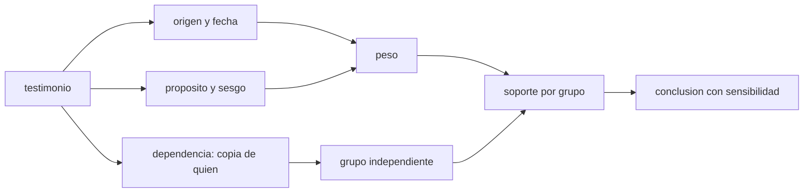

# B132-C01 — Crítica histórica de fuentes y método historiográfico

<!-- nav:top -->
[🏠 Programa](../../../../README.md) · [📚 Bloque B132](../../../tronco-comun/B132-historia-y-arqueoastronomia-aplicadas.md) · [← Anterior: B131-C11 — Plan completo de una clase de astronomía](../../B131/B131-C11-plan-completo-de-una-clase-de-astronomia/CLASE.md) · [Siguiente: B132-C02 — Arqueología de observatorios y de instrumentos antiguos →](../B132-C02-arqueologia-de-observatorios-y-de-instrumentos-antiguos/CLASE.md)
<!-- /nav -->

## 1. Ubicación, nivel y alcance

Clase 1 del bloque B132. Nivel N4. Contar la historia de la astronomía exige evaluar fuentes de época: un texto, una inscripción o un instrumento no «dicen» lo que pasó, hay que preguntarles quién los hizo, cuándo, para quién y a partir de qué. Esta clase no trata la desinformación actual (eso es materia de B01-C19) sino el método con el que se pondera lo antiguo. Usas el Mecanismo de Anticitera como caso real (sus ciclos están en una fuente consultada) y una matriz de crítica de fuentes con datos **sintéticos**.

## 2. Por qué esta clase existe

Un relato histórico es tan fiable como las fuentes que lo sostienen, y tres copias de una misma fuente no son tres fuentes. La decisión central: **¿cuánto apoyo da realmente un conjunto de fuentes a una afirmación y cuánto de ese apoyo es robusto ante cambios razonables de criterio?**

## 3. Lo que podrás hacer al terminar

1. Distinguir fuente primaria, secundaria y terciaria y reconocer una cadena de copias.
2. Contrastar un ciclo astronómico inscrito en un instrumento con su valor moderno.
3. Calcular una ponderación de fuentes por tipo, distancia temporal y sesgo.
4. Contar apoyos por grupos independientes y no por número de copias.
5. Probar la sensibilidad de una conclusión a los pesos elegidos.
6. Rotular qué es evidencia, qué es interpretación y qué no se sabe.

La evidencia es la **matriz de crítica de fuentes con sensibilidad** del ejercicio 12 (sección 20).

## 4. Con qué llegas y cómo comprobarlo

1. ¿Qué es una fuente primaria?
2. ¿Qué es un mes sinódico?
3. ¿Qué es un dato sintético?
4. ¿Qué diferencia hay entre evidencia e interpretación?
5. ¿Qué es una verificación por segunda vía?

<details>
<summary>Ver respuestas</summary>

1. Un testimonio u objeto de la época estudiada, sin intermediarios. 2. El tiempo entre dos fases iguales de la Luna, unos 29,53 d. 3. Un dato generado para el ejemplo, no medido. 4. La evidencia es lo que se observa o se lee; la interpretación es lo que se propone a partir de ella. 5. Calcular lo mismo con otro método y comparar.
</details>

Con cuatro o cinco aciertos, sigue; si no, repasa los prerrequisitos.

## 5. Un caso de contexto y casos de referencia

El Mecanismo de Anticitera es un dispositivo griego con engranajes, construido hacia fines del siglo II a. C. y hallado en 1901 en un naufragio romano; sus engranajes e inscripciones son fragmentarios y su función fue discutida durante décadas (Freeth et al. 2006, consultado). Sus inscripciones citan periodos como el 223 del ciclo de Saros y una espiral dividida en 235 secciones (ciclo metónico). Es el **caso real** de la parte A. La parte B usa un hecho **ficticio** con cinco fuentes sintéticas, para que el método se vea sin atribuir nada a nadie.

## 6. Vocabulario

La **crítica de fuentes** es el examen de origen, fecha, propósito y dependencia de un testimonio. Una **fuente primaria** es contemporánea del hecho; una **secundaria** lo relata desde otra; una **terciaria** compila secundarias. Un **estema** es el árbol de copias entre testimonios. El **ciclo metónico** son 235 meses sinódicos (≈ 19 años); el **calípico** son cuatro metónicos menos un día; el **ciclo de Saros** son 223 meses sinódicos.

## 7. Modelo mental: un juzgado con testigos



*Descripción textual:* cada testimonio se examina por origen, propósito y dependencia; el peso y el grupo independiente producen un soporte, y la conclusión se acompaña de su sensibilidad.

Analogía: diez testigos que oyeron lo mismo al mismo vecino cuentan como uno. Límite: los pesos numéricos son una ayuda para explicitar criterios, no una medida de verdad histórica.

## 8. La explicación, paso a paso

### 8.1 Un instrumento como fuente material

Freeth et al. (2006) leyeron el instrumento con tomografía de rayos X y fotografía de superficie y **duplicaron las inscripciones descifradas**. La forma de las letras permite datarlo entre 150 y 100 a. C., y el naufragio se sitúa hacia 80–60 a. C. Eso es evidencia con incertidumbre explícita. Que el instrumento sea una obra «ligada a Hiparco» es, en cambio, una **interpretación**: los autores señalan que es tentador asociarlo con Hiparco pero que este no fue el primero en usar modelos excéntricos o epicíclicos.

### 8.2 Ciclos: la aritmética como prueba de coherencia

Con `29,530589 d` por mes sinódico y `365,2422 d` por año trópico (valores modernos estándar): 235 meses = `6939,6884 d`; 19 años = `6939,6018 d`; diferencia `0,0866 d`. El calípico `4 × 6940 − 1 = 27759 d` frente a 76 años = `27758,4072 d`: diferencia `0,5928 d`. El Saros: 223 meses = `6585,3213 d` ≈ 18,03 años. El ajuste de estas cifras al cielo **no prueba quién construyó el instrumento ni para qué lo usaba**; prueba que los periodos inscritos son astronómicamente coherentes.

### 8.3 Ponderar fuentes (datos sintéticos)

Se asigna `peso = tipo × exp(−distancia/τ) × (1 − sesgo)`, con tipo 1,0 (primaria), 0,6 (secundaria) y 0,3 (terciaria). Con `τ = 100 a`, la fuente F1 (primaria, distancia 0, sesgo 0,20) pesa `0,800`; F2 (secundaria, 40 a, sesgo 0,10) pesa `0,362`.

### 8.4 Copias no son testigos

F2 y F3 son copias de F1 (mismo grupo). Sumar todo da `A = 1,382` frente a `B = 0,742`; contando **un apoyo por grupo independiente** da `A = 0,800` frente a `B = 0,742`: la ventaja casi desaparece. Con `τ` entre 50 y 400 años y pesos ±20 % al azar (10 000 sorteos, semilla fija), A gana solo en `37,4 %` de los casos: **la conclusión no es robusta**, y eso es lo que hay que informar.

## 9. Magnitudes, símbolos y unidades

| Símbolo | Qué es | Unidad | Valor / nota |
|---|---|---|---|
| `P_sin` | mes sinódico | d | 29,530589 (estándar) |
| `Y_tr` | año trópico | d | 365,2422 (estándar) |
| `τ` | escala de olvido de la fuente | a | 100 (ilustrativo) |
| `peso` | peso de una fuente | — | 0–1 |
| `sesgo` | sesgo estimado | — | 0–1 (sintético) |

## 10. Convenciones y referencias

Años en la era común convencional; los años a. C. se citan tal cual. Valores astronómicos estándar sin fuente concreta. Fuentes, tipos, distancias y sesgos de la parte B son **sintéticos**; ningún peso es una medida de la verdad histórica.

## 11. De dónde sale lo que afirmamos

| ID | Fuente | Localizador | Respalda | Estado |
|---|---|---|---|---|
| S1 | Freeth T. et al., «Decoding the ancient Greek astronomical calculator known as the Antikythera Mechanism», *Nature* 444, 587–591 (2006) — copia del PDF en cse.buffalo.edu (consultada 2026-11-11, texto completo con PyMuPDF) | resumen, texto y figuras | dispositivo de fines del s. II a. C.; fragmentario; letras 150–100 a. C.; naufragio ~80–60 a. C.; 223 Saros; espiral de 235; calípico = 4 metónicos − 1 d; tomografía; «tentador» asociarlo con Hiparco | Consultada |
| S2 | Cotte M. y Ruggles C., conclusión del Estudio Temático ICOMOS–IAU sobre patrimonio astronómico — web.astronomicalheritage.org (consultada 2026-11-11, texto del capítulo) | sección «Credibility as an authenticity issue» | la credibilidad de un «hecho» depende de su interpretación y de los estándares de la disciplina | Consultada |
| — | Valores del mes sinódico y del año trópico | — | los verifica el laboratorio por coherencia | No consultada en una fuente concreta |
| — | Páginas de UNESCO y Historic England | — | — | No consultada (acceso denegado) |

Límites: los pesos de la parte B son sintéticos; no se evaluó ninguna fuente histórica real más allá del artículo citado.

## 12. Cómo ver la crítica de fuentes

| Magnitud | Valor |
|---|---|
| diferencia metónica | 0,0866 d |
| diferencia calípica | 0,5928 d |
| soporte ingenuo A / B | 1,382 / 0,742 |
| soporte por grupos A / B | 0,800 / 0,742 |
| A gana en el barrido | 37,4 % |

Descripción larga: contar copias infla el soporte de A; contando grupos la ventaja casi se disuelve y el barrido de pesos muestra que la conclusión es frágil.

## 13. Ejemplo trabajado: el peso de F2

**Paso 1 · Tipo.** Secundaria: `0,6`.
**Paso 2 · Distancia.** `exp(−40/100) = 0,6703`.
**Paso 3 · Sesgo.** `1 − 0,10 = 0,90`.
**Paso 4 · Peso.** `0,6 × 0,6703 × 0,90 = 0,362`.

## 14. Distintas formas de describir un testimonio

**Por tipo:** primaria, secundaria o terciaria. **Por dependencia:** grupo de copias. **Por propósito:** ¿para qué se escribió? **Por distancia:** años desde el hecho. **Por materialidad:** texto, inscripción u objeto.

## 15. Práctica guiada

**Ejercicio 1 · con los pasos indicados.** Compara 235 meses sinódicos con 19 años trópicos. *Pasos:* multiplica cada uno y resta.

<details><summary>Solución comentada</summary>

`235 × 29,530589 = 6939,6884 d`; `19 × 365,2422 = 6939,6018 d`; diferencia `0,0866 d`, unas 2 h.
</details>

**Ejercicio 2 · con una pista.** ¿Cuánto mejora el ciclo calípico al metónico simple repetido cuatro veces? *Pista:* cuatro metónicos de 6940 d valen 27760 d.

<details><summary>Solución comentada</summary>

76 años trópicos son `27758,4072 d`. Cuatro metónicos: error `1,5928 d`; calípico (27759 d): `0,5928 d`.
</details>

**Ejercicio 3 · casi autónomo.** Calcula la duración del Saros en años.

<details><summary>Solución comentada</summary>

`223 × 29,530589 = 6585,3213 d`; `÷ 365,2422 = 18,03 a`.
</details>

## 16. Práctica autónoma, transferencia e integrador

**Ejercicio 4 · autónomo.** Con la diferencia metónica de `0,0866 d` por ciclo, ¿tras cuántos años se acumula un día?

<details><summary>Solución comentada</summary>

`1/0,0866 = 11,5` ciclos `× 19 = 219` años.
</details>

**Ejercicio 5 · autónomo.** Calcula el peso de F4 (primaria, 20 a, sesgo 0,10) con `τ = 50 a`.

<details><summary>Solución comentada</summary>

`1,0 × exp(−20/50) × 0,90 = 0,603`.
</details>

**Ejercicio 6 · autónomo.** Explica por qué el soporte por grupos de A es `0,800` y no `1,382`.

<details><summary>Solución comentada</summary>

F2 y F3 copian a F1: no aportan información independiente; se cuenta el máximo del grupo, `0,800`.
</details>

**Ejercicio 7 · autónomo.** Si el sesgo de F1 sube a 0,50, ¿qué peso tiene y gana A por grupos?

<details><summary>Solución comentada</summary>

`1,0 × 1 × 0,5 = 0,5 < 0,742`: gana B (con F5 despreciable).
</details>

**Ejercicio 8 · autónomo.** ¿Por qué el barrido da `37,4 %` y no 0 % o 100 %?

<details><summary>Solución comentada</summary>

Porque los soportes por grupo son casi iguales y los pesos cambian; la conclusión depende de criterios, no de los datos.
</details>

**Ejercicio 9 · transferencia.** **Transferencia.** La forma de las letras fecha el instrumento en 150–100 a. C. ¿Es evidencia o interpretación?

<details><summary>Solución comentada</summary>

La forma de las letras es evidencia observable; la fecha por paleografía es una inferencia con incertidumbre (el intervalo).
</details>

**Ejercicio 10 · transferencia.** **Transferencia.** Un cronista tardío describe un eclipse «de su pueblo» sin citar de dónde lo sabe. ¿Qué preguntas haces?

<details><summary>Solución comentada</summary>

Distancia al hecho, fuente de la que depende, propósito del relato y si hay un testimonio independiente.
</details>

**Ejercicio 11 · transferencia.** **Transferencia.** Un divulgador dice que el instrumento «prueba» que Hiparco lo construyó. ¿Qué responde la fuente consultada?

<details><summary>Solución comentada</summary>

Los autores dicen que es tentador asociarlo con Hiparco, pero que él no fue el primero en usar esos modelos: es interpretación, no prueba.
</details>

**Ejercicio 12 · integrador.** **Integrador.** Elabora tu *matriz de crítica de fuentes con sensibilidad* para un hecho ficticio con 5 fuentes: tipo, distancia, grupo, sesgo, peso, soporte ingenuo y por grupos, y un barrido de al menos un parámetro.

<details><summary>Solución comentada</summary>

Secciones 8.3–8.4 y la salida del laboratorio como modelo; añade una frase que diga qué conclusión sobrevive al barrido.
</details>

## 17. Laboratorio: ciclos y fuentes

El script [fuentes.py](fuentes.py) compara los ciclos de Anticitera con sus valores modernos y calcula el soporte de dos afirmaciones rivales con datos sintéticos (**comprueba** `|dif metónica| < 0,2 d`, el calípico `27759 d` y que contar copias infla el soporte).

**Datos:** cifras 235, 223 y «cuatro metónicos menos un día» de Freeth et al. (2006, consultado); valores del mes y del año estándar; fuentes de la parte B **sintéticas**. **Predice antes de ejecutar:** ¿cambiará el ganador al contar grupos independientes? (no, pero la ventaja casi desaparece). **Ejecución del 2026-11-11 (Python 3.12.9):**

```text
Python 3.12.9 (biblioteca estandar)
Parte A. Ciclos (cifras 235, 223 y 4 Metonicos - 1 dia: Freeth et al. 2006; valores modernos: estandar)
  Metonico: 235 meses sinodicos = 6939.6884 d ; 19 anios tropicos = 6939.6018 d ; dif = 0.0866 d
  Calipico: 4*6940-1 = 27759 d ; 76 anios tropicos = 27758.4072 d ; dif = 0.5928 d
  Saros: 223 meses sinodicos = 6585.3213 d (= 18.0300 anios tropicos)
Parte B. Matriz de critica de fuentes (datos SINTETICOS, hecho ficticio)
 id tipo dist[a] grupo sesgo  peso(tau=100)
 F1   P      0    g1    0.20   0.800
 F2   S     40    g1    0.10   0.362
 F3   S     90    g1    0.10   0.220
 F4   P     20    g2    0.10   0.737
 F5   T    400    g3    0.05   0.005
  ingenuo (suma de todas)     A = 1.382  B = 0.742  -> gana A
  por grupos independientes   A = 0.800  B = 0.742  -> gana A
Sensibilidad (semilla 20261111, 10000 sorteos, tau 50-400 a, pesos +-20 %): A gana en 37.4 % de los casos
Pruebas superadas.
```

```bash
python programa/clases/B132/B132-C01-critica-historica-de-fuentes-y-metodo-historiografico/fuentes.py
```

**Límites:** los pesos son criterios explícitos, no probabilidades de verdad; el hecho de la parte B no existió.

## 18. Errores frecuentes y cómo corregirlos

**Contar copias como testimonios independientes.** Se corrige con 8.4.

**Tomar la coherencia astronómica como prueba de autoría.** Se corrige con 8.2.

**Presentar una interpretación como evidencia.** Se corrige con 8.1.

**Dar un peso numérico sin barrido de sensibilidad.** Se corrige con 8.4.

## 19. Cómo sabrás que vas bien

Tras la sección 8: ¿qué soporte esperabas para A por grupos y cuál obtuviste? Si dudas, repasa el ejemplo 13. Tras el laboratorio: ¿qué comprueba? (ver la sección 17).

## 20. Qué entregas y cómo se evalúa

El producto es tu **matriz de crítica de fuentes con sensibilidad** (ejercicio 12).

| Criterio | Inicial | En desarrollo | Logrado | Destacado |
|---|---|---|---|---|
| Conceptos | Los confunde | Parciales | Distingue tipo y dependencia | Explica los límites del peso |
| Cálculo | Sin unidades | Con errores | Tablas completas | Calcula casos nuevos |
| Numérico | Sin comprobar | Un caso | Barrido de sensibilidad | Interpreta la fragilidad |
| Fuentes | Sin fuente | Sin fecha | Fuentes con fecha y estado | Declara lo no consultado |
| Límites | No los nombra | Uno | Tres | Separa evidencia, interpretación y desconocido |

**Condiciones críticas (no se compensan con promedio):** rotular los datos como sintéticos; no presentar una interpretación como evidencia; citar solo lo consultado.

## 21. Ética, seguridad y límites

Clase educativa: las fuentes de la parte B son ficticias y ningún resultado describe un testimonio histórico real. Los pueblos y culturas que observaron el cielo son los dueños de sus saberes; aquí no se atribuye nada a nadie que no esté en una fuente consultada. Accesibilidad: tablas equivalentes a las gráficas, fórmulas en texto, ejercicios sin conexión.

## 22. Para cerrar y seguir

Tres copias de una fuente no son tres fuentes: al contar grupos, la ventaja de A baja de `1,382` a `0,800` y la conclusión sobrevive solo en `37,4 %` de los barridos. Queda una pregunta: ¿qué dice el objeto material, y cómo se fecha?

**Glosario español–inglés.** crítica de fuentes · *source criticism*; fuente primaria · *primary source*; estema · *stemma*; ciclo metónico · *Metonic cycle*; sesgo · *bias*.

**Continuidad.** [B132-C02](../B132-C02-arqueologia-de-observatorios-y-de-instrumentos-antiguos/CLASE.md) trata la arqueología de observatorios e instrumentos.

**Referencias:** ver sección 11.

<!-- nav:bottom -->
---

[← Anterior: B131-C11 — Plan completo de una clase de astronomía](../../B131/B131-C11-plan-completo-de-una-clase-de-astronomia/CLASE.md) · [📚 Bloque B132](../../../tronco-comun/B132-historia-y-arqueoastronomia-aplicadas.md) · [Siguiente: B132-C02 — Arqueología de observatorios y de instrumentos antiguos →](../B132-C02-arqueologia-de-observatorios-y-de-instrumentos-antiguos/CLASE.md)
<!-- /nav -->
