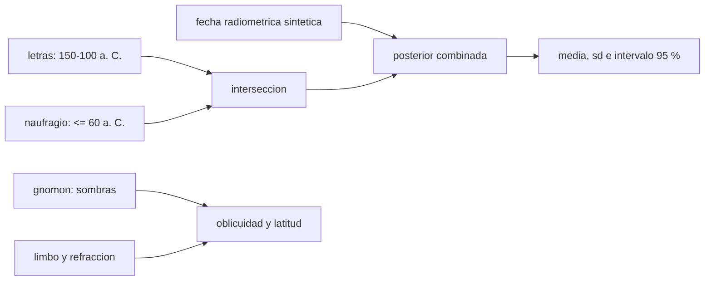

# B132-C02 — Arqueología de observatorios y de instrumentos antiguos

<!-- nav:top -->
[🏠 Programa](../../../../README.md) · [📚 Bloque B132](../../../tronco-comun/B132-historia-y-arqueoastronomia-aplicadas.md) · [← Anterior: B132-C01 — Crítica histórica de fuentes y método historiográfico](../B132-C01-critica-historica-de-fuentes-y-metodo-historiografico/CLASE.md) · [Siguiente: B132-C03 — Monumentos megalíticos y astronomía →](../B132-C03-monumentos-megaliticos-y-astronomia/CLASE.md)
<!-- /nav -->

## 1. Ubicación, nivel y alcance

Clase 2 del bloque B132. Nivel N4. [B02-C08](../../../tronco-comun/B02-historia-arqueoastronomia-y-culturas-del-cielo.md) presenta los métodos de la arqueoastronomía; aquí tratas cómo se estudian y se datan los **objetos materiales**: un instrumento recuperado de un naufragio, un gnomon, un observatorio. Combinas intervalos de datación de una fuente consultada con una fecha radiométrica **sintética**, y estimas la precisión y el sesgo de un gnomon **sintético**.

## 2. Por qué esta clase existe

Un instrumento antiguo no trae su fecha ni su precisión grabadas. La decisión central: **¿qué intervalo de fechas dejan las evidencias compatibles y qué precisión astronómica podía dar el instrumento, con qué sesgos?**

## 3. Lo que podrás hacer al terminar

1. Intersectar intervalos de datación y reconocer un *terminus ante quem*.
2. Combinar una fecha con incertidumbre con restricciones de intervalo y obtener un intervalo del 95 %.
3. Calcular la sombra de un gnomon y recuperar la oblicuidad y la latitud.
4. Distinguir error aleatorio (propagable) de sesgo sistemático (limbo solar, refracción).
5. Comprobar la propagación lineal contra un Monte Carlo.
6. Rotular qué es evidencia material, qué es inferencia y qué es sintético.

La evidencia es la **ficha de datación y precisión de un instrumento** del ejercicio 12 (sección 20).

## 4. Con qué llegas y cómo comprobarlo

1. ¿Qué es un gnomon?
2. ¿Qué es la oblicuidad de la eclíptica?
3. ¿Qué es un sesgo sistemático?
4. ¿Qué es un *terminus ante quem*?
5. ¿Qué es una simulación de Monte Carlo?

<details>
<summary>Ver respuestas</summary>

1. Una varilla vertical cuya sombra mide la altura del Sol. 2. La inclinación del eje terrestre respecto de la órbita, unos 23,4° hoy. 3. Un error que desplaza todas las medidas en el mismo sentido. 4. La fecha antes de la cual el objeto debió existir. 5. Repetir un cálculo con entradas al azar para ver la dispersión del resultado.
</details>

Con cuatro o cinco aciertos, sigue; si no, repasa los prerrequisitos.

## 5. Un caso de contexto y casos de referencia

Del Mecanismo de Anticitera sabemos, por Freeth et al. (2006, consultado), que la forma de las letras lo data entre 150 y 100 a. C. y que el naufragio del que procede se sitúa hacia 80–60 a. C. (**caso real**). Para practicar la combinación de evidencias añadimos una fecha radiométrica **sintética** de `120 a. C. ± 25 a`, y un gnomon **sintético** de `1,000 m` a `36,0° N` con oblicuidad ilustrativa `23,70°`. Nada de esto describe un hallazgo real.

## 6. Vocabulario

El **intervalo compatible** es la intersección de los intervalos que admite cada evidencia. El **limbo** es el borde del disco solar, de semidiámetro `0,2667°`. La **refracción** curva la luz en la atmósfera y eleva el objeto aparente; aquí `R ≈ 58,3″ · tan z`. El **error aleatorio** varía de una medida a otra; el **sesgo** no.

## 7. Modelo mental: dos cuerdas que se cruzan



*Descripción textual:* las fechas por letras y por naufragio se intersectan; la fecha radiométrica se multiplica con ellas para dar una distribución posterior; el gnomon da oblicuidad y latitud una vez corregidos el limbo y la refracción.

Analogía: dos cuerdas tensas entre dos clavos definen dónde puede pasar el hilo. Límite: la posterior depende de la forma que se suponga para cada incertidumbre (aquí gaussiana y uniforme).

## 8. La explicación, paso a paso

### 8.1 Intervalos de datación

Las letras dan `150–100 a. C.` (años astronómicos `−149` a `−99`). El objeto existía antes del naufragio (`≤ 60 a. C.`, o sea `≤ −59`). La intersección es `−149` a `−99`: el naufragio no la acorta. Esa es una **inferencia**; la fecha del naufragio y la paleografía son evidencias con sus propias incertidumbres.

### 8.2 Combinar con una fecha radiométrica sintética

Se multiplica la gaussiana `120 a. C. ± 25 a` por la ventana `[−149, −99]` y se normaliza: media `−122,5` (`123,5 a. C.`), desviación `13,6 a` e intervalo central del 95 % `[−147, −100]`. Una ventana uniforme de 50 años sola daría `50/√12 = 14,4 a`: la fecha radiométrica ayuda poco aquí porque la ventana ya es estrecha.

### 8.3 El gnomon sintético

Con `h = 1,000 m` y las distancias cenitales de mediodía `z_verano = φ − ε = 12,30°` y `z_invierno = φ + ε = 59,70°`, la punta de la sombra la marca el **limbo superior**, `0,2667°` más alto que el centro; con refracción, las sombras miden `0,2131 m` (verano) y `1,6913 m` (invierno).

### 8.4 Sesgo frente a error aleatorio

Sin corregir limbo ni refracción, la oblicuidad recuperada es `23,6879°` (sesgo `−0,0121°`), pero la **latitud** sale `35,7177°` (sesgo `−0,2823°`): el limbo corre ambas sombras en el mismo sentido y casi se cancela en la semidiferencia (oblicuidad) pero no en la semisuma (latitud). Corregido, `23,6999°` y `35,9998°`. El error aleatorio con `σ_L = 2 mm` es `0,0568°` por propagación lineal y `0,0563°` por Monte Carlo (semilla fija, 20 000 sorteos).

## 9. Magnitudes, símbolos y unidades

| Símbolo | Qué es | Unidad | Valor / nota |
|---|---|---|---|
| `h` | altura del gnomon | m | 1,000 (sintético) |
| `L` | longitud de la sombra | m | 0,2131; 1,6913 |
| `z` | distancia cenital | ° | 12,30; 59,70 |
| `φ` | latitud | ° N | 36,0 (ilustrativa) |
| `ε` | oblicuidad | ° | 23,70 (ilustrativa) |
| `σ_L` | error de lectura de la sombra | m | 0,002 |
| años | años astronómicos (1 a. C. = 0) | a | −149 a −99 |

## 10. Convenciones y referencias

Años astronómicos (1 a. C. = año 0) en el cálculo. Sistema de referencia: mediodía local, Sol sobre el meridiano, horizonte plano. Semidiámetro solar y refracción: valores estándar no consultados en una fuente concreta. Gnomon, fecha radiométrica, latitud y oblicuidad **sintéticos**. Tolerancia de la comprobación: `1e-3°` para las magnitudes corregidas y `3 %` para lineal frente a Monte Carlo.

## 11. De dónde sale lo que afirmamos

| ID | Fuente | Localizador | Respalda | Estado |
|---|---|---|---|---|
| S1 | Freeth T. et al., *Nature* 444, 587–591 (2006) — PDF en cse.buffalo.edu (consultada 2026-11-11, texto completo con PyMuPDF) | primera página; método de imagen | letras 150–100 a. C.; naufragio ~80–60 a. C.; tomografía y fotografía de superficie; inscripciones duplicadas | Consultada |
| S2 | Cotte M. y Ruggles C., introducción del Estudio Temático ICOMOS–IAU (consultada 2026-11-11, texto del capítulo) | «Background» | tipos de propiedades: observatorios e instrumentos, propiedades con significado celeste | Consultada |
| — | Semidiámetro solar, refracción `58,3″·tan z` | — | estándar; el laboratorio comprueba la recuperación de los parámetros | No consultada en una fuente concreta |
| — | Fecha radiométrica, gnomon | — | sintéticos | Ilustrativos |

Límites: ninguna medida de un instrumento real se obtuvo en esta clase; la fecha radiométrica no existe.

## 12. Cómo ver la datación y la precisión

| Magnitud | Valor |
|---|---|
| intervalo compatible | 150–100 a. C. |
| posterior (media ± sd) | 123,5 a. C. ± 13,6 a |
| sesgo en `ε` / en `φ` sin corregir | −0,0121° / −0,2823° |
| `σ(ε)` lineal / Monte Carlo | 0,0568° / 0,0563° |

Descripción larga: el sesgo del limbo apenas afecta a la oblicuidad pero sí a la latitud; el error aleatorio de 2 mm da unos 0,06° de incertidumbre en la oblicuidad.

## 13. Ejemplo trabajado: el efecto del limbo en una sombra

**Paso 1 · Dato.** `z = 45°`, `h = 1 m`: `L = 1,000 m`.
**Paso 2 · Cambio angular.** `dz = 0,2667° = 0,004654 rad`.
**Paso 3 · Derivada.** `dL/dz = h sec²z = 2 m/rad`.
**Paso 4 · Efecto.** `dL = 2 × 0,004654 = 0,0093 m`, unos 9,3 mm, casi cinco veces el error de lectura de 2 mm.

## 14. Distintas formas de describir un instrumento

**Por material:** bronce, piedra, madera. **Por función propuesta:** calendario, observación, enseñanza (siempre inferida). **Por datación:** intervalo con método. **Por precisión:** error aleatorio y sesgo. **Por contexto:** hallazgo, naufragio, templo.

## 15. Práctica guiada

**Ejercicio 1 · con los pasos indicados.** Calcula la sombra de un gnomon de 1,000 m con el Sol a `z = 45°`, sin limbo ni refracción. *Pasos:* `L = h tan z`.

<details><summary>Solución comentada</summary>

`tan 45° = 1`: `L = 1,000 m`.
</details>

**Ejercicio 2 · con una pista.** ¿Cuánto acorta la sombra el semidiámetro solar a `z = 45°`? *Pista:* `dL = h sec²z · dz`.

<details><summary>Solución comentada</summary>

`2 × 0,004654 = 0,0093 m`.
</details>

**Ejercicio 3 · casi autónomo.** ¿Qué error angular produce un error de lectura de 2 mm a `z = 45°`?

<details><summary>Solución comentada</summary>

`dz = 0,002/2 = 0,001 rad = 0,0573°`.
</details>

## 16. Práctica autónoma, transferencia e integrador

**Ejercicio 4 · autónomo.** Explica por qué el sesgo del limbo en la latitud es de `−0,2823°`.

<details><summary>Solución comentada</summary>

Es `0,2667°` del limbo más la media de las refracciones (`≈ 0,0156°`), porque la latitud sale de la semisuma de las dos distancias cenitales.
</details>

**Ejercicio 5 · autónomo.** Si las letras dieran 120–70 a. C. y el naufragio fuera `≤ 60 a. C.`, ¿cuál es el intervalo compatible?

<details><summary>Solución comentada</summary>

120–70 a. C.: el naufragio posterior no lo recorta.
</details>

**Ejercicio 6 · autónomo.** ¿Cuántas repeticiones independientes hacen falta para bajar `σ(ε)` de `0,0568°` a `0,02°`?

<details><summary>Solución comentada</summary>

`(0,0568/0,02)² = 8,07`: 9 repeticiones.
</details>

**Ejercicio 7 · autónomo.** ¿Por qué se verifica la propagación lineal con Monte Carlo?

<details><summary>Solución comentada</summary>

Porque la propagación lineal supone derivadas constantes; el Monte Carlo prueba esa hipótesis (aquí coinciden al 1 %).
</details>

**Ejercicio 8 · autónomo.** ¿Qué pasa con la oblicuidad si el limbo solo desplazara la sombra de invierno?

<details><summary>Solución comentada</summary>

El sesgo ya no se cancelaría y entraría casi completo (`≈ 0,13°`).
</details>

**Ejercicio 9 · transferencia.** **Transferencia.** Un observatorio antiguo tiene un muro con una muesca. ¿Qué evidencias independientes harían falta para llamarla «mira astronómica»?

<details><summary>Solución comentada</summary>

Medición con incertidumbre, orientación compatible, contexto cultural y estadística de un conjunto (clases C04 y C05).
</details>

**Ejercicio 10 · transferencia.** **Transferencia.** Dos laboratorios fechan una pieza con intervalos que no se solapan. ¿Qué haces?

<details><summary>Solución comentada</summary>

Revisar calibraciones, contexto estratigráfico y supuestos; no promediar.
</details>

**Ejercicio 11 · transferencia.** **Transferencia.** ¿Por qué no se afirma la función de un instrumento solo por su geometría?

<details><summary>Solución comentada</summary>

La función es una inferencia; hacen falta inscripciones, contexto o comparación, y declarar el desconocido.
</details>

**Ejercicio 12 · integrador.** **Integrador.** Elabora tu *ficha de datación y precisión de un instrumento*: intervalos de cada evidencia, intersección, posterior, sombras, sesgos y error aleatorio, con lo real y lo sintético rotulados.

<details><summary>Solución comentada</summary>

Secciones 8.1–8.4 y la salida del laboratorio.
</details>

## 17. Laboratorio: datación y gnomon

El script [instrumentos.py](instrumentos.py) intersecta los intervalos, calcula la posterior con la fecha sintética, simula el gnomon, recupera `ε` y `φ` con y sin corrección y contrasta la propagación lineal con Monte Carlo (**comprueba** `|sesgo corregido| < 1e-3°` y `σ` lineal frente a Monte Carlo `< 3 %`).

**Datos:** letras y naufragio de Freeth et al. (2006, consultado); fecha radiométrica y gnomon **sintéticos**; semidiámetro y refracción estándar. **Predice antes de ejecutar:** ¿el limbo sesgará más la oblicuidad o la latitud? (la latitud). **Ejecución del 2026-11-11 (Python 3.12.9):**

```text
Python 3.12.9 (biblioteca estandar)
Parte A. Datacion (anios astronomicos; 1 a. C. = 0). Fecha radiometrica SINTETICA: 120 a. C. +- 25 a
  Intervalo compatible letras (150-100 a. C.) y naufragio (<= 60 a. C.): -149 a -99 (= 150 a 100 a. C.)
  Posterior combinada: media = -122.5 (123.5 a. C.), sd = 13.6 a, 95 % central = [-147.0, -100.0]
Parte B. Gnomon SINTETICO: h = 1.000 m, latitud ilustrativa 36.0 N, oblicuidad ilustrativa 23.70
  Distancia cenital solsticio verano = 12.30, invierno = 59.70
  Sombra (limbo superior): verano = 0.2131 m, invierno = 1.6913 m
  Oblicuidad recuperada SIN corregir limbo/refraccion = 23.6879 (sesgo -0.0121)
  Oblicuidad recuperada CON correccion              = 23.6999 (sesgo -1.22e-04)
  Latitud recuperada SIN corregir = 35.7177 (sesgo -0.2823) ; CON correccion = 35.9998 (sesgo -2.02e-04)
  Error aleatorio (sigma_L = 2.0 mm): lineal = 0.0568 ; Monte Carlo (semilla 20261112, 20000 sorteos) = 0.0563
  El limbo desplaza ambas sombras en el mismo sentido: se cancela casi todo en la oblicuidad (0.0121) pero no en la latitud (0.2823)
Pruebas superadas.
```

```bash
python programa/clases/B132/B132-C02-arqueologia-de-observatorios-y-de-instrumentos-antiguos/instrumentos.py
```

**Límites:** horizonte plano, Sol puntual en el meridiano, sin penumbra real ni error de verticalidad del gnomon; la fecha radiométrica es inventada.

## 18. Errores frecuentes y cómo corregirlos

**Ignorar el limbo y la refracción.** Se corrige con 8.4.

**Promediar fechas incompatibles.** Se corrige con 8.1.

**Tratar la función propuesta como un hecho.** Se corrige con la sección 14.

**Dar el error aleatorio como si fuera el error total.** Se corrige con 8.4.

## 19. Cómo sabrás que vas bien

Tras la sección 8: ¿qué sesgo esperabas en la latitud y cuál obtuviste? Si dudas, repasa el ejemplo 13. Tras el laboratorio: ¿qué comprueba? (ver la sección 17).

## 20. Qué entregas y cómo se evalúa

El producto es tu **ficha de datación y precisión de un instrumento** (ejercicio 12).

| Criterio | Inicial | En desarrollo | Logrado | Destacado |
|---|---|---|---|---|
| Conceptos | Los confunde | Parciales | Distingue evidencia e inferencia | Explica los límites |
| Cálculo | Sin unidades | Con errores | Tablas completas con unidades | Calcula casos nuevos |
| Numérico | Sin comprobar | Un caso | Lineal frente a Monte Carlo | Interpreta las diferencias |
| Fuentes | Sin fuente | Sin fecha | Fuentes con fecha y estado | Declara lo sintético |
| Límites | No los nombra | Uno | Tres | Separa evidencia, interpretación y desconocido |

**Condiciones críticas (no se compensan con promedio):** rotular el gnomon y la fecha radiométrica como sintéticos; no afirmar una función no demostrada; citar solo lo consultado.

## 21. Ética, seguridad y límites

Clase educativa: los datos son sintéticos y ningún resultado describe un hallazgo real. El patrimonio astronómico pertenece a las comunidades y países que lo custodian; el estudio material debe respetar su conservación. Accesibilidad: tablas equivalentes a las gráficas, fórmulas en texto, ejercicios sin conexión.

## 22. Para cerrar y seguir

Las letras y el naufragio acotan la fecha a 150–100 a. C., y un gnomon de 1 m mide la oblicuidad con unos 0,06° de error aleatorio, pero la latitud arrastra un sesgo de 0,28° si se ignora el limbo. Queda una pregunta: ¿qué ocurre cuando el «instrumento» es un monumento de piedra?

**Glosario español–inglés.** gnomon · *gnomon*; limbo solar · *solar limb*; refracción · *refraction*; sesgo sistemático · *systematic bias*; *terminus ante quem* · *terminus ante quem*.

**Continuidad.** [B132-C03](../B132-C03-monumentos-megaliticos-y-astronomia/CLASE.md) estudia los monumentos megalíticos.

**Referencias:** ver sección 11.

<!-- nav:bottom -->
---

[← Anterior: B132-C01 — Crítica histórica de fuentes y método historiográfico](../B132-C01-critica-historica-de-fuentes-y-metodo-historiografico/CLASE.md) · [📚 Bloque B132](../../../tronco-comun/B132-historia-y-arqueoastronomia-aplicadas.md) · [Siguiente: B132-C03 — Monumentos megalíticos y astronomía →](../B132-C03-monumentos-megaliticos-y-astronomia/CLASE.md)
<!-- /nav -->
