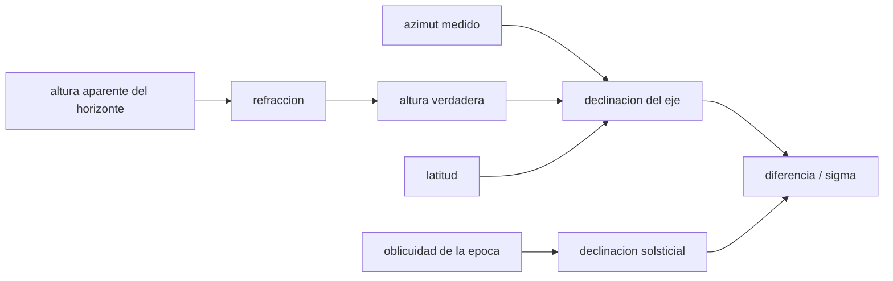

# B132-C03 — Monumentos megalíticos y astronomía

<!-- nav:top -->
[🏠 Programa](../../../../README.md) · [📚 Bloque B132](../../../tronco-comun/B132-historia-y-arqueoastronomia-aplicadas.md) · [← Anterior: B132-C02 — Arqueología de observatorios y de instrumentos antiguos](../B132-C02-arqueologia-de-observatorios-y-de-instrumentos-antiguos/CLASE.md) · [Siguiente: B132-C04 — Estadística de orientaciones en arqueoastronomía →](../../../tronco-comun/B132-historia-y-arqueoastronomia-aplicadas.md#b132-c04)
<!-- /nav -->

## 1. Ubicación, nivel y alcance

Clase 3 del bloque B132. Nivel N4. Los monumentos megalíticos (círculos, avenidas, tumbas de pasaje) son el caso clásico de la arqueoastronomía. Aquí aprendes la **geometría** con que se pregunta si un eje apunta a un lugar del horizonte donde sale o se pone un astro: convertir azimut y altura de horizonte en declinación, usar la oblicuidad de la época y decidir compatibilidad dentro de una tolerancia. Que un eje *sea compatible* no prueba que fuera *intencional*: eso lo tratan [C04](../B132-C04-estadistica-de-orientaciones-en-arqueoastronomia/CLASE.md) y [C05](../B132-C05-contexto-ritual-y-social-de-la-observacion-del-cielo/CLASE.md). El monumento es **sintético**.

## 2. Por qué esta clase existe

Una avenida de piedras que mira hacia el noreste «parece» apuntar al solsticio, pero ¿con qué precisión y para qué época? La decisión central: **¿qué declinación tiene el eje, con qué incertidumbre, y es compatible con el Sol solsticial de la época del monumento?**

## 3. Lo que podrás hacer al terminar

1. Convertir azimut y altura verdadera del horizonte en declinación y viceversa.
2. Corregir la altura aparente del horizonte por refracción.
3. Calcular la oblicuidad de una época con un polinomio y contrastarla con una aproximación lineal.
4. Propagar las incertidumbres de azimut y de horizonte a la declinación.
5. Decidir compatibilidad en unidades de `σ` y ver por qué una tolerancia amplia no discrimina épocas.
6. Distinguir compatibilidad geométrica de intención cultural.

La evidencia es la **tabla de compatibilidad de un monumento sintético** del ejercicio 12 (sección 20).

## 4. Con qué llegas y cómo comprobarlo

1. ¿Qué es el azimut y desde dónde se mide?
2. ¿Qué es la declinación?
3. ¿Qué es la oblicuidad de la eclíptica?
4. ¿Qué es la refracción atmosférica?
5. ¿Qué es un dato sintético?

<details>
<summary>Ver respuestas</summary>

1. El ángulo horizontal desde el norte hacia el este (0° N, 90° E). 2. La latitud celeste respecto del ecuador, en grados. 3. La inclinación del eje terrestre; fija la declinación máxima del Sol. 4. La curvatura de la luz en la atmósfera, que eleva los astros cerca del horizonte unos 0,5°. 5. Un dato generado para el ejemplo, no medido.
</details>

Con cuatro o cinco aciertos, sigue; si no, repasa los prerrequisitos.

## 5. Un caso de contexto y casos de referencia

Para los monumentos reales, el Estudio Temático ICOMOS–IAU (consultado) señala que la alineación de Newgrange con el sol naciente del solsticio de invierno y el eje solsticial de Stonehenge son «generalmente aceptados» en cuanto a su intencionalidad, aunque el debate sobre su propósito y significado continúa; y que la interpretación de un calendario solar de 365,25 días en Stonehenge ha sido criticada como «totalmente infundada» por Magli y Belmonte (resumen de arXiv, consultado). Son **casos reales citados**, no medidos aquí. El **monumento de trabajo** es sintético: latitud `50,0° N`, eje de azimut `50,6° ± 0,5°`, horizonte aparente `0,5° ± 0,3°`.

## 6. Vocabulario

La **declinación** `δ` cumple `sen δ = sen φ sen h + cos φ cos h cos A`, con latitud `φ`, altura verdadera `h` y azimut `A`. El **azimut de salida** de un astro de declinación `δ` es `cos A = (sen δ − sen φ sen h)/(cos φ cos h)`. La **refracción de Bennett** `R = cot(h + 7,31/(h + 4,4))` en minutos de arco da la elevación aparente. La **compatibilidad** es `|δ_eje − δ_astro| < 2σ`.

## 7. Modelo mental: apuntar con una regla sobre el horizonte



*Descripción textual:* azimut, altura (corregida por refracción) y latitud dan la declinación del eje; la oblicuidad de la época da la declinación solsticial; su diferencia en unidades de `σ` decide la compatibilidad.

Analogía: apuntar un puntero láser a una muesca del horizonte y preguntar qué estrella o Sol pasa por ahí. Límite: el eje de un monumento tiene anchura y la tolerancia depende de cómo se midió.

## 8. La explicación, paso a paso

### 8.1 Oblicuidad de la época

La oblicuidad cambia lentamente. El polinomio de Laskar (1986, recordado de la literatura, **no consultado**) da `23,4393°` en J2000, que reproduce el valor conocido, y `23,9742°` para el año −2499 (2500 a. C.). La aproximación lineal da `24,0244°`: `0,0501°` más, una diferencia pequeña frente a una tolerancia de `0,37°` pero no despreciable si la tolerancia fuera de `0,05°`.

### 8.2 Azimut y declinación, ida y vuelta

El laboratorio verifica que `azimut(declinación(A, h), h) = A` con error `2×10⁻¹⁴°` y que un este verdadero con horizonte plano tiene `δ = 0`.

### 8.3 El monumento sintético

La refracción en `h_ap = 0,5°` es `0,479°`, de modo que la altura verdadera es `0,021°`. La declinación del eje es `+24,096°`. Las sensibilidades son `∂δ/∂A = −0,544` y `∂δ/∂h = 0,839`, de donde `σ_δ = √((0,544·0,5)² + (0,839·0,3)²) = 0,371°`.

### 8.4 Compatibilidad solar

| Año | `ε` (°) | dif. (°) | n_σ | ¿compatible (< 2σ)? |
|---|---|---|---|---|
| −3499 | 24,064 | +0,033 | 0,09 | sí |
| −2999 | 24,021 | +0,076 | 0,20 | sí |
| −2499 | 23,974 | +0,122 | 0,33 | sí |
| −1999 | 23,924 | +0,173 | 0,47 | sí |

El eje es compatible **en las cuatro épocas**: con `σ = 0,37°` no se puede fechar el monumento por su alineación. El azimut del Sol solsticial con ese horizonte pasa de `50,660°` (−3499) a `50,824°` (−2499) y a `51,014°` (−1499): una deriva de `0,35°` en 2000 años, menor que la incertidumbre.

## 9. Magnitudes, símbolos y unidades

| Símbolo | Qué es | Unidad | Valor / nota |
|---|---|---|---|
| `φ` | latitud | ° N | 50,0 (sintética) |
| `A` | azimut | ° | 50,6 ± 0,5 (sintético) |
| `h_ap`, `h` | altura aparente y verdadera del horizonte | ° | 0,5 ± 0,3; 0,021 |
| `δ` | declinación | ° | +24,096 ± 0,371 |
| `ε` | oblicuidad | ° | 23,974 (−2499) |
| `R` | refracción | ° | 0,479 a 0,5° |

## 10. Convenciones y referencias

Azimut desde el norte verdadero hacia el este; años astronómicos (2500 a. C. = −2499); declinación del **centro** del disco solar con horizonte aparente (no se modela el limbo). Refracción de Bennett y relaciones esféricas: estándar, no consultadas en una fuente concreta. Polinomio de Laskar: no consultado, validado contra J2000 y contra la aproximación lineal. Tolerancia: `1e-9°` para la ida y vuelta, `0,1°` entre Laskar y lineal en −2499.

## 11. De dónde sale lo que afirmamos

| ID | Fuente | Localizador | Respalda | Estado |
|---|---|---|---|---|
| S1 | Cotte M. y Ruggles C., conclusión del Estudio Temático ICOMOS–IAU (consultada 2026-11-11, texto del capítulo) | sección «Credibility as an authenticity issue» | Newgrange y el eje solsticial de Stonehenge «generalmente aceptados» en intencionalidad; interpretar propósito y significado sigue en debate; hace falta contexto cultural y confirmación estadística antes de aceptar la intencionalidad | Consultada |
| S2 | Magli G. y Belmonte J. A., «Archaeoastronomy and the alleged Stonehenge calendar», arXiv:2211.07981 (consultado 2026-11-11, solo resumen) | resumen | críticas a la idea de un calendario de 365,25 d en Stonehenge: «totalmente infundada» | Consultada (solo resumen) |
| — | Polinomio de Laskar, refracción de Bennett, relaciones esféricas | — | estándar; se verifican en el laboratorio | No consultada en una fuente concreta |
| — | Página de Historic England sobre Stonehenge | — | — | No consultada (acceso denegado) |

Límites: ninguna medición de un monumento real se hizo aquí; no se afirma nada sobre las precisiones reales de Stonehenge o Newgrange.

## 12. Cómo ver la compatibilidad de un eje

| Magnitud | Valor |
|---|---|
| `δ` del eje | +24,096° ± 0,371° |
| `ε` (−2499) | 23,974° |
| n_σ en −2499 | 0,33 |
| deriva del azimut solsticial en 2000 a | 0,35° |

Descripción larga: la declinación del eje cae a menos de media desviación de la solsticial en cualquier época entre −3499 y −1999; la alineación no discrimina entre ellas.

## 13. Ejemplo trabajado: azimut solsticial de salida

**Paso 1 · Oblicuidad.** `ε(−2499) = 23,9742°`.
**Paso 2 · Fórmula.** `cos A = sen 23,9742° / cos 50° = 0,40632/0,64279 = 0,6321`.
**Paso 3 · Azimut.** `A = 50,79°` para un horizonte plano verdadero (`h = 0`).
**Paso 4 · Con horizonte elevado.** A `h = 2°` la misma declinación sale a `A = 53,78°`: el relieve importa más que la deriva de 2000 años.

## 14. Distintas formas de describir una alineación

**Por geometría:** azimut y altura. **Por astronomía:** declinación y astro. **Por estadística:** compatibilidad en `σ` (C04). **Por cultura:** significado atribuido, que se discute con contexto (C05). **Por credibilidad:** aceptada, debatida, no probada o refutada (C05).

## 15. Práctica guiada

**Ejercicio 1 · con los pasos indicados.** Calcula la declinación de un eje con `A = 90°` y `h = 0°` a latitud `50°`. *Pasos:* `sen δ = sen φ · 0 + cos φ cos 0 · cos 90°`.

<details><summary>Solución comentada</summary>

`cos 90° = 0`: `δ = 0°`, el equinoccio.
</details>

**Ejercicio 2 · con una pista.** Calcula el azimut de salida del Sol solsticial a `ε = 23,9742°` a latitud `50°` con horizonte plano. *Pista:* `cos A = sen δ / cos φ`.

<details><summary>Solución comentada</summary>

`A = 50,79°`.
</details>

**Ejercicio 3 · casi autónomo.** Estima `∂δ/∂A` en el monumento y el cambio de `δ` por un error de `0,5°` en el azimut.

<details><summary>Solución comentada</summary>

`∂δ/∂A = −0,544`: `Δδ ≈ 0,27°`.
</details>

## 16. Práctica autónoma, transferencia e integrador

**Ejercicio 4 · autónomo.** Calcula `σ_δ` si el horizonte se midiera con `σ_h = 0,1°`.

<details><summary>Solución comentada</summary>

`√((0,544·0,5)² + (0,839·0,1)²) = √(0,0740 + 0,0070) = 0,285°`.
</details>

**Ejercicio 5 · autónomo.** ¿Cuánto vale la diferencia entre la oblicuidad de −2499 y la de −1999?

<details><summary>Solución comentada</summary>

`23,9742 − 23,9240 = 0,0502°`.
</details>

**Ejercicio 6 · autónomo.** ¿Qué `n_σ` tendría un eje con `δ = 24,8°` en −2499?

<details><summary>Solución comentada</summary>

`(24,8 − 23,974)/0,371 = 2,23`: no compatible a 2σ.
</details>

**Ejercicio 7 · autónomo.** ¿Por qué la refracción hace que `h_verd < h_ap`?

<details><summary>Solución comentada</summary>

La refracción eleva el astro aparente; la altura verdadera es `h_ap − R` (`0,5 − 0,479 = 0,021°`).
</details>

**Ejercicio 8 · autónomo.** Si la latitud fuera `60°`, ¿cambia la declinación del eje?

<details><summary>Solución comentada</summary>

Sí: con el mismo azimut y horizonte, `δ = 18,52°` a 60° y `29,11°` a 40° (laboratorio): la latitud importa.
</details>

**Ejercicio 9 · transferencia.** **Transferencia.** Un eje es compatible con el Sol solsticial a 1σ. ¿Se puede afirmar que fue construido para marcar el solsticio?

<details><summary>Solución comentada</summary>

No: es compatibilidad geométrica. Faltan la estadística de un conjunto de ejes (C04) y el contexto cultural (C05), como pide el estudio ICOMOS–IAU.
</details>

**Ejercicio 10 · transferencia.** **Transferencia.** Un investigador dice que el eje «fecha» el monumento con la deriva de la oblicuidad. ¿Qué objetas?

<details><summary>Solución comentada</summary>

La deriva de `0,05°` en 500 años es 7 veces menor que `σ_δ = 0,37°`: no discrimina.
</details>

**Ejercicio 11 · transferencia.** **Transferencia.** Un divulgador afirma que un círculo de piedras «era un calendario exacto». ¿Qué piden las fuentes consultadas?

<details><summary>Solución comentada</summary>

Distinguir evidencia (alineación medida), interpretación (calendario) y límites; Magli y Belmonte critican la afirmación del calendario de Stonehenge como «totalmente infundada».
</details>

**Ejercicio 12 · integrador.** **Integrador.** Elabora tu *tabla de compatibilidad de un monumento sintético*: `δ`, `σ_δ`, `ε` por época, `n_σ` y veredicto, más una lista de lo medido, lo calculado y lo sintético.

<details><summary>Solución comentada</summary>

Secciones 8.3–8.4 y la salida del laboratorio.
</details>

## 17. Laboratorio: azimut, declinación y compatibilidad

El script [megalitos.py](megalitos.py) calcula la oblicuidad (Laskar y lineal), verifica la ida y vuelta azimut–declinación, procesa el monumento sintético y tabula la compatibilidad por época (**comprueba** el valor J2000, la ida y vuelta `< 1e-9°` y que el azimut solsticial aumenta con el tiempo).

**Datos:** monumento, azimut y horizonte **sintéticos**; relaciones esféricas y refracción estándar. **Predice antes de ejecutar:** ¿el eje será compatible en las cuatro épocas? (sí, porque `σ_δ` es mayor que la deriva). **Ejecución del 2026-11-11 (Python 3.12.9):**

```text
Python 3.12.9 (biblioteca estandar)
Oblicuidad: Laskar J2000 = 23.4393 ; lineal J2000 = 23.4393
 anio     Laskar   lineal   dif
 -3499   24.0637   24.1544  +0.0907
 -2999   24.0209   24.0894  +0.0685
 -2499   23.9742   24.0244  +0.0501
 -1999   23.9240   23.9593  +0.0354
     0   23.6949   23.6994  +0.0045
  2000   23.4393   23.4393  +0.0000
Ida y vuelta azimut-declinacion: error maximo = 2.13e-14 grados
Monumento SINTETICO: lat = 50.0 N ; eje azimut = 50.6 +- 0.5 ; horizonte aparente = 0.5 +- 0.3
  refraccion en el horizonte aparente = 0.479 ; altura verdadera = 0.021
  declinacion del eje (centro del objeto) = +24.096 +- 0.371
Compatibilidad con el Sol solsticial (centro del disco a la altura aparente del horizonte; semidiametro 0.2667):
 anio     eps    dec_Sol   dif    n_sigma   compatible(<2 sigma)
 -3499  24.064   +24.064  +0.033    0.09    si
 -2999  24.021   +24.021  +0.076    0.20    si
 -2499  23.974   +23.974  +0.122    0.33    si
 -1999  23.924   +23.924  +0.173    0.47    si
Azimut de salida del Sol solsticial con horizonte aparente 0.5 (Laskar):
  anio -3499: 50.660
  anio -2499: 50.824
  anio -1499: 51.014
Pruebas superadas.
```

```bash
python programa/clases/B132/B132-C03-monumentos-megaliticos-y-astronomia/megalitos.py
```

**Límites:** se usa el centro del disco, sin limbo ni paralaje; el horizonte es una sola altura; no hay análisis de varios ejes.

## 18. Errores frecuentes y cómo corregirlos

**Usar el azimut sin corregir la refracción.** Se corrige con 8.3.

**Confundir compatibilidad con intención.** Se corrige con la sección 1 y el ejercicio 9.

**Usar la oblicuidad de hoy para un monumento antiguo.** Se corrige con 8.1.

**Fechar con una tolerancia mayor que la deriva.** Se corrige con 8.4.

## 19. Cómo sabrás que vas bien

Tras la sección 8: ¿qué `n_σ` esperabas en −2499 y cuál obtuviste? Si dudas, repasa el ejemplo 13. Tras el laboratorio: ¿qué comprueba? (ver la sección 17).

## 20. Qué entregas y cómo se evalúa

El producto es tu **tabla de compatibilidad de un monumento sintético** (ejercicio 12).

| Criterio | Inicial | En desarrollo | Logrado | Destacado |
|---|---|---|---|---|
| Conceptos | Los confunde | Parciales | Calcula `δ` y `n_σ` | Explica los límites |
| Cálculo | Sin unidades | Con errores | Tablas completas con unidades | Calcula casos nuevos |
| Numérico | Sin comprobar | Un caso | Ida y vuelta y propagación | Interpreta la falta de discriminación |
| Fuentes | Sin fuente | Sin fecha | Fuentes con fecha y estado | Declara lo no consultado |
| Límites | No los nombra | Uno | Tres | Separa compatibilidad e intención |

**Condiciones críticas (no se compensan con promedio):** rotular el monumento como sintético; no afirmar intención solo por compatibilidad; citar solo lo consultado.

## 21. Ética, seguridad y límites

Clase educativa: el monumento es ficticio y ningún resultado describe un sitio real. Los lugares megalíticos son patrimonio de las comunidades que los custodian; no se inventan alineaciones ni datos arqueológicos. Accesibilidad: tablas equivalentes a las gráficas, fórmulas en texto, ejercicios sin conexión.

## 22. Para cerrar y seguir

Un eje de `50,6° ± 0,5°` en un horizonte de `0,5°` apunta a `δ = +24,10° ± 0,37°`: es compatible con el Sol solsticial en cualquier época de 3500 a 2000 a. C., por lo que no fecha nada ni prueba nada por sí solo. Queda una pregunta: ¿cómo se decide con estadística si muchos ejes apuntan a un objetivo más allá del azar?

**Glosario español–inglés.** declinación · *declination*; azimut · *azimuth*; oblicuidad · *obliquity*; refracción · *refraction*; monumento megalítico · *megalithic monument*.

**Continuidad.** [B132-C04](../B132-C04-estadistica-de-orientaciones-en-arqueoastronomia/CLASE.md) trata la estadística de orientaciones.

**Referencias:** ver sección 11.

<!-- nav:bottom -->
---

[← Anterior: B132-C02 — Arqueología de observatorios y de instrumentos antiguos](../B132-C02-arqueologia-de-observatorios-y-de-instrumentos-antiguos/CLASE.md) · [📚 Bloque B132](../../../tronco-comun/B132-historia-y-arqueoastronomia-aplicadas.md) · [Siguiente: B132-C04 — Estadística de orientaciones en arqueoastronomía →](../../../tronco-comun/B132-historia-y-arqueoastronomia-aplicadas.md#b132-c04)
<!-- /nav -->
