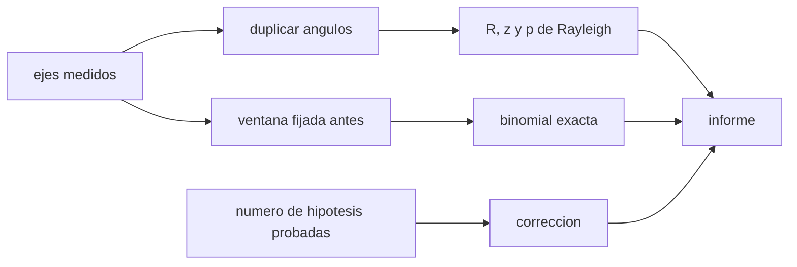

# B132-C04 — Estadística de orientaciones en arqueoastronomía

<!-- nav:top -->
[🏠 Programa](../../../../README.md) · [📚 Bloque B132](../../../tronco-comun/B132-historia-y-arqueoastronomia-aplicadas.md) · [← Anterior: B132-C03 — Monumentos megalíticos y astronomía](../B132-C03-monumentos-megaliticos-y-astronomia/CLASE.md) · [Siguiente: B132-C05 — Contexto ritual y social de la observación del cielo →](../B132-C05-contexto-ritual-y-social-de-la-observacion-del-cielo/CLASE.md)
<!-- /nav -->

## 1. Ubicación, nivel y alcance

Clase 4 del bloque B132. Nivel N4. B02-C09 trata los sesgos de las alineaciones; aquí tratas el **análisis estadístico**: cuando un conjunto de edificios o monumentos tiene orientaciones medidas, ¿se agrupan alrededor de una dirección más de lo que permitiría el azar? Usas la prueba de Rayleigh sobre datos **axiales**, la prueba binomial para una ventana fijada de antemano y la corrección por comparaciones múltiples. Las muestras son **sintéticas**.

## 2. Por qué esta clase existe

Si se mira un conjunto de ejes y se busca «algo», casi siempre se encuentra. La decisión central: **¿la agrupación observada supera lo esperable por azar, una vez descontado que se probaron varias hipótesis?**

## 3. Lo que podrás hacer al terminar

1. Tratar ejes como datos axiales (módulo 180°) duplicando los ángulos.
2. Calcular la longitud resultante media `R`, el estadístico `z = nR²` y un valor p de Rayleigh.
3. Verificar una aproximación de p con Monte Carlo.
4. Aplicar una prueba binomial exacta a una ventana fijada antes de ver los datos.
5. Medir cuánto infla los falsos positivos elegir la ventana después de ver los datos y corregir (Bonferroni).
6. Informar el resultado con sus supuestos y sin convertir un valor p en prueba de intención.

La evidencia es el **informe estadístico de una muestra sintética** del ejercicio 12 (sección 20).

## 4. Con qué llegas y cómo comprobarlo

1. ¿Qué es un valor p?
2. ¿Qué es una distribución binomial?
3. ¿Qué es un dato axial?
4. ¿Qué es una semilla fija?
5. ¿Qué es un dato sintético?

<details>
<summary>Ver respuestas</summary>

1. La probabilidad, bajo la hipótesis nula, de un resultado al menos tan extremo como el observado. 2. La del número de éxitos en `n` ensayos independientes con probabilidad `p0`. 3. Una dirección sin sentido, de modo que `θ` y `θ + 180°` son lo mismo. 4. Un valor que hace repetible el sorteo. 5. Un dato generado para el ejemplo, no medido.
</details>

Con cuatro o cinco aciertos, sigue; si no, repasa los prerrequisitos.

## 5. Un caso de contexto y casos de referencia

La literatura aplica pruebas de este tipo a conjuntos de templos: González García y Belmonte (2014, resumen consultado) contrastan si las orientaciones de templos helénicos de cinco áreas geográficas son estadísticamente consistentes entre sí y con templos de la Edad del Hierro y del Bronce mediterráneos. El estudio ICOMOS–IAU (consultado) pide, antes de aceptar la intencionalidad de una alineación, considerar el contexto cultural «balanceado, cuando sea posible, con confirmación estadística apropiada». Esos son **casos reales citados** (sin reproducir sus datos); en esta clase se usan dos muestras de `n = 30` ejes **sintéticas**: A (uniforme) y B (agrupada hacia `95°` con `σ = 12°`).

## 6. Vocabulario

La **hipótesis nula** de Rayleigh es que la población está distribuida uniformemente en el círculo; la prueba detecta una desviación **unimodal** (la documentación de astropy lo declara, consultada). Con ángulos duplicados `2θ_i`, `R = √(C² + S²)/n`, con `C = Σcos 2θ_i`, `S = Σsen 2θ_i`; `z = nR²`. La **prueba binomial** cuenta cuántos ejes caen en una ventana de ancho `2w`; bajo azar la probabilidad de caer en ella es `p0 = 2w/180°`. La **comparación múltiple** aparece cuando se prueban varias ventanas u objetivos.

## 7. Modelo mental: lanzar dardos a un reloj de 180°



*Descripción textual:* los ejes se duplican para la prueba de Rayleigh y se cuentan en una ventana fijada antes para la binomial; ambos resultados se corrigen según cuántas hipótesis se probaron y se reúnen en el informe.

Analogía: lanzar 30 dardos y ver si se agrupan; pero si pintas la diana después de ver dónde cayeron, siempre acertarás. Límite: el valor p no dice nada sobre la causa de la agrupación (intención, pendiente del terreno, construcción por etapas).

## 8. La explicación, paso a paso

### 8.1 Por qué se duplican los ángulos

Un eje a `10°` y otro a `170°` están a solo `20°` entre sí; sus ángulos duplicados (`20°` y `340°`) también. Sin duplicar, el círculo promedia mal. Con ejes perpendiculares (`45°` y `135°`) los duplicados (`90°` y `270°`) se cancelan y `R = 0`: Rayleigh no detecta distribuciones bimodales.

### 8.2 Rayleigh en las dos muestras

La muestra A (uniforme) da `R = 0,132`, `z = 0,52` y `p = 0,597`. La B (agrupada) da `R = 0,916`, `z = 25,16` y `p ≈ 10⁻¹⁵`, con eje medio `94,7°`. La fórmula del p (aproximación de Zar, 1999, **no consultada**) se verifica con 20 000 sorteos uniformes (semilla fija): `p_MC = 0,595` frente a `0,597`.

### 8.3 Binomial con ventana fijada antes

Ventana `95° ± 5°`, `p0 = 10/180 = 0,0556`. Muestra A: `k = 1` de 30, `P(X ≥ 1) = 0,82`. Muestra B: `k = 10` de 30, `P(X ≥ 10) = 3,0×10⁻⁶`. Se esperarían `30 × 0,0556 = 1,67` ejes en la ventana por azar.

### 8.4 Elegir la ventana después

Con 4 000 muestras uniformes de `n = 20`, una ventana fijada antes da `2,2 %` de falsos positivos al nivel `0,05` (la binomial es discreta y conservadora). **Elegir la mejor de 8 ventanas después de ver los datos** da `16,8 %`: casi ocho veces más. La corrección de Bonferroni rebaja el nivel a `0,05/8 = 0,0063`.

## 9. Magnitudes, símbolos y unidades

| Símbolo | Qué es | Unidad | Valor / nota |
|---|---|---|---|
| `θ` | orientación del eje | ° (módulo 180°) | muestras sintéticas |
| `R` | longitud resultante media | — | 0,132; 0,916 |
| `z` | `nR²` | — | 0,52; 25,16 |
| `p` | valor p | — | 0,597; ≈ 10⁻¹⁵ |
| `p0` | probabilidad de la ventana bajo azar | — | 0,0556 |
| `k` | ejes dentro de la ventana | — | 1; 10 |

## 10. Convenciones y referencias

Orientaciones en grados desde el norte hacia el este, módulo 180°. Hipótesis nula: distribución uniforme. Semilla fija `20261113` y derivadas. La aproximación de p y la binomial exacta se verifican por Monte Carlo (tolerancia `0,03`). Muestras **sintéticas**.

## 11. De dónde sale lo que afirmamos

| ID | Fuente | Localizador | Respalda | Estado |
|---|---|---|---|---|
| S1 | astropy, `astropy.stats.rayleightest` — astro-docs.readthedocs.io (consultada 2026-11-11) | página de la función | hipótesis nula de uniformidad; detecta una desviación unimodal; p pequeño sugiere rechazar la nula; datos circulares en radianes | Consultada (la página no da las fórmulas) |
| S2 | González García A. C. y Belmonte J. A., «Sacred architecture orientation across the Mediterranean: a comparative statistical analysis», *Mediterranean Archaeology and Archaeometry* 14(2), 95–113 (2014) — iac.edu.es (consultado 2026-11-11, solo resumen) | resumen | contraste estadístico de orientaciones de templos de cinco áreas y su comparación con templos mediterráneos | Consultada (solo resumen) |
| S3 | Cotte M. y Ruggles C., conclusión del Estudio Temático ICOMOS–IAU (consultada 2026-11-11) | «Credibility as an authenticity issue» | contexto cultural con confirmación estadística antes de aceptar la intencionalidad | Consultada |
| — | Aproximación de Zar, binomial exacta, Bonferroni | — | las verifica el laboratorio | No consultada en una fuente concreta |
| — | Parracho Silva (2020), *J. Archaeol. Sci.* | — | — | No consultada (solo conocida por un resumen de buscador) |

Límites: ninguna muestra de edificios reales se analizó; los resultados de los estudios citados no se reproducen.

## 12. Cómo ver el resultado estadístico

| Magnitud | Muestra A | Muestra B |
|---|---|---|
| `R` | 0,132 | 0,916 |
| p (Rayleigh) | 0,597 | ≈ 10⁻¹⁵ |
| `k` en 95° ± 5° | 1 | 10 |
| P binomial | 0,82 | 3,0×10⁻⁶ |

Descripción larga: la muestra uniforme no rechaza la nula y la agrupada la rechaza con holgura; elegir la ventana después multiplica por casi ocho los falsos positivos.

## 13. Ejemplo trabajado: cola binomial de la muestra A

**Paso 1 · Probabilidad de fallar.** `1 − 0,0556 = 0,9444`.
**Paso 2 · Ninguno en 30.** `0,9444³⁰ = exp(30 ln 0,9444) = exp(−1,715) = 0,180`.
**Paso 3 · Al menos uno.** `P(X ≥ 1) = 1 − 0,180 = 0,82`.

## 14. Distintas formas de describir una muestra

**Por histograma:** frecuencias por intervalos. **Por Rayleigh:** `R` y `z`. **Por ventana:** `k` y `p0`. **Por mapa:** ejes sobre el terreno. **Por cultura:** contexto de cada edificio (C05).

## 15. Práctica guiada

**Ejercicio 1 · con los pasos indicados.** Calcula `R` para dos ejes a `10°` y `170°`. *Pasos:* duplica, promedia coseno y seno, toma el módulo.

<details><summary>Solución comentada</summary>

Ángulos `20°` y `340°`: `C = (0,9397 + 0,9397)/2 = 0,9397`, `S = 0`: `R = 0,9397`.
</details>

**Ejercicio 2 · con una pista.** Halla `p0` para una ventana de `±5°` en datos axiales. *Pista:* el rango axial es `180°`.

<details><summary>Solución comentada</summary>

`10/180 = 0,0556`.
</details>

**Ejercicio 3 · casi autónomo.** Calcula `P(X ≥ 1)` con `n = 30` y `p0 = 0,0556`.

<details><summary>Solución comentada</summary>

`1 − 0,9444³⁰ = 0,82`.
</details>

## 16. Práctica autónoma, transferencia e integrador

**Ejercicio 4 · autónomo.** Calcula `z` para `n = 30` y `R = 0,132`.

<details><summary>Solución comentada</summary>

`30 × 0,0174 = 0,52`.
</details>

**Ejercicio 5 · autónomo.** ¿Cuántos ejes en la ventana esperas por azar con `n = 30`?

<details><summary>Solución comentada</summary>

`30 × 0,0556 = 1,67`.
</details>

**Ejercicio 6 · autónomo.** ¿A qué nivel rechazarías con Bonferroni si probaste 8 ventanas?

<details><summary>Solución comentada</summary>

`0,05/8 = 0,00625`.
</details>

**Ejercicio 7 · autónomo.** Una ventana elegida después da `p = 0,003` entre 8 candidatas. ¿Qué `p` corregido informas?

<details><summary>Solución comentada</summary>

`8 × 0,003 = 0,024`.
</details>

**Ejercicio 8 · autónomo.** Dos grupos de ejes perpendiculares dan `R ≈ 0`. ¿Significa que son uniformes?

<details><summary>Solución comentada</summary>

No: Rayleigh detecta solo una desviación unimodal; la muestra es bimodal y requiere otra prueba.
</details>

**Ejercicio 9 · transferencia.** **Transferencia.** Un colega mide 12 templos, ve que 5 apuntan al amanecer solsticial y calcula la binomial con esa ventana. ¿Qué falla?

<details><summary>Solución comentada</summary>

La ventana se eligió después de ver los datos y se probaron otros objetivos: hay que corregir por comparaciones múltiples o fijar la hipótesis antes.
</details>

**Ejercicio 10 · transferencia.** **Transferencia.** Una muestra tiene `p = 0,004` para una agrupación hacia el este. ¿Prueba que fue intencional?

<details><summary>Solución comentada</summary>

No: indica que no es uniforme; la causa puede ser el terreno, una dirección de acceso o una moda constructiva. Hace falta contexto (C05).
</details>

**Ejercicio 11 · transferencia.** **Transferencia.** Con `n = 5` ejes, ¿qué cabe esperar de la potencia de la prueba?

<details><summary>Solución comentada</summary>

Muy poca: solo agrupaciones extremas se detectan; un resultado no significativo no demuestra azar.
</details>

**Ejercicio 12 · integrador.** **Integrador.** Elabora tu *informe estadístico de una muestra sintética*: ejes, Rayleigh (R, z, p), verificación Monte Carlo, binomial con ventana fijada antes, corrección por comparaciones y una frase de límites.

<details><summary>Solución comentada</summary>

Secciones 8.2–8.4 y la salida del laboratorio.
</details>

## 17. Laboratorio: Rayleigh, binomial y comparaciones múltiples

El script [orientaciones.py](orientaciones.py) genera dos muestras sintéticas, calcula Rayleigh axial y binomial exacta, verifica el p con Monte Carlo y mide los falsos positivos al elegir la ventana después (**comprueba** `|p_Zar − p_MC| < 0,03` y que elegir después multiplica los falsos positivos por más de 2).

**Datos:** muestras **sintéticas** con semilla fija; fórmulas estándar. **Predice antes de ejecutar:** ¿cuántos falsos positivos dará elegir la mejor de 8 ventanas? (≈ 17 %, no el 5 % nominal). **Ejecución del 2026-11-11 (Python 3.12.9):**

```text
Python 3.12.9 (biblioteca estandar)
Muestras SINTETICAS de n = 30 ejes (semilla 20261113): A uniforme; B agrupada en 95 grados con sigma 12 grados
  A uniforme  R = 0.132  z = nR^2 = 0.52  p(Rayleigh, Zar) = 0.5968  eje medio = 176.7
  B agrupada  R = 0.916  z = nR^2 = 25.16  p(Rayleigh, Zar) = 1.037e-15  eje medio = 94.7
Verificacion de p para la muestra A: Zar = 0.597 ; Monte Carlo (20000 sorteos, semilla 20261114) = 0.595
  Binomial A uniforme: ventana 95 +- 5 -> k = 1 de 30 ; p0 = 0.0556 ; P(X>=k) = 0.82
  Binomial B agrupada: ventana 95 +- 5 -> k = 10 de 30 ; p0 = 0.0556 ; P(X>=k) = 2.999e-06
Falsos positivos al nivel 0.05 con muestras uniformes de n = 20 (4000 sorteos, semilla 20261115):
  ventana fijada antes de ver los datos = 0.022 ; mejor de 8 ventanas elegida despues = 0.168 ; Bonferroni (0.05/8) = nivel 0.0063
Pruebas superadas.
```

```bash
python programa/clases/B132/B132-C04-estadistica-de-orientaciones-en-arqueoastronomia/orientaciones.py
```

**Límites:** orientaciones sin error de medida, independientes y sin estructura espacial; la binomial es discreta y conservadora.

## 18. Errores frecuentes y cómo corregirlos

**No duplicar los ángulos axiales.** Se corrige con 8.1.

**Elegir la ventana después de ver los datos.** Se corrige con 8.4.

**Leer el valor p como probabilidad de que la hipótesis sea cierta.** Se corrige con el ejercicio 10.

**Concluir uniformidad de un p alto con pocos datos.** Se corrige con el ejercicio 11.

## 19. Cómo sabrás que vas bien

Tras la sección 8: ¿qué `p` esperabas para A y cuál obtuviste? Si dudas, repasa el ejemplo 13. Tras el laboratorio: ¿qué comprueba? (ver la sección 17).

## 20. Qué entregas y cómo se evalúa

El producto es tu **informe estadístico de una muestra sintética** (ejercicio 12).

| Criterio | Inicial | En desarrollo | Logrado | Destacado |
|---|---|---|---|---|
| Conceptos | Los confunde | Parciales | Distingue axial y nula | Explica los límites de la prueba |
| Cálculo | Sin unidades | Con errores | Tablas completas | Calcula casos nuevos |
| Numérico | Sin comprobar | Un caso | Verifica con Monte Carlo | Interpreta las diferencias |
| Fuentes | Sin fuente | Sin fecha | Fuentes con fecha y estado | Declara lo no consultado |
| Límites | No los nombra | Uno | Tres | Separa p, causa e intención |

**Condiciones críticas (no se compensan con promedio):** rotular las muestras como sintéticas; fijar o corregir la ventana; no leer p como intención; citar solo lo consultado.

## 21. Ética, seguridad y límites

Clase educativa: las muestras son sintéticas y ningún resultado describe un conjunto real de edificios. Un valor p no es una atribución cultural: lo que un pueblo pretendió al orientar un edificio no se deduce de una estadística. Accesibilidad: tablas equivalentes a las gráficas, fórmulas en texto, ejercicios sin conexión.

## 22. Para cerrar y seguir

Una muestra agrupada da `p ≈ 10⁻¹⁵` y una uniforme `0,597`, pero elegir la ventana después eleva los falsos positivos de `2,2 %` a `16,8 %`. Queda una pregunta: cuando la estadística dice «no es azar», ¿qué dice la sociedad que construyó?

**Glosario español–inglés.** prueba de Rayleigh · *Rayleigh test*; datos axiales · *axial data*; hipótesis nula · *null hypothesis*; comparaciones múltiples · *multiple comparisons*; falso positivo · *false positive*.

**Continuidad.** [B132-C05](../B132-C05-contexto-ritual-y-social-de-la-observacion-del-cielo/CLASE.md) trata el contexto ritual y social.

**Referencias:** ver sección 11.

<!-- nav:bottom -->
---

[← Anterior: B132-C03 — Monumentos megalíticos y astronomía](../B132-C03-monumentos-megaliticos-y-astronomia/CLASE.md) · [📚 Bloque B132](../../../tronco-comun/B132-historia-y-arqueoastronomia-aplicadas.md) · [Siguiente: B132-C05 — Contexto ritual y social de la observación del cielo →](../B132-C05-contexto-ritual-y-social-de-la-observacion-del-cielo/CLASE.md)
<!-- /nav -->
