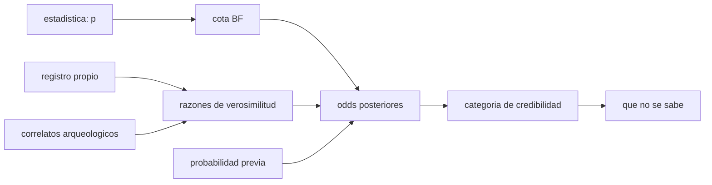

# B132-C05 — Contexto ritual y social de la observación del cielo

<!-- nav:top -->
[🏠 Programa](../../../../README.md) · [📚 Bloque B132](../../../tronco-comun/B132-historia-y-arqueoastronomia-aplicadas.md) · [← Anterior: B132-C04 — Estadística de orientaciones en arqueoastronomía](../B132-C04-estadistica-de-orientaciones-en-arqueoastronomia/CLASE.md) · [Siguiente: B132-C06 — Informe de un sitio arqueoastronómico →](../B132-C06-informe-de-un-sitio-arqueoastronomico/CLASE.md)
<!-- /nav -->

## 1. Ubicación, nivel y alcance

Clase 5 del bloque B132. Nivel N4. Una alineación medida (C03) y una estadística (C04) no bastan para interpretar un sitio: hace falta el **contexto social y ritual** de quienes lo usaron. Aquí aprendes a combinar líneas de evidencia —estadística, registro histórico o etnográfico, correlatos arqueológicos— y a clasificar la credibilidad de una alineación en las cuatro categorías que usa el Estudio Temático ICOMOS–IAU. Las sociedades, los sitios y las razones de verosimilitud del laboratorio son **sintéticos**: ningún pueblo real aparece como caso numérico.

## 2. Por qué esta clase existe

El catálogo trata alineaciones sin ese contexto. La decisión central: **¿cuánto apoyo da cada línea de evidencia a la intención de una alineación, y qué parte de la conclusión depende de lo que se supone de antemano?**

## 3. Lo que podrás hacer al terminar

1. Distinguir evidencia, interpretación y desconocido en el estudio de un sitio.
2. Nombrar y aplicar las cuatro categorías de credibilidad de Cotte y Ruggles.
3. Convertir un valor p en una cota del factor de Bayes y ver cuánto evidencia realmente.
4. Combinar líneas de evidencia con descuento por dependencia.
5. Probar la sensibilidad de la conclusión a la probabilidad previa.
6. Reconocer el peso del contexto cultural y el riesgo de imponer una lectura moderna.

La evidencia es la **ficha de credibilidad de una alineación** del ejercicio 12 (sección 20).

## 4. Con qué llegas y cómo comprobarlo

1. ¿Qué es una probabilidad previa?
2. ¿Qué es un factor de Bayes?
3. ¿Qué es una analogía etnográfica?
4. ¿Qué es un dato sintético?
5. ¿Qué diferencia hay entre evidencia e interpretación?

<details>
<summary>Ver respuestas</summary>

1. La probabilidad que se asigna a una hipótesis antes de ver la evidencia. 2. La razón entre cuánto predice la evidencia una hipótesis y cuánto la otra. 3. Usar prácticas documentadas de un pueblo para pensar otro caso; es una analogía, no una prueba. 4. Un dato generado para el ejemplo, no medido. 5. La evidencia se observa o se lee; la interpretación es lo que se propone a partir de ella.
</details>

Con cuatro o cinco aciertos, sigue; si no, repasa los prerrequisitos.

## 5. Un caso de contexto y casos de referencia

La conclusión del Estudio Temático ICOMOS–IAU (Cotte y Ruggles, consultado) establece que, antes de aceptar la intencionalidad de alineaciones en sitios arqueológicos, «por evidentes que parezcan al ojo moderno», hay que considerar el contexto cultural más amplio, equilibrado cuando sea posible con confirmación estadística. Propone cuatro categorías de credibilidad con ejemplos que **ellos** atribuyen: *generalmente aceptada* (la alineación del pasaje de Newgrange con el sol naciente del solsticio de invierno; el eje solsticial de Stonehenge), *debatida entre especialistas* (el Caracol de Chichén Itzá como observatorio), *no probada* (el efecto del equinoccio en la pirámide de Kukulcán) y *completamente refutada* (la lectura de cuatro símbolos pintados de Chaco Canyon como la supernova de 1054, cuando la evidencia cultural sugiere, según la fuente, una estación de observación solar de sacerdotes nativos). Esos son **casos reales citados**; el juicio sobre ellos pertenece a la literatura y a las comunidades implicadas, no a esta clase. El laboratorio usa cuatro **sitios sintéticos** S1–S4.

## 6. Vocabulario

El **contexto ritual y social** es el conjunto de prácticas, calendarios, jerarquías y creencias en que se inscribe una observación del cielo. Una **línea de evidencia** es una fuente independiente de apoyo a una hipótesis. El **factor de Bayes** `BF` multiplica las probabilidades a favor: `odds_post = odds_prior × Π BF_i`. La **cota de Sellke–Bayarri–Berger** acota el `BF` a favor de la alternativa con `BF ≤ 1/(−e p ln p)` para `p < 1/e`. El **descuento por dependencia** hace que la línea `i`-ésima cuente como `r^(d^i)`.

## 7. Modelo mental: una mesa con varias patas



*Descripción textual:* el valor p da una cota de factor de Bayes; el registro propio y los correlatos arqueológicos aportan razones; junto con la probabilidad previa dan las probabilidades posteriores, que se traducen en una categoría de credibilidad y en una lista de lo desconocido.

Analogía: una mesa con una sola pata (la estadística) se cae con cualquier empujón; con varias patas independientes (registro, correlatos, repetición) aguanta. Límite: las razones numéricas de este laboratorio son sintéticas y los umbrales entre categorías son una convención didáctica, **no** de Cotte y Ruggles.

## 8. La explicación, paso a paso

### 8.1 Qué dice realmente un valor p

La cota del factor de Bayes (recordada de la literatura, **no consultada**; el laboratorio comprueba su monotonía) crece lentamente con la rareza del p: `p = 0,05` → `BF ≤ 2,46`; `p = 0,01` → `BF ≤ 7,99`; `p = 0,004` → `BF ≤ 16,66`; `p = 0,001` → `BF ≤ 53,26`. Un `p = 0,05`, a menudo celebrado, respalda la intención a lo sumo 2,5 a 1.

### 8.2 Cuatro sitios sintéticos

Con probabilidad previa `0,10` (convención didáctica):

| Sitio | `p` | razones (estadística, contexto…) | posterior | categoría (convención didáctica) |
|---|---|---|---|---|
| S1: eje solsticial, registro propio y práctica ritual coincidente | 0,004 | 16,66; 6,00; 3,03 | 0,971 | aceptada |
| S2: eje compatible, sin registro, analogía lejana | 0,020 | 4,70; 1,50 | 0,439 | no probada |
| S3: efecto de luz, sin evidencia de intención | 0,300 | 1,02 | 0,102 | no probada |
| S4: lectura astronómica de un símbolo; el contexto apunta a otro uso | 0,040 | 2,86; 0,50; 0,28; 0,20 | 0,009 | refutada |

### 8.3 La conclusión depende del previo

Para S1 la posterior va de `0,941` a `0,992` si el previo cambia de `0,05` a `0,30`; la conclusión es robusta. Para S2 va de `0,271` a `0,751`: con un previo alto pasaría a *debatida entre especialistas*. Cuando el resultado cambia de categoría según el previo, lo honesto es decir que **los datos no deciden**.

### 8.4 No contar dos veces lo mismo

Las líneas contextuales de S1 no son del todo independientes (un mismo registro puede originar ambas). Con descuento `0,8` la posterior es `0,971`; sin descuento `0,978`. La diferencia es pequeña aquí pero puede ser grande si hay más líneas.

## 9. Magnitudes, símbolos y unidades

| Símbolo | Qué es | Unidad | Valor / nota |
|---|---|---|---|
| `p` | valor p de la estadística | — | 0,004 a 0,3 |
| `BF` | factor de Bayes (cota) | — | 1,02 a 16,66 |
| `r` | razón de una línea contextual | — | sintética |
| `d` | factor de dependencia | — | 0,8 (ilustrativo) |
| `π₀` | probabilidad previa | — | 0,10 (didáctica) |
| `odds` | `π/(1−π)` | — | 0,1111 al inicio |

## 10. Convenciones y referencias

Probabilidades en `[0, 1]`; razones multiplicativas. Cotas y razones **sintéticas**; los umbrales entre categorías (aceptada `≥ 0,9`, debatida `≥ 0,5`, refutada si hay evidencia en contra fuerte y posterior `< 0,1`) son una convención didáctica de esta clase, distinta de la clasificación cualitativa de la fuente. La cota de Sellke y otros es tolerancia `0,01` en `p = 0,05` (2,46).

## 11. De dónde sale lo que afirmamos

| ID | Fuente | Localizador | Respalda | Estado |
|---|---|---|---|---|
| S1 | Cotte M. y Ruggles C., conclusión del Estudio Temático ICOMOS–IAU sobre patrimonio astronómico — web.astronomicalheritage.org (consultada 2026-11-11, texto del capítulo) | «Credibility as an authenticity issue»; «Tangible and intangible heritage relating to astronomy» | las cuatro categorías de credibilidad y sus ejemplos; necesidad de contexto cultural y confirmación estadística; peso de las lecturas especulativas en la percepción pública; cuidado con los usos nacionalistas | Consultada |
| S2 | Cotte M. y Ruggles C., introducción del mismo estudio (consultada 2026-11-11) | «Background» | marco de la iniciativa UNESCO–IAU de astronomía y patrimonio mundial desde 2004 | Consultada |
| S3 | Magli G. y Belmonte J. A., arXiv:2211.07981 (consultado 2026-11-11, solo resumen) | resumen | crítica de interpretaciones «forzadas» y «analogías sin sustento» | Consultada (solo resumen) |
| — | Cota de Sellke, Bayarri y Berger (2001) | — | recordada; el laboratorio comprueba monotonía y el valor 2,46 | No consultada |
| — | Página de la UNESCO sobre astronomía | — | — | No consultada (acceso denegado) |

Límites: no se consultaron ni se citan datos etnográficos de ningún pueblo; ninguna razón de verosimilitud es empírica.

## 12. Cómo ver la credibilidad

| Sitio | Posterior | Categoría |
|---|---|---|
| S1 | 0,971 | aceptada |
| S2 | 0,439 | no probada |
| S3 | 0,102 | no probada |
| S4 | 0,009 | refutada |

Descripción larga: la estadística sola aporta como máximo un factor 17 a `p = 0,004`; solo la suma de líneas independientes lleva a S1 a la categoría aceptada, y S2 cambia de categoría con el previo.

## 13. Ejemplo trabajado: S1 paso a paso

**Paso 1 · Odds previos.** `0,10/0,90 = 0,1111`.
**Paso 2 · Estadística.** `BF ≤ 16,66`: `0,1111 × 16,66 = 1,851`.
**Paso 3 · Contexto.** `× 6,00 × 4^0,8 (=3,03) = 33,7`.
**Paso 4 · Probabilidad.** `33,7/(1 + 33,7) = 0,971`.

## 14. Distintas formas de describir una alineación

**Por geometría:** azimut y declinación (C03). **Por estadística:** p y BF (C04). **Por credibilidad:** una de cuatro categorías. **Por contexto:** registros, prácticas, jerarquías, calendarios. **Por quién interpreta:** investigadores externos o la comunidad que mantiene el saber.

## 15. Práctica guiada

**Ejercicio 1 · con los pasos indicados.** Convierte la probabilidad previa `0,10` en odds. *Pasos:* `π/(1−π)`.

<details><summary>Solución comentada</summary>

`0,10/0,90 = 0,1111`.
</details>

**Ejercicio 2 · con una pista.** Calcula la cota de `BF` para `p = 0,01`. *Pista:* `1/(−e p ln p)`.

<details><summary>Solución comentada</summary>

`−e × 0,01 × ln 0,01 = 0,1252`; `BF ≤ 7,99`.
</details>

**Ejercicio 3 · casi autónomo.** Calcula la posterior de S3 con previo `0,10` y razón `1,02`.

<details><summary>Solución comentada</summary>

`0,1111 × 1,02 = 0,1133`; `0,1133/1,1133 = 0,102`.
</details>

## 16. Práctica autónoma, transferencia e integrador

**Ejercicio 4 · autónomo.** Calcula `4^0,8`.

<details><summary>Solución comentada</summary>

`exp(0,8 × ln 4) = exp(1,109) = 3,03`.
</details>

**Ejercicio 5 · autónomo.** Calcula la posterior de S2 con previo `0,30`.

<details><summary>Solución comentada</summary>

Odds previos `0,4286`; `× 4,70 × 1,5 = 3,02`; probabilidad `0,751`.
</details>

**Ejercicio 6 · autónomo.** ¿Qué previo hace que S2 alcance `0,9`?

<details><summary>Solución comentada</summary>

Se necesita un odds posterior de 9; el factor total es `4,70 × 1,5 = 7,05`; odds previos `1,277`; previo `0,561`.
</details>

**Ejercicio 7 · autónomo.** ¿Por qué `p = 0,05` no justifica «probado»?

<details><summary>Solución comentada</summary>

Porque como mucho multiplica los odds por 2,46.
</details>

**Ejercicio 8 · autónomo.** Clasifica según Cotte y Ruggles: (a) Newgrange; (b) Caracol de Chichén Itzá; (c) efecto de Kukulcán; (d) símbolos de Chaco como supernova.

<details><summary>Solución comentada</summary>

(a) generalmente aceptada, (b) debatida entre especialistas, (c) no probada, (d) completamente refutada, según la fuente.
</details>

**Ejercicio 9 · transferencia.** **Transferencia.** Un guía turístico afirma que una luz espectacular en un edificio «demuestra» que sus constructores lo planearon. ¿Qué preguntas haces?

<details><summary>Solución comentada</summary>

¿Hay registro propio o contexto cultural de la intención? ¿Hay estadística sobre más ejemplos? ¿Se probaron muchas fechas? Sin eso, es categoría *no probada*.
</details>

**Ejercicio 10 · transferencia.** **Transferencia.** Una comunidad actual mantiene prácticas asociadas a un sitio. ¿Cómo se incorpora su saber?

<details><summary>Solución comentada</summary>

Con consulta y atribución, como saber propio de la comunidad; no como mera «analogía» extraída por investigadores externos.
</details>

**Ejercicio 11 · transferencia.** **Transferencia.** Un gobierno quiere declarar un sitio «el observatorio más antiguo de la región». ¿Qué advierte la fuente consultada?

<details><summary>Solución comentada</summary>

Que el orgullo nacional o la conveniencia política pueden sesgar esas afirmaciones, y que se funda en una creencia errónea en un único «camino de progreso» hacia la ciencia moderna.
</details>

**Ejercicio 12 · integrador.** **Integrador.** Elabora tu *ficha de credibilidad de una alineación*: estadística (p y BF), líneas contextuales con su fuente, previo, posterior, sensibilidad y categoría, más una lista de lo que no se sabe.

<details><summary>Solución comentada</summary>

Secciones 8.1–8.4 y la salida del laboratorio.
</details>

## 17. Laboratorio: combinar evidencia y clasificar

El script [contexto.py](contexto.py) calcula la cota del factor de Bayes, combina las líneas con descuento por dependencia, clasifica los cuatro sitios sintéticos y barre el previo (**comprueba** la monotonía de la cota, `BF(0,05) ≈ 2,46` y las categorías de S1–S4).

**Datos:** `p`, razones y previo **sintéticos**; categorías de Cotte y Ruggles (consultadas) con umbrales didácticos propios. **Predice antes de ejecutar:** ¿qué sitio cambiará de categoría con el previo? (S2). **Ejecución del 2026-11-11 (Python 3.12.9):**

```text
Python 3.12.9 (biblioteca estandar)
Cota del factor de Bayes a favor de la intencion segun p (Sellke y otros 2001, no consultada):
  p = 0.200  ->  BF <= 1.14
  p = 0.050  ->  BF <= 2.46
  p = 0.010  ->  BF <= 7.99
  p = 0.004  ->  BF <= 16.66
  p = 0.001  ->  BF <= 53.26
Casos SINTETICOS, probabilidad previa de intencion = 0.10 (convencion didactica)
 caso  p       razones            post   categoria
  S1  0.004  16.66,6.00,3.03,1.00 0.971  aceptada
  S2  0.020  4.70,1.50,1.00     0.439  no probada
  S3  0.300  1.02,1.00,1.00     0.102  no probada
  S4  0.040  2.86,0.50,0.28,0.20 0.009  refutada
Sensibilidad al previo (0.05 / 0.10 / 0.30) para S1 y S2:
  S1: 0.941  0.971  0.992
  S2: 0.271  0.439  0.751
Descuento por dependencia en S1: con = 0.971 ; sin descuento = 0.978
Pruebas superadas.
```

```bash
python programa/clases/B132/B132-C05-contexto-ritual-y-social-de-la-observacion-del-cielo/contexto.py
```

**Límites:** las razones son inventadas para ilustrar; el modelo trata la intención como binaria; no sustituye al juicio de especialistas ni a la consulta con comunidades.

## 18. Errores frecuentes y cómo corregirlos

**Leer el valor p como probabilidad de intención.** Se corrige con 8.1.

**Sumar líneas de evidencia dependientes.** Se corrige con 8.4.

**Esconder la dependencia del previo.** Se corrige con 8.3.

**Imponer una lectura moderna sin contexto cultural.** Se corrige con la sección 5.

## 19. Cómo sabrás que vas bien

Tras la sección 8: ¿qué posterior esperabas para S2 y cuál obtuviste? Si dudas, repasa el ejemplo 13. Tras el laboratorio: ¿qué comprueba? (ver la sección 17).

## 20. Qué entregas y cómo se evalúa

El producto es tu **ficha de credibilidad de una alineación** (ejercicio 12).

| Criterio | Inicial | En desarrollo | Logrado | Destacado |
|---|---|---|---|---|
| Conceptos | Los confunde | Parciales | Aplica las cuatro categorías | Explica los límites del modelo |
| Cálculo | Sin unidades | Con errores | Tablas completas | Calcula casos nuevos |
| Numérico | Sin comprobar | Un caso | Sensibilidad al previo | Interpreta el cambio de categoría |
| Fuentes | Sin fuente | Sin fecha | Fuentes con fecha y estado | Declara lo no consultado |
| Límites | No los nombra | Uno | Tres | Separa evidencia, interpretación y desconocido |

**Condiciones críticas (no se compensan con promedio):** rotular los casos como sintéticos; no inventar datos culturales; no presentar interpretación como evidencia; citar solo lo consultado.

## 21. Ética, seguridad y límites

Clase educativa: los sitios y las sociedades del laboratorio son sintéticos; los saberes de pueblos y culturas son propios de ellos y deben describirse con respeto, atribuirse a sus fuentes y contrastarse con quienes los mantienen. Esta clase no afirma qué creían o hacían pueblos reales. Accesibilidad: tablas equivalentes a las gráficas, fórmulas en texto, ejercicios sin conexión.

## 22. Para cerrar y seguir

Un `p = 0,004` multiplica los odds por 17 como máximo; hace falta que el registro propio y los correlatos arqueológicos lleven a S1 a `0,971`, mientras que S2 oscila entre `0,27` y `0,75` según el previo. Queda una pregunta: ¿cómo se escribe todo esto en un informe que otros puedan evaluar?

**Glosario español–inglés.** contexto ritual · *ritual context*; factor de Bayes · *Bayes factor*; probabilidad previa · *prior probability*; credibilidad · *credibility*; analogía etnográfica · *ethnographic analogy*.

**Continuidad.** [B132-C06](../B132-C06-informe-de-un-sitio-arqueoastronomico/CLASE.md) trata el informe de un sitio.

**Referencias:** ver sección 11.

<!-- nav:bottom -->
---

[← Anterior: B132-C04 — Estadística de orientaciones en arqueoastronomía](../B132-C04-estadistica-de-orientaciones-en-arqueoastronomia/CLASE.md) · [📚 Bloque B132](../../../tronco-comun/B132-historia-y-arqueoastronomia-aplicadas.md) · [Siguiente: B132-C06 — Informe de un sitio arqueoastronómico →](../B132-C06-informe-de-un-sitio-arqueoastronomico/CLASE.md)
<!-- /nav -->
