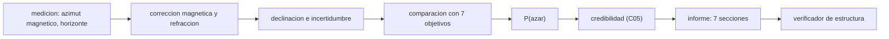

# B132-C06 — Informe de un sitio arqueoastronómico

<!-- nav:top -->
[🏠 Programa](../../../../README.md) · [📚 Bloque B132](../../../tronco-comun/B132-historia-y-arqueoastronomia-aplicadas.md) · [← Anterior: B132-C05 — Contexto ritual y social de la observación del cielo](../B132-C05-contexto-ritual-y-social-de-la-observacion-del-cielo/CLASE.md) · [Siguiente: B133-C01 — Relaciones entre cielo y territorio en los saberes tradicionales →](../../B133/B133-C01-relaciones-entre-cielo-y-territorio-en-los-saberes-tradicionales/CLASE.md)
<!-- /nav -->

## 1. Ubicación, nivel y alcance

Clase 6 del bloque B132. Nivel N4. El informe de sitio es el producto profesional de la arqueoastronomía: reúne mediciones, incertidumbres, comparación con objetivos astronómicos, credibilidad y límites en un documento que otros pueden evaluar y reproducir. Aquí integras lo de C03 (geometría), C04 (comparaciones múltiples) y C05 (contexto y credibilidad) en un informe de un sitio **sintético** de cinco estructuras, y verificas su estructura con un script.

## 2. Por qué esta clase existe

Ninguna clase enseñaba a escribir el informe. La decisión central: **¿qué debe contener el informe para que sus conclusiones puedan evaluarse, y cuántas coincidencias esperaría uno por azar?**

## 3. Lo que podrás hacer al terminar

1. Corregir un azimut magnético y propagar incertidumbres a la declinación.
2. Comparar cada estructura con siete objetivos solares y lunares.
3. Calcular la probabilidad de coincidir con algún objetivo por azar.
4. Contrastar la propagación lineal con Monte Carlo.
5. Redactar un informe con siete secciones y verificar su estructura.
6. Informar credibilidad, límites y lo desconocido sin forzar conclusiones.

La evidencia es el **informe de un sitio sintético** del ejercicio 12 (sección 20).

## 4. Con qué llegas y cómo comprobarlo

1. ¿Qué es la declinación magnética?
2. ¿Qué es una parada lunar mayor?
3. ¿Qué es la propagación de incertidumbres?
4. ¿Qué es la corrección por comparaciones múltiples?
5. ¿Qué es un dato sintético?

<details>
<summary>Ver respuestas</summary>

1. El ángulo entre el norte magnético y el verdadero, que cambia con el lugar y la época. 2. El extremo del ciclo de unos 18,6 años en que la Luna sale y se pone lo más al norte o al sur posible. 3. Calcular cómo los errores de las entradas se transmiten al resultado. 4. Ajustar el nivel de decisión según cuántas hipótesis se probaron. 5. Un dato generado para el ejemplo, no medido.
</details>

Con cuatro o cinco aciertos, sigue; si no, repasa los prerrequisitos.

## 5. Un caso de contexto y casos de referencia

El Estudio Temático ICOMOS–IAU (Cotte y Ruggles, consultado) dedica su conclusión a cómo evaluar un sitio y construir un dossier creíble, y subraya que el valor de un sitio astronómico se juzga junto con su contexto cultural más amplio. Eso es lo que debe reflejar un informe. El **sitio de trabajo** es **sintético**: latitud `40,0° N`, oblicuidad ilustrativa `23,9°`, declinación magnética `1,5° ± 0,5°` y cinco estructuras E1–E5 con azimut magnético medido con brújula (`σ = 0,5°`) y horizonte aparente.

## 6. Vocabulario

El **azimut verdadero** es el magnético más la declinación magnética. La **incertidumbre combinada** es la raíz de la suma de cuadrados de las contribuciones independientes. Los **objetivos** son el Sol en los solsticios (`δ = ±ε`) y el equinoccio (`δ = 0`), y la Luna en las paradas mayores (`δ = ±(ε + i)`) y menores (`δ = ±(ε − i)`), con `i = 5,145°` la inclinación de la órbita lunar (valor estándar, no consultado). La **probabilidad de azar** `P(azar)` es la fracción de declinaciones posibles que caen a menos de `2σ` de algún objetivo.

## 7. Modelo mental: un expediente con trazabilidad



*Descripción textual:* la medición se corrige, produce una declinación con incertidumbre, se compara con siete objetivos, se estima la probabilidad de azar, se asigna una categoría de credibilidad y todo se escribe en un informe cuya estructura se verifica.

Analogía: un informe de laboratorio donde cualquier lector puede repetir cada número. Límite: un informe completo no vuelve verdadera una interpretación; solo la vuelve evaluable.

## 8. La explicación, paso a paso

### 8.1 Incertidumbre del azimut y de la declinación

El azimut verdadero es `A = A_mag + 1,5°`, con `σ_A = √(0,5² + 0,5²) = 0,707°` (brújula y declinación magnética). Para E5 (magnético `57,0°`), `A = 58,50°`, `h_ap = 1,5° ± 0,3°`: `δ = +24,40°`. La propagación lineal da `σ_δ = 0,557°` y Monte Carlo (20 000 sorteos, semilla fija) `0,554°`.

### 8.2 Comparación con siete objetivos

Con `ε = 23,9°`: Sol `±23,9°` y `0°`; Luna mayor `±29,045°` y menor `±18,755°`.

| Estructura | `A` (°) | `δ` (°) | `σ_δ` (°) | Objetivo más cercano | `n_σ` | ¿compatible (< 2σ)? | `P(azar)` |
|---|---|---|---|---|---|---|---|
| E1 | 53,50 | +27,54 | 0,55 | Luna parada mayor norte | 2,75 | no | 0,226 |
| E2 | 127,00 | −27,44 | 0,55 | Luna parada mayor sur | 2,92 | no | 0,227 |
| E3 | 92,30 | −1,90 | 0,56 | Sol equinoccio | 3,38 | no | 0,232 |
| E4 | 72,50 | +14,44 | 0,60 | Luna parada menor norte | 7,15 | no | 0,250 |
| E5 | 58,50 | +24,40 | 0,56 | Sol solsticio de verano | 0,90 | sí | 0,230 |

### 8.3 Lo que dice el azar

Cada estructura tiene entre `22,6 %` y `25 %` de probabilidad de caer a menos de `2σ` de *algún* objetivo. Con cinco estructuras se esperan `5 × 0,23 ≈ 1,2` coincidencias por azar; se observa **1** (E5). El resultado es exactamente lo esperable por azar: **no hay evidencia estadística de intención** en esta muestra, aunque E5 sea compatible con el solsticio. Para decir algo más habría que añadir contexto (C05) y fijar las hipótesis antes de mirar los datos (C04).

### 8.4 La estructura del informe

Siete secciones: Resumen, Sitio y contexto, Método y mediciones, Resultados, Interpretación y credibilidad, Límites, Fuentes. El verificador revisa que existan y que cada cifra angular lleve su incertidumbre: un informe completo no tiene secciones faltantes; uno incompleto de prueba falta 5 secciones y tiene 1 cifra sin incertidumbre.

## 9. Magnitudes, símbolos y unidades

| Símbolo | Qué es | Unidad | Valor / nota |
|---|---|---|---|
| `A` | azimut verdadero | ° | 53,5 a 127,0 |
| `σ_A` | incertidumbre del azimut | ° | 0,707 |
| `h_ap` | altura aparente del horizonte | ° | 0,3 a 2,0 (sintética) |
| `δ` | declinación | ° | −27,44 a +27,54 |
| `σ_δ` | incertidumbre de la declinación | ° | 0,55 a 0,60 |
| `ε` | oblicuidad ilustrativa | ° | 23,9 |
| `P(azar)` | prob. de coincidir al azar con algún objetivo | — | 0,23 a 0,25 |

## 10. Convenciones y referencias

Azimut desde el norte verdadero hacia el este; hemisferio de salida (`A ≤ 180°`). Declinación magnética y azimuts **sintéticos**. Refracción de Bennett y relaciones esféricas: estándar, no consultadas en una fuente concreta. Tolerancia: lineal frente a Monte Carlo `< 8 %`. `P(azar)` se calcula en una malla de `0,001°` sobre `[−29,045°; +29,045°]`.

## 11. De dónde sale lo que afirmamos

| ID | Fuente | Localizador | Respalda | Estado |
|---|---|---|---|---|
| S1 | Cotte M. y Ruggles C., conclusión del Estudio Temático ICOMOS–IAU — web.astronomicalheritage.org (consultada 2026-11-11, texto del capítulo) | partes sobre evaluar un sitio, dossier creíble y credibilidad | el contexto cultural y la confirmación estadística son necesarios antes de aceptar la intencionalidad; categorías de credibilidad | Consultada |
| S2 | Cotte M. y Ruggles C., introducción del mismo estudio (consultada 2026-11-11) | «Background» | tipos de propiedades de patrimonio astronómico | Consultada |
| S3 | González García A. C. y Belmonte J. A. (2014), *Mediterranean Archaeology and Archaeometry* 14(2) — iac.edu.es (consultado 2026-11-11, solo resumen) | resumen | análisis estadístico comparativo de orientaciones de templos | Consultada (solo resumen) |
| — | Inclinación orbital lunar 5,145°, relaciones esféricas, refracción | — | estándar; las verifica el laboratorio por coherencia | No consultada en una fuente concreta |
| — | Páginas de UNESCO e Historic England | — | — | No consultada (acceso denegado) |

Límites: el sitio, las mediciones y la declinación magnética no existen; no hay modelo geomagnético real.

## 12. Cómo ver el informe

| Magnitud | Valor |
|---|---|
| estructuras compatibles con algún objetivo | 1 de 5 |
| coincidencias esperadas por azar | ≈ 1,2 |
| `σ_δ` lineal / Monte Carlo (E5) | 0,557° / 0,554° |
| secciones faltantes (completo / incompleto) | 0 / 5 |

Descripción larga: una de cinco estructuras es compatible con un objetivo, justo lo esperable por azar; el informe debe decirlo y no inflar la coincidencia.

## 13. Ejemplo trabajado: la estructura E5

**Paso 1 · Azimut verdadero.** Azimut magnético `57,0°` más declinación magnética `1,5°`: `58,5°`.
**Paso 2 · Incertidumbre.** `σ_A = √(0,5² + 0,5²) = 0,707°`.
**Paso 3 · Declinación.** Con `φ = 40°` y `h_ap = 1,5°` (corregida por refracción), `δ = +24,40°`.
**Paso 4 · Comparación.** `|24,40 − 23,9|/0,557 = 0,90 σ`: compatible con el Sol solsticial; `P(azar) = 0,23`.

## 14. Distintas formas de describir un sitio

**Por tabla:** estructuras, azimut, declinación, `n_σ`. **Por mapa:** ejes sobre el terreno. **Por texto:** contexto y credibilidad. **Por gráfico:** declinaciones frente a objetivos. **Por trazabilidad:** quién midió, cuándo y con qué.

## 15. Práctica guiada

**Ejercicio 1 · con los pasos indicados.** Calcula `σ_A` combinando una brújula de `0,5°` y una declinación magnética de `0,5°`. *Pasos:* suma cuadrática.

<details><summary>Solución comentada</summary>

`√(0,25 + 0,25) = 0,707°`.
</details>

**Ejercicio 2 · con una pista.** Calcula la declinación de la parada lunar mayor norte con `ε = 23,9°`. *Pista:* suma la inclinación orbital.

<details><summary>Solución comentada</summary>

`23,9 + 5,145 = 29,045°`.
</details>

**Ejercicio 3 · casi autónomo.** Calcula `n_σ` de E5 respecto del solsticio de verano.

<details><summary>Solución comentada</summary>

`(24,40 − 23,9)/0,557 = 0,90`.
</details>

## 16. Práctica autónoma, transferencia e integrador

**Ejercicio 4 · autónomo.** ¿Cuántas coincidencias por azar esperas entre 5 estructuras con `P(azar) ≈ 0,23`?

<details><summary>Solución comentada</summary>

`5 × 0,23 = 1,15`.
</details>

**Ejercicio 5 · autónomo.** Calcula la declinación de la parada lunar menor sur.

<details><summary>Solución comentada</summary>

`−(23,9 − 5,145) = −18,755°`.
</details>

**Ejercicio 6 · autónomo.** Si no se corrige la declinación magnética de `1,5°` en E5, ¿cuánto cambia `δ`?

<details><summary>Solución comentada</summary>

Cambia `−1,07°`, unas `1,9σ`: podría perderse la compatibilidad.
</details>

**Ejercicio 7 · autónomo.** ¿Por qué E4 está a `7σ` de todo objetivo?

<details><summary>Solución comentada</summary>

Su `δ = +14,4°` está a `4,3°` de la parada menor norte (`18,755°`) y `σ = 0,6°`.
</details>

**Ejercicio 8 · autónomo.** Escribe las siete secciones de un informe.

<details><summary>Solución comentada</summary>

Resumen, Sitio y contexto, Método y mediciones, Resultados, Interpretación y credibilidad, Límites, Fuentes.
</details>

**Ejercicio 9 · transferencia.** **Transferencia.** Un informe dice «E5 apunta al solsticio» sin incertidumbre. ¿Qué cambias?

<details><summary>Solución comentada</summary>

Añades `δ = 24,40° ± 0,56°`, `n_σ = 0,90` y que la coincidencia es esperable por azar (`P(azar) = 0,23`).
</details>

**Ejercicio 10 · transferencia.** **Transferencia.** Un responsable de un sitio con prácticas vivas pide revisar el informe. ¿Cómo lo incorporas?

<details><summary>Solución comentada</summary>

Se incluye su revisión y su lectura del sitio, atribuidas; las declaraciones de la comunidad no se reescriben como hipótesis del investigador.
</details>

**Ejercicio 11 · transferencia.** **Transferencia.** Un medio quiere titular «descubren el observatorio más antiguo». ¿Qué respondes?

<details><summary>Solución comentada</summary>

La categoría de credibilidad y los límites del informe no lo respaldan; la fuente consultada advierte contra afirmaciones de «el más antiguo» por orgullo o conveniencia política.
</details>

**Ejercicio 12 · integrador.** **Integrador.** Redacta tu *informe de un sitio sintético* con las siete secciones, una tabla de al menos cinco estructuras con `A`, `δ`, `σ_δ`, `n_σ` y `P(azar)`, la categoría de credibilidad y los límites; verifica la estructura.

<details><summary>Solución comentada</summary>

Secciones 8.1–8.4 y la salida del laboratorio.
</details>

## 17. Laboratorio: tabla del sitio y verificador

El script [informe.py](informe.py) corrige el azimut, propaga incertidumbres (lineal y Monte Carlo), compara con siete objetivos, calcula `P(azar)` y verifica la estructura de un informe (**comprueba** lineal frente a Monte Carlo `< 8 %`, al menos una estructura compatible y las secciones faltantes del informe de prueba).

**Datos:** sitio, azimuts, horizontes y declinación magnética **sintéticos**; inclinación lunar y fórmulas estándar. **Predice antes de ejecutar:** ¿cuántas estructuras serán compatibles con algún objetivo? (≈ 1). **Ejecución del 2026-11-11 (Python 3.12.9):**

```text
Python 3.12.9 (biblioteca estandar)
Sitio SINTETICO: lat = 40.0 N ; oblicuidad ilustrativa = 23.9 ; declinacion magnetica = 1.5 +- 0.5
 est  az_verd   dec     s_lin   s_MC   objetivo mas cercano (n_sigma)       compatible<2s   P(azar)
 E1    53.50  +27.54   0.55   0.55   Luna parada mayor norte    (2.75)     no           0.226
 E2   127.00  -27.44   0.55   0.53   Luna parada mayor sur      (2.92)     no           0.227
 E3    92.30   -1.90   0.56   0.56   Sol equinoccio             (3.38)     no           0.232
 E4    72.50  +14.44   0.60   0.60   Luna parada menor norte    (7.15)     no           0.250
 E5    58.50  +24.40   0.56   0.55   Sol solsticio de verano    (0.90)     si           0.230
Objetivos comparados por estructura = 7 ; P(azar) = fraccion de declinaciones posibles a menos de 2 sigma de algun objetivo
Verificador de estructura: informe completo -> faltan 0 secciones ; informe incompleto -> faltan 5 secciones, 1 cifra(s) angular(es) sin incertidumbre
Pruebas superadas.
```

```bash
python programa/clases/B132/B132-C06-informe-de-un-sitio-arqueoastronomico/informe.py
```

**Límites:** sin modelo geomagnético real, sin limbo, sin lunar con paralaje; `P(azar)` supone declinaciones posibles uniformes en el intervalo.

## 18. Errores frecuentes y cómo corregirlos

**Omitir la declinación magnética.** Se corrige con el ejercicio 6.

**Informar una coincidencia sin su probabilidad de azar.** Se corrige con 8.3.

**Cifras sin incertidumbre.** Se corrige con 8.4.

**Escribir la interpretación como si fuera evidencia.** Se corrige con la sección 7 y la clase C05.

## 19. Cómo sabrás que vas bien

Tras la sección 8: ¿cuántas coincidencias esperabas por azar y cuántas obtuviste? Si dudas, repasa el ejemplo 13. Tras el laboratorio: ¿qué comprueba? (ver la sección 17).

## 20. Qué entregas y cómo se evalúa

El producto es tu **informe de un sitio sintético** (ejercicio 12).

| Criterio | Inicial | En desarrollo | Logrado | Destacado |
|---|---|---|---|---|
| Conceptos | Los confunde | Parciales | Distingue medición, cálculo e interpretación | Explica los límites |
| Cálculo | Sin unidades | Con errores | Tabla completa con incertidumbres | Calcula casos nuevos |
| Numérico | Sin comprobar | Un caso | Lineal frente a Monte Carlo | Interpreta `P(azar)` |
| Fuentes | Sin fuente | Sin fecha | Fuentes con fecha y estado | Declara lo no consultado |
| Límites | No los nombra | Uno | Tres | Separa evidencia, interpretación y desconocido |

**Condiciones críticas (no se compensan con promedio):** rotular el sitio como sintético; toda cifra con incertidumbre; informar `P(azar)`; no afirmar intención sin contexto; citar solo lo consultado.

## 21. Ética, seguridad y límites

Clase educativa: el sitio es sintético y nada de lo calculado describe un lugar real. Un informe sobre un sitio real debe respetar a las comunidades que lo custodian, su consentimiento y la conservación del lugar, y atribuir sus saberes a sus fuentes. Accesibilidad: tablas equivalentes a las gráficas, fórmulas en texto, ejercicios sin conexión.

## 22. Para cerrar y seguir

Un sitio sintético de cinco estructuras tiene una compatible con un objetivo y `1,2` esperadas por azar: el informe honesto lo dice, con `δ = 24,40° ± 0,56°` y su probabilidad de azar. El bloque cierra aquí; el método —fuentes, objetos, geometría, estadística, contexto e informe— se aplica a cualquier sitio real con sus propias fuentes y con quienes lo mantienen.

**Glosario español–inglés.** informe de sitio · *site report*; declinación magnética · *magnetic declination*; parada lunar · *lunar standstill*; propagación de incertidumbres · *uncertainty propagation*; credibilidad · *credibility*.

**Continuidad.** Con este informe termina [B132](../../../tronco-comun/B132-historia-y-arqueoastronomia-aplicadas.md); el siguiente bloque del área es [B133](../../../tronco-comun/B133-saberes-astronomicos-y-educacion-intercultural.md).

**Referencias:** ver sección 11.

<!-- nav:bottom -->
---

[← Anterior: B132-C05 — Contexto ritual y social de la observación del cielo](../B132-C05-contexto-ritual-y-social-de-la-observacion-del-cielo/CLASE.md) · [📚 Bloque B132](../../../tronco-comun/B132-historia-y-arqueoastronomia-aplicadas.md) · [Siguiente: B133-C01 — Relaciones entre cielo y territorio en los saberes tradicionales →](../../B133/B133-C01-relaciones-entre-cielo-y-territorio-en-los-saberes-tradicionales/CLASE.md)
<!-- /nav -->
