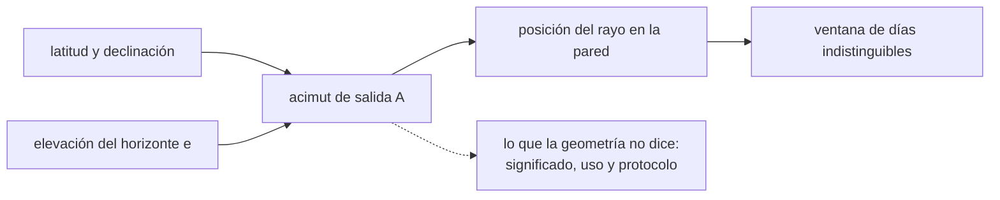

# B133-C01 — Relaciones entre cielo y territorio en los saberes tradicionales

<!-- nav:top -->
[🏠 Programa](../../../../README.md) · [📚 Bloque B133](../../../tronco-comun/B133-saberes-astronomicos-y-educacion-intercultural.md) · [← Anterior: B132-C06 — Informe de un sitio arqueoastronómico](../../B132/B132-C06-informe-de-un-sitio-arqueoastronomico/CLASE.md) · [Siguiente: B133-C02 — Narrativas orales y transmisión del saber del cielo →](../B133-C02-narrativas-orales-y-transmision-del-saber-del-cielo/CLASE.md)
<!-- /nav -->

## 1. Ubicación, nivel y alcance

Clase 1 del bloque B133. Nivel N4. Los saberes del cielo de muchos pueblos están ligados al lugar donde se vive: el cielo se lee desde un horizonte, una casa, un valle. Aquí aprendes a describir esa relación con una geometría que se puede calcular (el acimut de salida del sol y un rayo que entra por un agujero), sin confundir el cálculo con el saber de nadie. Usas [B131](../../../tronco-comun/B131-didactica-de-la-astronomia.md) solo como contexto didáctico. Los datos del laboratorio son **sintéticos**; el caso documentado proviene de un artículo publicado, y sus protagonistas son las personas de la comunidad que lo compartieron.

## 2. Por qué esta clase existe

Los saberes del cielo se enseñan a menudo como listas de constelaciones o de relatos sueltos, sin el territorio que los sostiene. La decisión central: **¿qué puede decir una geometría astronómica sobre una práctica ligada a un lugar, y qué le corresponde decir solo a quienes la portan?**

## 3. Lo que podrás hacer al terminar

1. Calcular el acimut de salida del sol a partir de la latitud, la declinación y la elevación del horizonte.
2. Explicar por qué el horizonte local cambia el acimut de un mismo día.
3. Calcular el desplazamiento diario de un rayo de sol en una pared y la ventana de días que una medida de cierta precisión no distingue.
4. Verificar el cálculo con una segunda vía numérica.
5. Separar lo documentado por una investigación, lo interpretado por quien investiga y lo que no se sabe.
6. Describir un saber ligado a un territorio sin generalizarlo a otros pueblos.

La evidencia es la **ficha de un marcador solar sintético con su ventana de incertidumbre** del ejercicio 12 (sección 20).

## 4. Con qué llegas y cómo comprobarlo

1. ¿Qué es el acimut y desde dónde se mide?
2. ¿Qué es la declinación del sol?
3. ¿Qué es un solsticio?
4. ¿Qué es un dato sintético?
5. ¿Qué diferencia hay entre un dato y su interpretación?

<details>
<summary>Ver respuestas</summary>

1. El ángulo horizontal de una dirección; aquí, desde el norte hacia el este. 2. El ángulo del sol respecto del ecuador celeste, que varía entre −23,44° y +23,44° en el año. 3. El día en que la declinación alcanza su extremo y el punto de salida del sol deja de avanzar y retrocede. 4. Un dato generado para el ejemplo, no medido. 5. El dato es lo observado; la interpretación es lo que alguien concluye de él.
</details>

Con cuatro o cinco aciertos, sigue; si no, repasa los prerrequisitos.

## 5. Un caso de contexto y casos de referencia

Fu (2016) documentó, durante 13 meses de vida con familias de la comunidad mapuche-pewenche de Trapa Trapa (37° 41' S, 71° 18' W), la astronomía que las personas mayores de cada clan recuerdan. En su artículo cuenta, entre otros hechos que le transmitieron, que las cabañas antiguas están orientadas para recibir los primeros rayos por la puerta, y relata lo que un informante dijo de su abuelo: un agujero en la pared oriental de la cocina dejaba entrar el primer rayo, que caía en la pared opuesta a unos cinco metros, y el anciano marcaba su posición desde mediados de junio para reconocer el día en que el rayo «retrocedía». El autor añade que él mismo probó esa idea con un experimento de marcado con un error medio de 2,9 mm y concluyó una ventana de unos días en torno al solsticio. Todo eso es lo que **ese artículo documenta y reporta**; no es una descripción general de «los mapuche».

El **ejemplo conductor** de esta clase es distinto y **sintético**: una pared a 5,0 m del agujero, tres horizontes inventados (0°, 3° y 8°) y la latitud del artículo. Con él no se mide a ninguna comunidad: se aprende la geometría que permite *leer* un artículo como el de Fu.

## 6. Vocabulario

El **acimut** `A` es el ángulo desde el norte hacia el este. La **declinación** `δ` es la latitud celeste del sol. La **elevación del horizonte** `e` es la altura angular de la línea del terreno (una cumbre, un cerro) sobre el horizonte matemático. El **orto** es la salida del sol. El **marcador** es un elemento del lugar (un agujero, una cumbre) usado para seguir el orto. El **territorio**, en esta clase, es el lugar concreto desde el que se mira; para quienes lo habitan puede significar mucho más de lo que una geometría recoge.

## 7. Modelo mental: el cielo se mira desde un lugar



*Descripción textual:* la latitud, la declinación y el horizonte local fijan el acimut del orto; ese acimut mueve un rayo en una pared; y la precisión de la medida define cuántos días parecen iguales. Lo que ese lugar significa para sus habitantes queda fuera del cálculo.

Analogía: leer la hora en un reloj de sol: la geometría explica la sombra, pero no por qué una familia ordena su día en torno a ella. Límite: la analogía dice que el cálculo es parcial; no que el saber sea «solo» un reloj.

## 8. La explicación, paso a paso

### 8.1 Acimut de salida

Con altura `h` del centro del sol, `cos A = (sin δ − sin φ sin h)/(cos φ cos h)`. Para un borde superior que toca un horizonte de elevación `e`, `h = e − 0,833°` (radio solar 0,267° más refracción 0,566°). En `φ = −37,683°` y el solsticio de junio (`δ = +23,44°`), con horizonte matemático `h = 0`, `A = 59,83°`; con `h = −0,833°`, `A = 60,56°`.

### 8.2 Tabla del laboratorio

| Fecha | `δ` (°) | `e = 0°` | `e = 3°` | `e = 8°` |
|---|---|---|---|---|
| 21-03 | 0,000 | 90,643 | 88,325 | 84,426 |
| 21-06 | 23,438 | 60,566 | 57,846 | 52,865 |
| 23-09 | −1,323 | 92,315 | 89,998 | 86,116 |
| 21-12 | −23,436 | 120,920 | 118,274 | 114,166 |

El modelo de declinación es aproximado (longitud eclíptica uniforme): `δ` el 23-09 sale −1,3° cuando en la realidad es casi 0°, de modo que los equinoccios del modelo no son fiables; los solsticios sí (error < 0,1°).

### 8.3 Dos vías

Resolviendo numéricamente el ángulo horario por bisección y calculando el acimut con vectores, la diferencia máxima con la forma cerrada en 53 fechas y 3 horizontes es `2,84 × 10⁻¹⁴°`. Con `h = 0`, los dos solsticios suman exactamente 180° (59,8253° + 120,1747°); con `h = −0,833°` suman 181,4888°, porque el sol sale algo más al sur en ambos.

### 8.4 El rayo en la pared

El rayo recorre la pared opuesta una distancia lateral `x = D tan(90° − A)`. Con `D = 5,0 m` y `A = 60,566°`, `x = 2,82 m`. Cerca del solsticio de junio el desplazamiento diario pasa de +5,39 mm (15→16 de junio) a −0,21 mm (20→21), −1,34 mm (21→22) y −8,01 mm (27→28): cambia de signo. Si la medida solo distingue 2,9 mm, los días 18-06 a 22-06 (5 días) no se distinguen entre sí.

### 8.5 Qué dice y qué no dice

El cálculo dice *qué precisión* haría falta para reconocer el cambio de sentido. No dice si una comunidad real usó ese método, cómo lo concibe ni qué significa para ella: eso lo reporta, cuando lo hace, quien trabajó con ella. En el artículo de Fu, además de esa geometría, hay un entramado de nombres, relatos y usos del cielo que el cálculo no toca.

## 9. Magnitudes, símbolos y unidades

| Símbolo | Qué es | Unidad | Valor / nota |
|---|---|---|---|
| `φ` | latitud | ° | −37,683 (Fu 2016) |
| `δ` | declinación solar | ° | ±23,44 en solsticios |
| `e` | elevación del horizonte | ° | 0; 3; 8 (sintéticos) |
| `h` | altura del centro del sol al orto | ° | `e − 0,833` |
| `A` | acimut desde el norte hacia el este | ° | 60,57 (junio, `e = 0`) |
| `D` | distancia agujero–pared | m | 5,0 (ejemplo) |
| `x` | desplazamiento lateral del rayo | m | 2,82 |

## 10. Convenciones y referencias

Acimut de 0° al norte, creciente hacia el este; latitud sur negativa; fechas de un año no bisiesto; la declinación usa una longitud eclíptica uniforme (no incluye la excentricidad de la órbita); sin efecto de la altura del observador ni de la forma exacta del terreno. El horizonte, la pared y el umbral son inventados. La tolerancia de verificación es `10⁻⁶°` entre dos vías.

## 11. De dónde sale lo que afirmamos

| ID | Fuente | Localizador | Respalda | Estado |
|---|---|---|---|---|
| S1 | Fu, R. R. (2016), «Las estrellas a través de las araucarias: la etnoastronomía mapuche-pewenche», *Boletín del Museo Chileno de Arte Precolombino* 21(2): 81-100 — http://www.redalyc.org/articulo.oa?id=359953501006 (texto leído el 2026-11-11 en las secciones de método y de calendario) | introducción, metodología y sección de We Tripantü | Latitud de Trapa; 13 meses de convivencia; orientación de cabañas; agujero de la pared oriental y rayo a ~5 m según un informante; experimento de marcado con error medio 2,9 mm; saber custodiado con celo | Consultada (es el relato del autor; las personas de la comunidad no son coautoras) |
| S2 | Leaman, T. M.; Hamacher, D. W.; Carter, M. T., «Aboriginal Astronomical Traditions from Ooldea, South Australia, Part 2: Animals in the Ooldean Sky» — https://arxiv.org/abs/1601.01065 (resumen consultado el 2026-11-11) | resumen | Tradiciones del cielo que vinculan animales celestes con el comportamiento de sus equivalentes terrestres (resumen) | Consultada solo en resumen |
| S3 | Lee, A. S. et al. (2020), *Building a Framework for Indigenous Astronomy Collaboration* — https://arxiv.org/abs/2008.07270 (texto leído el 2026-11-11) | sección 5 y preguntas | Protocolos sobre cuándo y quién cuenta; «todos eran parte del conocimiento del territorio y del cielo» (paráfrasis) | Consultada |
| S4 | UNESCO, Convención de 2003 para la salvaguardia del patrimonio inmaterial — https://ich.unesco.org/en/convention (consultada 2026-11-11) | artículo 2 | Dominio «conocimientos y prácticas sobre la naturaleza y el universo» | Consultada |
| — | Fórmulas de acimut y declinación | — | las verifica el laboratorio con una segunda vía | No consultada en una fuente concreta |

Límites: lo que Fu reporta de la comunidad es su registro; no se sabe si otras comunidades mapuche, o los mismos pewenche en otros lugares, comparten esas prácticas. Del texto de Fu no se leyeron todas las secciones. No se infiere nada de otros pueblos.

## 12. Cómo ver la relación cielo–lugar

| Magnitud | Valor |
|---|---|
| `A` en el solsticio de junio, `e = 0` | 60,566° |
| efecto de un horizonte de 8° | −7,70° |
| `x` del rayo | 2,82 m |
| días sin distinguir (2,9 mm) | 5 |
| diferencia entre dos vías | 2,8 × 10⁻¹⁴ ° |

Descripción larga: un horizonte más alto adelanta el orto y lo desplaza hacia el norte en junio; el rayo se mueve cada vez menos cerca del solsticio, y por eso esos días son difíciles de separar.

## 13. Ejemplo trabajado: el rayo el 28 de junio

**Paso 1 · Acimut.** Para el 28-06 el modelo da un `A` algo mayor que el de junio 21 y el desplazamiento diario crece con los días.

**Paso 2 · Desplazamiento.** Entre el 27 y el 28 el rayo se mueve −8,013 mm en una pared a 5 m.

**Paso 3 · Comparación.** `8,013 mm > 2,9 mm`: esa diferencia sí sería detectable con la precisión supuesta.

**Paso 4 · Lectura.** Una medida de 2,9 mm distinguiría el 28-06 del 27-06, pero no el 20-06 del 21-06.

## 14. Distintas formas de describir un orto

**Por número:** `A`. **Por tabla:** las fechas y horizontes. **Por geometría:** `x` en la pared. **Por texto:** «sale más al norte en junio». **Por el lugar:** «el sol llega primero a tal ladera». La última es la forma de quienes habitan el lugar y no se reemplaza por las otras.

## 15. Práctica guiada

**Ejercicio 1 · con los pasos indicados.** Calcula `A` con `h = 0` en el ecuador (`φ = 0`) para `δ = 23,44°`. *Pasos:* con `φ = 0`, `cos A = sin δ`.

<details><summary>Solución comentada</summary>

`cos A = 0,3978`, `A = 66,56°`: en el ecuador el orto solsticial queda a 23,44° del este.
</details>

**Ejercicio 2 · con una pista.** Estima `x` para `A = 60,566°` y `D = 5 m`. *Pista:* `x = D tan(90° − A)`.

<details><summary>Solución comentada</summary>

`5 × tan(29,434°) = 2,82 m`.
</details>

**Ejercicio 3 · casi autónomo.** ¿Por qué un horizonte más alto desplaza el orto de junio hacia el norte en el modelo?

<details><summary>Solución comentada</summary>

El sol debe alcanzar una altura `h = e − 0,833°` mayor; en junio su trayectoria se inclina hacia el norte, así que el punto del horizonte donde cruza esa altura queda más al norte (`A` menor).
</details>

## 16. Práctica autónoma, transferencia e integrador

**Ejercicio 4 · autónomo.** Con `e = 8°` en junio, ¿cuántos grados se corre el orto respecto de `e = 0°`?

<details><summary>Solución comentada</summary>

`60,563° − 52,863° = 7,70°` (laboratorio, `δ = 23,44°` y `h = e − 0,833°`).
</details>

**Ejercicio 5 · autónomo.** Si el agujero está a `D = 10 m` y el umbral sigue siendo 2,9 mm, ¿cómo cambia la ventana de días?

<details><summary>Solución comentada</summary>

El desplazamiento diario es proporcional a `D`; la ventana, aproximadamente `±2,6 días` a 5 m, se reduce a la mitad (≈ ±1,3 días).
</details>

**Ejercicio 6 · autónomo.** ¿Por qué los equinoccios del modelo no son fiables?

<details><summary>Solución comentada</summary>

La longitud eclíptica uniforme ignora la excentricidad: la `δ` del 23-09 sale −1,3° en vez de ~0°.
</details>

**Ejercicio 7 · autónomo.** Con `h = 0` y `φ = −37,68°`, ¿cuánto suman los acimutes de ambos solsticios y por qué?

<details><summary>Solución comentada</summary>

180°: `cos A` cambia de signo con `δ`, y `A₁ + A₂ = 180°` cuando el término de `h` es nulo.
</details>

**Ejercicio 8 · autónomo.** Menciona dos cosas que un número de acimut no puede decirte de una práctica de una comunidad.

<details><summary>Solución comentada</summary>

Por ejemplo, su significado para quienes la practican y quién y cuándo puede contarla. Solo la comunidad lo define.
</details>

**Ejercicio 9 · transferencia.** **Transferencia.** Un folleto afirma que «los pueblos originarios usaban agujeros en las paredes para medir el solsticio». ¿Qué falla?

<details><summary>Solución comentada</summary>

Generaliza a «los pueblos» un caso que Fu reporta a partir de un informante de una comunidad concreta; falta atribuir y delimitar.
</details>

**Ejercicio 10 · transferencia.** **Transferencia.** Te piden calcular el orto solar para el valle de otra comunidad. ¿Qué haces antes?

<details><summary>Solución comentada</summary>

Pedir a esa comunidad su participación y su acuerdo (clase C03); el cálculo por sí solo no basta ni autoriza a divulgar.
</details>

**Ejercicio 11 · transferencia.** **Transferencia.** Un cerro de 8° de elevación está al este de una casa. ¿Qué dos efectos tiene en el orto?

<details><summary>Solución comentada</summary>

Retrasa la hora de salida y mueve el punto de salida del solsticio de junio unos 7,7° hacia el norte en el modelo.
</details>

**Ejercicio 12 · integrador.** **Integrador.** Elabora tu *ficha de un marcador solar sintético con su ventana de incertidumbre*: tabla de `A` para los tres horizontes, `x` del rayo, ventana de días indistinguibles para el umbral que elijas, la segunda vía y una lista de qué es documentado, qué es modelo y qué no se sabe.

<details><summary>Solución comentada</summary>

Secciones 8.1–8.5 y la salida del laboratorio; la lista distingue lo de S1 (reportado por Fu), lo calculado aquí (sintético) y lo desconocido.
</details>

## 17. Laboratorio: orto solar y rayo en una pared

El script [orto_solar.py](orto_solar.py) calcula el acimut del orto para tres horizontes, lo verifica con una bisección numérica, calcula el desplazamiento diario del rayo y la ventana de días indistinguibles (**comprueba** simetría de solsticios con `h = 0`, equinoccio, acuerdo de dos vías < 1e-6° y monotonía con `e`).

**Datos:** latitud y longitud de 5 m de Fu (2016), usadas solo como valores de ejemplo; horizontes, pared y umbral **sintéticos**. **Predice antes de ejecutar:** ¿cuántos días no se distinguirán con 2,9 mm? (5.) **Ejecución del 2026-11-11 (Python 3.12.9):**

```text
Python 3.12.9 (biblioteca estandar)
Latitud -37.6833 deg (Fu 2016); pared a 5.0 m (ejemplo SINTETICO)
Horizonte e [deg]: 0, 3, 8 (SINTETICOS); h_centro = e - 0.833
Acimut de salida [deg desde el norte hacia el este]
 fecha   dia  decl[deg]   e=0       e=3       e=8
 21-03    80     0.000    90.643    88.325    84.426
 21-06   172    23.438    60.566    57.846    52.865
 23-09   266    -1.323    92.315    89.998    86.116
 21-12   355   -23.436   120.920   118.274   114.166
Diferencia maxima forma cerrada vs biseccion = 2.84e-14 deg
Solsticios con horizonte matematico (h = 0): 59.8253 y 120.1747 deg; suma = 180.000000000 (esperada 180)
Con h = -0.833 la simetria se rompe: suma = 181.4888 deg (el sol sale algo mas al sur en ambos casos)
Equinoccio con h = 0: desviacion maxima respecto de 90 deg = 0.00e+00
Rayo en la pared (e = 0): desplazamiento diario alrededor del solsticio de junio, en mm
  15-06->16-06     5.394 mm
  16-06->17-06     4.281 mm
  17-06->18-06     3.162 mm
  18-06->19-06     2.040 mm
  19-06->20-06     0.915 mm
  20-06->21-06    -0.211 mm
  21-06->22-06    -1.337 mm
  22-06->23-06    -2.461 mm
  23-06->24-06    -3.582 mm
  24-06->25-06    -4.699 mm
  25-06->26-06    -5.811 mm
  26-06->27-06    -6.916 mm
  27-06->28-06    -8.013 mm
Dias con |desplazamiento diario| < 2.9 mm: 18-06 a 22-06 (5 dias)
Acimut del solsticio de junio con e = 0, 3, 8 deg: 60.563, 57.844, 52.863
Pruebas superadas.
```

```bash
python programa/clases/B133/B133-C01-relaciones-entre-cielo-y-territorio-en-los-saberes-tradicionales/orto_solar.py
```

**Límites:** el modelo no incluye excentricidad, altura del observador ni relieve real; que una ventana de días exista en el modelo no prueba que una comunidad la use. Los resultados no corresponden a ninguna comunidad.

## 18. Errores frecuentes y cómo corregirlos

**Generalizar un caso a «los pueblos originarios».** Se corrige con 8.5 y el ejercicio 9.

**Tomar el cálculo como el saber.** Se corrige con 8.5.

**Usar el horizonte matemático en un valle.** Se corrige con 8.2.

**Confiar en los equinoccios del modelo.** Se corrige con 8.2.

## 19. Cómo sabrás que vas bien

Tras la sección 8: ¿qué acimut esperabas para el solsticio de junio con un horizonte de 3° y cuál obtuviste (57,85°)? Si dudas, repasa 8.1. Tras el laboratorio: ¿qué comprueba? (ver la sección 17).

## 20. Qué entregas y cómo se evalúa

El producto es tu **ficha de un marcador solar sintético con su ventana de incertidumbre** (ejercicio 12).

| Criterio | Inicial | En desarrollo | Logrado | Destacado |
|---|---|---|---|---|
| Conceptos | Los confunde | Parciales | Calcula `A` y `x` | Explica por qué el horizonte importa |
| Cálculo | Sin unidades | Con errores | Tablas completas con unidades | Calcula casos nuevos |
| Numérico | Sin comprobar | Un caso | Contraste con la segunda vía | Interpreta la ventana de incertidumbre |
| Fuentes | Sin fuente | Sin fecha | Fuentes con fecha y estado | Distingue evidencia, interpretación y lo desconocido |
| Límites | No los nombra | Uno | Tres | Discute qué le corresponde decir a la comunidad |

**Condiciones críticas (no se compensan con promedio):** rotular lo sintético; no generalizar de una comunidad a otros pueblos; citar solo lo consultado.

## 21. Ética, seguridad y límites

Clase educativa. No contiene saberes de ningún pueblo: describe lo que una investigación publicada reporta y calcula una geometría con datos inventados. Los saberes del cielo son de quienes los sostienen, y algunos tienen protocolos sobre quién los cuenta y cuándo; este material no los sustituye ni autoriza su divulgación. No fue revisado por personas de las comunidades mencionadas. Accesibilidad: tablas equivalentes a las gráficas, fórmulas en texto, ejercicios sin conexión.

## 22. Para cerrar y seguir

Con un horizonte de 8° el orto de junio se corre 7,7° y un rayo a 5 m cambia de sentido en una ventana de unos 5 días que 2,9 mm no resuelven. Queda una pregunta: ¿cómo se conserva y se transmite un saber así de generación en generación?

**Glosario español–inglés.** acimut · *azimuth*; declinación · *declination*; orto · *sunrise*; horizonte local · *local horizon*; etnoastronomía · *ethnoastronomy*.

**Continuidad.** [B133-C02](../B133-C02-narrativas-orales-y-transmision-del-saber-del-cielo/CLASE.md) estudia las narrativas orales y la transmisión.

**Referencias:** ver sección 11.

<!-- nav:bottom -->
---

[← Anterior: B132-C06 — Informe de un sitio arqueoastronómico](../../B132/B132-C06-informe-de-un-sitio-arqueoastronomico/CLASE.md) · [📚 Bloque B133](../../../tronco-comun/B133-saberes-astronomicos-y-educacion-intercultural.md) · [Siguiente: B133-C02 — Narrativas orales y transmisión del saber del cielo →](../B133-C02-narrativas-orales-y-transmision-del-saber-del-cielo/CLASE.md)
<!-- /nav -->
