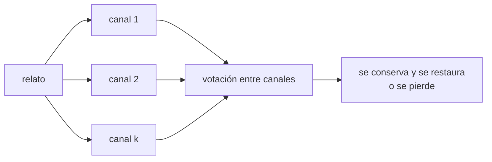

# B133-C02 — Narrativas orales y transmisión del saber del cielo

<!-- nav:top -->
[🏠 Programa](../../../../README.md) · [📚 Bloque B133](../../../tronco-comun/B133-saberes-astronomicos-y-educacion-intercultural.md) · [← Anterior: B133-C01 — Relaciones entre cielo y territorio en los saberes tradicionales](../B133-C01-relaciones-entre-cielo-y-territorio-en-los-saberes-tradicionales/CLASE.md) · [Siguiente: B133-C03 — Colaboración con comunidades en investigación y educación →](../B133-C03-colaboracion-con-comunidades-en-investigacion-y-educacion/CLASE.md)
<!-- /nav -->

## 1. Ubicación, nivel y alcance

Clase 2 del bloque B133. Nivel N4. En muchos pueblos el saber del cielo se conserva y se transmite de palabra, de canto, de práctica y de lugar. Aquí aprendes qué dicen las fuentes consultadas sobre esa transmisión y modelas, con un relato **inventado**, cuánto de un relato sobrevive a las generaciones según los canales que lo sostienen. Usas [B132](../../../tronco-comun/B132-historia-y-arqueoastronomia-aplicadas.md) solo como contexto de crítica de fuentes. El modelo es sintético y no describe ninguna tradición real.

## 2. Por qué esta clase existe

La transmisión oral se trata a menudo como una cadena frágil («se pierde») o como un archivo infalible («se conservó intacto»). Ninguna de las dos cosas está probada en general. La decisión central: **¿qué puede y qué no puede afirmarse sobre la edad o la fidelidad de un saber transmitido oralmente?**

## 3. Lo que podrás hacer al terminar

1. Describir con fuentes qué se ha documentado sobre transmisión oral del saber del cielo, sin generalizar.
2. Calcular la retención por generación de un relato con `k` canales y pérdidas por canal.
3. Calcular las generaciones necesarias para conservar la mitad del relato.
4. Verificar el cálculo con una simulación Monte Carlo con semilla fija.
5. Explicar por qué la retención sola no identifica la edad ni el mecanismo de una tradición.
6. Reconocer que algunas narraciones tienen protocolos de cuándo y quién las cuenta, y que no te corresponde definirlos.

La evidencia es la **ficha de transmisión de un relato sintético** del ejercicio 12 (sección 20).

## 4. Con qué llegas y cómo comprobarlo

1. ¿Qué es una probabilidad por generación?
2. ¿Qué es un estado absorbente?
3. ¿Qué es una simulación Monte Carlo?
4. ¿Qué es un dato sintético?
5. ¿Qué es la identificabilidad de un parámetro?

<details>
<summary>Ver respuestas</summary>

1. La probabilidad de que algo ocurra en cada paso generacional. 2. Un estado del que ya no se sale (aquí, un elemento perdido). 3. Repetir un experimento aleatorio con semilla fija para estimar una probabilidad. 4. Un dato generado para el ejemplo, no medido. 5. La posibilidad de determinar un parámetro de manera única a partir de los datos.
</details>

Con cuatro o cinco aciertos, sigue; si no, repasa los prerrequisitos.

## 5. Un caso de contexto y casos de referencia

Hamacher (2017) analizó dos tradiciones orales del sur de Australia que, según su interpretación, describen cambios periódicos de brillo en tres estrellas gigantes rojas (Betelgeuse, Aldebarán y Antares); sostiene que probablemente son las únicas descripciones conocidas de estrellas variables pulsantes en una tradición oral indígena, y señala que el registro etnográfico previo contenía estrellas mal identificadas. Eso es una **interpretación publicada de un investigador** sobre tradiciones registradas por terceros; el resumen consultado no indica la participación de las comunidades. En otro ámbito, Lee et al. (2020) recuerdan que hay protocolos estrictos sobre cuándo y quién cuenta ciertas historias; por ejemplo, algunas solo se cuentan cuando hay nieve en el suelo.

El **ejemplo conductor** es **sintético**: un relato de 12 elementos sostenido por `k` canales, con una pérdida de 0,15 y una corrupción de 0,05 por canal y generación. Con `k = 1` el relato conserva el 80 % por generación; con `k = 3`, el 95 %. Ningún número describe una tradición.

## 6. Vocabulario

Un **canal** es una vía de conservación (un relato, un lugar, un canto, una práctica). La **retención** `r` es la probabilidad de que un elemento sobreviva correcto una generación. La **corrupción** es el cambio de un elemento a una versión errónea. El **protocolo** es la regla comunitaria sobre cuándo, cómo y quién transmite o cuenta algo. La **tradición oral** es el conjunto de saberes y expresiones transmitidos de forma hablada, cantada o practicada; la Convención de 2003 de la UNESCO la incluye entre los dominios del patrimonio inmaterial.

## 7. Modelo mental: varias cuerdas sostienen el relato



*Descripción textual:* cada elemento del relato lo sostienen `k` canales; en cada generación gana la versión que más canales conservan, y si gana la correcta se restauran todos.

Analogía: un puente colgante con varias cuerdas: una puede fallar sin que caiga. Límite: las cuerdas de un modelo se rompen con probabilidades inventadas; las personas que transmiten un saber lo hacen con intención y significado, no al azar.

## 8. La explicación, paso a paso

### 8.1 La retención por generación

Con `k` canales y probabilidades `1 − q − e` (conserva), `q` (pierde) y `e` (corrompe), el elemento sobrevive si los canales que lo conservan superan a los que lo corrompen: `r = Σ P(a conservados, c corruptos) con a > c`. Con `k = 1`, `r = 1 − q − e = 0,8`.

### 8.2 Resultados del laboratorio

| `k` | `r` por generación | Generaciones para conservar el 50 % | Retención a 10 generaciones |
|---|---|---|---|
| 1 | 0,800000 | 3,11 | 0,1074 |
| 2 | 0,880000 | 5,42 | 0,2785 |
| 3 | 0,950000 | 13,51 | 0,5987 |
| 5 | 0,987305 | 54,25 | 0,8801 |

Más canales no solo aumentan `r`: multiplican las generaciones que el relato aguanta.

### 8.3 Dos vías

La simulación con semilla `20261111` y 20 000 elementos por celda da, por ejemplo, 0,5992 frente a 0,5987 analítico para `k = 3` a 10 generaciones. El mayor `|z|` en las seis celdas es 2,53, por debajo de la tolerancia de 4. Con `k = 1`, `r = 1 − q − e` exactamente.

### 8.4 Por qué la retención no data una tradición

Para conservar el 50 % tras 400 generaciones (10 000 años a 25 años por generación, **ilustrativo**) hace falta `r = 0,998269`. Con `e = 0`, eso lo logra un solo canal con `q = 0,001731`, o tres canales con `q = 0,120078`, o cinco con `q = 0,280335`. Distintas combinaciones dan la misma retención: **la retención observada no identifica ni la edad ni el mecanismo**. Por eso una afirmación sobre la antigüedad de una tradición exige, además de un modelo, evidencia independiente (geológica, astronómica, histórica) y la voz de la comunidad. Nunn y Reid (2016), por ejemplo, proponen en un registro consultado solo en resumen que ciertos relatos de 21 lugares de la costa australiana conservan memoria de la subida del nivel del mar desde hace entre 7250 y 13 070 años calibrados; es una propuesta de quienes la publican, con la que se puede discrepar o coincidir, y esta clase no la evalúa.

### 8.5 Lo que el modelo no representa

No representa la intención, el significado, el contexto ni los protocolos. Que un relato tenga restricciones sobre cuándo se cuenta no es una «pérdida»: es una forma de cuidado del saber. Quien enseña no decide esas reglas. Un error escrito por quien registra puede propagarse: Lee et al. piden extremo cuidado para no introducir errores en los registros escritos u orales.

## 9. Magnitudes, símbolos y unidades

| Símbolo | Qué es | Unidad | Valor / nota |
|---|---|---|---|
| `k` | número de canales | — | 1, 2, 3, 5 (sintético) |
| `q` | pérdida por canal y generación | — | 0,15 (sintético) |
| `e` | corrupción por canal y generación | — | 0,05 (sintético) |
| `r` | retención por generación | — | 0,80–0,987 |
| `G` | generaciones | — | 10; 400 (ilustrativo) |
| — | años por generación | años | 25 (sintético) |

## 10. Convenciones y referencias

Canales independientes; la versión errónea es siempre la misma (caso desfavorable); empate y ausencia de canales cuentan como pérdida; los elementos son independientes entre sí. Semilla `20261111`; tolerancia de 4 desviaciones estándar del binomio. Todos los parámetros son inventados.

## 11. De dónde sale lo que afirmamos

| ID | Fuente | Localizador | Respalda | Estado |
|---|---|---|---|---|
| S1 | Hamacher, D. W. (2017), «Observations of red-giant variable stars by Aboriginal Australians» — https://arxiv.org/abs/1709.04634 (resumen consultado el 2026-11-11) | resumen | Interpretación de dos tradiciones del sur de Australia como descripción de variabilidad de tres gigantes rojas; estrellas mal identificadas en el registro previo; el resumen no menciona colaboración con comunidades | Consultada solo en resumen |
| S2 | Lee, A. S. et al. (2020), *Building a Framework for Indigenous Astronomy Collaboration* — https://arxiv.org/abs/2008.07270 (texto leído el 2026-11-11) | sección 5 | Protocolos sobre cuándo se cuentan historias (algunas solo con nieve); cuidado de no introducir errores en los registros | Consultada |
| S3 | Naciones Unidas, Declaración sobre los derechos de los pueblos indígenas (res. 61/295, 13-09-2007), artículo 13 (texto en PDF leído el 2026-11-11) | art. 13 | Derecho a revitalizar, usar, desarrollar y transmitir a las generaciones futuras historias, lenguas y tradiciones orales | Consultada |
| S4 | UNESCO, Convención de 2003 — https://ich.unesco.org/en/convention (consultada 2026-11-11) | art. 2 | Dominio «tradiciones y expresiones orales»; patrimonio recreado continuamente | Consultada |
| S5 | Nunn, P. D.; Reid, N. J. (2016), *Australian Geographer* 47(1): 11-47 (registro de repositorio vía búsqueda, 2026-11-11) | resumen | Propuesta de persistencia de relatos costeros de 7250–13 070 años calibrados | Consultada solo en resumen de registro; texto completo y discusión crítica no consultados |
| — | Retención multinomial y Monte Carlo | — | los verifica el laboratorio con una segunda vía | No consultada en una fuente concreta |

Límites: el modelo y sus números son inventados; no se evalúan ni la propuesta de Nunn y Reid ni la de Hamacher; el relato de «las personas que transmiten» no está en ninguna de las fuentes salvo lo citado.

## 12. Cómo ver la transmisión

| Magnitud | Valor |
|---|---|
| `r` con 1 canal | 0,800 |
| `r` con 3 canales | 0,950 |
| generaciones al 50 % con 5 canales | 54,25 |
| `q` de 3 canales para 400 generaciones | 0,1201 |
| `\|z\|` máximo Monte Carlo | 2,53 |

Descripción larga: la retención crece rápido con los canales; para sostener un relato durante cientos de generaciones, basta con que cada canal sea moderadamente fiable si hay varios, pero lo que se observe hoy no dice cuántos canales hubo ni cuánto duró.

## 13. Ejemplo trabajado: tres canales

**Paso 1 · Estados.** Con `k = 3`, el elemento sobrevive si `a > c`: (3,0,0), (2,0,1), (2,1,0), (1,0,2).

**Paso 2 · Probabilidad.** Sumar las multinomiales con `p = 0,80`, `e = 0,05`, `q = 0,15`.

**Paso 3 · Resultado.** `r = 0,95` (laboratorio).

**Paso 4 · Generaciones.** `G½ = ln 0,5/ln 0,95 = 13,51`.

## 14. Distintas formas de describir la transmisión

**Por canal:** relato, lugar, canto, práctica. **Por número:** `r`. **Por tiempo:** generaciones. **Por protocolo:** cuándo y quién. **Por significado:** lo que el saber es para quien lo sostiene; esa forma no la sustituyen las otras.

## 15. Práctica guiada

**Ejercicio 1 · con los pasos indicados.** Calcula `r` con `k = 2`, `q = 0,15`, `e = 0,05`. *Pasos:* enumera `a > c` con `a + c + l = 2`.

<details><summary>Solución comentada</summary>

(2,0,0): `0,8² = 0,64`; (1,0,1): `2 × 0,8 × 0,15 = 0,24`; (1,1,0) es empate y no cuenta. `r = 0,88`.
</details>

**Ejercicio 2 · con una pista.** ¿Qué retención hay tras 5 generaciones con `k = 1`? *Pista:* `r⁵`.

<details><summary>Solución comentada</summary>

`0,8⁵ = 0,3277`; el laboratorio lo simula como 0,3299.
</details>

**Ejercicio 3 · casi autónomo.** ¿Por qué con `k = 1` no hay votación?

<details><summary>Solución comentada</summary>

Un solo canal no puede corregirse con otros; `r = 1 − q − e`.
</details>

## 16. Práctica autónoma, transferencia e integrador

**Ejercicio 4 · autónomo.** `r` para `k = 2`, `q = 0,15`, `e = 0`.

<details><summary>Solución comentada</summary>

El elemento sobrevive si queda al menos un canal: `1 − 0,15² = 0,9775`.
</details>

**Ejercicio 5 · autónomo.** Generaciones al 50 % con `k = 5`.

<details><summary>Solución comentada</summary>

`54,25` (laboratorio).
</details>

**Ejercicio 6 · autónomo.** ¿Qué `q` necesita un solo canal para 400 generaciones al 50 %?

<details><summary>Solución comentada</summary>

`0,001731`.
</details>

**Ejercicio 7 · autónomo.** Explica por qué el laboratorio toma la corrupción como «siempre la misma versión».

<details><summary>Solución comentada</summary>

Es el caso desfavorable: si los errores coincidieran, podrían imponerse en la votación.
</details>

**Ejercicio 8 · autónomo.** Cita un hecho de las fuentes sobre protocolo y explica por qué no es una «pérdida».

<details><summary>Solución comentada</summary>

Lee et al.: algunas historias solo se cuentan con nieve en el suelo; es una regla de cuidado del saber.
</details>

**Ejercicio 9 · transferencia.** **Transferencia.** Un libro dice que «la tradición oral conserva el cielo de hace diez mil años». ¿Qué le falta?

<details><summary>Solución comentada</summary>

Fuente concreta, comunidad, evidencia independiente de la edad y distinción entre propuesta y hecho; el modelo (sección 8.4) muestra que la retención sola no data.
</details>

**Ejercicio 10 · transferencia.** **Transferencia.** Un investigador publica una interpretación astronómica de un relato registrado por otros. ¿Qué debería preguntar el lector?

<details><summary>Solución comentada</summary>

Si participaron las comunidades, cómo se registró el relato, qué estrellas se identificaron y con qué criterio (cf. Hamacher).
</details>

**Ejercicio 11 · transferencia.** **Transferencia.** ¿Qué haces si una comunidad te pide no registrar un relato?

<details><summary>Solución comentada</summary>

No lo registras ni lo divulgas; su decisión prima (C03) y el derecho está reconocido en el artículo 31 de la Declaración de la ONU.
</details>

**Ejercicio 12 · integrador.** **Integrador.** Elabora tu *ficha de transmisión de un relato sintético*: tabla de `r`, generaciones al 50 %, simulación frente a analítico, tabla de combinaciones `(k, q)` equivalentes y una lista de qué es fuente, qué es modelo y qué no se sabe.

<details><summary>Solución comentada</summary>

Secciones 8.1–8.5 y la salida del laboratorio.
</details>

## 17. Laboratorio: retención de un relato sintético

El script [transmision.py](transmision.py) calcula `r` y las generaciones al 50 %, simula con semilla fija y calcula los pares `(k, q)` que dan la misma retención (**comprueba** `r = 1 − q − e` con `k = 1`, `|z| < 4` y retención idéntica de las combinaciones).

**Datos:** todo **sintético**. **Predice antes de ejecutar:** ¿qué `q` necesita un canal para 400 generaciones al 50 %? (≈ 0,0017.) **Ejecución del 2026-11-11 (Python 3.12.9):**

```text
Python 3.12.9 (biblioteca estandar)
Relato SINTETICO; q = 0.15, e = 0.05 por canal y generacion; 25 años por generacion (sinteticos)
 k   r (1 gen)   G de retencion 50%   retencion a 10 gen   (analitica)
 1   0.800000         3.11           0.107374
 2   0.880000         5.42           0.278501
 3   0.950000        13.51           0.598737
 5   0.987305        54.25           0.880062
Monte Carlo (n = 20000 elementos por celda; semilla 20261111): simulado frente a analitico
  k=1 G= 1  simulado 0.8072  analitico 0.8000  z = +2.53
  k=1 G= 5  simulado 0.3299  analitico 0.3277  z = +0.67
  k=1 G=10  simulado 0.1068  analitico 0.1074  z = -0.26
  k=3 G= 1  simulado 0.9500  analitico 0.9500  z = +0.03
  k=3 G= 5  simulado 0.7744  analitico 0.7738  z = +0.21
  k=3 G=10  simulado 0.5992  analitico 0.5987  z = +0.13
|z| maximo = 2.53 (tolerancia 4)
Para conservar 50% tras 400 generaciones (10000 años, ILUSTRATIVO) hace falta r = 0.998269 por generacion
 k   q de cada canal que da ese r (e = 0)
 1   0.001731
 2   0.041610
 3   0.120078
 5   0.280335
Combinaciones distintas (k, q) producen la misma retencion: la retencion sola no identifica el mecanismo ni la edad.
Pruebas superadas.
```

```bash
python programa/clases/B133/B133-C02-narrativas-orales-y-transmision-del-saber-del-cielo/transmision.py
```

**Límites:** canales independientes, errores idénticos y elementos independientes; los parámetros no se midieron en ninguna tradición. El `z = +2,53` es plausible en 6 celdas con una tolerancia de 4.

## 18. Errores frecuentes y cómo corregirlos

**Tomar el modelo como medida de una tradición.** Se corrige con 8.4 y la sección 10.

**Datar una tradición por su fidelidad aparente.** Se corrige con 8.4.

**Tratar un protocolo como una pérdida.** Se corrige con 8.5.

**Presentar una interpretación publicada como un hecho.** Se corrige con la sección 5.

## 19. Cómo sabrás que vas bien

Tras la sección 8: ¿qué `r` esperabas con tres canales y cuál obtuviste (0,95)? Si dudas, repasa 8.1. Tras el laboratorio: ¿qué comprueba? (ver la sección 17).

## 20. Qué entregas y cómo se evalúa

El producto es tu **ficha de transmisión de un relato sintético** (ejercicio 12).

| Criterio | Inicial | En desarrollo | Logrado | Destacado |
|---|---|---|---|---|
| Conceptos | Los confunde | Parciales | Explica canal, retención y votación | Explica la no identificabilidad |
| Cálculo | Sin unidades | Con errores | Tablas completas | Calcula casos nuevos |
| Numérico | Sin comprobar | Un caso | Contraste con Monte Carlo | Interpreta las diferencias |
| Fuentes | Sin fuente | Sin fecha | Fuentes con fecha y estado | Separa interpretación publicada de hecho |
| Límites | No los nombra | Uno | Tres | Discute qué le corresponde decir a la comunidad |

**Condiciones críticas (no se compensan con promedio):** rotular todo lo sintético; no datar ni valorar una tradición real con el modelo; citar solo lo consultado.

## 21. Ética, seguridad y límites

Clase educativa. No contiene relatos de ningún pueblo. Las tradiciones orales y sus protocolos son de las comunidades que las sostienen, y su transmisión es un derecho que la Declaración de la ONU reconoce (art. 13); quien enseña no decide qué se cuenta ni cuándo. La clase no fue revisada por personas de esas comunidades. Accesibilidad: tablas equivalentes a las gráficas, fórmulas en texto, ejercicios sin conexión.

## 22. Para cerrar y seguir

Un relato con tres canales conserva el 95 % por generación y llega a la mitad en unas 13,5 generaciones, pero una misma retención puede venir de muchas combinaciones: la fidelidad aparente no data. Queda una pregunta: ¿cómo se trabaja con las comunidades que sostienen esos saberes?

**Glosario español–inglés.** tradición oral · *oral tradition*; canal · *channel*; retención · *retention*; protocolo · *protocol*; identificabilidad · *identifiability*.

**Continuidad.** [B133-C03](../B133-C03-colaboracion-con-comunidades-en-investigacion-y-educacion/CLASE.md) estudia la colaboración con comunidades.

**Referencias:** ver sección 11.

<!-- nav:bottom -->
---

[← Anterior: B133-C01 — Relaciones entre cielo y territorio en los saberes tradicionales](../B133-C01-relaciones-entre-cielo-y-territorio-en-los-saberes-tradicionales/CLASE.md) · [📚 Bloque B133](../../../tronco-comun/B133-saberes-astronomicos-y-educacion-intercultural.md) · [Siguiente: B133-C03 — Colaboración con comunidades en investigación y educación →](../B133-C03-colaboracion-con-comunidades-en-investigacion-y-educacion/CLASE.md)
<!-- /nav -->
