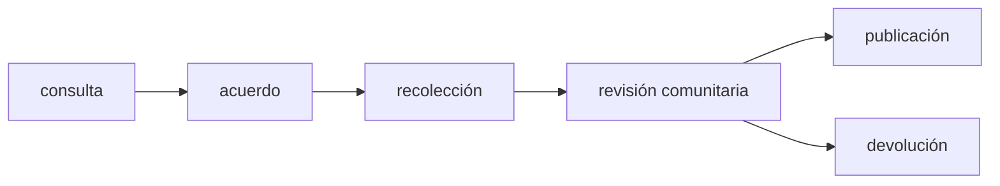

# B133-C03 — Colaboración con comunidades en investigación y educación

<!-- nav:top -->
[🏠 Programa](../../../../README.md) · [📚 Bloque B133](../../../tronco-comun/B133-saberes-astronomicos-y-educacion-intercultural.md) · [← Anterior: B133-C02 — Narrativas orales y transmisión del saber del cielo](../B133-C02-narrativas-orales-y-transmision-del-saber-del-cielo/CLASE.md) · [Siguiente: B133-C04 — Riesgos de apropiación cultural en la divulgación →](../B133-C04-riesgos-de-apropiacion-cultural-en-la-divulgacion/CLASE.md)
<!-- /nav -->

## 1. Ubicación, nivel y alcance

Clase 3 del bloque B133. Nivel N4. Trabajar con una comunidad que sostiene un saber del cielo no es una gestión técnica: es una relación, con derechos reconocidos y con un orden de pasos que no se puede alterar. Aquí aprendes qué piden las fuentes consultadas y conviertes un acuerdo de colaboración **sintético** en datos que se pueden revisar: consentimiento, ejes CARE, crédito, devolución de resultados y orden de las etapas. Retomas la ética general de [B02](../../../tronco-comun/B02-historia-arqueoastronomia-y-culturas-del-cielo.md) y la comunicación de [B130](../../../tronco-comun/B130-comunicacion-y-divulgacion-cientifica.md). Las comunidades y acuerdos del laboratorio son **ficticios**.

## 2. Por qué esta clase existe

Los saberes del cielo han sido registrados muchas veces sin que las comunidades decidieran qué, cómo ni para qué. La decisión central: **¿qué debe estar acordado, y en qué orden, antes de recoger, usar o enseñar un saber ajeno?**

## 3. Lo que podrás hacer al terminar

1. Enumerar los derechos y principios que las fuentes consultadas ponen como punto de partida.
2. Distinguir consentimiento libre, previo, informado y revocable.
3. Reconocer los cuatro ejes CARE (beneficio colectivo, autoridad de control, responsabilidad y ética) en un acuerdo.
4. Verificar que las etapas respeten su orden con dos algoritmos independientes.
5. Detectar elementos ausentes en un acuerdo, sabiendo que una lista completa no basta.
6. Reconocer que la relación es de años y que la decisión final pertenece a la comunidad.

La evidencia es el **acuerdo sintético validado con sus hallazgos** del ejercicio 12 (sección 20).

## 4. Con qué llegas y cómo comprobarlo

1. ¿Qué es el consentimiento informado?
2. ¿Qué es un grafo de precedencia?
3. ¿Qué es un dato sintético?
4. ¿Qué diferencia hay entre cumplir una lista y respetar a una comunidad?
5. ¿Qué es un ciclo en un grafo?

<details>
<summary>Ver respuestas</summary>

1. La aceptación de participar tras recibir información comprensible, sin presión. 2. Un conjunto de pasos con flechas que indican qué debe ocurrir antes. 3. Un dato generado para el ejemplo, no medido. 4. La lista comprueba la presencia de elementos; respetar exige relación, escucha y que decida la comunidad. 5. Una secuencia de flechas que vuelve al punto de partida (no hay orden posible).
</details>

Con cuatro o cinco aciertos, sigue; si no, repasa los prerrequisitos.

## 5. Un caso de contexto y casos de referencia

Lee et al. (2020) describen el proceso de construir un marco para programas de astronomía indígena en un museo de historia natural y planetario de Minnesota, escrito por integrantes de una colaboración entre una astrónoma-académica indígena y el museo. Insisten en dos puntos finales: el **protocolo** (hay reglas sobre qué se comparte, quién, con quién y cuándo) y la visión de *Etuaptmumk* o *Two-Eyed Seeing* («ver con un ojo desde las fortalezas de los saberes indígenas y con el otro desde las de los saberes occidentales, y usar ambos para el beneficio de todos», en palabras de los mayores mi'kmaw Albert y Murdena Marshall, con Cheryl Bartlett). Neilson et al. (2019) añaden que visitar una comunidad una o dos veces no construye la confianza necesaria y que hace falta un compromiso de varios años.

El **ejemplo conductor** es **sintético**: tres acuerdos con comunidades ficticias, uno completo (A), uno extractivo (B) y uno con las etapas desordenadas (C). Con ellos se aprende a revisar un acuerdo, no a negociarlo con una comunidad real.

## 6. Vocabulario

El **consentimiento libre, previo e informado** es la aceptación sin coacción, antes de empezar y con información suficiente. Los **principios CARE** para la gobernanza de datos indígenas son Beneficio Colectivo, Autoridad para Controlar, Responsabilidad y Ética. El **portador del saber** es la persona o grupo que sostiene el saber en su comunidad. La **devolución de resultados** es entregar a la comunidad lo producido, de modo que lo pueda usar. El **protocolo** es la regla comunitaria sobre compartir un saber. El **acuerdo** es el documento que fija todo lo anterior.

## 7. Modelo mental: un orden que no se salta



*Descripción textual:* primero se consulta, luego se acuerda, después se recoge; los resultados vuelven a la comunidad para su revisión, y solo entonces se publican o se devuelven en su forma final.

Analogía: un puente se construye de un lado al otro, no se coloca el tablero antes que los pilares. Límite: las comunidades pueden decidir otro orden o rechazar el proyecto; el orden del modelo es el mínimo, no el único.

## 8. La explicación, paso a paso

### 8.1 Derechos como punto de partida

La Declaración de las Naciones Unidas sobre los derechos de los pueblos indígenas (resolución 61/295 de la Asamblea General, 13 de septiembre de 2007) reconoce, en el artículo 31, el derecho a mantener, controlar, proteger y desarrollar su patrimonio cultural, sus conocimientos tradicionales y sus manifestaciones, incluidas las tradiciones orales, y su propiedad intelectual sobre ellos. En el artículo 32.2 se habla de obtener el consentimiento libre e informado antes de aprobar proyectos que afecten sus tierras o territorios; aquí se usa **por analogía** como criterio para proyectos sobre sus saberes, y esa extensión es una decisión de esta clase, no un texto de la Declaración.

### 8.2 Los cuatro ejes CARE

Carroll et al. (2020), en un resumen consultado, presentan CARE como complemento de los principios FAIR para los datos: Beneficio Colectivo, Autoridad para Controlar, Responsabilidad y Ética, desarrollados por el Grupo Internacional de Interés en la Soberanía de Datos Indígenas. Esta clase los usa como cuatro campos del acuerdo; su significado completo está en el artículo, que no se consultó.

### 8.3 Lo que reportan los casos

Fu (2016) cuenta que vivió 13 meses con familias de una comunidad, que el saber astronómico es «cuidado con celo», que algunos informantes no se sintieron del todo cómodos con la idea de documentarlo y que quiso hacer un registro fiel. El texto leído no describe un acuerdo formal ni la devolución; no se sabe si los hubo. Lee et al. proponen en cambio construir marcos con la colaboración desde el principio. La comparación no juzga a Fu: muestra cómo se ve, en un artículo, una colaboración y cómo se ve su ausencia.

### 8.4 Resultados del laboratorio

| Acuerdo | Críticos | Importantes/avisos | Veredicto |
|---|---|---|---|
| A (completo) | 0 | 0 | puede iniciar |
| B (extractivo) | 6 | 5 | no puede iniciar |
| C (orden roto) | 2 | 0 | no puede iniciar |

B carece de consentimiento previo e informado y revocable, de tres de los cuatro ejes CARE, de reconocimiento de portadores, de crédito, de devolución, de idioma de la comunidad y de duración (0,1 años). C rompe dos precedencias: la recolección empieza antes del acuerdo y la publicación antes de la revisión comunitaria.

### 8.5 Dos vías y límites

El orden de etapas se verifica con el algoritmo de Kahn y con un recorrido en profundidad; ambos dicen que el grafo no tiene ciclos y que, con un ciclo agregado, no hay orden posible. Los hallazgos coinciden con los defectos plantados, de modo que la comprobación es circular por diseño: valida el código, no la ética. Ningún acuerdo completo garantiza una buena relación; la comunidad puede decir que no, cambiar las condiciones o retirarse.

## 9. Magnitudes, símbolos y unidades

| Símbolo | Qué es | Unidad | Valor / nota |
|---|---|---|---|
| — | duración de la relación | años | 3,0 (A); 0,1 (B); 2,0 (C) |
| — | día de inicio de una etapa | días | 0–500 (sintético) |
| — | hallazgos críticos | cuenta | 0; 6; 2 |
| — | hallazgos importantes/avisos | cuenta | 0; 5; 0 |

## 10. Convenciones y referencias

Días contados desde la consulta; una precedencia se cumple si la etapa previa empieza estrictamente antes. «Crítico» = impide iniciar; «importante» = debe corregirse; «aviso» = señal que hay que discutir. Las categorías y el umbral de 1 año son decisiones de esta clase, no normas. Comunidades ficticias.

## 11. De dónde sale lo que afirmamos

| ID | Fuente | Localizador | Respalda | Estado |
|---|---|---|---|---|
| S1 | Naciones Unidas, Declaración sobre los derechos de los pueblos indígenas, resolución 61/295 (13-09-2007) — PDF https://www.un.org/esa/socdev/unpfii/documents/DRIPS_en.pdf (texto leído el 2026-11-11) | artículos 13, 31 y 32 | Derecho a controlar el patrimonio cultural y los conocimientos tradicionales; consentimiento libre e informado en proyectos sobre tierras y territorios | Consultada |
| S2 | Lee, A. S. et al. (2020), *Building a Framework for Indigenous Astronomy Collaboration* — https://arxiv.org/abs/2008.07270 (texto leído el 2026-11-11) | secciones 1, 4 y 5 | Marco de colaboración museo–astrónoma indígena; protocolo; Etuaptmumk | Consultada |
| S3 | Neilson, H. R. et al. (2019), *Indigenizing the next decade of astronomy in Canada* — https://arxiv.org/abs/1910.02976 (texto leído el 2026-11-11) | secciones 5 y 6 | Una o dos visitas no construyen relación; hace falta compromiso de años; formación | Consultada |
| S4 | Bartlett, C.; Marshall, M.; Marshall, A. (2012), *J. Environ. Stud. Sci.* 2(4): 331-340 — https://ideas.repec.org/a/spr/jenvss/v2y2012i4p331-340.html (resumen consultado el 2026-11-11) | resumen | Los participantes se necesitan y aprenden juntos; Two-Eyed Seeing; consejo asesor | Consultada solo en resumen |
| S5 | Carroll, S. R. et al. (2020), «The CARE Principles for Indigenous Data Governance», *Data Science Journal* 19(1) (resumen vía búsqueda, 2026-11-11) | resumen | Los cuatro principios y su relación con FAIR | Consultada solo en resumen; texto completo y página de GIDA no consultados |
| S6 | Fu, R. R. (2016), *Boletín del Museo Chileno de Arte Precolombino* 21(2): 81-100 (texto leído el 2026-11-11) | introducción y método | Convivencia de 13 meses; saber custodiado; incomodidad de algunos informantes | Consultada (secciones citadas) |
| — | Principios OCAP de las Primeras Naciones de Canadá | — | — | No consultada (acceso denegado) |
| — | Orden de etapas, categorías y umbral de un año | — | decisiones de esta clase | No consultada en una fuente concreta |

Límites: no se consultó el texto completo de CARE ni ningún protocolo de una comunidad concreta; el modelo es sintético.

## 12. Cómo ver un acuerdo

| Elemento | A | B | C |
|---|---|---|---|
| consentimiento (4 campos) | 4/4 | 1/4 | 4/4 |
| CARE (4 ejes) | 4/4 | 1/4 | 4/4 |
| autoría y devolución (4 campos) | 4/4 | 0/4 | 4/4 |
| duración | 3,0 años | 0,1 años | 2,0 años |
| orden de etapas | cumple | cumple | rompe 2 |

Descripción larga: A cumple todo, B incumple casi todo menos el orden, C cumple todo menos el orden.

## 13. Ejemplo trabajado: el acuerdo C

**Paso 1 · Etapas.** Acuerdo en el día 60, recolección en el día 30.

**Paso 2 · Precedencia.** `acuerdo < recolección` exige 60 < 30: falla.

**Paso 3 · Segundo par.** Revisión comunitaria en el día 400, publicación en el 380: falla.

**Paso 4 · Lectura.** Hay dos hallazgos críticos; el acuerdo no puede iniciar aunque tenga todo lo demás.

## 14. Distintas formas de describir un acuerdo

**Por documento:** el texto firmado. **Por lista:** campos y hallazgos. **Por grafo:** etapas y precedencias. **Por relación:** años de trabajo y confianza. **Por la comunidad:** lo que ella dice que es una colaboración; esa forma no la reemplaza ninguna otra.

## 15. Práctica guiada

**Ejercicio 1 · con los pasos indicados.** Indica si un acuerdo con `consulta = 0`, `acuerdo = 10`, `recolección = 10` cumple la precedencia. *Pasos:* compara con `<` estricto.

<details><summary>Solución comentada</summary>

No: `10 < 10` es falso. Las etapas no pueden empezar el mismo día en este modelo.
</details>

**Ejercicio 2 · con una pista.** ¿Qué ejes CARE faltan en B? *Pista:* revisa el campo `care`.

<details><summary>Solución comentada</summary>

Beneficio colectivo, autoridad para controlar y ética.
</details>

**Ejercicio 3 · casi autónomo.** ¿Por qué el consentimiento debe ser «revocable»?

<details><summary>Solución comentada</summary>

Porque la comunidad conserva el control (artículo 31); una aceptación irrevocable lo anularía.
</details>

## 16. Práctica autónoma, transferencia e integrador

**Ejercicio 4 · autónomo.** ¿Cuántos hallazgos críticos tiene un acuerdo que solo omite el consentimiento previo?

<details><summary>Solución comentada</summary>

Uno (`CRIT-previo`).
</details>

**Ejercicio 5 · autónomo.** Añade a la lista una precedencia nueva: `devolución` antes de `publicación`. ¿Qué pasa con A?

<details><summary>Solución comentada</summary>

En A, `devolución = 450 < publicación = 500`: cumple.
</details>

**Ejercicio 6 · autónomo.** Explica por qué un ciclo en las precedencias es un error de diseño.

<details><summary>Solución comentada</summary>

Ningún orden temporal puede cumplirlo; Kahn y la búsqueda en profundidad lo detectan.
</details>

**Ejercicio 7 · autónomo.** ¿Por qué una duración menor de un año es solo un «aviso»?

<details><summary>Solución comentada</summary>

Neilson et al. dicen que las visitas únicas no construyen confianza, pero una acción breve puede ser legítima si la propone la comunidad; el umbral es un criterio de discusión.
</details>

**Ejercicio 8 · autónomo.** Nombra una cosa que la lista no puede comprobar.

<details><summary>Solución comentada</summary>

Si la comunidad realmente decidió y está de acuerdo, o si el protocolo se respeta en la práctica.
</details>

**Ejercicio 9 · transferencia.** **Transferencia.** Un colega propone grabar a los mayores un fin de semana y «pedir permiso después». ¿Qué respondes?

<details><summary>Solución comentada</summary>

El consentimiento debe ser previo; sin acuerdo no hay recolección (S1, S2).
</details>

**Ejercicio 10 · transferencia.** **Transferencia.** Una comunidad pide que sus relatos no se publiquen. ¿Qué haces con el proyecto?

<details><summary>Solución comentada</summary>

Se respeta; la autoridad es de la comunidad (art. 31) y se ajusta el proyecto o se cierra.
</details>

**Ejercicio 11 · transferencia.** **Transferencia.** Un artículo describe 13 meses de convivencia y no menciona un acuerdo. ¿Qué puedes afirmar?

<details><summary>Solución comentada</summary>

Solo que el texto leído no lo describe; no que no existiera ni que fuera irrespetuoso.
</details>

**Ejercicio 12 · integrador.** **Integrador.** Elabora tu *acuerdo sintético validado con sus hallazgos*: define una comunidad ficticia, completa los campos, corre la validación, corrige los hallazgos y explica qué decisiones nunca podrías tomar tú.

<details><summary>Solución comentada</summary>

El acuerdo debe terminar con 0 críticos y una nota que diga que la decisión es de la comunidad real, si la hubiera.
</details>

## 17. Laboratorio: validar acuerdos de colaboración sintéticos

El script [acuerdo.py](acuerdo.py) revisa tres acuerdos ficticios, ordena sus etapas con dos algoritmos y compara los hallazgos con los defectos plantados (**comprueba** acuerdos A, B y C y la detección de un ciclo).

**Datos:** todo **sintético**. **Predice antes de ejecutar:** ¿cuántos críticos tiene B? (6.) **Ejecución del 2026-11-11 (Python 3.12.9):**

```text
Python 3.12.9 (biblioteca estandar)
Comunidades y acuerdos SINTETICOS (ficticios); la lista no decide si una colaboracion es respetuosa.
Grafo de precedencia sin ciclos: Kahn = True, profundidad = True

Acuerdo A (completo): criticos = 0, importantes/avisos = 0 -> puede iniciar

Acuerdo B (extractivo): criticos = 6, importantes/avisos = 5 -> NO puede iniciar
   CRIT-CARE-autoridad_control
   CRIT-CARE-beneficio_colectivo
   CRIT-CARE-etica
   CRIT-informado
   CRIT-previo
   CRIT-revocable
   AVISO-duracion
   IMP-credito
   IMP-devolucion
   IMP-idioma
   IMP-portadores

Acuerdo C (orden roto): criticos = 2, importantes/avisos = 0 -> NO puede iniciar
   CRIT-orden-acuerdo-recoleccion
   CRIT-orden-revision_comunitaria-publicacion

Grafo con ciclo agregado: Kahn = False, profundidad = False
Hallazgos obtenidos = hallazgos plantados en los 3 acuerdos (la comprobacion es circular por diseño).
Pruebas superadas.
```

```bash
python programa/clases/B133/B133-C03-colaboracion-con-comunidades-en-investigacion-y-educacion/acuerdo.py
```

**Límites:** el script solo comprueba la presencia de campos y el orden; no puede juzgar si el consentimiento es genuino, si el protocolo se respeta ni si la comunidad está de acuerdo. Una lista completa no es una colaboración.

## 18. Errores frecuentes y cómo corregirlos

**Tomar una lista completa por una colaboración.** Se corrige con 8.5.

**Pedir permiso después de recoger.** Se corrige con 8.1 y la sección 7.

**Dar por inexistente lo que un artículo no menciona.** Se corrige con 8.3.

**Tratar una visita como relación.** Se corrige con la sección 5.

## 19. Cómo sabrás que vas bien

Tras la sección 8: ¿cuántos críticos esperabas en C y cuántos obtuviste (2)? Si dudas, repasa 8.4. Tras el laboratorio: ¿qué comprueba? (ver la sección 17).

## 20. Qué entregas y cómo se evalúa

El producto es tu **acuerdo sintético validado con sus hallazgos** (ejercicio 12).

| Criterio | Inicial | En desarrollo | Logrado | Destacado |
|---|---|---|---|---|
| Conceptos | Los confunde | Parciales | Distingue consentimiento, CARE y protocolo | Explica por qué la lista no basta |
| Cálculo | Sin orden | Con errores | Etapas ordenadas y verificadas | Detecta ciclos |
| Numérico | Sin comprobar | Un acuerdo | Tres acuerdos con hallazgos esperados | Diseña un defecto nuevo |
| Fuentes | Sin fuente | Sin fecha | Fuentes con fecha y estado | Distingue lo consultado en resumen |
| Límites | No los nombra | Uno | Tres | Declara qué decide solo la comunidad |

**Condiciones críticas (no se compensan con promedio):** consentimiento previo y autoridad de la comunidad; no presentar el acuerdo sintético como real; citar solo lo consultado.

## 21. Ética, seguridad y límites

Clase educativa con comunidades ficticias. No sustituye la consulta con una comunidad real ni asesoría jurídica. Las decisiones sobre datos, relatos y protocolos son de las comunidades; este material no las representa ni fue revisado por ellas. Accesibilidad: tablas equivalentes a las gráficas, fórmulas en texto, ejercicios sin conexión.

## 22. Para cerrar y seguir

Un acuerdo completo (A) cumple los cuatro campos de consentimiento, los cuatro ejes CARE, autoría, devolución y orden de etapas, y aun así la última palabra es de la comunidad. Queda una pregunta: ¿qué riesgos de apropiación aparecen cuando se divulga un saber?

**Glosario español–inglés.** consentimiento libre, previo e informado · *free, prior and informed consent*; soberanía de datos indígenas · *Indigenous data sovereignty*; portador del saber · *knowledge holder*; protocolo · *protocol*; devolución de resultados · *return of results*.

**Continuidad.** [B133-C04](../B133-C04-riesgos-de-apropiacion-cultural-en-la-divulgacion/CLASE.md) estudia los riesgos de apropiación en la divulgación.

**Referencias:** ver sección 11.

<!-- nav:bottom -->
---

[← Anterior: B133-C02 — Narrativas orales y transmisión del saber del cielo](../B133-C02-narrativas-orales-y-transmision-del-saber-del-cielo/CLASE.md) · [📚 Bloque B133](../../../tronco-comun/B133-saberes-astronomicos-y-educacion-intercultural.md) · [Siguiente: B133-C04 — Riesgos de apropiación cultural en la divulgación →](../B133-C04-riesgos-de-apropiacion-cultural-en-la-divulgacion/CLASE.md)
<!-- /nav -->
