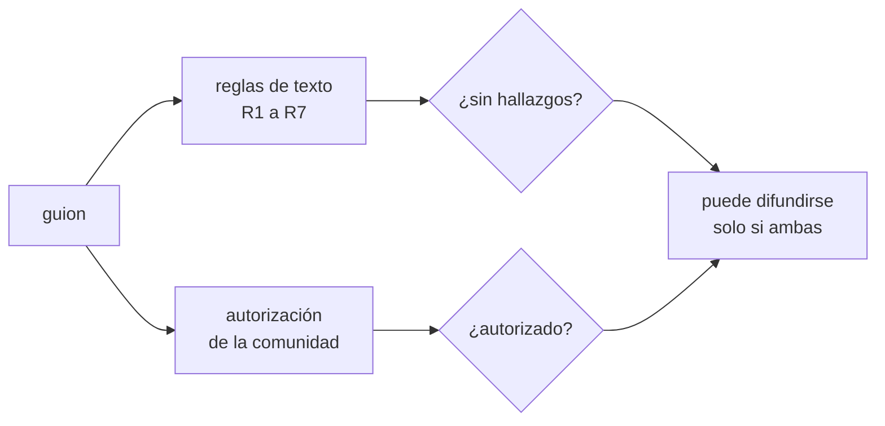

# B133-C04 — Riesgos de apropiación cultural en la divulgación

<!-- nav:top -->
[🏠 Programa](../../../../README.md) · [📚 Bloque B133](../../../tronco-comun/B133-saberes-astronomicos-y-educacion-intercultural.md) · [← Anterior: B133-C03 — Colaboración con comunidades en investigación y educación](../B133-C03-colaboracion-con-comunidades-en-investigacion-y-educacion/CLASE.md) · [Siguiente: B133-C05 — Diseño de una unidad de enseñanza intercultural →](../B133-C05-diseno-de-una-unidad-de-ensenanza-intercultural/CLASE.md)
<!-- /nav -->

## 1. Ubicación, nivel y alcance

Clase 4 del bloque B133. Nivel N4. Divulgar un saber ajeno puede apropiarlo: usarlo sin permiso, sacarlo de su contexto, atribuirlo a un genérico, mostrarlo como curiosidad del pasado o convertirlo en producto sin beneficio para quien lo sostiene. Aquí aprendes a reconocer esos riesgos en un guion y a auditarlo con reglas simples, sabiendo exactamente qué esas reglas **no** pueden decidir. Usas [B130](../../../tronco-comun/B130-comunicacion-y-divulgacion-cientifica.md) para la comunicación y la clase [B133-C03](../B133-C03-colaboracion-con-comunidades-en-investigacion-y-educacion/CLASE.md) para el acuerdo. Los guiones y la comunidad del laboratorio son **ficticios**.

## 2. Por qué esta clase existe

La divulgación llega a mucha gente y la apropiación suele ocurrir sin mala intención, por falta de método. La decisión central: **¿qué revisas antes de difundir un contenido sobre un saber que no es tuyo, y quién decide si se difunde?**

## 3. Lo que podrás hacer al terminar

1. Nombrar siete riesgos de apropiación en un texto de divulgación.
2. Aplicar una auditoría de reglas a un guion y leer sus hallazgos.
3. Calcular la fracción de oraciones con atribución y explicar su umbral.
4. Contrastar dos implementaciones de una misma regla para validar el código.
5. Explicar por qué un guion sin hallazgos puede ser inaceptable.
6. Reconocer que la autorización de la comunidad es un dato externo al texto y no se infiere.

La evidencia es el **informe de auditoría de un guion** del ejercicio 12 (sección 20).

## 4. Con qué llegas y cómo comprobarlo

1. ¿Qué es la atribución en un texto?
2. ¿Qué es una expresión regular?
3. ¿Qué es un falso negativo?
4. ¿Qué es un dato sintético?
5. ¿Qué diferencia hay entre una regla de texto y un juicio?

<details>
<summary>Ver respuestas</summary>

1. Señalar de quién o de dónde proviene lo que se afirma. 2. Un patrón para buscar texto. 3. Un caso problemático que la regla no detecta. 4. Un dato generado para el ejemplo, no medido. 5. La regla busca palabras; el juicio pondera el contexto y las personas.
</details>

Con cuatro o cinco aciertos, sigue; si no, repasa los prerrequisitos.

## 5. Un caso de contexto y casos de referencia

Neilson et al. (2019) señalan, para la astronomía canadiense, una historia de apropiación de saberes indígenas y de silenciamiento de sus voces; observan que los textos de astronomía suelen mencionar los saberes indígenas al hablar de constelaciones o calendarios, como si fueran historia antigua y menos valiosa que la ciencia occidental, lo que borra esos saberes y puede excluir a estudiantes indígenas. Lee et al. (2020) recuerdan que algunos saberes se consideraron sagrados, que hay protocolo sobre qué se comparte, por quién y cuándo, y que quien educa debe practicar humildad y no introducir errores en los registros. La Declaración de la ONU (art. 31) reconoce el derecho de los pueblos indígenas a mantener, controlar, proteger y desarrollar su patrimonio cultural y su propiedad intelectual sobre él.

El **ejemplo conductor** es **sintético**: tres guiones sobre la comunidad ficticia de Alfa-Tul. X cuida el texto y tiene autorización; Y acumula defectos; Z no tiene defectos en el texto pero no cuenta con la autorización.

## 6. Vocabulario

La **apropiación cultural** es, en esta clase, usar un saber, relato o símbolo de un pueblo sin su autorización o sin beneficio para él, descontextualizándolo. La **atribución** nombra a la comunidad y a la fuente. La **generalización** atribuye a «los pueblos originarios» lo que es de un pueblo concreto. El **borrado temporal** presenta como solo pasado lo que sigue vivo. El **protocolo** limita qué, cuándo y quién cuenta. El **beneficio** es lo que vuelve a la comunidad cuando se difunde algo suyo. La **auditoría** es aquí una revisión por reglas de texto.

## 7. Modelo mental: dos filtros, uno de ellos no es del texto



*Descripción textual:* un guion pasa dos filtros independientes: las reglas de texto (que detectan defectos) y la autorización de la comunidad (que ningún texto revela). Solo se difunde si pasa los dos.

Analogía: un control de calidad mide las piezas, pero no pregunta al dueño de la receta si la quería publicar. Límite: la autorización no es una casilla: es una relación continua con la comunidad.

## 8. La explicación, paso a paso

### 8.1 Siete riesgos y sus reglas

R1 generalización («los indígenas», «los pueblos originarios»). R2 solo pasado («creían», «antiguos») sin presente. R3 afirmaciones sin atribución (menos de la mitad de las oraciones atribuidas). R4 contenido con protocolo («ceremonia», «sagrada») sin permiso. R5 uso comercial sin beneficio. R6 palabras jerárquicas («mito», «leyenda», «primitivo»). R7 ausencia de crédito. Las listas de palabras y los umbrales son decisiones de esta clase y no están tomados de las fuentes.

### 8.2 Resultados del laboratorio

| Guion | Oraciones | Con atribución | Hallazgos de texto | Autorización | Veredicto |
|---|---|---|---|---|---|
| X (cuidado) | 6 | 4 (0,67) | 0 | sí | puede difundirse |
| Y (defectuoso) | 5 | 0 (0,00) | 7 | no | no puede difundirse |
| Z (pasa las reglas) | 4 | 2 (0,50) | 0 | no | no puede difundirse |

### 8.3 Dos vías

La regla R1 se implementa con una expresión regular y con un recorrido de palabras; coinciden en los tres guiones (3/3). Además, los hallazgos de X, Y y Z coinciden con los plantados. La comprobación es **circular**: demuestra que el código hace lo que pretendíamos, no que las reglas capturen la apropiación.

### 8.4 Por qué Z importa

Z cita a la comunidad, la nombra, usa el presente y agradece. Aun así, «recogimos este relato en una visita y lo mostramos en nuestra sala» deja ver que nadie autorizó su uso. Ninguna regla de texto lo detecta con certeza; el dato `autorizacion_comunidad` es externo. Y a la inversa: una regla puede marcar un texto cuidadoso (falso positivo) por una palabra. Los dos errores existen.

### 8.5 Qué hacer con un hallazgo

Un hallazgo es una pregunta, no una sentencia: quien audita corrige el texto, consulta a la comunidad y, si esta no autoriza, no difunde. La mejora de Y es reescribirlo con la comunidad, no sustituir palabras. Una divulgación que valga la pena incluye a las personas portadoras del saber como autoras o presentadoras si ellas lo desean.

## 9. Magnitudes, símbolos y unidades

| Símbolo | Qué es | Unidad | Valor / nota |
|---|---|---|---|
| — | oraciones | cuenta | 6; 5; 4 |
| — | oraciones con atribución | cuenta | 4; 0; 2 |
| — | fracción atribuida | — | 0,67; 0,00; 0,50 |
| — | umbral R3 | — | 0,5 (decisión de la clase) |
| — | hallazgos de texto | cuenta | 0; 7; 0 |

## 10. Convenciones y referencias

El texto se divide en oraciones por puntuación; la búsqueda ignora mayúsculas; las listas de palabras son parciales y están en español sin tildes. Comunidad y guiones ficticios; la «autorización» es un dato externo declarado por el guion. Ninguna lista de palabras es una norma ni proviene de una fuente.

## 11. De dónde sale lo que afirmamos

| ID | Fuente | Localizador | Respalda | Estado |
|---|---|---|---|---|
| S1 | Neilson, H. R. et al. (2019), *Indigenizing the next decade of astronomy in Canada* — https://arxiv.org/abs/1910.02976 (texto leído el 2026-11-11) | secciones 4 y 6 | Historia de apropiación; saberes tratados como historia antigua y menos valiosos; necesidad de colaboración y formación | Consultada |
| S2 | Lee, A. S. et al. (2020), *Building a Framework for Indigenous Astronomy Collaboration* — https://arxiv.org/abs/2008.07270 (texto leído el 2026-11-11) | secciones 4 y 5 | Saberes sagrados y protocolo; humildad; no introducir errores en los registros | Consultada |
| S3 | Naciones Unidas, Declaración sobre los derechos de los pueblos indígenas, res. 61/295 (13-09-2007) — PDF https://www.un.org/esa/socdev/unpfii/documents/DRIPS_en.pdf (texto leído el 2026-11-11) | art. 31 | Derecho a mantener, controlar, proteger y desarrollar el patrimonio cultural y los conocimientos tradicionales | Consultada |
| S4 | Hamacher, D. W. (2017), «Observations of red-giant variable stars by Aboriginal Australians» — https://arxiv.org/abs/1709.04634 (resumen consultado el 2026-11-11) | resumen | El registro etnográfico previo contenía estrellas mal identificadas | Consultada solo en resumen |
| S5 | UNESCO, programa LINKS — https://www.unesco.org/en/links (consultada 2026-11-11) | página del programa | Ayuda a pueblos indígenas y comunidades a estudiar y expresar la importancia de sus sistemas de conocimiento | Consultada |
| — | Listas de palabras, umbral y reglas R1–R7 | — | decisiones de esta clase | No consultada en una fuente concreta |

Límites: ninguna fuente consultada ofrece una lista de verificación contra la apropiación; las reglas son una propuesta didáctica. Las páginas de los principios CARE y de OCAP no pudieron consultarse.

## 12. Cómo ver una auditoría

| Magnitud | X | Y | Z |
|---|---|---|---|
| fracción atribuida | 0,67 | 0,00 | 0,50 |
| hallazgos de texto | 0 | 7 | 0 |
| autorización | sí | no | no |
| difundible | sí | no | no |

Descripción larga: el único guion difundible es X; Y falla en el texto; Z falla por algo que el texto no muestra.

## 13. Ejemplo trabajado: el guion Y

**Paso 1 · Texto.** «Los indígenas creían que las estrellas eran dioses.»

**Paso 2 · R1.** «los indigenas» está en la lista de genéricos: hallazgo.

**Paso 3 · R2.** «creían» sin ningún marcador de presente: hallazgo.

**Paso 4 · Lectura.** La oración generaliza, congela a un pueblo en el pasado y afirma sin atribuir; la solución no es cambiar palabras, sino preguntar a quién pertenece ese saber y si autoriza mostrarlo.

## 14. Distintas formas de describir un riesgo

**Por palabra:** el patrón que lo delata. **Por oración:** su atribución. **Por texto:** la fracción atribuida. **Por persona:** a quién perjudica o beneficia. **Por la comunidad:** lo que ella considera una falta de respeto; es la forma decisiva.

## 15. Práctica guiada

**Ejercicio 1 · con los pasos indicados.** Calcula la fracción atribuida del guion X. *Pasos:* divide las oraciones atribuidas por el total.

<details><summary>Solución comentada</summary>

`4/6 = 0,67`.
</details>

**Ejercicio 2 · con una pista.** ¿Qué regla activa «Este mito primitivo es una leyenda pintoresca»? *Pista:* palabras jerárquicas.

<details><summary>Solución comentada</summary>

R6 (jerarquía).
</details>

**Ejercicio 3 · casi autónomo.** ¿Por qué Z no activa R2?

<details><summary>Solución comentada</summary>

Contiene «sigue usando», un marcador de presente; no usa «creían» ni «antiguos».
</details>

## 16. Práctica autónoma, transferencia e integrador

**Ejercicio 4 · autónomo.** Con umbral de R3 de 0,6, ¿qué guiones se marcarían?

<details><summary>Solución comentada</summary>

Y (0,00) y Z (0,50); X (0,67) no. Subir el umbral hace aparecer un hallazgo en Z.
</details>

**Ejercicio 5 · autónomo.** Reescribe «Los pueblos originarios antiguos pensaban que el cielo era un animal» para que no active R1 ni R2 (con una fuente ficticia).

<details><summary>Solución comentada</summary>

«Según el Consejo de Mayores de Alfa-Tul, el cielo de su territorio se asocia a un animal en uno de sus relatos, que la comunidad sigue contando hoy.» (Sintético; en la vida real solo si la comunidad lo autoriza.)
</details>

**Ejercicio 6 · autónomo.** Explica por qué la coincidencia entre regex y recorrido de palabras valida el código y no las reglas.

<details><summary>Solución comentada</summary>

Ambas implementan la misma lista; coinciden si el código es correcto, aunque la lista fuera inadecuada.
</details>

**Ejercicio 7 · autónomo.** Da un ejemplo de falso positivo de una regla de palabras.

<details><summary>Solución comentada</summary>

«El eclipse marca el inicio de...» activaría la palabra «marca» de R5 aunque no se hable de una marca comercial (ocurrió al preparar el guion).
</details>

**Ejercicio 8 · autónomo.** ¿Qué dato exige el veredicto además del texto?

<details><summary>Solución comentada</summary>

La autorización de la comunidad.
</details>

**Ejercicio 9 · transferencia.** **Transferencia.** Un planetario quiere usar la imagen de un tejido con motivos estelares de una comunidad real en su camiseta. ¿Qué haces?

<details><summary>Solución comentada</summary>

No lo haces sin acuerdo con la comunidad, beneficio y crédito (art. 31, S2, R5).
</details>

**Ejercicio 10 · transferencia.** **Transferencia.** Un docente enseña «los mitos del cielo de los indígenas» en una lección de constelaciones. ¿Qué cambias?

<details><summary>Solución comentada</summary>

Nombrar el pueblo y la fuente, no usar «mito» como jerarquía, mostrar su presencia hoy y acordar con la comunidad.
</details>

**Ejercicio 11 · transferencia.** **Transferencia.** Tienes un guion sin hallazgos y sin respuesta de la comunidad. ¿Lo difundes?

<details><summary>Solución comentada</summary>

No: sin autorización no se difunde (guion Z).
</details>

**Ejercicio 12 · integrador.** **Integrador.** Elabora tu *informe de auditoría de un guion*: escribe un guion sintético de 5 a 8 oraciones sobre una comunidad ficticia, audítalo con las siete reglas, corrige los hallazgos y declara qué no pudo comprobar la auditoría.

<details><summary>Solución comentada</summary>

El informe debe terminar con 0 hallazgos y una nota que indique que la autorización de una comunidad real no se infiere de un texto.
</details>

## 17. Laboratorio: auditar guiones de divulgación sintéticos

El script [auditoria_guion.py](auditoria_guion.py) aplica las reglas R1–R7 a tres guiones ficticios, valida R1 con dos implementaciones y compara los hallazgos con los defectos plantados (**comprueba** los tres guiones y la coincidencia regex/palabras).

**Datos:** todo **sintético**. **Predice antes de ejecutar:** ¿cuántos hallazgos de texto tendrá Z? (0.) **Ejecución del 2026-11-11 (Python 3.12.9):**

```text
Python 3.12.9 (biblioteca estandar)
Guiones y comunidad SINTETICOS (Alfa-Tul es ficticia). Las reglas no deciden si hay apropiacion.

Guion X (cuidado): oraciones = 6, con atribucion = 4 (0.67)
   hallazgos de texto: 0
   autorizacion de la comunidad (dato externo al texto): True
   -> puede difundirse

Guion Y (defectuoso): oraciones = 5, con atribucion = 0 (0.00)
   hallazgos de texto: 7
   R1-generalizacion
   R2-solo-pasado
   R3-sin-atribucion
   R4-protocolo-sin-permiso
   R5-comercial-sin-beneficio
   R6-jerarquia
   R7-sin-credito
   autorizacion de la comunidad (dato externo al texto): False
   -> NO puede difundirse

Guion Z (pasa las reglas): oraciones = 4, con atribucion = 2 (0.50)
   hallazgos de texto: 0
   autorizacion de la comunidad (dato externo al texto): False
   -> NO puede difundirse

Acuerdo entre regex y recorrido de palabras en R1: 3/3
Los guiones X, Y y Z reproducen los hallazgos plantados; la comprobacion es circular por diseño.
El guion Z no tiene hallazgos de texto y aun asi no puede difundirse: falta la autorizacion de la comunidad.
Pruebas superadas.
```

```bash
python programa/clases/B133/B133-C04-riesgos-de-apropiacion-cultural-en-la-divulgacion/auditoria_guion.py
```

**Límites:** reglas de palabras en español sin tildes; ni lista ni umbral están validados con comunidades; el script no mide apropiación ni respeto, solo la presencia de ciertas formas.

## 18. Errores frecuentes y cómo corregirlos

**Creer que «sin hallazgos» significa «respetuoso».** Se corrige con 8.4.

**Arreglar solo las palabras.** Se corrige con 8.5.

**Generalizar a «los pueblos originarios».** Se corrige con el ejemplo 13.

**Confundir validar el código con validar las reglas.** Se corrige con 8.3.

## 19. Cómo sabrás que vas bien

Tras la sección 8: ¿cuántos hallazgos esperabas en Y y cuántos obtuviste (7)? Si dudas, repasa 8.1. Tras el laboratorio: ¿qué comprueba? (ver la sección 17).

## 20. Qué entregas y cómo se evalúa

El producto es tu **informe de auditoría de un guion** (ejercicio 12).

| Criterio | Inicial | En desarrollo | Logrado | Destacado |
|---|---|---|---|---|
| Conceptos | Los confunde | Parciales | Explica los siete riesgos | Explica por qué la lista no basta |
| Cálculo | Sin recuento | Con errores | Fracción atribuida correcta | Prueba umbrales distintos |
| Numérico | Sin comprobar | Un guion | Dos vías y hallazgos esperados | Diseña un falso positivo |
| Fuentes | Sin fuente | Sin fecha | Fuentes con fecha y estado | Separa lo consultado de la decisión propia |
| Límites | No los nombra | Uno | Tres | Declara qué decide solo la comunidad |

**Condiciones críticas (no se compensan con promedio):** no tratar la auditoría como autorización; rotular lo sintético; citar solo lo consultado.

## 21. Ética, seguridad y límites

Clase educativa con comunidad y guiones ficticios. La auditoría no es una norma ni sustituye la consulta: la decisión de difundir un saber es de la comunidad que lo sostiene. El material no fue revisado por personas de comunidades. Accesibilidad: tablas equivalentes a las gráficas, fórmulas en texto, ejercicios sin conexión.

## 22. Para cerrar y seguir

Un guion cuidado (X) tiene el 67 % de sus oraciones atribuidas y autorización; uno defectuoso (Y) acumula siete hallazgos; y uno sin hallazgos (Z) sigue sin poder difundirse. Queda una pregunta: ¿cómo se enseña, con todo esto, una unidad que une los saberes y la ciencia escolar?

**Glosario español–inglés.** apropiación cultural · *cultural appropriation*; atribución · *attribution*; falso negativo · *false negative*; falso positivo · *false positive*; beneficio · *benefit*.

**Continuidad.** [B133-C05](../B133-C05-diseno-de-una-unidad-de-ensenanza-intercultural/CLASE.md) diseña una unidad de enseñanza intercultural.

**Referencias:** ver sección 11.

<!-- nav:bottom -->
---

[← Anterior: B133-C03 — Colaboración con comunidades en investigación y educación](../B133-C03-colaboracion-con-comunidades-en-investigacion-y-educacion/CLASE.md) · [📚 Bloque B133](../../../tronco-comun/B133-saberes-astronomicos-y-educacion-intercultural.md) · [Siguiente: B133-C05 — Diseño de una unidad de enseñanza intercultural →](../B133-C05-diseno-de-una-unidad-de-ensenanza-intercultural/CLASE.md)
<!-- /nav -->
