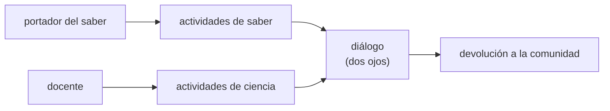

# B133-C05 — Diseño de una unidad de enseñanza intercultural

<!-- nav:top -->
[🏠 Programa](../../../../README.md) · [📚 Bloque B133](../../../tronco-comun/B133-saberes-astronomicos-y-educacion-intercultural.md) · [← Anterior: B133-C04 — Riesgos de apropiación cultural en la divulgación](../B133-C04-riesgos-de-apropiacion-cultural-en-la-divulgacion/CLASE.md)
<!-- /nav -->

## 1. Ubicación, nivel y alcance

Clase 5 del bloque B133 y última del programa. Nivel N4. Aquí reúnes lo anterior para diseñar una unidad de seis sesiones que junte la ciencia escolar con los saberes de una comunidad, sin que el docente hable en nombre de ella. Calculas un presupuesto de tiempo, dimensionas una medición escolar (el orto del sol con brújula) con su incertidumbre y compruebas quién lidera cada actividad. Usas [B131](../../../tronco-comun/B131-didactica-de-la-astronomia.md) para la didáctica y las clases [C01](../B133-C01-relaciones-entre-cielo-y-territorio-en-los-saberes-tradicionales/CLASE.md), [C03](../B133-C03-colaboracion-con-comunidades-en-investigacion-y-educacion/CLASE.md) y [C04](../B133-C04-riesgos-de-apropiacion-cultural-en-la-divulgacion/CLASE.md). La escuela, la comunidad y el portador del saber son **ficticios**.

## 2. Por qué esta clase existe

Enseñar «con» una cultura es más que añadir una diapositiva: exige repartir roles, acordar protocolos y medir bien. La decisión central: **¿cómo se organiza una unidad para que el saber lo presente quien lo porta y la ciencia se enseñe con rigor, en el mismo hilo?**

## 3. Lo que podrás hacer al terminar

1. Distribuir 360 minutos entre actividades de ciencia, de saber y de diálogo.
2. Comprobar que toda actividad de saber la lidere quien porta ese saber.
3. Verificar que cada objetivo esté cubierto.
4. Calcular la separación mínima entre dos mediciones del orto para detectar un cambio con 5 % de falsas alarmas y 95 % de potencia.
5. Explicar por qué esa separación depende de la fecha.
6. Reconocer lo que el plan no puede garantizar: la voluntad y los protocolos de la comunidad.

La evidencia es el **plan de una unidad intercultural de 6 sesiones** del ejercicio 12 (sección 20).

## 4. Con qué llegas y cómo comprobarlo

1. ¿Qué es un objetivo de aprendizaje?
2. ¿Qué es la incertidumbre de una medición?
3. ¿Qué es la potencia de una prueba?
4. ¿Qué es un dato sintético?
5. ¿Qué hace un portador del saber en el aula?

<details>
<summary>Ver respuestas</summary>

1. Lo que el estudiante podrá hacer al terminar. 2. El intervalo en que razonablemente cae el valor verdadero. 3. La probabilidad de detectar un cambio que existe. 4. Un dato generado para el ejemplo, no medido. 5. Comparte lo que su comunidad le autoriza compartir, con sus propios términos; no es un «recurso» del docente.
</details>

Con cuatro o cinco aciertos, sigue; si no, repasa los prerrequisitos.

## 5. Un caso de contexto y casos de referencia

Neilson et al. (2019) cuentan un primer paso concreto: un profesor integró saberes indígenas en un curso de Astronomía 101 trayendo, desde el programa de ancianas y ancianos residentes de la universidad, a una «Life Speaker» a la primera clase; la oficina de indigenización de la universidad lo ayudó con las pronunciaciones, el reconocimiento del territorio y el protocolo para presentarla. Lee et al. (2020) piden que quienes usen sus materiales busquen mayores y miembros de la comunidad para llevarlos al aula, y presentan sus propios materiales como un comienzo. Bartlett, Marshall y Marshall (2012) describen ocho lecciones aprendidas en un programa de ciencia integrada: las partes se necesitan y se comprometen a aprender juntas, se guían por *Two-Eyed Seeing* y forman un consejo asesor.

El **ejemplo conductor** es **sintético**: una escuela ficticia a −38,0° de latitud, la comunidad ficticia de Alfa-Tul y un invitado portador. La unidad dura seis sesiones de 60 minutos, y las mediciones se hacen durante semanas.

## 6. Vocabulario

Una **actividad de ciencia** enseña un método o resultado científico. Una **actividad de saber** presenta un saber de la comunidad y la **lidera quien lo porta**. Una **actividad de diálogo** pone ambos en conversación. El **orto** es la salida del sol. La **potencia** es la probabilidad de detectar un cambio real. La **falsa alarma** es detectar un cambio que no existe. *Two-Eyed Seeing* o *Etuaptmumk* es la idea de mirar con las fortalezas de los saberes indígenas y con las de los occidentales, y usar ambas.

## 7. Modelo mental: dos ojos y un reparto de roles



*Descripción textual:* el portador lidera las actividades de saber, el docente las de ciencia, ambos se encuentran en actividades de diálogo, y los resultados vuelven a la comunidad.

Analogía: una orquesta donde cada sección toca su parte y el director no toca los instrumentos de otra. Límite: en el aula real los roles se negocian con la comunidad, y la comunidad puede preferir otro reparto.

## 8. La explicación, paso a paso

### 8.1 El plan

La unidad tiene 11 actividades y suma 360 minutos: 140 de ciencia (0,39), 90 de saber (0,25) y 130 de diálogo (0,36). El portador lidera 180 minutos (0,50). Cada sesión suma como máximo 60 minutos, los cuatro objetivos están cubiertos (explicar el cambio del orto, describir el uso del cielo de la comunidad, medir con incertidumbre y respetar los protocolos) y ningún componente baja de 0,20. Esos umbrales son decisiones de esta clase.

### 8.2 Un plan defectuoso

Si el docente lidera las tres actividades de saber, el laboratorio da tres hallazgos: presentación del territorio, cómo la comunidad sigue el sol en su casa y el cuidado de los relatos. El defecto no es de tiempo ni de objetivos: es de **quién habla**.

### 8.3 La medición del orto

Con la fórmula cerrada de la clase C01 a `φ = −38,0°`, la brújula tiene `σ = 2°`. La diferencia de dos lecturas independientes tiene desviación `σ√2 = 2,83°`. Con 5 % de falsas alarmas, el criterio es `τ = 1,645 σ√2 = 4,653°`; para 95 % de potencia, el cambio real debe ser de al menos `2τ = 9,306°`.

### 8.4 Cuántos días separar las mediciones

| Inicio | `dA/dn` (°/día) | Separación mínima |
|---|---|---|
| 21-03 | −0,4976 | 19 días |
| 21-04 | −0,4420 | 25 días |
| 21-06 | 0,0068 | 45 días |

Cerca del equinoccio el orto se mueve unos 0,5° por día; cerca del solsticio casi no se mueve y hay que esperar mucho más. Por eso la unidad se planifica por semanas: las sesiones 2 y 4 deben separarse al menos 19 días si se empieza en marzo. La derivada analítica y la diferencia finita coinciden a `5,6 × 10⁻⁶ °/día`.

### 8.5 La segunda vía y sus límites

Una simulación con semilla `20261111` y 20 000 pares da una potencia de 0,953 con 19 días (cambio real de 9,320°) y 0,052 de falsas alarmas cuando no hay cambio, coherentes con los valores de diseño. El modelo supone errores gaussianos independientes, ignora la declinación magnética y la forma del horizonte, y vale solo cerca del equinoccio de marzo y de los solsticios (la declinación del modelo es aproximada). El plan no puede asegurar lo importante: que la comunidad acepte participar, ni que los protocolos se cumplan.

## 9. Magnitudes, símbolos y unidades

| Símbolo | Qué es | Unidad | Valor / nota |
|---|---|---|---|
| `φ` | latitud de la escuela | ° | −38,0 (sintético) |
| `σ` | incertidumbre de la brújula | ° | 2,0 (sintético) |
| `τ` | criterio de decisión | ° | 4,653 |
| `2τ` | cambio real necesario | ° | 9,306 |
| `dA/dn` | cambio diario del acimut | °/día | −0,498 (21-03) |
| — | tiempo de la unidad | min | 360 |

## 10. Convenciones y referencias

Acimut desde el norte hacia el este; fechas de un año no bisiesto; 1,645 es el cuantil normal de 5 % de una cola; la potencia y la falsa alarma se calculan con la diferencia de dos lecturas independientes. Escuela, comunidad e invitado ficticios. Los umbrales del plan (60 min por sesión, 20 % por componente, saber siempre liderado por el portador) son decisiones didácticas de esta clase.

## 11. De dónde sale lo que afirmamos

| ID | Fuente | Localizador | Respalda | Estado |
|---|---|---|---|---|
| S1 | Neilson, H. R. et al. (2019), *Indigenizing the next decade of astronomy in Canada* — https://arxiv.org/abs/1910.02976 (texto leído el 2026-11-11) | sección 4 y sección 5 | Primer curso con una persona invitada de la comunidad; apoyo de la oficina de indigenización; relaciones de varios años | Consultada |
| S2 | Lee, A. S. et al. (2020), *Building a Framework for Indigenous Astronomy Collaboration* — https://arxiv.org/abs/2008.07270 (texto leído el 2026-11-11) | secciones 4 y 5 | Buscar mayores y miembros de la comunidad; materiales como comienzo; Etuaptmumk | Consultada |
| S3 | Bartlett, C.; Marshall, M.; Marshall, A. (2012), *J. Environ. Stud. Sci.* 2(4): 331-340 — https://ideas.repec.org/a/spr/jenvss/v2y2012i4p331-340.html (resumen consultado el 2026-11-11) | resumen | Ocho lecciones; las partes se necesitan; Two-Eyed Seeing; consejo asesor | Consultada solo en resumen |
| S4 | Naciones Unidas, Declaración sobre los derechos de los pueblos indígenas, res. 61/295 — PDF https://www.un.org/esa/socdev/unpfii/documents/DRIPS_en.pdf (texto leído el 2026-11-11) | arts. 13 y 14 | Derecho a transmitir sus tradiciones y a establecer y controlar sus sistemas educativos | Consultada (art. 14 leído solo en su primera línea) |
| S5 | UNESCO, programa LINKS — https://www.unesco.org/en/links (consultada 2026-11-11) | página del programa | Cooperación de conocimiento transdisciplinaria entre portadores y ciencia | Consultada |
| S6 | Hamacher, D. W. (2017), arXiv:1709.04634 (resumen consultado el 2026-11-11) | resumen | Quien investiga saberes indígenas debe formarse en ciencias naturales y sociales | Consultada solo en resumen |
| — | Fórmulas de acimut y de potencia/falsa alarma | — | las verifica el laboratorio con una segunda vía | No consultada en una fuente concreta |

Límites: no se consultó ningún currículo oficial, ni evaluaciones de unidades interculturales; la evidencia de que estas unidades mejoran aprendizajes no se evaluó aquí.

## 12. Cómo ver la unidad

| Magnitud | Valor |
|---|---|
| minutos totales | 360 |
| ciencia / saber / diálogo | 0,39 / 0,25 / 0,36 |
| tiempo liderado por el portador | 0,50 |
| separación mínima en marzo | 19 días |
| separación mínima en junio | 45 días |
| potencia / falsas alarmas simuladas | 0,953 / 0,052 |

Descripción larga: la mitad del tiempo lo lidera quien porta el saber; la medición exige semanas, más aún cerca del solsticio.

## 13. Ejemplo trabajado: ¿cuántos días entre lecturas?

**Paso 1 · Criterio.** `τ = 1,645 × 2,83 = 4,653°`.

**Paso 2 · Cambio real.** `2τ = 9,306°` para 95 % de potencia.

**Paso 3 · Velocidad.** En marzo el orto se mueve unos 0,5°/día.

**Paso 4 · Días.** `9,306/0,4976 ≈ 18,7`: se redondea a 19 días (laboratorio).

## 14. Distintas formas de describir una unidad

**Por tiempo:** minutos por componente. **Por roles:** quién lidera cada actividad. **Por objetivos:** cobertura. **Por calendario:** semanas entre mediciones. **Por la comunidad:** cómo vive la unidad quien porta el saber; esa mirada decide si la unidad se hace.

## 15. Práctica guiada

**Ejercicio 1 · con los pasos indicados.** Calcula la fracción de tiempo de ciencia. *Pasos:* suma las actividades de ciencia y divide por 360.

<details><summary>Solución comentada</summary>

`140/360 = 0,39`.
</details>

**Ejercicio 2 · con una pista.** Calcula `τ` para `σ = 2°`. *Pista:* `τ = 1,645 σ √2`.

<details><summary>Solución comentada</summary>

`1,645 × 2 × 1,4142 = 4,653°`.
</details>

**Ejercicio 3 · casi autónomo.** ¿Por qué la medición no cabe en una sola sesión?

<details><summary>Solución comentada</summary>

El orto cambia lentamente; se necesitan al menos 19 días entre lecturas en marzo.
</details>

## 16. Práctica autónoma, transferencia e integrador

**Ejercicio 4 · autónomo.** Con `σ = 1°`, ¿cuánto cambia el cambio real necesario?

<details><summary>Solución comentada</summary>

Se reduce a la mitad: `4,653°`; en marzo bastan unos 10 días.
</details>

**Ejercicio 5 · autónomo.** ¿Por qué empezar a medir en junio exige 45 días?

<details><summary>Solución comentada</summary>

Cerca del solsticio `dA/dn ≈ 0,007°/día`; el cambio crece con el cuadrado del tiempo.
</details>

**Ejercicio 6 · autónomo.** Cambia el plan para que la sesión 4 dure 70 minutos. ¿Qué hallazgo aparece?

<details><summary>Solución comentada</summary>

«sesión 4 dura 70 min (> 60)» y el total pasa de 360.
</details>

**Ejercicio 7 · autónomo.** Propón un objetivo nuevo y una actividad que lo cubra.

<details><summary>Solución comentada</summary>

Por ejemplo, «reconocer la diferencia entre evidencia e interpretación» cubierto por una actividad de diálogo; debe quedar liderada por el portador si toca el saber.
</details>

**Ejercicio 8 · autónomo.** Explica la diferencia entre falsa alarma y potencia.

<details><summary>Solución comentada</summary>

Falsa alarma: ver un cambio donde no lo hay (≈ 0,05). Potencia: ver un cambio que existe (≈ 0,95).
</details>

**Ejercicio 9 · transferencia.** **Transferencia.** El portador del saber no puede venir. ¿Qué haces?

<details><summary>Solución comentada</summary>

No lo reemplazas hablando por su comunidad. Reprogramas, o enseñas solo la ciencia y presentas, con fuente y declarando sus límites, lo publicado por la propia comunidad si lo autoriza.
</details>

**Ejercicio 10 · transferencia.** **Transferencia.** Tu escuela está a −20° de latitud. ¿Qué cambia en la medición?

<details><summary>Solución comentada</summary>

La velocidad del orto en el equinoccio cambia con `1/cos φ`; hay que recalcular con el laboratorio.
</details>

**Ejercicio 11 · transferencia.** **Transferencia.** Un estudiante de la comunidad no quiere participar en una actividad de saber. ¿Qué haces?

<details><summary>Solución comentada</summary>

Respetas su decisión sin exigir explicación y propones una alternativa; hablas con la familia y la comunidad.
</details>

**Ejercicio 12 · integrador.** **Integrador.** Elabora tu *plan de una unidad intercultural de 6 sesiones*: tabla de actividades (tipo, minutos, líder, objetivo), verificación del plan, dimensionamiento de la medición con su incertidumbre, acuerdo con la comunidad (C03), auditoría del material (C04) y una nota de lo que decide solo la comunidad.

<details><summary>Solución comentada</summary>

Secciones 8.1–8.5, la salida del laboratorio y los productos de C03 y C04.
</details>

## 17. Laboratorio: plan y medición de una unidad sintética

El script [unidad.py](unidad.py) verifica el plan de 11 actividades, dimensiona la medición del orto y la comprueba con una simulación (**comprueba** 360 minutos, saber liderado por el portador, cobertura de objetivos, derivada analítica frente a diferencia finita y potencia/falsas alarmas).

**Datos:** todo **sintético**. **Predice antes de ejecutar:** ¿cuántos días separarán las lecturas en marzo? (≈ 19.) **Ejecución del 2026-11-11 (Python 3.12.9):**

```text
Python 3.12.9 (biblioteca estandar)
Escuela, comunidad y portador SINTETICOS (Alfa-Tul es ficticia).
Plan: 11 actividades, 360 min, hallazgos = 0
   ciencia   140 min  (0.39)
   saber      90 min  (0.25)
   dialogo   130 min  (0.36)
   tiempo liderado por el portador: 180 min (0.50)
Plan modificado (el docente lidera el saber): hallazgos = 3
   actividad de saber sin portador: Presentacion del territorio y de la comunidad
   actividad de saber sin portador: Como la comunidad sigue el sol en su casa
   actividad de saber sin portador: Cuidado de los relatos: que no se cuenta

Medicion del orto con brujula (sigma = 2.0 deg): criterio de decision = 4.653 deg; cambio real necesario = 9.306 deg
Derivada analitica frente a diferencia finita: diferencia maxima = 5.58e-06 deg/dia
 inicio    dia  dA/dn[deg/dia]  separacion minima [dias]
 21-03     80      -0.4976      19
 21-06    172       0.0068      45
 21-04    111      -0.4420      25
Simulacion (semilla 20261111, 20000 pares): con 19 dias (cambio real 9.320 deg) potencia = 0.953; falsas alarmas sin cambio = 0.052
Pruebas superadas.
```

```bash
python programa/clases/B133/B133-C05-diseno-de-una-unidad-de-ensenanza-intercultural/unidad.py
```

**Límites:** errores gaussianos independientes, sin declinación magnética ni relieve; los umbrales del plan no provienen de una fuente; el script no evalúa ni la pertinencia cultural ni los aprendizajes.

## 18. Errores frecuentes y cómo corregirlos

**Hablar por la comunidad.** Se corrige con 8.2.

**Pretender medir el orto en una sola sesión.** Se corrige con 8.4.

**Usar la fecha equivocada para la medición.** Se corrige con la tabla de 8.4.

**Tomar un plan completo por una unidad aprobada.** Se corrige con 8.5.

## 19. Cómo sabrás que vas bien

Tras la sección 8: ¿cuántos días esperabas entre lecturas en marzo y cuántos obtuviste (19)? Si dudas, repasa el ejemplo 13. Tras el laboratorio: ¿qué comprueba? (ver la sección 17).

## 20. Qué entregas y cómo se evalúa

El producto es tu **plan de una unidad intercultural de 6 sesiones** (ejercicio 12).

| Criterio | Inicial | En desarrollo | Logrado | Destacado |
|---|---|---|---|---|
| Conceptos | Los confunde | Parciales | Distingue ciencia, saber y diálogo | Explica el reparto de roles |
| Cálculo | Sin unidades | Con errores | Tiempos y días correctos | Adapta a otra latitud |
| Numérico | Sin comprobar | Un caso | Dos vías y simulación | Interpreta potencia y falsas alarmas |
| Fuentes | Sin fuente | Sin fecha | Fuentes con fecha y estado | Separa lo consultado en resumen |
| Límites | No los nombra | Uno | Tres | Declara qué decide solo la comunidad |

**Condiciones críticas (no se compensan con promedio):** toda actividad de saber liderada por quien lo porta; consentimiento y acuerdo previos (C03); rotular lo sintético.

## 21. Ética, seguridad y límites

Clase educativa con escuela, comunidad y portador ficticios. No trae contenidos de ningún pueblo: la unidad real se construye con una comunidad real y sus decisiones, no con este material. El plan no sustituye el acuerdo previo ni los protocolos de las comunidades, ni fue revisado por ellas. Accesibilidad: tablas equivalentes a las gráficas, fórmulas en texto, ejercicios sin conexión.

## 22. Para cerrar y seguir

La unidad de 360 minutos reparte la mitad del tiempo al portador y exige al menos 19 días entre dos lecturas del orto en marzo para detectar su cambio con la brújula. Con esto termina el bloque B133 y el programa: queda una pregunta que ningún cálculo cierra, la de cómo cada comunidad quiere que se cuente su cielo.

**Glosario español–inglés.** unidad didáctica · *teaching unit*; portador del saber · *knowledge holder*; potencia · *power*; falsa alarma · *false alarm*; Two-Eyed Seeing · *Two-Eyed Seeing (Etuaptmumk)*.

**Continuidad.** Esta es la última clase del programa; vuelve al [bloque B133](../../../tronco-comun/B133-saberes-astronomicos-y-educacion-intercultural.md).

**Referencias:** ver sección 11.

<!-- nav:bottom -->
---

[← Anterior: B133-C04 — Riesgos de apropiación cultural en la divulgación](../B133-C04-riesgos-de-apropiacion-cultural-en-la-divulgacion/CLASE.md) · [📚 Bloque B133](../../../tronco-comun/B133-saberes-astronomicos-y-educacion-intercultural.md) · [Fin del bloque](../../../tronco-comun/B133-saberes-astronomicos-y-educacion-intercultural.md)
<!-- /nav -->
