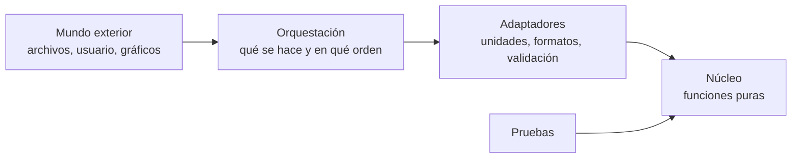

# B14-C01 — Arquitectura de software científico

<!-- nav:top -->
[🏠 Programa](../../../../README.md) · [📚 Bloque B14](../../../tronco-comun/B14-computacion-cientifica-y-ciencia-abierta.md) · [← Anterior: B13-C20 — Validación de una cadena de medida](../../../tronco-comun/B13-metrologia-tiempo-y-mediciones-cientificas.md#b13-c20) · [Siguiente: B14-C02 — Arreglos multidimensionales NumPy →](../B14-C02-arreglos-multidimensionales-numpy/CLASE.md)
<!-- /nav -->

## 1. Ubicación, nivel y alcance

Primera clase del bloque B14 y del tramo de computación del área A02. Hasta aquí usaste fórmulas con lápiz o con una calculadora; desde ahora las escribes como programas que otras personas (y tú dentro de seis meses) deben poder leer, probar y reutilizar. No es una clase de programación desde cero: supone que sabes escribir una función en Python. Nivel N2.

Verás cómo separar un cálculo científico en capas (núcleo, adaptadores, orquestación), por qué esa separación hace posible probarlo, y cómo decidir dónde vive cada decisión. No verás todavía NumPy, SciPy ni Astropy (C02–C04), ni pruebas de regresión (C10) ni empaquetado (C12 y C19).

## 2. Por qué esta clase existe

Un script de 300 líneas que lee un archivo, calcula una órbita, dibuja una figura y escribe un informe funciona hasta el día en que cambias el archivo de entrada. Entonces no sabes si un resultado distinto viene de los datos, de la fórmula o de un error nuevo. La pregunta motivadora es: **¿cómo organizo un cálculo para poder confiar en él y cambiarlo sin miedo?**

La decisión central es: **¿qué parte del programa es ciencia (una función que dados unos números devuelve otros) y qué parte es logística (leer, escribir, graficar, elegir parámetros)?** Quien separa ambas puede probar la ciencia contra una solución exacta, sin archivos ni gráficos, y puede cambiar la logística sin tocar la ciencia.

## 3. Lo que podrás hacer al terminar

1. Distinguir en un programa científico las capas de núcleo, adaptación y orquestación, y justificar dónde cae cada línea.
2. Escribir funciones puras para una fórmula física, con unidades y dominio de validez declarados.
3. Diseñar una prueba que compare el núcleo con un caso analítico y que detenga la ejecución si falla.
4. Aislar la lectura de configuración y la conversión de unidades en un adaptador que rechaza lo desconocido.
5. Detectar acoplamientos que impiden probar (estado global, entrada/salida dentro del cálculo).
6. Proponer una estructura de carpetas y módulos para un proyecto pequeño y explicar qué dependería de qué.

La evidencia es el **diseño en capas** del ejercicio 12 (sección 20).

## 4. Con qué llegas y cómo comprobarlo

Necesitas escribir funciones en Python y la tercera ley de Kepler (B09 y la física de A01). Cinco preguntas:

1. Escribe una función `area_circulo(r)` y llámala con `r = 2`.
2. Si `T` es el período y `a` el radio de una órbita circular alrededor de una masa con parámetro gravitacional `GM`, ¿cuál es la relación entre ellos? (`T = 2π√(a³/GM)`.)
3. ¿En qué unidades de SI se expresa `GM`? (m³/s².)
4. ¿Qué devuelve `math.sqrt(-1)` en Python y qué significa?
5. ¿Qué es una constante «mágica» en un programa y por qué es mala idea escribirla en medio de una fórmula?

<details>
<summary>Ver respuestas</summary>

1. `def area_circulo(r): return math.pi * r**2` → `12.566…`. 2. La indicada: `T² / a³ = 4π² / GM`. 3. m³/s². 4. Lanza `ValueError: math domain error`: no hay raíz real de un negativo. 5. Un número sin nombre ni unidad pegado a la fórmula; si lo necesitas en otro lugar, lo copias y se desincroniza.
</details>

Con cuatro o cinco aciertos, sigue; con tres o menos, repasa funciones en Python y B09.

## 5. Un caso real: lo que nos enseñan las malas prácticas de software científico

Un artículo de práctica general, *Best Practices for Scientific Computing* (S1), parte de una observación: los científicos dedican una parte creciente de su tiempo a escribir software, pero casi nunca reciben formación para hacerlo, y por eso muchos desconocen herramientas y hábitos que harían su código más fiable con menos esfuerzo. Los autores proponen un conjunto de prácticas basadas en investigación y experiencia. Consulté solo el resumen (S1), de modo que no te atribuyo la lista de prácticas, solo su motivación.

El caso de esta clase es nuestro **ejemplo conductor**: calcular el período de un satélite alrededor de la Tierra y el radio de la órbita geosíncrona. Es corto y tiene respuesta exacta, así que sirve para ver la arquitectura sin distraerte con la física.

## 6. Vocabulario

Una **función pura** devuelve siempre el mismo resultado para los mismos argumentos y no cambia nada fuera de sí misma: no lee archivos, no imprime, no usa variables globales que cambien. Un **efecto secundario** es cualquier cosa que una función hace además de devolver un valor (escribir, imprimir, modificar un objeto compartido). El **núcleo** es el conjunto de funciones puras que contiene la ciencia. Un **adaptador** traduce entre el mundo exterior (archivos, unidades, formatos, configuración) y el núcleo. La **orquestación** es el código que decide el orden: qué se lee, qué se calcula, qué se guarda. Una **prueba** es un código que llama al núcleo con un caso cuya respuesta conoces y falla si no la obtiene. El **dominio de validez** es el rango de entradas para el que el modelo es correcto. El **acoplamiento** mide cuánto depende una parte de otra: bajo acoplamiento significa que puedes cambiar una sin romper la otra.

## 7. Modelo mental: capas que dependen hacia adentro

Imagina tres anillos concéntricos. En el centro está la ciencia; alrededor, la traducción; afuera, el mundo. Las dependencias apuntan hacia adentro: la orquestación conoce a los adaptadores y al núcleo, los adaptadores conocen al núcleo, pero el núcleo no conoce a nadie.



*Descripción textual:* de izquierda a derecha, el mundo exterior entra a la orquestación, que usa adaptadores, que llaman al núcleo. Las pruebas llaman al núcleo directamente, sin pasar por el mundo exterior. Ninguna flecha sale del núcleo hacia afuera.

**Analogía y su límite.** Es como la cocina de un restaurante: el cocinero (núcleo) solo recibe ingredientes y devuelve platos; el camarero (adaptador) traduce lo que dice el cliente; la caja (orquestación) decide el orden. Si pruebas la receta, no necesitas clientes. Límite: en software las capas no son tan rígidas, y un proyecto pequeño puede tener las tres en un solo archivo, como hace el laboratorio de esta clase.

## 8. La explicación, paso a paso

### 8.1 Escribe primero el núcleo

Para el período de una órbita circular de radio `a` alrededor de una masa de parámetro gravitacional `GM`, el modelo es `T = 2π√(a³/GM)`. Como función:

```python
def periodo(a_m, gm):
    if a_m <= 0 or gm <= 0:
        raise ValueError("a y GM deben ser positivos")
    return 2.0 * math.pi * math.sqrt(a_m**3 / gm)
```

Fíjate en tres decisiones. Los argumentos llevan la unidad en el nombre (`a_m` son metros). No hay `print` ni lectura de archivos. Y el dominio de validez se verifica y se rechaza con un error explícito, en vez de devolver un número sin sentido. Dentro del núcleo todo está en SI; convertir es trabajo del adaptador.

### 8.2 El adaptador traduce y rechaza

Los datos llegan en kilómetros, en millas o en radios terrestres. El adaptador convierte a SI y **rechaza las unidades que no conoce**. Esta decisión evita un error clásico (C04): leer un número en otra unidad sin darse cuenta.

```python
def leer_config(cfg):
    factor = {"m": 1.0, "km": 1.0e3}
    if cfg["unidad_a"] not in factor:
        raise ValueError(f"unidad no admitida: {cfg['unidad_a']}")
    return {"a_m": cfg["a"] * factor[cfg["unidad_a"]], "gm": cfg["gm"]}
```

### 8.3 La orquestación decide y comunica

Solo en la capa externa aparecen `print`, archivos y el orden de las llamadas. Si mañana quieres escribir un CSV en vez de imprimir, cambias la orquestación. El núcleo y sus pruebas siguen intactos.

### 8.4 Las pruebas son parte de la arquitectura

Una prueba útil compara el núcleo con algo que no depende de él. Tres tipos: la **ida y vuelta** (aplicar una función y su inversa analítica y recuperar la entrada), la **propiedad invariante** (por la tercera ley, `T²/a³` vale `4π²/GM` para cualquier `a`) y la **referencia externa** (un valor publicado). Si una prueba falla, el programa se detiene: un cálculo que sigue adelante con un resultado dudoso es peor que uno que falla.

### 8.5 Estructura mínima de un proyecto

Para un proyecto de varios archivos, una organización razonable es una carpeta `nucleo/` con funciones puras, `adaptadores/` con lectura y conversión, un archivo de orquestación, `pruebas/` y un `README`. La regla es que `nucleo/` no importe de ninguna otra carpeta. Si lo hace, la arquitectura se rompió.

## 9. Magnitudes, símbolos y unidades

| Símbolo | Qué es | Unidad | Nota |
|---|---|---|---|
| `a` | radio de la órbita circular, medido desde el centro de la Tierra | m (o km) | `a = R + altitud` |
| `T` | período orbital | s | tiempo de una vuelta |
| `GM` | parámetro gravitacional de la Tierra | m³/s² | 3,986004 × 10¹⁴ (S2) |
| `v` | velocidad circular | m/s | `v = √(GM/a)` |
| `R` | radio ecuatorial terrestre | km | 6378,137 (S3) |

## 10. Convenciones y referencias

Sistema de referencia: inercial, centrado en la Tierra; la órbita circular y de dos cuerpos se describe solo con su radio. Convención de unidades: SI dentro del núcleo, otras unidades solo en la frontera. Convención de nombres: la unidad va en el nombre de la variable. El valor de `GM` es el nominal de la documentación de astropy (S2); el radio, el ecuatorial de la ficha de la NASA (S3).

## 11. De dónde sale lo que afirmamos

| ID | Fuente | Localizador | Respalda | Estado |
|---|---|---|---|---|
| S1 | Wilson, G. et al., *Best Practices for Scientific Computing* | arXiv:1210.0530 | Motivación: poca formación en desarrollo de software y propuesta de prácticas | Resumen consultado el 2026-11-05 |
| S2 | astropy, documentación de `astropy.constants` | https://docs.astropy.org/en/stable/constants/index.html | `GM_earth = 3,986004 × 10¹⁴ m³/s²` («nominal Earth mass parameter», sin resolución citada en esa página) | Página consultada el 2026-11-05 (mutable) |
| S3 | NASA NSSDC, *Earth Fact Sheet* | https://nssdc.gsfc.nasa.gov/planetary/factsheet/earthfact.html | Radio ecuatorial 6378,137 km; rotación sidérea 23,9345 h; actualizada 2024-11-15 | Consultada el 2026-11-05 (mutable) |

Límites: de S1 no se leyó la lista de prácticas; de S2 no se verificó el origen del valor nominal de GM; las capas descritas son una convención de diseño, no un estándar.

## 12. Cómo ver la estructura

Una tabla de dependencias es la versión accesible del diagrama de la sección 7.

| Capa | Puede importar de | No puede importar de | Contiene efectos secundarios |
|---|---|---|---|
| Núcleo | biblioteca estándar, NumPy | adaptadores, orquestación | no |
| Adaptadores | núcleo | orquestación | lectura y validación |
| Orquestación | adaptadores, núcleo | — | sí: salida, archivos |
| Pruebas | núcleo | — | no |

## 13. Ejemplo trabajado: la órbita geosíncrona

Un satélite geosíncrono completa una vuelta en lo que tarda la Tierra en girar respecto a las estrellas: 23,9345 h (S3), es decir `T = 86 164,2 s`. Con la inversa analítica `a = (GM · (T/2π)²)^(1/3)`:

1. `T/2π = 86 164,2 / 6,283185 = 13 713,4 s`.
2. `(T/2π)² = 1,8807 × 10⁸ s²`.
3. `GM · (T/2π)² = 3,986004 × 10¹⁴ × 1,8807 × 10⁸ = 7,4965 × 10²²`.
4. Raíz cúbica: `a ≈ 4,2164 × 10⁷ m = 42 164 km`.
5. Altitud: `42 164 − 6378,137 ≈ 35 786 km`.
6. Velocidad: `v = √(GM/a) = √(3,986004 × 10¹⁴ / 4,2164 × 10⁷) ≈ 3074,7 m/s`.

El laboratorio hace el mismo cálculo y llega a `42 164,2 km` y `3074,66 m/s`. **Paso final · incertidumbre.** El resultado tiene la precisión de los datos de entrada (cinco o seis cifras) y del modelo (dos cuerpos): la Tierra no es esférica ni está sola. Es una estimación, no una predicción de efemérides.

## 14. Comparación: un script frente a capas

Un único script sin funciones es rápido de escribir y adecuado para una exploración de diez minutos. Pierde cuando necesitas repetir el cálculo, probarlo o compartirlo. Un diseño en capas cuesta más al principio y paga cuando el cálculo se reutiliza. Un diseño con demasiadas capas para un cálculo de tres líneas es burocracia. El criterio: si alguien más (o tú más adelante) va a ejecutar o modificar esto, separa el núcleo; si no, un script ordenado basta.

## 15. Práctica guiada

**Ejercicio 1 · con los pasos.** Calcula el período de una órbita circular a 400 km de altitud sobre el ecuador (`R = 6378,137 km`). *Pasos:* `a = R + h` en metros; usa `T = 2π√(a³/GM)` (sección 8.1).

<details><summary>Solución comentada</summary>

`a = 6 778 137 m`; `a³ = 3,1141 × 10²⁰ m³`; `a³/GM = 7,8126 × 10⁵ s²`; su raíz es `883,9 s`; por `2π` da `5553,6 s = 92,56 min`. El laboratorio imprime `92,56 min`. Una órbita baja dura alrededor de hora y media.
</details>

**Ejercicio 2 · con una pista.** Marca en cada línea de este fragmento si es núcleo, adaptador u orquestación: (a) `a = float(open("a.txt").read())`, (b) `T = 2*pi*sqrt(a**3/GM)`, (c) `print(T)`, (d) `a *= 1000  # km a m`. *Pista:* pregunta si la línea toca el exterior y si contiene ciencia.

<details><summary>Solución comentada</summary>

(a) toca un archivo: adaptador (o orquestación si decide cuál archivo). (b) ciencia pura: núcleo. (c) salida: orquestación. (d) conversión de unidades: adaptador. El fragmento mezcla las tres capas y por eso no se puede probar (b) sin crear `a.txt`.
</details>

**Ejercicio 3 · casi autónomo.** Escribe una prueba de ida y vuelta para `radio_para_periodo` y `periodo` con `T = 5400 s`.

<details><summary>Solución comentada</summary>

```python
a = radio_para_periodo(5400.0, GM)
assert abs(periodo(a, GM) - 5400.0) <= 1e-12 * 5400.0
```
La tolerancia relativa de 1e-12 está pensada para números de doble precisión (aprox. 16 cifras); un error mayor delataría un fallo de fórmula, no de redondeo.
</details>

## 16. Práctica autónoma, transferencia e integrador

**Ejercicio 4.** Calcula la velocidad circular a 400 km de altitud y compárala con la de la órbita geosíncrona. ¿Cuál es mayor y por qué?

<details><summary>Solución comentada</summary>

LEO: `v = √(3,986004×10¹⁴ / 6,778137×10⁶) = 7668,6 m/s`. Geosíncrona: `3074,7 m/s`. Más cerca la gravedad es más intensa y se necesita más velocidad para no caer: `v ∝ a^(−1/2)`. Un satélite geosíncrono es más lento y tarda más.
</details>

**Ejercicio 5.** Comprueba con dos radios que `T²/a³` es el mismo (tercera ley). ¿Qué unidades tiene?

<details><summary>Solución comentada</summary>

Debe valer `4π²/GM = 9,9043 × 10⁻¹⁴ s²/m³` para cualquier `a`. Si cambias de metros a kilómetros, la cifra cambia por 10⁹ pero la propiedad se conserva: la constante depende de la unidad. Un error típico es mezclar km en `a` con m³/s² en `GM`.
</details>

**Ejercicio 6.** La función `periodo(0, GM)` lanza `ValueError`. ¿Por qué es mejor que devolver 0?

<details><summary>Solución comentada</summary>

Un radio nulo no es una órbita: el resultado 0 parecería válido y se propagaría sin avisar. Fallar pronto, con un mensaje, es parte de declarar el dominio de validez (sección 8.1).
</details>

**Ejercicio 7.** El adaptador acepta `"m"` y `"km"`. Añade `"R_T"` (radios terrestres de 6 378 137 m). ¿Qué otras partes cambian?

<details><summary>Solución comentada</summary>

Solo el diccionario de factores del adaptador: `{"R_T": 6378137.0}`. El núcleo no cambia, y esa es la ventaja de la capa. Conviene añadir una prueba que verifique `leer_config` con `R_T`.
</details>

**Ejercicio 8.** Detecta dos acoplamientos en: `GM = 3.986e14` a nivel de módulo, `def T(a): print(...); return 2*pi*sqrt(a**3/GM)`.

<details><summary>Solución comentada</summary>

(1) Estado global: la función depende de `GM` definido fuera y de su valor sin unidad ni fuente. (2) Efecto secundario: imprime dentro del cálculo. Corrección: pasar `gm` como argumento y mover la impresión a la orquestación.
</details>

**Ejercicio 9 · transferencia.** Un estudiante convierte «35 786 km de altitud» y usa ese número como `a`. ¿Qué error comete y qué capa debería evitarlo?

<details><summary>Solución comentada</summary>

Confunde altitud con radio desde el centro: debe sumar `R = 6378,137 km`. El adaptador, si recibe `altitud_km` y no `a_km`, puede hacer la suma; nombrar la variable `altitud_km` frente a `a_km` lo hace evidente.
</details>

**Ejercicio 10 · transferencia.** Un colega mide cuánto tarda su programa, que lee 1 000 archivos y calcula 1 000 períodos. El 99 % del tiempo se va en leer. ¿Qué capa optimizarías y cuál no tocarías?

<details><summary>Solución comentada</summary>

La de adaptadores (lectura, formato, caché). El núcleo, que consume 1 % del tiempo, no merece optimización prematura. Medir antes de optimizar es una regla general (se retoma en C14).
</details>

**Ejercicio 11 · transferencia.** Se propone cambiar el modelo de dos cuerpos por uno con achatamiento terrestre. Describe qué cambia y qué pruebas siguen valiendo.

<details><summary>Solución comentada</summary>

Cambia el núcleo (nueva función de período o de propagación). La prueba de ida y vuelta y la tercera ley valdrán solo en el límite sin achatamiento; hay que conservarlas como prueba de que el nuevo modelo reduce al anterior cuando el achatamiento tiende a cero, y añadir una referencia externa nueva.
</details>

**Ejercicio 12 · integrador.** Diseña en una página la arquitectura de un programa que, dado un archivo de elementos orbitales de varios satélites, calcule sus períodos y escriba una tabla. Entrega: lista de funciones del núcleo con firma y unidades, lista de adaptadores, orquestación en pasos, tres pruebas con su tipo y un diagrama con descripción textual.

<details><summary>Solución modelo</summary>

Núcleo: `periodo(a_m, gm)`, `radio_para_periodo(t_s, gm)`. Adaptadores: `leer_elementos(ruta) → lista de dicts en SI`, `escribir_tabla(filas, ruta)`. Orquestación: leer, validar, calcular cada período, escribir. Pruebas: ida y vuelta, tercera ley, referencia externa (período sidéreo). Diagrama de la sección 7 con el CSV como mundo exterior. Se acepta cualquier diseño en el que el núcleo no importe de otras capas.
</details>

## 17. Laboratorio

El script [periodo_en_capas.py](periodo_en_capas.py) implementa las tres capas en un solo archivo, con cuatro pruebas: ida y vuelta, tercera ley, consistencia con el período sidéreo publicado y rechazo de unidades por el adaptador. La prueba 3 reproduce el período a partir del radio calculado a partir de ese mismo período, de modo que verifica consistencia de la implementación y que el radio obtenido es el esperado para una órbita geosíncrona; no es una prueba independiente del modelo.

**Datos:** publicados (GM nominal de astropy, período sidéreo NASA); modelo de dos cuerpos. **Predice antes de ejecutar:** ¿qué radio geosíncrono esperas? (≈ 42 164 km.) **Ejecución del 2026-11-05 (Python 3.12.9):**

```text
ida y vuelta T -> a -> T: correcta a 1e-12
T^2/a^3 = 9.904259e-14 s2/m3 (igual a 4 pi^2/GM = 9.904259e-14)
radio geosíncrono a = 42164.2 km (altitud sobre 6378.137 km: 35786.1 km)
adaptador rechaza unidad: unidad no admitida: mi
velocidad circular a ese radio v = 3074.66 m/s
LEO 400 km: T = 92.56 min
Pruebas superadas.
```

```bash
python programa/clases/B14/B14-C01-arquitectura-de-software-cientifico/periodo_en_capas.py
```

**Límites:** órbita circular, dos cuerpos, sin perturbaciones; sin comparación con efemérides reales.

## 18. Errores frecuentes y cómo corregirlos

**Mezclar lectura de archivos y fórmula.** No se puede probar la fórmula sin el archivo. Se corrige con el ejercicio 2.

**Constantes mágicas.** `3.986e14` sin nombre, unidad ni fuente. Se corrige con el ejercicio 8.

**Confundir altitud con radio.** Se corrige con el ejercicio 9.

**Pruebas que repiten el código.** Una prueba que calcula lo mismo con la misma fórmula no detecta errores de fórmula. Se corrige con una referencia externa o una propiedad invariante (sección 8.4).

**Optimizar sin medir.** Se corrige con el ejercicio 10.

## 19. Cómo sabrás que vas bien

Tras 8.1: ¿tu función rechaza una entrada inválida? Si no, rehaz el ejercicio 6. Tras 8.2: ¿puedes decir qué unidades acepta tu adaptador? Si no, rehaz el 7. Tras el ejemplo trabajado: ¿llegas a 42 164 km con una calculadora? Si no, repasa la raíz cúbica. Tras el laboratorio: ¿sabes qué prueba detectaría un error de fórmula? Si no, relee 8.4. Al final: ¿dónde vive cada decisión de tu diseño del ejercicio 12?

## 20. Qué entregas y cómo se evalúa

El producto es tu **diseño en capas** (una página) del ejercicio 12, con el núcleo implementado y al menos tres pruebas.

| Criterio | Inicial | En desarrollo | Logrado | Destacado |
|---|---|---|---|---|
| Separación de capas | Todo mezclado | Separa parcialmente | Núcleo sin efectos secundarios | Verifica que el núcleo no importa de otras capas |
| Unidades y dominio | Sin unidades | Unidades en comentarios | Unidades en nombres y validación | Rechaza unidades desconocidas |
| Pruebas | Ninguna | Repiten el código | Ida y vuelta o invariante | Añade referencia externa |
| Fuentes y alcance | Sin fuente | Fuente sin alcance | Fuente con alcance | Declara qué no respalda |

**Condiciones críticas:** no presentar como verificado un valor sin fuente consultada; no esconder una prueba fallida; no mezclar unidades sin declararlo.

## 21. Ética, seguridad y límites

El software científico alimenta decisiones: un error de unidades puede costar una misión (C04). Documentar supuestos y límites es una obligación ética. Accesibilidad: diagramas con descripción, ejercicios sin conexión. Seguridad: no ejecutes código descargado sin leerlo. Esto es material educativo; no sustituye la verificación y validación de software de vuelo.

## 22. Para cerrar y seguir

Un programa científico se vuelve confiable cuando la ciencia vive en funciones puras con unidades y dominio declarados, la traducción con el exterior está en adaptadores que rechazan lo desconocido, y las pruebas llaman al núcleo contra casos que conoces. Queda abierta una pregunta: ¿cómo detectas que una prueba es demasiado parecida al código que prueba?

**Glosario español–inglés.** función pura · *pure function*; efecto secundario · *side effect*; núcleo · *core*; adaptador · *adapter*; orquestación · *orchestration*; acoplamiento · *coupling*; prueba · *test*; dominio de validez · *domain of validity*.

**Continuidad.** B14-C02 te da la estructura de datos del núcleo (arreglos) y B14-C03 los algoritmos; B14-C04 refuerza la capa de adaptación con unidades verificadas. B14-C10 convertirá estas pruebas en una batería de regresión.

**Referencias:** ver sección 11. De S1 solo se usó el resumen; S2 y S3 son páginas mutables.

<!-- nav:bottom -->
---

[← Anterior: B13-C20 — Validación de una cadena de medida](../../../tronco-comun/B13-metrologia-tiempo-y-mediciones-cientificas.md#b13-c20) · [📚 Bloque B14](../../../tronco-comun/B14-computacion-cientifica-y-ciencia-abierta.md) · [Siguiente: B14-C02 — Arreglos multidimensionales NumPy →](../B14-C02-arreglos-multidimensionales-numpy/CLASE.md)
<!-- /nav -->
