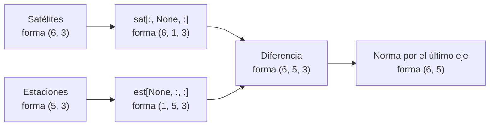

# B14-C02 — Arreglos multidimensionales NumPy

<!-- nav:top -->
[🏠 Programa](../../../../README.md) · [📚 Bloque B14](../../../tronco-comun/B14-computacion-cientifica-y-ciencia-abierta.md) · [← Anterior: B14-C01 — Arquitectura de software científico](../B14-C01-arquitectura-de-software-cientifico/CLASE.md) · [Siguiente: B14-C03 — Análisis numérico con SciPy →](../B14-C03-analisis-numerico-con-scipy/CLASE.md)
<!-- /nav -->

## 1. Ubicación, nivel y alcance

Segunda clase del bloque B14. En la [clase anterior](../B14-C01-arquitectura-de-software-cientifico/CLASE.md) separaste el núcleo de un programa; ahora le das su estructura de datos: el arreglo multidimensional. Pasas de calcular un número a calcular miles de ellos de una vez. Nivel N2.

Verás forma, tipo y almacenamiento de un arreglo, rebanadas (vistas) frente a copias, y la difusión (*broadcasting*), que permite operar arreglos de formas distintas sin bucles. No verás álgebra lineal avanzada (B10), ni rendimiento fino (C14), ni lectura de archivos (C05–C07).

## 2. Por qué esta clase existe

Una constelación de seis satélites y cinco estaciones en tierra producen treinta distancias. Un catálogo de estrellas produce millones. Escribir bucles anidados funciona pero es lento, largo y propenso a errores de índice. La pregunta motivadora es: **¿cómo expreso una operación sobre muchas posiciones a la vez, de forma que se lea como la fórmula?**

La decisión central es: **¿qué forma tiene mi dato y qué forma quiero en el resultado?** Quien lo decide por escrito, antes de programar, evita la mayoría de los errores de difusión.

## 3. Lo que podrás hacer al terminar

1. Describir un arreglo por su `shape`, `dtype` y orden de almacenamiento (`strides`).
2. Predecir la forma del resultado de una operación entre arreglos usando la regla de difusión.
3. Distinguir si una operación devuelve una vista o una copia, y por qué importa.
4. Calcular una matriz de distancias entre dos conjuntos de puntos sin bucles y verificarla contra un bucle.
5. Elegir `float32` o `float64` justificando el riesgo de acumulación de error.
6. Verificar un cálculo con casos exactos (antípodas, mismo punto, cotas).

La evidencia es la **matriz de distancias verificada** del ejercicio 12 (sección 20).

## 4. Con qué llegas y cómo comprobarlo

Necesitas B14-C01 (núcleo y pruebas), coordenadas esféricas (B04) y la norma de un vector. Cinco preguntas:

1. ¿Cuáles son las coordenadas cartesianas de un punto de radio `r`, latitud `φ` y longitud `λ`?
2. ¿Cuál es la distancia entre `(1, 2, 3)` y `(4, 6, 3)`?
3. ¿Cuántos pares hay entre 6 satélites y 5 estaciones?
4. ¿Cuál es la distancia entre dos puntos antípodas de una esfera de radio `R`?
5. ¿Qué precisión relativa tiene aproximadamente un número de 64 bits y uno de 32 bits?

<details>
<summary>Ver respuestas</summary>

1. `x = r cos φ cos λ`, `y = r cos φ sin λ`, `z = r sin φ`. 2. `√(9 + 16 + 0) = 5`. 3. 30. 4. `2R` (el diámetro). 5. Unas 16 cifras decimales (precisión de máquina ≈ 2,2 × 10⁻¹⁶) y unas 7 (≈ 1,2 × 10⁻⁷).
</details>

Con cuatro o cinco aciertos, sigue; con tres o menos, repasa B04 y B01-C18.

## 5. Un caso real: lo que la documentación de NumPy fija como regla

La documentación oficial de NumPy (S1) define la difusión con una regla precisa: se alinean las formas por su dimensión final y se avanza hacia la izquierda; cada par de dimensiones es compatible si son iguales o si una de ellas vale 1; si falta alguna dimensión se supone de tamaño 1. Si algún par no es compatible, NumPy lanza un `ValueError`. La página trae ejemplos que usaremos: `8×1×6×1` con `7×1×5` da `8×7×6×5`, y `2×1` con `8×4×3` no es compatible.

Nuestro **ejemplo conductor** es geométrico: seis satélites sintéticos a 7000 km del centro de la Tierra y cinco estaciones sintéticas en su superficie. Queremos las 30 distancias, y queremos saber si esos números son correctos.

## 6. Vocabulario

Un **arreglo** (`ndarray`) es una tabla de valores del mismo tipo. Su **forma** (`shape`) es la tupla de longitudes por eje; sus **ejes** se numeran desde 0. Su **tipo** (`dtype`) fija cómo se guarda cada valor (`float64`, `float32`, `int64`). Los **pasos** (`strides`) son los bytes que hay que saltar para avanzar una posición en cada eje. Una **vista** es un arreglo que mira los mismos datos que otro sin copiarlos; una **copia** tiene datos propios. La **difusión** es la regla que permite operar arreglos de formas distintas. Un **eje nuevo** (`None` o `np.newaxis`) inserta una dimensión de tamaño 1. La **norma euclídea** de un vector `v` es `‖v‖ = √(v₁² + v₂² + v₃²)`.

## 7. Modelo mental: una caja de números con una etiqueta de forma

Un arreglo es un bloque contiguo de bytes más una etiqueta que dice cómo leerlo: cuántos ejes, cuánto mide cada uno y de qué tipo son los valores. Cambiar la etiqueta (por ejemplo, `reshape` o una rebanada) no mueve los bytes; cambiar el contenido sí.



*Descripción textual:* los satélites `(6,3)` ganan un eje central y pasan a `(6,1,3)`; las estaciones `(5,3)` ganan un eje inicial y pasan a `(1,5,3)`. Su diferencia difunde a `(6,5,3)`. La norma sobre el último eje reduce a `(6,5)`, una distancia por par.

**Analogía y su límite.** Una hoja de cálculo con celdas de un solo tipo: la etiqueta es el encabezado y las celdas son los bytes. Límite: una hoja puede mezclar tipos por columna; un arreglo no, y eso es justamente lo que lo hace rápido.

## 8. La explicación, paso a paso

### 8.1 Forma, tipo y almacenamiento

`np.array([[1., 2., 3.], [4., 5., 6.]])` tiene `shape = (2, 3)`, `dtype = float64` y `strides = (24, 8)`: pasar a la fila siguiente salta 24 bytes (tres números de 8) y pasar a la columna siguiente, 8. En el laboratorio, `est` con forma `(5,3)` ocupa `5·3·8 = 120` bytes y tiene pasos `(24, 8)`.

### 8.2 Operaciones elemento a elemento

`a + b`, `a * b`, `np.sin(a)` operan posición por posición, en código compilado. Se leen como la fórmula: la expresión `r * np.cos(lat) * np.cos(lon)` calcula la coordenada `x` de todos los puntos a la vez.

### 8.3 La difusión

La regla de S1 en tres pasos. **Primero**, escribe las formas alineadas por la derecha: `(6,1,3)` y `(1,5,3)`. **Segundo**, compara columna a columna: `6` y `1` (compatible, gana 6), `1` y `5` (compatible, gana 5), `3` y `3` (iguales). **Tercero**, el resultado tiene la forma `(6,5,3)`. Un caso incompatible: `(4,3)` con `(4,)` alinea `3` con `4`, que no son iguales ni valen 1, y NumPy lo rechaza con `ValueError`. Un rechazo es una buena noticia: evita un resultado silenciosamente erróneo.

### 8.4 Vistas y copias

Una rebanada `est[:, :2]` es una vista: comparte memoria con `est`, y modificarla modifica el original. Indexar con una lista de posiciones `est[[0, 1]]` crea una copia. Si necesitas independencia, usa `.copy()`. Confundir ambas es una fuente clásica de errores en cálculos que parecen correctos.

### 8.5 Tipo y acumulación

Sumar diez millones de valores 0,1 en `float32` acumula errores de redondeo, y el resultado depende del orden y del algoritmo de suma. En el laboratorio, `float32` dio `1 000 000,1` y `float64` dio `1 000 000,0`. NumPy usa suma por pares, que atenúa el problema, pero con `float32` el error no desaparece. Regla: acumula en `float64` salvo que haya una razón de memoria o velocidad y una prueba que muestre que el error es aceptable.

## 9. Magnitudes, símbolos y unidades

| Símbolo | Qué es | Unidad | Nota |
|---|---|---|---|
| `r` | distancia al centro de la Tierra | km | 6378,137 en superficie (S2); 7000 para los satélites |
| `φ` | latitud | grados (se convierte a rad con `np.radians`) | positiva al norte |
| `λ` | longitud | grados | positiva al este |
| `x, y, z` | coordenadas cartesianas | km | `x` hacia lon 0, `z` al polo norte |
| `d` | distancia satélite–estación | km | forma `(S, E)` |
| `shape` | longitudes por eje | adimensional | tupla |

## 10. Convenciones y referencias

Sistema de referencia: terrestre fijo, ejes definidos arriba; la Tierra se toma esférica de radio ecuatorial 6378,137 km (S2), una simplificación. Los ángulos se convierten a radianes antes de usar funciones trigonométricas. Orden de ejes: `(satélite, estación, componente)`. Las posiciones del laboratorio son **sintéticas**, no estaciones ni satélites reales.

## 11. De dónde sale lo que afirmamos

| ID | Fuente | Localizador | Respalda | Estado |
|---|---|---|---|---|
| S1 | NumPy, *Broadcasting* (guía del usuario) | https://numpy.org/doc/stable/user/basics.broadcasting.html | Regla de difusión y ejemplos de formas | Consultada el 2026-11-05 (versión estable, mutable) |
| S2 | NASA NSSDC, *Earth Fact Sheet* | https://nssdc.gsfc.nasa.gov/planetary/factsheet/earthfact.html | Radio ecuatorial 6378,137 km | Consultada el 2026-11-05 (actualizada 2024-11-15) |

Límites: la precisión de `float32` y `float64` (≈ 1,2 × 10⁻⁷ y 2,2 × 10⁻¹⁶) es la del estándar IEEE 754 y la sé de conocimiento general; no se consultó una fuente para esas cifras en esta clase. Vistas frente a copias y `strides` son comportamientos que verifica el propio laboratorio.

## 12. Cómo ver las formas

Tabla de formas del ejemplo conductor, versión accesible del diagrama.

| Objeto | Forma | Significado |
|---|---|---|
| `est` | `(5, 3)` | 5 estaciones × 3 coordenadas |
| `sat` | `(6, 3)` | 6 satélites × 3 coordenadas |
| `sat[:, None, :]` | `(6, 1, 3)` | satélites con eje de estación de tamaño 1 |
| `est[None, :, :]` | `(1, 5, 3)` | estaciones con eje de satélite de tamaño 1 |
| diferencia | `(6, 5, 3)` | un vector por par |
| distancia | `(6, 5)` | un número por par |

## 13. Ejemplo trabajado: 30 distancias sin bucles

1. Convierte cada conjunto a cartesianas con `a_cartesianas(r, lat, lon)`; devuelve forma `(N, 3)`.
2. Inserta ejes: `sat[:, None, :]` y `est[None, :, :]`.
3. Resta: forma `(6, 5, 3)`.
4. `np.linalg.norm(..., axis=-1)` reduce el último eje: forma `(6, 5)`.
5. **Verifica.** Compara con el bucle doble (`np.allclose`, `rtol = 1e-9`). Comprueba casos exactos: dos puntos antípodas de la superficie distan `2R = 12 756,274 km`; un punto consigo mismo, 0; y ningún satélite a 7000 km del centro puede estar más cerca de una estación que `7000 − 6378,137 = 621,863 km` ni más lejos que `13 378,137 km` (desigualdad triangular).

El laboratorio da un mínimo de `621,9 km` y un máximo de `13 175,3 km`: ambos dentro de las cotas, y el mínimo casi las alcanza (un satélite casi sobre una estación). **Paso final · incertidumbre.** Las distancias son exactas para la geometría supuesta (Tierra esférica, posiciones sintéticas); no representan estaciones reales.

## 14. Comparación: bucle, difusión y funciones de biblioteca

Un bucle es claro y lento; es la mejor referencia para **probar**. La difusión es concisa y rápida, pero consume memoria `S·E·3` y puede volverse ilegible. Para conjuntos muy grandes existen funciones especializadas de SciPy (`scipy.spatial.distance.cdist`, C03) que evitan crear el arreglo intermedio. La estrategia sensata: bucle para verificar, difusión para trabajar, biblioteca cuando el tamaño lo exija.

## 15. Práctica guiada

**Ejercicio 1 · con los pasos.** ¿Qué forma resulta de sumar un arreglo `(4, 3)` con uno `(3,)`? ¿Y con uno `(4,)`? *Pasos:* alinea por la derecha (sección 8.3).

<details><summary>Solución comentada</summary>

`(4,3)` con `(3,)`: se alinea `3` con `3` y el eje faltante vale 1; resultado `(4,3)`. `(4,3)` con `(4,)`: `3` frente a `4`, no son iguales ni 1; `ValueError`. Es el ejemplo literal de S1.
</details>

**Ejercicio 2 · con una pista.** Escribe la forma de `a[:, None]` si `a` es `(5,)`, y de `a[:, None] - a[None, :]`. *Pista:* una operación entre `(5,1)` y `(1,5)`.

<details><summary>Solución comentada</summary>

`a[:, None]` es `(5,1)`; `a[None, :]` es `(1,5)`; el resultado es `(5,5)`: la matriz de diferencias entre todos los pares. Con ella obtienes, por ejemplo, las separaciones entre cinco instantes de observación.
</details>

**Ejercicio 3 · casi autónomo.** Una estación está en `(lat, lon) = (0°, 0°)` sobre la superficie. ¿Qué coordenadas cartesianas tiene y qué distancia hay hasta un satélite sobre ella a 7000 km del centro?

<details><summary>Solución comentada</summary>

`x = 6378,137`, `y = z = 0`. El satélite está en `(7000, 0, 0)`. Distancia: `7000 − 6378,137 = 621,863 km`: es la altitud, y confirma la cota mínima.
</details>

## 16. Práctica autónoma, transferencia e integrador

**Ejercicio 4.** ¿Cuántos bytes ocupa un arreglo `float32` de forma `(1000, 1000, 3)`? ¿Y si es `float64`?

<details><summary>Solución comentada</summary>

`10⁶·3 = 3 × 10⁶` valores. `float32`: `1,2 × 10⁷` bytes (12 MB); `float64`: `2,4 × 10⁷` bytes (24 MB). Es relevante porque la difusión del ejercicio de las 30 distancias crea un arreglo de `S·E·3` valores: para `S = E = 1000`, 24 MB en `float64`.
</details>

**Ejercicio 5.** Si `v = est[:, :2]` y haces `v[0, 0] = 0`, ¿cambia `est`? ¿Y si `c = est[[0, 1]]` y haces `c[0, 0] = 0`?

<details><summary>Solución comentada</summary>

Sí cambia en el primer caso (vista, sección 8.4) y no en el segundo (copia). El laboratorio lo comprueba con `np.shares_memory`.
</details>

**Ejercicio 6.** Escribe la expresión sin bucles que da la distancia al origen de todas las filas de `est`.

<details><summary>Solución comentada</summary>

`np.linalg.norm(est, axis=1)`: reduce el eje de componentes. Para una estación en superficie debe dar 6378,137 km, lo cual es una buena prueba.
</details>

**Ejercicio 7.** Calcula a mano la diferencia de `float32` y `float64` al sumar `0,1` diez veces. ¿Por qué `0,1` no se representa exactamente?

<details><summary>Solución comentada</summary>

En binario, `0,1` es periódico, así que se guarda redondeado; la suma acumula esos redondeos. En diez sumas el efecto es del orden de la precisión de máquina; en diez millones se vuelve visible en `float32` (laboratorio: `1 000 000,1` frente a `1 000 000,0`).
</details>

**Ejercicio 8.** Un arreglo `latitudes` tiene forma `(5,)` y otro `longitudes`, `(3,)`. ¿Cómo obtienes una malla `(5,3)` de pares sin bucles?

<details><summary>Solución comentada</summary>

Con difusión: `lat[:, None] + 0*lon[None, :]` para repetir latitudes, y `0*lat[:, None] + lon[None, :]` para repetir longitudes; o `np.meshgrid(lat, lon, indexing="ij")`. Ambas dan `(5,3)`.
</details>

**Ejercicio 9 · transferencia.** Un catálogo tiene `N = 10⁶` estrellas con `(ra, dec)` en grados. Quieres la separación angular de todas con una estrella dada. ¿Qué forma tiene el cálculo y por qué no conviene todas contra todas?

<details><summary>Solución comentada</summary>

Una estrella contra `N`: operación con forma `(N,)`. Todas contra todas serían `N² = 10¹²` pares: terabytes de memoria. La difusión no es gratuita (sección 14).
</details>

**Ejercicio 10 · transferencia.** Un colega suma flujos de millones de píxeles en `float32` y obtiene un total que cambia al reordenar los píxeles. ¿Qué le recomiendas?

<details><summary>Solución comentada</summary>

La suma en coma flotante no es asociativa. Acumular en `float64` (`sum(dtype=np.float64)`) y declarar la tolerancia de comparación. La diferencia por reordenamiento es una señal de error de redondeo, no de datos distintos.
</details>

**Ejercicio 11 · transferencia.** Un colega modifica `sub = datos[10:20]` y descubre que `datos` cambió. Explica por qué y cómo evitarlo.

<details><summary>Solución comentada</summary>

La rebanada es una vista. Para independizarla: `sub = datos[10:20].copy()`. Conviene documentarlo en la función: si devuelve una vista, que lo diga.
</details>

**Ejercicio 12 · integrador.** Entrega una función `matriz_distancias(a, b)` (formas `(S,3)` y `(E,3)`), con: versión por difusión, versión por bucle, comparación entre ambas, tres casos exactos (con su deducción), y una nota con la memoria que usa para `S = E = 5000`.

<details><summary>Solución modelo</summary>

Difusión: `np.linalg.norm(a[:, None, :] - b[None, :, :], axis=-1)`. Bucle de referencia. Casos: mismo punto = 0, antípodas = `2R`, dos puntos separados 90° sobre un círculo máximo = `R√2`. Memoria: `5000·5000·3·8 = 6 × 10⁸` bytes = 600 MB para la diferencia intermedia; propone `cdist` o procesar por bloques. Se acepta cualquier solución que cumpla las cinco partes.
</details>

## 17. Laboratorio

El script [estaciones_y_satelites.py](estaciones_y_satelites.py) construye las posiciones, calcula las 30 distancias por difusión, las compara con un bucle y con casos exactos, verifica vistas y copias, provoca un error de difusión y muestra la acumulación en `float32`.

**Datos:** sintéticos; radio terrestre publicado (NASA). **Predice antes de ejecutar:** ¿qué forma tendrá `d`? (`(6, 5)`.) **Ejecución del 2026-11-05 (Python 3.12.9, NumPy 2.5.4):**

```text
est.shape=(5, 3) sat.shape=(6, 3) dtype=float64 strides=(24, 8) nbytes=120
sat[:,None,:].shape=(6, 1, 3)  est[None,:,:].shape=(1, 5, 3)
d.shape=(6, 5)  mínimo=621.9 km  máximo=13175.3 km
antípodas = 2R, mismo punto = 0, cotas triangulares: correctos
rebanada comparte memoria (vista); indexación con lista copia
difusión incompatible: operands could not be broadcast together with shapes (4,3) (4,) 
suma 1e7 x 0.1: float32=1000000.1  float64=1000000.0  valor ideal=1000000.0
Pruebas superadas.
```

```bash
python programa/clases/B14/B14-C02-arreglos-multidimensionales-numpy/estaciones_y_satelites.py
```

**Límites:** Tierra esférica y estática; la suma de `float32` depende de la versión de NumPy y del algoritmo; el valor `1000000.1` puede variar.

## 18. Errores frecuentes y cómo corregirlos

**Predecir mal la forma.** Se corrige escribiendo las formas antes de operar (ejercicios 1 y 2).

**Confundir vista y copia.** Se corrige con los ejercicios 5 y 11.

**Mezclar grados y radianes.** `np.cos(45)` es coseno de 45 radianes. Se corrige convirtiendo en la frontera (adaptador, B14-C01).

**Acumular en `float32`.** Se corrige con el ejercicio 10.

**Crear arreglos intermedios enormes.** Se corrige con los ejercicios 9 y 12.

## 19. Cómo sabrás que vas bien

Tras 8.3: ¿predices la forma de `(8,1,6,1)` con `(7,1,5)` sin ejecutar? Si no, rehaz el ejercicio 1. Tras 8.4: ¿sabes si `a[::2]` es vista o copia? Si no, rehaz el 5. Tras el ejemplo trabajado: ¿puedes explicar por qué el mínimo está cerca de 621,863 km? Si no, rehaz el ejercicio 3. Tras el laboratorio: ¿qué prueba habría detectado un eje equivocado en la norma? Al final: ¿cuánta memoria pide tu solución del ejercicio 12?

## 20. Qué entregas y cómo se evalúa

El producto es tu **función `matriz_distancias`** con sus pruebas y la nota de memoria.

| Criterio | Inicial | En desarrollo | Logrado | Destacado |
|---|---|---|---|---|
| Formas | Prueba y error | Predice a veces | Predice y justifica | Documenta formas en el código |
| Verificación | Sin prueba | Solo compara con bucle | Bucle y casos exactos | Añade cotas y propiedades |
| Memoria y tipo | No considera | Menciona | Calcula bytes | Propone alternativa |
| Fuentes y alcance | Sin fuente | Fuente sin alcance | Fuente con alcance | Rotula datos sintéticos |

**Condiciones críticas:** no presentar posiciones sintéticas como reales; no omitir la verificación contra un caso exacto; no mezclar grados y radianes.

## 21. Ética, seguridad y límites

Los arreglos grandes pueden agotar la memoria de una máquina compartida; mide antes de lanzar. Accesibilidad: formas dadas en tabla y en texto. Los resultados de este laboratorio no sirven para planificar enlaces reales ni geolocalizar nada. Material educativo.

## 22. Para cerrar y seguir

Un arreglo es un bloque de datos con una etiqueta de forma; la difusión opera formas distintas bajo una regla que puedes aplicar a mano; vistas y copias, y el tipo de dato, determinan si el resultado es correcto y cuánta memoria cuesta. Queda abierta una pregunta: ¿cuándo deja de ser razonable materializar todos los pares?

**Glosario español–inglés.** arreglo · *array*; forma · *shape*; eje · *axis*; vista · *view*; copia · *copy*; difusión · *broadcasting*; tipo de dato · *dtype*; pasos · *strides*.

**Continuidad.** B14-C03 usa estos arreglos como entrada de integradores y buscadores de raíces. B14-C14 retoma la vectorización y la medición del rendimiento.

**Referencias:** ver sección 11.

<!-- nav:bottom -->
---

[← Anterior: B14-C01 — Arquitectura de software científico](../B14-C01-arquitectura-de-software-cientifico/CLASE.md) · [📚 Bloque B14](../../../tronco-comun/B14-computacion-cientifica-y-ciencia-abierta.md) · [Siguiente: B14-C03 — Análisis numérico con SciPy →](../B14-C03-analisis-numerico-con-scipy/CLASE.md)
<!-- /nav -->
