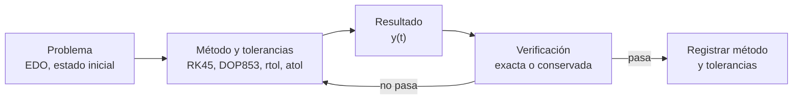

# B14-C03 — Análisis numérico con SciPy

<!-- nav:top -->
[🏠 Programa](../../../../README.md) · [📚 Bloque B14](../../../tronco-comun/B14-computacion-cientifica-y-ciencia-abierta.md) · [← Anterior: B14-C02 — Arreglos multidimensionales NumPy](../B14-C02-arreglos-multidimensionales-numpy/CLASE.md) · [Siguiente: B14-C04 — Unidades y constantes con Astropy →](../B14-C04-unidades-y-constantes-con-astropy/CLASE.md)
<!-- /nav -->

## 1. Ubicación, nivel y alcance

Tercera clase del bloque B14. Ya tienes un núcleo ([C01](../B14-C01-arquitectura-de-software-cientifico/CLASE.md)) y arreglos ([C02](../B14-C02-arreglos-multidimensionales-numpy/CLASE.md)); ahora usas algoritmos numéricos ya construidos, en lugar de escribir los tuyos. Retomas las ecuaciones diferenciales de B11 y las derivadas de B09 desde el lado del programa. Nivel N2.

Verás cómo integrar una ecuación diferencial ordinaria con `solve_ivp`, cómo resolver una ecuación con `brentq`, cómo calcular una integral con `quad`, y sobre todo cómo elegir y **verificar** las tolerancias. No verás métodos para ecuaciones rígidas en profundidad (B11), ni optimización con restricciones, ni álgebra lineal dispersa.

## 2. Por qué esta clase existe

Un integrador devuelve un número aunque sea malo. Con las tolerancias por defecto, una órbita circular puede no cerrarse después de una vuelta y el programa no se queja. La pregunta motivadora es: **¿cómo sé que el resultado de un algoritmo numérico es correcto y no solo plausible?**

La decisión central es: **¿qué método y qué tolerancias uso, y qué prueba me demuestra que bastan?** Se responde comparando con una solución exacta o con una cantidad conservada.

## 3. Lo que podrás hacer al terminar

1. Escribir un sistema de primer orden `y′ = f(t, y)` a partir de una ecuación de segundo orden.
2. Integrar una órbita de dos cuerpos con `solve_ivp` y elegir `method`, `rtol` y `atol`.
3. Medir el error con una solución exacta y con una cantidad conservada (energía específica).
4. Resolver la ecuación de Kepler `M = E − e sin E` con un buscador de raíces acotado.
5. Calcular una integral definida con `quad` y leer su estimación de error.
6. Explicar por qué las tolerancias por defecto pueden no bastar.

La evidencia es el **informe de verificación numérica** del ejercicio 12 (sección 20).

## 4. Con qué llegas y cómo comprobarlo

Necesitas B14-C01 y C02, derivadas (B09) y la idea de ecuación diferencial (B11). Cinco preguntas:

1. Escribe `x″ = −ω² x` como sistema de primer orden.
2. ¿Qué es la energía específica de una órbita de dos cuerpos? (`ε = v²/2 − GM/r`.)
3. ¿Qué es una raíz de una función?
4. ¿Qué significa error relativo?
5. ¿Qué valor tiene `∫₀^π sin x dx`?

<details>
<summary>Ver respuestas</summary>

1. `x′ = v`, `v′ = −ω² x`. 2. Energía cinética más potencial por unidad de masa, constante en el problema de dos cuerpos. 3. Un `x` tal que `f(x) = 0`. 4. `|aprox − exacto| / |exacto|`. 5. 2.
</details>

Con cuatro o cinco aciertos, sigue; con tres o menos, repasa B09 y B11.

## 5. Un caso real: lo que la documentación de SciPy fija sobre tolerancias

La documentación de `scipy.integrate.solve_ivp` (S1) ofrece los métodos RK45 (Runge–Kutta explícito de orden 5(4), el método por defecto), RK23, DOP853 (orden 8, pensado para alta precisión), Radau, BDF y LSODA. Indica que el solver mantiene las estimaciones de error locales por debajo de `atol + rtol·|y|`, con valores por defecto `rtol = 10⁻³` y `atol = 10⁻⁶`; que `rtol` es aproximadamente el número de cifras correctas y `atol` el de decimales correctos; y que `dense_output=True` permite evaluar la solución en cualquier instante. Recomienda métodos explícitos para problemas no rígidos e implícitos (Radau, BDF) para rígidos. De esa página sale el diseño de esta clase: las tolerancias son una decisión tuya, no del programa.

El **ejemplo conductor** es una órbita circular a 400 km de altitud (sintética), con solución exacta conocida: tras un período debe volver a su punto de partida.

## 6. Vocabulario

Una **ecuación diferencial ordinaria (EDO)** relaciona una función de una variable con sus derivadas. Un **problema de valor inicial** da la EDO y el estado en `t = 0`. Un **paso** es el avance en `t` entre dos evaluaciones del integrador; un método de **paso adaptativo** lo ajusta para controlar el error. El **error local** es el error de un solo paso; el **error global** es el acumulado. La **tolerancia relativa** `rtol` y la **absoluta** `atol` fijan el error permitido por paso. Una **cantidad conservada** es una función del estado que no cambia en el modelo (aquí, la energía específica). Un **método acotado** para raíces (como `brentq`) necesita un intervalo `[a, b]` donde la función cambia de signo. La **salida densa** es una interpolación continua de la solución.

## 7. Modelo mental: un algoritmo con perillas y un árbitro

Un algoritmo numérico es una máquina con perillas (método, tolerancias) y una salida. El árbitro es la verificación: una solución exacta o una cantidad conservada. Giras las perillas hasta que el árbitro queda satisfecho, y entonces registras el valor de las perillas junto con el resultado.



*Descripción textual:* el problema entra al método con sus tolerancias; el resultado se verifica contra una solución exacta o una cantidad conservada; si falla, se vuelve a ajustar el método; si pasa, se registra el método y las tolerancias usados.

**Analogía y su límite.** Es como calibrar una balanza con una pesa patrón: no confías en la balanza sin comprobarla. Límite: en muchos problemas reales no hay pesa patrón y la verificación debe hacerse con otra cantidad conservada, con una refinación de tolerancias o con otro método.

## 8. La explicación, paso a paso

### 8.1 De segundo a primer orden

El movimiento de dos cuerpos en el plano es `r″ = −GM r/|r|³`, de segundo orden. Se escribe con el estado `y = (x, y, vₓ, v_y)`: `x′ = vₓ`, `y′ = v_y`, `vₓ′ = −GM x/r³`, `v_y′ = −GM y/r³`, con `r = √(x² + y²)`. En código, la función `f(t, y)` devuelve esa lista de cuatro derivadas. Todas las unidades en SI (m, m/s).

### 8.2 Llamar al integrador

```python
sol = solve_ivp(dos_cuerpos, (0, T), y0, method="DOP853", rtol=1e-12, atol=1e-9)
```

`(0, T)` es el intervalo; `sol.y[:, -1]` es el estado final; `sol.nfev` cuenta evaluaciones de `f`, una medida del costo.

### 8.3 Qué tolerancias elegir

La orientación de S1 es que `rtol` equivale a cifras correctas. Pero el error global se acumula sobre muchos pasos, y no hay garantía de que sea tan pequeño como el local. Por eso se **verifica**: se mide el cierre de la órbita y la deriva de energía. En el laboratorio, con las perillas por defecto de RK45 (`rtol = 10⁻³`), la posición tras un período erró en `1,47 × 10⁶ m` (más de 1000 km, una fracción apreciable del radio orbital) y la energía derivó un 4,2 %. Con `rtol = 10⁻⁹` bajó a `2,2 × 10⁻² m`, y con DOP853 y `rtol = 10⁻¹²`, a `1,3 × 10⁻⁵ m`.

### 8.4 Buscar raíces con un método acotado

La ecuación de Kepler `M = E − e sin E` relaciona la anomalía media `M` (proporcional al tiempo) con la anomalía excéntrica `E`; se resuelve para `E` dado `e` y `M` (no tiene solución cerrada). Se define `g(E) = E − e sin E − M`; como `g(0) = −M < 0` y `g(π) = π − M > 0` para `0 < M < π`, hay una raíz en `[0, π]`. `brentq(g, 0, π)` la encuentra, y la verificación es el **residuo** `g(E)`.

### 8.5 Integrar con `quad`

`quad(f, a, b)` devuelve `(valor, error_estimado)`. El error estimado es una cota que el propio algoritmo calcula, no el error real; para integrales con solución exacta (como `∫₀^π sin x dx = 2`) se compara con ella.

## 9. Magnitudes, símbolos y unidades

| Símbolo | Qué es | Unidad | Nota |
|---|---|---|---|
| `GM` | parámetro gravitacional terrestre | m³/s² | 3,986004 × 10¹⁴ (S2) |
| `y = (x, y, vₓ, v_y)` | estado | m, m/s | sistema inercial, centro en la Tierra |
| `ε` | energía específica | J/kg = m²/s² | `v²/2 − GM/r` |
| `rtol, atol` | tolerancias relativa y absoluta | adimensional; unidad de `y` | S1 |
| `M, E, e` | anomalía media, excéntrica, excentricidad | rad, rad, adimensional | `M = E − e sin E` |
| `T` | período | s | `2π√(a³/GM)` |

## 10. Convenciones y referencias

Sistema inercial plano centrado en la Tierra, sin rotación; órbita inicial en `(a, 0)` con velocidad `(0, v)`. Tierra puntual (dos cuerpos). Radio 6378,137 km (S3). Las versiones de Python, NumPy y SciPy se imprimen en cada ejecución porque los resultados de integración dependen de ellas.

## 11. De dónde sale lo que afirmamos

| ID | Fuente | Localizador | Respalda | Estado |
|---|---|---|---|---|
| S1 | SciPy, `scipy.integrate.solve_ivp` (referencia) | https://docs.scipy.org/doc/scipy/reference/generated/scipy.integrate.solve_ivp.html | Métodos disponibles, `rtol = 1e-3` y `atol = 1e-6` por defecto, significado de las tolerancias, `dense_output` | Consultada el 2026-11-05 (mutable) |
| S2 | astropy, `astropy.constants` | https://docs.astropy.org/en/stable/constants/index.html | `GM_earth = 3,986004 × 10¹⁴ m³/s²` (nominal; sin resolución citada en la página) | Consultada el 2026-11-05 (mutable) |
| S3 | NASA NSSDC, *Earth Fact Sheet* | https://nssdc.gsfc.nasa.gov/planetary/factsheet/earthfact.html | Radio ecuatorial 6378,137 km | Consultada el 2026-11-05 (actualizada 2024-11-15) |

Límites: de `brentq` y `quad` no consulté su página de referencia; su descripción aquí es de uso general y se comprueba con el laboratorio. No se verificó el origen del valor nominal de GM.

## 12. Cómo ver el resultado

Tabla de verificación del ejemplo conductor, versión accesible de un gráfico de error frente a costo.

| Método | `rtol` | Error de cierre tras 1 período | Deriva de energía | Evaluaciones |
|---|---|---|---|---|
| RK45 | 10⁻³ | 1,47 × 10⁶ m | 4,2 × 10⁻² | 110 |
| RK45 | 10⁻⁹ | 2,2 × 10⁻² m | 1,8 × 10⁻⁹ | 776 |
| DOP853 | 10⁻¹² | 1,3 × 10⁻⁵ m | 1,7 × 10⁻¹⁴ | 674 |

## 13. Ejemplo trabajado: ¿cierra la órbita?

1. Radio: `a = 6378,137 + 400 = 6778,137 km`. Velocidad: `v = √(GM/a) = 7668,558 m/s`. Período: `T = 5553,625 s`.
2. Estado inicial: `(a, 0, 0, v)`.
3. Integra de `0` a `T` con tres combinaciones de método y tolerancia.
4. Mide el **cierre**: `√((x_f − a)² + y_f²)`, que debe ser 0.
5. Mide la **deriva de energía**: `|ε_f − ε₀| / |ε₀|`, que debe ser 0.
6. Con la salida densa de DOP853 evalúa la posición en `T/4`: debe ser `(0, a)` (un cuarto de vuelta, sobre el eje `y`). El laboratorio da `(0,0000, 6 778 137,000)` m.
7. Conclusión: las tolerancias por defecto no bastan para propagar una vuelta con un error de metros; con DOP853 a `10⁻¹²` sí.

**Paso final · incertidumbre.** El error medido es del algoritmo, no del modelo: la órbita real no es de dos cuerpos. Y es el error numérico de **este** problema; otro problema (excéntrico, rígido, de varias vueltas) exige otra verificación.

## 14. Comparación de métodos

RK45 es una buena primera elección: barato y robusto para tolerancias moderadas. DOP853 resulta más económico cuando se pide mucha precisión en problemas suaves, como la propagación orbital, porque su orden alto permite pasos más largos. Los métodos implícitos (Radau, BDF) se reservan para problemas rígidos, donde un método explícito necesitaría pasos minúsculos para ser estable; el movimiento kepleriano no lo es. Un método sencillo escrito por ti (Euler) es útil para entender, y mala idea para producir.

## 15. Práctica guiada

**Ejercicio 1 · con los pasos.** Escribe `x″ = −ω² x` como sistema de primer orden y di cuál sería `f(t, y)`. *Pasos:* define `y = (x, v)` (sección 8.1).

<details><summary>Solución comentada</summary>

`y = (x, v)`, `f(t, y) = (y[1], −ω² y[0])`. Es el oscilador armónico; su energía `v²/2 + ω²x²/2` es conservada y sirve de árbitro.
</details>

**Ejercicio 2 · con una pista.** Para `e = 0,7` y `M = 1` rad, verifica que `g(E) = E − e sin E − M` cambia de signo en `[0, π]`. *Pista:* evalúa en los extremos.

<details><summary>Solución comentada</summary>

`g(0) = −1 < 0`; `g(π) = π − 1 = 2,142 > 0`. Hay una raíz. `brentq` da `E = 1,694639 rad`; el residuo es cero a precisión de máquina.
</details>

**Ejercicio 3 · casi autónomo.** Calcula a mano `∫₀^π sin x dx` y compáralo con la salida de `quad`.

<details><summary>Solución comentada</summary>

`[−cos x]₀^π = 1 + 1 = 2`. `quad` devolvió `2,000000000000` con error estimado `2,2 × 10⁻¹⁴`: el error real es menor que el estimado.
</details>

## 16. Práctica autónoma, transferencia e integrador

**Ejercicio 4.** ¿Cuántas evaluaciones de `f` hizo RK45 con `rtol = 10⁻³` y con `10⁻⁹`? ¿Qué relación hay entre costo y precisión?

<details><summary>Solución comentada</summary>

110 y 776 en el laboratorio. Ganar seis órdenes de magnitud de tolerancia costó siete veces más evaluaciones; la precisión no es gratis, pero tampoco es proporcional.
</details>

**Ejercicio 5.** La energía específica inicial es `ε₀ = −GM/(2a)` para una órbita circular. Calcúlala con los datos de la clase.

<details><summary>Solución comentada</summary>

`ε₀ = −3,986004 × 10¹⁴ / (2 × 6,778137 × 10⁶) = −2,9402 × 10⁷ J/kg`. Comprueba con `v²/2 − GM/a = 2,9402 × 10⁷ − 5,8804 × 10⁷ = −2,9402 × 10⁷`.
</details>

**Ejercicio 6.** Si cambias a la excentricidad `e = 0,9`, ¿hay raíz en `[0, π]` para `M = 0,1`? Compruébalo.

<details><summary>Solución comentada</summary>

`g(0) = −0,1 < 0` y `g(π) = π − 0,1 > 0`: sí hay raíz. Como `g′ = 1 − e cos E` es positiva para `e < 1`, la raíz es única. Con `e ≥ 1` el análisis cambia (la ecuación de Kepler elíptica no aplica).
</details>

**Ejercicio 7.** `quad` devuelve `(valor, error)`. Si el error estimado es `10⁻⁸` y el valor es 3, ¿cuántas cifras puedes reportar?

<details><summary>Solución comentada</summary>

El error absoluto estimado es `10⁻⁸`, así que reportas hasta la octava cifra decimal, por ejemplo `3,00000000`. Sigue siendo una estimación del algoritmo, no una garantía.
</details>

**Ejercicio 8.** ¿Qué problema tendría una tolerancia `atol = 10⁻⁶` para un estado medido en metros si lo que importa es el centímetro? ¿Y si el estado se midiera en kilómetros?

<details><summary>Solución comentada</summary>

`atol` está en la unidad del estado: `10⁻⁶ m` es más fino que el centímetro, aceptable. En kilómetros, `10⁻⁶ km = 1 mm`, también aceptable, pero el valor numérico no es el mismo: la tolerancia depende de la unidad, y hay que declararla.
</details>

**Ejercicio 9 · transferencia.** Un colega propaga una órbita durante 100 períodos con `rtol = 10⁻⁶` y dice que «el integrador es preciso». Plantea la verificación que le pedirías.

<details><summary>Solución comentada</summary>

Medir la deriva de energía y el cierre tras 1, 10 y 100 períodos y ver cómo crece; repetir con una tolerancia más fina o con DOP853; comparar con la posición analítica (órbita circular). El error global crece con el tiempo y la tolerancia local no lo acota por sí sola.
</details>

**Ejercicio 10 · transferencia.** Para un cuerpo con arrastre atmosférico débil, la energía ya no se conserva. ¿Qué otro árbitro usarías?

<details><summary>Solución comentada</summary>

Un caso límite sin arrastre (la solución kepleriana), la comparación con otro método o tolerancia más fina, y una cantidad con balance conocido (la energía perdida debe coincidir con el trabajo del arrastre integrado con `quad`).
</details>

**Ejercicio 11 · transferencia.** Quieres el instante en que un satélite cruza `y = 0` en la órbita de la clase. ¿Qué herramienta de `solve_ivp` o de `scipy.optimize` usarías y qué verificación?

<details><summary>Solución comentada</summary>

Con la salida densa evalúas `y(t)` y aplicas `brentq` sobre `y(t)` en un intervalo con cambio de signo; `solve_ivp` también ofrece eventos. Verificación: el cruce ocurre en `t = T/2` (la mitad del período) con tolerancia pequeña.
</details>

**Ejercicio 12 · integrador.** Redacta un **informe de verificación numérica** de una página: el problema, el método y las tolerancias, la cantidad de control, una tabla de error frente a costo con al menos tres configuraciones, la elección final justificada y el límite del resultado.

<details><summary>Solución modelo</summary>

Debe incluir: modelo (dos cuerpos, SI), tabla como la de la sección 12 con sus propios números, un criterio explícito («cierre < 1 m y deriva < 10⁻⁹»), la configuración elegida con su costo, una frase sobre qué no cubre (perturbaciones, otros problemas) y la versión de las bibliotecas. Se acepta cualquier problema con solución exacta o cantidad conservada.
</details>

## 17. Laboratorio

El script [orbita_con_scipy.py](orbita_con_scipy.py) integra la órbita con tres configuraciones, mide cierre y energía, usa la salida densa, resuelve Kepler con `brentq` y verifica `quad`. Falla si el cierre de DOP853 supera 1 mm, si la deriva de energía supera 10⁻¹⁰, o si la configuración por defecto resulta por casualidad tan buena como la fina.

**Datos:** GM publicado; órbita sintética. **Predice antes de ejecutar:** ¿cuál configuración cierra mejor? **Ejecución del 2026-11-05 (Python 3.12.9, NumPy 2.5.4, SciPy 1.18.1):**

```text
a = 6778.137 km, v = 7668.558 m/s, T = 5553.625 s
RK45    rtol=0.001: error de cierre = 1.466e+06 m, deriva de energía = 4.23e-02, evaluaciones = 110
RK45    rtol=1e-09: error de cierre = 2.249e-02 m, deriva de energía = 1.80e-09, evaluaciones = 776
DOP853  rtol=1e-12: error de cierre = 1.273e-05 m, deriva de energía = 1.70e-14, evaluaciones = 674
a T/4: (x, y) = (0.0000, 6778137.000) m  (esperado (0, 6778137.000))
Kepler: E = 1.694638912092 rad, residuo = 0.00e+00
quad sin: 2.000000000000 (error estimado 2.2e-14); gauss: 0.886226925453 (exacto 0.886226925453)
Pruebas superadas.
```

```bash
python programa/clases/B14/B14-C03-analisis-numerico-con-scipy/orbita_con_scipy.py
```

**Límites:** dos cuerpos, sin perturbaciones; resultados válidos para esas versiones de SciPy; el número de evaluaciones puede cambiar entre versiones.

## 18. Errores frecuentes y cómo corregirlos

**Confiar en las tolerancias por defecto.** Se corrige con la sección 8.3 y el ejercicio 9.

**No verificar con una cantidad conservada.** Se corrige con el ejercicio 5.

**Interpretar el error estimado como el error real.** Se corrige con los ejercicios 3 y 7.

**Mezclar unidades en el estado.** Kilómetros en la posición y metros por segundo en la velocidad. Se corrige con el ejercicio 8 y con C04.

**Aplicar `brentq` sin cambio de signo.** El método falla. Se corrige con los ejercicios 2 y 6.

## 19. Cómo sabrás que vas bien

Tras 8.1: ¿escribes `f(t, y)` de un oscilador sin ayuda? Si no, repite el ejercicio 1. Tras 8.3: ¿explicas por qué `rtol = 10⁻³` no cierra la órbita? Si no, relee la tabla de la sección 12. Tras el ejemplo trabajado: ¿qué cantidad hace de árbitro? Tras el laboratorio: ¿qué cambiarías para propagar 100 vueltas? Al final: ¿qué dice tu informe sobre el límite?

## 20. Qué entregas y cómo se evalúa

El producto es tu **informe de verificación numérica** del ejercicio 12.

| Criterio | Inicial | En desarrollo | Logrado | Destacado |
|---|---|---|---|---|
| Formulación | Sin sistema de primer orden | Sistema con unidades faltantes | Sistema con unidades | Verifica dimensiones |
| Verificación | Sin árbitro | Un árbitro | Dos árbitros (exacto y conservado) | Tabla de error frente a costo |
| Tolerancias | Por defecto | Elegidas sin prueba | Elegidas con prueba | Justifica el compromiso |
| Fuentes y alcance | Sin fuente | Fuente sin alcance | Fuente con alcance | Declara versiones y límites |

**Condiciones críticas:** no presentar un resultado numérico sin árbitro; no afirmar precisión por la tolerancia sola; citar solo lo consultado.

## 21. Ética, seguridad y límites

Un integrador mal configurado puede dar trayectorias plausibles y falsas; en navegación real eso es un riesgo para una misión. Esta clase es educativa y no sustituye la propagación de efemérides con modelos de fuerza completos. Accesibilidad: resultados en tabla; sin gráficos obligatorios.

## 22. Para cerrar y seguir

SciPy te da algoritmos listos, pero las perillas (método y tolerancias) son tuyas, y el árbitro (una solución exacta o una cantidad conservada) decide si bastan. Con las tolerancias por defecto, la órbita de la clase no cerró; con DOP853 a `10⁻¹²`, sí. Queda abierta una pregunta: ¿cómo verificas un integrador cuando no existe solución exacta ni cantidad conservada?

**Glosario español–inglés.** ecuación diferencial ordinaria · *ordinary differential equation*; tolerancia relativa · *relative tolerance*; tolerancia absoluta · *absolute tolerance*; cantidad conservada · *conserved quantity*; salida densa · *dense output*; buscador de raíces · *root finder*.

**Continuidad.** B14-C04 hace que las unidades del estado sean verificables por el programa. B14-C10 convierte la verificación de esta clase en pruebas de regresión. B11 desarrolla los métodos y su análisis de error.

**Referencias:** ver sección 11. De `brentq` y `quad` no se consultó la documentación.

<!-- nav:bottom -->
---

[← Anterior: B14-C02 — Arreglos multidimensionales NumPy](../B14-C02-arreglos-multidimensionales-numpy/CLASE.md) · [📚 Bloque B14](../../../tronco-comun/B14-computacion-cientifica-y-ciencia-abierta.md) · [Siguiente: B14-C04 — Unidades y constantes con Astropy →](../B14-C04-unidades-y-constantes-con-astropy/CLASE.md)
<!-- /nav -->
