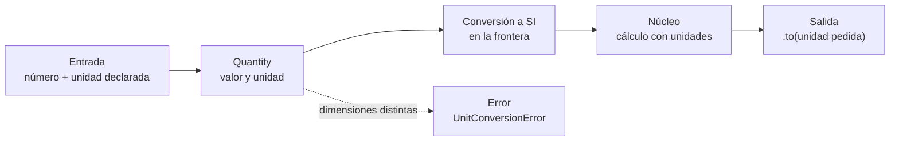

# B14-C04 — Unidades y constantes con Astropy

<!-- nav:top -->
[🏠 Programa](../../../../README.md) · [📚 Bloque B14](../../../tronco-comun/B14-computacion-cientifica-y-ciencia-abierta.md) · [← Anterior: B14-C03 — Análisis numérico con SciPy](../B14-C03-analisis-numerico-con-scipy/CLASE.md) · [Siguiente: B14-C05 — Tablas astronómicas y catálogos →](../../../tronco-comun/B14-computacion-cientifica-y-ciencia-abierta.md#b14-c05)
<!-- /nav -->

## 1. Ubicación, nivel y alcance

Cuarta clase del bloque B14. En [C01](../B14-C01-arquitectura-de-software-cientifico/CLASE.md) pediste que el adaptador rechace unidades desconocidas; aquí aprendes a hacer que el propio programa lleve las unidades consigo y se niegue a sumar peras con manzanas. Retomas las unidades y el análisis dimensional de B01-C08 y las constantes físicas de B13. Nivel N2.

Verás cómo asociar unidades a números (`Quantity`), convertir, detectar incompatibilidades y usar constantes con su origen. No verás metrología formal (B13), ni escalas de tiempo (B13) ni sistemas de coordenadas (B14 posterior y B19).

## 2. Por qué esta clase existe

En 1999 la sonda Mars Climate Orbiter se perdió al llegar a Marte. NASA atribuye la pérdida a un error de navegación causado por no traducir unidades inglesas a métricas: el software en tierra usaba unidades inglesas y el de a bordo, métricas (S1). La pregunta motivadora es: **¿cómo hago que mi programa no pueda cometer ese error en silencio?**

La decisión central es: **¿en qué punto del programa entra una cantidad con su unidad y en qué punto la convierto a la unidad que usa el cálculo?** Si el código lleva las unidades, una suma incompatible falla; si solo hay números, el error pasa.

## 3. Lo que podrás hacer al terminar

1. Crear y convertir magnitudes con unidades en Astropy y leer su valor numérico en una unidad elegida.
2. Predecir cuándo una operación entre magnitudes debe fallar por dimensiones incompatibles.
3. Usar equivalencias (por ejemplo, longitud de onda a frecuencia) de forma explícita.
4. Usar constantes de `astropy.constants` indicando su fuente y versión.
5. Comprobar una conversión con una identidad exacta y con un cálculo manual.
6. Explicar por qué las unidades en el código no sustituyen la comprensión de los factores de conversión.

La evidencia es la **hoja de conversiones comprobada** del ejercicio 12 (sección 20).

## 4. Con qué llegas y cómo comprobarlo

Necesitas B01-C08 (unidades y conversión) y C01–C03 de este bloque. Cinco preguntas:

1. ¿Cuántos metros hay en un kilómetro y en una unidad astronómica? (10³ y ≈ 1,496 × 10¹¹.)
2. ¿Cuántas unidades astronómicas hay en un parsec? (≈ 206 265.)
3. ¿Qué dimensión tiene la velocidad y cuál el impulso (fuerza × tiempo)?
4. ¿Se puede sumar 5 km con 3 s? ¿Por qué?
5. ¿Qué es un radián y cuántos radianes tiene un minuto de arco?

<details>
<summary>Ver respuestas</summary>

1. 1000 m y 149 597 870 700 m. 2. `648 000/π ≈ 206 264,806`. 3. Longitud/tiempo y masa·longitud/tiempo (N·s = kg·m/s). 4. No: longitud y tiempo son dimensiones distintas. 5. Un ángulo cuyo arco mide un radio; `1′ = π/10 800 = 2,909 × 10⁻⁴ rad`.
</details>

Con cuatro o cinco aciertos, sigue; con tres o menos, repasa B01-C08.

## 5. Un caso real: Mars Climate Orbiter

La página de misión de NASA (S1) indica que la nave se lanzó el 11 de diciembre de 1998, que el contacto se perdió el 23 de septiembre de 1999, y que la causa fue un error de navegación por no traducir unidades inglesas a métricas: el software de tierra usaba unidades inglesas y el de a bordo, métricas, lo que sesgó los cálculos de trayectoria y acercó demasiado la nave a Marte. La página no da más detalle técnico; no la uso para afirmar qué magnitud exacta se mal interpretó. Por eso, el ejemplo conductor de la clase es una **ilustración sintética de la idea**: un impulso de 100 lbf·s que alguien lee como si fuera N·s (el número 100 se escoge solo para ejemplificar). No es una reconstrucción del suceso.

## 6. Vocabulario

Una **unidad** es una cantidad de referencia de una dimensión. Una **dimensión** es la clase de cantidad física (longitud, tiempo, masa). Una **magnitud con unidad** (`Quantity` en Astropy) es un número, o un arreglo, junto con una unidad. Una **conversión** cambia la unidad sin cambiar la cantidad física. Una **equivalencia** es una regla que relaciona dimensiones distintas bajo un supuesto (por ejemplo, `ν = c/λ`). Una **constante física** es un valor con unidad, incertidumbre y referencia. El **SI** es el Sistema Internacional de Unidades. Un **ángulo** es adimensional en el SI; el radián es la unidad coherente.

## 7. Modelo mental: la unidad viaja con el número

Piensa en cada valor como una moneda con su país. Puedes cambiarla de divisa con una tasa conocida, pero no sumar pesos con euros sin convertir. El programa lleva la divisa en la moneda y se niega a mezclarlas.



*Descripción textual:* una entrada con su unidad se convierte en `Quantity`; se convierte a SI en la frontera, el núcleo calcula con unidades, y la salida pide la unidad deseada. Si se mezclan dimensiones distintas, el programa lanza un `UnitConversionError`.

**Analogía y su límite.** Las divisas. Límite: una tasa de cambio fluctúa; el factor entre kilómetro y metro es exacto por definición, pero el factor entre libra-fuerza y newton es una definición convencional con sus propias cifras, y el valor de una constante como `G` tiene incertidumbre.

## 8. La explicación, paso a paso

### 8.1 Crear magnitudes

En Astropy (S2), una magnitud se crea multiplicando un número o un arreglo por una unidad: `5 * u.km`. La página enseña `42.0 * u.meter` y conversión con `.to`: `(1.0 * u.parsec).to(u.km)`. El valor numérico es `.value` y la unidad, `.unit`.

### 8.2 Convertir y comprobar

`.to(u.au)` devuelve una nueva magnitud. Comprueba siempre al menos una conversión con una identidad exacta: por definición de parsec, `1 pc = 648 000/π au`. El laboratorio da `206 264,806247096` en ambas.

### 8.3 Dimensiones incompatibles

S2 documenta que convertir entre dimensiones distintas falla por defecto: `(1000 * u.nm).to(u.Hz)` lanza un `UnitConversionError` («`nm` (longitud) y `Hz` (frecuencia) no son convertibles»). Con una equivalencia explícita, `u.spectral()`, sí se permite: `(1000 * u.nm).to(u.THz, equivalencies=u.spectral())` da `299,792 THz`, igual que `c/λ = 299 792 458 / 10⁻⁶ m` en THz. La sección dice lo que no documenta: no consulté qué hace S2 con las sumas incompatibles. Lo verifica el laboratorio: `5 km + 3 s` lanza un `UnitConversionError`.

### 8.4 Constantes con origen

`astropy.constants` (S3) trae `G`, `c` y otras con valor, unidad y referencia. Su página indica que `G` y `c` llevan la referencia CODATA 2022 y que, para `GM_earth` («parámetro de masa terrestre nominal») y `au`, no declara fuente ni resolución. Por eso: **cita la versión de Astropy y la constante**, y no atribuyas a una resolución algo que la fuente no declara.

### 8.5 Unidades en el cálculo

Con unidades, el período orbital se escribe como la fórmula:

```python
T = (2*np.pi*np.sqrt(a**3 / const.GM_earth)).to(u.min)
```

Si `a` estuviera en km y `GM_earth` en m³/s², Astropy resuelve la conversión sola; un número sin unidad no lo haría.

### 8.6 Lo que las unidades no hacen

Las unidades verifican dimensiones, no significado. Si alguien etiqueta como `u.N * u.s` un número que en realidad estaba en lbf·s, Astropy no se entera. La conversión de `lbf·s` a `N·s` es otra operación, que debe ocurrir en el adaptador.

## 9. Magnitudes, símbolos y unidades

| Símbolo | Qué es | Unidad | Nota |
|---|---|---|---|
| `lbf` | libra-fuerza | N | `1 lbf = 4,448222 N` (S4, 7 cifras) |
| `pc` | parsec | au | `648 000/π` au, exacto por definición |
| `au` | unidad astronómica | m | 149 597 870 700 m (S3: `1,49597871 × 10¹¹ m`) |
| `λ`, `ν` | longitud de onda, frecuencia | m, Hz | `ν = c/λ` (equivalencia espectral) |
| `c` | velocidad de la luz | m/s | 299 792 458, exacta |
| `G` | constante gravitatoria | m³/(kg s²) | 6,6743 × 10⁻¹¹ (S3, CODATA 2022) |
| `GM_earth` | parámetro gravitacional de la Tierra | m³/s² | 3,986004 × 10¹⁴ (nominal, S3) |

## 10. Convenciones y referencias

Las conversiones se hacen en la frontera del programa (C01) y el núcleo trabaja con magnitudes con unidades o en SI. Los ángulos pequeños se convierten a radianes antes de multiplicar por una distancia. Los valores de constantes dependen de la versión de Astropy; el laboratorio la imprime. El impulso de 100 lbf·s es sintético.

## 11. De dónde sale lo que afirmamos

| ID | Fuente | Localizador | Respalda | Estado |
|---|---|---|---|---|
| S1 | NASA Science, «Mars Climate Orbiter» | https://science.nasa.gov/mission/mars-climate-orbiter/ | Lanzamiento 1998-12-11, contacto perdido 1999-09-23, causa: fallo al traducir unidades inglesas a métricas entre el software de tierra y el de a bordo | Página consultada el 2026-11-05 (mutable) |
| S2 | astropy, documentación de `astropy.units` | https://docs.astropy.org/en/stable/units/index.html | Creación de `Quantity`, `.to`, `UnitConversionError` entre dimensiones distintas, equivalencias | Consultada el 2026-11-05 (mutable) |
| S3 | astropy, documentación de `astropy.constants` | https://docs.astropy.org/en/stable/constants/index.html | `G` y `c` con referencia CODATA 2022; `GM_earth` y `au` sin fuente declarada | Consultada el 2026-11-05 (mutable) |
| S4 | NIST, *Guide for the Use of the SI*, Apéndice B.8 (factores de conversión) | https://www.nist.gov/pml/special-publication-811/nist-guide-si-appendix-b-conversion-factors/nist-guide-si-appendix-b8 | `1 lbf = 4,448222 N` (página: no marcado como exacto) | Consultada el 2026-11-05 |

Límites: S1 no detalla la magnitud mal interpretada; la identidad `1 pc = 648 000/π au` y `1 au = 149 597 870 700 m` son de conocimiento general (definiciones de la IAU, 2012 y 2015), que no consulté en esta clase; tampoco el valor del jansky (1 Jy = 10⁻²⁶ W m⁻² Hz⁻¹, ejercicio 7) ni la página del BIPM sobre el SI.

## 12. Cómo ver las conversiones

Tabla accesible de las conversiones del laboratorio.

| Operación | Resultado |
|---|---|
| 1 pc en au | 206 264,806247096 |
| 100 lbf·s en N·s | 444,822168 (manual con 4,448222: 444,822200) |
| 1000 nm en THz con `u.spectral()` | 299,792 |
| T de una órbita a 400 km | 92,5604 min |
| 1′ en rad | 2,908882 × 10⁻⁴ |
| 1′ a 43 Mpc | 12,508 kpc |

## 13. Ejemplo trabajado: el impulso leído en la unidad equivocada

1. Un dato dice «impulso de 100 lbf·s» (sintético).
2. **Con unidades:** `(100 * u.imperial.lbf * u.s).to(u.N * u.s)` da `444,822168 N·s`.
3. **A mano:** `100 × 4,448222 = 444,8222 N·s` (diferencia relativa ≈ 7 × 10⁻⁸ con la cifra de S4 de siete dígitos).
4. **Error de lectura:** si el número 100 se lee como N·s, el impulso se subestima por el factor `4,4482`: el 22,5 % del valor real.
5. **Prevención:** el adaptador (C01) exige la unidad y convierte; el núcleo solo recibe N·s.

**Paso final · incertidumbre.** La cifra `4,448222` tiene siete dígitos; la diferencia con el valor de Astropy es de décimas de una millonésima y no afecta a esta conclusión. La parte que importa es el factor 4,45, no la séptima cifra.

## 14. Comparación: unidades en el código, en el nombre o en comentarios

**Sufijos en los nombres** (`a_m`, `t_s`): sin dependencias, pero no se comprueban. **Comentarios**: se pierden. **Astropy**: comprueba dimensiones y convierte, con algo de costo de ejecución y de aprendizaje; para bucles internos muy exigentes se trabaja en SI sin unidades y se aplica la unidad en la frontera. **Pruebas**: ninguna de las anteriores sustituye comprobar conversiones con una identidad conocida.

## 15. Práctica guiada

**Ejercicio 1 · con los pasos.** Convierte 1 au a km con Astropy y a mano. *Pasos:* `1 au = 149 597 870,7 km` (sección 8.2).

<details><summary>Solución comentada</summary>

`(1*u.au).to(u.km)` da `1,495978707 × 10⁸ km`. A mano, `149 597 870 700 m / 1000`. Coinciden porque el au está fijado por definición en 149 597 870 700 m.
</details>

**Ejercicio 2 · con una pista.** Predice si `(2*u.km) + (300*u.m)` funciona y cuánto vale. *Pista:* misma dimensión.

<details><summary>Solución comentada</summary>

Funciona: ambas son longitudes. El resultado es `2,3 km` (Astropy usa la unidad del primer operando). Una suma entre `km` y `s` fallaría (sección 8.3).
</details>

**Ejercicio 3 · casi autónomo.** Calcula la frecuencia de una línea a 500 nm con `c/λ` y con `u.spectral()`.

<details><summary>Solución comentada</summary>

`299 792 458 / 5 × 10⁻⁷ = 5,9958 × 10¹⁴ Hz = 599,58 THz`. Con la equivalencia da lo mismo. Sin equivalencia, `.to(u.Hz)` falla (sección 8.3).
</details>

## 16. Práctica autónoma, transferencia e integrador

**Ejercicio 4.** El tamaño angular de una galaxia es 30″ y está a 43 Mpc. Calcula su tamaño en kpc con unidades. ¿Por qué hay que pasar el ángulo a radianes?

<details><summary>Solución comentada</summary>

`30″ = 1,454 × 10⁻⁴ rad`; `s ≈ d·θ = 43 000 kpc × 1,454 × 10⁻⁴ = 6,25 kpc`. La aproximación `s ≈ dθ` exige `θ` en radianes porque es el único ángulo adimensional coherente (B01-C03).
</details>

**Ejercicio 5.** Con `GM_earth` y `a = 7000 km`, calcula `v = √(GM/a)` en km/s y en m/s.

<details><summary>Solución comentada</summary>

`GM = 3,986004 × 10¹⁴ m³/s²`; `a = 7 × 10⁶ m`; `GM/a = 5,694 × 10⁷ m²/s²`; `v = 7546 m/s = 7,546 km/s`. Con unidades, `.to(u.km/u.s)` hace el cambio.
</details>

**Ejercicio 6.** ¿Qué diferencia hay entre `.value` y `.to_value(u.km)`? ¿Cuándo usar cada una?

<details><summary>Solución comentada</summary>

`.value` entrega el número en la unidad actual; `.to_value(u.km)` convierte y entrega el número en km. Usa la segunda cuando necesitas un número en una unidad concreta y quieres evitar sorpresas si la unidad actual es otra.
</details>

**Ejercicio 7.** Un instrumento entrega el flujo en `mJy` y otro en `W m⁻² Hz⁻¹`. ¿Basta `.to` para comparar? ¿Qué verificarías?

<details><summary>Solución comentada</summary>

Ambos son densidades de flujo espectral y `1 mJy = 10⁻²⁹ W m⁻² Hz⁻¹` (definición del jansky, `1 Jy = 10⁻²⁶`). Verificarías la conversión con una identidad conocida, no solo confiar en que no falle.
</details>

**Ejercicio 8.** Explica por qué `(1000*u.nm).to(u.Hz)` falla y qué supuesto hace la equivalencia espectral.

<details><summary>Solución comentada</summary>

Longitud de onda y frecuencia son dimensiones distintas; relacionarlas requiere `ν = c/λ` en el vacío. La equivalencia asume propagación en el vacío; en un medio con índice de refracción, `ν` es la misma pero `λ` cambia.
</details>

**Ejercicio 9 · transferencia.** Un archivo de datos tiene una columna `distancia` sin unidad. Describe qué harías antes de usarla.

<details><summary>Solución comentada</summary>

Buscar la unidad en la documentación del archivo (encabezado, diccionario de datos), no asumirla; declararla en el adaptador y rechazar el archivo si falta; comprobar el orden de magnitud con un valor conocido. Es la raíz del caso de la sección 5.
</details>

**Ejercicio 10 · transferencia.** Dos equipos usan versiones distintas de Astropy y sus períodos orbitales difieren en la sexta cifra. ¿Qué miras primero?

<details><summary>Solución comentada</summary>

Las constantes: el valor de `GM_earth` o `G·M` pudo cambiar entre versiones o conjuntos de constantes. Imprime la versión y los valores usados y compáralos; fija la versión en el entorno (C12).
</details>

**Ejercicio 11 · transferencia.** Propón una prueba automática que habría detectado el error de la sección 13.

<details><summary>Solución comentada</summary>

Una prueba que convierta `100 lbf·s` y compruebe `≈ 444,82 N·s`, y otra que verifique que el adaptador rechaza una entrada sin unidad. La primera prueba la conversión, la segunda impide el uso de números desnudos.
</details>

**Ejercicio 12 · integrador.** Construye una **hoja de conversiones comprobada** con al menos ocho conversiones de ciencias espaciales (longitud, tiempo, velocidad, ángulo, flujo o frecuencia). Para cada una: valor inicial con unidad, resultado con Astropy, cálculo manual, la identidad o referencia con que se comprobó y la fuente.

<details><summary>Solución modelo</summary>

Debe incluir conversiones exactas (pc–au, km–m), una con equivalencia espectral, una con ángulo, una con un factor convencional (lbf–N), y para cada una una comprobación manual con diferencia relativa declarada. Se acepta cualquier selección que declare sus fuentes y límites.
</details>

## 17. Laboratorio

El script [unidades_con_astropy.py](unidades_con_astropy.py) comprueba la identidad del parsec, la conversión lbf·s → N·s, la detección de sumas incompatibles, la equivalencia espectral, el período orbital con unidades y el ángulo de un minuto de arco.

**Datos:** factores publicados; impulso sintético. **Predice antes de ejecutar:** ¿qué factor falla al leer lbf·s como N·s? (4,45.) **Ejecución del 2026-11-05 (Python 3.12.9, NumPy 2.5.4, astropy 8.0.2):**

```text
1 pc = 206264.806247096 au (648000/pi = 206264.806247096)
100 lbf*s = 444.822168 N*s (manual con 4.448222: 444.822200); leerlo como N*s subestima el impulso en un factor 4.4482
km + s -> UnitConversionError: Can only apply 'add' function to quantities with compatible dimensions
nm -> Hz sin equivalencia: UnitConversionError
1000 nm con u.spectral() = 299.792 THz  (c/lambda = 299.792 THz)
T(LEO 400 km) = 92.5604 min (manual 92.5604 min)
G = 6.67430e-11 m3 / (kg s2), c = 299792458 m / s, GM_earth = 3.986004e+14 m3 / s2
au = 1.49597871e+11 m  (1 au = 149597870700 m: dif. relativa 0.0e+00)
1 arcmin = 2.908882e-04 rad; tamaño de 1' a 43 Mpc = 12.508 kpc
Pruebas superadas.
```

```bash
python programa/clases/B14/B14-C04-unidades-y-constantes-con-astropy/unidades_con_astropy.py
```

Observa que Astropy 8.0.2 da `au = 1.49597871e+11 m` y que la comparación con `149 597 870 700` imprime diferencia 0: ambos son el mismo número de doble precisión redondeado. **Límites:** valores válidos para esa versión; los de otras versiones pueden diferir; no es un laboratorio de metrología.

## 18. Errores frecuentes y cómo corregirlos

**Usar números desnudos.** Se corrige con el ejercicio 9.

**Etiquetar con la unidad equivocada.** Astropy no lo detecta. Se corrige con la sección 8.6 y el ejercicio 11.

**Convertir ángulos sin pasar a radianes.** Se corrige con el ejercicio 4.

**Confundir `.value` con una conversión.** Se corrige con el ejercicio 6.

**Atribuir a una constante una fuente que no declara.** Se corrige con la sección 8.4 y el ejercicio 10.

## 19. Cómo sabrás que vas bien

Tras 8.3: ¿predices cuándo falla una suma? Si no, rehaz el ejercicio 2. Tras 8.4: ¿sabes qué constante de Astropy tiene fuente declarada? Si no, relee la sección 11. Tras el ejemplo trabajado: ¿qué prueba habría evitado el error? Si no, rehaz el ejercicio 11. Tras el laboratorio: ¿qué versión de Astropy usaste? Al final: ¿cuál de tus conversiones depende de una convención y no de una identidad?

## 20. Qué entregas y cómo se evalúa

El producto es tu **hoja de conversiones comprobada** del ejercicio 12.

| Criterio | Inicial | En desarrollo | Logrado | Destacado |
|---|---|---|---|---|
| Conversión | Con errores | Correcta sin comprobar | Correcta y comprobada a mano | Comprobada con identidad exacta |
| Dimensiones | No las revisa | Las revisa a veces | Detecta incompatibilidades | Usa equivalencias con su supuesto |
| Constantes | Sin origen | Con valor | Con valor y versión | Con fuente y límite |
| Fuentes y alcance | Sin fuente | Fuente sin alcance | Fuente con alcance | Distingue definición y convención |

**Condiciones críticas:** no usar números sin unidad; no atribuir una constante a una fuente que no la declara; no presentar el ejemplo sintético como el caso real.

## 21. Ética, seguridad y límites

Los errores de unidades pueden perder misiones y vidas en otros campos. Declarar unidades es una obligación profesional. Esta clase no reconstruye el caso real de 1999: usa su idea general. Accesibilidad: tablas y texto. Material educativo.

## 22. Para cerrar y seguir

Las unidades deben viajar con el número y las conversiones ocurrir en la frontera; Astropy detecta dimensiones incompatibles, pero no etiquetas mal puestas. Las constantes se citan con su versión y origen. Queda abierta una pregunta: ¿qué otras convenciones (marcos, escalas de tiempo) pueden fallar en silencio aunque las unidades estén bien?

**Glosario español–inglés.** unidad · *unit*; dimensión · *dimension*; magnitud con unidad · *quantity*; equivalencia · *equivalency*; constante física · *physical constant*; conversión · *conversion*; libra-fuerza · *pound-force*.

**Continuidad.** B14-C05 pone unidades en las columnas de una tabla; B14-C06 en los encabezados FITS; B14-C10 convierte las comprobaciones de esta clase en pruebas de regresión. B13 desarrolla la metrología detrás de las constantes.

**Referencias:** ver sección 11. De S1 solo se usó la página de misión.

<!-- nav:bottom -->
---

[← Anterior: B14-C03 — Análisis numérico con SciPy](../B14-C03-analisis-numerico-con-scipy/CLASE.md) · [📚 Bloque B14](../../../tronco-comun/B14-computacion-cientifica-y-ciencia-abierta.md) · [Siguiente: B14-C05 — Tablas astronómicas y catálogos →](../../../tronco-comun/B14-computacion-cientifica-y-ciencia-abierta.md#b14-c05)
<!-- /nav -->
