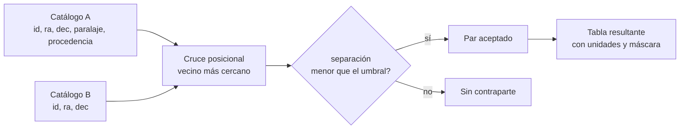

# B14-C05 — Tablas astronómicas y catálogos

<!-- nav:top -->
[🏠 Programa](../../../../README.md) · [📚 Bloque B14](../../../tronco-comun/B14-computacion-cientifica-y-ciencia-abierta.md) · [← Anterior: B14-C04 — Unidades y constantes con Astropy](../B14-C04-unidades-y-constantes-con-astropy/CLASE.md) · [Siguiente: B14-C06 — Formato FITS y encabezados →](../B14-C06-formato-fits-y-encabezados/CLASE.md)
<!-- /nav -->

## 1. Ubicación, nivel y alcance

Quinta clase del bloque B14. Con [NumPy](../B14-C02-arreglos-multidimensionales-numpy/CLASE.md) manejas números y con [Astropy](../B14-C04-unidades-y-constantes-con-astropy/CLASE.md) manejas magnitudes con unidad; ahora los organizas en **tablas**: filas de objetos, columnas de propiedades. Es el formato en que casi todo catálogo astronómico llega a tus manos. Nivel N2.

Verás tablas con unidades, valores faltantes enmascarados, metadatos de procedencia, el cruce posicional de dos catálogos y la escritura en un formato de texto que conserva todo eso. No verás consultas a archivos remotos de misión (B14-C18), ni FITS binario (C06), ni limpieza masiva con pandas (C08).

## 2. Por qué esta clase existe

Un catálogo de estrellas no es una lista de números: cada columna tiene una unidad, algunas filas no tienen paralaje, y la tabla viene de un instrumento, una época y una versión. Si pierdes eso al copiar los datos a un arreglo, pierdes la mitad del significado. La pregunta motivadora es: **¿cómo guardo un catálogo para que sus unidades, sus huecos y su origen sobrevivan a cada operación?**

La decisión central es: **¿qué información acompaña a cada columna y cada fila, y qué debe pasar cuando falta un valor?** Quien la deja escrita evita que un hueco se convierta en un cero.

## 3. Lo que podrás hacer al terminar

1. Construir una tabla con columnas con unidad, valores enmascarados y metadatos.
2. Calcular una columna derivada (distancia a partir de paralaje) sin perder la máscara.
3. Cruzar dos catálogos por posición con un umbral angular y justificarlo.
4. Explicar por qué el cruce debe manejar el salto de 360° a 0° en ascensión recta.
5. Guardar y leer una tabla en un formato de texto con unidades y máscara (ida y vuelta verificada).
6. Documentar la procedencia de un catálogo (datos observados, sintéticos o derivados).

La evidencia es el **catálogo cruzado documentado** del ejercicio 12 (sección 20).

## 4. Con qué llegas y cómo comprobarlo

Necesitas C02 y C04 de este bloque, coordenadas esféricas (B04) y ángulos en grados y segundos de arco. Cinco preguntas:

1. ¿Cuántos segundos de arco tiene un grado? (3600.)
2. Si el paralaje de una estrella es 100 mas (milisegundos de arco), ¿a qué distancia está? (10 pc, con `d[pc] = 1000/p[mas]`.)
3. ¿Qué forma tiene un arreglo de 6 posiciones con 2 coordenadas? ((6, 2).)
4. ¿Cuánto separa, sobre el cielo, dos puntos con la misma declinación y ascensiones rectas 359,9999° y 0,0001°?
5. ¿Qué es un valor faltante y por qué no debe sustituirse por 0?

<details>
<summary>Ver respuestas</summary>

1. 3600″. 2. 10 pc. 3. (6, 2). 4. Solo 0,0002° en el ecuador (0,72″), no 359,9998°: el cielo es periódico en ascensión recta. 5. Es un dato que no se midió o no se pudo calcular; un 0 afirmaría una medida que no existe (un paralaje de 0 sugeriría una distancia infinita).
</details>

Con cuatro o cinco aciertos, sigue; con tres o menos, repasa B04 y B01-C08.

## 5. Un caso real: las tablas de Astropy y su diseño

La documentación de `astropy.table` (S1) describe la tabla como una interfaz flexible construida sobre NumPy, con varias características que esta clase aprovecha: las columnas conservan **unidades**, descripciones y formatos de impresión; `QTable` guarda las columnas como `Quantity` de forma nativa; `MaskedColumn` marca las entradas faltantes, que se muestran como enmascaradas; se pueden adjuntar **metadatos** a la tabla y a cada columna; se lee y escribe en varios formatos a través de una interfaz unificada; y hay operaciones de agrupación, unión (*join*) y apilado. Es un diseño explícito para no perder significado.

El **ejemplo conductor** es sintético: un catálogo A de seis fuentes y un catálogo B de cinco, de los cuales cuatro son reobservaciones de fuentes de A con un desplazamiento de 0,5″ en declinación y una es nueva. Ninguna fila corresponde a una estrella real; el desplazamiento se fijó de antemano para que podamos comprobar el cruce.

## 6. Vocabulario

Una **tabla** es un conjunto de columnas del mismo largo; cada **fila** describe un objeto y cada **columna** una propiedad. Un **catálogo** es una tabla de objetos con procedencia (instrumento, época, versión, criterios de selección). Una **columna enmascarada** lleva, junto a los valores, un indicador de cuáles faltan. El **paralaje** `ϖ` es el pequeño desplazamiento angular aparente de una estrella al verse desde dos puntos de la órbita terrestre; sirve para estimar su distancia. La **separación angular** es el ángulo entre dos direcciones del cielo. Un **cruce posicional** (*cross-match*) empareja filas de dos catálogos que probablemente son el mismo objeto. Un **umbral de cruce** es la separación máxima aceptada. Un **formato de texto con metadatos** guarda también unidades y máscara; el que usamos es ECSV, escrito por Astropy.

## 7. Modelo mental: una tabla es un conjunto de columnas con etiqueta

Cada columna lleva su unidad y su máscara; la tabla lleva su procedencia. Una operación entre tablas debe preservar esas etiquetas o fallar con un mensaje, nunca perderlas en silencio.



*Descripción textual:* los dos catálogos entran a un cruce posicional que busca, para cada fuente de B, la más cercana de A. Si la separación es menor que el umbral, el par se acepta; si no, la fuente queda sin contraparte. La tabla resultante conserva unidades y máscara.

**Analogía y su límite.** Una ficha de biblioteca con campos fijos: título, autor y, al margen, la procedencia. Límite: una ficha no calcula; en una tabla las columnas se transforman y esa transformación debe conservar las etiquetas.

## 8. La explicación, paso a paso

### 8.1 Construir con unidades y máscara

Con `QTable` y `MaskedColumn` (S1) la columna `paralaje` lleva unidad `mas` y una máscara: la fuente A5 tiene paralaje enmascarado. Las posiciones `ra` y `dec` llevan unidad `deg`. Los metadatos de la tabla guardan la procedencia («sintético»).

### 8.2 Derivar una columna

La distancia en parsec es `d = 1000/ϖ`, con `ϖ` en mas. Se calcula sobre los valores no enmascarados y las filas faltantes devuelven `NaN` (no un número). En el laboratorio: 100 mas → 10 pc, 50 mas → 20 pc, 12,5 mas → 80 pc, 4 mas → 250 pc, 2 mas → 500 pc, y A5 sigue sin valor. (Esta relación es la definición del parsec; no la consulté en esta clase, ver sección 11.) Una advertencia: invertir el paralaje es una estimación adecuada solo si el error relativo del paralaje es pequeño, asunto que se trata con estadística en B12.

### 8.3 Separación angular y cruce

Para cada fuente de B se busca la más cercana de A. Con `SkyCoord` se calcula la separación sobre la esfera (no la diferencia de coordenadas). En el laboratorio, B1→A1, B2→A2, B3→A4 y B4→A6, todas a 0,5000″, que es lo planeado. La fuente B5 queda lejos de todo: su vecino más cercano es A3, a 133 370″ (más de 37°). Sin umbral, el algoritmo la emparejaría de todos modos; **siempre devuelve un vecino más cercano, sea razonable o no**. Por eso se exige un umbral: aquí 2″, con lo que quedan 4 pares y 1 fuente sin contraparte.

### 8.4 La envoltura en ascensión recta

La ascensión recta vale 0° a 360° y el cielo se cierra sobre sí mismo. La separación entre `ra = 359,9999°` y `ra = 0,0001°` en el ecuador es de 0,72″, y el laboratorio lo comprueba. Un cruce que restase las ascensiones rectas daría casi 360° y perdería el par.

### 8.5 Elegir el umbral

El umbral debe ser mayor que la incertidumbre posicional combinada de ambos catálogos y menor que la separación típica entre fuentes distintas. Con un umbral demasiado pequeño pierdes pares reales; con uno demasiado grande aceptas falsos positivos. En un campo denso, ningún umbral basta y hace falta más información (magnitud, color, movimiento propio).

### 8.6 Guardar sin perder

El formato ECSV (texto con cabecera) conserva unidades, máscara y metadatos. El laboratorio verifica la ida y vuelta: la unidad `mas` vuelve igual, la máscara de A5 vuelve en su sitio y la procedencia sigue en los metadatos. Un CSV plano perdería las tres cosas.

## 9. Magnitudes, símbolos y unidades

| Símbolo | Qué es | Unidad | Nota |
|---|---|---|---|
| `α` (`ra`) | ascensión recta | grados (deg) | 0 a 360°, ICRS |
| `δ` (`dec`) | declinación | grados | −90° a +90° |
| `ϖ` (`paralaje`) | paralaje | mas | milisegundos de arco |
| `d` | distancia | pc | `d = 1000/ϖ[mas]` |
| `ρ` | separación angular | arcsec | umbral de cruce 2″ |

## 10. Convenciones y referencias

Posiciones en el sistema ICRS (marco celeste de referencia internacional), sin movimiento propio ni época: el laboratorio ignora que las estrellas se mueven. Ascensión recta y declinación en grados. Los datos del laboratorio son **sintéticos**. La relación `d = 1000/ϖ` y la escala de 3600″ por grado son convenciones o definiciones que se tomaron como conocidas.

## 11. De dónde sale lo que afirmamos

| ID | Fuente | Localizador | Respalda | Estado |
|---|---|---|---|---|
| S1 | astropy, documentación de `astropy.table` | https://docs.astropy.org/en/stable/table/index.html | Tablas con unidades, columnas enmascaradas, metadatos, formatos de lectura/escritura, unión y apilado | Consultada el 2026-11-05 (mutable) |

Límites: no consulté la documentación de `astropy.coordinates` ni la del formato ECSV; su comportamiento se verifica con el laboratorio y no se atribuye a una fuente. La definición del parsec y del paralaje, y la noción de ICRS, no se consultaron en esta clase. Los datos son sintéticos y no demuestran nada sobre catálogos reales.

## 12. Cómo ver la tabla

Versión accesible del catálogo A del laboratorio (sintético).

| id | ra (deg) | dec (deg) | paralaje (mas) | distancia (pc) |
|---|---|---|---|---|
| A1 | 10,0 | −20,0 | 100 | 10 |
| A2 | 10,5 | −20,1 | 50 | 20 |
| A3 | 11,0 | 5,0 | 12,5 | 80 |
| A4 | 150,0 | 60,0 | 4 | 250 |
| A5 | 200,0 | −75,0 | (faltante) | (sin valor) |
| A6 | 359,9999 | 0,0 | 2 | 500 |

## 13. Ejemplo trabajado: cruzar B con A

1. Para B1 (`ra = 10°`, `dec = −19,99986°`) busca la fuente de A más cercana: A1, a 0,5000″.
2. Repite para B2, B3 y B4: A2, A4 y A6, todas a 0,5000″.
3. Para B5 (`ra = 40°`, `dec = 30°`) la más cercana es A3, a 133 370″.
4. Aplica el umbral de 2″: B1–B4 se aceptan, B5 no.
5. Verifica el resultado contra el diseño: los pares esperados eran A1, A2, A4 y A6, y B5 debía quedar sin contraparte. Coincide.
6. Comprueba la envoltura: `ra = 359,9999°` frente a `0,0001°` en el ecuador da 0,7200″.

**Paso final · incertidumbre.** El resultado es exacto porque los datos son sintéticos y las posiciones están definidas sin error. Con catálogos reales, la incertidumbre posicional, el movimiento propio y la diferencia de épocas determinan el umbral y la tasa de falsos emparejamientos.

## 14. Comparación: vecino más cercano, cruce por radio y cruce probabilístico

El **vecino más cercano** con umbral es simple y suficiente en campos poco densos. El **cruce por radio** (todas las fuentes dentro del umbral) detecta ambigüedades: si dos fuentes de A caen dentro, el emparejamiento no es único. Los **métodos probabilísticos** consideran incertidumbres y densidad de fuentes, y son lo correcto para catálogos grandes; exceden esta clase. Un cruce sin ninguna comprobación de ambigüedad no debe publicarse.

## 15. Práctica guiada

**Ejercicio 1 · con los pasos.** Calcula la distancia de una fuente con paralaje 8 mas. *Pasos:* `d = 1000/ϖ` (sección 8.2).

<details><summary>Solución comentada</summary>

`d = 1000/8 = 125 pc`. Si el paralaje estuviera enmascarado, el resultado correcto no es 0 ni infinito: es «sin valor».
</details>

**Ejercicio 2 · con una pista.** Dos fuentes tienen `dec = 0°` y ascensiones rectas 10,0000° y 10,0003°. ¿Cuál es su separación en segundos de arco? *Pista:* en el ecuador, `Δα cos δ = Δα`.

<details><summary>Solución comentada</summary>

`0,0003° × 3600 = 1,08″`. Con una declinación mayor, la separación real es menor que la diferencia de ascensiones rectas por el factor `cos δ`.
</details>

**Ejercicio 3 · casi autónomo.** ¿Aceptas un par a 1,08″ con un umbral de 1″? ¿Y con un umbral de 2″?

<details><summary>Solución comentada</summary>

Con 1″ no; con 2″ sí. El resultado depende del umbral, y por eso hay que justificarlo con la incertidumbre posicional (sección 8.5).
</details>

## 16. Práctica autónoma, transferencia e integrador

**Ejercicio 4.** Calcula la distancia de A3 y A4 y di cuántas veces es mayor la de A4. ¿Qué paralaje tendría una fuente a 1000 pc?

<details><summary>Solución comentada</summary>

A3: 80 pc; A4: 250 pc; razón 3,125. A 1000 pc, `ϖ = 1000/1000 = 1 mas`.
</details>

**Ejercicio 5.** ¿Por qué el cruce de B5 con A3 devuelve 133 370″ y no «sin resultado»?

<details><summary>Solución comentada</summary>

El método del vecino más cercano siempre devuelve el más cercano. Descartar el par es trabajo del umbral (sección 8.3).
</details>

**Ejercicio 6.** Si a una columna de paralaje enmascarada le aplicas `.mean()`, ¿qué esperas? ¿Y si sustituyes los huecos por 0?

<details><summary>Solución comentada</summary>

La media debe ignorar los valores enmascarados. Con ceros, la media se sesga hacia abajo. Un hueco rellenado con un valor numérico cambia el resultado y deja de ser visible.
</details>

**Ejercicio 7.** Explica por qué guardar la tabla en CSV simple pierde información y qué conserva ECSV.

<details><summary>Solución comentada</summary>

El CSV pierde unidades, máscara y metadatos de procedencia; ECSV los conserva (laboratorio: unidad `mas`, máscara de A5 y procedencia). Sin la unidad, un lector podría tomar `mas` por `arcsec`.
</details>

**Ejercicio 8.** Una fuente de A está en `ra = 0,0001°` y otra de B en `ra = 359,9999°`, misma declinación 0°. ¿Un cruce que compare `|Δra|` con 2″ las empareja? ¿Y uno esférico?

<details><summary>Solución comentada</summary>

El primero calcula `|Δra| ≈ 360°` y las rechaza; el segundo obtiene 0,72″ y las acepta. Es el error de la sección 8.4.
</details>

**Ejercicio 9 · transferencia.** Un colega fusiona dos catálogos con una unión por nombre de objeto. Las nomenclaturas difieren. ¿Qué alternativa propones y qué riesgo conserva?

<details><summary>Solución comentada</summary>

Un cruce posicional con umbral, más una comprobación de ambigüedad. Riesgo: falsos emparejamientos en campos densos o por movimiento propio entre épocas.
</details>

**Ejercicio 10 · transferencia.** Un catálogo antiguo da posiciones en la época 1950 y otro en 2000. ¿Qué pasa si las cruzas sin corregir y qué información de la tabla lo habría advertido?

<details><summary>Solución comentada</summary>

Las estrellas con movimiento propio apreciable se habrán desplazado y se acumularán falsos negativos. Los metadatos de época (y de marco de referencia) habrían advertido la diferencia; si no están, hay que consultarlos en la documentación del catálogo.
</details>

**Ejercicio 11 · transferencia.** Propón dos columnas de metadatos que añadirías a un catálogo para que alguien más lo reutilice.

<details><summary>Solución comentada</summary>

Procedencia (instrumento, versión, fecha de descarga) y marco/época de las posiciones; también la unidad y descripción de cada columna. Cualquier selección razonable se acepta.
</details>

**Ejercicio 12 · integrador.** Entrega un **catálogo cruzado documentado**: dos tablas pequeñas (sintéticas o de una fuente consultada y citada), un cruce con umbral justificado, una columna derivada, el manejo de valores faltantes, la verificación contra pares planeados y la ida y vuelta de escritura/lectura.

<details><summary>Solución modelo</summary>

Debe incluir metadatos de procedencia, unidades en cada columna, separaciones planeadas y reproducidas (como en el laboratorio), umbral y su justificación, al menos un caso sin contraparte, una prueba de envoltura de ascensión recta y una comprobación de que la ida y vuelta conserva unidad y máscara. Se acepta cualquier diseño que cumpla estas partes.
</details>

## 17. Laboratorio

El script [catalogo_con_unidades.py](catalogo_con_unidades.py) construye los dos catálogos sintéticos, calcula distancias con máscara, cruza por posición con umbral, comprueba la envoltura de ascensión recta y verifica la ida y vuelta en ECSV. Falla si alguna separación planeada no se reproduce a 10⁻³″ o si se pierden unidad o máscara.

**Datos:** sintéticos. **Predice antes de ejecutar:** ¿qué par habrá con una separación muy grande y qué hará el umbral? **Ejecución del 2026-11-05 (Python 3.12.9, NumPy 2.5.4, astropy 8.0.2):**

```text
distancias [pc]: [ 10.  20.  80. 250.  nan 500.]
B1 -> A1  sep = 0.5000 arcsec
B2 -> A2  sep = 0.5000 arcsec
B3 -> A4  sep = 0.5000 arcsec
B4 -> A6  sep = 0.5000 arcsec
B5 -> A3  sep = 133370.2655 arcsec
cruce con umbral 2 arcsec: 4 pares, 1 fuente sin contraparte
separación a través de ra=0: 0.7200 arcsec (esperado 0.7200 arcsec)
ECSV: unidades, máscara y metadatos se conservan
Pruebas superadas.
```

```bash
python programa/clases/B14/B14-C05-tablas-astronomicas-y-catalogos/catalogo_con_unidades.py
```

**Límites:** posiciones sin movimiento propio ni época; sintético; no es un cruce astrométrico real.

## 18. Errores frecuentes y cómo corregirlos

**Rellenar huecos con 0.** Se corrige con el ejercicio 6.

**Aceptar cualquier vecino más cercano.** Se corrige con el ejercicio 5.

**Restar ascensiones rectas.** Se corrige con el ejercicio 8.

**Perder las unidades al guardar.** Se corrige con el ejercicio 7.

**Ignorar la época.** Se corrige con el ejercicio 10.

## 19. Cómo sabrás que vas bien

Tras 8.2: ¿tu distancia respeta el hueco? Si no, rehaz el ejercicio 1. Tras 8.3: ¿explicas por qué B5 tiene vecino? Si no, rehaz el 5. Tras el ejemplo trabajado: ¿puedes cambiar el umbral a 0,3″ y predecir el resultado? (Cero pares.) Tras el laboratorio: ¿qué pierde un CSV plano? Al final: ¿cómo justificaste tu umbral?

## 20. Qué entregas y cómo se evalúa

El producto es tu **catálogo cruzado documentado** del ejercicio 12.

| Criterio | Inicial | En desarrollo | Logrado | Destacado |
|---|---|---|---|---|
| Estructura | Solo números | Unidades en nombres | Unidades y máscara | Metadatos de procedencia |
| Cruce | Por nombre | Por posición sin umbral | Con umbral justificado | Con comprobación de ambigüedad |
| Verificación | Sin prueba | Revisión visual | Contra pares planeados | Con envoltura e ida y vuelta |
| Fuentes y alcance | Sin fuente | Fuente sin alcance | Fuente con alcance | Rotula datos sintéticos u observados |

**Condiciones críticas:** no rellenar huecos con valores inventados; no presentar datos sintéticos como un catálogo real; no omitir el umbral.

## 21. Ética, seguridad y límites

Un cruce erróneo puede atribuir propiedades a la fuente equivocada y contaminar un análisis posterior. Documentar la procedencia permite que otros lo detecten. Los catálogos reales tienen licencias y condiciones de uso: léelas antes de redistribuir. Accesibilidad: tablas en texto. Material educativo.

## 22. Para cerrar y seguir

Una tabla científica conserva unidades, huecos y procedencia; un cruce posicional necesita un umbral justificado y debe respetar que el cielo es periódico en ascensión recta. Queda abierta una pregunta: ¿cómo cuantificas la probabilidad de que un par aceptado sea un falso emparejamiento?

**Glosario español–inglés.** tabla · *table*; catálogo · *catalog*; columna enmascarada · *masked column*; paralaje · *parallax*; separación angular · *angular separation*; cruce posicional · *cross-match*; metadatos · *metadata*; ascensión recta · *right ascension*; declinación · *declination*.

**Continuidad.** B14-C06 guarda imágenes y tablas en el formato FITS; B14-C08 limpia tablas grandes con pandas; B14-C18 las obtiene de archivos remotos. B12 tratará la incertidumbre del cruce.

**Referencias:** ver sección 11. Solo S1 fue consultada.

<!-- nav:bottom -->
---

[← Anterior: B14-C04 — Unidades y constantes con Astropy](../B14-C04-unidades-y-constantes-con-astropy/CLASE.md) · [📚 Bloque B14](../../../tronco-comun/B14-computacion-cientifica-y-ciencia-abierta.md) · [Siguiente: B14-C06 — Formato FITS y encabezados →](../B14-C06-formato-fits-y-encabezados/CLASE.md)
<!-- /nav -->
