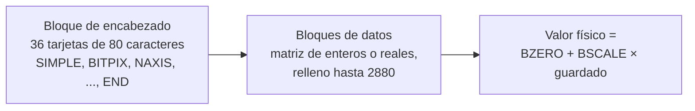

# B14-C06 — Formato FITS y encabezados

<!-- nav:top -->
[🏠 Programa](../../../../README.md) · [📚 Bloque B14](../../../tronco-comun/B14-computacion-cientifica-y-ciencia-abierta.md) · [← Anterior: B14-C05 — Tablas astronómicas y catálogos](../B14-C05-tablas-astronomicas-y-catalogos/CLASE.md) · [Siguiente: B14-C07 — HDF5 y almacenamiento científico →](../B14-C07-hdf5-y-almacenamiento-cientifico/CLASE.md)
<!-- /nav -->

## 1. Ubicación, nivel y alcance

Sexta clase del bloque B14. En [C05](../B14-C05-tablas-astronomicas-y-catalogos/CLASE.md) guardaste tablas con unidades; ahora conoces el formato en que se guardan las **imágenes** y buena parte de los datos de observatorios: FITS. Aprenderás a leerlo por dentro, no solo a abrirlo. Nivel N2.

Verás la estructura de bloques de 2880 bytes, las tarjetas de 80 caracteres del encabezado, las palabras clave obligatorias, el tipo de dato (`BITPIX`), la escala física (`BSCALE`, `BZERO`) y una referencia de coordenadas lineal (WCS) mínima. No verás extensiones de tabla binaria en profundidad, compresión de imágenes ni calibración de datos (B15).

## 2. Por qué esta clase existe

Una imagen astronómica es una matriz de números, pero esos números no significan nada sin su encabezado: ¿qué unidad tienen?, ¿cuánto duró la exposición?, ¿a qué punto del cielo apunta el píxel central? Si el encabezado miente o se pierde, la imagen no sirve. La pregunta motivadora es: **¿cómo sé qué significa cada número de un archivo FITS y cómo sé que lo leí bien?**

La decisión central es: **¿qué palabras clave debo verificar antes de usar los datos?** Quien las lee antes de calcular detecta escalas, unidades y orígenes erróneos en un minuto.

## 3. Lo que podrás hacer al terminar

1. Describir la estructura de un archivo FITS (bloques, HDU, encabezado, datos).
2. Leer un encabezado tarjeta por tarjeta e identificar las palabras clave obligatorias.
3. Convertir valores almacenados en valores físicos con `BSCALE` y `BZERO` y acotar el error de cuantización.
4. Distinguir el orden de índices de la matriz (fila, columna) del orden de los ejes FITS (x, y).
5. Usar una WCS lineal para pasar de píxel a coordenadas del cielo y comprobarlo en el píxel de referencia.
6. Escribir un FITS mínimo y verificar su estructura a nivel de bytes.

La evidencia es la **auditoría de un archivo FITS** del ejercicio 12 (sección 20).

## 4. Con qué llegas y cómo comprobarlo

Necesitas C02 (arreglos y forma), C04 (unidades) y C05 (metadatos). Cinco preguntas:

1. ¿Qué forma tiene una imagen de 64 columnas y 48 filas como arreglo de NumPy? ((48, 64).)
2. ¿Cuántos bytes ocupa un entero de 16 bits? (2.)
3. ¿Cuántas tarjetas de 80 caracteres caben en 2880 bytes? (36.)
4. Si un valor guardado vale 5000 y la escala es 0,1, ¿cuál es el valor físico? (500.)
5. ¿Qué es un píxel de referencia?

<details>
<summary>Ver respuestas</summary>

1. (48, 64): primero filas. 2. 2 bytes. 3. `2880/80 = 36`. 4. `0,1 × 5000 = 500`. 5. El píxel cuyas coordenadas del cielo se declaran en el encabezado y desde el cual se calculan las demás.
</details>

Con cuatro o cinco aciertos, sigue; con tres o menos, repasa C02.

## 5. Un caso real: lo que dice el estándar FITS 4.0

El estándar vigente es la versión 4.0, fechada el 13 de agosto de 2018: su contenido lo aprobó el Grupo de Trabajo FITS de la Unión Astronómica Internacional el 22 de julio de 2016, y la versión con edición de lenguaje el 13 de agosto de 2018; el sitio lo aloja HEASARC, de la NASA (S1). Del texto del estándar (S2), que leí extrayendo el texto del PDF, uso cuatro afirmaciones: un archivo FITS se interpreta como una secuencia de **bloques de 2880 bytes**; un bloque de encabezado contiene **treinta y seis registros de 80 caracteres**; el último bloque de encabezado debe contener la palabra clave `END`; y los valores guardados se transforman en físicos con `valor físico = BZERO + BSCALE × valor guardado` (sección 4.4.2.5, Ec. 3), con valores por defecto `BSCALE = 1` y `BZERO = 0`. Son pocas reglas, y por eso un archivo de hace décadas sigue siendo legible.

El **ejemplo conductor** es un archivo sintético: una imagen de 64×48 píxeles con una fuente gaussiana (amplitud 1000 e⁻, centro en `x = 40`, `y = 20`) sobre un cielo de 100 e⁻ y ruido de 5 e⁻. No es una observación real.

## 6. Vocabulario

Un **HDU** (*Header Data Unit*) es una unidad formada por un encabezado y, normalmente, un bloque de datos; el primero del archivo es el **HDU primario**. Un **encabezado** es una lista de **tarjetas** (registros de 80 caracteres) con una palabra clave, un valor y un comentario. `SIMPLE`, `BITPIX`, `NAXIS`, `NAXISn` y `END` son palabras clave estructurales. `BITPIX` indica el tipo de dato de la matriz: 8, 16, 32 o 64 para enteros, y −32 o −64 para coma flotante (estos valores los doy como conocidos; el texto extraído me sirvió para la estructura y la escala, no para la lista completa). `BSCALE` y `BZERO` son la pendiente y el desplazamiento que pasan de valor guardado a físico. `BUNIT` es la unidad física. Una **WCS** (*World Coordinate System*) asocia píxeles con coordenadas del cielo mediante palabras clave como `CRPIX`, `CRVAL`, `CDELT` y `CTYPE`.

## 7. Modelo mental: bloques de 2880 bytes, tarjetas de 80

Imagina un archivo hecho de cajas iguales de 2880 bytes. Las primeras cajas guardan texto (tarjetas de 80 caracteres, 36 por caja) hasta una tarjeta `END`; las siguientes guardan los números de la matriz, rellenadas hasta completar una caja.



*Descripción textual:* el archivo empieza por un bloque de encabezado con 36 tarjetas, entre las cuales debe aparecer `END`; sigue la matriz de datos en bloques de 2880 bytes, con relleno al final. El valor físico se obtiene aplicando `BZERO + BSCALE × guardado`.

**Analogía y su límite.** Un libro con una página de portada que describe el contenido y páginas de datos. Límite: la portada de un FITS es máquina-legible y obligatoria para interpretar los datos; una portada de libro no.

## 8. La explicación, paso a paso

### 8.1 El encabezado a nivel de bytes

El laboratorio escribe el archivo y lo relee en bruto. Los primeros nueve bytes son `SIMPLE  =`; el bloque de encabezado se parte en 36 tarjetas de 80 bytes y hay exactamente una tarjeta `END`, en la posición 24. Las 12 tarjetas siguientes están rellenas con espacios (S2: las tarjetas sin información después de `END` se rellenan con espacios). Las tres primeras tarjetas son `SIMPLE = T`, `BITPIX = 16` y `NAXIS = 2`.

### 8.2 El tamaño del archivo

La matriz ocupa `64 × 48 × 2 = 6144` bytes, que se redondean a tres bloques de 2880 (8640 bytes) con relleno. Con el bloque de encabezado, el archivo mide `11 520 = 4 × 2880` bytes. Un archivo FITS cuyo tamaño no sea múltiplo de 2880 está truncado o mal escrito: es una verificación de un segundo.

### 8.3 Orden de ejes

FITS numera los ejes desde 1 y el primero (`NAXIS1`) es el que cambia más rápido (columnas: `x`). En NumPy, `data.shape = (NAXIS2, NAXIS1) = (48, 64)` y se indexa `[fila, columna]` = `[y, x]` (S3). El máximo de la imagen sintética está en `(x, y) = (40, 20)`, es decir, `data[20, 40]`. Intercambiar los dos índices es uno de los errores más comunes.

### 8.4 Escala y desplazamiento

Para ahorrar espacio, los valores se guardan como enteros de 16 bits y el encabezado dice cómo recuperarlos: `valor físico = BZERO + BSCALE × guardado` (S2). En el laboratorio, `BSCALE = 0,1` y `BZERO = 0`, de modo que el entero 5000 vale 500 e⁻. El precio es la **cuantización**: el error máximo de redondeo es `BSCALE/2 = 0,05 e⁻`. Lo medido fue 0,050001 e⁻; la milésima de milésima extra viene de que Astropy lee los datos reescalados como `float32`, que tiene unas siete cifras significativas (el propio `info()` lo indica: «rescales to float32»). Si tu precisión necesaria es menor que `BSCALE/2`, necesitas otra escala o datos en coma flotante.

### 8.5 Una WCS lineal

Para el campo pequeño del ejemplo, la WCS es: `CRPIX = (33, 25)` (píxel de referencia, numerado desde 1), `CRVAL = (150°, 2°)` (coordenadas del cielo de ese píxel), `CDELT = (−1″, +1″)` expresadas en grados, `CTYPE = RA---TAN, DEC--TAN`. Un detalle crucial: **`CRPIX` se numera desde 1** y Python desde 0; el píxel de referencia es `(32, 24)` en índices de NumPy. La prueba es inmediata: ese píxel debe mapearse a `CRVAL`. El laboratorio da `(150,000000°, 2,000000°)` y, un píxel más arriba en `y`, una variación de `1,0000″` en declinación. (No consulté el estándar de WCS: lo uso como convención y verifico su resultado, ver sección 11.)

### 8.6 Lo que el encabezado no garantiza

Un encabezado puede estar mal. Siempre se comprueba una cosa física independiente: la posición de una estrella conocida, la unidad con un valor típico, el tiempo de exposición con el registro de la observación.

## 9. Magnitudes, símbolos y unidades

| Símbolo | Qué es | Unidad | Nota |
|---|---|---|---|
| `BITPIX` | tipo de dato guardado | — | 16 en el ejemplo |
| `NAXIS1, NAXIS2` | columnas, filas | píxeles | 64, 48 |
| `BSCALE, BZERO` | pendiente y desplazamiento | `BUNIT` | 0,1 y 0 |
| `BUNIT` | unidad física | texto | `electron` |
| `EXPTIME` | tiempo de exposición | s | 30 (ficticio) |
| `CRPIX` | píxel de referencia | píxel (desde 1) | (33, 25) |
| `CRVAL` | coordenada del píxel de referencia | grados | (150, 2) |
| `CDELT` | escala por píxel | grados/píxel | ∓1/3600 |

## 10. Convenciones y referencias

Los datos del laboratorio son **sintéticos**, y `DATE-OBS` y `OBJECT` son ficticios. Sistema de índices: FITS desde 1, NumPy desde 0 y en orden (fila, columna). Ángulos del cielo en grados. La proyección `TAN` es la gnomónica (tangente al plano); para el campo de un minuto de arco la distorsión es despreciable.

## 11. De dónde sale lo que afirmamos

| ID | Fuente | Localizador | Respalda | Estado |
|---|---|---|---|---|
| S1 | NASA HEASARC, página del estándar FITS | https://fits.gsfc.nasa.gov/fits_standard.html | Versión 4.0, 13-ago-2018; aprobación por el IAU FITS Working Group (2016-07-22 y 2018-08-13); alojada por HEASARC | Página consultada el 2026-11-05 (mutable) |
| S2 | IAU FITS Working Group, *Definition of the Flexible Image Transport System (FITS), Version 4.0* | https://fits.gsfc.nasa.gov/standard40/fits_standard40aa-le.pdf | Bloques de 2880 bytes; encabezado de 36 registros de 80 caracteres; `END` en el último bloque; relleno con espacios; Ec. 3 (sec. 4.4.2.5): valor físico = BZERO + BSCALE × guardado; defaults | Texto del PDF (75 páginas) extraído con PyMuPDF y leído parcialmente el 2026-11-05: secciones 3.3.1, 4.4.1, 4.4.2.5 y glosario |
| S3 | astropy, documentación de `astropy.io.fits` | https://docs.astropy.org/en/stable/io/fits/index.html | HDU, `HDUList`, encabezado como lista de tarjetas de 80 bytes con clave, valor y comentario, `data` como `ndarray` en orden [fila, columna], lectura con `with fits.open` | Consultada el 2026-11-05 (mutable) |

Límites: no leí íntegro el estándar (solo las secciones indicadas); la lista de valores de `BITPIX` y el significado de `CRPIX`, `CRVAL`, `CDELT` y `TAN` (artículos de WCS de Greisen y Calabretta, no consultados) se usan como conocimiento general y se verifican con el laboratorio; no se consultó la documentación de `astropy.wcs`.

## 12. Cómo ver la estructura

Versión accesible de la estructura del archivo del laboratorio.

| Parte | Bytes | Contenido |
|---|---|---|
| Bloque de encabezado | 2880 | 36 tarjetas: 23 de información, `END` en la 24, 12 de relleno |
| Datos | 8640 | 6144 de matriz `int16` + 2496 de relleno |
| Total | 11 520 | 4 bloques de 2880 |

## 13. Ejemplo trabajado: auditar un FITS en cinco minutos

1. **Estructura.** `11 520 % 2880 = 0`. Aprobado.
2. **Primera tarjeta.** `SIMPLE  =`. Aprobado.
3. **Encabezado.** 36 tarjetas de 80 bytes, una sola `END` (posición 24). Aprobado.
4. **Tipo y forma.** `BITPIX = 16`, `NAXIS1 = 64`, `NAXIS2 = 48`; `data.shape = (48, 64)`. Aprobado.
5. **Escala.** `BSCALE = 0,1`, `BZERO = 0`: reconstruido a mano desde los bytes en bruto, `0 + 0,1 × guardado` coincide con lo que entrega la biblioteca. Cuantización máxima: 0,050001 e⁻ (cota 0,05).
6. **Coordenadas.** Píxel de referencia `(32, 24)` ↦ `(150°, 2°)`; un píxel en `y` ↦ `1,0000″`. Aprobado.
7. **Física.** El máximo está en `(x, y) = (40, 20)` con 1099,5 e⁻: amplitud 1000 + cielo 100 + ruido de unos 5 e⁻. Cuadra con el diseño.

**Paso final · incertidumbre.** Cada comprobación detecta un tipo de fallo: la estructura (archivo truncado), la escala (unidad mal leída), las coordenadas (píxel desplazado). Ninguna prueba demuestra que los datos sean ciertos: solo que el archivo es coherente consigo mismo y con el diseño.

## 14. Comparación: FITS, texto y otros formatos

FITS es estándar, autodescriptivo y duradero, ideal para imágenes y para intercambio entre observatorios; su encabezado limita cada valor a 80 caracteres y su estructura en bloques lo hace poco cómodo para datos jerárquicos enormes. Un CSV es legible pero pierde tipos y unidades. HDF5 (C07) maneja mejor jerarquías y datos muy grandes con acceso parcial. La elección depende del uso: intercambio con la comunidad astronómica → FITS; almacenamiento interno de grandes volúmenes → HDF5 u otro.

## 15. Práctica guiada

**Ejercicio 1 · con los pasos.** Una imagen de 100 columnas × 80 filas se guarda con `BITPIX = 16`. ¿Cuántos bytes de datos y cuántos bloques de 2880 necesita? *Pasos:* `100·80·2` y redondea (sección 8.2).

<details><summary>Solución comentada</summary>

`100·80·2 = 16 000` bytes; `16 000/2880 = 5,56` → 6 bloques (17 280 bytes, con 1280 de relleno). Más un bloque de encabezado: 7 bloques = 20 160 bytes.
</details>

**Ejercicio 2 · con una pista.** Si `BSCALE = 0,5` y `BZERO = 100`, ¿qué valor físico tiene el entero guardado 40? *Pista:* Ec. 3.

<details><summary>Solución comentada</summary>

`100 + 0,5 × 40 = 120`. Y el error de cuantización máximo sería `BSCALE/2 = 0,25` en la unidad física.
</details>

**Ejercicio 3 · casi autónomo.** La fuente está en `data[20, 40]`. ¿Cuáles son sus `(x, y)` en el sentido FITS y en 1-indexado?

<details><summary>Solución comentada</summary>

0-indexado: `(x, y) = (40, 20)`. En la numeración FITS (desde 1): `(41, 21)`. El tercer error clásico es confundir ambas numeraciones.
</details>

## 16. Práctica autónoma, transferencia e integrador

**Ejercicio 4.** ¿Cuántas tarjetas de relleno hay después de `END` si el encabezado tiene 23 tarjetas de información? ¿Y si tuviera 36?

<details><summary>Solución comentada</summary>

Con 23 + `END` = 24, quedan 12 de relleno. Con 36 de información, `END` no cabe en el bloque, se necesita un segundo bloque de encabezado y quedan 35 de relleno.
</details>

**Ejercicio 5.** Se quiere una cuantización máxima de 0,005 e⁻. ¿Qué `BSCALE` pide? ¿Alcanza `int16` para valores hasta 1100 e⁻?

<details><summary>Solución comentada</summary>

`BSCALE/2 = 0,005` → `BSCALE = 0,01`. Entero máximo guardado: `1100/0,01 = 110 000`, que excede el rango de `int16` (hasta 32 767). Se necesita `int32` o coma flotante.
</details>

**Ejercicio 6.** Escribe la comprobación de que el píxel de referencia se mapea a `CRVAL` si `CRPIX = (33, 25)`.

<details><summary>Solución comentada</summary>

Convierte a 0-indexado `(32, 24)`, llama a `wcs_pix2world(32, 24, 0)` y compara con `(150, 2)` a 10⁻⁹°. Si lo evalúas en `(33, 25)` con origen 0, te equivocas por un píxel.
</details>

**Ejercicio 7.** Una imagen tiene `BUNIT = 'adu'`; otra, `BUNIT = 'electron'`. ¿Puedes sumarlas? ¿Qué necesitas?

<details><summary>Solución comentada</summary>

No directamente: son unidades distintas. Necesitas la ganancia del detector (e⁻/adu) documentada en el encabezado o en el manual del instrumento, y convertir primero (C04).
</details>

**Ejercicio 8.** ¿Por qué el máximo medido es 1099,5 y no 1100?

<details><summary>Solución comentada</summary>

La amplitud pura vale 1000 sobre un cielo de 100 → 1100 en el centro exacto de la gaussiana; el ruido de 5 e⁻ desplaza ese valor (aquí −0,5 e⁻, dentro de lo esperado) y la cuantización añade una décima. Un desvío de 0,5 e⁻ es 0,1 σ de ruido.
</details>

**Ejercicio 9 · transferencia.** Un archivo llega sin `BUNIT`. ¿Qué haces antes de analizarlo?

<details><summary>Solución comentada</summary>

No supones: buscas la unidad en la documentación del instrumento o del archivo de origen, la registras con su fuente y la verificas con un valor físico conocido. Si no puedes, el resultado debe declarar la unidad como no verificada.
</details>

**Ejercicio 10 · transferencia.** Una imagen aparece volteada respecto a una referencia. Sospechas del orden de índices. ¿Qué compruebas?

<details><summary>Solución comentada</summary>

Que `shape = (NAXIS2, NAXIS1)`, que no se haya trasladado `x`↔`y`, y el signo de `CDELT1` (negativo en ascensión recta si el este queda a la izquierda). Una comprobación con una estrella de posición conocida lo resuelve.
</details>

**Ejercicio 11 · transferencia.** El archivo mide 11 000 bytes. ¿Qué concluyes?

<details><summary>Solución comentada</summary>

No es múltiplo de 2880 (11 000 = 3·2880 + 2360): está truncado o no es un FITS estándar. No lo uses sin investigar la causa.
</details>

**Ejercicio 12 · integrador.** Entrega la **auditoría de un archivo FITS** (el del laboratorio o uno sintético tuyo): tamaño, estructura de bytes, encabezado, escala, orden de ejes, WCS y comprobación física, con una tabla de aprobado/falla y la justificación de cada prueba.

<details><summary>Solución modelo</summary>

Debe tener las siete comprobaciones de la sección 13 con sus valores reales, el cálculo de la cuantización y una frase sobre lo que la auditoría no garantiza. Se acepta cualquier archivo sintético que declare sus parámetros.
</details>

## 17. Laboratorio

El script [fits_y_encabezados.py](fits_y_encabezados.py) genera la imagen sintética, la guarda con `BSCALE`/`BZERO`, la lee en bruto para auditar bloques y tarjetas, reconstruye la escala a mano y comprueba la WCS y la posición de la fuente. Se detiene si cualquier comprobación falla.

**Datos:** sintéticos (semilla 20261105). **Predice antes de ejecutar:** ¿en qué tarjeta estará `END`? (En la 24.) **Ejecución del 2026-11-05 (Python 3.12.9, NumPy 2.5.4, astropy 8.0.2):**

```text
tamaño del archivo = 11520 bytes = 4 bloques de 2880
bloque de encabezado: 36 tarjetas; END en la tarjeta 24
primeras 3 tarjetas: ['SIMPLE  =                    T / conforms to FITS standard', 'BITPIX  =                   16 / array data type', 'NAXIS   =                    2 / number of array dimensions']
BITPIX=16 NAXIS=2 NAXIS1=64 NAXIS2=48
error máximo de cuantización = 0.050001 e- (cota 0.05 más 1e-4 por la lectura en float32)
WCS: píxel de referencia -> (150.000000, 2.000000) deg; un píxel en y = 1.0000 arcsec
máximo en (x, y) = (40, 20) 0-indexado; valor = 1099.5 e-
Pruebas superadas.
```

(`info()` también imprime una tabla del HDU con la ruta temporal, que no se reproduce aquí.)

```bash
python programa/clases/B14/B14-C06-formato-fits-y-encabezados/fits_y_encabezados.py
```

**Límites:** WCS lineal, campo pequeño, sin distorsión; el valor 1099,5 depende de la semilla y de la versión de NumPy; no es una calibración.

## 18. Errores frecuentes y cómo corregirlos

**Intercambiar `x` e `y`.** Se corrige con los ejercicios 3 y 10.

**Mezclar numeración desde 1 y desde 0.** Se corrige con el ejercicio 6.

**Ignorar `BSCALE`, `BZERO` y `BUNIT`.** Se corrige con los ejercicios 2, 5 y 7.

**Confiar en un encabezado sin verificar.** Se corrige con el ejercicio 9 y la sección 8.6.

**Usar un archivo truncado.** Se corrige con el ejercicio 11.

## 19. Cómo sabrás que vas bien

Tras 8.1: ¿cuentas las tarjetas de relleno de un encabezado? Si no, rehaz el ejercicio 4. Tras 8.4: ¿calculas la cuantización? Si no, rehaz el 5. Tras el ejemplo trabajado: ¿qué comprobación detectaría una imagen volteada? Tras el laboratorio: ¿qué parte del archivo es relleno? Al final: ¿qué no garantiza tu auditoría?

## 20. Qué entregas y cómo se evalúa

El producto es tu **auditoría de un archivo FITS** del ejercicio 12.

| Criterio | Inicial | En desarrollo | Logrado | Destacado |
|---|---|---|---|---|
| Estructura | Solo abre el archivo | Revisa el encabezado | Verifica bloques y tarjetas | Lee los bytes en bruto |
| Escala y unidades | No las usa | Las usa sin comprobar | Reconstruye a mano | Acota la cuantización |
| Coordenadas | Ignora | Aplica sin probar | Prueba el píxel de referencia | Prueba el orden de ejes |
| Fuentes y alcance | Sin fuente | Fuente sin alcance | Fuente con sección | Declara qué no leyó |

**Condiciones críticas:** no usar datos sin conocer su unidad; no presentar datos sintéticos como observados; no atribuir al estándar lo que no se leyó.

## 21. Ética, seguridad y límites

Un archivo FITS de un archivo público tiene licencia y condiciones de cita: respétalas. No abras archivos de origen desconocido con programas que ejecuten código; la lectura de FITS no ejecuta código, pero un archivo muy grande puede agotar la memoria. Accesibilidad: estructuras en tabla y texto. Material educativo.

## 22. Para cerrar y seguir

Un FITS son bloques de 2880 bytes con un encabezado de tarjetas de 80 caracteres que dice cómo leer los datos: tipo, forma, escala, unidad y coordenadas. El valor físico se recupera con `BZERO + BSCALE × guardado` y cuesta una cuantización de `BSCALE/2`. Queda abierta una pregunta: ¿cómo detectas un encabezado que es coherente pero falso?

**Glosario español–inglés.** encabezado · *header*; tarjeta · *card*; unidad de encabezado y datos · *header data unit (HDU)*; escala · *scale*; desplazamiento · *offset*; cuantización · *quantization*; sistema de coordenadas del cielo · *world coordinate system (WCS)*; píxel de referencia · *reference pixel*.

**Continuidad.** B14-C07 estudia HDF5, para volúmenes y jerarquías mayores; B14-C09 y C10 usan estas auditorías como pruebas de regresión; B15 trata la calibración de imágenes.

**Referencias:** ver sección 11. Del estándar se leyeron solo las secciones citadas.

<!-- nav:bottom -->
---

[← Anterior: B14-C05 — Tablas astronómicas y catálogos](../B14-C05-tablas-astronomicas-y-catalogos/CLASE.md) · [📚 Bloque B14](../../../tronco-comun/B14-computacion-cientifica-y-ciencia-abierta.md) · [Siguiente: B14-C07 — HDF5 y almacenamiento científico →](../B14-C07-hdf5-y-almacenamiento-cientifico/CLASE.md)
<!-- /nav -->
