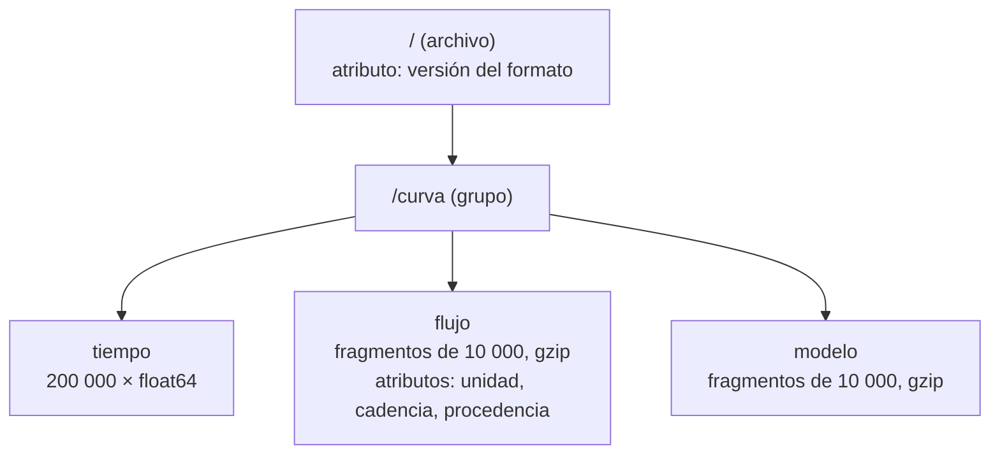

# B14-C07 — HDF5 y almacenamiento científico

<!-- nav:top -->
[🏠 Programa](../../../../README.md) · [📚 Bloque B14](../../../tronco-comun/B14-computacion-cientifica-y-ciencia-abierta.md) · [← Anterior: B14-C06 — Formato FITS y encabezados](../B14-C06-formato-fits-y-encabezados/CLASE.md) · [Siguiente: B14-C08 — Pandas y limpieza de datos →](../B14-C08-pandas-y-limpieza-de-datos/CLASE.md)
<!-- /nav -->

## 1. Ubicación, nivel y alcance

Séptima clase del bloque B14. En [C06](../B14-C06-formato-fits-y-encabezados/CLASE.md) leíste el formato de intercambio astronómico; ahora conoces un formato pensado para **muchos datos organizados jerárquicamente** y para leerlos por pedazos: HDF5. Nivel N2.

Verás el modelo de datos de HDF5 (archivo, grupos, conjuntos de datos, atributos), la fragmentación (*chunking*) y la compresión sin pérdida, la lectura parcial y cuándo conviene HDF5 en lugar de FITS o de texto. No verás HDF5 paralelo (B14-C16), formatos en la nube ni bases de datos.

## 2. Por qué esta clase existe

Una simulación o un instrumento moderno produce series de millones de muestras con sus metadatos. Guardarlas en texto es lento y pesado; cargarlas enteras en memoria para leer un fragmento es inviable. La pregunta motivadora es: **¿cómo guardo un volumen grande de datos, con sus unidades y procedencia, de modo que pueda leer solo lo que necesito y recuperar exactamente lo que escribí?**

La decisión central es: **¿cómo estructuro y comprimo los datos, y cuánto gano realmente con eso?** La respuesta depende del contenido: el ruido no se comprime, la señal limpia sí.

## 3. Lo que podrás hacer al terminar

1. Describir el modelo de HDF5: archivo, grupos, datasets y atributos.
2. Crear un archivo con jerarquía, atributos con unidades y datasets comprimidos y fragmentados.
3. Leer un fragmento de un dataset sin cargar todo.
4. Verificar que la compresión sin pérdida devuelve exactamente los mismos datos.
5. Medir la razón de compresión y explicar por qué depende del contenido.
6. Elegir entre HDF5, FITS y texto con criterios explícitos.

La evidencia es la **ficha de almacenamiento** del ejercicio 12 (sección 20).

## 4. Con qué llegas y cómo comprobarlo

Necesitas C02 (arreglos), C05–C06 (metadatos) y noción de ruido. Cinco preguntas:

1. ¿Cuántos bytes ocupan 200 000 números de 64 bits? (1 600 000.)
2. ¿Qué es una rebanada `a[1000:2000]`?
3. ¿Qué diferencia hay entre compresión con pérdida y sin pérdida?
4. ¿Por qué un archivo de ceros se comprime mejor que uno de números aleatorios?
5. ¿Por qué guardar la unidad junto al dato?

<details>
<summary>Ver respuestas</summary>

1. `200 000 × 8`. 2. Una vista de 1000 elementos (C02). 3. Con pérdida descarta información; sin pérdida permite reconstruir exactamente. 4. Los ceros tienen estructura repetitiva (poca entropía); los aleatorios no. 5. Para que el dato no dependa de la memoria de quien lo escribió.
</details>

Con cuatro o cinco aciertos, sigue; con tres o menos, repasa C02.

## 5. Un caso real: el modelo de datos de HDF5

La documentación del Grupo HDF (S1) describe un **archivo** como un contenedor de objetos organizado en un grafo con raíz; los **grupos** funcionan como directorios; los **datasets** son arreglos multidimensionales cuyo espacio de datos y tipo se fijan al crearlos; los **atributos** son pequeños valores con nombre asociados a grupos o datasets; las propiedades de creación incluyen el almacenamiento fragmentado y la compresión. La guía de h5py (S2) añade cómo se usa en Python: el `File` es el grupo raíz `/`, los grupos se comportan como diccionarios, los datasets se leen con rebanadas como `dset[0:100:10]`, los atributos se acceden con `.attrs`, y los modos de apertura son `'r'`, `'w'`, `'a'` y `'r+'`.

El **ejemplo conductor** es una curva de luz sintética: 200 000 muestras cada 2 s de una fuente ficticia con un tránsito de profundidad 0,01 y ruido de 0,002. No es una observación real.

## 6. Vocabulario

Un **grupo** agrupa datasets y otros grupos. Un **dataset** es un arreglo con forma y tipo. Un **atributo** es un metadato pequeño con nombre. Un **fragmento** (*chunk*) es el bloque de un dataset que se guarda y comprime como una unidad. La **compresión sin pérdida** (aquí `gzip`) reduce el espacio sin cambiar ningún valor. La **razón de compresión** es el tamaño sin comprimir dividido por el comprimido. La **entropía** (en sentido informal) es cuánto desorden hay en los datos: mayor entropía, menor compresión. El **tránsito** es la disminución de brillo cuando un cuerpo pasa por delante de su estrella; su **profundidad** es la fracción de flujo que se pierde.

## 7. Modelo mental: un sistema de archivos dentro de un archivo

Piensa en un disco con carpetas (grupos), documentos (datasets) y etiquetas (atributos). Cada documento está troceado en fragmentos que se leen o escriben por separado y se pueden comprimir.



*Descripción textual:* el archivo tiene un grupo `/curva` con tres datasets: `tiempo`, `flujo` (fragmentado en trozos de 10 000, comprimido, con atributos de unidad, cadencia y procedencia) y `modelo`. El archivo mismo lleva un atributo con la versión del formato.

**Analogía y su límite.** Un archivador con carpetas y etiquetas, donde cada documento está guardado por capítulos. Límite: un archivador no comprime y su orden es tuyo; en HDF5 los fragmentos y la compresión son propiedades que fijas al crear el dataset y que condicionan la velocidad de lectura.

## 8. La explicación, paso a paso

### 8.1 Crear la jerarquía

Con h5py (S2): `f.create_group("curva")`, `g.create_dataset("flujo", data=flujo, chunks=(10_000,), compression="gzip", compression_opts=4)`. Los atributos se asignan con `dset.attrs["unidad"] = ...`. La estructura que imprime el laboratorio es `curva`, `curva/flujo`, `curva/flujo_sin_comprimir`, `curva/modelo`, `curva/tiempo`.

### 8.2 Leer por pedazos

`d[95_000:105_000]` lee solo ese tramo (los fragmentos necesarios), no los 200 000 valores. La prueba del laboratorio es que ese tramo es **idéntico** a la misma rebanada del arreglo original. El tamaño del fragmento condiciona la lectura: si lees tramos pequeños, un fragmento grande obliga a descomprimir de más; si lees todo, uno pequeño añade sobrecarga. (Esta es una regla práctica; el laboratorio no la mide.)

### 8.3 Compresión sin pérdida: verificar y medir

La compresión `gzip` no cambia ningún valor: el laboratorio comprueba `np.array_equal(d[...], flujo)`, igualdad exacta, no aproximada. La razón de compresión sí cambia mucho según el contenido: el flujo con ruido ocupó `1 373 210` bytes frente a `1 600 000` sin comprimir (razón **1,17**); el modelo sin ruido ocupó `8 970` bytes (razón **178,4**). El ruido aleatorio de doble precisión es casi incompresible; la señal limpia, casi toda repetida, comprime enormemente. **Consecuencia:** no prometas un ahorro sin medirlo con tus datos.

### 8.4 Estimar la profundidad desde los datos

La profundidad verdadera es 0,01. Estimarla desde el flujo con ruido da `mediana(fuera) − mediana(dentro) = 0,01006`, una desviación de 6 × 10⁻⁵, muy inferior al ruido por muestra (0,002) porque se promedian miles de muestras. Esto muestra para qué sirve guardar bien los datos: la estimación puede repetirse y verificarse contra el modelo almacenado.

### 8.5 Atributos para la procedencia

El dataset `flujo` lleva `unidad = "relativo (adimensional)"`, `cadencia_s = 2,0` y `procedencia = "sintético, semilla 20261105"`. Un archivo sin atributos obliga a quien lo recibe a adivinar. Los atributos son pequeños y no se leen parcialmente (S1), así que no sirven para guardar arreglos grandes.

### 8.6 Cuándo HDF5 y cuándo no

HDF5 conviene para jerarquías, datos grandes y lectura parcial; FITS para el intercambio con la comunidad astronómica y las herramientas existentes; texto o CSV para tablas pequeñas y legibilidad humana. Un formato binario exige una herramienta para abrirlo y una versión de biblioteca: guarda la versión.

## 9. Magnitudes, símbolos y unidades

| Símbolo | Qué es | Unidad | Nota |
|---|---|---|---|
| `t` | tiempo | s | 0 a 399 998 s, cadencia 2 s |
| `F` | flujo relativo | adimensional | 1 = sin tránsito |
| `δ` | profundidad del tránsito | adimensional | 0,01 |
| `σ` | ruido por muestra | adimensional | 0,002 |
| `N` | número de muestras | — | 200 000 |
| `r` | razón de compresión | — | sin comprimir / comprimido |

## 10. Convenciones y referencias

Los datos son **sintéticos** (semilla 20261105) y el tránsito es trapezoidal, con ingreso y egreso de 1000 s y duración total de 8000 s, centrado en `t = 200 000 s`. Los atributos de unidad y procedencia son una convención de esta clase, no un estándar. El laboratorio usa h5py 3.16.0 con HDF5 2.0.0.

## 11. De dónde sale lo que afirmamos

| ID | Fuente | Localizador | Respalda | Estado |
|---|---|---|---|---|
| S1 | The HDF Group, documentación de HDF5, capítulo del modelo de datos (guía de usuario; el título exacto no se verificó) | https://support.hdfgroup.org/documentation/hdf5/latest/_h5_d_m__u_g.html | Archivo con grupo raíz, grupos, datasets (espacio y tipo fijados al crear), atributos, propiedades de creación con fragmentación y compresión | Página consultada el 2026-11-05 (mutable) |
| S2 | h5py, *Quick Start Guide* | https://docs.h5py.org/en/stable/quick.html | `File` como grupo raíz, grupos como diccionarios, rebanadas, `attrs`, modos de apertura | Página consultada el 2026-11-05 (mutable); no trata fragmentación ni compresión |

Límites: la página de h5py no trata fragmentación ni compresión, y S1 solo las menciona; el uso de `chunks` y `compression="gzip"` se verifica con el laboratorio. No se leyó la especificación del formato de archivo. La regla sobre el tamaño de fragmento es práctica general no medida aquí.

## 12. Cómo ver el resultado

Versión accesible de las mediciones del laboratorio.

| Dataset | Bytes guardados | Razón frente a 1 600 000 |
|---|---|---|
| flujo sin comprimir | 1 600 000 | 1,00 |
| flujo con gzip (ruido) | 1 373 210 | 1,17 |
| modelo con gzip (sin ruido) | 8 970 | 178,4 |

## 13. Ejemplo trabajado: guardar, leer y verificar la curva de luz

1. Genera `t = 0, 2, …, 399 998 s` y el modelo trapezoidal: `F = 1 − 0,01 · clip((4000 − |t − 200 000|)/1000, 0, 1)`.
2. Añade ruido gaussiano de 0,002 con semilla fija.
3. Escribe `tiempo`, `flujo` (comprimido), `modelo` (comprimido) y `flujo_sin_comprimir` para comparar. Añade atributos.
4. **Verifica la ida y vuelta:** `np.array_equal(d[...], flujo)` → verdadero.
5. **Verifica la lectura parcial:** el tramo 95 000–105 000 es igual al original.
6. **Verifica el modelo:** `1 − min(modelo) = 0,010000`.
7. **Estima la profundidad:** `0,01006` frente a la verdadera 0,01.
8. **Mide la compresión:** 1,17 para el flujo, 178,4 para el modelo.

**Paso final · incertidumbre.** La profundidad estimada concuerda con la verdadera dentro de 6 × 10⁻⁵, pero una sola realización del ruido no dice cuánto varía esa estimación; para eso habría que repetir con varias semillas (B12). Las razones de compresión valen solo para estos datos.

## 14. Comparación: HDF5, FITS y texto

HDF5 gana en lectura parcial, jerarquía y compresión integrada; pierde en universalidad y en que la herramienta más sencilla (un editor de texto) no lo abre. FITS gana en el ecosistema astronómico y en su estabilidad como estándar, y pierde en datos jerárquicos. El texto gana en transparencia y pierde en tamaño y en velocidad: 200 000 números en texto con 17 dígitos ocupan unas diez veces más que en binario. Esa cifra es una estimación de orden de magnitud, no medida aquí.

## 15. Práctica guiada

**Ejercicio 1 · con los pasos.** Calcula cuántos fragmentos de 10 000 elementos tiene un dataset de 200 000. *Pasos:* divide (sección 8.1).

<details><summary>Solución comentada</summary>

`200 000/10 000 = 20` fragmentos. Leer el tramo 95 000–105 000 toca los fragmentos 10 (90 000–99 999) y 11 (100 000–109 999): 2 de 20.
</details>

**Ejercicio 2 · con una pista.** ¿Qué razón de compresión esperas para un dataset de 1 000 000 de ceros en `float64`? *Pista:* la entropía es mínima.

<details><summary>Solución comentada</summary>

Muy alta (cientos o miles). No se puede decir un número exacto sin medirlo; la regla es: baja entropía, alta compresión.
</details>

**Ejercicio 3 · casi autónomo.** Escribe cómo comprobarías que la compresión no alteró ningún valor.

<details><summary>Solución comentada</summary>

`np.array_equal(leido, original)` (igualdad exacta). No uses `np.allclose`, que aceptaría diferencias pequeñas y ocultaría una pérdida.
</details>

## 16. Práctica autónoma, transferencia e integrador

**Ejercicio 4.** Con la razón de 1,17 y 1 600 000 bytes, ¿cuántos bytes ahorró la compresión del flujo? ¿Valió la pena?

<details><summary>Solución comentada</summary>

`1 600 000 − 1 373 210 = 226 790` bytes (14 %). Depende del contexto: para un archivo pequeño, no; para miles de archivos, sí. Un ahorro del 14 % por ruido es modesto; para señal limpia el ahorro es enorme.
</details>

**Ejercicio 5.** ¿Por qué el modelo se comprime 178 veces y el flujo 1,17 si ambos tienen el mismo tamaño?

<details><summary>Solución comentada</summary>

El modelo es casi constante (1 fuera del tránsito, 0,99 dentro) y su estructura es predecible; el flujo añade ruido aleatorio de precisión completa en cada muestra, que no tiene estructura que aprovechar.
</details>

**Ejercicio 6.** Quieres leer 100 muestras seguidas de un dataset de mil millones. ¿Qué haces y qué importa?

<details><summary>Solución comentada</summary>

Una rebanada `d[i:i+100]`; el tamaño de fragmento define cuánto se descomprime. No cargas el dataset completo (sería de 8 GB en `float64`).
</details>

**Ejercicio 7.** ¿Qué atributos añadirías al dataset `flujo` para que un tercero lo use sin preguntarte nada?

<details><summary>Solución comentada</summary>

Unidad, cadencia, marco de tiempo (escala y origen), procedencia, versión del script y semilla (si es sintético). Cualquier conjunto que evite ambigüedad se acepta.
</details>

**Ejercicio 8.** Estima la profundidad con otros límites (por ejemplo, solo las muestras con `|t − medio| < 2000`). ¿Cambia?

<details><summary>Solución comentada</summary>

Debe dar casi lo mismo, porque en el fondo plano el flujo vale `0,99` con ruido; un cambio grande indicaría una elección de ventana que mezcla ingreso/egreso con fondo. Ejecútalo y compara con 0,01006.
</details>

**Ejercicio 9 · transferencia.** Un colega guarda 10⁹ muestras en un CSV y tarda horas en leerlo. ¿Qué propones?

<details><summary>Solución comentada</summary>

Formato binario con acceso parcial (HDF5 con fragmentos y compresión), conservando atributos y verificando la ida y vuelta. Y medir el tiempo de lectura antes y después.
</details>

**Ejercicio 10 · transferencia.** Dos laboratorios intercambian HDF5 con versiones distintas de la biblioteca. ¿Qué precauciones tomas?

<details><summary>Solución comentada</summary>

Registrar versiones de biblioteca y formato en un atributo, incluir una prueba de lectura con un archivo pequeño de referencia y no depender de funciones recientes si el receptor usa una versión antigua.
</details>

**Ejercicio 11 · transferencia.** Un archivo comprimido con pérdida (reducción de precisión) ahorra 90 %. ¿Qué debes declarar antes de usarlo en un análisis?

<details><summary>Solución comentada</summary>

Que hay pérdida, cuánta (error máximo por valor), y que el análisis resiste ese error. Hay que verificarlo con el caso que importa (por ejemplo, la estimación de profundidad antes y después).
</details>

**Ejercicio 12 · integrador.** Entrega una **ficha de almacenamiento** para un conjunto de datos propio (sintético): estructura de grupos y datasets, atributos, tamaño de fragmento, compresión, comprobación de ida y vuelta exacta, lectura parcial, razón de compresión medida y justificación del formato frente a FITS y texto.

<details><summary>Solución modelo</summary>

Debe incluir el diagrama de jerarquía con descripción, atributos con unidad y procedencia, medición real de bytes con y sin compresión, prueba con `array_equal`, y una comparación explícita de formatos que reconozca los límites. Se acepta cualquier conjunto sintético.
</details>

## 17. Laboratorio

El script [hdf5_curva_de_luz.py](hdf5_curva_de_luz.py) genera la curva de luz, la guarda en HDF5 con jerarquía, atributos, fragmentos y compresión, la relee y verifica igualdad exacta, lectura parcial, profundidad del modelo y de los datos y tamaños reales por dataset.

**Datos:** sintéticos (semilla 20261105). **Predice antes de ejecutar:** ¿qué dataset se comprimirá más? **Ejecución del 2026-11-05 (Python 3.12.9, NumPy 2.5.4, h5py 3.16.0, HDF5 2.0.0):**

```text
tamaño del archivo = 4.595 MB
estructura: ['curva', 'curva/flujo', 'curva/flujo_sin_comprimir', 'curva/modelo', 'curva/tiempo']
flujo: shape=(200000,) dtype=float64 chunks=(10000,) compression=gzip
atributos: {'cadencia_s': np.float64(2.0), 'procedencia': 'sintético, semilla 20261105', 'unidad': 'relativo (adimensional)'}
profundidad del modelo = 0.010000 (esperada 0.01)
profundidad estimada de los datos = 0.01006 (verdadera 0.01)
bytes: sin comprimir = 1600000; con gzip = 1373210 (razón 1.17); modelo sin ruido con gzip = 8970 (razón 178.4)
Pruebas superadas.
```

```bash
python programa/clases/B14/B14-C07-hdf5-y-almacenamiento-cientifico/hdf5_curva_de_luz.py
```

(El archivo temporal incluye `tiempo` y las dos versiones del flujo; por eso pesa 4,6 MB.) **Límites:** una sola realización de ruido; razones de compresión válidas para estos datos y para esta versión de la biblioteca.

## 18. Errores frecuentes y cómo corregirlos

**Esperar siempre una gran compresión.** Se corrige con los ejercicios 4 y 5.

**Verificar con tolerancia lo que debe ser exacto.** Se corrige con el ejercicio 3.

**Cargar todo para leer un fragmento.** Se corrige con el ejercicio 6.

**Olvidar los atributos.** Se corrige con el ejercicio 7.

**No declarar una compresión con pérdida.** Se corrige con el ejercicio 11.

## 19. Cómo sabrás que vas bien

Tras 8.3: ¿predices qué comprimirá más? Si no, rehaz el ejercicio 5. Tras 8.2: ¿lees un fragmento sin cargar todo? Si no, rehaz el 6. Tras el ejemplo trabajado: ¿qué prueba habría detectado una pérdida de datos? Tras el laboratorio: ¿qué cambiaría si el flujo fuera `float32`? Al final: ¿qué dice tu ficha sobre el límite de tu medición?

## 20. Qué entregas y cómo se evalúa

El producto es tu **ficha de almacenamiento** del ejercicio 12.

| Criterio | Inicial | En desarrollo | Logrado | Destacado |
|---|---|---|---|---|
| Estructura | Un solo dataset | Jerarquía sin atributos | Jerarquía con atributos | Atributos con unidad, versión y procedencia |
| Verificación | Sin prueba | Con tolerancia | Con igualdad exacta | Y lectura parcial |
| Medición | Supone ahorro | Mide una vez | Mide y explica | Compara con otro formato |
| Fuentes y alcance | Sin fuente | Fuente sin alcance | Fuente con alcance | Declara lo no tratado por la fuente |

**Condiciones críticas:** no afirmar un ahorro sin medirlo; no usar compresión con pérdida sin declararla; no presentar datos sintéticos como observados.

## 21. Ética, seguridad y límites

Un archivo de datos puede contener información sensible (ubicaciones, personas); revisa metadatos antes de compartirlo. No abras archivos HDF5 de origen desconocido sin precaución: las bibliotecas tienen errores de seguridad como todo software; usa versiones actualizadas. Accesibilidad: estructura descrita en tabla y texto. Material educativo.

## 22. Para cerrar y seguir

HDF5 organiza datos en una jerarquía con atributos, y su fragmentación y compresión permiten leer por pedazos y ahorrar espacio, un ahorro que depende del contenido y debe medirse. La ida y vuelta se verifica con igualdad exacta. Queda abierta una pregunta: ¿cuál es el tamaño de fragmento óptimo para tu patrón de lectura?

**Glosario español–inglés.** grupo · *group*; conjunto de datos · *dataset*; atributo · *attribute*; fragmento · *chunk*; compresión sin pérdida · *lossless compression*; razón de compresión · *compression ratio*; tránsito · *transit*; profundidad · *depth*.

**Continuidad.** B14-C08 trabaja tablas en memoria con pandas; B14-C11 versiona datos; B14-C16 usa HDF5 en paralelo. B15 trata el ajuste de modelos como el de este tránsito.

**Referencias:** ver sección 11. S2 no cubre fragmentación ni compresión.

<!-- nav:bottom -->
---

[← Anterior: B14-C06 — Formato FITS y encabezados](../B14-C06-formato-fits-y-encabezados/CLASE.md) · [📚 Bloque B14](../../../tronco-comun/B14-computacion-cientifica-y-ciencia-abierta.md) · [Siguiente: B14-C08 — Pandas y limpieza de datos →](../B14-C08-pandas-y-limpieza-de-datos/CLASE.md)
<!-- /nav -->
