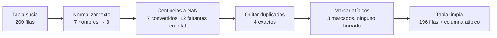

# B14-C08 — Pandas y limpieza de datos

<!-- nav:top -->
[🏠 Programa](../../../../README.md) · [📚 Bloque B14](../../../tronco-comun/B14-computacion-cientifica-y-ciencia-abierta.md) · [← Anterior: B14-C07 — HDF5 y almacenamiento científico](../B14-C07-hdf5-y-almacenamiento-cientifico/CLASE.md) · [Siguiente: B14-C09 — Jupyter y experimentos reproducibles →](../../../tronco-comun/B14-computacion-cientifica-y-ciencia-abierta.md#b14-c09)
<!-- /nav -->

## 1. Ubicación, nivel y alcance

Octava clase del bloque B14. Cierra el tramo de herramientas de datos: arreglos ([C02](../B14-C02-arreglos-multidimensionales-numpy/CLASE.md)), tablas con unidades ([C05](../B14-C05-tablas-astronomicas-y-catalogos/CLASE.md)), formatos ([C06](../B14-C06-formato-fits-y-encabezados/CLASE.md), [C07](../B14-C07-hdf5-y-almacenamiento-cientifico/CLASE.md)) y ahora la **limpieza** de tablas de observación con pandas. Nivel N2.

Verás cómo detectar y tratar valores centinela, valores ausentes, duplicados, nombres inconsistentes y valores atípicos, y cómo comprobar la limpieza contra defectos conocidos. No verás estadística inferencial (B12), imputación avanzada ni bases de datos.

## 2. Por qué esta clase existe

Una bitácora de observación real tiene errores: alguien escribió `-99` donde faltaba un dato, el mismo objeto aparece con tres grafías, una fila se copió dos veces, un valor tiene un dígito de más. Si calculas una media sin limpiar, el resultado es otro número. La pregunta motivadora es: **¿cómo limpio una tabla de modo que cada cambio sea explícito, reproducible y comprobable, sin borrar datos que podrían ser reales?**

La decisión central es: **¿qué es un error de captura, qué es un dato que falta y qué es un valor real pero extremo?** Esa decisión es científica, no técnica, y debe quedar escrita.

## 3. Lo que podrás hacer al terminar

1. Detectar valores centinela, ausentes, duplicados y nombres inconsistentes en una tabla.
2. Distinguir entre eliminar, convertir y marcar un dato.
3. Marcar atípicos con un criterio robusto (mediana y MAD) y explicar por qué la media no sirve para eso.
4. Usar `isna` en lugar de comparar con `NaN`, y explicar por qué.
5. Comprobar una limpieza contra defectos inyectados de cantidad conocida.
6. Documentar cada paso para que otra persona obtenga el mismo resultado.

La evidencia es el **registro de limpieza** del ejercicio 12 (sección 20).

## 4. Con qué llegas y cómo comprobarlo

Necesitas C02 y C05 y las nociones de media y mediana (B12 las profundiza). Cinco preguntas:

1. ¿Cuál es la media de 1, 2, 3, 4 y 100? ¿Y la mediana? (22 y 3.)
2. ¿Qué significa que `NaN == NaN` sea falso?
3. ¿Qué es un valor centinela?
4. ¿Qué es un duplicado exacto?
5. ¿Qué diferencia hay entre eliminar y marcar un dato?

<details>
<summary>Ver respuestas</summary>

1. `110/5 = 22`; mediana 3: la mediana resiste el valor extremo. 2. Que `NaN` no es igual ni a sí mismo: para detectarlo se usa `isna()`. 3. Un número reservado para indicar «dato ausente» (por ejemplo, `-99`). 4. Una fila idéntica en todas sus columnas a otra. 5. Eliminar quita la fila; marcar la conserva con una etiqueta y deja decidir después.
</details>

Con cuatro o cinco aciertos, sigue; con tres o menos, repasa B12-C01 y C05.

## 5. Un caso real: cómo pandas trata lo que falta

La documentación de pandas sobre datos faltantes (S1) fija las reglas que usaremos. El marcador depende del tipo: `np.nan` en tipos numéricos de NumPy (y entonces los enteros pasan a `float64`), `NaT` en fechas y `pd.NA` en los tipos «anulables»; `None` también se trata como faltante en objetos. Se detecta con `isna()` y `notna()`, y **no** con `==`: `np.nan == np.nan` es falso, así que `serie == np.nan` no identifica nada. Las reducciones (media, suma…) omiten los faltantes por defecto; `dropna()` quita filas con algún faltante; `fillna()` los reemplaza.

El **ejemplo conductor** es una bitácora **sintética** de 200 filas con defectos de cantidad conocida: 7 valores centinela `-99`, 5 valores ausentes, 4 filas duplicadas, 3 atípicos de +5 magnitudes y nombres con mayúsculas y espacios inconsistentes. Como conocemos la cantidad exacta de cada defecto, podemos comprobar que la limpieza los encuentra todos y no toca nada más.

## 6. Vocabulario

Una **magnitud** (en el sentido astronómico) es una escala logarítmica de brillo: menos magnitud es más brillante; es adimensional. Un **centinela** es un valor reservado (como `-99`) que codifica «sin dato». Un **valor ausente** es una celda sin valor (`NaN`). Un **duplicado exacto** es una fila repetida en todas sus columnas, incluido su identificador. Un **atípico** (*outlier*) es un valor muy distinto del resto; puede ser un error o un fenómeno real. La **mediana** es el valor central. La **MAD** (desviación absoluta mediana) es la mediana de `|x − mediana|`; multiplicada por 1,4826 estima la desviación típica de una distribución normal (el factor 1,4826 lo doy como conocido; no lo verifiqué en una fuente en esta clase). Un **identificador único** (`id_obs`) distingue observaciones distintas con valores iguales.

## 7. Modelo mental: cada paso de limpieza cambia algo y se puede contar

Limpiar es una cadena de transformaciones y cada una debe poder contarse: cuántas filas cambió, cuántas quitó, cuántas marcó. Si no cuadran con lo esperado, hay algo que no entiendes de tus datos.



*Descripción textual:* la tabla de 200 filas pasa por cuatro pasos encadenados: normalizar los nombres (de siete grafías a tres), convertir centinelas en `NaN` (con lo que hay 12 faltantes en total), quitar cuatro duplicados exactos y marcar tres atípicos sin borrarlos. El resultado son 196 filas con una columna de marca.

**Analogía y su límite.** Una auditoría contable: cada ajuste se anota y los totales deben cuadrar. Límite: en ciencia no siempre hay un total que cuadre; a veces solo tienes tu criterio y debes documentarlo.

## 8. La explicación, paso a paso

### 8.1 Mirar antes de tocar

Antes de limpiar, cuenta: filas, nombres distintos, centinelas, ausentes. En el laboratorio hay 200 filas, 7 grafías distintas de 3 objetos, 7 centinelas y 5 ausentes. Contar primero convierte la limpieza en una verificación.

### 8.2 Normalizar texto

`.str.strip().str.upper()` unifica espacios y mayúsculas: de 7 grafías quedan 3 (`OBJ-A`, `OBJ-B`, `OBJ-C`). Si dos nombres distintos realmente se refieren al mismo objeto con otra nomenclatura (catálogos distintos), la solución es un cruce posicional (C05), no una limpieza de texto.

### 8.3 Centinelas: convertir, no borrar

`-99` no es una magnitud: es «sin dato». Se convierte en `NaN` con `.mask(col == -99)`. El resultado: 7 convertidos + 5 ausentes = 12 faltantes. La razón de no borrar la fila es que sus otras columnas pueden ser válidas. El daño de no convertir es enorme: la media sucia del laboratorio fue **10,984** frente a **15,0005** limpia, un error de más de 4 magnitudes, cuando todos los datos reales rondan 15.

### 8.4 Duplicados exactos y por qué importa el identificador

Una fila se repite si **todas** sus columnas coinciden, incluido `id_obs`. Sin el identificador, dos observaciones distintas con el mismo objeto, magnitud y exposición parecerían duplicados: en una primera versión de este laboratorio, sin identificador, esa coincidencia casual produjo un duplicado falso (5 detectados frente a 4 reales). Moraleja: define qué es una observación única antes de quitar duplicados. Aquí se quitan 4 y quedan 196 filas.

### 8.5 Atípicos: marcar con un criterio robusto

La media y la desviación típica se dejan arrastrar por los propios atípicos. La mediana y la MAD no. Se marca como atípico `|x − mediana| > 5 × 1,4826 × MAD`. En el laboratorio: mediana 15,0013, sigma robusta 0,0960, y **3 marcados**, que son los 3 inyectados. Los `NaN` nunca quedan marcados, porque una comparación con `NaN` es falsa (S1). Y **no se borran**: una marca permite decidir después si es un error o un fenómeno (un destello real también parece un atípico). El umbral de 5 es una elección que debe declararse.

### 8.6 Reproducibilidad

La limpieza debe ser un script que parte de los datos crudos y produce los limpios, con la semilla fija si hay generación sintética y con los recuentos impresos. Otra persona debe poder repetirla y obtener lo mismo.

## 9. Magnitudes, símbolos y unidades

| Símbolo | Qué es | Unidad | Nota |
|---|---|---|---|
| `mag` | magnitud aparente | magnitud (adimensional) | menor = más brillante |
| `t_exp_s` | tiempo de exposición | s | 30, 60 o 120 |
| `id_obs` | identificador de observación | — | único |
| `med` | mediana de `mag` | magnitud | 15,0013 |
| `MAD` | desviación absoluta mediana | magnitud | `1,4826·MAD = 0,0960` |
| `-99` | centinela | — | «sin dato» |

## 10. Convenciones y referencias

Los datos son **sintéticos** (semilla 20261105); ningún valor corresponde a una observación real. Convención: los atípicos se marcan, no se borran; los centinelas se convierten en `NaN`; los duplicados se definen incluyendo `id_obs`. El umbral de 5 MAD y el factor 1,4826 son convenciones de esta clase. Versión: pandas 3.1.1.

## 11. De dónde sale lo que afirmamos

| ID | Fuente | Localizador | Respalda | Estado |
|---|---|---|---|---|
| S1 | pandas, guía de usuario: *Working with missing data* | https://pandas.pydata.org/docs/user_guide/missing_data.html | `NaN`, `NaT`, `pd.NA`; `isna`/`notna`; `NaN == NaN` es falso; reducciones omiten faltantes; `dropna`, `fillna` | Página consultada el 2026-11-05 (mutable) |

Límites: no se consultó la documentación de `duplicated`, `drop_duplicates` ni `mask`; su comportamiento se verifica con el laboratorio. El factor 1,4826 y la definición de magnitud no se consultaron en esta clase. Todos los datos son sintéticos.

## 12. Cómo ver el resultado

Versión accesible de las verificaciones del laboratorio.

| Paso | Esperado | Obtenido |
|---|---|---|
| Filas de partida | 200 | 200 |
| Centinelas −99 | 7 | 7 |
| Ausentes | 5 | 5 |
| Nombres tras normalizar | 3 | 3 |
| Faltantes tras convertir | 12 | 12 |
| Duplicados exactos | 4 | 4 |
| Filas tras quitar duplicados | 196 | 196 |
| Atípicos marcados | 3 | 3 |

Recuento final por objeto: OBJ-A 60, OBJ-B 76, OBJ-C 60.

## 13. Ejemplo trabajado: limpiar la bitácora y medir el daño

1. Cuenta: 200 filas, 7 grafías, 7 centinelas, 5 ausentes.
2. Normaliza el texto: 3 nombres.
3. Convierte `-99` en `NaN`: 12 faltantes.
4. Detecta duplicados con `id_obs` incluido: 4. Quítalos: 196 filas.
5. Calcula mediana (15,0013) y MAD; sigma robusta = 0,0960.
6. Marca como atípico lo que se aleja más de `5 × 0,0960 = 0,48` de la mediana: 3 filas.
7. Compara medias: sucia 10,984; limpia 15,0005.

**Paso final · incertidumbre.** Que los recuentos coincidan con lo inyectado prueba que el procedimiento encuentra esos tipos de defecto, no que encuentre todos los defectos posibles en datos reales. Los atípicos del laboratorio son errores por construcción; en una bitácora real un atípico puede ser un hallazgo, por eso se marca y no se borra.

## 14. Comparación: eliminar, imputar y marcar

**Eliminar** es simple, pero pierde las columnas válidas de la fila y puede sesgar si los faltantes no son aleatorios. **Imputar** (rellenar con la media, la mediana o un modelo) conserva el tamaño de la muestra pero fabrica un dato; hay que declararlo y estudiar su efecto (B12). **Marcar** conserva todo y difiere la decisión; es la opción por defecto en ciencia abierta, porque deja al lector reproducir cualquiera de las otras dos.

## 15. Práctica guiada

**Ejercicio 1 · con los pasos.** Detecta los faltantes de `[15,1; -99; 15,0; NaN]` si `-99` es centinela. *Pasos:* convierte el centinela y cuenta con `isna` (sección 8.3).

<details><summary>Solución comentada</summary>

Tras convertir, hay 2 faltantes (la posición 2 y la 4). La media de lo disponible es `(15,1 + 15,0)/2 = 15,05`. Sin convertir, la media habría sido `(15,1 − 99 + 15)/3 = −22,97`, absurda.
</details>

**Ejercicio 2 · con una pista.** ¿Por qué `serie == np.nan` no encuentra los faltantes? *Pista:* S1.

<details><summary>Solución comentada</summary>

Porque `np.nan == np.nan` es falso: nada es igual a `NaN`, ni siquiera él mismo. Se usa `serie.isna()`.
</details>

**Ejercicio 3 · casi autónomo.** Calcula la mediana y la MAD de `[14,9; 15,0; 15,1; 15,0; 20,0]` y marca atípicos con el criterio de la clase.

<details><summary>Solución comentada</summary>

Ordenados: 14,9; 15,0; 15,0; 15,1; 20,0 → mediana 15,0. Desviaciones absolutas: 0,1; 0; 0; 0,1; 5,0 → ordenadas 0; 0; 0,1; 0,1; 5,0 → MAD 0,1. Sigma robusta = 0,14826; umbral = 0,741. Solo 20,0 (desviación 5,0) se marca.
</details>

## 16. Práctica autónoma, transferencia e integrador

**Ejercicio 4.** Con los 200 datos, ¿cuántas filas quedan sin dato de magnitud tras convertir y quitar duplicados? (Pista: los duplicados copian las filas 0–3.)

<details><summary>Solución comentada</summary>

Los faltantes (12) están en las filas 5–11 y en las filas 20, 40, 60, 80, 100, todas de las 196 originales. Los duplicados copian filas 0–3, que tienen magnitud válida, por lo que quitar duplicados no cambia el recuento: 12.
</details>

**Ejercicio 5.** ¿Por qué la media limpia (15,0005) es mejor estimador que la sucia aunque se hayan marcado, no borrado, los atípicos? ¿Qué filas excluiste del cálculo?

<details><summary>Solución comentada</summary>

La media limpia excluye las marcadas como atípicas y los `NaN` (por defecto); la sucia incluye los `-99` y los +5. «Marcar» no cambia nada hasta que decides excluir; el cálculo excluyó explícitamente las marcadas.
</details>

**Ejercicio 6.** Un dato real de 20,0 aparece en tu bitácora y corresponde a un destello verdadero. ¿Qué habría pasado si hubieras borrado los atípicos?

<details><summary>Solución comentada</summary>

Habrías eliminado un fenómeno real. Por eso se marca y se revisa contra el registro de observación antes de descartar.
</details>

**Ejercicio 7.** Explica por qué sin `id_obs` la primera versión del laboratorio encontró 5 duplicados.

<details><summary>Solución comentada</summary>

Entre las filas con magnitud `-99` (convertidas a `NaN`), dos observaciones distintas coincidieron en objeto y exposición: sin identificador parecían duplicados. Con `id_obs` solo se repiten las filas realmente copiadas.
</details>

**Ejercicio 8.** Cambia el umbral a 3 MAD y a 10 MAD. ¿Qué esperas? ¿Cómo lo verificarías?

<details><summary>Solución comentada</summary>

Con 3 MAD se marcan más filas, incluso algunas normales por azar (el 0,3 % de una normal supera 3σ, es decir, unas 0,6 filas en 196); con 10 MAD probablemente solo los atípicos inyectados (que están a unos 52 σ robustos). Se verifica ejecutando con cada umbral y contando contra las 3 inyectadas.
</details>

**Ejercicio 9 · transferencia.** Recibes una tabla con una columna `distancia` que contiene `0` en algunas filas. ¿Es un valor o un faltante? ¿Qué haces?

<details><summary>Solución comentada</summary>

Depende de la documentación: un 0 puede codificar «sin dato». Pregunta al origen o consulta el diccionario; hasta saberlo, trátalo como sospechoso y márcalo, no lo promedies.
</details>

**Ejercicio 10 · transferencia.** Dos bitácoras usan `-99` y `-9999` como centinela. ¿Cómo las unificas con seguridad?

<details><summary>Solución comentada</summary>

Documentas el centinela de cada una, conviertes ambos a `NaN` por separado antes de unir y compruebas los recuentos esperados. Unir antes de convertir mezclaría significados.
</details>

**Ejercicio 11 · transferencia.** Un colega rellena los faltantes con la media y obtiene un error estándar menor. ¿Qué reparo le haces?

<details><summary>Solución comentada</summary>

Imputar con la media fabrica datos idénticos, reduce artificialmente la dispersión y por tanto la incertidumbre: el resultado parece más preciso de lo que es. Debe declararse y evaluarse con un método adecuado (B12).
</details>

**Ejercicio 12 · integrador.** Entrega un **registro de limpieza** de una tabla sintética propia con defectos de cantidad conocida: recuentos antes y después de cada paso, los criterios y umbrales, la decisión de eliminar, convertir o marcar de cada defecto y la comprobación contra lo inyectado.

<details><summary>Solución modelo</summary>

Debe incluir una tabla paso-recuento como la de la sección 12, el script reproducible con semilla, justificación del umbral de atípicos, una prueba que falle si los recuentos no coinciden y una nota sobre qué defectos no se detectan. Se acepta cualquier tabla sintética.
</details>

## 17. Laboratorio

El script [limpieza_de_bitacora.py](limpieza_de_bitacora.py) genera la bitácora sintética con defectos de cantidad conocida, la limpia en cuatro pasos, comprueba cada recuento y marca atípicos con mediana y MAD. Se detiene si algún recuento no coincide.

**Datos:** sintéticos (semilla 20261105). **Predice antes de ejecutar:** ¿cuántos nombres distintos quedarán? (3.) **Ejecución del 2026-11-05 (Python 3.12.9, NumPy 2.5.4, pandas 3.1.1):**

```text
filas = 200; nombres distintos antes = 7
nombres distintos tras normalizar = 3
duplicados exactos = 4
mediana = 15.0013, sigma robusta = 0.0960, atípicos marcados = 3
media sucia (con -99 y atípicos) = 10.984; media limpia = 15.0005
recuento por objeto: {'OBJ-A': 60, 'OBJ-B': 76, 'OBJ-C': 60}
Pruebas superadas.
```

```bash
python programa/clases/B14/B14-C08-pandas-y-limpieza-de-datos/limpieza_de_bitacora.py
```

**Límites:** defectos inyectados conocidos; el criterio de 5 MAD no es universal; no representa una bitácora real.

## 18. Errores frecuentes y cómo corregirlos

**Comparar con `NaN` usando `==`.** Se corrige con el ejercicio 2.

**Dejar los centinelas dentro de los cálculos.** Se corrige con el ejercicio 1 y la sección 8.3.

**Quitar duplicados sin definir qué es único.** Se corrige con el ejercicio 7.

**Borrar atípicos que podrían ser reales.** Se corrige con el ejercicio 6.

**Imputar sin declarar.** Se corrige con el ejercicio 11.

## 19. Cómo sabrás que vas bien

Tras 8.1: ¿cuentas defectos antes de limpiar? Si no, rehaz el ejercicio 1. Tras 8.5: ¿calculas la MAD a mano? Si no, rehaz el 3. Tras el ejemplo trabajado: ¿explicas por qué 10,984 es un número absurdo? Tras el laboratorio: ¿qué defecto no detectaría tu script? Al final: ¿qué decidiste marcar y qué eliminar, y por qué?

## 20. Qué entregas y cómo se evalúa

El producto es tu **registro de limpieza** del ejercicio 12.

| Criterio | Inicial | En desarrollo | Logrado | Destacado |
|---|---|---|---|---|
| Detección | Revisa a ojo | Cuenta algunos defectos | Cuenta todos | Contra defectos inyectados |
| Decisión | Borra todo | Elimina o rellena sin criterio | Elimina, convierte o marca con razón | Declara umbrales y efectos |
| Reproducibilidad | Manual | Script sin semilla | Script con semilla | Con pruebas que fallan |
| Fuentes y alcance | Sin fuente | Fuente sin alcance | Fuente con alcance | Declara lo no verificado |

**Condiciones críticas:** no borrar datos sin registro; no presentar datos sintéticos como observados; no ocultar el criterio de atípicos.

## 21. Ética, seguridad y límites

Limpiar datos es tomar decisiones que afectan las conclusiones: descartar sin registrar es una forma de manipulación, aunque sea involuntaria. Documenta todo. Si los datos contienen información personal, protégela. Accesibilidad: tablas en texto. Material educativo.

## 22. Para cerrar y seguir

Limpiar es una cadena de pasos contables: normalizar, convertir centinelas, quitar duplicados bien definidos y marcar atípicos con un criterio robusto, comprobando cada recuento. La media sucia del laboratorio (10,984) frente a la limpia (15,0005) muestra lo que cuesta no hacerlo. Queda abierta una pregunta: ¿cómo decides si un atípico es un error o un descubrimiento?

**Glosario español–inglés.** valor centinela · *sentinel value*; valor ausente · *missing value*; duplicado · *duplicate*; atípico · *outlier*; mediana · *median*; desviación absoluta mediana · *median absolute deviation (MAD)*; limpieza de datos · *data cleaning*; magnitud · *magnitude*.

**Continuidad.** B14-C09 organiza estos pasos en un cuaderno reproducible; B14-C10 los convierte en pruebas de regresión; B14-C11 versiona los datos limpios. B12 desarrolla la estadística de atípicos e imputación.

**Referencias:** ver sección 11. Solo S1 fue consultada.

<!-- nav:bottom -->
---

[← Anterior: B14-C07 — HDF5 y almacenamiento científico](../B14-C07-hdf5-y-almacenamiento-cientifico/CLASE.md) · [📚 Bloque B14](../../../tronco-comun/B14-computacion-cientifica-y-ciencia-abierta.md) · [Siguiente: B14-C09 — Jupyter y experimentos reproducibles →](../../../tronco-comun/B14-computacion-cientifica-y-ciencia-abierta.md#b14-c09)
<!-- /nav -->
