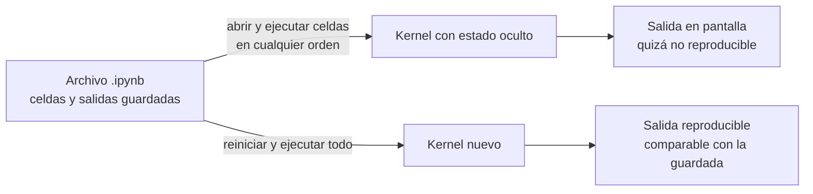

# B14-C09 — Jupyter y experimentos reproducibles

<!-- nav:top -->
[🏠 Programa](../../../../README.md) · [📚 Bloque B14](../../../tronco-comun/B14-computacion-cientifica-y-ciencia-abierta.md) · [← Anterior: B14-C08 — Pandas y limpieza de datos](../B14-C08-pandas-y-limpieza-de-datos/CLASE.md) · [Siguiente: B14-C10 — Pruebas de regresión numérica →](../B14-C10-pruebas-de-regresion-numerica/CLASE.md)
<!-- /nav -->

## 1. Ubicación, nivel y alcance

Novena clase del bloque B14 y primera del tramo de reproducibilidad. Hasta ahora escribiste scripts; ahora trabajas con **cuadernos** (Jupyter), el formato en que muchas personas exploran datos astronómicos y comunican resultados. Un cuaderno es cómodo, y esa comodidad esconde un riesgo: que lo que ves en pantalla no se pueda repetir. Nivel N2.

Verás qué es un cuaderno por dentro, qué significa «reiniciar y ejecutar todo», cómo el estado oculto y el azar sin semilla rompen la reproducibilidad, y cómo detectar un orden de ejecución no lineal. No verás instalación de Jupyter ni widgets interactivos, ni control de versiones (C11) ni entornos (C12).

## 2. Por qué esta clase existe

Alguien te manda un cuaderno con un gráfico que apoya una conclusión. Lo abres, ejecutas las celdas y el gráfico sale distinto. ¿Cuál es el correcto? La pregunta motivadora es: **¿cómo sé que un cuaderno cuenta lo que realmente calculó, y cómo escribo uno que otra persona pueda repetir?**

La decisión central es: **¿qué debe cumplir un cuaderno para considerarlo un registro del experimento y no solo un borrador?** Un criterio simple y verificable es que *reiniciar el kernel y ejecutar todo de arriba abajo* produzca exactamente los mismos resultados.

## 3. Lo que podrás hacer al terminar

1. Describir la estructura de un cuaderno `.ipynb` (claves, tipos de celda, número de ejecución, salidas).
2. Explicar qué es el estado oculto y reproducirlo con un ejemplo.
3. Fijar la semilla de un generador aleatorio y comprobar que la repetición es idéntica.
4. Detectar, en un cuaderno guardado, un orden de ejecución no lineal.
5. Aplicar el criterio «reiniciar y ejecutar todo» antes de compartir un cuaderno.
6. Decidir qué lleva un cuaderno y qué debe ir a un módulo o script probado.

La evidencia es el **cuaderno repetible con su comprobación** del ejercicio 12 (sección 20).

## 4. Con qué llegas y cómo comprobarlo

Necesitas C01 (separar núcleo y orquestación), C02 y C08. Cinco preguntas:

1. ¿Qué es un generador de números pseudoaleatorios y qué es su semilla?
2. ¿Qué es el estado de un programa?
3. ¿Qué es un archivo JSON?
4. ¿Por qué un cálculo que usa azar no se puede repetir sin fijar la semilla?
5. ¿Qué significa ejecutar un programa «desde cero»?

<details>
<summary>Ver respuestas</summary>

1. Un algoritmo que produce una secuencia que parece aleatoria; la semilla es el valor inicial que la determina por completo. 2. Los valores de las variables y objetos en un momento dado. 3. Un formato de texto para datos estructurados (diccionarios, listas, números y cadenas). 4. Cada ejecución arranca con una semilla distinta. 5. Con un intérprete nuevo, sin variables de ejecuciones previas.
</details>

Con cuatro o cinco aciertos, sigue; con tres o menos, repasa C01 y C02.

## 5. Un caso real: lo que el formato nbformat fija

La documentación del formato de cuadernos (S1) establece que un cuaderno es un objeto JSON con cuatro claves de nivel superior: `metadata`, `nbformat` (versión mayor), `nbformat_minor` (menor) y `cells`. Cada celda tiene `cell_type` (markdown, código o raw), `metadata` y `source`. Las celdas de código llevan además `outputs` y `execution_count` (un entero o `null`); este último es el número de orden con que se ejecutó la celda en el kernel. Las salidas pueden ser de flujo (`stream`), de visualización (`display_data`), resultados (`execute_result`) o errores (`error`). Y a partir del esquema 4.5 cada celda tiene un identificador único.

Esto importa porque el archivo **guarda las salidas de la última ejecución, no la garantía de que el código las produzca**: el cuaderno puede mostrar una salida de una versión anterior de una celda. El **ejemplo conductor** es un cuaderno sintético de tres celdas de código que estima la media de un flujo relativo gaussiano de 1000 muestras, con la semilla fija 20261105. No es una observación real.

## 6. Vocabulario

Un **cuaderno** es un documento con celdas de texto y de código, y las salidas de ese código. Un **kernel** es el proceso que ejecuta el código y conserva sus variables entre celdas. El **estado oculto** es el conjunto de variables que existen en el kernel y que no se ven en el texto del cuaderno: pueden haber sido creadas por celdas borradas o ejecutadas en otro orden. **Reiniciar y ejecutar todo** (*restart and run all*) borra el estado y ejecuta las celdas de arriba abajo. La **semilla** (`seed`) fija la secuencia de un generador pseudoaleatorio. Un **orden lineal** es aquel en que los `execution_count` son 1, 2, 3, … sin saltos ni retrocesos. La **ida y vuelta de serialización** es escribir el cuaderno a texto y leerlo de nuevo sin perder nada.

## 7. Modelo mental: el cuaderno guarda el texto, el kernel guarda el estado

Un cuaderno son dos cosas distintas: el **archivo** (texto de las celdas y salidas guardadas) y el **kernel** vivo (las variables actuales). Lo que reproduce tu resultado es el texto ejecutado en orden desde cero; lo que a veces ves en pantalla es el texto *más* el estado del kernel.



*Descripción textual:* desde el archivo hay dos caminos. Ejecutar celdas en cualquier orden sobre un kernel con estado acumulado da una salida que quizá no se pueda repetir. Reiniciar el kernel y ejecutar todo de arriba abajo da una salida reproducible, que se puede comparar con la guardada en el archivo.

**Analogía y su límite.** Una libreta de laboratorio en la que puedes escribir las páginas en cualquier orden: sirve de registro solo si se puede repetir el experimento leyéndola de principio a fin. Límite: una libreta no ejecuta nada; en un cuaderno el estado vivo puede ser invisible.

## 8. La explicación, paso a paso

### 8.1 Por dentro

El laboratorio construye el cuaderno con `nbformat` y lo valida contra el esquema: sus claves de nivel superior son `cells`, `metadata`, `nbformat` y `nbformat_minor`, con versión 4.5 y cuatro celdas (una de texto y tres de código). Cada celda de código tiene `outputs` y `execution_count`, como indica S1. Al serializar a texto y leer de nuevo, el código de todas las celdas coincide (872 caracteres de JSON en el ejemplo).

### 8.2 Reiniciar y ejecutar todo

El laboratorio **simula** ese criterio sin kernel: ejecuta las celdas de código con `exec`, en orden, en un espacio de nombres nuevo. Dos ejecuciones desde cero dan exactamente la misma salida: `media = 1,000214`. Eso es reproducibilidad en sentido fuerte: igualdad de cadena, no «parecido». (Es una simulación: un kernel real tiene más estado, como importaciones y configuración de gráficos.)

### 8.3 La semilla

Si el generador no tiene semilla, cada ejecución arranca de forma distinta: en el laboratorio, dos ejecuciones sin semilla dieron `0,999696` y `1,000040` (los valores concretos cambian en cada ejecución). Con la semilla fija en la primera celda, el resultado es único. Fija la semilla **al principio**, en una celda visible, y registra su valor.

### 8.4 El estado oculto

Ejecuta la celda 1 (semilla), la 2 (muestras) y la 3 (media): `media = 1,000214`. Si ahora vuelves a ejecutar solo las celdas 2 y 3 **sin reiniciar**, el generador ya avanzó y da otra muestra: `media = 1,000193`. El texto del cuaderno no cambió, la salida sí. Esto muestra el estado oculto: el generador conserva su posición entre ejecuciones. Quien lea tu cuaderno después de «reiniciar y ejecutar todo» obtendrá 1,000214, no 1,000193, aunque la pantalla anterior mostrara este último.

### 8.5 Detectar un orden no lineal

En un cuaderno guardado, los `execution_count` de las celdas de código dicen en qué orden se ejecutaron. Si son 1, 2, 3 el orden es lineal; si son 1, 3, 2 alguien ejecutó la tercera celda antes que la segunda y la salida guardada puede depender de ese orden. El laboratorio implementa esa comprobación y detecta el caso (1, 3, 2). No es una prueba suficiente de reproducibilidad (un orden lineal también puede esconder estado), pero es barata y detecta un error frecuente.

### 8.6 Qué va en el cuaderno y qué no

El cuaderno es buen lugar para narrar, explorar y mostrar figuras. El **cálculo reutilizable** debe estar en funciones probadas (C01, C10) que el cuaderno importa. Un cuaderno con 300 líneas de lógica en celdas es un programa sin pruebas.

## 9. Magnitudes, símbolos y unidades

| Símbolo | Qué es | Unidad | Nota |
|---|---|---|---|
| `x` | flujo relativo | adimensional | 1000 muestras, media 1,0, desviación 0,01 |
| `media` | media muestral | adimensional | 1,000214 con la semilla 20261105 |
| `execution_count` | orden de ejecución de una celda | entero o `null` | S1 |
| `nbformat` | versión del formato | entero (mayor.menor) | 4.5 en el ejemplo |
| semilla | valor inicial del generador | entero | 20261105 |

## 10. Convenciones y referencias

Datos **sintéticos**. El flujo es relativo (cociente respecto a un nivel de referencia) y adimensional. La reproducibilidad se mide como igualdad exacta de la salida impresa. El generador es `numpy.random.default_rng`; su comportamiento con semilla se comprobó con el laboratorio, no con la documentación (ver sección 11). Versiones: Python 3.12.9, NumPy 2.5.4, nbformat 5.11.1 (la biblioteca; el formato es 4.5).

## 11. De dónde sale lo que afirmamos

| ID | Fuente | Localizador | Respalda | Estado |
|---|---|---|---|---|
| S1 | Jupyter, *The Notebook file format* (nbformat) | https://nbformat.readthedocs.io/en/latest/format_description.html | Cuatro claves de nivel superior, tipos de celda, `execution_count`, tipos de salida, identificador de celda desde 4.5, versionado mayor/menor | Página consultada el 2026-11-05 (mutable) |

Límites: no consulté la documentación de NumPy sobre `default_rng` ni la de Jupyter sobre kernels; el efecto de la semilla y del estado se demuestra con el laboratorio. La simulación con `exec` no reproduce un kernel real.

## 12. Cómo ver el resultado

Versión accesible de las ejecuciones del laboratorio.

| Situación | Salida | ¿Reproducible? |
|---|---|---|
| Ejecutar todo desde cero (con semilla), vez 1 | `media = 1,000214` | sí |
| Ejecutar todo desde cero (con semilla), vez 2 | `media = 1,000214` | sí |
| Sin semilla, dos ejecuciones | `0,999696` y `1,000040` (varían) | no |
| Volver a ejecutar celdas 2 y 3 sin reiniciar | `1,000193` | no coincide con «ejecutar todo» |
| `execution_count` (1, 2, 3) | orden lineal | — |
| `execution_count` (1, 3, 2) | orden no lineal detectado | — |

## 13. Ejemplo trabajado: auditar un cuaderno antes de compartirlo

1. **Valida** contra el esquema: aprobado.
2. **Revisa el orden**: `execution_count` 1, 2, 3, lineal.
3. **Busca la semilla**: está en la primera celda de código, con valor visible.
4. **Reinicia y ejecuta todo** dos veces: `media = 1,000214` en ambas. Igualdad exacta.
5. **Compara con la salida guardada** en el archivo: coincide.
6. **Revisa qué hay en celdas**: solo tres líneas de cálculo; la lógica reutilizable no está.

**Paso final · incertidumbre.** Que dos ejecuciones coincidan prueba que el cuaderno es repetible *en esta máquina y con estas versiones*; no prueba que el resultado sea correcto (una media de muestras sintéticas no dice nada del cielo) ni que se repita con otras versiones de NumPy, algo que se estudia en C10 y C12.

## 14. Comparación: cuaderno, script y módulo

Un **cuaderno** es mejor para explorar y comunicar, porque mezcla texto, código y figuras. Un **script** es mejor para ejecutar de forma automática y repetible. Un **módulo probado** es mejor para lo que se reutiliza. Un flujo sano usa los tres: el módulo contiene el núcleo, el script ejecuta la tarea y el cuaderno cuenta la historia y muestra los resultados importando el módulo.

## 15. Práctica guiada

**Ejercicio 1 · con los pasos.** Un cuaderno tiene `execution_count` 1, 2, 4, 3. ¿Es lineal? *Pasos:* compara con 1, 2, 3, 4 (sección 8.5).

<details><summary>Solución comentada</summary>

No: la celda con 4 se ejecutó antes que la de 3. La salida guardada pudo depender de ese orden. Hay que reiniciar y ejecutar todo antes de compartirlo.
</details>

**Ejercicio 2 · con una pista.** Si la celda 2 hace `x = rng.normal(...)` y la ejecutas dos veces seguidas, ¿por qué da dos muestras distintas aunque haya semilla? *Pista:* el generador avanza.

<details><summary>Solución comentada</summary>

La semilla fija el estado **inicial** del generador; cada llamada lo hace avanzar. La segunda vez parte de otro estado. La semilla garantiza la secuencia completa, no que cada celda dé lo mismo al repetirla (sección 8.4).
</details>

**Ejercicio 3 · casi autónomo.** Escribe qué cambiarías en la celda 1 para que dos ejecuciones sin reiniciar den lo mismo.

<details><summary>Solución comentada</summary>

Crear el generador dentro de la celda que usa el azar (`rng = np.random.default_rng(20261105)` y luego `x = rng.normal(...)` en la misma celda): así cada ejecución parte del mismo estado. Es un patrón útil, aunque cada celda queda autocontenida.
</details>

## 16. Práctica autónoma, transferencia e integrador

**Ejercicio 4.** ¿Qué claves de nivel superior debe tener un cuaderno según S1? ¿Qué pasa si falta `nbformat`?

<details><summary>Solución comentada</summary>

`metadata`, `nbformat`, `nbformat_minor` y `cells`. Sin `nbformat` no se sabe qué esquema aplicar y la validación falla.
</details>

**Ejercicio 5.** Explica la diferencia entre `stream` y `execute_result` como tipos de salida.

<details><summary>Solución comentada</summary>

`stream` es texto escrito en salida estándar o de error (lo que hace `print`); `execute_result` es el valor de la última expresión de la celda, y lleva su propio número de ejecución (S1).
</details>

**Ejercicio 6.** Un cuaderno calcula la media de 1000 muestras sin semilla y reporta `1,000040`. ¿Qué puedes afirmar de ese número?

<details><summary>Solución comentada</summary>

Que es una realización de una variable aleatoria: otra ejecución dará otro valor cercano a 1,0 (la desviación esperada de la media es `0,01/√1000 ≈ 3 × 10⁻⁴`). El número solo sirve si se acompaña de la semilla o de un intervalo.
</details>

**Ejercicio 7.** Calcula la desviación típica esperada de la media del ejemplo y compara con la dispersión entre `0,999696` y `1,000040`.

<details><summary>Solución comentada</summary>

`0,01/√1000 = 3,16 × 10⁻⁴`. Las dos medias sin semilla difieren en `3,44 × 10⁻⁴`, un poco más de una desviación típica: coherente con dos realizaciones independientes. (Una sola pareja de valores no es una prueba estadística.)
</details>

**Ejercicio 8.** Propón una comprobación automática que falle si un cuaderno no es repetible.

<details><summary>Solución comentada</summary>

Ejecutarlo dos veces desde cero (con `nbconvert` o una herramienta equivalente) y comparar las salidas con tolerancia declarada; que falle si difieren o si los `execution_count` no son lineales. El laboratorio hace una versión simplificada.
</details>

**Ejercicio 9 · transferencia.** Un colega comparte un cuaderno con un gráfico, pero una celda borrada creaba una variable que otra celda aún usa. ¿Cómo se manifiesta y cómo se evita?

<details><summary>Solución comentada</summary>

En su máquina funciona porque la variable vive en el kernel; en la tuya da un error de nombre. Se evita reiniciando y ejecutando todo antes de compartir.
</details>

**Ejercicio 10 · transferencia.** Un cuaderno tarda dos horas en ejecutar. ¿Cómo mantienes la reproducibilidad sin esperar dos horas en cada revisión?

<details><summary>Solución comentada</summary>

Separa el cálculo costoso en un script o función cuyos resultados se guardan con su huella (C11) y que se prueba con un caso pequeño (C10); el cuaderno carga los resultados y muestra figuras. La repetición completa se hace al publicar.
</details>

**Ejercicio 11 · transferencia.** El cuaderno usa una función de un módulo que cambió de versión. ¿Qué información debe llevar el cuaderno para poder repetirse?

<details><summary>Solución comentada</summary>

Versiones de Python y bibliotecas (impresas en una celda o en un archivo de bloqueo, C12), la semilla, la versión de los datos (C11) y la fecha. Sin eso el cuaderno es repetible solo hoy y en tu equipo.
</details>

**Ejercicio 12 · integrador.** Entrega un **cuaderno repetible con su comprobación**: un cuaderno sintético (o su equivalente en script) con semilla, versiones impresas, tres celdas de cálculo, un script que lo ejecute dos veces desde cero y compare salidas, la detección de orden lineal y una nota sobre qué no garantiza.

<details><summary>Solución modelo</summary>

Debe incluir la semilla visible, las versiones, la comparación exacta de dos ejecuciones, la comprobación de `execution_count`, una prueba que falle al quitar la semilla, y una sección «límites» que diga que reproducibilidad no es corrección. Se acepta cualquier cálculo sintético que declare sus datos.
</details>

## 17. Laboratorio

El script [cuaderno_reproducible.py](cuaderno_reproducible.py) construye y valida un cuaderno con `nbformat`, simula «reiniciar y ejecutar todo» con `exec`, compara ejecuciones con y sin semilla, demuestra el estado oculto, detecta un orden no lineal y verifica la ida y vuelta de serialización.

**Datos:** sintéticos. **Predice antes de ejecutar:** ¿qué ocurrirá con la media si repites solo las celdas 2 y 3 sin reiniciar? **Ejecución del 2026-11-05 (Python 3.12.9, NumPy 2.5.4, nbformat 5.11.1):**

```text
claves de nivel superior: ['cells', 'metadata', 'nbformat', 'nbformat_minor']; nbformat = 4.5; celdas = 4
ejecución 1: media = 1.000214
ejecución 2: media = 1.000214
sin semilla: media = 0.999696 | media = 1.000040
re-ejecutar la celda 2 sin reiniciar: media = 1.000214 -> media = 1.000193
orden lineal (1,2,3): True;  orden (1,3,2): False
serialización: 872 caracteres JSON; ida y vuelta igual
Pruebas superadas.
```

```bash
python programa/clases/B14/B14-C09-jupyter-y-experimentos-reproducibles/cuaderno_reproducible.py
```

**Límites:** no usa un kernel de Jupyter; los valores sin semilla cambian en cada ejecución; el criterio de igualdad exacta es válido para esta plataforma y estas versiones.

## 18. Errores frecuentes y cómo corregirlos

**Compartir sin reiniciar y ejecutar todo.** Se corrige con el ejercicio 9 y la sección 13.

**No fijar la semilla.** Se corrige con el ejercicio 6.

**Confiar en la salida guardada.** Se corrige con la sección 8.4.

**Ejecutar celdas en desorden.** Se corrige con el ejercicio 1.

**Dejar la lógica reutilizable en celdas.** Se corrige con el ejercicio 10 y la sección 8.6.

## 19. Cómo sabrás que vas bien

Tras 8.3: ¿explicas qué fija la semilla y qué no? Si no, rehaz el ejercicio 2. Tras 8.5: ¿detectas un orden no lineal? Si no, rehaz el 1. Tras el ejemplo trabajado: ¿qué paso detectaría una variable de una celda borrada? Tras el laboratorio: ¿qué cambia si el cuaderno usa otro generador? Al final: ¿qué no garantiza tu comprobación?

## 20. Qué entregas y cómo se evalúa

El producto es tu **cuaderno repetible con su comprobación** del ejercicio 12.

| Criterio | Inicial | En desarrollo | Logrado | Destacado |
|---|---|---|---|---|
| Repetibilidad | Sin semilla | Con semilla sin comprobar | Dos ejecuciones desde cero idénticas | Falla automáticamente si no |
| Estado y orden | Ignora | Revisa a ojo | Comprueba `execution_count` | Documenta el estado oculto |
| Estructura | Todo en celdas | Algo en funciones | Núcleo en módulo | Núcleo probado |
| Fuentes y alcance | Sin fuente | Fuente sin alcance | Fuente con alcance | Declara que reproducibilidad no es corrección |

**Condiciones críticas:** no compartir un cuaderno sin reiniciar y ejecutar todo; no presentar datos sintéticos como observados; no confundir reproducible con correcto.

## 21. Ética, seguridad y límites

Un cuaderno guarda salidas, y estas pueden contener datos sensibles, rutas o credenciales: revísalas antes de publicar. No ejecutes cuadernos de origen desconocido: contienen código arbitrario. Accesibilidad: describe las figuras con texto. Material educativo.

## 22. Para cerrar y seguir

Un cuaderno es un archivo (texto y salidas guardadas) y un kernel (estado vivo); solo «reiniciar y ejecutar todo» con la semilla fijada garantiza que lo guardado se pueda repetir. El estado oculto y el azar sin semilla son las causas más comunes de que no se repita. Queda abierta una pregunta: ¿cómo garantizas que el cuaderno se repita dentro de un año, cuando las bibliotecas hayan cambiado?

**Glosario español–inglés.** cuaderno · *notebook*; celda · *cell*; kernel · *kernel*; estado oculto · *hidden state*; semilla · *seed*; reiniciar y ejecutar todo · *restart and run all*; salida · *output*; serialización · *serialization*.

**Continuidad.** B14-C10 convierte las comprobaciones en pruebas de regresión con tolerancias; B14-C11 versiona los datos; B14-C12 fija las versiones de las bibliotecas.

**Referencias:** ver sección 11. Solo S1 fue consultada.

<!-- nav:bottom -->
---

[← Anterior: B14-C08 — Pandas y limpieza de datos](../B14-C08-pandas-y-limpieza-de-datos/CLASE.md) · [📚 Bloque B14](../../../tronco-comun/B14-computacion-cientifica-y-ciencia-abierta.md) · [Siguiente: B14-C10 — Pruebas de regresión numérica →](../B14-C10-pruebas-de-regresion-numerica/CLASE.md)
<!-- /nav -->
