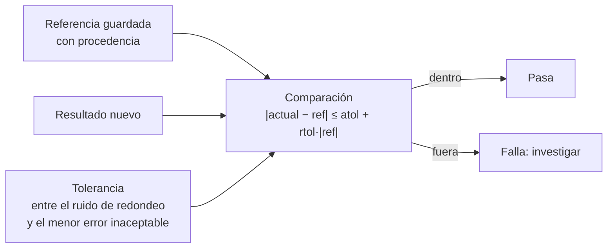

# B14-C10 — Pruebas de regresión numérica

<!-- nav:top -->
[🏠 Programa](../../../../README.md) · [📚 Bloque B14](../../../tronco-comun/B14-computacion-cientifica-y-ciencia-abierta.md) · [← Anterior: B14-C09 — Jupyter y experimentos reproducibles](../B14-C09-jupyter-y-experimentos-reproducibles/CLASE.md) · [Siguiente: B14-C11 — Control de versiones de datos →](../B14-C11-control-de-versiones-de-datos/CLASE.md)
<!-- /nav -->

## 1. Ubicación, nivel y alcance

Décima clase del bloque B14. En [C03](../B14-C03-analisis-numerico-con-scipy/CLASE.md) verificaste un cálculo contra una solución exacta; en [C09](../B14-C09-jupyter-y-experimentos-reproducibles/CLASE.md) lo repetiste. Ahora lo conviertes en una **prueba que se ejecuta cada vez** y que avisa si un cambio de código, de biblioteca o de máquina altera el resultado. Nivel N2.

Verás los valores de referencia, el criterio de comparación con tolerancias relativa y absoluta, cómo elegir una tolerancia que detecte errores reales sin saltar por el redondeo, y la asimetría de la comparación. No verás integración continua (B14-C20), pruebas de propiedades ni estadística de ensayos (B12).

## 2. Por qué esta clase existe

Cambias una línea de un propagador orbital «solo para ordenarlo» y el período de una órbita pasa de 5553,624562 s a 5553,627342 s (situación ilustrativa con cifras de esta clase). ¿Es un error o ruido? Sin pruebas no lo sabes; con una prueba mal calibrada, o te avisa de todo (y la ignoras) o de nada (y no sirve). La pregunta motivadora es: **¿cómo detecto automáticamente que un cálculo cambió, sin falsas alarmas y sin dejar pasar errores reales?**

La decisión central es: **¿qué valor de referencia y qué tolerancia usar?** Una tolerancia es una afirmación científica: «diferencias menores que esto no importan».

## 3. Lo que podrás hacer al terminar

1. Guardar un resultado de referencia con su procedencia y recuperarlo exactamente.
2. Aplicar el criterio `|actual − referencia| ≤ atol + rtol·|referencia|` y explicar cada término.
3. Elegir `rtol` y `atol` justificando qué errores deben detectarse y cuáles tolerarse.
4. Explicar por qué un valor de referencia casi nulo necesita tolerancia absoluta.
5. Reconocer la asimetría de la comparación y el efecto del orden de las operaciones.
6. Distinguir una prueba de regresión de una prueba de corrección.

La evidencia es la **batería de regresión** del ejercicio 12 (sección 20).

## 4. Con qué llegas y cómo comprobarlo

Necesitas C01, C03 y la idea de error relativo (B01-C18). Cinco preguntas:

1. ¿Cuál es el error relativo entre 100,0 y 100,1? (10⁻³.)
2. ¿Por qué `0,1 + 0,2 == 0,3` es falso en coma flotante?
3. ¿Qué es un valor de referencia?
4. ¿Qué diferencia hay entre una prueba de regresión y una de corrección?
5. Si una cantidad vale `10⁻⁵` y la comparas con tolerancia relativa `10⁻⁶`, ¿qué diferencia absoluta aceptas? (10⁻¹¹.)

<details>
<summary>Ver respuestas</summary>

1. `0,1/100 = 10⁻³`. 2. Porque 0,1, 0,2 y 0,3 no son exactos en binario. 3. Un resultado previo, aceptado, contra el cual se compara. 4. La de regresión detecta *cambios*; la de corrección compara con una solución independiente (exacta o externa). 5. `10⁻⁶ × 10⁻⁵ = 10⁻¹¹`.
</details>

Con cuatro o cinco aciertos, sigue; con tres o menos, repasa B01-C18 y C03.

## 5. Un caso real: el criterio exacto de `assert_allclose`

La documentación de NumPy (S1) define `numpy.testing.assert_allclose(actual, desired, rtol, atol)`: pasa si, para cada elemento, `|actual − desired| ≤ atol + rtol·|desired|`. Los valores por defecto son `rtol = 10⁻⁷` y `atol = 0`; los NaN en la misma posición se consideran iguales por defecto; si uno de los argumentos es un escalar, se difunde sobre el otro. S1 destaca además que la comparación es **asimétrica**: la tolerancia relativa se escala con `|desired|` (la referencia), no con `actual`, de modo que intercambiar los argumentos puede cambiar el resultado cerca del límite. S1 ilustra el caso con `rtol = 0,1`: comparar 1,0 con 1,102 pasa (`0,102 ≤ 0,1102`), pero 1,102 con 1,0 falla (`0,102 > 0,1`).

El **ejemplo conductor** es el de C03: una órbita circular sintética a 400 km de altitud. Guardamos como referencia su período (5553,624562448 s), el error de cierre de la integración (1,273 × 10⁻⁵ m) y la deriva de energía (1,70 × 10⁻¹⁴), y comprobamos qué cambios detecta la batería.

## 6. Vocabulario

Una **prueba de regresión** compara el resultado actual con uno guardado de una versión anterior; detecta cambios, no demuestra corrección. Un **valor de referencia** (*golden value*) es ese resultado guardado. La **tolerancia relativa** `rtol` escala con el tamaño de la referencia; la **absoluta** `atol` es un piso fijo. Un **falso positivo** es una alarma sin error real; un **falso negativo**, un error que pasa inadvertido. El **orden de operaciones** afecta al redondeo: la suma en coma flotante no es asociativa. Un **cambio inocuo** es uno que no altera el resultado más allá del redondeo.

## 7. Modelo mental: un detector con umbral

La tolerancia es el umbral de un detector. Muy bajo, suena con el redondeo (falsos positivos). Muy alto, no suena con errores reales (falsos negativos). La tolerancia se elige entre el ruido numérico que ya conoces y el menor error que no puedes permitirte.



*Descripción textual:* la referencia guardada y el resultado nuevo entran a una comparación con el criterio `|actual − ref| ≤ atol + rtol·|ref|`. Si queda dentro, la prueba pasa; si queda fuera, falla y hay que investigar. La tolerancia se elige entre el ruido de redondeo y el menor error que no se puede permitir.

**Analogía y su límite.** Un detector de humo: ni tan sensible que suene con una tostada, ni tan torpe que no suene con un incendio. Límite: el humo es físico y su umbral lo calibran fabricantes; la tolerancia de un cálculo la calibras tú con el conocimiento de tu problema.

## 8. La explicación, paso a paso

### 8.1 Guardar la referencia con procedencia

El laboratorio guarda en JSON el período, el cierre y la deriva, junto con la versión de SciPy y una nota que dice que es sintético. La ida y vuelta es exacta (`ref["periodo_s"] == T0`). Una referencia sin procedencia es un número sin historia: no sabrás con qué versión se obtuvo.

### 8.2 El criterio

Para cada valor: `|actual − referencia| ≤ atol + rtol·|referencia|`. `rtol` cubre el caso general; `atol` evita que una referencia casi nula exija una exactitud imposible. Con `rtol` solo, una referencia de 10⁻⁵ con tolerancia `10⁻⁶` aceptaría solo diferencias de 10⁻¹¹; el cierre de la integración puede variar mucho más sin ser un error. El laboratorio muestra el efecto: el cierre se comprueba con `atol = 10⁻³ m`, y una prueba solo relativa sobre ese valor rechazaría una desviación de 5 × 10⁻³ m que, en términos físicos, es irrelevante frente al radio de 6778 km.

### 8.3 Elegir la tolerancia: un error de 10⁻⁶ en `GM`

Introduce un error de un dígito en `GM`: 3,986008 × 10¹⁴ en vez de 3,986004 × 10¹⁴, un 10⁻⁶ en términos relativos. El período cambia en `5,02 × 10⁻⁷` (la mitad, porque `T ∝ GM^(−1/2)`). Con `rtol = 10⁻⁷` el error se **detecta**; con `rtol = 10⁻³` **pasa sin ser visto**. Una tolerancia de 10⁻³ habría dejado entrar un error de datos que afecta a la sexta cifra. La regla: la tolerancia debe ser más estricta que el error que quieres cazar y más laxa que el ruido de redondeo que ya conoces.

### 8.4 El ruido que sí existe

Reordenar una suma cambia el redondeo: sumar 100 000 valores de forma secuencial en dos órdenes distintos dio una diferencia relativa de `1,99 × 10⁻¹⁴`, y los resultados **no** son idénticos bit a bit. Eso es ruido legítimo. Una tolerancia de 10⁻¹² lo absorbe y sigue detectando un error de 10⁻⁶. (Una reescritura algebraica del período, `2π·a^{3/2}/√GM` frente a `2π√(a³/GM)`, dio resultados idénticos bit a bit en esta máquina: un cambio inocuo puede no cambiar ni un bit, y otro, en otra plataforma, sí.)

### 8.5 La asimetría

El laboratorio comprueba lo que dice S1: con `rtol = 0,1`, comparar 1,0 con la referencia 1,102 pasa, y comparar 1,102 con la referencia 1,0 falla. Por eso hay que decidir **cuál es la referencia** y escribirla siempre en el mismo lugar (el argumento `desired`).

### 8.6 Qué no prueba una regresión

Si la referencia estaba mal, la prueba de regresión la defiende. Por eso la referencia inicial debe provenir de una **prueba de corrección** previa: aquí, el período analítico y el árbitro de la energía de C03. La regresión protege lo ya verificado frente al cambio; no verifica nada por sí sola.

## 9. Magnitudes, símbolos y unidades

| Símbolo | Qué es | Unidad | Nota |
|---|---|---|---|
| `T` | período orbital | s | 5553,624562448 (referencia) |
| `GM` | parámetro gravitacional terrestre | m³/s² | 3,986004 × 10¹⁴ (nominal, S2) |
| `rtol` | tolerancia relativa | adimensional | 10⁻⁷, 10⁻⁹, 10⁻³ en los ejemplos |
| `atol` | tolerancia absoluta | unidad de la magnitud | 10⁻³ m para el cierre |
| cierre | error de posición tras un período | m | 1,273 × 10⁻⁵ en la referencia |
| deriva | cambio relativo de la energía específica | adimensional | 1,70 × 10⁻¹⁴ en la referencia |

## 10. Convenciones y referencias

La referencia es **sintética**: se obtiene en la misma ejecución con la implementación del momento, y se guarda para compararla con variantes. En un proyecto real, la referencia se guarda en un archivo versionado (C11) tras verificarse con una prueba de corrección. El criterio es el de NumPy (S1); el orden de los argumentos es `(actual, desired)`. `GM` y el radio terrestre (6378,137 km, NASA NSSDC Earth Fact Sheet) son las constantes de C03.

## 11. De dónde sale lo que afirmamos

| ID | Fuente | Localizador | Respalda | Estado |
|---|---|---|---|---|
| S1 | NumPy, `numpy.testing.assert_allclose` | https://numpy.org/doc/stable/reference/generated/numpy.testing.assert_allclose.html | Criterio `|actual − desired| ≤ atol + rtol·|desired|`; valores por defecto; asimetría y su ejemplo | Consultada el 2026-11-05 (mutable) |
| S2 | astropy, `astropy.constants` | https://docs.astropy.org/en/stable/constants/index.html | `GM_earth = 3,986004 × 10¹⁴ m³/s²` (nominal) | Consultada el 2026-11-05 (mutable) |

Límites: no consulté la documentación de pytest ni de `numpy.isclose`; la proporcionalidad `T ∝ GM^{-1/2}` es una consecuencia de la fórmula de C01. Los valores del cierre y de la deriva dependen de las versiones de SciPy y NumPy.

## 12. Cómo ver el resultado

Versión accesible de las comparaciones del laboratorio.

| Caso | Diferencia relativa | `rtol = 10⁻⁷` | `rtol = 10⁻³` |
|---|---|---|---|
| Reescritura algebraica de `T` | 0 | pasa | pasa |
| `GM` con un dígito cambiado | 5,02 × 10⁻⁷ | **falla (detectado)** | pasa (no detectado) |
| Suma en otro orden | 1,99 × 10⁻¹⁴ | pasa | pasa |

## 13. Ejemplo trabajado: una batería para el propagador de C03

1. **Referencia.** Calcula `T = 5553,624562448 s`, cierre `1,273 × 10⁻⁵ m`, deriva `1,70 × 10⁻¹⁴`; guárdalos en JSON con la versión de SciPy.
2. **Cambio inocuo.** Reescribe la fórmula de `T`: diferencia 0; pasa con `rtol = 10⁻⁹`.
3. **Error real.** Cambia un dígito de `GM`: diferencia `5,02 × 10⁻⁷`. Con `rtol = 10⁻⁷` falla: detectado.
4. **Tolerancia floja.** Con `rtol = 10⁻³` el mismo error pasa. Conclusión: `10⁻⁷` es una buena elección para el período; `10⁻³` no lo es.
5. **Cierre.** Se compara con `atol = 10⁻³ m`; una tolerancia solo relativa sobre `10⁻⁵ m` sería injusta.
6. **Deriva.** Se exige `< 10⁻¹⁰` (un umbral, no una igualdad).
7. **Ruido.** La suma en otro orden da `1,99 × 10⁻¹⁴`; una tolerancia de 10⁻¹² lo absorbe.

**Paso final · incertidumbre.** Las tolerancias elegidas valen para esta máquina y estas versiones; un cambio de plataforma puede mover el redondeo más allá de 10⁻¹⁴ (aunque no más allá de 10⁻⁹). Una batería de regresión solo es tan buena como la corrección de su referencia y la justificación de sus tolerancias.

## 14. Comparación: igualdad exacta, tolerancia fija y tolerancia por cantidad

La **igualdad exacta** es adecuada para enteros, cadenas y sumas de verificación (C11), nunca para coma flotante entre plataformas. Una **tolerancia fija para todo** es cómoda y casi siempre equivocada: cantidades distintas tienen ruido distinto. Una **tolerancia por cantidad**, con `rtol` y `atol` justificados, es más trabajo y es la correcta. Un caso intermedio: tolerancias estrechas (10⁻¹²) para cálculos algebraicos y moderadas (10⁻⁶) para integraciones numéricas.

## 15. Práctica guiada

**Ejercicio 1 · con los pasos.** ¿Pasa `assert_allclose(5553,6246, 5553,6245, rtol=10⁻⁷)`? *Pasos:* diferencia `1 × 10⁻⁴`; umbral `10⁻⁷ × 5553,6245 = 5,55 × 10⁻⁴` (sección 8.2).

<details><summary>Solución comentada</summary>

Sí: `1 × 10⁻⁴ ≤ 5,55 × 10⁻⁴`. Con `rtol = 10⁻⁸` no pasaría (umbral `5,55 × 10⁻⁵`).
</details>

**Ejercicio 2 · con una pista.** Para una referencia de `2 × 10⁻⁶` y `rtol = 10⁻⁶`, ¿qué diferencia máxima se acepta? ¿Y con `atol = 10⁻⁸` añadido? *Pista:* `atol + rtol·|ref|`.

<details><summary>Solución comentada</summary>

Solo relativa: `10⁻⁶ × 2 × 10⁻⁶ = 2 × 10⁻¹²`. Con `atol`: `10⁻⁸ + 2 × 10⁻¹² ≈ 10⁻⁸`. El piso absoluto manda cuando la referencia es muy pequeña.
</details>

**Ejercicio 3 · casi autónomo.** Verifica que el error de 10⁻⁶ en `GM` produce un cambio de 5 × 10⁻⁷ en `T` con la proporcionalidad `T ∝ GM^{−1/2}`.

<details><summary>Solución comentada</summary>

`(1 + 10⁻⁶)^{−1/2} ≈ 1 − 5 × 10⁻⁷`. El cambio medido, `5,02 × 10⁻⁷`, coincide (el valor `3,986008/3,986004 − 1 = 1,0035 × 10⁻⁶`, de donde sale el 5,02).
</details>

## 16. Práctica autónoma, transferencia e integrador

**Ejercicio 4.** Dos programas calculan el mismo período y difieren en `3 × 10⁻¹²` (relativo). ¿Qué tolerancia mínima justifica que ambos pasen y qué error de datos seguiría detectando?

<details><summary>Solución comentada</summary>

`rtol = 10⁻¹¹` (con margen de un factor 3). Seguiría detectando un error de `GM` de `10⁻⁶` con facilidad: la brecha es de cinco órdenes de magnitud.
</details>

**Ejercicio 5.** ¿Por qué la comparación de `1,0` con `1,102` pasa pero la de `1,102` con `1,0` falla (`rtol = 0,1`)?

<details><summary>Solución comentada</summary>

El umbral se escala con la referencia: `0,1 × 1,102 = 0,1102 ≥ 0,102`, pasa; `0,1 × 1,0 = 0,1 < 0,102`, falla (S1).
</details>

**Ejercicio 6.** Un compañero invierte el orden de los argumentos en todas las pruebas. ¿Qué riesgo introduce?

<details><summary>Solución comentada</summary>

Cerca del límite, resultados que antes pasaban pueden fallar y viceversa, y la tolerancia se escala con el valor nuevo en lugar de la referencia. Hay que fijar una convención (referencia siempre como `desired`).
</details>

**Ejercicio 7.** Propón `rtol` y `atol` para comparar un vector de posiciones en metros de magnitud `7 × 10⁶` con un error de cierre esperable de `10⁻⁴ m`.

<details><summary>Solución comentada</summary>

Una elección razonable: `rtol = 10⁻¹²` (para la magnitud grande) y `atol = 10⁻³ m` (para componentes casi nulas). Ambas deben justificarse con el ruido conocido; otra elección, argumentada, es válida.
</details>

**Ejercicio 8.** ¿Qué haría fallar a una prueba de regresión sin que exista un error de código?

<details><summary>Solución comentada</summary>

Un cambio de versión de una biblioteca, de plataforma o del orden de una reducción: variaciones de redondeo mayores que la tolerancia. Se diagnostica comparando versiones (C12) y revisando si el error es mayor que el ruido conocido.
</details>

**Ejercicio 9 · transferencia.** Actualizas SciPy y tres pruebas fallan con diferencias de `10⁻⁹`. ¿Qué haces?

<details><summary>Solución comentada</summary>

Verificas con la solución exacta o el árbitro de corrección si el nuevo resultado sigue siendo correcto; si lo es, actualizas la referencia con una nota (versión, fecha, motivo) en el control de versiones. Nunca actualizas la referencia solo para que pase.
</details>

**Ejercicio 10 · transferencia.** Una simulación estocástica tiene resultados distintos en cada ejecución. ¿Cómo la pruebas por regresión?

<details><summary>Solución comentada</summary>

Fijando la semilla (C09) para obtener una secuencia reproducible, o comparando estadísticos con una tolerancia basada en su dispersión esperada (B12). La primera es más estricta; la segunda, más robusta frente a cambios del generador.
</details>

**Ejercicio 11 · transferencia.** Tu batería tarda 20 minutos. ¿Qué prueba mantendrías en cada cambio y cuál en una ejecución nocturna?

<details><summary>Solución comentada</summary>

En cada cambio, pruebas rápidas con casos pequeños (fórmulas, ida y vuelta). Por la noche, las integraciones largas y las comparaciones con referencias grandes. Lo importante es que ambas existan y que las lentas no se abandonen.
</details>

**Ejercicio 12 · integrador.** Entrega una **batería de regresión** para un cálculo propio sintético: referencia con procedencia, al menos cuatro pruebas con `rtol` y `atol` justificados, una prueba que detecte un error de tamaño conocido, una que tolere un cambio inocuo, y la discusión de qué no demuestra.

<details><summary>Solución modelo</summary>

Debe incluir el archivo de referencia con versión y fecha, la tabla caso-tolerancia-resultado como la de la sección 12, una justificación de cada tolerancia basada en un ruido medido, una prueba de corrección que sustente la referencia y una nota sobre la asimetría. Se acepta cualquier cálculo sintético.
</details>

## 17. Laboratorio

El script [regresion_orbital.py](regresion_orbital.py) guarda la referencia en JSON, comprueba una reescritura inocua, un error de `GM` con dos tolerancias, la tolerancia absoluta del cierre, la asimetría de `assert_allclose` y el efecto del orden de suma. Falla si el error de `GM` no es detectado con `rtol = 10⁻⁷` o si lo es con `10⁻³`.

**Datos:** sintéticos. **Predice antes de ejecutar:** ¿qué tolerancia detecta el error de `GM`? **Ejecución del 2026-11-05 (Python 3.12.9, NumPy 2.5.4, SciPy 1.18.1):**

```text
referencia guardada: T = 5553.624562448 s; cierre = 1.273e-05 m; deriva = 1.70e-14
reescritura inocua: diferencia relativa = 0.00e+00; idéntico bit a bit: True
GM erróneo (3.986008e14): diferencia relativa en T = 5.02e-07
rtol=1e-7: detectado;  rtol=1e-3: NO detectado (tolerancia demasiado floja)
repetición: cierre = 1.273e-05 m; deriva = 1.70e-14
asimetría: (1.0 vs 1.102, rtol=0.1) pasa = True; (1.102 vs 1.0, rtol=0.1) pasa = False
suma en dos órdenes: diferencia relativa = 1.99e-14; idéntico bit a bit: False
Pruebas superadas.
```

```bash
python programa/clases/B14/B14-C10-pruebas-de-regresion-numerica/regresion_orbital.py
```

**Límites:** la referencia sale de la misma máquina y versiones; el cierre y la deriva dependen de SciPy; la prueba no verifica la corrección de la propagación más allá de C03.

## 18. Errores frecuentes y cómo corregirlos

**Tolerancia por defecto sin pensar.** Se corrige con el ejercicio 4 y la sección 8.3.

**Solo `rtol` con referencias casi nulas.** Se corrige con el ejercicio 2.

**Actualizar la referencia para que pase.** Se corrige con el ejercicio 9.

**Ignorar la asimetría.** Se corrige con los ejercicios 5 y 6.

**Confundir regresión con corrección.** Se corrige con la sección 8.6.

## 19. Cómo sabrás que vas bien

Tras 8.2: ¿calculas el umbral de una comparación a mano? Si no, rehaz el ejercicio 1. Tras 8.3: ¿explicas por qué 10⁻³ no detecta el error? Si no, rehaz el 3. Tras el ejemplo trabajado: ¿qué tolerancia usarías para el cierre y por qué? Tras el laboratorio: ¿qué cambiaría en otra plataforma? Al final: ¿de dónde viene la corrección de tu referencia?

## 20. Qué entregas y cómo se evalúa

El producto es tu **batería de regresión** del ejercicio 12.

| Criterio | Inicial | En desarrollo | Logrado | Destacado |
|---|---|---|---|---|
| Referencia | Sin procedencia | Con valor | Con versión y fecha | Respaldada por una prueba de corrección |
| Tolerancias | Por defecto | Elegidas sin prueba | Justificadas con ruido y error objetivo | Con prueba de detección y de tolerancia |
| Casos | Uno | Varios iguales | Inocuo, error y ruido | Con asimetría considerada |
| Fuentes y alcance | Sin fuente | Fuente sin alcance | Fuente con alcance | Declara qué no demuestra |

**Condiciones críticas:** no actualizar una referencia solo para que pase; no usar una tolerancia que deje pasar el error objetivo; no presentar regresión como corrección.

## 21. Ética, seguridad y límites

Una batería mal calibrada da falsa confianza: «todas las pruebas pasan» no significa «el resultado es correcto». En software de misión, las tolerancias forman parte de la evidencia y deben ser revisables. Accesibilidad: resultados en tabla. Material educativo.

## 22. Para cerrar y seguir

Una prueba de regresión compara con un valor de referencia bajo el criterio `|actual − ref| ≤ atol + rtol·|ref|`; la tolerancia debe quedar entre el ruido de redondeo y el menor error inaceptable, como mostró el error de `GM` (5 × 10⁻⁷), detectado con 10⁻⁷ y no con 10⁻³. Queda abierta una pregunta: ¿cómo eliges una tolerancia cuando no conoces el ruido numérico de tu cálculo?

**Glosario español–inglés.** prueba de regresión · *regression test*; valor de referencia · *reference (golden) value*; tolerancia relativa · *relative tolerance*; tolerancia absoluta · *absolute tolerance*; falso positivo · *false positive*; falso negativo · *false negative*; redondeo · *rounding*.

**Continuidad.** B14-C11 versiona los datos y las referencias; B14-C12 fija las versiones que las producen; B14-C20 las ejecuta en el proyecto final. B12 trata la estadística de pruebas con azar.

**Referencias:** ver sección 11.

<!-- nav:bottom -->
---

[← Anterior: B14-C09 — Jupyter y experimentos reproducibles](../B14-C09-jupyter-y-experimentos-reproducibles/CLASE.md) · [📚 Bloque B14](../../../tronco-comun/B14-computacion-cientifica-y-ciencia-abierta.md) · [Siguiente: B14-C11 — Control de versiones de datos →](../B14-C11-control-de-versiones-de-datos/CLASE.md)
<!-- /nav -->
