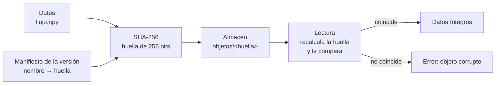

# B14-C11 — Control de versiones de datos

<!-- nav:top -->
[🏠 Programa](../../../../README.md) · [📚 Bloque B14](../../../tronco-comun/B14-computacion-cientifica-y-ciencia-abierta.md) · [← Anterior: B14-C10 — Pruebas de regresión numérica](../B14-C10-pruebas-de-regresion-numerica/CLASE.md) · [Siguiente: B14-C12 — Ejecución reproducible con uv →](../B14-C12-ejecucion-reproducible-con-uv/CLASE.md)
<!-- /nav -->

## 1. Ubicación, nivel y alcance

Undécima clase del bloque B14. Las pruebas de regresión de [C10](../B14-C10-pruebas-de-regresion-numerica/CLASE.md) comparan contra una referencia; ahora te preguntas **cuál versión de los datos** produjo esa referencia y cómo se demuestra que no cambió. Es el mismo problema que el código resuelve con Git, aplicado a archivos grandes. Nivel N2.

Verás sumas de verificación (SHA-256), almacenes direccionados por contenido, manifiestos como versiones, detección de corrupción y de cambios mínimos, y cómo herramientas como DVC aplican la idea. No verás criptografía, firma digital ni almacenamiento en la nube en detalle (B14-C19, C16).

## 2. Por qué esta clase existe

Un análisis usó «la tabla de catálogo de octubre». En noviembre alguien reemplazó el archivo por otro con el mismo nombre. Los resultados cambian y nadie sabe por qué. La pregunta motivadora es: **¿cómo identifico los datos de forma que dos personas sepan, sin discutir, si tienen exactamente los mismos bytes?**

La decisión central es: **¿qué identifica una versión de los datos: un nombre, una fecha o su contenido?** Solo el contenido es inequívoco: un nombre puede apuntar a archivos distintos, y una fecha puede ser la de copia, no la de creación.

## 3. Lo que podrás hacer al terminar

1. Calcular y comprobar la suma de verificación SHA-256 de un archivo contra un vector de prueba oficial.
2. Explicar el direccionamiento por contenido y por qué deduplica automáticamente.
3. Construir un manifiesto que asigne nombres lógicos a hashes y usarlo como versión.
4. Detectar la corrupción de un solo bit y la modificación de un único valor.
5. Explicar qué guarda Git y qué guarda una herramienta como DVC (metadatos frente a datos).
6. Decidir qué datos se versionan por contenido y cuáles se regeneran desde un script.

La evidencia es el **historial de datos con verificación** del ejercicio 12 (sección 20).

## 4. Con qué llegas y cómo comprobarlo

Necesitas C06–C07 (archivos), C09–C10 (repetir y comparar) y nociones de bytes y hexadecimal. Cinco preguntas:

1. ¿Cuántos bytes ocupan 1000 números de 64 bits? (8000.)
2. ¿Cuántos bits tiene un resumen de 64 dígitos hexadecimales? (256.)
3. ¿Qué es un bit y qué significa «invertir un bit»?
4. ¿Qué diferencia hay entre dos archivos con el mismo nombre y dos con el mismo contenido?
5. ¿Qué es un metadato?

<details>
<summary>Ver respuestas</summary>

1. `1000 × 8`. 2. `64 × 4`. 3. Un dígito binario; invertirlo es pasar de 0 a 1 o de 1 a 0. 4. El nombre no determina el contenido, el contenido sí. 5. Un dato sobre otro dato (unidad, procedencia, fecha).
</details>

Con cuatro o cinco aciertos, sigue; con tres o menos, repasa C06 y C07.

## 5. Un caso real: el vector de prueba del NIST y cómo lo hace DVC

El NIST publica ejemplos de valores para sus algoritmos (S1); el de SHA-256 con el mensaje de tres caracteres `abc` comienza con los valores iniciales de hash `H[0] = 6A09E667`, … y termina con el resumen cuyos primeros bloques son `BA7816BF 8F01CFEA 414140DE 5DAE2223 B00361A3 96177A9C B410FF61 F20015AD`. Leí el texto del PDF y comprobé en su suma final los cuatro primeros bloques (`H[0]` a `H[3]`); los cuatro últimos los da el mismo documento y los comprueba el laboratorio con la cadena completa. Una implementación que no reproduzca ese vector no es SHA-256.

La documentación de DVC (S2) describe el mismo principio aplicado a datos: `dvc add` mueve el archivo a una caché cuya ruta depende de su hash (MD5, según esa documentación), escribe un pequeño archivo `.dvc` con el hash y la ruta, y ese archivo —no los datos— lo versiona Git. Cada commit de un `.dvc` apunta a una versión concreta de los datos; `dvc push` copia la caché a un remoto con la misma estructura y `dvc pull` baja lo que falta. El **ejemplo conductor** es un arreglo sintético de 1000 flujos relativos con una versión 2 que cambia un único valor.

## 6. Vocabulario

Una **suma de verificación** (*checksum*) es un número calculado a partir de los bytes de un archivo. Una **función de hash criptográfica** como SHA-256 convierte cualquier secuencia de bytes en un resumen de 256 bits; cambiar un solo bit del mensaje cambia el resumen por completo. El **direccionamiento por contenido** guarda cada objeto bajo su hash: el nombre *es* el contenido. La **deduplicación** guarda una sola vez el contenido idéntico. Un **manifiesto** es una lista que asigna nombres lógicos (`flujo.npy`) a hashes. Una **versión** es un manifiesto fijado. La **corrupción** es una alteración involuntaria de los bytes. El **efecto avalancha** es la propiedad por la que un cambio mínimo del mensaje altera, en promedio, la mitad de los bits del resumen. Un **remoto** es un almacén compartido de objetos.

## 7. Modelo mental: el nombre de un objeto es su huella

En Git, DVC y en el laboratorio de esta clase, un objeto se guarda bajo su huella. Una versión no contiene datos: contiene una lista de huellas. Para recuperar una versión, se pide cada huella al almacén y se comprueba que los bytes recibidos tienen esa huella.



*Descripción textual:* los datos pasan por SHA-256 y se guardan en el almacén bajo su huella. Una versión es un manifiesto que lista nombre y huella. Al leer, se recalcula la huella y se compara: si coincide, los datos son íntegros; si no, se lanza un error de objeto corrupto.

**Analogía y su límite.** Una huella dactilar: identifica sin ambigüedad práctica y se compara en un instante. Límite: una huella no dice qué cambió ni cuánto; para eso hay que comparar los datos (el laboratorio localiza la posición cambiada leyendo ambos objetos).

## 8. La explicación, paso a paso

### 8.1 Verificar la implementación con un vector oficial

Antes de confiar en una suma, compruébala con un caso publicado. El laboratorio calcula `SHA-256("abc")` y obtiene `ba7816bf8f01cfea414140de5dae2223b00361a396177a9cb410ff61f20015ad`, igual al de S1. Este es el mismo principio que la prueba contra una solución exacta de C01 y C03.

### 8.2 Almacén direccionado por contenido

Se insertan tres objetos: la versión 1, la versión 1 otra vez y la versión 2. Resultado: dos objetos en el almacén (`5bd531f1…` y `81b80681…`). El contenido repetido no se guardó dos veces. La deduplicación es una consecuencia del diseño, no una función añadida.

### 8.3 Una versión mínima cambia por completo la huella

La versión 2 cambia el elemento 500 en `10⁻⁹`. Sus huellas difieren en 140 de 256 bits, en línea con lo esperado (alrededor de la mitad). El laboratorio mide además el efecto avalancha con 20 cambios de un bit: entre 103 y 144 bits distintos, con media 125,9 (cerca de 128). Esto significa que **dos huellas parecidas no indican datos parecidos**: la huella sirve para decidir igualdad, no similitud.

### 8.4 Manifiestos como versiones

Un manifiesto `{"flujo.npy": "5bd531f1…"}` es la versión 1; `{"flujo.npy": "81b80681…"}`, la versión 2. Guardar los manifiestos en Git (pequeños) y los datos en el almacén (grandes) es el diseño de DVC (S2). Con ambos manifiestos y el almacén, el laboratorio recupera las dos versiones exactamente y localiza la única posición que cambia: la 500.

### 8.5 Detectar la corrupción

Se invierte un solo bit del archivo almacenado (posición de byte 1234). La lectura recalcula la huella, no coincide, y se lanza `objeto corrupto`. Ningún bit alterado pasa inadvertido (con probabilidad prácticamente igual a 1, no con certeza matemática absoluta).

### 8.6 Qué versionar y qué regenerar

Versiona por contenido lo que **no puedes regenerar** (observaciones, descargas) o lo que cuesta mucho regenerar. Lo que sale de un script determinista y rápido se regenera, y se versiona el script y la huella esperada del resultado (C10). Un archivo versionado sin su procedencia no vale más que uno sin versionar.

## 9. Magnitudes, símbolos y unidades

| Símbolo | Qué es | Unidad | Nota |
|---|---|---|---|
| `x` | flujo relativo | adimensional | 1000 muestras, media 1,0, desviación 0,01 |
| `h` | huella SHA-256 | 256 bits (64 dígitos hexadecimales) | S1 |
| bits distintos | distancia de Hamming entre huellas | bits | ≈ 128 esperados |
| `v1`, `v2` | versiones de los datos | — | difieren en la posición 500 |
| bytes | tamaño del archivo | B | `1000 × 8 = 8000` |

## 10. Convenciones y referencias

Datos **sintéticos** (semilla 20261105). Convención del laboratorio: SHA-256 en hexadecimal en minúsculas; objetos guardados en `objetos/<huella>`; versión = manifiesto en JSON. DVC usa MD5 según su documentación (S2); la elección de SHA-256 aquí es de esta clase. La propiedad de «≈ 128 bits de diferencia» es una expectativa estadística que medimos, no una cifra de una fuente.

## 11. De dónde sale lo que afirmamos

| ID | Fuente | Localizador | Respalda | Estado |
|---|---|---|---|---|
| S1 | NIST, *Cryptographic Standards and Guidelines: Example Values*, ejemplo de SHA-256 (mensaje «abc») | https://csrc.nist.gov/CSRC/media/Projects/Cryptographic-Standards-and-Guidelines/documents/examples/SHA256.pdf | Valores iniciales de hash y suma final `BA7816BF…20015AD` para «abc» | Texto del PDF extraído y leído el 2026-11-05 (primera página y los cuatro primeros bloques de la suma final) |
| S2 | DVC, documentación de inicio (*Get Started*) | https://doc.dvc.org/start | Archivos `.dvc`, caché por hash (MD5), Git versiona los `.dvc` y no los datos, `dvc checkout`, `dvc push/pull` | Página consultada el 2026-11-05 (mutable) |

Límites: no leí el estándar FIPS 180-4 ni la documentación de Git; lo que digo de Git es el principio general que el laboratorio reproduce, no una cita. El efecto avalancha y su valor medio se miden aquí; no los atribuyo a una fuente. La página del NIST indica que su lista de ejemplos puede no reflejar todos los algoritmos aprobados.

## 12. Cómo ver el resultado

Versión accesible de las mediciones del laboratorio.

| Comprobación | Resultado |
|---|---|
| `SHA-256("abc")` | coincide con S1 |
| Objetos tras insertar v1, v1, v2 | 2 |
| Bits distintos entre v1 y v2 | 140 de 256 |
| Posiciones que cambian entre v1 y v2 | [500] |
| Corrupción de 1 bit | detectada |
| Avalancha (20 cambios de 1 bit) | mín 103, media 125,9, máx 144 |

## 13. Ejemplo trabajado: versionar y auditar los flujos

1. Verifica la implementación de SHA-256 con el vector de S1.
2. Genera `v1` (1000 flujos) y `v2 = v1` con el elemento 500 sumado `10⁻⁹`.
3. Guarda ambos en el almacén: dos objetos, tres inserciones.
4. Escribe dos manifiestos (v1, v2) en JSON.
5. Recupera cada versión a partir de su manifiesto y comprueba que los bytes coinciden con los originales.
6. Localiza la diferencia: solo la posición 500.
7. Invierte un bit del archivo de v1 en el almacén y lee: `objeto corrupto`.

**Paso final · incertidumbre.** La huella demuestra igualdad de bytes, no corrección de datos: una tabla errónea tiene una huella perfectamente estable. Tampoco protege frente a quien modifique a la vez el dato y el manifiesto (hace falta firma o un registro confiable, B14-C19).

## 14. Comparación: copias con fecha, Git, DVC y almacén propio

**Copias con fecha en el nombre** (`catalogo_2026-10.fits`) son simples y frágiles: nada impide que dos archivos con la misma fecha difieran. **Git** versiona bien texto pequeño y mal archivos binarios grandes. **DVC** y herramientas parecidas guardan los datos aparte y versionan su huella con Git (S2). Un **almacén propio** como el del laboratorio sirve para entender el principio y para casos mínimos; en un proyecto real conviene una herramienta mantenida.

## 15. Práctica guiada

**Ejercicio 1 · con los pasos.** Calcula cuántos bits distintos esperas, en promedio, entre las huellas SHA-256 de dos mensajes que difieren en un bit. *Pasos:* la mitad de 256 (sección 8.3).

<details><summary>Solución comentada</summary>

128 en promedio. El laboratorio dio una media de 125,9 en 20 casos, con valores entre 103 y 144: coherente con 128 más dispersión.
</details>

**Ejercicio 2 · con una pista.** Si dos archivos tienen la misma huella, ¿qué concluyes? Si tienen huellas distintas, ¿qué concluyes? *Pista:* igualdad frente a similitud.

<details><summary>Solución comentada</summary>

Misma huella: son idénticos (con probabilidad prácticamente 1). Huellas distintas: difieren en algún bit, sin que la huella diga cuánto. Dos huellas parecidas no implican datos parecidos.
</details>

**Ejercicio 3 · casi autónomo.** ¿Por qué insertar dos veces el mismo contenido no crea dos objetos?

<details><summary>Solución comentada</summary>

Porque el nombre del objeto es su huella, y el mismo contenido da la misma huella: la segunda inserción encuentra el objeto ya existente (sección 8.2).
</details>

## 16. Práctica autónoma, transferencia e integrador

**Ejercicio 4.** Cuántos objetos hay en el almacén tras insertar `A`, `B`, `A`, `C`, `B`.

<details><summary>Solución comentada</summary>

Tres (`A`, `B`, `C`), si los contenidos son distintos entre sí. La deduplicación elimina las repeticiones.
</details>

**Ejercicio 5.** ¿Qué tamaño ocupa en hexadecimal una huella SHA-256 y cuántos bits aporta cada dígito?

<details><summary>Solución comentada</summary>

64 dígitos hexadecimales; cada dígito aporta 4 bits (`64 × 4 = 256`).
</details>

**Ejercicio 6.** Dos laboratorios tienen «catalogo.fits» de 41 MB y dudan si es el mismo. ¿Qué intercambian y qué comparan?

<details><summary>Solución comentada</summary>

Intercambian solo la huella (64 caracteres) y la comparan; no hace falta enviar 41 MB. Si coincide, son el mismo archivo; si no, difieren.
</details>

**Ejercicio 7.** Un archivo versionado cambia su huella tras abrirse y guardarse con otra herramienta, sin cambiar los números. Explica por qué puede ocurrir.

<details><summary>Solución comentada</summary>

La huella es sobre bytes, no sobre significado: cambios en el encabezado, la codificación, el orden de metadatos o un redondeo al reescribir alteran los bytes aunque los números sean los mismos. Por eso se conserva el original o se versiona el resultado del proceso.
</details>

**Ejercicio 8.** ¿Qué diferencia hay entre lo que versiona Git y lo que versiona DVC, según S2?

<details><summary>Solución comentada</summary>

Git versiona los pequeños archivos `.dvc` (hash y ruta); DVC mueve los datos a una caché por hash y los sincroniza con un remoto. Git no guarda los datos (S2).
</details>

**Ejercicio 9 · transferencia.** Recibes un archivo con una huella que no coincide con la publicada. ¿Qué haces?

<details><summary>Solución comentada</summary>

No lo usas todavía. Descartas una descarga incompleta (vuelves a bajarlo), revisas si la huella publicada corresponde a otra versión o a otro algoritmo, y si persiste la diferencia, avisas al responsable. Un archivo con huella distinta no debe entrar en un análisis.
</details>

**Ejercicio 10 · transferencia.** Un archivo de 10 GB cambia un píxel. ¿Cuánto espacio extra necesita un almacén por contenido de objeto completo y qué alternativa existe?

<details><summary>Solución comentada</summary>

Otros 10 GB (objeto completo). Alternativas: dividir en fragmentos con huella propia (solo cambia uno), o versionar el *script* que regenera el archivo. Es un compromiso entre simplicidad y espacio.
</details>

**Ejercicio 11 · transferencia.** Quieres que un lector verifique que usó tus mismos datos al repetir tu análisis. ¿Qué publicas junto a los resultados?

<details><summary>Solución comentada</summary>

La huella de cada archivo de entrada (en un manifiesto), el algoritmo, el nombre y la versión de cada archivo, y las instrucciones para descargarlos. Con eso, cualquiera comprueba que tiene los mismos bytes.
</details>

**Ejercicio 12 · integrador.** Entrega un **historial de datos con verificación** para un conjunto sintético propio: tres versiones con manifiestos, verificación de la implementación con un vector oficial, detección de un cambio de un valor y de un bit corrupto, deduplicación demostrada y una nota sobre qué no protege.

<details><summary>Solución modelo</summary>

Debe incluir el vector de prueba, los tres manifiestos con huellas completas, la tabla de comprobaciones como la de la sección 12, la posición exacta del cambio y una discusión que reconozca que la huella no prueba corrección ni protege de manipular también el manifiesto. Se acepta cualquier conjunto sintético.
</details>

## 17. Laboratorio

El script [versiones_de_datos.py](versiones_de_datos.py) implementa un almacén direccionado por contenido con SHA-256, comprueba el vector de prueba del NIST, inserta dos versiones y un duplicado, usa manifiestos como versiones, localiza el cambio, detecta la corrupción de un bit y mide el efecto avalancha.

**Datos:** sintéticos (semilla 20261105). **Predice antes de ejecutar:** ¿cuántos objetos habrá tras tres inserciones? (2.) **Ejecución del 2026-11-05 (Python 3.12.9, NumPy 2.5.4):**

```text
SHA-256('abc') = ba7816bf8f01cfea414140de5dae2223b00361a396177a9cb410ff61f20015ad  (coincide con el ejemplo del NIST)
v1 = 5bd531f114c04340...  v1 repetido = 5bd531f114c04340...  v2 = 81b806815fa6cea8...
objetos en el almacén tras 3 inserciones: 2 (contenido repetido deduplicado)
bits distintos entre los hashes de v1 y v2 (de 256): 140
posiciones que cambian entre v1 y v2: [500]
corrupción de 1 bit detectada: objeto corrupto: 5bd531f114c0...
avalancha: bits distintos en 20 cambios de 1 bit: mín 103, media 125.9, máx 144 (de 256)
Pruebas superadas.
```

```bash
python programa/clases/B14/B14-C11-control-de-versiones-de-datos/versiones_de_datos.py
```

**Límites:** un solo equipo, sin remoto ni atacante; la prueba usa un vector de la familia SHA-256 publicado por el NIST y la biblioteca `hashlib` de Python.

## 18. Errores frecuentes y cómo corregirlos

**Identificar los datos por el nombre o la fecha.** Se corrige con el ejercicio 6.

**Creer que huellas parecidas implican datos parecidos.** Se corrige con el ejercicio 2.

**Confiar en una descarga sin verificar la huella.** Se corrige con el ejercicio 9.

**Pensar que la huella prueba corrección.** Se corrige con la sección 13.

**Versionar sin procedencia.** Se corrige con el ejercicio 11.

## 19. Cómo sabrás que vas bien

Tras 8.1: ¿verificas tu implementación con un vector oficial? Si no, repite 8.1. Tras 8.3: ¿explicas la avalancha? Si no, rehaz el ejercicio 1. Tras el ejemplo trabajado: ¿qué detecta la huella y qué no? Tras el laboratorio: ¿qué pasa si el atacante cambia también el manifiesto? Al final: ¿qué datos de tu proyecto no se pueden regenerar?

## 20. Qué entregas y cómo se evalúa

El producto es tu **historial de datos con verificación** del ejercicio 12.

| Criterio | Inicial | En desarrollo | Logrado | Destacado |
|---|---|---|---|---|
| Identificación | Por nombre | Por fecha | Por huella | Con manifiesto por versión |
| Verificación | Sin prueba | Compara a ojo | Vector oficial y corrupción | Y localización del cambio |
| Alcance | Cree que protege todo | Menciona límites | Declara qué no protege | Propone mitigaciones |
| Fuentes y alcance | Sin fuente | Fuente sin alcance | Fuente con alcance | Distingue lo medido de lo citado |

**Condiciones críticas:** no presentar una huella como prueba de corrección; no usar una descarga sin verificar su huella; no atribuir a una fuente lo que se midió.

## 21. Ética, seguridad y límites

Una huella no protege la privacidad: los datos sensibles siguen siendo sensibles aunque se publiquen solo sus huellas (se pueden adivinar contenidos pequeños probando candidatos). Respeta las licencias de los datos que versionas. SHA-256 es adecuada para integridad; no es una firma. Accesibilidad: resultados en tabla. Material educativo.

## 22. Para cerrar y seguir

Una versión de datos se identifica por su contenido: la huella SHA-256 decide igualdad, un manifiesto fija una versión, y la lectura que recalcula la huella detecta cualquier corrupción. Eso no prueba que los datos sean correctos. Queda abierta una pregunta: ¿cómo demuestras que el manifiesto mismo no fue alterado?

**Glosario español–inglés.** suma de verificación · *checksum*; función de hash · *hash function*; direccionamiento por contenido · *content addressing*; deduplicación · *deduplication*; manifiesto · *manifest*; corrupción · *corruption*; efecto avalancha · *avalanche effect*; remoto · *remote*.

**Continuidad.** B14-C12 fija las versiones del software con el mismo principio (el archivo de bloqueo guarda sumas de verificación); B14-C17 hace lo propio con el entorno completo; B14-C19 trata la publicación con identificadores persistentes y firmas.

**Referencias:** ver sección 11.

<!-- nav:bottom -->
---

[← Anterior: B14-C10 — Pruebas de regresión numérica](../B14-C10-pruebas-de-regresion-numerica/CLASE.md) · [📚 Bloque B14](../../../tronco-comun/B14-computacion-cientifica-y-ciencia-abierta.md) · [Siguiente: B14-C12 — Ejecución reproducible con uv →](../B14-C12-ejecucion-reproducible-con-uv/CLASE.md)
<!-- /nav -->
