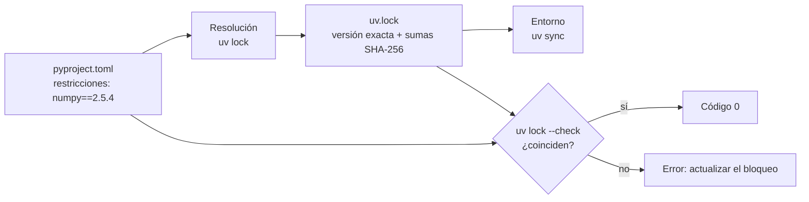

# B14-C12 — Ejecución reproducible con uv

<!-- nav:top -->
[🏠 Programa](../../../../README.md) · [📚 Bloque B14](../../../tronco-comun/B14-computacion-cientifica-y-ciencia-abierta.md) · [← Anterior: B14-C11 — Control de versiones de datos](../B14-C11-control-de-versiones-de-datos/CLASE.md) · [Siguiente: B14-C13 — Computación paralela →](../B14-C13-computacion-paralela/CLASE.md)
<!-- /nav -->

## 1. Ubicación, nivel y alcance

Duodécima clase del bloque B14, y última del tramo de reproducibilidad. En [C09](../B14-C09-jupyter-y-experimentos-reproducibles/CLASE.md) repetiste un cuaderno, en [C10](../B14-C10-pruebas-de-regresion-numerica/CLASE.md) detectaste cambios numéricos y en [C11](../B14-C11-control-de-versiones-de-datos/CLASE.md) fijaste los datos. Falta fijar **el software**: qué versión de Python y de cada biblioteca produjo el resultado. Nivel N2.

Verás un proyecto con `pyproject.toml`, un archivo de bloqueo (`uv.lock`) con versiones exactas y sumas de verificación, el criterio `uv lock --check`, y la «huella» del entorno. No verás empaquetado ni publicación (B14-C19), contenedores (B14-C17) ni la instalación de uv.

## 2. Por qué esta clase existe

Tu análisis dio un período de 5553,624562 s en 2026. Un colega lo ejecuta con otra versión de SciPy y obtiene un cierre distinto; otro usa Python más antiguo y falla al importar. «En mi máquina funciona» no es un resultado científico. La pregunta motivadora es: **¿cómo declaro, de forma que una máquina pueda verificarlo, exactamente qué software usé?**

La decisión central es: **¿qué se fija —versiones aproximadas o exactas— y dónde se guarda?** Una restricción como `numpy>=2` admite muchas versiones; un archivo de bloqueo registra la que se resolvió.

## 3. Lo que podrás hacer al terminar

1. Distinguir la declaración de dependencias (`pyproject.toml`) del bloqueo (`uv.lock`).
2. Explicar qué contiene un archivo de bloqueo (versión, origen y sumas SHA-256) y por qué se versiona.
3. Comprobar que el bloqueo coincide con el proyecto sin modificarlo.
4. Predecir cuándo un cambio de dependencia invalida el bloqueo.
5. Registrar la huella del entorno (Python, plataforma y bibliotecas) junto a un resultado.
6. Reconocer lo que este mecanismo no reproduce (el sistema operativo, el hardware, las bibliotecas del sistema).

La evidencia es el **entorno recreable** del ejercicio 12 (sección 20).

## 4. Con qué llegas y cómo comprobarlo

Necesitas C09–C11 y usar un terminal. Cinco preguntas:

1. ¿Qué es una dependencia de un programa?
2. ¿Qué diferencia hay entre `numpy>=2` y `numpy==2.5.4`?
3. ¿Qué es una versión semántica (`mayor.menor.parche`)?
4. ¿Qué es un entorno virtual de Python?
5. ¿Qué es una suma de verificación y para qué sirve aquí? (C11.)

<details>
<summary>Ver respuestas</summary>

1. Una biblioteca externa que el programa necesita. 2. La primera admite 2.0, 2.4, 2.5.4…; la segunda, solo 2.5.4. 3. Un esquema de numeración en el que los cambios mayores incompatibles incrementan el primer número. 4. Un directorio aislado con su propio intérprete y paquetes. 5. Un resumen de bytes que permite comprobar que un archivo es el esperado.
</details>

Con cuatro o cinco aciertos, sigue; con tres o menos, repasa C11.

## 5. Un caso real: lo que dice la documentación de uv

La documentación de uv sobre la estructura de un proyecto (S1) indica que un proyecto tiene un `pyproject.toml` (metadatos, versión de Python requerida, dependencias), un `uv.lock` creado junto a él, y un entorno `.venv` que no debe versionarse. El `uv.lock` registra las **versiones exactas** resueltas, es un bloqueo **universal** (cubre sistemas operativos, arquitecturas y versiones de Python) y se debe versionar para que las instalaciones sean consistentes; es TOML legible, pero lo gestiona uv y no se edita a mano. Sobre la sincronización (S2): `--locked` hace que uv falle si el bloqueo no está al día en vez de actualizarlo; `--frozen` usa el bloqueo existente sin comprobar si coincide con el proyecto; y `uv lock --check` comprueba si el bloqueo coincide con los metadatos del proyecto sin modificarlo, el equivalente de `--locked` para `uv lock`.

El **ejemplo conductor** es un proyecto mínimo y sintético, `demo-repro`, con una única dependencia fijada: `numpy==2.5.4`. Vemos qué escribe uv en el bloqueo y qué ocurre al cambiar la dependencia.

## 6. Vocabulario

Un **proyecto** es un directorio con un `pyproject.toml`. Un **resolutor** elige versiones de todas las dependencias (directas e indirectas) que sean compatibles entre sí. Un **archivo de bloqueo** (*lockfile*) registra el resultado de esa resolución. Un **bloqueo universal** vale para varias plataformas a la vez. Una **rueda** (*wheel*) es un paquete ya compilado para una plataforma; una **distribución fuente** (*sdist*) es el código sin compilar. La **huella del entorno** es el registro de las versiones de Python, plataforma y bibliotecas con que se ejecutó un análisis. **Fijar** una versión es exigir exactamente esa. **Hash** es la suma de verificación (C11) de cada archivo descargable.

## 7. Modelo mental: dos archivos, dos preguntas

`pyproject.toml` responde «¿qué necesita mi proyecto?» con restricciones. `uv.lock` responde «¿qué se instaló exactamente la última vez que lo resolvimos?» con versiones y sumas. La verificación compara ambos: si el proyecto cambió y el bloqueo no, hay una incoherencia.



*Descripción textual:* las restricciones del `pyproject.toml` entran a la resolución, que produce `uv.lock` con versiones exactas y sumas SHA-256; con él se crea el entorno. En paralelo, `uv lock --check` compara ambos archivos: si coinciden termina con código 0; si no, falla pidiendo actualizar el bloqueo.

**Analogía y su límite.** Una receta (restricciones) y la lista de la compra del día (bloqueo, con marca y lote de cada ingrediente). Límite: la lista fija los ingredientes, no el horno ni la cocina; el bloqueo fija las bibliotecas de Python, no el sistema operativo ni el hardware.

## 8. La explicación, paso a paso

### 8.1 Declarar

El proyecto del laboratorio declara en `pyproject.toml`: nombre, versión, `requires-python = ">=3.12"` y `dependencies = ["numpy==2.5.4"]`. Esta declaración dice qué se necesita, no qué se instaló.

### 8.2 Bloquear

`uv lock` resuelve y escribe `uv.lock`. En el laboratorio: «Resolved 2 packages» (el proyecto mismo y NumPy). El archivo contiene `version = 1`, `revision = 5`, `requires-python = ">=3.12"`, los dos paquetes y, para NumPy, la versión exacta 2.5.4 y **66 sumas SHA-256** (la distribución fuente y las ruedas de cada plataforma, de acuerdo con la naturaleza universal del bloqueo en S1). Esas sumas son las mismas de C11: si alguien sustituyera un archivo por otro, la instalación fallaría.

### 8.3 Verificar sin modificar

`uv lock --check` con el proyecto sin cambios termina con código 0. Y comprobamos lo que dice S2: no modifica `uv.lock` (los bytes del archivo son idénticos antes y después).

### 8.4 Un cambio de dependencia invalida el bloqueo

Cambiamos `numpy==2.5.4` por `numpy==2.4.4` y repetimos `uv lock --check`: termina con código 1 y el mensaje «The lockfile at `uv.lock` needs to be updated, but `--check` was provided.» Esa es la detección: la declaración y el bloqueo ya no coinciden. En una canalización de revisión, este comando evita que alguien cambie una dependencia sin regenerar el bloqueo.

### 8.5 La huella del entorno

Aunque uv gestione las versiones, conviene que cada resultado lleve su huella: el laboratorio la obtiene con `importlib.metadata` y registra Python 3.12.9, plataforma Windows, NumPy 2.5.4, SciPy 1.18.1 y Astropy 8.0.2. Una huella pegada junto a un resultado permite entender, meses después, por qué no coincide con otro.

### 8.6 Qué no se reproduce

El bloqueo fija paquetes de Python. No fija el sistema operativo, las bibliotecas del sistema (por ejemplo, las de álgebra lineal con que se compiló un paquete), el hardware ni el reloj. Dos máquinas con el mismo bloqueo pueden diferir en el último dígito (C10). Para fijar el sistema completo se usan contenedores (C17), con sus propios límites.

## 9. Magnitudes, símbolos y unidades

| Símbolo | Qué es | Unidad | Nota |
|---|---|---|---|
| `requires-python` | versiones de Python admitidas | texto (`>=3.12`) | declarado en `pyproject.toml` |
| `numpy==2.5.4` | dependencia fijada | versión | restricción exacta |
| `version`, `revision` | formato del bloqueo | enteros | 1 y 5 en el laboratorio |
| hashes | sumas SHA-256 del bloqueo | 64 dígitos hexadecimales | 66 en el laboratorio |
| código de salida | resultado de `--check` | entero | 0 coincide; 1 no |

## 10. Convenciones y referencias

El proyecto es **sintético** y mínimo; los resultados de resolución (número de sumas, `revision`) dependen de la versión de uv y del estado del índice en la fecha de ejecución (uv 0.13.7, 2026-11-05). Convención del laboratorio: si no hay uv o no hay red, la parte de bloqueo se declara **omitida** y el script termina con código 2; no se da por aprobada.

## 11. De dónde sale lo que afirmamos

| ID | Fuente | Localizador | Respalda | Estado |
|---|---|---|---|---|
| S1 | uv, *Project structure* (conceptos de proyectos) | https://docs.astral.sh/uv/concepts/projects/layout/ | `pyproject.toml`, `uv.lock` (versiones exactas, universal, se versiona, no se edita a mano), `.venv` sin versionar, `uv sync`, `uv run`, `uv lock` | Página consultada el 2026-11-05 (mutable) |
| S2 | uv, *Locking and syncing* (conceptos de proyectos) | https://docs.astral.sh/uv/concepts/projects/sync/ | `--locked`, `--frozen`, `uv lock --check` | Página consultada el 2026-11-05 (mutable) |

Límites: el título exacto de S1 y S2 no se verificó; el comportamiento del código de salida (0 y 1) y el mensaje de error se observaron en el laboratorio, no en la documentación (S1 no describe `--check` y S2 solo lo resume). No consulté la documentación del estándar `pyproject.toml` (PEP 621) ni la de `importlib.metadata`.

## 12. Cómo ver el resultado

Versión accesible de las comprobaciones del laboratorio.

| Comprobación | Resultado |
|---|---|
| `uv lock` | «Resolved 2 packages» |
| `numpy` en `uv.lock` | 2.5.4 |
| Sumas SHA-256 en el bloqueo | 66 |
| `uv lock --check` sin cambios | código 0 |
| `uv lock --check` tras cambiar a `numpy==2.4.4` | código 1 («needs to be updated») |
| `uv.lock` tras `--check` | sin modificar |

## 13. Ejemplo trabajado: bloquear, verificar y romper a propósito

1. Escribe un `pyproject.toml` con `numpy==2.5.4`.
2. Ejecuta `uv lock`: se crea `uv.lock` con NumPy 2.5.4 y 66 sumas.
3. Ejecuta `uv lock --check`: código 0.
4. Cambia la dependencia a `numpy==2.4.4` sin regenerar el bloqueo.
5. Ejecuta `uv lock --check`: código 1.
6. Comprueba que el archivo no se tocó: los bytes son idénticos.
7. Regenera con `uv lock` cuando el cambio es intencional, y versiona ambos archivos juntos.
8. Registra la huella del entorno junto al resultado del análisis.

**Paso final · incertidumbre.** El resultado de resolución depende del índice en esa fecha: un mes después, una restricción más laxa (`numpy>=2`) podría resolverse a otra versión; con `==` y bloqueo, no. Y que el bloqueo coincida no garantiza que dos máquinas den el mismo último dígito.

## 14. Comparación: restricciones, archivo de bloqueo y contenedor

Solo **restricciones** (`numpy>=2`) son cómodas y no reproducibles. Un **bloqueo** fija versiones y sumas de los paquetes de Python: reproducible para la parte de Python, barato y legible. Un **contenedor** (C17) fija también el sistema; más completo y más pesado. Para un proyecto científico, el bloqueo es el mínimo; el contenedor, cuando el sistema importa.

## 15. Práctica guiada

**Ejercicio 1 · con los pasos.** ¿Qué admite `numpy>=2,<3`? ¿Y `numpy==2.5.4`? *Pasos:* escribe el rango (sección 8.1).

<details><summary>Solución comentada</summary>

La primera, cualquier 2.x; la segunda, solo 2.5.4. Con la primera, el resultado depende de cuándo y dónde se resuelva, salvo que haya bloqueo.
</details>

**Ejercicio 2 · con una pista.** Si cambias `pyproject.toml` y ejecutas `uv lock --check`, ¿qué código esperas? *Pista:* ¿coinciden ambos archivos?

<details><summary>Solución comentada</summary>

Distinto de 0 (en el laboratorio, 1) si el cambio afecta a lo que el bloqueo registra; el archivo no se modifica.
</details>

**Ejercicio 3 · casi autónomo.** ¿Por qué se versiona `uv.lock` pero no `.venv`?

<details><summary>Solución comentada</summary>

`uv.lock` es pequeño, legible y determina el entorno; `.venv` es grande, específico de la máquina y se regenera desde el bloqueo (S1).
</details>

## 16. Práctica autónoma, transferencia e integrador

**Ejercicio 4.** ¿Qué función cumplen las sumas SHA-256 del bloqueo? Relaciónalo con C11.

<details><summary>Solución comentada</summary>

Verifican que cada archivo descargado es el esperado: si el índice o la red entregan otro archivo, la suma no coincide y la instalación falla. Es el mismo principio de la verificación de integridad de C11.
</details>

**Ejercicio 5.** El laboratorio imprime 66 sumas para una sola dependencia. ¿Por qué tantas?

<details><summary>Solución comentada</summary>

Hay una por cada archivo descargable: la distribución fuente y una rueda por plataforma, versión de Python y arquitectura. Es la forma en que un bloqueo universal sirve a varias máquinas (S1).
</details>

**Ejercicio 6.** Un colega usa `uv sync --frozen` y el bloqueo está desactualizado. ¿Qué ocurre y qué recomendarías?

<details><summary>Solución comentada</summary>

Según S2, `--frozen` usa el bloqueo existente sin comprobar si coincide con el proyecto: instalará lo que dice el bloqueo, aunque el proyecto haya cambiado. Se recomienda `--locked`, que falla si hay incoherencia.
</details>

**Ejercicio 7.** Propón una comprobación de revisión que impida cambiar una dependencia sin regenerar el bloqueo.

<details><summary>Solución comentada</summary>

Ejecutar `uv lock --check` en la integración continua: si falla, se rechaza el cambio hasta que se regenere y versione el bloqueo.
</details>

**Ejercicio 8.** Dos máquinas con el mismo bloqueo dan resultados distintos en el décimo dígito. ¿Qué puede explicarlo?

<details><summary>Solución comentada</summary>

Diferencias fuera del bloqueo: sistema operativo, bibliotecas numéricas del sistema, instrucciones del procesador, orden de operaciones en paralelo (C10, C13). Se estudia con pruebas de regresión con tolerancia justificada.
</details>

**Ejercicio 9 · transferencia.** Un artículo dice «análisis hecho con NumPy y SciPy». ¿Qué le falta para ser reproducible y qué añadirías?

<details><summary>Solución comentada</summary>

Versiones exactas de Python y de cada biblioteca, plataforma, y el archivo de bloqueo; también la versión de los datos (C11) y la semilla (C09). Sin eso, solo es repetible por quien tenga suerte.
</details>

**Ejercicio 10 · transferencia.** Debes reproducir un análisis de hace tres años con un bloqueo que incluye una biblioteca ya retirada del índice. ¿Qué haces?

<details><summary>Solución comentada</summary>

Buscas la versión en archivos o espejos y verificas su suma SHA-256 contra la del bloqueo; si no existe, lo registras como limitación y compruebas qué resultados resisten una versión cercana con una prueba de regresión (C10).
</details>

**Ejercicio 11 · transferencia.** Quieres que un lector ejecute tu proyecto con un solo comando. ¿Qué incluyes en el repositorio?

<details><summary>Solución comentada</summary>

`pyproject.toml`, `uv.lock`, el código, los datos o instrucciones para obtenerlos con su huella, y un `README` con el comando (por ejemplo, `uv run` con el script). No incluyes `.venv`.
</details>

**Ejercicio 12 · integrador.** Entrega un **entorno recreable**: un proyecto mínimo con dependencias fijadas, su bloqueo, la verificación con `--check` (aprobada y fallida a propósito), la huella del entorno y una nota sobre lo que no reproduce.

<details><summary>Solución modelo</summary>

Debe incluir `pyproject.toml`, `uv.lock` (o la salida equivalente), la tabla de comprobaciones como la de la sección 12 con tus propios resultados, la huella (Python, plataforma, bibliotecas) y una discusión que mencione sistema operativo, hardware y bibliotecas del sistema. Se acepta cualquier proyecto sintético.
</details>

## 17. Laboratorio

El script [entorno_reproducible.py](entorno_reproducible.py) imprime la huella del entorno actual, crea en un directorio temporal un proyecto con `numpy==2.5.4`, ejecuta `uv lock`, lee `uv.lock` como TOML, cuenta sus sumas, ejecuta `uv lock --check` antes y después de cambiar la dependencia, y comprueba que `--check` no modifica el bloqueo. Necesita uv y acceso al índice de paquetes; sin ellos termina con código 2 y no declara aprobada la prueba.

**Datos:** ninguno científico; proyecto sintético. **Predice antes de ejecutar:** ¿qué código devolverá `--check` tras cambiar la dependencia? (distinto de 0.) **Ejecución del 2026-11-05 (Python 3.12.9, uv 0.13.7):**

```text
huella del entorno actual: {'python': '3.12.9', 'plataforma': 'Windows', 'numpy': '2.5.4', 'scipy': '1.18.1', 'astropy': '8.0.2'}
uv: uv 0.13.7 (316c827e0 2026-11-03 x86_64-pc-windows-msvc)
uv lock -> Resolved 2 packages in 135ms
uv.lock: version=1 revision=5 requires-python=>=3.12; paquetes: ['demo-repro', 'numpy']
sumas SHA-256 en el bloqueo: 66 (sdist + ruedas de cada plataforma)
uv lock --check con el proyecto sin cambios: código 0
uv lock --check tras cambiar la dependencia a numpy==2.4.4: código 1; mensaje: error: The lockfile at `uv.lock` needs to be updated, but `--check` was provided.
--check no modificó uv.lock
Pruebas superadas.
```

```bash
python programa/clases/B14/B14-C12-ejecucion-reproducible-con-uv/entorno_reproducible.py
```

**Límites:** requiere red; el número de sumas y la revisión del formato dependen de la versión de uv y del índice; el tiempo de resolución (135 ms) varía; no se ejecuta ni instala el proyecto.

## 18. Errores frecuentes y cómo corregirlos

**Declarar solo rangos.** Se corrige con el ejercicio 1.

**Editar `uv.lock` a mano o no versionarlo.** Se corrige con el ejercicio 3 y S1.

**Usar `--frozen` creyendo que valida.** Se corrige con el ejercicio 6.

**No registrar la huella con el resultado.** Se corrige con el ejercicio 9.

**Creer que el bloqueo fija el sistema.** Se corrige con el ejercicio 8 y la sección 8.6.

## 19. Cómo sabrás que vas bien

Tras 8.2: ¿explicas por qué hay tantas sumas? Si no, rehaz el ejercicio 5. Tras 8.4: ¿predices cuándo falla `--check`? Si no, rehaz el 2. Tras el ejemplo trabajado: ¿qué pasaría con `--frozen`? Tras el laboratorio: ¿qué parte de tu entorno no queda fijada? Al final: ¿cuánto de tu proyecto se recrea con un solo comando?

## 20. Qué entregas y cómo se evalúa

El producto es tu **entorno recreable** del ejercicio 12.

| Criterio | Inicial | En desarrollo | Logrado | Destacado |
|---|---|---|---|---|
| Declaración | Sin versiones | Rangos | Versiones fijadas | Con `requires-python` |
| Bloqueo | Ninguno | Generado sin versionar | Versionado y verificado | Con `--check` automatizado |
| Huella | No registra | Python solo | Python y bibliotecas | Plataforma incluida |
| Fuentes y alcance | Sin fuente | Fuente sin alcance | Fuente con alcance | Declara qué no reproduce |

**Condiciones críticas:** no afirmar reproducibilidad sin bloqueo; no editar el bloqueo a mano; no omitir lo que el bloqueo no cubre.

## 21. Ética, seguridad y límites

Instalar dependencias es ejecutar código de terceros: las sumas del bloqueo protegen contra sustituciones accidentales, no contra un paquete malicioso legítimamente publicado. Revisa las dependencias y sus licencias. Accesibilidad: pasos y resultados en tabla y texto. Material educativo.

## 22. Para cerrar y seguir

`pyproject.toml` declara lo que el proyecto necesita; `uv.lock` registra versiones exactas y sumas SHA-256; `uv lock --check` detecta la incoherencia sin modificar nada, y la huella del entorno acompaña cada resultado. Queda abierta una pregunta: ¿cómo fijas lo que el bloqueo no cubre, como el sistema operativo y las bibliotecas nativas?

**Glosario español–inglés.** archivo de bloqueo · *lockfile*; resolutor · *resolver*; rueda · *wheel*; distribución fuente · *source distribution (sdist)*; entorno virtual · *virtual environment*; huella del entorno · *environment fingerprint*; fijar una versión · *to pin a version*.

**Continuidad.** B14-C13 abre el tramo de rendimiento: el paralelismo introduce variaciones de orden que C10 ya mostró; B14-C17 trata los contenedores como siguiente nivel de fijación; B14-C20 integra todo en un proyecto reproducible.

**Referencias:** ver sección 11. S1 no describe `--check` y S2 lo resume.

<!-- nav:bottom -->
---

[← Anterior: B14-C11 — Control de versiones de datos](../B14-C11-control-de-versiones-de-datos/CLASE.md) · [📚 Bloque B14](../../../tronco-comun/B14-computacion-cientifica-y-ciencia-abierta.md) · [Siguiente: B14-C13 — Computación paralela →](../B14-C13-computacion-paralela/CLASE.md)
<!-- /nav -->
