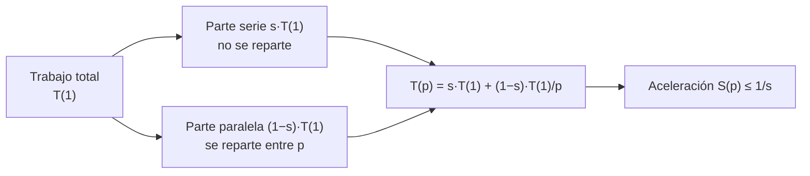

# B14-C13 — Computación paralela

<!-- nav:top -->
[🏠 Programa](../../../../README.md) · [📚 Bloque B14](../../../tronco-comun/B14-computacion-cientifica-y-ciencia-abierta.md) · [← Anterior: B14-C12 — Ejecución reproducible con uv](../B14-C12-ejecucion-reproducible-con-uv/CLASE.md) · [Siguiente: B14-C14 — Vectorización y rendimiento →](../B14-C14-vectorizacion-y-rendimiento/CLASE.md)
<!-- /nav -->

## 1. Ubicación, nivel y alcance

Decimotercera clase del bloque B14 y primera del tramo de rendimiento y escala. Con [C12](../B14-C12-ejecucion-reproducible-con-uv/CLASE.md) fijaste el entorno; ahora repartes un cálculo entre varios procesos de un mismo equipo y aprendes a **medir** si valió la pena. Nivel N2.

Verás procesos frente a hilos, reparto de trabajo con `multiprocessing.Pool`, la ley de Amdahl, la eficiencia y por qué una tarea pequeña se vuelve más lenta al paralelizarla. No verás MPI ni clústeres (C16), GPU (C15) ni hilos con memoria compartida en profundidad.

## 2. Por qué esta clase existe

Un análisis de miles de simulaciones tarda una noche. Tienes ocho núcleos. ¿Tardará una octava parte? Casi nunca. La pregunta motivadora es: **¿cuánto puedo ganar repartiendo el trabajo, y cómo compruebo que el resultado sigue siendo el mismo?**

La decisión central es: **¿qué parte del trabajo es independiente y qué parte no se puede repartir?** Esa fracción no repartible fija el techo de la aceleración, como muestra la ley de Amdahl.

## 3. Lo que podrás hacer al terminar

1. Distinguir procesos, hilos y reparto de datos, y decir cuándo conviene cada uno.
2. Repartir trozos independientes con un `Pool` de procesos y comprobar que el resultado es idéntico al serie.
3. Calcular aceleración y eficiencia a partir de tiempos medidos.
4. Aplicar la ley de Amdahl para predecir el techo y estimar la fracción serie.
5. Explicar por qué una tarea pequeña no se acelera (coste de creación y copia).
6. Hacer reproducible un cálculo paralelo con semillas por trozo.

La evidencia es la **medición de aceleración frente a la teórica** del ejercicio 12 (sección 20).

## 4. Con qué llegas y cómo comprobarlo

Necesitas C09–C10 (medir y comparar) y C02. Cinco preguntas:

1. ¿Qué es un proceso?
2. Si una tarea tarda 10 s y la repartes en 2 procesos sin pérdidas, ¿cuánto tarda? (5 s.)
3. ¿Qué es una semilla y por qué importa en paralelo? (C09)
4. ¿Qué significa «independientes» para dos trozos de cálculo?
5. ¿Por qué `a + b + c` puede dar otro resultado que `c + b + a` en coma flotante? (C10)

<details>
<summary>Ver respuestas</summary>

1. Un programa en ejecución con su propia memoria. 2. 5 s. 3. Fija la secuencia aleatoria; en paralelo cada trozo necesita la suya para que el resultado no dependa del reparto. 4. Ninguno necesita el resultado del otro. 5. La suma no es asociativa (C10).
</details>

Con cuatro o cinco aciertos, sigue; con tres o menos, repasa C09 y C10.

## 5. Un caso real: lo que dice la documentación de `multiprocessing`

La documentación de Python (S1) explica que `multiprocessing` ejecuta el trabajo en **procesos separados**, de modo que evita el bloqueo global del intérprete (GIL) y puede usar varios núcleos; su interfaz imita a `threading`. Los objetos que se pasan entre procesos deben poder serializarse (*pickle*), y conviene evitar el estado compartido. `Pool.map` reparte las entradas de una función entre procesos trabajadores. Hay tres métodos de arranque: `spawn` (intérprete nuevo, lento pero seguro; es el predeterminado en Windows y macOS), `fork` (copia del padre, rápido pero inseguro con hilos; solo POSIX) y `forkserver`. Con `spawn`, el proceso hijo importa el módulo principal, por lo que se exige la guarda `if __name__ == '__main__':` y que las funciones estén en un módulo importable. Solo leí los primeros 100 000 caracteres de esa página.

El **ejemplo conductor** es sintético: estimar π por Monte Carlo con 8 trozos de 6 000 000 de puntos, cada trozo con su semilla (20261105 + índice). Es una tarea típica de ciencias espaciales (simulación estocástica) con trozos totalmente independientes.

## 6. Vocabulario

Un **proceso** tiene su memoria propia; un **hilo** comparte la memoria del proceso. El **GIL** (bloqueo global del intérprete) impide que dos hilos ejecuten código Python a la vez. Un **trabajador** es un proceso del `Pool`. La **aceleración** `S(p) = T(1)/T(p)` compara el tiempo con un proceso y con `p`. La **eficiencia** es `E = S/p`. La **fracción serie** `s` es la parte del tiempo que no se puede repartir. La **ley de Amdahl** dice `S(p) = 1/(s + (1−s)/p) ≤ 1/s`. Un **trozo** (*chunk*) es una porción independiente de trabajo. El **coste de arranque** es el tiempo de crear procesos y copiar datos.

## 7. Modelo mental: parte repartible y parte no repartible

Divide el tiempo del programa en dos: lo que cada proceso hace en paralelo (se reparte entre `p`) y lo que no (arranque, reparto, recogida, combinación). Aumentar `p` solo reduce la primera parte.



*Descripción textual:* el tiempo total se divide en una parte serie, que no se reparte, y una parte paralela, que se reparte entre `p` procesos. El tiempo con `p` procesos suma la parte serie y la paralela dividida por `p`; la aceleración no puede superar `1/s`.

**Analogía y su límite.** Cocinar para ocho: puedes pelar verduras entre varios, pero el horno se enciende una sola vez y la comida se sirve por una puerta. Límite: en un programa, repartir cuesta tiempo (copiar datos), cosa que la analogía no recoge.

## 8. La explicación, paso a paso

### 8.1 Repartir trozos independientes

`pool.map(trozo, range(8))` envía los índices 0 a 7 a los trabajadores; cada uno llama a `trozo(i)`, que genera sus puntos con la semilla `20261105 + i` y devuelve cuántos caen dentro del círculo. Como cada trozo tiene semilla propia, **el total no depende de cuántos procesos se usen**. El laboratorio lo verifica: `37 698 475` aciertos con 1, 2 y 4 procesos, idéntico. Es un resultado de suma de enteros, así que la igualdad es exacta (con sumas de reales, el orden cambiaría el último dígito, C10).

### 8.2 Medir

Se mide el mejor de tres ejecuciones para reducir el ruido de una máquina ocupada. Tiempos en esta máquina (8 procesadores lógicos, Windows, 2026-11-05): `p = 1`: 1,391 s; `p = 2`: 1,195 s; `p = 4`: 1,401 s. Aceleración: `S(2) = 1,16` y `S(4) = 0,99`, con eficiencias de 0,58 y 0,25. **Con cuatro procesos no hubo ganancia.** No es un fallo: en Windows el método de arranque es `spawn` (S1), cada trabajador es un intérprete nuevo que debe importar NumPy, y ese arranque cuesta una fracción de segundo por proceso, del orden del trabajo útil de cada trozo.

### 8.3 La ley de Amdahl

Con las mediciones, el ajuste da `s ≈ 0,91` (es decir, que el 91 % del tiempo de esta tarea no se repartió) y un techo `1/s ≈ 1,1`. Esa fracción serie **incluye el coste de crear el `Pool`**, no solo el código serie del programa. Dos comprobaciones analíticas independientes de la medición: con `s = 0,10` y `p = 10`, `S = 1/(0,1 + 0,09) = 5,26`; con `s = 0,05`, ni infinitos procesos dan más de 20.

### 8.4 Tareas pequeñas

Con trozos de 50 000 puntos, la versión serie tardó 25,2 ms y la de dos procesos 1682 ms: aceleración de 0,015 (la paralela fue 67 veces **más lenta**). El coste de arrancar procesos y serializar es fijo; si el trabajo útil es menor, se pierde. Regla: paraleliza trabajo que dure mucho más que el coste de repartirlo.

### 8.5 Procesos o hilos

Para cálculo puro en Python, los hilos no ayudan por el GIL (S1); los procesos sí, a costa de memoria y de serializar los datos. Para bibliotecas que liberan el GIL (como NumPy en muchas operaciones), los hilos pueden servir. No medí hilos en el laboratorio: es una afirmación general de la documentación sobre el GIL y los procesos.

### 8.6 Reproducibilidad en paralelo

Lo que hace al paralelismo reproducible: semilla por trozo (no una global compartida), reparto determinista de trozos y combinación en un orden fijo. Si el orden de la combinación cambia, un resultado real cambiará en el último dígito (C10).

## 9. Magnitudes, símbolos y unidades

| Símbolo | Qué es | Unidad | Nota |
|---|---|---|---|
| `p` | número de procesos | adimensional | 1, 2, 4 |
| `T(p)` | tiempo con `p` procesos | s | mejor de 3 |
| `S(p)` | aceleración | adimensional | `T(1)/T(p)` |
| `E(p)` | eficiencia | adimensional | `S/p` |
| `s` | fracción serie | adimensional | 0,91 estimada aquí |
| `π̂` | estimación de π | adimensional | 3,141540 (error 5,3 × 10⁻⁵) |

## 10. Convenciones y referencias

Datos **sintéticos**. Las mediciones son de **esta máquina y de esta ejecución** y varían entre corridas. La estimación de `s` se hizo con una búsqueda en rejilla de mínimos cuadrados sobre tres puntos: es una descripción, no una inferencia. Versión: Python 3.12.9, NumPy 2.5.4.

## 11. De dónde sale lo que afirmamos

| ID | Fuente | Localizador | Respalda | Estado |
|---|---|---|---|---|
| S1 | Python Software Foundation, documentación de `multiprocessing` | https://docs.python.org/3/library/multiprocessing.html | Procesos frente a hilos y GIL; `Pool.map`; métodos `spawn`, `fork`, `forkserver` y sus valores predeterminados; guarda `__main__`; serialización | Consultada el 2026-11-05 (mutable); leídos los primeros 100 000 de 162 272 caracteres |

Límites: no consulté ninguna fuente sobre la ley de Amdahl: la fórmula se usa como modelo y se verifica con identidades analíticas en el laboratorio. La afirmación sobre hilos y bibliotecas que liberan el GIL es general y no se midió. Los tiempos son mediciones locales sin valor general.

## 12. Cómo ver el resultado

Versión accesible de las mediciones.

| Procesos `p` | Tiempo (s) | Aceleración | Eficiencia |
|---|---|---|---|
| 1 | 1,391 | 1,00 | 1,00 |
| 2 | 1,195 | 1,16 | 0,58 |
| 4 | 1,401 | 0,99 | 0,25 |

Tarea pequeña (8 × 50 000 puntos): serie 25,2 ms; 2 procesos 1682 ms; aceleración 0,015.

## 13. Ejemplo trabajado: ¿conviene repartir?

1. **Resultado idéntico.** `37 698 475` aciertos con 1, 2 y 4 procesos. Aprobado.
2. **Estimación.** `π̂ = 4 × 37 698 475 / 48 000 000 = 3,141540`; error `5,3 × 10⁻⁵`, compatible con el error estadístico de Monte Carlo (`≈ 1/√N`, unos `2 × 10⁻⁴` en π). (La relación `1/√N` es general, no medida aquí.)
3. **Aceleración.** `S(2) = 1,16`, `S(4) = 0,99`.
4. **Diagnóstico.** El arranque de los procesos (`spawn`) y la serialización pesan tanto como el cálculo de cada trozo.
5. **Decisión.** Para esta tarea de poco más de un segundo, no compensa; sí compensaría con trozos cien veces más largos, donde el coste de arranque es una fracción pequeña.
6. **Techo.** Con `s = 0,10` (si lográramos reducir el arranque a ese nivel) el techo con 8 procesos sería `1/(0,1 + 0,9/8) = 4,7`.

**Paso final · incertidumbre.** Las aceleraciones dependen de la carga de la máquina en el momento; con tres puntos, el ajuste de `s` es una orientación, no una medida firme. Repetir en otra máquina daría otros números.

## 14. Comparación: procesos, hilos y bibliotecas vectoriales

Los **procesos** reparten cálculo en Python puro y escalan con los núcleos, con coste de memoria y serialización. Los **hilos** son útiles cuando el trabajo espera (entrada/salida) o la biblioteca libera el GIL. Una **biblioteca vectorizada** (C14) a veces da más ganancia que paralelizar el bucle. El orden razonable: primero vectorizar y medir, después paralelizar lo que siga siendo lento.

## 15. Práctica guiada

**Ejercicio 1 · con los pasos.** Calcula la aceleración y eficiencia con 2 procesos si `T(1) = 10 s` y `T(2) = 6 s`. *Pasos:* `S = T(1)/T(p)`, `E = S/p` (sección 8.2).

<details><summary>Solución comentada</summary>

`S = 10/6 = 1,67`; `E = 1,67/2 = 0,83`. Un 17 % de lo que hubiera sido ideal se perdió en repartir y recoger.
</details>

**Ejercicio 2 · con una pista.** Con `s = 0,2`, ¿cuál es el techo de aceleración? ¿Y la aceleración con `p = 4`? *Pista:* Amdahl (sección 8.3).

<details><summary>Solución comentada</summary>

Techo `1/0,2 = 5`. Con `p = 4`: `1/(0,2 + 0,8/4) = 2,5`. Más procesos acercan al 5 sin alcanzarlo.
</details>

**Ejercicio 3 · casi autónomo.** ¿Por qué la comprobación `total == ref` es exacta para el conteo de aciertos pero no sería segura para una suma de flujos reales?

<details><summary>Solución comentada</summary>

Los enteros se suman exactamente en cualquier orden; los reales no son asociativos (C10), y con otro reparto la suma cambia en el último dígito. Para reales se compara con tolerancia justificada.
</details>

## 16. Práctica autónoma, transferencia e integrador

**Ejercicio 4.** Con `s = 0,05`, calcula `S` para `p = 2, 8, 64`. ¿Cuándo deja de compensar añadir procesos?

<details><summary>Solución comentada</summary>

`S(2) = 1/(0,05 + 0,475) = 1,90`; `S(8) = 1/(0,05 + 0,11875) = 5,93`; `S(64) = 1/(0,05 + 0,0148) = 15,4`. Pasar de 8 a 64 (8 veces más recursos) da 2,6 veces más aceleración: rendimientos decrecientes.
</details>

**Ejercicio 5.** Un compañero obtiene aceleración 9 con 8 procesos. ¿Qué sospechas?

<details><summary>Solución comentada</summary>

No puede superar `p` en el modelo de Amdahl. Sospechas un error de medición (comparó con una versión serie ineficiente, caché distinta, tiempos de otra carga) o un efecto de memoria superlineal real que hay que explicar. El laboratorio rechaza `S > 1,05·p`.
</details>

**Ejercicio 6.** ¿Por qué se usa la semilla `20261105 + i` y no una única semilla compartida?

<details><summary>Solución comentada</summary>

Con una única semilla, cada proceso generaría la misma secuencia (resultados repetidos) o dependería del orden de uso. Con una semilla por trozo, cada trozo es independiente y el total no depende del reparto.
</details>

**Ejercicio 7.** Estima, con la fórmula de tiempo `T(p) = T_s + T_p/p`, `T_s` y `T_p` para `T(1) = 1,391 s` y `T(2) = 1,195 s`.

<details><summary>Solución comentada</summary>

`T_s + T_p = 1,391` y `T_s + T_p/2 = 1,195` → `T_p/2 = 0,196`, `T_p = 0,392`, `T_s = 0,999 s`. La parte «serie» (arranque incluido) es el 72 % del tiempo con un proceso. El ajuste a tres puntos del laboratorio dio `s = 0,91`; con dos puntos sale 0,72: los números son sensibles al ruido.
</details>

**Ejercicio 8.** ¿Qué harías para que la tarea pequeña (50 000 puntos) sí mereciera paralelizarse?

<details><summary>Solución comentada</summary>

Agrupar muchos trozos pequeños en cada tarea (reducir el número de mensajes), reutilizar el `Pool` en lugar de crearlo en cada llamada, o no paralelizar.
</details>

**Ejercicio 9 · transferencia.** Debes ajustar 400 modelos independientes, cada uno de 5 minutos, en una máquina con 8 núcleos. ¿Tiempo estimado y supuestos?

<details><summary>Solución comentada</summary>

`400 × 5/8 = 250 min` con eficiencia ideal; con eficiencia 0,9, 278 min. Supone trozos independientes, memoria suficiente por proceso y reparto equilibrado. Se verifica con una muestra pequeña.
</details>

**Ejercicio 10 · transferencia.** Un resultado cambia en el décimo dígito al pasar de 1 a 8 procesos. ¿Error o ruido?

<details><summary>Solución comentada</summary>

Probablemente ruido de redondeo por distinto orden de combinación (C10). Se confirma comparando con una referencia en mayor precisión y una tolerancia justificada; un cambio mayor que el ruido conocido sí sería un error.
</details>

**Ejercicio 11 · transferencia.** Tu cálculo comparte un arreglo grande entre procesos con `spawn`. ¿Qué problema aparece?

<details><summary>Solución comentada</summary>

Cada proceso recibe una copia serializada: coste de tiempo y memoria multiplicado por `p`. Se mitiga pasando solo índices y que cada proceso lea o genere sus datos, o usando memoria compartida (no tratada aquí).
</details>

**Ejercicio 12 · integrador.** Entrega una **medición de aceleración frente a la teórica**: un cálculo sintético con trozos independientes, resultado idéntico verificado, tiempos con 1, 2, 4 y (si puedes) 8 procesos, aceleración y eficiencia, ajuste de la fracción serie, una prueba con tarea pequeña, y una discusión de por qué se aleja del ideal.

<details><summary>Solución modelo</summary>

Debe incluir la tabla de la sección 12 con tus propios tiempos, la comprobación de igualdad, la fracción serie con su incertidumbre (reportar el rango según los puntos usados), el caso pequeño y una nota sobre método de arranque y máquina. Se acepta cualquier tarea sintética.
</details>

## 17. Laboratorio

El script [paralelo_y_amdahl.py](paralelo_y_amdahl.py) ejecuta la tarea con 1, 2 y 4 procesos (el mejor de 3), verifica que el resultado es idéntico, calcula aceleración y eficiencia, estima la fracción serie, mide una tarea pequeña y comprueba identidades de Amdahl. Falla si el paralelo difiere del serie o si la aceleración supera `1,05·p`.

**Datos:** sintéticos. **Predice antes de ejecutar:** ¿qué aceleración esperas con 4 procesos? (Y compáralo con lo medido.) **Ejecución del 2026-11-05 (Python 3.12.9, NumPy 2.5.4, 8 CPU lógicas, Windows):**

```text
p=1: tiempo = 1.391 s; aciertos = 37698475
p=2: tiempo = 1.195 s; aciertos = 37698475
p=4: tiempo = 1.401 s; aciertos = 37698475
tarea pequeña (8 x 50 000 puntos): serie = 25.2 ms; 2 procesos = 1682 ms; aceleración = 0.015 (menor que 1: el reparto cuesta más que el trabajo)
pi estimado = 3.141540 (exacto 3.141593); error = 5.31e-05
aceleración S(1) = 1.00  (eficiencia 1.00)
aceleración S(2) = 1.16  (eficiencia 0.58)
aceleración S(4) = 0.99  (eficiencia 0.25)
fracción serie estimada s = 0.914; cota teórica 1/s = 1.1
Amdahl analítica: s=0.10, p=10 -> 5.2632; s=0.05, p->infinito -> 20
Pruebas superadas.
```

```bash
python programa/clases/B14/B14-C13-computacion-paralela/paralelo_y_amdahl.py
```

**Límites:** los tiempos cambian en cada ejecución y en cada máquina; en Linux, con `fork`, el coste de arranque sería menor; no se probaron hilos; el ajuste de `s` usa tres puntos.

## 18. Errores frecuentes y cómo corregirlos

**Esperar aceleración lineal.** Se corrige con los ejercicios 2 y 4.

**Paralelizar tareas pequeñas.** Se corrige con la sección 8.4 y el ejercicio 8.

**No verificar que el resultado es el mismo.** Se corrige con el ejercicio 3.

**Una sola semilla para todos los procesos.** Se corrige con el ejercicio 6.

**Medir una sola vez.** Se corrige con la sección 8.2 y el ejercicio 12.

## 19. Cómo sabrás que vas bien

Tras 8.2: ¿calculas `S` y `E` de una tabla de tiempos? Si no, rehaz el ejercicio 1. Tras 8.3: ¿predices el techo de Amdahl? Si no, rehaz el 2. Tras el ejemplo trabajado: ¿por qué no compensó repartir? Tras el laboratorio: ¿qué cambiaría en Linux? Al final: ¿qué incertidumbre tiene tu estimación de `s`?

## 20. Qué entregas y cómo se evalúa

El producto es tu **medición de aceleración frente a la teórica** del ejercicio 12.

| Criterio | Inicial | En desarrollo | Logrado | Destacado |
|---|---|---|---|---|
| Corrección | No verifica | Verifica a ojo | Resultado idéntico verificado | Y con semilla por trozo |
| Medición | Una vez | Varias sin criterio | Mejor de varias | Con tarea pequeña y análisis |
| Modelo | Ninguno | Cita Amdahl | Ajusta `s` | Declara su incertidumbre |
| Fuentes y alcance | Sin fuente | Fuente sin alcance | Fuente con alcance | Declara que las mediciones son locales |

**Condiciones críticas:** no afirmar una aceleración sin medirla; no generalizar mediciones de una máquina; no paralelizar sin verificar la igualdad del resultado.

## 21. Ética, seguridad y límites

Los recursos de cómputo compartidos y la energía son finitos: lanzar ocho procesos sin necesidad es un coste. En un equipo compartido, respeta las cuotas. Accesibilidad: resultados en tabla. Material educativo.

## 22. Para cerrar y seguir

Repartir trabajo entre procesos acelera solo la parte repartible: la ley de Amdahl pone el techo en `1/s`, y los costes de arranque y reparto cuentan como parte serie. En esta máquina, con `spawn`, la aceleración con 4 procesos fue 0,99 y con una tarea pequeña, 0,015. Queda abierta una pregunta: ¿a partir de qué tamaño de trozo compensa repartir en tu equipo?

**Glosario español–inglés.** proceso · *process*; hilo · *thread*; aceleración · *speedup*; eficiencia · *efficiency*; fracción serie · *serial fraction*; ley de Amdahl · *Amdahl's law*; trabajador · *worker*; trozo · *chunk*.

**Continuidad.** B14-C14 muestra que a veces vectorizar gana más que paralelizar; B14-C16 lleva el reparto a varios equipos con colas de trabajo; B14-C10 explica por qué el último dígito cambia con el orden.

**Referencias:** ver sección 11. De S1 se leyó el 61 % del texto.

<!-- nav:bottom -->
---

[← Anterior: B14-C12 — Ejecución reproducible con uv](../B14-C12-ejecucion-reproducible-con-uv/CLASE.md) · [📚 Bloque B14](../../../tronco-comun/B14-computacion-cientifica-y-ciencia-abierta.md) · [Siguiente: B14-C14 — Vectorización y rendimiento →](../B14-C14-vectorizacion-y-rendimiento/CLASE.md)
<!-- /nav -->
