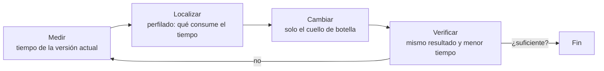

# B14-C14 — Vectorización y rendimiento

<!-- nav:top -->
[🏠 Programa](../../../../README.md) · [📚 Bloque B14](../../../tronco-comun/B14-computacion-cientifica-y-ciencia-abierta.md) · [← Anterior: B14-C13 — Computación paralela](../B14-C13-computacion-paralela/CLASE.md) · [Siguiente: B14-C15 — Cálculo en GPU y limitaciones →](../B14-C15-calculo-en-gpu-y-limitaciones/CLASE.md)
<!-- /nav -->

## 1. Ubicación, nivel y alcance

Decimocuarta clase del bloque B14. En [C13](../B14-C13-computacion-paralela/CLASE.md) viste que repartir trabajo tiene un coste; ahora miras antes: **dónde se va el tiempo** de un cálculo y cómo ganarlo con los arreglos de [C02](../B14-C02-arreglos-multidimensionales-numpy/CLASE.md). Nivel N2.

Verás medir tiempos con rigor, perfilar con `cProfile`, vectorizar un bucle, el efecto de la precisión (`float32` frente a `float64`) y por qué no se debe optimizar sin medir. No verás compilación (Numba, Cython), paralelismo (C13) ni GPU (C15).

## 2. Por qué esta clase existe

Una función que calcula la distancia de 200 000 posiciones tarda medio minuto en tu cuaderno, y alguien propone «comprar un servidor». La pregunta motivadora es: **¿es el cálculo lento por su matemática o por cómo lo escribí, y cuánto puedo ganar sin cambiar el resultado?**

La decisión central es: **¿qué parte del programa vale la pena acelerar?** Solo la que el perfilado muestra que consume el tiempo; y solo si el resultado sigue siendo correcto.

## 3. Lo que podrás hacer al terminar

1. Medir el tiempo de una función con repeticiones y quedarte con el mejor valor, explicando por qué.
2. Perfilar un programa con `cProfile` e identificar dónde se concentra el tiempo.
3. Reescribir un bucle como operación vectorizada y comprobar que da lo mismo.
4. Estimar el error y la ganancia de pasar de `float64` a `float32`.
5. Detectar cuándo vectorizar no ayuda (arreglos pequeños, memoria insuficiente).
6. Decidir si optimizar, con una medición como respaldo.

La evidencia es el **informe de perfilado con mejora medida** del ejercicio 12 (sección 20).

## 4. Con qué llegas y cómo comprobarlo

Necesitas C02 (difusión y formas) y C10 (tolerancias). Cinco preguntas:

1. ¿Qué forma tiene `np.sqrt((x - a)**2 + y**2)` si `x` e `y` son arreglos `(N,)`? ((N,).)
2. ¿Cuántos bytes ocupa un `float32` y un `float64`? (4 y 8.)
3. ¿Qué es la desigualdad triangular y cómo acota una distancia?
4. ¿Por qué comparar resultados con tolerancia en lugar de igualdad exacta? (C10)
5. ¿Por qué un cálculo puede tardar distinto en dos ejecuciones iguales?

<details>
<summary>Ver respuestas</summary>

1. (N,): operación elemento a elemento. 2. 4 y 8 bytes. 3. `|a − b| ≤ d(a,c) + d(c,b)`; aquí el satélite a 7000 km y la estación a 6378,137 km del centro quedan entre `7000 − 6378,137` y `7000 + 6378,137` km. 4. Porque el redondeo difiere (C10). 5. Carga de la máquina, caché, planificador del sistema.
</details>

Con cuatro o cinco aciertos, sigue; con tres o menos, repasa C02 y C10.

## 5. Un caso real: qué entiende NumPy por vectorizar

La guía de NumPy (S1) define la vectorización como la **ausencia de bucles, índices y construcciones similares en el código**: esas operaciones siguen ocurriendo, pero «entre bastidores», en código C precompilado. Explica que el bucle en Python paga el coste de interpretar código y manipular objetos en cada iteración, mientras que NumPy lo evita; que el código resulta más conciso y con menos errores; y que funciona gracias a la difusión (C02). No da cifras: la ganancia hay que medirla.

El **ejemplo conductor** es sintético: la distancia de 200 000 posiciones de satélite (órbita circular de 7000 km, anomalías aleatorias con semilla 20261105) a una estación en `(6378,137; 0; 0)` km, en un sistema fijo a la Tierra esférica.

## 6. Vocabulario

La **vectorización** es expresar una operación sobre arreglos completos en lugar de elemento a elemento en un bucle. Un **perfilador** (`cProfile`) cuenta cuánto tiempo pasa en cada función. El **tiempo acumulado** incluye las funciones llamadas; el **propio** (*tottime*) no. Un **cuello de botella** es la parte que domina el tiempo. La **aceleración** es el cociente de tiempos antes/después. Una **optimización prematura** es optimizar sin medir. Una **operación acotada por memoria** es aquella cuyo tiempo depende más de leer y escribir datos que de calcular.

## 7. Modelo mental: medir, localizar, cambiar, verificar

Optimizar es un ciclo de cuatro pasos y el orden importa: medir el tiempo actual, localizar el cuello de botella, cambiar solo eso y verificar que el resultado no cambió y que el tiempo bajó.



*Descripción textual:* un ciclo de cuatro pasos: medir el tiempo actual, localizar con el perfilador qué consume el tiempo, cambiar solo ese punto y verificar que el resultado es el mismo y el tiempo menor. Si no basta, se repite desde la medición.

**Analogía y su límite.** Un médico que mide antes de recetar. Límite: en software la medición cambia con la máquina y la carga; el diagnóstico no es transferible.

## 8. La explicación, paso a paso

### 8.1 Tres implementaciones

(1) Un **bucle** en Python con `math.sqrt` y una lista de resultados; (2) la versión **vectorizada** `np.sqrt((x − R)**2 + y**2)`; (3) la vectorizada en `float32`. Antes de medir, se verifica que dan lo mismo: la vectorizada coincide con el bucle a `10⁻⁹` relativo; la de `float32` a `10⁻⁵` (el error máximo medido fue `7,84 × 10⁻⁷`, coherente con una precisión de unos 7 dígitos). Las distancias caen entre 621,9 y 13 378,1 km, exactamente las cotas triangulares.

### 8.2 Medir bien

Se usa `time.perf_counter` y el **mejor de cinco** repeticiones: el mínimo es la medida menos contaminada por otras tareas (el máximo mide la máquina, no tu código). Resultados en esta máquina: bucle 53,4 ms; vectorizada 3,25 ms; `float32` 1,73 ms. Aceleración vectorizada: **16×**. `float32` frente a `float64`: 1,88×.

### 8.3 Perfilar el bucle

`cProfile` sobre el bucle da un tiempo acumulado de 0,219 s (el perfilador añade sobrecarga: no es el tiempo real de 53 ms) y reparte: 0,047 s en `append` de la lista y 0,042 s en `math.sqrt`, con 200 000 llamadas cada una. El resto es el propio bucle: indexado, restas y multiplicaciones interpretadas. El perfil dice que el tiempo se va en 200 000 repeticiones de cosas diminutas: eso es lo que la vectorización elimina.

### 8.4 Por qué `float32` es más rápido, y qué cuesta

Mover la mitad de bytes por elemento acelera una operación acotada por memoria: 1,88× aquí (cerca de 2). Cuesta precisión: unos 7 dígitos (error `7,84 × 10⁻⁷` frente a 10⁻¹⁶ de `float64`). Para una distancia de 10⁴ km, 10⁻⁶ relativo son 1 cm: aceptable para un cribado, no para determinación orbital precisa. La decisión es científica (C10): ¿qué error tolera el resultado?

### 8.5 Cuándo no ayuda

Con arreglos muy pequeños, el coste de llamar a NumPy supera al cálculo; con arreglos que no caben en memoria, la vectorización no es posible sin trocear (C02). Y si el cuello de botella es leer un archivo (C06–C07), vectorizar el cálculo no cambia nada.

### 8.6 Medir antes de optimizar

La optimización sin medición suele mejorar lo que no importa. Si el 90 % del tiempo está en leer datos, un cálculo 16 veces más rápido ahorra menos del 6 % (ley de Amdahl, C13). Por eso el ciclo empieza midiendo.

## 9. Magnitudes, símbolos y unidades

| Símbolo | Qué es | Unidad | Nota |
|---|---|---|---|
| `N` | número de posiciones | adimensional | 200 000 |
| `x, y` | coordenadas del satélite en el plano | km | radio 7000 km |
| `R` | radio ecuatorial terrestre (posición de la estación) | km | 6378,137 |
| `d` | distancia satélite–estación | km | 621,9 a 13 378,1 |
| `t` | tiempo de ejecución | ms | mejor de 5 |
| `S` | aceleración | adimensional | 16 (bucle → vectorizada) |

## 10. Convenciones y referencias

Datos **sintéticos**. Las mediciones son de **esta máquina y de esta ejecución**. El valor de `R` es el radio ecuatorial de la ficha de la NASA (NSSDC Earth Fact Sheet, 2024; citado en C02). El sistema es terrestre fijo, Tierra esférica. Versión: Python 3.12.9, NumPy 2.5.4.

## 11. De dónde sale lo que afirmamos

| ID | Fuente | Localizador | Respalda | Estado |
|---|---|---|---|---|
| S1 | NumPy, *What is NumPy?* (guía del usuario) | https://numpy.org/doc/stable/user/whatisnumpy.html | Definición de vectorización, ahorro del coste de interpretación en cada iteración, difusión | Página consultada el 2026-11-05 (mutable) |
| S2 | NASA NSSDC, *Earth Fact Sheet* | https://nssdc.gsfc.nasa.gov/planetary/factsheet/earthfact.html | Radio ecuatorial 6378,137 km | Consultada el 2026-11-05 (citada en C02) |

Límites: no consulté la documentación de `cProfile` ni de `time.perf_counter`; la precisión de `float32` y `float64` es la del estándar IEEE 754, conocimiento general no consultado aquí. Las aceleraciones son mediciones locales sin valor general.

## 12. Cómo ver el resultado

Versión accesible de las mediciones.

| Implementación | Tiempo (mejor de 5) | Frente al bucle | Error relativo máximo |
|---|---|---|---|
| Bucle de Python | 53,4 ms | 1× | referencia |
| Vectorizada `float64` | 3,25 ms | 16× | < 10⁻⁹ |
| Vectorizada `float32` | 1,73 ms | 31× | 7,84 × 10⁻⁷ |

## 13. Ejemplo trabajado: acelerar el cálculo de distancias

1. **Verifica** que bucle y vectorizada dan lo mismo (`10⁻⁹`) y que están dentro de las cotas triangulares.
2. **Mide** el bucle: 53,4 ms para 200 000 elementos.
3. **Perfila**: el tiempo se reparte en 200 000 llamadas pequeñas a `append` y `sqrt`.
4. **Cambia**: expresa el cálculo vectorizado.
5. **Verifica y mide**: 3,25 ms, aceleración 16×.
6. **Decide la precisión**: `float32` da 1,73 ms con error `7,84 × 10⁻⁷`; sirve para un cribado, no para una determinación precisa.
7. **Contextualiza**: si estos cálculos son el 20 % del programa, la ganancia total máxima es `1/(0,8 + 0,2/16) = 1,23`.

**Paso final · incertidumbre.** Los tiempos son de esta máquina; la aceleración de 16× vale para 200 000 elementos y puede ser otra para 1000 o para 10⁸. La verificación de igualdad es lo que hace legítima la comparación.

## 14. Comparación: bucle, vectorización, compilación y paralelismo

El **bucle** es claro y sirve de referencia de corrección. La **vectorización** da una gran ganancia con poco esfuerzo. La **compilación** (no tratada) acelera bucles que no se pueden vectorizar. El **paralelismo** (C13) multiplica por el número de núcleos con costes de reparto. El orden razonable es verificar, medir, vectorizar y solo después paralelizar o compilar lo que siga lento.

## 15. Práctica guiada

**Ejercicio 1 · con los pasos.** Un bucle tarda 40 ms y la versión vectorizada 2 ms. ¿Qué aceleración hay? Si el resto del programa tarda 160 ms, ¿qué ganancia total? *Pasos:* `S = 40/2`; tiempo total antes `200`, después `162` (sección 8.6).

<details><summary>Solución comentada</summary>

`S = 20`. Total: de 200 ms a 162 ms: 1,23× global. Una gran aceleración local da poca ganancia global si lo demás domina.
</details>

**Ejercicio 2 · con una pista.** ¿Por qué se toma el mínimo de varias repeticiones y no la media? *Pista:* ¿qué ensucia una medida?

<details><summary>Solución comentada</summary>

Otras tareas, el planificador y la caché solo pueden *añadir* tiempo; el mínimo es la medida menos contaminada de lo que tarda tu código.
</details>

**Ejercicio 3 · casi autónomo.** Una distancia vale 10 000 km. ¿Qué error absoluto corresponde al error relativo `7,84 × 10⁻⁷` de `float32`?

<details><summary>Solución comentada</summary>

`10 000 km × 7,84 × 10⁻⁷ = 7,8 × 10⁻³ km ≈ 7,8 m`. Para un cribado de visibilidad sobra; para una determinación orbital precisa, no.
</details>

## 16. Práctica autónoma, transferencia e integrador

**Ejercicio 4.** Calcula la aceleración de `float32` frente al bucle con las cifras de la clase.

<details><summary>Solución comentada</summary>

`53,4/1,73 = 30,9`, es decir, unos 31×; combina vectorización (16×) y precisión reducida (1,88×): `16,4 × 1,88 = 30,9`.
</details>

**Ejercicio 5.** ¿Qué cuesta en memoria una versión vectorizada de `(N, N)` pares para `N = 10⁵` en `float64`?

<details><summary>Solución comentada</summary>

`10¹⁰ × 8 B = 80 GB`: inviable. Hay que trocear por bloques o usar rutinas específicas (C02). Vectorizar no es siempre posible sin límite.
</details>

**Ejercicio 6.** Un perfil muestra 85 % del tiempo en `leer_archivo`. ¿Qué harías?

<details><summary>Solución comentada</summary>

Optimizar la lectura (formato binario, lectura parcial, caché: C06–C07) en lugar de vectorizar el cálculo, que como mucho ahorraría un 15 %.
</details>

**Ejercicio 7.** Explica por qué el perfil dice 0,219 s si el bucle tarda 53,4 ms.

<details><summary>Solución comentada</summary>

El perfilador instrumenta cada llamada y añade sobrecarga, de modo que sirve para *repartir* el tiempo, no para medirlo. Los tiempos absolutos se miden sin perfilador.
</details>

**Ejercicio 8.** Escribe la verificación que acompañaría a cualquier optimización.

<details><summary>Solución comentada</summary>

`np.allclose(nuevo, referencia, rtol=…)` con tolerancia justificada (C10), más una propiedad física (las cotas triangulares) y una medición de tiempo con mejor de varias.
</details>

**Ejercicio 9 · transferencia.** Tu cuaderno de análisis tarda 10 minutos. El perfil muestra 60 % en un bucle sobre filas de una tabla. ¿Plan?

<details><summary>Solución comentada</summary>

Vectorizar ese bucle (por columnas), verificar que el resultado no cambia, medir. Con aceleración 20× local, el total pasa de 10 a `4 + 6/20 = 4,3` min.
</details>

**Ejercicio 10 · transferencia.** Un colega usa `float32` para acumular millones de flujos y obtiene resultados distintos al reordenar. ¿Qué le dices?

<details><summary>Solución comentada</summary>

Que la acumulación en `float32` pierde dígitos y depende del orden (C10, C15); debe acumular en `float64` o con suma por pares y justificar la tolerancia.
</details>

**Ejercicio 11 · transferencia.** Un cálculo sobre arreglos de 20 elementos se vuelve más lento al vectorizarlo. ¿Por qué?

<details><summary>Solución comentada</summary>

El coste fijo de cada llamada a NumPy (crear arreglos, despachar la operación) supera al de 20 operaciones. La vectorización compensa con tamaños grandes.
</details>

**Ejercicio 12 · integrador.** Entrega un **informe de perfilado con mejora medida** de un cálculo sintético: versión de referencia (bucle), verificación de igualdad, perfil con interpretación, versión mejorada, tiempos con mejor de varias, aceleración local y global, decisión sobre precisión y discusión de límites.

<details><summary>Solución modelo</summary>

Debe incluir la tabla de la sección 12 con tus números, la verificación con tolerancia, el perfil con su sobrecarga explicada, el cálculo de la ganancia global con el resto del programa y una nota de que las mediciones son locales. Se acepta cualquier cálculo sintético.
</details>

## 17. Laboratorio

El script [vectorizar_y_medir.py](vectorizar_y_medir.py) implementa las tres versiones, verifica igualdad con tolerancias declaradas y cotas triangulares, mide el mejor de cinco tiempos y perfila el bucle. Falla si la vectorizada no gana al menos 5× o si algún resultado se sale de tolerancia.

**Datos:** sintéticos (semilla 20261105). **Predice antes de ejecutar:** ¿cuál será la aceleración? **Ejecución del 2026-11-05 (Python 3.12.9, NumPy 2.5.4):**

```text
distancias: mín = 621.9 km, máx = 13378.1 km (cotas 621.9 y 13378.1)
error relativo máximo de float32 = 7.84e-07
tiempos (mejor de 5): bucle = 53.4 ms; vectorizada = 3.25 ms; float32 = 1.73 ms
aceleración vectorizada = 16x; float32 frente a float64 = 1.88x
perfilado (cProfile): 200 000 llamadas a append (0,047 s) y a math.sqrt (0,042 s), tiempo acumulado del bucle 0,219 s con sobrecarga del perfilador
Pruebas superadas.
```

(La salida completa del perfilador incluye rutas de archivo; aquí se resume.)

```bash
python programa/clases/B14/B14-C14-vectorizacion-y-rendimiento/vectorizar_y_medir.py
```

**Límites:** tiempos locales y variables; un solo tamaño de problema; no se midió el uso de memoria.

## 18. Errores frecuentes y cómo corregirlos

**Optimizar sin medir.** Se corrige con el ejercicio 6 y la sección 8.6.

**Medir una sola vez o con la media.** Se corrige con el ejercicio 2.

**Cambiar el resultado sin darse cuenta.** Se corrige con el ejercicio 8.

**Usar `float32` sin evaluar el error.** Se corrige con los ejercicios 3 y 10.

**Vectorizar lo pequeño o lo gigantesco.** Se corrige con los ejercicios 5 y 11.

## 19. Cómo sabrás que vas bien

Tras 8.2: ¿explicas por qué el mínimo? Si no, rehaz el ejercicio 2. Tras 8.3: ¿lees un perfil? Si no, rehaz el 7. Tras el ejemplo trabajado: ¿qué ganancia global esperas si cambia la parte que no es el cálculo? Tras el laboratorio: ¿qué pasaría con `N = 20`? Al final: ¿qué error de `float32` tolera tu problema?

## 20. Qué entregas y cómo se evalúa

El producto es tu **informe de perfilado con mejora medida** del ejercicio 12.

| Criterio | Inicial | En desarrollo | Logrado | Destacado |
|---|---|---|---|---|
| Verificación | Sin comprobar | A ojo | Con tolerancia | Con propiedad física |
| Medición | Una vez | Media | Mejor de varias | Con ganancia global |
| Diagnóstico | Intuición | Perfil sin leer | Perfil interpretado | Con sobrecarga explicada |
| Fuentes y alcance | Sin fuente | Fuente sin alcance | Fuente con alcance | Declara que las mediciones son locales |

**Condiciones críticas:** no optimizar sin medir; no cambiar el resultado sin verificarlo; no extrapolar tiempos de una máquina.

## 21. Ética, seguridad y límites

El cómputo consume energía: optimizar bien es también reducir ese gasto. Una optimización que introduce un error silencioso en un resultado científico es peor que un programa lento. Accesibilidad: tablas en texto. Material educativo.

## 22. Para cerrar y seguir

Se optimiza midiendo, localizando con un perfil, cambiando solo el cuello de botella y verificando el resultado. Vectorizar dio 16× en este cálculo y `float32` un factor más (1,88×) con un error de `7,84 × 10⁻⁷`. Queda abierta una pregunta: ¿cuánto de esa ganancia sobrevive al resto del programa?

**Glosario español–inglés.** vectorización · *vectorization*; perfilador · *profiler*; cuello de botella · *bottleneck*; aceleración · *speedup*; optimización prematura · *premature optimization*; acotado por memoria · *memory-bound*.

**Continuidad.** B14-C15 estudia qué cambia al pasar a GPU; B14-C16 lleva el cálculo a varios equipos; B14-C10 sostiene la verificación de cada optimización.

**Referencias:** ver sección 11.

<!-- nav:bottom -->
---

[← Anterior: B14-C13 — Computación paralela](../B14-C13-computacion-paralela/CLASE.md) · [📚 Bloque B14](../../../tronco-comun/B14-computacion-cientifica-y-ciencia-abierta.md) · [Siguiente: B14-C15 — Cálculo en GPU y limitaciones →](../B14-C15-calculo-en-gpu-y-limitaciones/CLASE.md)
<!-- /nav -->
