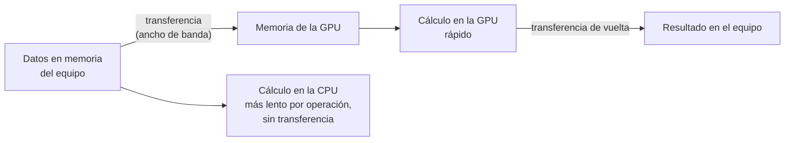

# B14-C15 — Cálculo en GPU y limitaciones

<!-- nav:top -->
[🏠 Programa](../../../../README.md) · [📚 Bloque B14](../../../tronco-comun/B14-computacion-cientifica-y-ciencia-abierta.md) · [← Anterior: B14-C14 — Vectorización y rendimiento](../B14-C14-vectorizacion-y-rendimiento/CLASE.md) · [Siguiente: B14-C16 — Computación distribuida y HPC →](../B14-C16-computacion-distribuida-y-hpc/CLASE.md)
<!-- /nav -->

## 1. Ubicación, nivel y alcance

Decimoquinta clase del bloque B14. En [C13](../B14-C13-computacion-paralela/CLASE.md) repartiste trabajo entre núcleos y en [C14](../B14-C14-vectorizacion-y-rendimiento/CLASE.md) lo vectorizaste; ahora conoces un tercer recurso, la **unidad de procesamiento gráfico (GPU)**, y sobre todo sus **limitaciones**: transferencia de datos, precisión y reproducibilidad. Nivel N2.

**Aviso de alcance:** el laboratorio de esta clase **no se ejecutó en una GPU**. Reproduce en CPU dos efectos numéricos que la documentación de NVIDIA señala como causas de diferencias entre CPU y GPU y evalúa con un modelo de parámetros inventados cuándo compensa transferir datos. No hay ninguna medición de GPU en esta clase.

Verás qué tipo de cálculo se beneficia de una GPU, el coste de mover datos, el orden de la suma y la multiplicación-suma fusionada (FMA). No verás programación CUDA ni bibliotecas de GPU.

## 2. Por qué esta clase existe

Un equipo promete que su simulación irá «100 veces más rápido en GPU» y, al compararla con la de CPU, los resultados difieren en el séptimo dígito. ¿Error del código o característica de la máquina? La pregunta motivadora es: **¿cuándo compensa usar una GPU y qué diferencias numéricas debo esperar y tolerar?**

La decisión central es: **¿el cálculo tiene suficientes operaciones por dato como para compensar mover los datos, y mi resultado tolera las diferencias de redondeo?** Si alguna respuesta es no, la GPU no ayuda o ayuda a costa de la confianza.

## 3. Lo que podrás hacer al terminar

1. Explicar qué características de un cálculo (paralelismo de datos, intensidad aritmética) lo hacen apto para GPU.
2. Plantear un modelo de tiempo con transferencia y calcular el punto de equilibrio.
3. Explicar por qué la suma no es asociativa y cómo una reducción en árbol cambia el resultado.
4. Explicar qué es la multiplicación-suma fusionada (FMA) y por qué puede cambiar un resultado.
5. Interpretar una diferencia CPU/GPU sin concluir automáticamente que la GPU se equivoca.
6. Declarar los límites de una comparación hecha sin GPU.

La evidencia es la **comparación CPU–GPU con sus límites** del ejercicio 12 (sección 20).

## 4. Con qué llegas y cómo comprobarlo

Necesitas C10 (tolerancias y redondeo), C13–C14. Cinco preguntas:

1. ¿Qué es la precisión de máquina de `float32`? (≈ 1,2 × 10⁻⁷ relativo.)
2. ¿Por qué `(a + b) + c` puede diferir de `a + (b + c)`? (Redondeo.)
3. ¿Qué significa «acotado por memoria»? (C14)
4. ¿Qué es una operación por elemento? Da un ejemplo.
5. ¿Qué fracción del tiempo ahorras si aceleras 10× algo que es el 30 % del total? (27 %.)

<details>
<summary>Ver respuestas</summary>

1. `2⁻²³ ≈ 1,19 × 10⁻⁷`. 2. Cada suma se redondea y el orden cambia qué se redondea. 3. El tiempo depende de mover datos, no de calcular. 4. Las operaciones aritméticas que se hacen sobre cada dato leído (por ejemplo, 3 para `a*b + c` y `sqrt`). 5. Ahorras `0,3 × (1 − 1/10) = 0,27`.
</details>

Con cuatro o cinco aciertos, sigue; con tres o menos, repasa C10 y C14.

## 5. Un caso real: lo que dice NVIDIA sobre coma flotante en GPU

La guía de NVIDIA sobre coma flotante y CUDA (S1) afirma que las GPU de capacidad de cómputo 2.0 o superior soportan aritmética IEEE 754 de precisión simple y doble, incluida la **multiplicación-suma fusionada (FMA)**, que redondea una sola vez en vez de dos y por tanto suele ser más exacta. Señala que la suma en coma flotante **no es asociativa**, por lo que reagrupar la misma suma (por ejemplo, en una reducción paralela) puede cambiar el resultado. Y explica que los resultados de CPU y GPU pueden diferir por el FMA, el orden de las operaciones, el número de hilos y las bibliotecas matemáticas distintas, sin que ninguna esté garantizada como correctamente redondeada: una diferencia entre CPU y GPU **no significa automáticamente que la GPU esté mal**.

El **ejemplo conductor** es doble: (1) sumar un millón de flujos relativos sintéticos en `float32` de varias maneras; (2) un modelo de tiempo con transferencia para un cálculo de 40 operaciones por elemento, con parámetros **inventados** (12 GB/s de transferencia, CPU de 20 Gflop/s y GPU de 2000 Gflop/s). Nada de lo anterior son medidas de equipos reales.

## 6. Vocabulario

Una **GPU** es un procesador con miles de unidades simples que ejecutan la misma operación sobre muchos datos. Una **transferencia** es copiar datos entre la memoria del equipo y la de la GPU. La **intensidad aritmética** es el número de operaciones por byte movido. Una **reducción** combina muchos valores en uno (una suma). Una **reducción en árbol** suma por pares, luego los resultados por pares, y así hasta uno. La **FMA** calcula `a·b + c` con un solo redondeo. La **no asociatividad** es la propiedad de que `(a + b) + c ≠ a + (b + c)` en coma flotante. El **punto de equilibrio** es el tamaño o la intensidad a partir de la cual compensa.

## 7. Modelo mental: calcular es barato, mover es caro

El tiempo en GPU es el de mover los datos más el de calcular. La GPU hace el cálculo mucho más rápido, pero mover los datos cuesta lo mismo con cualquier cálculo. Si el cálculo es corto frente al movimiento, la ganancia desaparece.



*Descripción textual:* los datos pasan de la memoria del equipo a la de la GPU, se calculan allí y el resultado vuelve. Alternativamente, se calculan directamente en la CPU, con un cálculo más lento por operación pero sin transferencia. La GPU compensa solo si el ahorro de cálculo supera el coste de ir y volver.

**Analogía y su límite.** Una cocina industrial lejana: cocina mucho más rápido, pero hay que llevar y traer los ingredientes. Límite: en una GPU real también existen costes de lanzamiento de cada operación y límites de memoria que este modelo omite.

## 8. La explicación, paso a paso

### 8.1 Qué cálculos se benefician

Los que aplican la misma operación a muchísimos datos independientes (paralelismo de datos) y tienen mucha aritmética por dato. Una propagación orbital de millones de partículas, un cribado de imágenes o un producto de matrices grandes encajan; un cálculo con muchas ramas y dependencias secuenciales, no.

### 8.2 El modelo de transferencia

`t_GPU = t_transferencia + t_cálculo_GPU` con `t_transferencia = 2·n·4 B / ancho de banda` (ida y vuelta de `n` números `float32` de 4 bytes), y `t_CPU = n·ops/rendimiento_CPU`. Con los parámetros **inventados**: `t_GPU/t_CPU = 0,343` para cualquier `n` (el modelo no tiene costes fijos), es decir, el modelo da una ganancia de 2,9× aunque la GPU sea 100 veces más rápida en cálculo, porque la transferencia consume la mayor parte del tiempo. El **punto de equilibrio** analítico es `ops_min = (2·4/ancho de banda)/(1/CPU − 1/GPU) = 13,5` operaciones por elemento: con menos, no compensa. (Es una verificación del modelo con sus propios parámetros, no una propiedad de ninguna GPU real.)

### 8.3 El orden de la suma

Sumar 200 000 números `float32` de media 1 con desviación 0,01: la referencia en `float64` es `200 002,4942`. La suma **secuencial** en `float32` tiene un error relativo de `1,03 × 10⁻⁵`; la **reducción en árbol** (por pares, como hacen los núcleos paralelos), `1,27 × 10⁻⁷`. El árbol es más exacto porque suma números de magnitud parecida; la secuencial suma números pequeños a un acumulador grande y pierde dígitos. Los dos resultados difieren: **el orden cambia el resultado** (S1).

### 8.4 La multiplicación-suma fusionada

Se calcula `a·b + c` con `c = −a·b` casi cancelado, en `float32`. Con **dos redondeos** (multiplicar y redondear, luego sumar) el error máximo es `5,96 × 10⁻⁸`; con **un solo redondeo** (FMA simulado: se calcula exacto en `float64` y se redondea una vez), es `0`. Y los resultados de ambos métodos **no son idénticos**. Si una GPU usa FMA y la CPU no, sus resultados diferirán aunque ambas sean correctas (S1). (Es una simulación en CPU de un efecto descrito por S1, no una medición de FMA en hardware.)

### 8.5 Interpretar una diferencia CPU/GPU

Antes de concluir que algo falla, pregunta: ¿la diferencia es del orden del redondeo (10⁻⁷ en `float32`, 10⁻¹⁶ en `float64`)? ¿Cambia al reordenar la suma? ¿Está dentro de la tolerancia justificada (C10)? Si sí, es esperable. Si es mucho mayor, hay un error de otro tipo.

### 8.6 Precisión y reproducibilidad

La GPU suele usarse en `float32` por velocidad y memoria. Para reducciones largas, acumula en mayor precisión o usa árbol. Y fija semillas y orden cuando necesites reproducibilidad: el número de hilos puede cambiar el orden de la suma y, con él, el resultado.

## 9. Magnitudes, símbolos y unidades

| Símbolo | Qué es | Unidad | Nota |
|---|---|---|---|
| `n` | número de elementos | adimensional | 10³ a 10⁹ en el modelo |
| `ops` | operaciones por elemento | adimensional | 40 (sintético) |
| `B` | ancho de banda de transferencia | B/s | 12 × 10⁹ (inventado) |
| `P_CPU`, `P_GPU` | rendimiento | flop/s | 2 × 10¹⁰ y 2 × 10¹² (inventados) |
| `ε₃₂` | precisión de máquina de `float32` | relativo | ≈ 1,2 × 10⁻⁷ |
| error | diferencia relativa a la referencia `float64` | relativo | 1,03 × 10⁻⁵ y 1,27 × 10⁻⁷ |

(Los parámetros del modelo son inventados: 20 Gflop/s para la CPU y 2000 Gflop/s para la GPU.)

## 10. Convenciones y referencias

Datos **sintéticos** (semilla 20261105). **No hay GPU en este laboratorio.** Las cifras del modelo de transferencia son inventadas y no representan ningún equipo. La precisión de `float32` es la del estándar IEEE 754, conocimiento general. Versión: Python 3.12.9, NumPy 2.5.4.

## 11. De dónde sale lo que afirmamos

| ID | Fuente | Localizador | Respalda | Estado |
|---|---|---|---|---|
| S1 | NVIDIA, *Floating Point and IEEE 754 Compliance for NVIDIA GPUs* (documentación de CUDA) | https://docs.nvidia.com/cuda/floating-point/index.html | IEEE 754 en GPU de capacidad ≥ 2.0; FMA con un solo redondeo; suma no asociativa y reducciones; causas de diferencias CPU/GPU | Página consultada el 2026-11-05 (mutable); título exacto no verificado |

Límites: no consulté documentación de rendimiento ni de transferencia de ninguna GPU concreta; el modelo es analítico. No ejecuté nada en GPU. La FMA y la reducción en árbol se simularon en CPU.

## 12. Cómo ver el resultado

Versión accesible.

| Experimento (CPU) | Resultado |
|---|---|
| Suma secuencial `float32` de 200 000 valores | error relativo 1,03 × 10⁻⁵ |
| Suma en árbol `float32` | error relativo 1,27 × 10⁻⁷ |
| `a·b + c` con dos redondeos | error máximo 5,96 × 10⁻⁸ |
| `a·b + c` con un redondeo (simulado) | error máximo 0 |
| Modelo: razón `t_GPU/t_CPU` | 0,343 |
| Modelo: operaciones mínimas para compensar | 13,5 |

## 13. Ejemplo trabajado: ¿merece la pena transferir?

1. **Calcula `ops_min`:** transferir un elemento cuesta `2·4 B/(12 × 10⁹ B/s) = 6,67 × 10⁻¹⁰ s`; cada operación ahorrada en la GPU respecto a la CPU vale `1/(2 × 10¹⁰) − 1/(2 × 10¹²) = 4,95 × 10⁻¹¹ s`; el equilibrio es `6,67 × 10⁻¹⁰ / 4,95 × 10⁻¹¹ = 13,5` operaciones por elemento.
2. **Compara con tu cálculo:** 40 operaciones por elemento > 13,5: compensa.
3. **Razón:** `t_GPU/t_CPU = 0,343`: ganancia de 2,9× (no 100×).
4. **Verifica el resultado:** la suma en árbol y la secuencial difieren a `10⁻⁵`; no es error, es orden.
5. **Fija una tolerancia** (C10) acorde: `rtol` por encima de `10⁻⁵` para `float32` en sumas largas, o acumula en `float64`.
6. **Declara** que nada de esto es una medición de GPU.

**Paso final · incertidumbre.** Los parámetros del modelo son inventados: con valores reales, el equilibrio será otro; la ganancia y el punto de equilibrio dependen del hardware, de los costes de lanzamiento y de la memoria. Esta clase enseña el razonamiento, no una cifra.

## 14. Comparación: CPU, GPU y vectorización

La **vectorización en CPU** (C14) no mueve datos y suele bastar para tamaños moderados. La **GPU** compensa con muchos datos y mucha aritmética por dato, o cuando los datos ya viven en la GPU durante varias operaciones. La **CPU paralela** (C13) es la opción intermedia. La elección se hace con una medición del caso real, no por moda.

## 15. Práctica guiada

**Ejercicio 1 · con los pasos.** Con `B = 12 GB/s`, ¿cuánto tarda en ir y volver un arreglo de `10⁷` `float32`? *Pasos:* `2 × 10⁷ × 4 B / 12 × 10⁹` (sección 8.2).

<details><summary>Solución comentada</summary>

`8 × 10⁷ B/(1,2 × 10¹⁰ B/s) = 6,67 × 10⁻³ s` (6,7 ms). Es el coste fijo de ir y volver con este ancho de banda inventado, haga lo que haga la GPU.
</details>

**Ejercicio 2 · con una pista.** ¿Por qué la suma en árbol es más exacta que la secuencial? *Pista:* magnitudes de los sumandos.

<details><summary>Solución comentada</summary>

La secuencial suma números pequeños a un acumulador grande, perdiendo sus dígitos bajos; el árbol suma números de tamaño parecido en cada nivel, perdiendo menos.
</details>

**Ejercicio 3 · casi autónomo.** Explica con tus palabras qué es FMA y por qué cambia el resultado.

<details><summary>Solución comentada</summary>

Calcula `a·b + c` redondeando una sola vez en lugar de dos; como el redondeo intermedio desaparece, el resultado puede ser distinto (S1) y, en casos de cancelación, más exacto.
</details>

## 16. Práctica autónoma, transferencia e integrador

**Ejercicio 4.** Con 40 operaciones por elemento, ¿cuál es `t_CPU` para `n = 10⁷`? ¿Y `t_GPU`?

<details><summary>Solución comentada</summary>

`t_CPU = 10⁷ × 40/(2 × 10¹⁰) = 0,02 s`. `t_GPU = 6,67 × 10⁻³ s` (transferencia, ejercicio 1) `+ 10⁷ × 40/(2 × 10¹²) = 2 × 10⁻⁴ s` (cálculo) `= 6,87 × 10⁻³ s`. Razón `0,343`. La transferencia es el 97 % del tiempo de la GPU.
</details>

**Ejercicio 5.** ¿Qué esperas si aumentas las operaciones por elemento a 4?

<details><summary>Solución comentada</summary>

Bajo `ops_min = 13,5`, la GPU no compensa en el modelo: la transferencia domina.
</details>

**Ejercicio 6.** Un colega compara una suma en CPU y en GPU y ve `10⁻⁶` de diferencia relativa con `float32`. ¿Qué haces?

<details><summary>Solución comentada</summary>

Comprobar que es del orden de la precisión de `float32` y de la sensibilidad al orden (laboratorio: `10⁻⁵` entre sumas), comparar ambas con una referencia en `float64` y fijar una tolerancia justificada (C10).
</details>

**Ejercicio 7.** ¿Por qué no se puede decir que una GPU «se equivoca» al diferir de la CPU?

<details><summary>Solución comentada</summary>

Porque ninguna está garantizada como correctamente redondeada y difieren por FMA, orden y bibliotecas (S1); hay que compararlas con una referencia independiente.
</details>

**Ejercicio 8.** Diseña una prueba que detecte si un cálculo en GPU cambia más de lo tolerable respecto a la CPU.

<details><summary>Solución comentada</summary>

Prueba de regresión con referencia en `float64` de CPU, `rtol` justificado por el ruido conocido (`~10⁻⁶` para sumas largas en `float32`) y casos con errores sembrados de tamaño conocido (C10).
</details>

**Ejercicio 9 · transferencia.** Un análisis ejecuta 50 operaciones distintas sobre el mismo arreglo. ¿Cambia la conclusión sobre transferencia?

<details><summary>Solución comentada</summary>

Sí: si el arreglo permanece en la GPU entre operaciones, la transferencia se paga una vez y la intensidad efectiva sube. La mala práctica es ir y volver en cada operación.
</details>

**Ejercicio 10 · transferencia.** Tu cálculo no cabe en la memoria de la GPU. ¿Opciones?

<details><summary>Solución comentada</summary>

Trocear en bloques (transferencia por bloque), reducir precisión si es tolerable, o usar CPU/HPC (C16). Cada opción debe medirse.
</details>

**Ejercicio 11 · transferencia.** Un artículo reporta «50× más rápido en GPU» sin decir la referencia de CPU. ¿Qué preguntas haces?

<details><summary>Solución comentada</summary>

¿Qué CPU y cuántos núcleos? ¿Código vectorizado u ordinario? ¿Se incluye la transferencia? ¿Qué precisión? ¿Mismo resultado dentro de qué tolerancia? Sin eso, la cifra no es comparable.
</details>

**Ejercicio 12 · integrador.** Entrega una **comparación CPU–GPU con sus límites** para un cálculo sintético: modelo de tiempo con transferencia y parámetros explícitos (rotulados como inventados o medidos), punto de equilibrio, experimento de orden de suma en `float32`, discusión de FMA, tolerancia propuesta y una sección que diga qué no mediste.

<details><summary>Solución modelo</summary>

Debe incluir la fórmula del modelo y su equilibrio, la tabla de errores de suma, una tolerancia justificada, la advertencia de que no hubo GPU (o la medición con su hardware y versión) y una lista de lo que falta medir. Se acepta cualquier cálculo sintético.
</details>

## 17. Laboratorio

El script [precision_y_transferencia.py](precision_y_transferencia.py) compara la suma secuencial y en árbol en `float32` con una referencia en `float64`, simula la FMA y evalúa el modelo de transferencia con parámetros inventados. **No usa GPU.**

**Datos:** sintéticos (semilla 20261105). **Ejecución del 2026-11-05 (Python 3.12.9, NumPy 2.5.4, sin GPU):**

```text
suma de 200 000 float32: referencia float64 = 200002.4942
  secuencial float32: error relativo = 1.03e-05
  en árbol float32:   error relativo = 1.27e-07
a*b+c con casi-cancelación: error máx. con dos redondeos = 5.96e-08; con un redondeo (FMA simulado) = 0.00e+00
resultados idénticos entre ambos métodos: False
razón t_GPU/t_CPU = 0.343 para cualquier n (sin latencias fijas)
operaciones por elemento mínimas para que compense = 13.5
Pruebas superadas.
```

```bash
python programa/clases/B14/B14-C15-calculo-en-gpu-y-limitaciones/precision_y_transferencia.py
```

**Límites:** sin GPU; modelo con parámetros inventados; la FMA es simulada.

## 18. Errores frecuentes y cómo corregirlos

**Suponer aceleración sin contar la transferencia.** Se corrige con la sección 8.2.

**Concluir que la GPU «se equivoca».** Se corrige con el ejercicio 7.

**Acumular en `float32` sin pensar.** Se corrige con el ejercicio 2.

**Comparar con una CPU mal usada.** Se corrige con el ejercicio 11.

**Presentar un modelo con parámetros inventados como medición.** Se corrige con la sección 10.

## 19. Cómo sabrás que vas bien

Tras 8.2: ¿calculas el tiempo de transferencia de un arreglo? Si no, rehaz el ejercicio 1. Tras 8.3: ¿explicas por qué difieren las sumas? Si no, rehaz el 2. Tras el ejemplo trabajado: ¿distingues lo calculado de lo medido? Tras el laboratorio: ¿qué faltaría medir en una GPU real? Al final: ¿qué tolerancia propones y por qué?

## 20. Qué entregas y cómo se evalúa

El producto es tu **comparación CPU–GPU con sus límites** del ejercicio 12.

| Criterio | Inicial | En desarrollo | Logrado | Destacado |
|---|---|---|---|---|
| Modelo | Sin modelo | Modelo sin parámetros | Modelo con equilibrio | Parámetros rotulados |
| Numérica | Ignora el orden | Menciona | Mide el orden de suma | Y discute FMA |
| Tolerancia | Ninguna | Por defecto | Justificada | Con casos sembrados |
| Fuentes y alcance | Sin fuente | Fuente sin alcance | Fuente con alcance | Declara qué no se midió |

**Condiciones críticas:** no presentar un modelo como medición; no afirmar una aceleración sin medirla; no atribuir un error a la GPU sin referencia independiente.

## 21. Ética, seguridad y límites

Los centros de datos con GPU consumen mucha energía: justifica el uso con una ganancia medida. No presentes cifras de rendimiento de un equipo que no mediste. Accesibilidad: tablas en texto. Material educativo.

## 22. Para cerrar y seguir

Una GPU ayuda cuando el cálculo tiene mucha aritmética por dato y el movimiento de datos no domina; además cambia el redondeo (orden y FMA), y esas diferencias hay que tolerarlas con criterio. Esta clase no midió ninguna GPU. Queda abierta una pregunta: ¿cuánto de tu cálculo cabe y se queda en la memoria de la GPU?

**Glosario español–inglés.** unidad de procesamiento gráfico · *graphics processing unit (GPU)*; transferencia · *transfer*; intensidad aritmética · *arithmetic intensity*; reducción · *reduction*; multiplicación-suma fusionada · *fused multiply-add (FMA)*; no asociatividad · *non-associativity*.

**Continuidad.** B14-C16 lleva el cálculo a varios equipos; B14-C10 sostiene la verificación de la tolerancia; B14-C20 reúne todo en el proyecto final.

**Referencias:** ver sección 11.

<!-- nav:bottom -->
---

[← Anterior: B14-C14 — Vectorización y rendimiento](../B14-C14-vectorizacion-y-rendimiento/CLASE.md) · [📚 Bloque B14](../../../tronco-comun/B14-computacion-cientifica-y-ciencia-abierta.md) · [Siguiente: B14-C16 — Computación distribuida y HPC →](../B14-C16-computacion-distribuida-y-hpc/CLASE.md)
<!-- /nav -->
