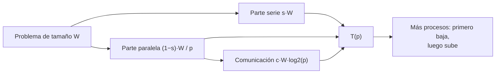

# B14-C16 — Computación distribuida y HPC

<!-- nav:top -->
[🏠 Programa](../../../../README.md) · [📚 Bloque B14](../../../tronco-comun/B14-computacion-cientifica-y-ciencia-abierta.md) · [← Anterior: B14-C15 — Cálculo en GPU y limitaciones](../B14-C15-calculo-en-gpu-y-limitaciones/CLASE.md) · [Siguiente: B14-C17 — Contenedores y ambientes científicos →](../../../tronco-comun/B14-computacion-cientifica-y-ciencia-abierta.md#b14-c17)
<!-- /nav -->

## 1. Ubicación, nivel y alcance

Decimosexta clase del bloque B14 y cierre del tramo de rendimiento. En [C13](../B14-C13-computacion-paralela/CLASE.md) repartiste trabajo dentro de un equipo; ahora el reparto sale a **varios equipos** de un clúster de computación de alto rendimiento (HPC), que se usan mediante un planificador de trabajos. Nivel N2.

**Aviso de alcance:** el laboratorio **no se ejecutó en ningún clúster**. Las cifras de escalado son de un **modelo analítico con parámetros inventados** y el guion de trabajo se **generó como texto sin enviarlo** a ningún planificador. Lo que se verifica son identidades del modelo y la forma del guion.

Verás nodos, particiones y trabajos, escalado fuerte y débil, la ley de Gustafson, el coste de comunicación y cómo se describe un trabajo para Slurm. No verás MPI en detalle, almacenamiento paralelo ni cómo obtener acceso a un clúster concreto.

## 2. Por qué esta clase existe

Una simulación de la población de escombros orbitales requiere cien veces más cálculo del que tu equipo puede dar en una semana. Pides tiempo en un clúster y debes decidir: ¿cuántos procesos pido? ¿Más es siempre mejor? La pregunta motivadora es: **¿cuántos recursos pedir para un cálculo y cómo sé si los uso bien?**

La decisión central es: **¿mi problema crece con los recursos (escalado débil) o es de tamaño fijo (escalado fuerte)?** La respuesta determina cuánto sirve añadir procesos y qué se le debe prometer a quien comparte el clúster.

## 3. Lo que podrás hacer al terminar

1. Describir un clúster en términos de nodos, particiones, planificador y trabajos.
2. Distinguir escalado fuerte (problema fijo) y débil (trabajo por proceso fijo) y sus métricas.
3. Calcular aceleración y eficiencia con un modelo que incluya comunicación.
4. Identificar el número de procesos a partir del cual añadir más empeora el tiempo.
5. Escribir un guion de `sbatch` con las directivas básicas y comprobar su estructura.
6. Declarar con honestidad qué medidas de rendimiento tienes y cuáles son un modelo.

La evidencia es el **plan de ejecución escalable** del ejercicio 12 (sección 20).

## 4. Con qué llegas y cómo comprobarlo

Necesitas C13 (Amdahl, aceleración, eficiencia) y C14. Cinco preguntas:

1. ¿Cuál es el techo de aceleración con fracción serie `s = 0,02`? (50.)
2. ¿Qué es la eficiencia y qué valor tiene la aceleración ideal? (`E = S/p`; 1.)
3. ¿Qué es `log₂ 8`? (3.)
4. ¿Qué significa un coste de comunicación?
5. ¿Qué es una cola de trabajos?

<details>
<summary>Ver respuestas</summary>

1. `1/s = 50`. 2. `E = S/p`; ideal 1. 3. 3, porque `2³ = 8`. 4. Tiempo gastado en intercambiar datos entre procesos o equipos en vez de calcular. 5. Una lista ordenada de trabajos que esperan recursos libres.
</details>

Con cuatro o cinco aciertos, sigue; con tres o menos, repasa C13.

## 5. Un caso real: cómo describe Slurm un clúster

La guía rápida de Slurm (S1) describe los comandos principales: `sbatch` envía un guion para su ejecución posterior, que suele contener comandos `srun` que lanzan tareas paralelas; `srun` envía un trabajo o lanza pasos de trabajo en tiempo real, con opciones de número de nodos y de tareas; `squeue` muestra el estado de trabajos; `scancel` cancela un trabajo; y `sinfo` muestra el estado de particiones y nodos. Define un **nodo** como un recurso de cómputo, una **partición** como un grupo lógico de nodos que funciona como una cola de trabajos, con límites de tamaño y de tiempo, y un **trabajo** como un conjunto de recursos asignados a un usuario durante un tiempo.

El **ejemplo conductor** es un modelo: un problema de tamaño `W = 1` (unidad arbitraria) con fracción serie `s = 0,02` y un coste de comunicación `c = 0,005·W` por cada etapa de un árbol de `log₂ p` niveles. Todo parámetro es inventado.

## 6. Vocabulario

Un **clúster** es un conjunto de equipos conectados que se usan como un sistema. Un **planificador** asigna recursos a trabajos en cola. El **escalado fuerte** mantiene fijo el tamaño del problema y aumenta `p`; su meta es reducir el tiempo. El **escalado débil** mantiene fijo el trabajo *por proceso* (el problema crece con `p`); su meta es mantener el tiempo. La **ley de Gustafson** da, para escalado débil ideal, `S(p) = s + (1 − s)·p`. La **eficiencia débil** es `T(1)/T(p)`. La **comunicación** es el intercambio de datos entre procesos. Un **guion de trabajo** declara recursos y órdenes.

## 7. Modelo mental: calcular se reparte, comunicar se acumula

El cálculo se divide entre `p` procesos; la comunicación crece con `p` (aquí, `log₂ p`). Al principio domina el ahorro de cálculo; después, el coste de coordinarse.



*Descripción textual:* el problema se divide en una parte serie, una parte paralela dividida por `p` y un término de comunicación que crece con `log₂ p`. La suma da el tiempo `T(p)`, que primero baja al añadir procesos y luego vuelve a subir.

**Analogía y su límite.** Una reunión: más participantes reparten el trabajo, pero coordinarse lleva cada vez más tiempo. Límite: en un clúster la comunicación depende de la red y del patrón de comunicación, no solo de `log₂ p`.

## 8. La explicación, paso a paso

### 8.1 Escalado fuerte con el modelo

Con `T(p) = W·(s + (1−s)/p) + c·W·log₂ p` (modelo inventado), `T(1) = 1` (no hay comunicación con un proceso). Resultados: `p = 2`: `S = 1,94`, `E = 0,971`; `p = 8`: `S = 6,35`, `E = 0,794`; `p = 64`: `S = 15,31`, `E = 0,239`; `p = 128`: `S = 15,96`, `E = 0,125`; `p = 1024`: `S = 14,09`, `E = 0,014`. El tiempo mínimo del modelo está en `p = 128`; con más procesos, **empeora**. Eso no es un fallo de la máquina: es la consecuencia de un coste que crece con `p`.

### 8.2 Amdahl sin comunicación

Sin el término de comunicación, la aceleración tiende a `1/s = 50`. Con `p = 64`: `S = 28,3`. Con comunicación el mismo `p = 64` da 15,3: el modelo con comunicación es más pesimista y, por ello, más realista. (El modelo es inventado: la proporción real depende del problema y de la red.)

### 8.3 Escalado débil

Si cada proceso hace siempre el mismo trabajo y el problema crece con `p`, el tiempo ideal es constante. Con el término de comunicación: `T(8) = 1,015`, `T(64) = 1,030`, `T(512) = 1,045`, de modo que la eficiencia débil es `0,985`, `0,971` y `0,957`. La ley de Gustafson (sin comunicación) da `S(64) = s + (1−s)·64 = 62,7`. El escalado débil resulta mucho más favorable porque la parte serie no crece con el problema en este modelo.

### 8.4 Qué tipo de escalado necesita tu problema

Si tu problema tiene un tamaño fijo (por ejemplo, ajustar un modelo a un conjunto de datos), el escalado relevante es el fuerte y habrá un número de procesos óptimo. Si puedes aumentar el problema (más partículas, mejor resolución, más escenarios), el relevante es el débil. Muchos barridos de parámetros son «vergonzosamente paralelos»: trozos independientes sin comunicación (C13).

### 8.5 Pedir recursos con un guion

El laboratorio genera un guion con las directivas básicas de `sbatch` (S1): nombre del trabajo (`--job-name=transito`), nodos (`--nodes=2`), tareas (`--ntasks=64`), tiempo máximo (`--time=00:30:00`) y partición (`--partition=general`), seguido de `srun python analisis.py`. El guion no se envía a ningún planificador. Las directivas concretas (nombres de partición, límites) dependen de cada centro: se consultan en su documentación; las de S1 solo confirman los comandos y las nociones de nodo, partición y trabajo, no el valor de ninguna directiva.

### 8.6 Buenas prácticas con recursos compartidos

Pide lo que necesitas (el tiempo máximo declarado condiciona la espera en cola), prueba con un caso pequeño antes de lanzar uno grande, guarda resultados intermedios (puntos de control) y registra el entorno (C12) y las versiones de datos (C11) junto con el trabajo. Mide la eficiencia: si baja de lo razonable, pides menos procesos.

## 9. Magnitudes, símbolos y unidades

| Símbolo | Qué es | Unidad | Nota |
|---|---|---|---|
| `p` | número de procesos | adimensional | 1 a 1024 en el modelo |
| `W` | tamaño del problema | unidad arbitraria | 1 |
| `s` | fracción serie | adimensional | 0,02 (inventada) |
| `c` | coste de comunicación por etapa | fracción de `W` | 0,005 (inventado) |
| `T(p)` | tiempo | unidad arbitraria | modelo |
| `S`, `E` | aceleración y eficiencia | adimensional | `S = T(1)/T(p)`, `E = S/p` |

## 10. Convenciones y referencias

**Todo parámetro es inventado**; las cifras de escalado son salidas de un modelo, no mediciones. El guion es un texto sintético. Versión: Python 3.12.9.

## 11. De dónde sale lo que afirmamos

| ID | Fuente | Localizador | Respalda | Estado |
|---|---|---|---|---|
| S1 | SchedMD, *Slurm Workload Manager: Quick Start User Guide* | https://slurm.schedmd.com/quickstart.html | Comandos `sbatch`, `srun`, `squeue`, `scancel`, `sinfo`; definiciones de nodo, partición y trabajo | Página consultada el 2026-11-05 (mutable); título exacto no verificado |

Límites: no consulté ninguna fuente sobre las leyes de Amdahl o Gustafson ni sobre el coste de comunicación de redes reales; las fórmulas son modelos que se verifican con identidades en el laboratorio. No se consultó documentación de MPI. No hay medidas de ningún clúster.

## 12. Cómo ver el resultado

Versión accesible del modelo (escalado fuerte).

| `p` | `T(p)` | `S` | `E` |
|---|---|---|---|
| 1 | 1,0000 | 1,00 | 1,000 |
| 2 | 0,5150 | 1,94 | 0,971 |
| 8 | 0,1575 | 6,35 | 0,794 |
| 64 | 0,0653 | 15,31 | 0,239 |
| 128 | 0,0627 | 15,96 | 0,125 |
| 1024 | 0,0710 | 14,09 | 0,014 |

Escalado débil: eficiencia 0,985 (`p = 8`), 0,971 (`p = 64`), 0,957 (`p = 512`).

## 13. Ejemplo trabajado: ¿cuántos procesos pedir?

1. **Tipo de problema:** tamaño fijo → escalado fuerte.
2. **Modelo:** `T(p)` con `s = 0,02` y `c = 0,005`.
3. **Óptimo:** el tiempo mínimo está en `p = 128` (`T = 0,0627`).
4. **Eficiencia:** en `p = 128`, `E = 0,125`; en `p = 16`, `0,617`; en `p = 8`, `0,794`.
5. **Decisión:** si solo importa el tiempo, 128; si importa no desperdiciar recursos compartidos, un compromiso como `p = 16` (aceleración 9,9 con eficiencia 0,62).
6. **Guion:** declarar nodos, tareas y tiempo con margen y lanzar un caso pequeño antes.

**Paso final · incertidumbre.** El óptimo depende de parámetros inventados; con otros `s` y `c` cambiaría (más comunicación, menor `p` óptimo). En la práctica se mide con casos pequeños en el clúster real antes de decidir.

## 14. Comparación: más procesos, más trabajo y mejor algoritmo

**Más procesos** (escalado fuerte) llega a un límite por Amdahl y por comunicación. **Más trabajo** (escalado débil) aprovecha el clúster si el problema puede crecer. Un **mejor algoritmo** (menos operaciones o menos comunicación) suele ganar más que recursos. Antes de pedir mil procesos, comprueba que el cálculo en uno es razonable (C14).

## 15. Práctica guiada

**Ejercicio 1 · con los pasos.** Con el modelo, calcula `T(4)`. *Pasos:* `0,02 + 0,98/4 + 0,005·log₂ 4` (sección 8.1).

<details><summary>Solución comentada</summary>

`0,02 + 0,245 + 0,005 × 2 = 0,275`; `S = 3,64`, `E = 0,909` (coincide con la tabla del laboratorio).
</details>

**Ejercicio 2 · con una pista.** ¿Por qué en el modelo `T(1) = 1`? *Pista:* `log₂ 1`.

<details><summary>Solución comentada</summary>

`log₂ 1 = 0`: con un solo proceso no hay comunicación, y `s + (1−s) = 1`.
</details>

**Ejercicio 3 · casi autónomo.** Calcula la eficiencia débil con `p = 64`: `T(1)/T(64)`.

<details><summary>Solución comentada</summary>

`T(64) = 1 + 0,005 × 6 = 1,030`; eficiencia `1/1,030 = 0,971`.
</details>

## 16. Práctica autónoma, transferencia e integrador

**Ejercicio 4.** ¿Por qué empeora `T(p)` para `p > 128` en el modelo?

<details><summary>Solución comentada</summary>

El ahorro de la parte paralela (`0,98/p`) ya es minúsculo, mientras el coste de comunicación `0,005·log₂ p` sigue creciendo con `p`. Su suma tiene un mínimo.
</details>

**Ejercicio 5.** Si `c` se duplicara a `0,01`, ¿el `p` óptimo sube o baja? Verifícalo para `p = 64` frente a `128`.

<details><summary>Solución comentada</summary>

Baja. Con `c = 0,01`: `T(64) = 0,02 + 0,0153 + 0,06 = 0,0953`; `T(128) = 0,02 + 0,00766 + 0,07 = 0,0977`; ya es mejor 64 que 128, y probablemente 32 aún mejor.
</details>

**Ejercicio 6.** Calcula la aceleración de Gustafson para `s = 0,02` y `p = 512`.

<details><summary>Solución comentada</summary>

`0,02 + 0,98 × 512 = 501,8` (laboratorio). Es una aceleración «escalada»: compara con el tiempo que tardaría en un proceso un problema 512 veces mayor.
</details>

**Ejercicio 7.** Identifica en un guion de `sbatch` qué línea controla cuántos procesos pides y cuál el tiempo máximo.

<details><summary>Solución comentada</summary>

`#SBATCH --ntasks=64` (tareas) y `#SBATCH --time=00:30:00` (límite de tiempo), según las directivas del guion. Los nombres exactos los define Slurm; confírmalos en la documentación de tu centro.
</details>

**Ejercicio 8.** ¿Qué es un trabajo «vergonzosamente paralelo» y qué escalado esperas?

<details><summary>Solución comentada</summary>

Uno con trozos independientes y sin comunicación: la eficiencia es cercana a 1 hasta que se acaban los trozos o domina el reparto o la entrada/salida (C13).
</details>

**Ejercicio 9 · transferencia.** Una simulación fija tarda 10 h en 1 proceso. ¿Cuántas horas estima el modelo con 16 procesos?

<details><summary>Solución comentada</summary>

`T(16) = 0,1013`; `0,1013 × 10 h = 1,01 h` (aceleración 9,88). Es una estimación con parámetros inventados, no una promesa.
</details>

**Ejercicio 10 · transferencia.** Un compañero pide 1024 procesos para un problema fijo «por si acaso». ¿Qué le dices?

<details><summary>Solución comentada</summary>

Que con un modelo realista el tiempo puede empeorar respecto a 128 y que desperdicia recursos compartidos; debe medir con casos pequeños y pedir lo que el escalado justifique.
</details>

**Ejercicio 11 · transferencia.** Debes reportar el rendimiento de tu código en un artículo. ¿Qué datos incluyes para que sea creíble?

<details><summary>Solución comentada</summary>

Hardware (nodos, procesadores, red), versiones de software y entorno (C12), tamaño del problema, tiempos medidos (mejor de varias y su dispersión), escalado fuerte y débil por separado y la referencia en un proceso. Y distingues lo medido de lo modelado.
</details>

**Ejercicio 12 · integrador.** Entrega un **plan de ejecución escalable** para un cálculo sintético o real: tipo de escalado, modelo con parámetros rotulados, tabla de `T`, `S`, `E`, elección de `p` justificada, guion de trabajo, caso pequeño de prueba, puntos de control y la lista de lo que no mediste.

<details><summary>Solución modelo</summary>

Debe incluir la tabla como la de la sección 12 con tus parámetros, el criterio de elección (tiempo mínimo o eficiencia mínima), el guion con directivas, la estrategia de puntos de control y una distinción clara entre modelo y medición. Se acepta cualquier cálculo declarado.
</details>

## 17. Laboratorio

El script [escalado_y_trabajos.py](escalado_y_trabajos.py) evalúa el modelo de escalado fuerte y débil, verifica identidades (Amdahl, Gustafson, `T(1) = 1`, óptimo finito) y genera un guion de `sbatch`. **No usa ningún clúster ni envía el guion.**

**Datos:** ninguno (modelo con parámetros inventados). **Predice antes de ejecutar:** ¿en qué `p` estará el mínimo de `T(p)`? **Ejecución del 2026-11-05 (Python 3.12.9):**

```text
escalado fuerte: p, T(p), S, E
  p=    1: T = 1.0000, S =   1.00, E = 1.000
  p=    2: T = 0.5150, S =   1.94, E = 0.971
  p=    4: T = 0.2750, S =   3.64, E = 0.909
  p=    8: T = 0.1575, S =   6.35, E = 0.794
  p=   16: T = 0.1013, S =   9.88, E = 0.617
  p=   32: T = 0.0756, S =  13.22, E = 0.413
  p=   64: T = 0.0653, S =  15.31, E = 0.239
  p=  128: T = 0.0627, S =  15.96, E = 0.125
  p=  256: T = 0.0638, S =  15.67, E = 0.061
  p=  512: T = 0.0669, S =  14.94, E = 0.029
  p= 1024: T = 0.0710, S =  14.09, E = 0.014
el tiempo mínimo del modelo está en p = 128 (más procesos empeoran por la comunicación)
Amdahl sin comunicación con s=0.02: S(64) = 28.32; límite 1/s = 50
escalado débil: eficiencia 0.985 (p=8), 0.971 (p=64), 0.957 (p=512); Gustafson S(64) = 62.7
guion de sbatch generado: #SBATCH --job-name=transito, --nodes=2, --ntasks=64, --time=00:30:00, --partition=general; srun python analisis.py
Pruebas superadas.
```

```bash
python programa/clases/B14/B14-C16-computacion-distribuida-y-hpc/escalado_y_trabajos.py
```

(La salida completa imprime además la tabla de escalado débil y el guion línea por línea; aquí se resume.) **Límites:** modelo con parámetros inventados; sin clúster; el guion no se probó en un planificador.

## 18. Errores frecuentes y cómo corregirlos

**Pedir más procesos «por si acaso».** Se corrige con el ejercicio 10.

**Confundir escalado fuerte y débil.** Se corrige con la sección 8.4 y el ejercicio 6.

**Presentar el modelo como medición.** Se corrige con la sección 10 y el ejercicio 11.

**Lanzar sin caso pequeño ni puntos de control.** Se corrige con la sección 8.6.

**Ignorar la comunicación.** Se corrige con los ejercicios 4 y 5.

## 19. Cómo sabrás que vas bien

Tras 8.1: ¿calculas `T`, `S` y `E` del modelo? Si no, rehaz el ejercicio 1. Tras 8.3: ¿distingues eficiencia fuerte y débil? Si no, rehaz el 3. Tras el ejemplo trabajado: ¿qué `p` pedirías y por qué? Tras el laboratorio: ¿qué parámetro del modelo mediste? (Ninguno.) Al final: ¿qué caso pequeño pruebas primero?

## 20. Qué entregas y cómo se evalúa

El producto es tu **plan de ejecución escalable** del ejercicio 12.

| Criterio | Inicial | En desarrollo | Logrado | Destacado |
|---|---|---|---|---|
| Tipo de escalado | No lo distingue | Lo menciona | Lo aplica al problema | Con ambos casos |
| Modelo | Sin modelo | Amdahl solo | Con comunicación | Con parámetros medidos |
| Guion | Ninguno | Incompleto | Con directivas básicas | Con puntos de control |
| Fuentes y alcance | Sin fuente | Fuente sin alcance | Fuente con alcance | Distingue modelo y medición |

**Condiciones críticas:** no presentar un modelo como medición; no reclamar recursos sin justificarlos; no omitir lo que no se midió.

## 21. Ética, seguridad y límites

Un clúster compartido es un recurso común: el uso desmedido perjudica a otros y consume energía. Respeta las cuotas, no lances trabajos sin probar y no ejecutes en un clúster código que no entiendes. Los datos sensibles requieren las reglas del centro. Accesibilidad: tablas en texto. Material educativo.

## 22. Para cerrar y seguir

En un clúster los trabajos se piden con un guion y los recursos se justifican con el tipo de escalado: en uno fuerte hay un número óptimo de procesos más allá del cual el tiempo empeora (128 en nuestro modelo), y en uno débil la eficiencia se mantiene mejor. Las cifras de esta clase son de un modelo, no de un clúster. Queda abierta una pregunta: ¿cómo medirías los parámetros `s` y `c` de tu propio programa?

**Glosario español–inglés.** clúster · *cluster*; nodo · *node*; partición · *partition*; planificador · *scheduler*; escalado fuerte · *strong scaling*; escalado débil · *weak scaling*; punto de control · *checkpoint*; guion de trabajo · *job script*.

**Continuidad.** B14-C17 empaqueta el entorno para ejecutarlo en cualquier equipo; B14-C20 reúne el proyecto final; B14-C30 (programada) trata cadenas automatizadas de procesamiento.

**Referencias:** ver sección 11.

<!-- nav:bottom -->
---

[← Anterior: B14-C15 — Cálculo en GPU y limitaciones](../B14-C15-calculo-en-gpu-y-limitaciones/CLASE.md) · [📚 Bloque B14](../../../tronco-comun/B14-computacion-cientifica-y-ciencia-abierta.md) · [Siguiente: B14-C17 — Contenedores y ambientes científicos →](../../../tronco-comun/B14-computacion-cientifica-y-ciencia-abierta.md#b14-c17)
<!-- /nav -->
