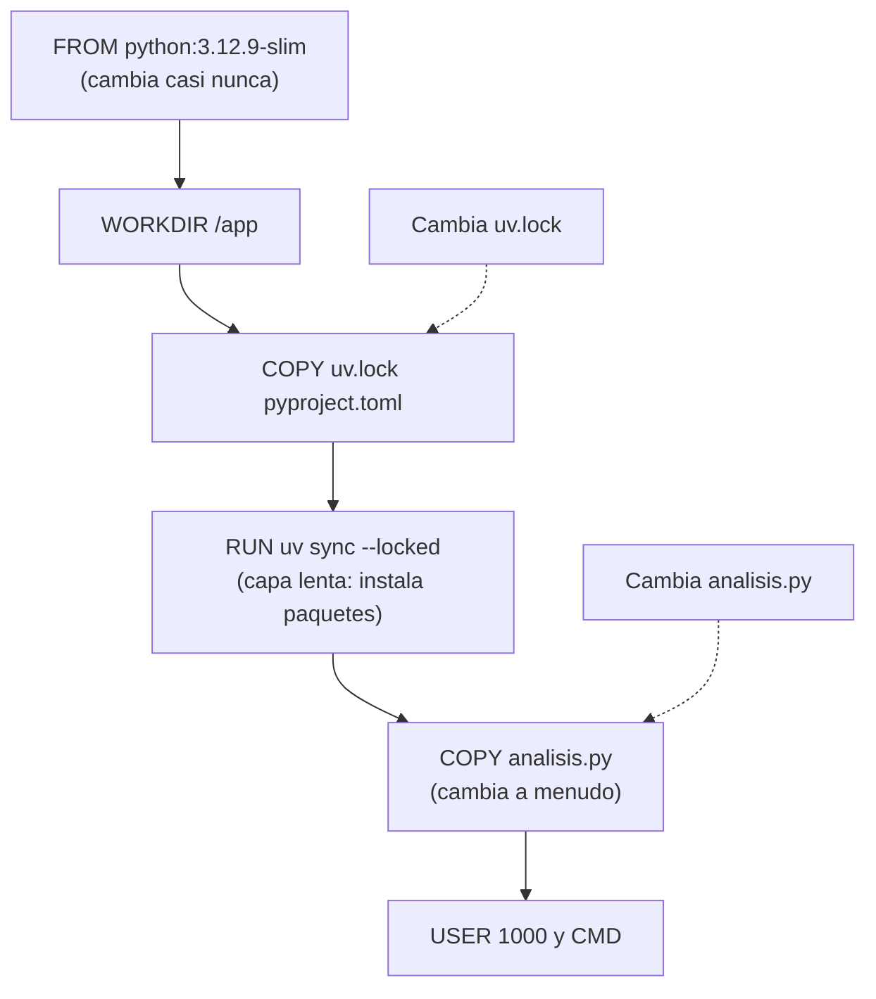

# B14-C17 — Contenedores y ambientes científicos

<!-- nav:top -->
[🏠 Programa](../../../../README.md) · [📚 Bloque B14](../../../tronco-comun/B14-computacion-cientifica-y-ciencia-abierta.md) · [← Anterior: B14-C16 — Computación distribuida y HPC](../B14-C16-computacion-distribuida-y-hpc/CLASE.md) · [Siguiente: B14-C18 — Flujos de datos espaciales →](../B14-C18-flujos-de-datos-espaciales/CLASE.md)
<!-- /nav -->

## 1. Ubicación, nivel y alcance

Decimoséptima clase del bloque B14. En [C12](../B14-C12-ejecucion-reproducible-con-uv/CLASE.md) fijaste los paquetes de Python con un archivo de bloqueo y viste que no fija el sistema operativo. Un **contenedor** da el paso siguiente: empaquetar también el sistema de archivos y la configuración en que corre el análisis. Nivel N2.

**Aviso de alcance:** el laboratorio **no construye ni ejecuta ningún contenedor**. Revisa texto (un Dockerfile de ejemplo) y simula con hashes cómo el caché de capas decide qué se reconstruye. Cualquier afirmación sobre el comportamiento real de Docker viene de su documentación, que consulté, no de una prueba.

Verás qué es un contenedor y una imagen, qué reproducen y qué no, las reglas de una definición reproducible (versión fija, directorio de trabajo, usuario no root, bloqueo) y el orden de las instrucciones para aprovechar el caché. No verás orquestación, redes ni seguridad en profundidad.

## 2. Por qué esta clase existe

Tu análisis funciona con el bloqueo de C12 en tu equipo, pero en el servidor del laboratorio falla porque falta una biblioteca del sistema. La pregunta motivadora es: **¿cómo entrego el análisis junto con todo lo que necesita para correr, de modo que otra persona lo ejecute igual?**

La decisión central es: **¿qué va dentro de la imagen y qué queda fuera?** Dentro, lo que debe ser idéntico (sistema base, paquetes, código); fuera, lo que cambia (datos grandes, resultados).

## 3. Lo que podrás hacer al terminar

1. Explicar qué es un contenedor, qué es una imagen y en qué se distinguen de una máquina virtual.
2. Revisar una definición de contenedor con reglas de reproducibilidad.
3. Ordenar las instrucciones para que el caché reutilice las capas lentas.
4. Distinguir lo que un contenedor reproduce de lo que no.
5. Decidir entre bloqueo de paquetes (C12) y contenedor para un caso concreto.
6. Declarar los límites de una definición que no se construyó.

La evidencia es la **definición de contenedor verificada** del ejercicio 12 (sección 20).

## 4. Con qué llegas y cómo comprobarlo

Necesitas C11 (huellas) y C12 (bloqueo). Cinco preguntas:

1. ¿Qué fija `uv.lock` y qué no? (C12)
2. ¿Qué es una suma de verificación? (C11)
3. ¿Qué es una capa en el sentido de «cambios acumulados»?
4. ¿Por qué `python:latest` no es reproducible?
5. ¿Qué es ejecutar como root y por qué conviene evitarlo?

<details>
<summary>Ver respuestas</summary>

1. Versiones y sumas de paquetes de Python; no el sistema ni el hardware. 2. Un resumen de bytes que identifica un archivo. 3. Un conjunto de cambios al sistema de archivos que se apila sobre otros. 4. Porque `latest` apunta a versiones distintas con el tiempo. 5. Es ejecutar con privilegios totales: un fallo da más poder a un atacante.
</details>

Con cuatro o cinco aciertos, sigue; con tres o menos, repasa C11 y C12.

## 5. Un caso real: lo que dice Docker sobre contenedores e imágenes

La documentación de Docker sobre contenedores (S1) los describe como **aislados** (cada componente corre en su propio proceso con influencia mínima sobre el equipo anfitrión), **autocontenidos** (incluyen lo que necesitan, sin depender de software preinstalado en el anfitrión), **portables** (funcionan igual en el equipo del desarrollador, en integración continua y en producción) e **independientes**. Contrasta con las máquinas virtuales: una MV ejecuta un sistema operativo completo con su propio núcleo; un contenedor es un proceso aislado que **comparte el núcleo del anfitrión**, por eso pesa menos. La página sobre imágenes (S2) las define como un paquete estandarizado con los archivos, binarios, bibliotecas y configuraciones para ejecutar un contenedor, con tres propiedades: **inmutables**, **por capas** (cada capa es un conjunto de cambios al sistema de archivos) y que empaquetan archivos y configuración. S1 no define imagen y S2 no explica los Dockerfiles.

El **ejemplo conductor** es un par de Dockerfiles sintéticos para un análisis ficticio (`analisis.py`): uno descuidado y uno revisado.

## 6. Vocabulario

Una **imagen** es el paquete inmutable; un **contenedor** es una instancia en ejecución de una imagen. Un **Dockerfile** es el texto con las instrucciones para construirla (`FROM`, `COPY`, `RUN`, `WORKDIR`, `USER`, `CMD`). Una **capa** es el resultado de una instrucción apilada sobre las anteriores. El **caché de capas** reutiliza las capas cuya instrucción y entradas no cambiaron. La **imagen base** es la que se declara con `FROM`. Una **etiqueta** (*tag*) nombra una versión de imagen; `latest` es una etiqueta móvil. Un **resumen** (*digest*) identifica una imagen por su contenido. **Root** es el usuario con todos los privilegios.

## 7. Modelo mental: capas apiladas, caché por prefijo

Cada instrucción añade una capa sobre la anterior. Si una instrucción o sus archivos de entrada cambian, esa capa y **todas las posteriores** se reconstruyen; las anteriores se reutilizan. Por eso se ordena de lo que cambia poco (sistema, dependencias) a lo que cambia mucho (tu código).



*Descripción textual:* una pila de capas, de arriba abajo: imagen base, directorio de trabajo, copia de los archivos de bloqueo, instalación de paquetes (la capa lenta), copia del script de análisis y, por último, usuario y orden de arranque. Cambiar el script solo afecta a las capas desde su copia hacia abajo; cambiar el archivo de bloqueo reconstruye desde su copia, incluida la instalación.

**Analogía y su límite.** Un pastel de capas: si cambias la crema de arriba, no rehaces el bizcocho de abajo. Límite: en una imagen real el caché depende de reglas internas de Docker que este modelo no replica.

## 8. La explicación, paso a paso

### 8.1 Qué es y qué reproduce un contenedor

Según S1, un contenedor es autocontenido y aislado, y comparte el núcleo del anfitrión. Reproduce **el sistema de archivos y la configuración** de la imagen: sistema base, bibliotecas, paquetes, código. **No** reproduce el núcleo, el hardware, el reloj ni los datos que montes desde fuera. Por eso dos contenedores idénticos en máquinas distintas pueden diferir en el último dígito de un cálculo (C10) si el procesador es distinto. (La parte del núcleo compartido viene de S1; la del hardware es una consecuencia que no probé.)

### 8.2 Reglas de revisión

El laboratorio aplica seis reglas, convenciones de esta clase: imagen base con **versión fija** (no `latest` ni sin etiqueta); **usuario no root** (`USER`); **directorio de trabajo** (`WORKDIR`); dependencias con **versiones fijadas**; **archivo de bloqueo** usado en la construcción; y **no usar `COPY .` antes de instalar dependencias**. El Dockerfile descuidado (`FROM python:latest`, `COPY . /app`, `RUN pip install numpy scipy`, `CMD python …`) incumple las seis: **6 hallazgos**. El revisado (`FROM python:3.12.9-slim`, `WORKDIR /app`, `COPY uv.lock pyproject.toml ./`, instalación con `uv sync --locked`, `COPY analisis.py ./`, `USER 1000`) tiene **0**.

### 8.3 El orden importa: el caché

Con la huella encadenada del laboratorio, el Dockerfile revisado tiene 7 instrucciones. Si cambia solo `analisis.py`, se **reutilizan 4 capas** y se reconstruyen 3; si cambia `uv.lock`, se reutilizan 2 y se reconstruyen 5 (incluida la instalación, la lenta). En el descuidado, `COPY . /app` hace que **cualquier cambio de cualquier archivo** reconstruya todo salvo `FROM`: se reutiliza 1 de 4. El orden «dependencias primero, código después» ahorra la capa lenta cuando cambia el código. (Es una simulación de la idea, no del algoritmo real.)

### 8.4 Fijar de verdad la base

`python:3.12.9-slim` es una etiqueta: apunta a una imagen que puede reconstruirse (con parches del sistema) y cambiar con el tiempo. Para fijar el contenido exacto se usa el **resumen** (*digest*) de la imagen, que identifica por contenido, el mismo principio de C11. Esta clase no consultó la documentación de resúmenes: se menciona como práctica general.

### 8.5 Datos y resultados fuera de la imagen

Los datos grandes y los resultados se **montan** al ejecutar, no se meten en la imagen: la imagen debe seguir siendo pequeña, inmutable y reutilizable, y los datos se versionan aparte (C11). Un contenedor que lleva datos dentro oculta su procedencia.

### 8.6 Bloqueo o contenedor

El **bloqueo** (C12) basta cuando el sistema no importa y todos usan Python gestionable; el **contenedor** cuando importa el sistema (bibliotecas nativas, compiladores, otro sistema operativo) o cuando necesitas entregar el entorno completo. Pueden combinarse: el contenedor instala desde el bloqueo, como en el ejemplo. Un contenedor sin bloqueo repite el problema de las versiones móviles dentro de la imagen.

## 9. Magnitudes, símbolos y unidades

| Concepto | Qué es | Unidad | Nota |
|---|---|---|---|
| hallazgos | incumplimientos de reglas | conteo | 6 (descuidado) y 0 (revisado) |
| capas | instrucciones apiladas | conteo | 7 (revisado), 4 (descuidado) |
| capas reutilizadas | capas cuya huella no cambia | conteo | 4, 2 y 1 en los casos del laboratorio |
| huella de capa | SHA-256 encadenado | 64 dígitos hexadecimales | modelo, no el de Docker |

## 10. Convenciones y referencias

Los Dockerfiles y los archivos (`uv.lock`, `analisis.py`) son **sintéticos**. Las reglas de revisión son una convención didáctica, no una norma ni la lista de buenas prácticas de ningún organismo. La simulación del caché no es el algoritmo de Docker. No se construyó nada; Docker estaba instalado en el equipo de redacción pero no se usó.

## 11. De dónde sale lo que afirmamos

| ID | Fuente | Localizador | Respalda | Estado |
|---|---|---|---|---|
| S1 | Docker, *What is a container?* | https://docs.docker.com/get-started/docker-concepts/the-basics/what-is-a-container/ | Contenedor aislado, autocontenido, portable e independiente; comparte el núcleo del anfitrión frente a la MV con su núcleo | Página consultada el 2026-11-05 (mutable) |
| S2 | Docker, *What is an image?* | https://docs.docker.com/get-started/docker-concepts/the-basics/what-is-an-image/ | Imagen inmutable, por capas, con archivos y configuración | Página consultada el 2026-11-05 (mutable) |

Límites: no consulté la documentación del Dockerfile, del caché de capas, de los resúmenes de imagen ni la especificación OCI. Las reglas de revisión y la simulación son de esta clase. No se probó ningún contenedor.

## 12. Cómo ver el resultado

Versión accesible de las comprobaciones.

| Caso | Resultado |
|---|---|
| Dockerfile descuidado | 6 hallazgos |
| Dockerfile revisado | 0 hallazgos |
| Revisado, cambia `analisis.py` | 4 de 7 capas reutilizadas |
| Revisado, cambia `uv.lock` | 2 de 7 capas reutilizadas |
| Descuidado, cambia `analisis.py` | 1 de 4 capas reutilizadas |

## 13. Ejemplo trabajado: del Dockerfile descuidado al revisado

1. **Base:** `python:latest` → `python:3.12.9-slim` (versión fija).
2. **Directorio:** añadir `WORKDIR /app`.
3. **Dependencias:** `pip install numpy scipy` → copiar `uv.lock` y `pyproject.toml` e instalar con `uv sync --locked`.
4. **Código:** `COPY . /app` → copiar solo `analisis.py`, después de instalar.
5. **Usuario:** añadir `USER 1000`.
6. **Arranque:** `CMD ["uv", "run", "python", "analisis.py"]`.
7. **Verifica:** el revisor da 0 hallazgos; al cambiar el script, se reutilizan 4 de 7 capas, frente a 1 de 4 antes.

**Paso final · incertidumbre.** Que el revisor dé 0 hallazgos no prueba que la imagen se construya ni que reproduzca el resultado; solo que el texto cumple las reglas elegidas. Lo que falta, construirla y comparar resultados en dos máquinas, no se hizo.

## 14. Comparación: bloqueo, contenedor y máquina virtual

Un **bloqueo** (C12) es ligero y suficiente para Python. Un **contenedor** añade el sistema de archivos y comparte el núcleo, con poco peso (S1). Una **máquina virtual** lleva un sistema operativo completo: más aislamiento y más coste (S1). La elección depende de qué debe ser idéntico y cuánto estás dispuesto a pagar.

## 15. Práctica guiada

**Ejercicio 1 · con los pasos.** Revisa `FROM python` + `COPY . .` + `CMD python a.py` con las reglas. *Pasos:* aplica las seis reglas (sección 8.2).

<details><summary>Solución comentada</summary>

Hallazgos: base sin versión fija; falta `WORKDIR`; falta `USER`; `COPY .` antes de instalar (aquí ni se instala); sin archivo de bloqueo. Cinco de seis (no hay `pip install` sin versiones porque no se instala nada).
</details>

**Ejercicio 2 · con una pista.** Si cambia la línea `RUN` de instalación, ¿qué capas se reconstruyen en el Dockerfile revisado? *Pista:* esa capa y las siguientes.

<details><summary>Solución comentada</summary>

La instalación y todas las posteriores (`COPY analisis.py`, `USER`, `CMD`); se reutilizan `FROM`, `WORKDIR` y `COPY uv.lock …`.
</details>

**Ejercicio 3 · casi autónomo.** ¿Por qué el contenedor no garantiza el mismo último dígito en dos máquinas?

<details><summary>Solución comentada</summary>

Comparte el núcleo del anfitrión (S1) y se ejecuta sobre el procesador de cada máquina; instrucciones y orden de operaciones pueden diferir (C10, C15).
</details>

## 16. Práctica autónoma, transferencia e integrador

**Ejercicio 4.** ¿Qué diferencia hay entre una imagen y un contenedor?

<details><summary>Solución comentada</summary>

La imagen es el paquete inmutable; el contenedor, una instancia en ejecución creada a partir de ella (S1, S2).
</details>

**Ejercicio 5.** ¿Por qué `FROM python:latest` rompe la reproducibilidad?

<details><summary>Solución comentada</summary>

`latest` es una etiqueta móvil: apunta a imágenes distintas con el tiempo. Una reconstrucción dentro de seis meses podría usar otra versión de Python y otras bibliotecas.
</details>

**Ejercicio 6.** Propón una séptima regla de revisión y cómo la comprobarías.

<details><summary>Solución comentada</summary>

Por ejemplo, «no incluir datos en la imagen»: buscar `COPY` de archivos de datos grandes. Otra: «exponer la versión del código en una etiqueta». Cualquiera razonable con su comprobación.
</details>

**Ejercicio 7.** Ordena estas instrucciones para aprovechar el caché: `COPY analisis.py`, `FROM`, `RUN uv sync`, `COPY uv.lock`.

<details><summary>Solución comentada</summary>

`FROM`, `COPY uv.lock`, `RUN uv sync`, `COPY analisis.py`: de lo que menos cambia a lo que más.
</details>

**Ejercicio 8.** ¿Qué parte de la reproducibilidad **no** resuelve un contenedor?

<details><summary>Solución comentada</summary>

La versión de los datos (C11), la semilla (C09), el núcleo y el hardware del anfitrión, y la tolerancia numérica (C10).
</details>

**Ejercicio 9 · transferencia.** Un colega mete 5 GB de datos dentro de la imagen. ¿Qué problemas trae?

<details><summary>Solución comentada</summary>

Imagen enorme que cuesta distribuir; cualquier cambio de datos obliga a reconstruir y re-subir; oculta la procedencia. Mejor montar los datos y versionarlos aparte.
</details>

**Ejercicio 10 · transferencia.** Un artículo dice «análisis reproducible: Docker». ¿Qué le pides para creerlo?

<details><summary>Solución comentada</summary>

El Dockerfile con versiones fijas, el bloqueo, el resumen de la imagen, la versión y huella de los datos, las instrucciones de ejecución y una comprobación de que el resultado coincide dentro de una tolerancia.
</details>

**Ejercicio 11 · transferencia.** Tu clúster no permite Docker. ¿Alternativas?

<details><summary>Solución comentada</summary>

Entornos de módulos del centro o contenedores compatibles con HPC que el centro soporte (consulta su documentación); en último caso, el bloqueo de C12. No lo investigué: es una pregunta para la documentación de tu centro.
</details>

**Ejercicio 12 · integrador.** Entrega una **definición de contenedor verificada** para un análisis propio: el Dockerfile, la revisión con las seis reglas más una propia, el orden justificado con el caché, qué queda fuera de la imagen, qué no reproduce y la advertencia de si se construyó o no.

<details><summary>Solución modelo</summary>

Debe tener el Dockerfile con versión fija y bloqueo, la tabla de reglas con aprobado/falla, la explicación del orden con un recuento de capas reutilizadas al cambiar el código, la separación datos–imagen y una declaración honesta sobre si construiste y comparaste resultados.
</details>

## 17. Laboratorio

El script [revisar_dockerfile.py](revisar_dockerfile.py) revisa los dos Dockerfiles con las seis reglas y simula el caché con hashes encadenados. **No construye ningún contenedor.** Falla si el descuidado tiene menos de cinco hallazgos, si el revisado tiene alguno o si los conteos de capas no coinciden con lo esperado.

**Datos:** sintéticos. **Predice antes de ejecutar:** ¿cuántas capas se reutilizan al cambiar solo el script? **Ejecución del 2026-11-05 (Python 3.12.9):**

```text
Dockerfile descuidado: 6 hallazgos
  - imagen base sin versión fija (latest o sin etiqueta)
  - se ejecuta como root (falta USER)
  - falta WORKDIR
  - pip install sin versiones fijadas
  - COPY . antes de instalar dependencias: cualquier cambio invalida el caché de todo
  - no usa un archivo de bloqueo
Dockerfile revisado: 0 hallazgos
cambia analisis.py: 4 de 7 capas reutilizadas, 3 reconstruidas
cambia uv.lock: 2 de 7 capas reutilizadas, 5 reconstruidas
descuidado, cambia analisis.py: 1 de 4 capas reutilizadas
Pruebas superadas.
```

```bash
python programa/clases/B14/B14-C17-contenedores-y-ambientes-cientificos/revisar_dockerfile.py
```

**Límites:** revisión de texto; las reglas son una convención; el caché es una simulación; no se construyó ni ejecutó ninguna imagen.

## 18. Errores frecuentes y cómo corregirlos

**Usar `latest`.** Se corrige con el ejercicio 5.

**`COPY .` antes de instalar.** Se corrige con la sección 8.3 y el ejercicio 7.

**Meter datos en la imagen.** Se corrige con el ejercicio 9.

**Creer que el contenedor lo reproduce todo.** Se corrige con los ejercicios 3 y 8.

**Ejecutar como root.** Se corrige con la regla `USER` de la sección 8.2.

## 19. Cómo sabrás que vas bien

Tras 8.2: ¿revisas un Dockerfile con las seis reglas? Si no, rehaz el ejercicio 1. Tras 8.3: ¿predices las capas reutilizadas? Si no, rehaz el 2. Tras el ejemplo trabajado: ¿qué falta para afirmar que reproduce? Tras el laboratorio: ¿qué no simula? Al final: ¿qué dejas fuera de tu imagen?

## 20. Qué entregas y cómo se evalúa

El producto es tu **definición de contenedor verificada** del ejercicio 12.

| Criterio | Inicial | En desarrollo | Logrado | Destacado |
|---|---|---|---|---|
| Reglas | Ninguna | Algunas | Las seis | Más una propia justificada |
| Caché | Sin orden | Orden sin justificar | Orden con recuento | Con simulación o medición real |
| Alcance | Cree que lo reproduce todo | Menciona límites | Declara qué no reproduce | Y qué no probó |
| Fuentes y alcance | Sin fuente | Fuente sin alcance | Fuente con alcance | Distingue documentación de convención |

**Condiciones críticas:** no afirmar que una imagen reproduce un resultado sin haberla construido y comparado; no incluir credenciales ni datos sensibles en la imagen; no presentar una convención como norma.

## 21. Ética, seguridad y límites

Una imagen puede contener credenciales, claves o datos personales sin que lo notes, y se comparte con su historia de capas: no las incluyas. Descargar imágenes base es ejecutar código de terceros: usa fuentes de confianza y versiones fijas. Accesibilidad: tablas en texto. Material educativo.

## 22. Para cerrar y seguir

Un contenedor empaqueta el sistema de archivos y la configuración, comparte el núcleo del anfitrión y se construye por capas; una definición reproducible fija versiones, usa el bloqueo y ordena de lo estable a lo cambiante. Esta clase revisó texto y no construyó ninguna imagen. Queda abierta una pregunta: ¿cómo compruebas que dos construcciones separadas dan el mismo resultado?

**Glosario español–inglés.** contenedor · *container*; imagen · *image*; capa · *layer*; caché · *cache*; etiqueta · *tag*; resumen de imagen · *image digest*; máquina virtual · *virtual machine*; usuario no privilegiado · *non-root user*.

**Continuidad.** B14-C18 describe flujos de datos que entran a estos entornos; B14-C19 trata cómo publicar el paquete; B14-C20 integra todo en un proyecto final.

**Referencias:** ver sección 11.

<!-- nav:bottom -->
---

[← Anterior: B14-C16 — Computación distribuida y HPC](../B14-C16-computacion-distribuida-y-hpc/CLASE.md) · [📚 Bloque B14](../../../tronco-comun/B14-computacion-cientifica-y-ciencia-abierta.md) · [Siguiente: B14-C18 — Flujos de datos espaciales →](../B14-C18-flujos-de-datos-espaciales/CLASE.md)
<!-- /nav -->
