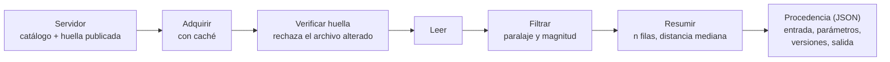

# B14-C18 — Flujos de datos espaciales

<!-- nav:top -->
[🏠 Programa](../../../../README.md) · [📚 Bloque B14](../../../tronco-comun/B14-computacion-cientifica-y-ciencia-abierta.md) · [← Anterior: B14-C17 — Contenedores y ambientes científicos](../B14-C17-contenedores-y-ambientes-cientificos/CLASE.md) · [Siguiente: B14-C19 — Publicación de código y datos →](../B14-C19-publicacion-de-codigo-y-datos/CLASE.md)
<!-- /nav -->

## 1. Ubicación, nivel y alcance

Decimoctava clase del bloque B14. Ya sabes leer tablas ([C05](../B14-C05-tablas-astronomicas-y-catalogos/CLASE.md)), formatos ([C06](../B14-C06-formato-fits-y-encabezados/CLASE.md), [C07](../B14-C07-hdf5-y-almacenamiento-cientifico/CLASE.md)), limpiar ([C08](../B14-C08-pandas-y-limpieza-de-datos/CLASE.md)) y versionar ([C11](../B14-C11-control-de-versiones-de-datos/CLASE.md)). Ahora los encadenas en un **flujo**: de la adquisición de datos de un archivo espacial hasta un resultado, con cada paso verificado y registrado. Nivel N2.

**Aviso de alcance:** el laboratorio **no accede a ningún archivo ni servicio remoto**. El «servidor» es un directorio temporal con un catálogo sintético, y la consulta ADQL se escribe como texto equivalente sin enviarla.

Verás las etapas de un flujo, la verificación de la huella al adquirir, el caché, el registro de procedencia y la forma de una consulta a un servicio astronómico de tablas. No verás autenticación, descargas masivas ni servicios concretos de misión (B14-C21 y C22, programadas).

## 2. Por qué esta clase existe

Un artículo usa «datos de un archivo público filtrados por paralaje y magnitud». Dos años después nadie puede repetir el filtro: el archivo se actualizó, los parámetros no se anotaron y la consulta no se guardó. La pregunta motivadora es: **¿qué debe registrar un flujo de datos para que su resultado se pueda repetir y auditar?**

La decisión central es: **¿qué se registra de cada etapa (entrada, parámetros, versiones, salida) y cuándo se vuelve a descargar?** Un flujo bien diseñado descarga una vez, verifica siempre y registra todo.

## 3. Lo que podrás hacer al terminar

1. Descomponer un flujo en etapas con entradas y salidas definidas.
2. Verificar la integridad de un archivo adquirido con su huella publicada y rechazar el alterado.
3. Usar una caché para no repetir descargas, sin perder la verificación.
4. Escribir una consulta de filtrado y comprobar su resultado con un conteo independiente.
5. Registrar la procedencia (huellas, parámetros, versiones) de cada resultado.
6. Explicar qué es una consulta ADQL/TAP y declarar que no se envió.

La evidencia es el **diagrama de flujo con procedencia** del ejercicio 12 (sección 20).

## 4. Con qué llegas y cómo comprobarlo

Necesitas C05, C08 y C11. Cinco preguntas:

1. ¿Qué es la distancia de una estrella con paralaje 5 mas? (200 pc.)
2. ¿Qué es una huella SHA-256 y qué comprueba? (C11)
3. ¿Qué filtra `df[df["mag"] < 15]`?
4. ¿Por qué un resultado debe llevar sus parámetros?
5. ¿Qué es una caché?

<details>
<summary>Ver respuestas</summary>

1. `1000/5 = 200 pc`. 2. Un resumen de bytes; comprueba que el archivo es el esperado. 3. Las filas con magnitud menor que 15 (más brillantes que 15). 4. Para poder repetirlo e interpretarlo. 5. Una copia local que evita repetir un trabajo costoso.
</details>

Con cuatro o cinco aciertos, sigue; con tres o menos, repasa C05 y C11.

## 5. Un caso real: el protocolo TAP del Observatorio Virtual

La Alianza Internacional del Observatorio Virtual (IVOA) define el **Table Access Protocol (TAP)**, un protocolo de servicio para acceder a datos de tablas generales: catálogos astronómicos y tablas de bases de datos, con acceso a los metadatos y a los datos (S1). Acepta consultas en el lenguaje **ADQL** (*Astronomical Data Query Language*), con extensiones espaciales, y ofrece modos síncrono y asíncrono (S1 no explica cómo difieren). La versión más reciente que vi es TAP 1.1, una recomendación del IVOA de 27 de septiembre de 2019 (S1). Por eso muchos archivos permiten la misma consulta de filtrado por escrito, en vez de descargar todo.

El **ejemplo conductor** es un catálogo **sintético** de 5000 estrellas ficticias (paralaje `0,5 + Exp(2)` mas, magnitud `N(14, 2)`, semilla 20261105) que hace de servidor local. La consulta equivalente en ADQL sería `SELECT id, paralaje_mas, mag FROM catalogo WHERE paralaje_mas > 2.0 AND mag < 15.0`, escrita pero **no enviada**.

## 6. Vocabulario

Un **flujo de datos** (*pipeline*) es una cadena de etapas donde la salida de una es la entrada de la siguiente. La **adquisición** obtiene los datos del origen. La **verificación** comprueba su integridad con una huella. La **caché** guarda localmente lo ya adquirido. Una **consulta** selecciona filas y columnas con criterios. **ADQL** es el lenguaje de consultas astronómicas del IVOA y **TAP** el protocolo para enviarlas (S1). La **procedencia** (*provenance*) es el registro de cómo se obtuvo un resultado: entradas, parámetros, versiones y salida. El **conteo independiente** es un recuento por un método distinto del que se verifica.

## 7. Modelo mental: cada etapa deja una huella

Cada etapa recibe una entrada con su huella, aplica un parámetro y entrega una salida con la suya. El registro de procedencia une las huellas y los parámetros. Si algo cambia, la huella cambia y se ve.



*Descripción textual:* el servidor publica el catálogo y su huella; el flujo adquiere el archivo (usando una caché si ya lo tiene), verifica la huella y rechaza el alterado, lee la tabla, filtra por paralaje y magnitud, resume y escribe un registro de procedencia en JSON con entrada, parámetros, versiones y salida.

**Analogía y su límite.** Una cadena de custodia en un laboratorio: cada traspaso se firma. Límite: la cadena de custodia exige personas y sellos; el registro de procedencia no impide que alguien lo falsifique.

## 8. La explicación, paso a paso

### 8.1 Adquirir con caché y verificar

El laboratorio publica el archivo y su huella (`65aa3cdbf61fc5a2…`). La primera ejecución copia el archivo a la caché verificando que su huella coincide con la publicada; la segunda ejecución encuentra la caché, vuelve a comprobar su huella y **no descarga de nuevo**: dos ejecuciones, una descarga. La verificación se repite aunque haya caché: una caché alterada se detectaría.

### 8.2 Filtrar y comprobar

La consulta (`paralaje > 2 mas` y `mag < 15`) devuelve 1594 filas, con distancia mediana 290,12 pc. Un **conteo independiente**, con arreglos de NumPy y sin pandas, da 1594: coincide. Con `paralaje > 3 mas` quedan 960 filas (mediana 225,31 pc): un filtro más estricto, menos filas, y distancias más cortas porque paralajes mayores significan estrellas más cercanas.

### 8.3 La huella de la salida

Cada resultado se resume en JSON con claves ordenadas y se calcula su huella. Dos ejecuciones con los mismos parámetros dan la misma huella; un parámetro distinto, otra. La huella de salida es lo que se compara en una prueba de regresión (C10).

### 8.4 El registro de procedencia

El laboratorio produce un JSON con cinco claves: `entrada` (archivo y huella), `parametros` (`p_min_mas`, `mag_max`), `consulta_adql_equivalente`, `versiones` (Python, NumPy, pandas) y `salida` (resumen y huella). Con eso, quien lo lea sabe qué datos, qué filtros y qué software produjeron el resultado.

### 8.5 Un origen que cambia

Si el archivo del servidor se altera (el laboratorio le añade un salto de línea), la huella ya no coincide y la adquisición **rechaza** el archivo con un error explícito. En un archivo real que se actualiza, lo correcto es publicar una nueva versión con su propia huella, no sobrescribir la anterior.

### 8.6 Lo que este flujo no cubre

No hay red, autenticación, reintentos, paginación ni descargas parciales; el servidor es local y la consulta ADQL no se envió, de modo que no sé qué respondería un servicio real. Un catálogo real tiene además épocas, unidades y errores por columna (C05), y la selección por paralaje introduce sesgos (que se estudian con estadística en B12).

## 9. Magnitudes, símbolos y unidades

| Símbolo | Qué es | Unidad | Nota |
|---|---|---|---|
| `ϖ` (`paralaje_mas`) | paralaje | mas | sintético: `0,5 + Exp(2)` |
| `m` (`mag`) | magnitud aparente | magnitud (adimensional) | sintético: `N(14, 2)` |
| `d` | distancia | pc | `1000/ϖ` |
| `n_filas` | filas seleccionadas | conteo | 1594 y 960 |
| huella | SHA-256 | 64 dígitos hexadecimales | C11 |

## 10. Convenciones y referencias

Datos **sintéticos**; el catálogo no corresponde a ninguna estrella real. La relación `d = 1000/ϖ` es la de C05. La consulta ADQL es un texto de ejemplo con la sintaxis estándar `SELECT … FROM … WHERE`; no se validó contra ningún servicio. Versiones: Python 3.12.9, NumPy 2.5.4, pandas 3.1.1.

## 11. De dónde sale lo que afirmamos

| ID | Fuente | Localizador | Respalda | Estado |
|---|---|---|---|---|
| S1 | IVOA, *Table Access Protocol (TAP)* | https://www.ivoa.net/documents/TAP/ | Propósito del protocolo, ADQL, modos síncrono y asíncrono, versión 1.1 (recomendación del 2019-09-27) | Página consultada el 2026-11-05 (mutable); no leí la especificación completa |

Límites: no consulté la especificación de ADQL ni de TAP en detalle ni ningún servicio concreto; la sintaxis de la consulta es la que cualquier lector de SQL reconoce y no está validada. El comportamiento de pandas y NumPy se comprobó con el laboratorio.

## 12. Cómo ver el resultado

Versión accesible.

| Parámetros | Filas | Distancia mediana (pc) |
|---|---|---|
| `paralaje > 2`, `mag < 15` | 1594 | 290,12 |
| `paralaje > 3`, `mag < 15` | 960 | 225,31 |

Descargas en dos ejecuciones iguales: 1. Huella de salida: igual con los mismos parámetros, distinta con otros.

## 13. Ejemplo trabajado: un flujo auditable

1. **Publica** el catálogo sintético y su huella.
2. **Adquiere** con caché: 1 descarga en 2 ejecuciones.
3. **Verifica** la huella: coincide.
4. **Filtra** con `p > 2 mas` y `mag < 15`: 1594 filas.
5. **Comprueba** con un conteo independiente: 1594.
6. **Resume**: distancia mediana 290,12 pc.
7. **Registra** la procedencia y la huella de la salida.
8. **Altera** el archivo del servidor: la adquisición lo rechaza.

**Paso final · incertidumbre.** Todo es exacto porque los datos son sintéticos y locales. Con un servicio real habría que registrar también la fecha, la versión del archivo y la consulta enviada, y el resultado podría cambiar si el archivo se actualiza.

## 14. Comparación: descargar todo, consultar en el servidor y usar caché

**Descargar todo y filtrar local** es simple y caro para archivos grandes. **Consultar en el servidor** (TAP/ADQL) reduce lo transferido pero depende de la disponibilidad y del servicio. Una **caché verificada** evita repetir descargas y da independencia, a costa de espacio y del riesgo de datos obsoletos si no se comprueba la versión. Un buen flujo combina consulta y caché con huella.

## 15. Práctica guiada

**Ejercicio 1 · con los pasos.** ¿Cuántas descargas hacen tres ejecuciones consecutivas con la misma huella? *Pasos:* primera: descarga; siguientes: caché válida (sección 8.1).

<details><summary>Solución comentada</summary>

Una: las dos siguientes encuentran la caché y la verifican sin descargar.
</details>

**Ejercicio 2 · con una pista.** ¿Por qué se vuelve a comprobar la huella aunque exista la caché? *Pista:* ¿qué podría haber cambiado el archivo local?

<details><summary>Solución comentada</summary>

Un disco corrupto, una edición accidental o un archivo antiguo con el mismo nombre: la huella detecta los tres.
</details>

**Ejercicio 3 · casi autónomo.** Con `paralaje > 3 mas`, ¿por qué la mediana de distancia (225 pc) es menor que con `> 2 mas` (290 pc)?

<details><summary>Solución comentada</summary>

Paralaje mayor = distancia menor (`d = 1000/ϖ`). El filtro más estricto deja solo las estrellas más cercanas, así que su mediana baja.
</details>

## 16. Práctica autónoma, transferencia e integrador

**Ejercicio 4.** Calcula la distancia máxima que admite el filtro `paralaje > 2 mas`.

<details><summary>Solución comentada</summary>

`d < 1000/2 = 500 pc`. Todo el resultado de la primera consulta está a menos de 500 pc; con `> 3 mas`, a menos de 333 pc.
</details>

**Ejercicio 5.** ¿Por qué el conteo independiente se hace con otro método y no con la misma línea de pandas?

<details><summary>Solución comentada</summary>

Repetir la misma línea repetiría el mismo error (por ejemplo, `>` frente a `>=` o un `&` mal precedido). Un método distinto detecta fallos de implementación.
</details>

**Ejercicio 6.** Escribe en ADQL la consulta equivalente a filtrar `mag < 12` y `paralaje_mas > 5`.

<details><summary>Solución comentada</summary>

`SELECT id, paralaje_mas, mag FROM catalogo WHERE paralaje_mas > 5 AND mag < 12`. Es la sintaxis de la clase; no se validó contra un servicio.
</details>

**Ejercicio 7.** El registro de procedencia no incluye la fecha de adquisición. ¿Qué problema trae?

<details><summary>Solución comentada</summary>

Si el archivo de origen se actualiza, no se sabe qué versión se usó. La huella de entrada lo mitiga (identifica el archivo exacto), pero la fecha ayuda a localizar la versión publicada entonces.
</details>

**Ejercicio 8.** Si el servidor entrega un archivo distinto del esperado, ¿qué hace el flujo del laboratorio?

<details><summary>Solución comentada</summary>

Lanza un error («la huella del archivo no coincide con la publicada») y no lo guarda en la caché. Hay que investigar antes de seguir.
</details>

**Ejercicio 9 · transferencia.** Quieres repetir un análisis publicado hace cinco años que cita «el catálogo X». ¿Qué le pides al autor?

<details><summary>Solución comentada</summary>

La versión exacta del catálogo (huella o identificador de versión), la consulta enviada, los parámetros, la fecha y las versiones del software. Sin la huella no sabrás si es el mismo archivo.
</details>

**Ejercicio 10 · transferencia.** Un colega filtra por `mag < 15` en un catálogo con magnitudes ausentes. ¿Qué ocurre con esas filas y qué haces?

<details><summary>Solución comentada</summary>

Una comparación con `NaN` es falsa (C08): quedan fuera sin aviso. Cuenta cuántas hay antes de filtrar y decide si importa; regístralo en la procedencia.
</details>

**Ejercicio 11 · transferencia.** El servicio limita cada consulta a 100 000 filas. ¿Cómo adaptas el flujo?

<details><summary>Solución comentada</summary>

Divides la consulta en rangos (por ejemplo, por identificador o por trozos de cielo), verificas que los rangos no se solapan ni dejan huecos, y compruebas que el total coincide con un conteo del servicio. Documentas los rangos en la procedencia.
</details>

**Ejercicio 12 · integrador.** Entrega un **diagrama de flujo con procedencia** de un flujo sintético propio: etapas con entradas y salidas, verificación de huella, caché, consulta con conteo independiente, JSON de procedencia, comportamiento ante un archivo alterado y lista de lo que no cubre.

<details><summary>Solución modelo</summary>

Debe incluir el diagrama con descripción textual, la tabla de resultados como la de la sección 12 con tus números, el JSON de procedencia con huellas y parámetros, la prueba del archivo alterado y una sección de límites (sin red, sin autenticación, sin servicio real). Se acepta cualquier flujo sintético.
</details>

## 17. Laboratorio

El script [flujo_con_procedencia.py](flujo_con_procedencia.py) genera el catálogo sintético en un directorio temporal, adquiere con caché y verificación, filtra, comprueba con un conteo independiente, calcula la huella de salida, registra la procedencia y verifica el rechazo de un archivo alterado. **No usa red.**

**Datos:** sintéticos (semilla 20261105). **Predice antes de ejecutar:** ¿cuántas descargas harán dos ejecuciones iguales? **Ejecución del 2026-11-05 (Python 3.12.9, NumPy 2.5.4, pandas 3.1.1):**

```text
catálogo sintético: sha256 = 65aa3cdbf61fc5a2...
consulta (p > 2 mas, mag < 15): {'n_filas': 1594, 'distancia_mediana_pc': 290.123373}
descargas realizadas en 2 ejecuciones: 1 (la segunda usa la caché)
conteo independiente = 1594 (coincide)
consulta (p > 3 mas, mag < 15): {'n_filas': 960, 'distancia_mediana_pc': 225.313821}; huella de salida distinta: True
archivo alterado en origen rechazado: la huella del archivo no coincide con la publicada
procedencia (JSON, claves): ['consulta_adql_equivalente', 'entrada', 'parametros', 'salida', 'versiones']
consulta ADQL equivalente (no enviada): SELECT id, paralaje_mas, mag FROM catalogo WHERE paralaje_mas > 2.0 AND mag < 15.0
Pruebas superadas.
```

```bash
python programa/clases/B14/B14-C18-flujos-de-datos-espaciales/flujo_con_procedencia.py
```

**Límites:** sin red ni servicio real; la consulta ADQL no se validó ni se envió; el catálogo es sintético y sin errores por columna.

## 18. Errores frecuentes y cómo corregirlos

**No registrar parámetros ni versiones.** Se corrige con el ejercicio 9 y la sección 8.4.

**Confiar en la caché sin verificar.** Se corrige con el ejercicio 2.

**Verificar con la misma línea que se verifica.** Se corrige con el ejercicio 5.

**Ignorar los valores ausentes al filtrar.** Se corrige con el ejercicio 10.

**Sobrescribir el origen sin cambiar la versión.** Se corrige con la sección 8.5.

## 19. Cómo sabrás que vas bien

Tras 8.1: ¿cuántas descargas hace tu flujo? Si no lo sabes, rehaz el ejercicio 1. Tras 8.2: ¿tu conteo independiente es realmente independiente? Si no, rehaz el 5. Tras el ejemplo trabajado: ¿qué falta para repetir esto con un servicio real? Tras el laboratorio: ¿qué no cubre? Al final: ¿qué dice tu registro de procedencia de la versión del origen?

## 20. Qué entregas y cómo se evalúa

El producto es tu **diagrama de flujo con procedencia** del ejercicio 12.

| Criterio | Inicial | En desarrollo | Logrado | Destacado |
|---|---|---|---|---|
| Etapas | Un script | Etapas sin entradas | Etapas con entradas y salidas | Con verificación por etapa |
| Integridad | Ninguna | Huella al adquirir | Huella y rechazo | Y caché verificada |
| Procedencia | Ninguna | Parámetros | Entrada, parámetros y versiones | Con huella de salida |
| Fuentes y alcance | Sin fuente | Fuente sin alcance | Fuente con alcance | Distingue lo sintético de lo remoto |

**Condiciones críticas:** no presentar una consulta no enviada como resultado de un servicio; no omitir la huella de entrada; no presentar datos sintéticos como observados.

## 21. Ética, seguridad y límites

Los archivos públicos tienen condiciones de uso y de cita; consúltalas. No guardes credenciales en el registro de procedencia. Descargar masivamente de un servicio público puede perjudicar a otros usuarios: respeta sus límites. Accesibilidad: tablas en texto. Material educativo.

## 22. Para cerrar y seguir

Un flujo de datos espaciales descarga una vez, verifica siempre con la huella, filtra con criterios comprobados por un método independiente y registra entrada, parámetros, versiones y salida. Esta clase no usó ningún servicio real. Queda abierta una pregunta: ¿cómo detectas que el origen cambió sin que cambiara su nombre?

**Glosario español–inglés.** flujo de datos · *data pipeline*; adquisición · *acquisition*; verificación · *verification*; caché · *cache*; procedencia · *provenance*; consulta · *query*; protocolo de acceso a tablas · *Table Access Protocol (TAP)*; lenguaje de consultas astronómicas · *Astronomical Data Query Language (ADQL)*.

**Continuidad.** B14-C19 trata cómo publicar el código y los datos de un flujo así; B14-C20 lo integra en un proyecto; B14-C21 y C22 (programadas) cubren archivos concretos de misiones y de heliofísica.

**Referencias:** ver sección 11.

<!-- nav:bottom -->
---

[← Anterior: B14-C17 — Contenedores y ambientes científicos](../B14-C17-contenedores-y-ambientes-cientificos/CLASE.md) · [📚 Bloque B14](../../../tronco-comun/B14-computacion-cientifica-y-ciencia-abierta.md) · [Siguiente: B14-C19 — Publicación de código y datos →](../B14-C19-publicacion-de-codigo-y-datos/CLASE.md)
<!-- /nav -->
