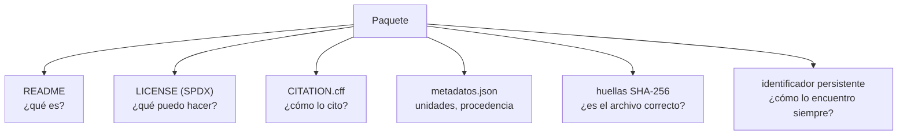

# B14-C19 — Publicación de código y datos

<!-- nav:top -->
[🏠 Programa](../../../../README.md) · [📚 Bloque B14](../../../tronco-comun/B14-computacion-cientifica-y-ciencia-abierta.md) · [← Anterior: B14-C18 — Flujos de datos espaciales](../B14-C18-flujos-de-datos-espaciales/CLASE.md) · [Siguiente: B14-C20 — Proyecto reproducible de análisis astronómico →](../B14-C20-proyecto-reproducible-de-analisis-astronomico/CLASE.md)
<!-- /nav -->

## 1. Ubicación, nivel y alcance

Decimonovena clase del bloque B14. Ya sabes hacer que un análisis se repita ([C09](../B14-C09-jupyter-y-experimentos-reproducibles/CLASE.md) a [C12](../B14-C12-ejecucion-reproducible-con-uv/CLASE.md)) y registrar de dónde vienen los datos ([C18](../B14-C18-flujos-de-datos-espaciales/CLASE.md)). Ahora decides qué entregas a otras personas y con qué información para que puedan **encontrarlo, citarlo y reutilizarlo legalmente**. Nivel N2.

**Aviso de alcance:** el laboratorio **no publica nada y no acuña ningún identificador persistente (DOI)**: revisa un paquete ficticio en un directorio temporal. Una lista de comprobación inspirada en los principios FAIR no es una certificación FAIR.

Verás licencias con identificadores SPDX, el archivo de citación `CITATION.cff`, metadatos con unidades y procedencia, huellas de los archivos y los principios FAIR. No verás cómo se obtiene un DOI en un repositorio concreto ni los aspectos legales de las licencias en profundidad.

## 2. Por qué esta clase existe

Subes tu código a un repositorio y tus datos a una carpeta compartida. Un año después, alguien quiere usarlos y no sabe si puede, cómo citarte, qué significan las columnas ni si el archivo es el que tú usaste. La pregunta motivadora es: **¿qué debe acompañar a un código y a unos datos para que otra persona pueda encontrarlos, entenderlos, citarlos y reutilizarlos?**

La decisión central es: **¿qué licencia, qué metadatos y qué identificador pongo, y qué comprobación hago antes de publicar?** Una publicación sin licencia es, en la práctica, de uso no autorizado por defecto; una sin metadatos, de uso difícil.

## 3. Lo que podrás hacer al terminar

1. Enunciar los principios FAIR y asociar cada uno con una acción concreta.
2. Elegir y declarar una licencia con su identificador SPDX para código y para datos.
3. Escribir un `CITATION.cff` con sus campos básicos.
4. Redactar metadatos con descripción, unidades, procedencia y huellas de archivos.
5. Revisar un paquete con una lista de comprobación y reconocer sus límites.
6. Distinguir lo que se tiene (huellas, licencia) de lo que falta (identificador persistente).

La evidencia es el **paquete publicable con ficha de metadatos** del ejercicio 12 (sección 20).

## 4. Con qué llegas y cómo comprobarlo

Necesitas C11 (huellas), C18 (procedencia) y C05 (unidades y metadatos). Cinco preguntas:

1. ¿Qué es un identificador persistente?
2. ¿Qué es una licencia de software?
3. ¿Qué prueba una huella SHA-256 y qué no?
4. ¿Por qué una columna sin unidad es un problema?
5. ¿Qué es la procedencia de un dato?

<details>
<summary>Ver respuestas</summary>

1. Un nombre que sigue apuntando al mismo objeto con el tiempo (por ejemplo, un DOI). 2. El permiso que dice qué se puede hacer con el software. 3. Que dos archivos son idénticos; no que sean correctos. 4. No se sabe cómo interpretar el número. 5. De dónde y cómo se obtuvo.
</details>

Con cuatro o cinco aciertos, sigue; con tres o menos, repasa C11 y C18.

## 5. Un caso real: los principios FAIR, SPDX y CITATION.cff

Los principios FAIR (*Findable, Accessible, Interoperable, Reusable*) se publicaron en Wilkinson y otros, *Scientific Data* 3, 160018 (2016), DOI 10.1038/sdata.2016.18; esa referencia viene de la página de la fundación GO FAIR (S1), porque el artículo no se pudo abrir y no lo leí. La página resume: **F1** identificador global y persistente; **F2** metadatos ricos; **F3** los metadatos incluyen el identificador de los datos; **F4** registro en un recurso donde se pueda buscar; **A1** recuperación por identificador con un protocolo estándar, abierto y gratuito; **A2** los metadatos siguen accesibles aunque los datos ya no lo estén; **I1–I3** lenguaje y vocabularios formales y compartidos, y referencias cualificadas; **R1** metadatos ricos y precisos, incluyendo licencia clara (R1.1), procedencia detallada (R1.2) y conformidad con estándares de la comunidad (R1.3).

La **lista de licencias SPDX** (S2) es un catálogo de licencias de uso común para software, datos, hardware y documentación; cada entrada trae un identificador corto estándar, su nombre completo, su texto y una URL permanente, con ejemplos como `Apache-2.0` (Apache License 2.0) y `MIT` (MIT License). `CITATION.cff` (S3) es un archivo de texto legible por humanos y máquinas con la información para citar software o datos; su ejemplo incluye `cff-version`, `message`, `authors` y `title` y debe ir en la raíz del repositorio (S3 no dice cuáles campos son obligatorios).

El **ejemplo conductor** es un paquete **sintético**: tres muestras de flujo relativo, con README, LICENSE, CITATION.cff, metadatos con huellas y un identificador marcado «pendiente».

## 6. Vocabulario

Un **identificador persistente** (por ejemplo, un DOI) apunta siempre al mismo objeto. Una **licencia** define qué usos se permiten. Un **identificador SPDX** es el nombre corto estándar de una licencia. Los **metadatos** describen los datos (qué son, unidades, procedencia). Un **manifiesto** lista los archivos con su huella (C11). `CITATION.cff` es el archivo que dice cómo citar. La **lista de comprobación** es un conjunto de reglas que se aplican al paquete. **Reutilizable** significa que otra persona puede usarlo legal y técnicamente.

## 7. Modelo mental: el paquete se explica solo

Un paquete bien hecho responde, sin que su autor esté presente, cinco preguntas: qué es (README, descripción), qué puedo hacer con ello (licencia), cómo lo cito (CITATION.cff), qué significan los datos (unidades, procedencia) y si es el archivo correcto (huellas).



*Descripción textual:* el paquete tiene seis componentes, cada uno responde una pregunta: el README dice qué es, la licencia qué se puede hacer, `CITATION.cff` cómo citarlo, los metadatos qué significan los datos, las huellas si el archivo es el correcto y el identificador persistente cómo encontrarlo siempre. En el ejemplo, el identificador está pendiente.

**Analogía y su límite.** Una ficha de biblioteca completa: quién, qué, dónde, con qué permisos. Límite: una ficha completa no garantiza que el libro sea bueno; el paquete completo no garantiza que los datos sean correctos.

## 8. La explicación, paso a paso

### 8.1 Los principios FAIR como acciones

F1 y F4: pedir un identificador y registrar el conjunto en un repositorio donde se pueda buscar. F2 y R1: metadatos ricos. R1.1: licencia. R1.2: procedencia. A1: entregar por un protocolo estándar (descarga por HTTPS, por ejemplo). I1–I3: usar formatos y vocabularios compartidos (unidades estándar, nombres de columnas documentados). Cada letra se traduce en algo que puedes revisar en una lista (S1).

### 8.2 La licencia

Código y datos admiten licencias distintas. El laboratorio acepta un conjunto pequeño de identificadores SPDX (`Apache-2.0`, `MIT`, `CC-BY-4.0`, `CC0-1.0`, `BSD-3-Clause`); la lista del laboratorio es una **selección de esta clase**, no la lista completa de S2. Un nombre inventado («mi propia licencia») no es un identificador SPDX y la regla lo rechaza. **Esta clase no da asesoría legal**: la elección de licencia depende de tus compromisos con instituciones y financiadores.

### 8.3 `CITATION.cff`

El ejemplo declara `cff-version`, `message`, `title`, `version`, `date-released` y `authors` (S3: ejemplo con `cff-version`, `message`, `authors`, `title`, `version`, `identifiers` y `date-released`). El revisor del laboratorio exige `cff-version`, `message`, `title` y `authors`. Es una regla de la clase, no la lista oficial de campos obligatorios, que S3 no precisa.

### 8.4 Metadatos con unidades y procedencia

El JSON del ejemplo lleva descripción, `unidades` (`t_s`: s; `flujo`: relativo, adimensional), `procedencia` («sintético, escrito a mano en el script de la clase») y las huellas de los archivos. Sin unidades, `0,9990` podría ser un flujo, un porcentaje o una magnitud.

### 8.5 El revisor y los defectos sembrados

El revisor comprueba presencia de README, LICENSE, CITATION.cff y metadatos; campos de `CITATION.cff`; licencia SPDX; procedencia; descripción y unidades; campo de identificador; y que cada archivo declarado exista y su huella coincida. Con el paquete completo da **0 fallos**. Con seis defectos sembrados, uno cada vez, detecta cada uno con el mensaje correspondiente: sin licencia, licencia no SPDX, sin procedencia, datos alterados (la huella no coincide), sin unidades y sin `CITATION.cff`.

### 8.6 Lo que la lista no garantiza

Aprobar la lista **no** significa que el paquete sea FAIR, ni que los datos sean correctos, ni que el DOI exista. En el ejemplo, el identificador está **pendiente**: no se acuñó ninguno, y F1 y F4 (identificador persistente y registro en un recurso de búsqueda) quedan sin cumplir. El revisor solo comprueba que el campo exista, no que sea válido.

## 9. Magnitudes, símbolos y unidades

| Concepto | Qué es | Unidad | Nota |
|---|---|---|---|
| `t_s` | tiempo | s | 0, 2, 4 en el ejemplo |
| `flujo` | flujo relativo | adimensional | 1,0000; 0,9990; 1,0010 (sintético) |
| huella | SHA-256 de cada archivo | 64 dígitos hexadecimales | en `metadatos.json` |
| fallos | incumplimientos de la lista | conteo | 0 en el paquete completo |
| licencia | identificador SPDX | texto | `CC-BY-4.0` en el ejemplo |

## 10. Convenciones y referencias

Datos **sintéticos**. Las reglas de la lista de comprobación son una convención de esta clase, inspirada en FAIR (S1); el conjunto de licencias admitidas es una selección. El analizador de `CITATION.cff` del laboratorio es un lector mínimo de líneas `clave: valor`, no un validador del esquema oficial. Nada se publicó.

## 11. De dónde sale lo que afirmamos

| ID | Fuente | Localizador | Respalda | Estado |
|---|---|---|---|---|
| S1 | GO FAIR, *FAIR Principles* | https://www.gofair.foundation/fair-principles/ | Principios F1–F4, A1–A2, I1–I3, R1 (R1.1–R1.3) resumidos; referencia a Wilkinson et al., *Scientific Data* 3, 160018 (2016), DOI 10.1038/sdata.2016.18 | Página consultada el 2026-11-05 (mutable); el artículo original no se abrió |
| S2 | SPDX, *SPDX License List* | https://spdx.org/licenses/ | Qué es la lista y los identificadores cortos, con `Apache-2.0` y `MIT` como ejemplos | Página consultada el 2026-11-05 (mutable) |
| S3 | Citation File Format, página principal | https://citation-file-format.github.io/ | Qué es `CITATION.cff`, campos del ejemplo, ubicación en la raíz del repositorio | Página consultada el 2026-11-05 (mutable); no leí el esquema |

Límites: no leí el artículo FAIR original, la especificación del esquema CFF ni textos de licencias. No hay asesoría legal. La lista de comprobación es una convención de la clase.

## 12. Cómo ver el resultado

Versión accesible.

| Caso | Resultado del revisor |
|---|---|
| Paquete completo | 0 fallos |
| Sin licencia | falta LICENSE |
| Licencia no SPDX | licencia ausente o no SPDX admitido (R1.1) |
| Sin procedencia | sin procedencia (R1.2) |
| Datos alterados | huella no coincide |
| Sin unidades | metadatos pobres (F2, R1) |
| Sin CITATION | falta CITATION.cff |
| Identificador | pendiente (sin DOI acuñado) |

## 13. Ejemplo trabajado: preparar el paquete

1. **Datos:** `flujo.csv` con tres filas y sus unidades en los metadatos.
2. **Huella:** SHA-256 del archivo, anotada en `metadatos.json`.
3. **Licencia:** `CC-BY-4.0` para los datos, declarada en `LICENSE` y en los metadatos.
4. **Citación:** `CITATION.cff` con título, versión, fecha y autoría.
5. **Procedencia:** «sintético».
6. **Identificador:** pendiente.
7. **Revisión:** 0 fallos; con un byte añadido a `flujo.csv`, el revisor detecta la alteración.

**Paso final · incertidumbre.** El paquete aprueba la lista, pero no tiene identificador persistente ni está registrado en ningún lugar: F1 y F4 siguen sin cumplirse. Y nadie ha comprobado que un tercero pueda reutilizarlo.

## 14. Comparación: carpeta compartida, repositorio de código y repositorio de datos

Una **carpeta compartida** es cómoda y efímera: sin identificador, sin versión, sin garantía de permanencia. Un **repositorio de código** versiona el código, no siempre los datos grandes (C11). Un **repositorio de datos** con identificador persistente y metadatos cumple mejor FAIR; que lo elijas depende de tu institución y financiador, que no conozco. Esta clase no consultó ningún repositorio concreto.

## 15. Práctica guiada

**Ejercicio 1 · con los pasos.** Revisa un paquete con README, datos y huellas, pero sin licencia ni citación. *Pasos:* aplica la lista (sección 8.5).

<details><summary>Solución comentada</summary>

Fallos: falta LICENSE (R1.1) y falta CITATION.cff. Los datos y las huellas están bien, pero sin licencia nadie sabe si puede reutilizarlos.
</details>

**Ejercicio 2 · con una pista.** ¿Por qué se rechaza «mi propia licencia» como licencia? *Pista:* ¿qué es un identificador SPDX?

<details><summary>Solución comentada</summary>

Un identificador SPDX nombra una licencia de la lista estándar (S2); un nombre inventado no es reconocible por personas ni por herramientas. Si necesitas una licencia propia, hay que incluir su texto completo y la consulta legal correspondiente.
</details>

**Ejercicio 3 · casi autónomo.** Escribe los metadatos mínimos de una tabla con dos columnas: tiempo en segundos y temperatura en kelvin.

<details><summary>Solución comentada</summary>

Descripción, unidades (`t_s`: s; `T_K`: K), procedencia, licencia y la huella del archivo. Las unidades por columna son lo que evita ambigüedad.
</details>

## 16. Práctica autónoma, transferencia e integrador

**Ejercicio 4.** Asocia cada principio con una acción: F1, F2, R1.1, R1.2, A1.

<details><summary>Solución comentada</summary>

F1: pedir un identificador persistente. F2: describir con metadatos ricos. R1.1: declarar la licencia. R1.2: registrar la procedencia. A1: ofrecer descarga por un protocolo estándar abierto (S1).
</details>

**Ejercicio 5.** ¿Qué detecta la huella cuando alguien añade una fila a `flujo.csv`? ¿Qué no detecta?

<details><summary>Solución comentada</summary>

Detecta que el archivo ya no es el declarado. No detecta si la fila añadida es correcta ni si la versión original lo era.
</details>

**Ejercicio 6.** El paquete del ejemplo aprueba la lista y aun así no cumple F1. ¿Por qué?

<details><summary>Solución comentada</summary>

La regla solo comprueba que el campo de identificador exista, y el valor es «pendiente». F1 exige un identificador global y persistente real, que se obtiene al registrar el conjunto en un repositorio.
</details>

**Ejercicio 7.** Propón una regla más para la lista y cómo comprobarla automáticamente.

<details><summary>Solución comentada</summary>

Por ejemplo, «el README menciona cómo ejecutar el análisis»: buscar una sección o la palabra «ejecutar». O «el `CITATION.cff` tiene fecha»: comprobar la clave `date-released`. Cualquier regla razonable con su comprobación.
</details>

**Ejercicio 8.** ¿Por qué conviene licencias distintas para código y datos?

<details><summary>Solución comentada</summary>

Porque tienen naturalezas distintas: las licencias de software (como `Apache-2.0` o `MIT`) regulan código; las de datos y contenidos (como `CC-BY-4.0` o `CC0-1.0`) regulan atribución y reutilización de datos. No es asesoría legal: confirma con tu institución.
</details>

**Ejercicio 9 · transferencia.** Publicas tu análisis y alguien reporta que no puede reproducir tu tabla 2. ¿Qué en el paquete habría ayudado?

<details><summary>Solución comentada</summary>

Huellas de entrada (C11), entorno bloqueado (C12) o contenedor (C17), semilla (C09), procedencia (C18) y una prueba de regresión (C10) con tolerancias. Con eso, la discrepancia se localiza.
</details>

**Ejercicio 10 · transferencia.** Tus datos incluyen coordenadas de personas. ¿Qué haces antes de publicar?

<details><summary>Solución comentada</summary>

Revisar condiciones éticas y legales (consentimiento, anonimización, normas de tu institución) antes de publicar; puede ser que no puedas publicarlos o solo con acceso restringido. FAIR no obliga a que todo sea abierto: A1 admite autenticación y autorización cuando es necesario (S1).
</details>

**Ejercicio 11 · transferencia.** Un colega cita datos sin versión ni identificador. ¿Qué problema crea?

<details><summary>Solución comentada</summary>

Nadie sabrá qué versión usó; si el conjunto cambia, el resultado no se podrá verificar. Hay que citar con versión e identificador persistente (`CITATION.cff` ayuda a que los demás citen bien tu trabajo).
</details>

**Ejercicio 12 · integrador.** Entrega un **paquete publicable con ficha de metadatos** (sintético) con README, licencia SPDX, `CITATION.cff`, datos con unidades y procedencia, huellas, revisor que apruebe el completo y detecte al menos cuatro defectos sembrados, y una lista de lo que falta para publicarlo de verdad (identificador, registro, revisión legal).

<details><summary>Solución modelo</summary>

Debe incluir los archivos, la tabla de la sección 12 con tus resultados, la nota de que el identificador está pendiente y una lista de pasos faltantes (elegir repositorio, acuñar DOI, revisar licencia con tu institución). Se acepta cualquier paquete sintético.
</details>

## 17. Laboratorio

El script [revisar_paquete.py](revisar_paquete.py) crea el paquete sintético en un directorio temporal, lo revisa, siembra seis defectos (uno cada vez) y comprueba que el revisor detecta cada uno. **No publica nada ni acuña ningún DOI.**

**Datos:** sintéticos. **Predice antes de ejecutar:** ¿qué fallo da un archivo de datos al que se le añade una fila? **Ejecución del 2026-11-05 (Python 3.12.9):**

```text
paquete completo: 0 fallos []
defecto sembrado «sin licencia»: ['falta LICENSE']
defecto sembrado «licencia no SPDX»: ['licencia ausente o no es un identificador SPDX admitido (R1.1)']
defecto sembrado «sin procedencia»: ['sin procedencia (R1.2)']
defecto sembrado «datos alterados»: ['huella no coincide: flujo.csv']
defecto sembrado «sin unidades»: ['metadatos pobres: faltan descripción o unidades (F2, R1)']
defecto sembrado «sin CITATION»: ['falta CITATION.cff']
identificador persistente: pendiente (sin DOI acuñado)
Pruebas superadas.
```

```bash
python programa/clases/B14/B14-C19-publicacion-de-codigo-y-datos/revisar_paquete.py
```

**Límites:** reglas de la clase; lector mínimo de `CITATION.cff`; no valida identificadores; no es una certificación FAIR ni asesoría legal.

## 18. Errores frecuentes y cómo corregirlos

**Publicar sin licencia.** Se corrige con los ejercicios 1 y 2.

**Datos sin unidades ni procedencia.** Se corrige con el ejercicio 3.

**Creer que aprobar la lista es ser FAIR.** Se corrige con la sección 8.6 y el ejercicio 6.

**Citar sin versión.** Se corrige con el ejercicio 11.

**Publicar datos sensibles sin revisar.** Se corrige con el ejercicio 10.

## 19. Cómo sabrás que vas bien

Tras 8.1: ¿asocias cada principio con una acción? Si no, rehaz el ejercicio 4. Tras 8.2: ¿distingues licencia de código y de datos? Si no, rehaz el 8. Tras el ejemplo trabajado: ¿qué principios siguen sin cumplirse? Tras el laboratorio: ¿qué regla agregarías? Al final: ¿qué te falta para publicar de verdad?

## 20. Qué entregas y cómo se evalúa

El producto es tu **paquete publicable con ficha de metadatos** del ejercicio 12.

| Criterio | Inicial | En desarrollo | Logrado | Destacado |
|---|---|---|---|---|
| Licencia y citación | Ninguna | Una de las dos | Ambas con SPDX y CFF | Distingue código y datos |
| Metadatos | Sin unidades | Con unidades | Con procedencia y huellas | Con descripción y vocabulario |
| Revisión | Sin lista | Lista sin pruebas | Detecta defectos sembrados | Declara lo que no garantiza |
| Fuentes y alcance | Sin fuente | Fuente sin alcance | Fuente con alcance | Declara pendientes (DOI, legal) |

**Condiciones críticas:** no publicar datos sensibles sin revisión; no afirmar que un paquete es FAIR sin identificador ni registro; no presentar la lista como asesoría legal.

## 21. Ética, seguridad y límites

Publicar es irreversible en la práctica: un archivo publicado puede copiarse y seguir circulando aunque lo borres. Revisa datos personales, credenciales y derechos de terceros antes de publicar. Esta clase no da asesoría legal ni valida el cumplimiento normativo. Accesibilidad: metadatos y README en texto. Material educativo.

## 22. Para cerrar y seguir

Un paquete publicable explica solo qué es, qué se puede hacer con él, cómo citarlo, qué significan sus datos y si el archivo es el correcto; pero sin identificador persistente y registro no cumple todo FAIR. El revisor del laboratorio aprobó el paquete completo y detectó los seis defectos sembrados; no acuñó ningún DOI. Queda abierta una pregunta: ¿dónde publicarías tus datos y quién decide la licencia?

**Glosario español–inglés.** identificador persistente · *persistent identifier*; licencia · *license*; metadatos · *metadata*; procedencia · *provenance*; reutilizable · *reusable*; archivo de citación · *citation file*; lista de comprobación · *checklist*.

**Continuidad.** B14-C20 reúne todo en un proyecto reproducible; B124-C14 trata la ciencia abierta en general (según la necesidad registrada para B14-C23); B14-C23 y C24 (programadas) tratan el preregistro y la documentación de decisiones.

**Referencias:** ver sección 11.

<!-- nav:bottom -->
---

[← Anterior: B14-C18 — Flujos de datos espaciales](../B14-C18-flujos-de-datos-espaciales/CLASE.md) · [📚 Bloque B14](../../../tronco-comun/B14-computacion-cientifica-y-ciencia-abierta.md) · [Siguiente: B14-C20 — Proyecto reproducible de análisis astronómico →](../B14-C20-proyecto-reproducible-de-analisis-astronomico/CLASE.md)
<!-- /nav -->
