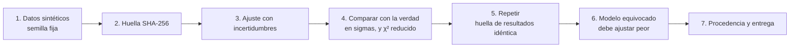

# B14-C20 — Proyecto reproducible de análisis astronómico

<!-- nav:top -->
[🏠 Programa](../../../../README.md) · [📚 Bloque B14](../../../tronco-comun/B14-computacion-cientifica-y-ciencia-abierta.md) · [← Anterior: B14-C19 — Publicación de código y datos](../B14-C19-publicacion-de-codigo-y-datos/CLASE.md) · [Siguiente: B14-C21 — Datos de misiones planetarias: PDS4, etiquetas y SPICE →](../../../tronco-comun/B14-computacion-cientifica-y-ciencia-abierta.md#b14-c21)
<!-- /nav -->

## 1. Ubicación, nivel y alcance

Vigésima y última clase de la línea base del bloque B14. Integra lo anterior: arquitectura ([C01](../B14-C01-arquitectura-de-software-cientifico/CLASE.md)), cálculo numérico ([C03](../B14-C03-analisis-numerico-con-scipy/CLASE.md)), datos ([C05](../B14-C05-tablas-astronomicas-y-catalogos/CLASE.md) a [C08](../B14-C08-pandas-y-limpieza-de-datos/CLASE.md)), reproducibilidad ([C09](../B14-C09-jupyter-y-experimentos-reproducibles/CLASE.md) a [C12](../B14-C12-ejecucion-reproducible-con-uv/CLASE.md)), flujos ([C18](../B14-C18-flujos-de-datos-espaciales/CLASE.md)) y publicación ([C19](../B14-C19-publicacion-de-codigo-y-datos/CLASE.md)). Es un proyecto, no una lección nueva. Nivel N2.

**Aviso de alcance:** el proyecto trabaja con una curva de luz **sintética**; no hay observación real, ni contenedor construido, ni publicación. Las partes de C13 a C17 (rendimiento, contenedor) no se ejecutan aquí.

Harás un análisis completo de un tránsito: generar datos, ajustar un modelo con incertidumbres, comprobar contra la verdad conocida, repetir idénticamente, registrar la procedencia y entregar con el criterio de C19.

## 2. Por qué esta clase existe

Un análisis reproducible no es un conjunto de herramientas: es una **cadena de comprobaciones** donde cada eslabón puede fallar a la vista. La pregunta motivadora es: **¿cómo demuestro, con evidencia revisable, que mi resultado se obtuvo de estos datos, con este modelo y este software, y que otra persona lo repetirá?**

La decisión central es: **¿qué comprobaciones convierten un número en un resultado defendible?** Aquí son seis: datos con huella, ajuste con incertidumbre, comparación con la verdad, repetición idéntica, un modelo equivocado que falle y un registro de procedencia.

## 3. Lo que podrás hacer al terminar

1. Diseñar un análisis de punta a punta con etapas verificables.
2. Ajustar un modelo con incertidumbres a partir de la covarianza y juzgar el ajuste con `χ²` reducido.
3. Comprobar un resultado contra una verdad conocida con un criterio en unidades de incertidumbre.
4. Mostrar que un modelo equivocado se distingue del correcto.
5. Verificar que dos ejecuciones dan exactamente el mismo resultado.
6. Entregar el análisis con procedencia, versiones, límites y lista de pendientes.

La evidencia es el **repositorio reproducible con informe** del ejercicio 12 (sección 20).

## 4. Con qué llegas y cómo comprobarlo

Necesitas todo el bloque hasta C12, en especial C03, C10 y C11. Cinco preguntas:

1. ¿Qué es una incertidumbre de un parámetro ajustado y de dónde sale en un ajuste por mínimos cuadrados?
2. ¿Qué es `χ²` y qué valor esperas por grado de libertad en un buen ajuste?
3. ¿Qué significa estar a «1,2 sigma» de la verdad?
4. ¿Por qué se fija la semilla?
5. ¿Qué es un registro de procedencia?

<details>
<summary>Ver respuestas</summary>

1. La desviación típica estimada del parámetro; sale de la raíz de la diagonal de la matriz de covarianza del ajuste. 2. La suma de residuos al cuadrado divididos por la incertidumbre; cerca de 1 por grado de libertad. 3. Que la diferencia es 1,2 veces la incertidumbre: compatible con el azar. 4. Para que la repetición dé lo mismo (C09). 5. El registro de entradas, parámetros, versiones y salida (C18).
</details>

Con cuatro o cinco aciertos, sigue; con tres o menos, repasa C03, C09 y C18 (la estadística del ajuste se profundiza en B12 y B15).

## 5. Un caso real: lo que cuenta como evidencia

Este proyecto no tiene un «caso real» con datos de misión: no consulté ningún archivo de datos reales para él. Lo que sí hay son prácticas con respaldo en lo consultado en clases anteriores: pruebas de ida y vuelta y de propiedad (C01), tolerancias justificadas (C10, con el criterio de `assert_allclose` de NumPy), huellas SHA-256 con un vector del NIST (C11), bloqueo de versiones (C12, documentación de uv) y principios FAIR (C19, página de GO FAIR). Del **ajuste con `curve_fit`** no consulté su documentación: su uso aquí se describe por lo que el laboratorio comprueba (el resultado frente a la verdad sintética).

El **ejemplo conductor** es una curva de luz sintética de 20 000 muestras (cadencia 10 s) con un tránsito trapezoidal de profundidad 0,010, centro `t₀ = 100 000 s`, duración 8000 s, ingreso y egreso de 1000 s y ruido gaussiano de 0,002 (semilla 20261105).

## 6. Vocabulario

El **modelo** es la función `F(t) = 1 − δ·clip((D/2 − |t − t₀|)/τ, 0, 1)` con `δ` (profundidad), `t₀` (centro), `D` (duración) y `τ = 1000 s` (ingreso, fijo). El **ajuste por mínimos cuadrados** busca los parámetros que minimizan la suma de residuos al cuadrado ponderados. La **matriz de covarianza** da las incertidumbres. `χ²` mide el desajuste en unidades del ruido; `χ²` reducido es `χ²` entre los **grados de libertad** (número de datos menos de parámetros). La **desviación en sigmas** es `(estimado − verdadero)/incertidumbre`. La **verdad conocida** solo existe porque los datos son sintéticos. Un **modelo equivocado** es uno distinto del que generó los datos.

## 7. Modelo mental: seis comprobaciones, una cadena

Cada etapa produce algo que se puede comprobar. Si una falla, se sabe dónde.



*Descripción textual:* siete etapas encadenadas: generar datos con semilla fija, calcular su huella, ajustar con incertidumbres, comparar con la verdad conocida en sigmas y con `χ²` reducido, repetir el análisis y comparar huellas de resultados, probar que un modelo equivocado ajusta peor y, por último, registrar la procedencia y entregar.

**Analogía y su límite.** Un control de calidad con varios puntos de inspección: un producto defectuoso se detecta en algún punto. Límite: los controles solo detectan los defectos que prevén; el análisis real puede fallar de maneras que ninguno de estos pasos cubre.

## 8. La explicación, paso a paso

### 8.1 Datos y huella

Los datos se generan con la semilla 20261105 y se calcula la huella SHA-256 de sus bytes (`0e61b27879ae2e80…`). Es la huella de entrada del análisis (C11, C18). Son 20 000 muestras con ruido de 0,002.

### 8.2 El ajuste y sus incertidumbres

`curve_fit` ajusta `(δ, t₀, D)` partiendo de valores iniciales `(0,005; 99 000 s; 7000 s)`, con incertidumbre `σ = 0,002` conocida para cada punto (`absolute_sigma`) y las incertidumbres salen de la raíz de la diagonal de la covarianza. Resultados: `δ = 0,0100214 ± 0,000081`; `t₀ = 99 983,2 ± 14 s`; `D = 7959,78 ± 29 s`.

### 8.3 Comparar con la verdad, en sigmas

`δ`: `+0,26 σ`; `t₀`: `−1,19 σ`; `D`: `−1,37 σ`. Los tres dentro de `3 σ`, criterio de aceptación declarado antes (tolerancia de la prueba). Con tres parámetros, es normal que alguno quede a 1–1,5 σ; que **todos** estén dentro de 0,3 σ sería sospechoso. `χ²` = 20 032,4 con 19 997 grados de libertad: `χ²/gl = 1,002`, el valor esperado cuando el modelo es correcto y la incertidumbre está bien declarada (~1).

### 8.4 Repetir idéntico

Se repite todo el análisis y se compara la huella del resultado (parámetros e incertidumbres serializados con claves ordenadas): **idéntica**. Es el criterio de C09 y C10 aplicado a un análisis completo, válido en este entorno (Python 3.12.9, NumPy 2.5.4, SciPy 1.18.1). Con otras versiones, el último dígito podría cambiar: hace falta una tolerancia (C10).

### 8.5 Un modelo equivocado debe notarse

Se ajusta un modelo sin ingreso (un salto brusco, `1 − δ·(|t − t₀| < D/2)`) a los mismos datos: `χ²/gl = 1,186` frente a `1,002`. El ajuste empeora de forma visible. Una prueba que no fallaría con un modelo equivocado no prueba nada: por eso se incluye este control negativo. (Con ruido mayor o un ingreso más corto, la diferencia sería menor: el control depende de los datos.)

### 8.6 Procedencia y entrega

El registro de procedencia incluye la huella de los datos, el modelo, la semilla, las versiones de Python, NumPy y SciPy, los resultados y las incertidumbres. Para entregar, se completa con lo de C12 (bloqueo), C17 (contenedor, si hace falta) y C19 (licencia, metadatos, citación). **En este proyecto nada de eso se ejecutó** aparte del análisis: son pasos pendientes de la entrega real.

## 9. Magnitudes, símbolos y unidades

| Símbolo | Qué es | Unidad | Valor |
|---|---|---|---|
| `δ` | profundidad del tránsito | adimensional (flujo relativo) | 0,010 (verdad); 0,0100214 ± 0,000081 |
| `t₀` | centro del tránsito | s | 100 000 (verdad); 99 983,2 ± 14 |
| `D` | duración total | s | 8000 (verdad); 7959,78 ± 29 |
| `τ` | ingreso y egreso (fijo) | s | 1000 |
| `σ` | ruido por muestra | adimensional | 0,002 |
| `χ²/gl` | ajuste reducido | adimensional | 1,002 (correcto); 1,186 (equivocado) |

## 10. Convenciones y referencias

Datos **sintéticos**; el tiempo se mide en segundos desde un origen arbitrario; el flujo es relativo y adimensional. El ruido es gaussiano, independiente y de σ conocida: supuestos del modelo, no verificados en datos reales. El ingreso `τ` se fija; solo se ajustan tres parámetros. Versiones: Python 3.12.9, NumPy 2.5.4, SciPy 1.18.1.

## 11. De dónde sale lo que afirmamos

| ID | Fuente | Localizador | Respalda | Estado |
|---|---|---|---|---|
| S1 | Clases B14-C01 a B14-C19 de este programa | ver sus secciones 11 | Prácticas de verificación, tolerancias, huellas, bloqueo y publicación (con las fuentes que cada una cita) | Consultadas en este programa el 2026-11-05 |

Límites: no consulté la documentación de `scipy.optimize.curve_fit` ni la estadística del ajuste (la interpretación de `χ²` y de la covarianza es conocimiento general que se profundiza en B12 y B15); el proyecto no usa datos reales ni ejecuta un contenedor; el control con un modelo equivocado solo muestra una diferencia para este nivel de ruido.

## 12. Cómo ver el resultado

Versión accesible.

| Parámetro | Verdad | Estimado ± incertidumbre | Desviación |
|---|---|---|---|
| `δ` | 0,010 | 0,0100214 ± 0,000081 | +0,26 σ |
| `t₀` (s) | 100 000 | 99 983,2 ± 14 | −1,19 σ |
| `D` (s) | 8000 | 7959,78 ± 29 | −1,37 σ |

`χ²/gl`: 1,002 (modelo correcto), 1,186 (modelo sin ingreso). Huella de datos: `0e61b27879ae2e80…`. Repetición: idéntica.

## 13. Ejemplo trabajado: del dato al informe

1. **Genera** 20 000 muestras con la semilla fija y calcula su huella.
2. **Ajusta** `(δ, t₀, D)` y extrae las incertidumbres de la covarianza.
3. **Compara** con la verdad en sigmas: +0,26, −1,19, −1,37; todas dentro de 3 σ.
4. **Juzga el ajuste:** `χ²/gl = 1,002`.
5. **Repite** el análisis: la huella de resultados es idéntica.
6. **Control negativo:** el modelo sin ingreso da `χ²/gl = 1,186`, peor.
7. **Registra** la procedencia y redacta el informe con límites y pendientes (bloqueo, contenedor, licencia, identificador).

**Paso final · incertidumbre.** Con una sola realización del ruido, que los tres parámetros estén dentro de 3 σ es consistente con un ajuste correcto, no una demostración. Para evaluar el sesgo del método habría que repetir con muchas semillas (B12). Y con datos reales, el modelo, el ruido y las incertidumbres habría que justificarlos.

## 14. Comparación: script, cuaderno y paquete

Un **script** ejecutable (como el laboratorio) es la base: se repite con un comando. Un **cuaderno** (C09) cuenta la historia con figuras y debe importar el núcleo. Un **paquete** con bloqueo, pruebas y metadatos (C12, C10, C19) es lo que se entrega. Para este proyecto, el script es el núcleo del paquete y el cuaderno, su explicación.

## 15. Práctica guiada

**Ejercicio 1 · con los pasos.** Calcula la desviación en sigmas de `t₀`: estimado 99 983,2 s, incertidumbre 14 s, verdad 100 000 s. *Pasos:* `(estimado − verdadero)/incertidumbre` (sección 8.3).

<details><summary>Solución comentada</summary>

`(99 983,2 − 100 000)/14 = −16,8/14 = −1,2 σ`. Compatible con el azar.
</details>

**Ejercicio 2 · con una pista.** ¿Cuántos grados de libertad tiene el ajuste? *Pista:* datos menos parámetros ajustados.

<details><summary>Solución comentada</summary>

`20 000 − 3 = 19 997`. `χ²/gl = 20 032,4/19 997 = 1,0018`.
</details>

**Ejercicio 3 · casi autónomo.** ¿Por qué no se acepta el análisis solo porque `χ²/gl ≈ 1`?

<details><summary>Solución comentada</summary>

`χ²/gl ≈ 1` dice que los residuos son del tamaño del ruido declarado, no que el resultado sea el correcto (podría haber un sesgo común) ni que se pueda repetir. Hay que añadir la comparación con la verdad (aquí conocida), la repetición y el control negativo.
</details>

## 16. Práctica autónoma, transferencia e integrador

**Ejercicio 4.** Calcula la duración del tránsito que corresponde a la estimación `D = 7959,78 s` en horas y su diferencia con la verdad.

<details><summary>Solución comentada</summary>

`7959,78/3600 = 2,211 h`; verdad `2,222 h`; diferencia `−40,2 s` (−0,50 %), unos `1,4 σ`.
</details>

**Ejercicio 5.** Si el ruido fuera 0,004 en lugar de 0,002, ¿qué esperas para las incertidumbres de los parámetros?

<details><summary>Solución comentada</summary>

Escalan con el ruido: se duplican (`σ_δ ≈ 1,6 × 10⁻⁴`, etc.), siempre que la forma del problema no cambie. Es una consecuencia del ajuste lineal en el ruido; compruébalo ejecutando.
</details>

**Ejercicio 6.** ¿Qué pasaría con `χ²/gl` si declaras `σ = 0,001` pero el ruido real es 0,002?

<details><summary>Solución comentada</summary>

Los residuos serían el doble de lo declarado: `χ²/gl ≈ 4`. Una incertidumbre subestimada se delata en un `χ²` reducido muy superior a 1.
</details>

**Ejercicio 7.** El control negativo da `χ²/gl = 1,186`. ¿Es suficiente para rechazar el modelo sin ingreso? ¿Qué más harías?

<details><summary>Solución comentada</summary>

Con 19 997 grados de libertad, la desviación estándar esperada de `χ²/gl` es `√(2/19 997) = 0,010`; 1,186 está a unas 19 σ de 1: rechazo claro (la fórmula `√(2/gl)` es conocimiento general, no consultado aquí). Además compararías visualmente los residuos y probarías otros modelos.
</details>

**Ejercicio 8.** Añade a la prueba de regresión (C10) un valor de referencia de `δ` con tolerancia: ¿cuál elegirías y por qué?

<details><summary>Solución comentada</summary>

Una tolerancia en unidades de la incertidumbre, por ejemplo `|δ − 0,0100214| < 10⁻⁶` para detectar cambios de implementación (ruido de redondeo ≪ incertidumbre `8 × 10⁻⁵`), distinta de la prueba de corrección de `3 σ` contra la verdad. Son dos pruebas con propósitos distintos.
</details>

**Ejercicio 9 · transferencia.** Con datos reales no tienes «verdad conocida». ¿Cómo adaptas las comprobaciones del proyecto?

<details><summary>Solución comentada</summary>

Sustituyes la comparación con la verdad por: simulaciones con inyección de señales conocidas en datos reales, comparación entre modelos, validación cruzada o comparación con resultados publicados, siempre declarando qué cubre cada una. Las comprobaciones de repetición, huella y procedencia se mantienen igual.
</details>

**Ejercicio 10 · transferencia.** Un revisor pide repetir el análisis con otra versión de SciPy. ¿Qué esperas y qué haces?

<details><summary>Solución comentada</summary>

Pequeñas diferencias de redondeo; compruebas que los parámetros coinciden dentro de una tolerancia mucho menor que la incertidumbre (C10) y actualizas el registro de versiones. Si difieren más, investigas el cambio.
</details>

**Ejercicio 11 · transferencia.** Quieres ejecutar el análisis sobre 1000 curvas. ¿Qué capítulos del bloque usarías y qué cuidarías?

<details><summary>Solución comentada</summary>

Vectorización o paralelismo por trozos (C13–C14), semilla por curva (C13), flujo con procedencia por curva (C18), almacenamiento en HDF5 (C07) y la comprobación de que el resultado paralelo es idéntico al serie. Medir antes de afirmar una aceleración.
</details>

**Ejercicio 12 · integrador.** Entrega un **repositorio reproducible con informe** para un análisis sintético propio: el script de análisis con las seis comprobaciones, el bloqueo de versiones (C12), una prueba de regresión (C10), el registro de procedencia (C18), el paquete con licencia, citación y metadatos (C19), y un informe de una página con resultados, incertidumbres, límites y pendientes.

<details><summary>Solución modelo</summary>

Debe incluir los archivos, la tabla de resultados con sigmas, la verificación de repetición, el control negativo, el bloqueo, los metadatos con huellas, y un informe que distinga lo hecho de lo pendiente (por ejemplo, contenedor, identificador, revisión legal). Se acepta cualquier análisis sintético que declare sus supuestos.
</details>

## 17. Laboratorio

El script [proyecto_transito.py](proyecto_transito.py) ejecuta el análisis completo: genera los datos, calcula su huella, ajusta, compara con la verdad en sigmas, juzga `χ²` reducido, repite y compara huellas de resultados, prueba un modelo equivocado y arma el registro de procedencia. Se detiene si algún parámetro supera 3 σ, si `χ²/gl` sale de (0,9; 1,1), si la repetición no es idéntica o si el modelo equivocado no ajusta peor.

**Datos:** sintéticos (semilla 20261105). **Predice antes de ejecutar:** ¿qué desviación en sigmas esperas para cada parámetro? **Ejecución del 2026-11-05 (Python 3.12.9, NumPy 2.5.4, SciPy 1.18.1):**

```text
1-2. datos sintéticos: n = 20000; huella sha256 = 0e61b27879ae2e80...
3. ajuste:
   profundidad : estimado = 0.0100214 +- 8.1e-05  (verdadero 0.01; desviación = +0.26 sigma)
   t0_s        : estimado = 99983.2 +- 14  (verdadero 100000; desviación = -1.19 sigma)
   duracion_s  : estimado = 7959.78 +- 29  (verdadero 8000; desviación = -1.37 sigma)
   chi2 = 20032.4 con 19997 grados de libertad (chi2/gl = 1.002; esperado ~ 1)
5. repetición: huella de resultados idéntica = True
6. procedencia (claves): ['datos_sha256', 'incertidumbres', 'modelo', 'resultados', 'semilla', 'versiones']
7. modelo equivocado (sin ingreso): chi2/gl = 1.186 frente a 1.002
Pruebas superadas.
```

```bash
python programa/clases/B14/B14-C20-proyecto-reproducible-de-analisis-astronomico/proyecto_transito.py
```

**Límites:** datos y modelo sintéticos; una sola realización del ruido; la prueba de «regresión» del script compara con la verdad (no con una referencia congelada); no incluye bloqueo, contenedor ni publicación.

## 18. Errores frecuentes y cómo corregirlos

**Aceptar un análisis solo por un `χ²` razonable.** Se corrige con el ejercicio 3.

**No declarar el criterio de aceptación antes de mirar.** Se corrige con la sección 8.3.

**Sin control negativo.** Se corrige con el ejercicio 7.

**Confundir la prueba de corrección con la de regresión.** Se corrige con el ejercicio 8.

**Entregar sin límites ni pendientes.** Se corrige con la sección 8.6 y el ejercicio 12.

## 19. Cómo sabrás que vas bien

Tras 8.3: ¿calculas una desviación en sigmas? Si no, rehaz el ejercicio 1. Tras 8.5: ¿explicas el control negativo? Si no, rehaz el 7. Tras el ejemplo trabajado: ¿qué comprobación detectaría un cambio de implementación? Tras el laboratorio: ¿qué parte del proyecto no se ejecutó? Al final: ¿cuáles son tus pendientes?

## 20. Qué entregas y cómo se evalúa

El producto es tu **repositorio reproducible con informe** del ejercicio 12.

| Criterio | Inicial | En desarrollo | Logrado | Destacado |
|---|---|---|---|---|
| Comprobaciones | Ninguna | Una o dos | Las seis | Con criterios declarados de antemano |
| Reproducibilidad | No repite | Repite a ojo | Huella idéntica y bloqueo | Con prueba de regresión y tolerancias |
| Entrega | Solo código | Código y datos | Con licencia, citación y metadatos | Con límites y pendientes explícitos |
| Fuentes y alcance | Sin fuente | Fuente sin alcance | Fuente con alcance | Rotula lo sintético y lo no ejecutado |

**Condiciones críticas:** no presentar datos sintéticos como observados; no afirmar que algo se ejecutó si no se ejecutó; no esconder una comprobación que falló; citar solo lo consultado.

## 21. Ética, seguridad y límites

Un análisis reproducible no es por eso correcto: la reproducibilidad permite que otros encuentren tus errores, y eso es una virtud. Declara tus supuestos y tus límites; no sobreinterpretes un resultado de una realización de ruido. Respeta licencias y condiciones de los datos. Accesibilidad: resultados en tablas y texto. Material educativo.

## 22. Para cerrar y seguir

Un análisis reproducible es una cadena de comprobaciones: datos con huella, ajuste con incertidumbres, comparación con la verdad en sigmas, repetición idéntica, un control negativo y un registro de procedencia. En el ejemplo, los tres parámetros quedaron dentro de 1,4 σ, `χ²/gl = 1,002` y la repetición fue idéntica; faltan bloqueo, contenedor y publicación reales. Queda abierta una pregunta: ¿cómo cambia este diseño cuando no existe una verdad conocida?

**Glosario español–inglés.** ajuste por mínimos cuadrados · *least-squares fit*; matriz de covarianza · *covariance matrix*; grados de libertad · *degrees of freedom*; `χ²` reducido · *reduced chi-squared*; control negativo · *negative control*; procedencia · *provenance*; reproducible · *reproducible*.

**Continuidad.** Las clases programadas B14-C21 a B14-C31 amplían el bloque: datos de misiones planetarias y heliofísicos, preregistro y documentación de decisiones de análisis, y datos geoespaciales; B12 profundiza la estadística del ajuste y B15 la estimación.

**Referencias:** ver sección 11.

<!-- nav:bottom -->
---

[← Anterior: B14-C19 — Publicación de código y datos](../B14-C19-publicacion-de-codigo-y-datos/CLASE.md) · [📚 Bloque B14](../../../tronco-comun/B14-computacion-cientifica-y-ciencia-abierta.md) · [Siguiente: B14-C21 — Datos de misiones planetarias: PDS4, etiquetas y SPICE →](../../../tronco-comun/B14-computacion-cientifica-y-ciencia-abierta.md#b14-c21)
<!-- /nav -->
