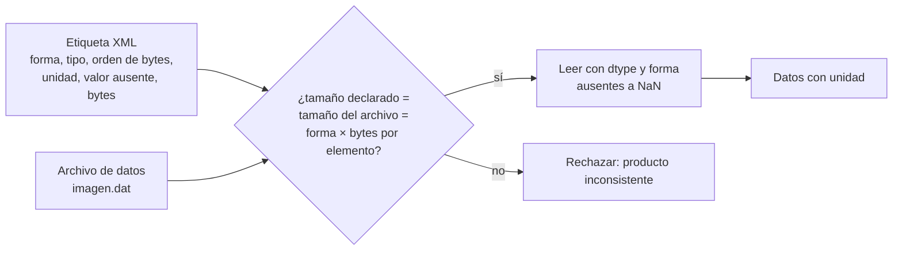

# B14-C21 — Datos de misiones planetarias: PDS4, etiquetas y SPICE

<!-- nav:top -->
[🏠 Programa](../../../../README.md) · [📚 Bloque B14](../../../tronco-comun/B14-computacion-cientifica-y-ciencia-abierta.md) · [← Anterior: B14-C20 — Proyecto reproducible de análisis astronómico](../B14-C20-proyecto-reproducible-de-analisis-astronomico/CLASE.md) · [Siguiente: B14-C22 — Acceso a datos heliofísicos abiertos con SunPy →](../B14-C22-acceso-a-datos-heliofisicos-abiertos-con-sunpy/CLASE.md)
<!-- /nav -->

## 1. Ubicación, nivel y alcance

Primera clase de la ampliación programada del bloque B14. En [C18](../B14-C18-flujos-de-datos-espaciales/CLASE.md) trataste flujos de datos en general; esta clase aborda cómo se **estructuran y describen los archivos de las misiones planetarias**: un archivo de datos acompañado de una etiqueta que dice cómo leerlo, y datos auxiliares de geometría (SPICE) para saber dónde estaba cada cosa. Nivel N2.

**Aviso de alcance:** el laboratorio usa una **etiqueta XML simplificada e inventada, que NO es una etiqueta PDS4 válida** y no se validó contra ningún esquema PDS4; tampoco usa SPICE. Ilustra la idea de «archivo + etiqueta». Lo que sé del PDS4 real se limita a lo que dicen las tres páginas oficiales que consulté (ver sección 11).

Verás por qué un archivo de misión viaja con una descripción, qué hay que comprobar al leerlo (tamaño, tipo, orden de bytes, valor de dato ausente) y qué son los kernels de SPICE. No verás cómo escribir una etiqueta PDS4 conforme ni usar la biblioteca SPICE.

## 2. Por qué esta clase existe

Un archivo binario de una sonda planetaria son bytes sin significado: ¿cuántas filas?, ¿enteros o reales?, ¿qué orden de bytes?, ¿qué número indica «no hay dato»?, ¿qué unidad? Y para interpretarlo, hace falta saber dónde estaba la nave y hacia dónde apuntaba. La pregunta motivadora es: **¿cómo describe un archivo de una misión su propio contenido, y qué compruebo antes de fiarme de lo que leo?**

La decisión central es: **¿qué información debo tomar de la etiqueta y qué debo verificar contra el archivo real?** Una etiqueta que no coincide con el archivo es un error que debes detectar, no corregir en silencio.

## 3. Lo que podrás hacer al terminar

1. Explicar por qué un producto de datos se compone de archivo de datos y descripción.
2. Leer un archivo binario guiado por una descripción (forma, tipo, orden de bytes, ausentes, unidad).
3. Comprobar la coherencia entre la descripción y el archivo (tamaño) y rechazar la que no coincide.
4. Detectar una lectura con el orden de bytes equivocado.
5. Nombrar los tipos de kernels de SPICE y qué contiene cada uno.
6. Declarar con honestidad qué parte del estándar real no se ha leído.

La evidencia es la **lectura verificada de un producto** del ejercicio 12 (sección 20).

## 4. Con qué llegas y cómo comprobarlo

Necesitas C06 (FITS, orden de ejes), C05 (unidades y ausentes) y C11. Cinco preguntas:

1. ¿Cuántos bytes ocupa una imagen de 24 × 32 de `float32`? (3072.)
2. ¿Qué es el orden de bytes (*endianness*) y qué pasa si lo lees mal?
3. ¿Qué es un valor especial de dato ausente? (C08: un centinela.)
4. ¿Qué es un archivo XML?
5. ¿Por qué un encabezado puede estar mal aunque el archivo exista? (C06)

<details>
<summary>Ver respuestas</summary>

1. `24 × 32 × 4`. 2. El orden en que se guardan los bytes de un número; leído al revés da números absurdos. 3. Un número reservado que significa «sin dato». 4. Un archivo de texto con estructura de etiquetas anidadas. 5. Porque la descripción puede no corresponder al contenido.
</details>

Con cuatro o cinco aciertos, sigue; con tres o menos, repasa C06 y C08.

## 5. Un caso real: lo que sé del PDS4 y de SPICE

La página oficial del PDS (S1) dice que PDS4 es el estándar de archivo requerido para los datos de misiones financiadas por NASA desde 2011, con coordinación internacional por la Alianza Internacional de Datos Planetarios; que el PDS permite solo un conjunto limitado de formatos de archivo; que hay herramientas para generar, validar y acceder a datos PDS4; y que la versión vigente al consultar era la 1.26.0.0. La página de documentos (S2) lista los textos fundamentales: el *Concepts Document* (introducción), el *Data Provider's Handbook* (guía para construir un archivo), el *Standards Reference*, la especificación del modelo de información y el diccionario de datos común. **No pude leer el documento de conceptos (no cargó)**, así que no afirmo cómo define producto, etiqueta ni identificador lógico. Sí sé, como conocimiento general no verificado en esta clase, que las etiquetas PDS4 son archivos XML.

SPICE (S3) es el sistema de información auxiliar del Navigation and Ancillary Information Facility de NASA que provee la geometría de observación; sus archivos se llaman **kernels**: **SPK** (efemérides: posiciones de naves y cuerpos), **PCK** (constantes físicas y cartográficas de cuerpos), **IK** (geometría de un instrumento), **CK** (orientación de la nave o de la estructura que lleva instrumentos), **FK** (definición de marcos de referencia y alineaciones) y **LSK** (segundos intercalares) y **SCLK** (conversión del reloj de la nave a otros sistemas de tiempo).

El **ejemplo conductor** es un producto **sintético y simplificado**: una imagen de 24 × 32 `float32` big-endian en `imagen.dat` con su descripción XML inventada en `imagen.xml`.

## 6. Vocabulario

Un **producto** es el conjunto archivo de datos más descripción (en el sentido de esta clase). Una **etiqueta** (*label*) es la descripción en XML. El **orden de bytes** (*endianness*) puede ser *big-endian* (el byte más significativo primero) o *little-endian*. Un **valor especial** marca dato ausente o saturado. Un **kernel** es un archivo de datos de SPICE. Una **efeméride** da la posición de un cuerpo en función del tiempo. Un **marco de referencia** define ejes y origen (B01-C04 y B13). Un **esquema** es el documento que dice qué etiquetas XML son válidas; este laboratorio **no usa ninguno**.

## 7. Modelo mental: la etiqueta es el manual del archivo

Los datos sin su descripción no se pueden leer; la descripción sin los datos no sirve. Se comprueba que ambas concuerdan antes de usar nada: el tamaño declarado, el tamaño real y el tamaño que sale de forma y tipo deben coincidir.



*Descripción textual:* la etiqueta XML con forma, tipo, orden de bytes, unidad, valor ausente y tamaño, y el archivo de datos, entran a una comprobación de tamaños: el declarado, el real y el calculado a partir de forma y tipo. Si coinciden, se lee con el tipo y la forma y se convierten los ausentes en `NaN`; si no, se rechaza el producto.

**Analogía y su límite.** Un manual de instrucciones que acompaña a un aparato. Límite: el manual puede estar equivocado o ser de otro modelo; la comprobación de tamaño detecta algunos desajustes, no todos.

## 8. La explicación, paso a paso

### 8.1 Qué dice la etiqueta

La etiqueta sintética declara el nombre del archivo, el número de bytes, dos ejes (fila con 24 elementos y columna con 32, con su secuencia), el tipo de dato (`IEEE754MSBSingle`: real de 32 bits, byte más significativo primero), la unidad (`DN`, números digitales), el valor especial de dato ausente (`−1,0 × 10³²`) y un identificador. Los nombres de las etiquetas son inventados y no coinciden con los de PDS4.

### 8.2 Leer guiado por la etiqueta

El tipo se traduce a `>f4` (`float32` *big-endian*), la forma a `(24, 32)`, y los píxeles iguales al valor especial se convierten a `NaN`. El laboratorio escribe el archivo (3072 bytes `= 24 × 32 × 4`), lo lee con la etiqueta y obtiene forma `(24, 32)`, unidad `DN` y 12 `NaN`: los doce ausentes sembrados. La lectura es idéntica a lo escrito (con los `NaN` en las mismas posiciones). El máximo está en la fila 10, columna 20 (550,1 DN): la mancha sintética que se puso allí.

### 8.3 Comprobar la coherencia

Antes de leer, se comparan tres tamaños: el de la etiqueta, el del archivo y el que resulta de forma por tipo. Si el archivo se trunca en 4 bytes, el laboratorio lo rechaza con el mensaje «tamaño inconsistente: archivo 3068, etiqueta 3072, esperado 3072». Es la versión de C06 (archivo FITS cuyo tamaño no es múltiplo de 2880) para este producto.

### 8.4 Un orden de bytes equivocado

Leído como *little-endian*, el mismo archivo da un máximo de `9,93 × 10³⁷`: números absurdos pero **sin error del programa**. La etiqueta es la única que dice el orden correcto; un máximo imposible para una cantidad física es la señal de alarma.

### 8.5 SPICE: dónde estaba todo

Para interpretar una imagen necesitas la posición de la nave y del cuerpo (SPK), la orientación de la nave (CK), la geometría del instrumento (IK), los marcos de referencia (FK), las constantes del cuerpo (PCK) y la conversión de tiempos (LSK y SCLK) (S3). Es el contenido de la geometría de observación; esta clase no usa la biblioteca ni lee kernels reales.

### 8.6 Lo que no sé del estándar real

No leí el documento de conceptos ni el *Standards Reference*, de modo que no describo la estructura de un producto, un lote (*bundle*) ni los identificadores lógicos de PDS4 y no afirmo que este laboratorio refleje esos detalles. Para trabajar con datos reales hay que leer la documentación (S2) y usar las herramientas de validación que el PDS ofrece (S1).

## 9. Magnitudes, símbolos y unidades

| Concepto | Qué es | Unidad | Valor en el ejemplo |
|---|---|---|---|
| filas × columnas | forma de la imagen | píxeles | 24 × 32 |
| `float32` big-endian | tipo y orden de bytes | — | `>f4`, 4 bytes por elemento |
| tamaño del archivo | bytes | B | 3072 |
| valor ausente | centinela | DN | `−1,0 × 10³²` |
| amplitud de la mancha | señal sobre el fondo | DN | 500 (sobre 50) |
| píxeles ausentes | enmascarados | conteo | 12 |

## 10. Convenciones y referencias

Datos **sintéticos** (semilla 20261105). La etiqueta es **inventada y no es PDS4**. Orden C (la columna varía más rápido). Unidad: DN (números digitales del convertidor), sin calibración física. SPICE se describe solo según S3.

## 11. De dónde sale lo que afirmamos

| ID | Fuente | Localizador | Respalda | Estado |
|---|---|---|---|---|
| S1 | NASA PDS, *PDS4 Data Standards* (página «about») | https://pds.nasa.gov/datastandards/about/ | PDS4 requerido para archivos de misiones NASA desde 2011; coordinación internacional; formatos limitados; herramientas; versión 1.26.0.0 | Página consultada el 2026-11-05 (mutable) |
| S2 | NASA PDS, *PDS4 Documents* | https://pds.nasa.gov/datastandards/documents/ | Lista de documentos: Concepts, Data Provider's Handbook, Standards Reference, Information Model, Common Data Dictionary | Página consultada el 2026-11-05 (mutable) |
| S3 | NASA NAIF, *SPICE Concept* | https://naif.jpl.nasa.gov/naif/spiceconcept.html | Qué es SPICE y qué contienen SPK, PCK, IK, CK, FK, LSK y SCLK | Página consultada el 2026-11-05 (mutable) |

Límites: el documento de conceptos de PDS4 no cargó y no lo leí; que las etiquetas PDS4 son XML es conocimiento general no verificado aquí; no leí el *Standards Reference* ni el diccionario de datos; no usé SPICE. La etiqueta del laboratorio no es PDS4.

## 12. Cómo ver el resultado

Versión accesible.

| Comprobación | Resultado |
|---|---|
| Tamaño del archivo | 3072 B `= 24 × 32 × 4` |
| Lectura guiada por la etiqueta | forma (24, 32), unidad DN, 12 NaN, idéntica a lo escrito |
| Máximo de la imagen | fila 10, columna 20; 550,1 DN |
| Orden de bytes equivocado | máximo 9,93 × 10³⁷ (absurdo) |
| Archivo truncado 4 bytes | rechazado por tamaño inconsistente |

## 13. Ejemplo trabajado: leer un producto con precaución

1. **Lee la etiqueta:** forma (24, 32), `IEEE754MSBSingle`, unidad DN, ausente `−1,0 × 10³²`, 3072 bytes.
2. **Comprueba tamaños:** archivo 3072, etiqueta 3072, `24 × 32 × 4 = 3072`. Coherente.
3. **Lee** con `>f4` y forma (24, 32); convierte los ausentes a `NaN`: 12.
4. **Verifica** contra lo escrito: idéntico; la mancha está en (10, 20).
5. **Prueba negativa 1:** orden de bytes equivocado → máximo absurdo.
6. **Prueba negativa 2:** archivo truncado → rechazo.
7. **Registra** la unidad y la procedencia (sintético) con el resultado.

**Paso final · incertidumbre.** Esta comprobación asegura la coherencia interna de un producto sintético; un producto real tiene mucha más estructura (varias tablas, historia, calibración) y debe validarse con las herramientas del PDS.

## 14. Comparación: etiqueta aparte, encabezado interno y sin descripción

Con **etiqueta aparte** (como aquí) la descripción es independiente del formato del dato. Con **encabezado interno** (FITS, C06) la descripción viaja dentro del archivo. **Sin descripción**, el archivo solo se puede leer por convención oral, la peor opción para el largo plazo. Cualquiera funciona si se verifica contra el archivo real.

## 15. Práctica guiada

**Ejercicio 1 · con los pasos.** Una imagen de 100 × 80 `float64` debe ocupar cuántos bytes. *Pasos:* `filas × columnas × 8` (sección 8.3).

<details><summary>Solución comentada</summary>

`100 × 80 × 8 = 64 000` bytes. Si la etiqueta declara otro valor, el producto es inconsistente.
</details>

**Ejercicio 2 · con una pista.** ¿Por qué un máximo de `10³⁷` en una imagen de brillo es señal de alarma? *Pista:* ¿cuánto vale un DN típico?

<details><summary>Solución comentada</summary>

Ningún detector da `10³⁷` DN: es la lectura del patrón de bits en el orden equivocado (o del centinela sin enmascarar). Se revisa el orden de bytes y los valores especiales.
</details>

**Ejercicio 3 · casi autónomo.** ¿Qué conjunto de kernels de SPICE necesitas para saber hacia dónde apuntaba un instrumento en un instante?

<details><summary>Solución comentada</summary>

Orientación de la nave (CK), geometría del instrumento (IK), marcos de referencia (FK) y conversión de tiempo del reloj de la nave (SCLK, con LSK); para la posición, SPK (S3).
</details>

## 16. Práctica autónoma, transferencia e integrador

**Ejercicio 4.** Con 12 píxeles ausentes en 768, ¿qué fracción de la imagen falta?

<details><summary>Solución comentada</summary>

`12/768 = 1,56 %`. Debe informarse junto a cualquier estadística de la imagen.
</details>

**Ejercicio 5.** ¿Qué ocurre con `np.mean` de la imagen si no conviertes los ausentes en `NaN`?

<details><summary>Solución comentada</summary>

Los doce valores de `−10³²` dominan la media: se obtiene una cifra absurda de orden `−10³⁰`. Es el error de C08.
</details>

**Ejercicio 6.** Escribe la comprobación de coherencia en una frase.

<details><summary>Solución comentada</summary>

Tamaño del archivo = tamaño declarado en la etiqueta = filas × columnas × bytes por elemento; si alguno difiere, se rechaza el producto.
</details>

**Ejercicio 7.** Una etiqueta dice `float32` y el archivo tiene el doble de bytes. ¿Qué hipótesis tienes?

<details><summary>Solución comentada</summary>

Que sea `float64`, o que haya dos bandas o una cabecera. No lo supones: contrastas con la documentación del producto y con otro archivo del mismo conjunto.
</details>

**Ejercicio 8.** ¿Qué kernel contiene los segundos intercalares y para qué sirve?

<details><summary>Solución comentada</summary>

El LSK; permite convertir tiempos entre sistemas de medida (S3). Sin él, un error de decenas de segundos en las conversiones es posible (B13).
</details>

**Ejercicio 9 · transferencia.** Te dan un archivo de una misión sin etiqueta. ¿Qué haces?

<details><summary>Solución comentada</summary>

Buscas el producto completo en el archivo oficial; no adivinas el formato. Si no existe, el resultado debe declararse no verificado y pedir la descripción a quien lo envió.
</details>

**Ejercicio 10 · transferencia.** Dos productos del mismo instrumento usan orden de bytes distinto. ¿Cómo evitas errores?

<details><summary>Solución comentada</summary>

Lees siempre el orden de la etiqueta de cada producto, nunca lo fijas en el código, y pruebas con un máximo plausible de cada imagen.
</details>

**Ejercicio 11 · transferencia.** Quieres validar un producto real con el estándar. ¿Dónde empiezas y qué NO puedes afirmar con lo de esta clase?

<details><summary>Solución comentada</summary>

En la documentación y las herramientas del PDS (S1, S2: Data Provider's Handbook, Standards Reference y validador). No puedes afirmar que una etiqueta cumpla PDS4 por parecerse a la del laboratorio.
</details>

**Ejercicio 12 · integrador.** Entrega una **lectura verificada de un producto** (sintético o real con fuente): descripción del producto, comprobación de tamaños, lectura con ausentes a `NaN`, pruebas negativas (orden de bytes y truncado), unidad registrada y una sección con lo que no verificaste del estándar.

<details><summary>Solución modelo</summary>

Debe incluir la tabla de la sección 12 con tus números, las dos pruebas negativas, el registro de unidad y procedencia y una declaración clara de que la etiqueta es simplificada (o la validación real hecha). Se acepta cualquier producto sintético.
</details>

## 17. Laboratorio

El script [etiqueta_y_datos.py](etiqueta_y_datos.py) escribe la imagen sintética y su etiqueta simplificada, la lee guiado por la etiqueta, comprueba tamaños, simula el orden de bytes equivocado y detecta el archivo truncado. **No es PDS4 ni usa SPICE.**

**Datos:** sintéticos (semilla 20261105). **Predice antes de ejecutar:** ¿cuántos NaN y dónde estará el máximo? **Ejecución del 2026-11-05 (Python 3.12.9, NumPy 2.5.4):**

```text
archivo de datos: 3072 bytes = 24 x 32 x 4
leído con la etiqueta: forma = (24, 32), unidad = DN, NaN = 12
máximo en (fila, columna) = (10, 20); valor = 550.1 DN
leído con el orden de bytes equivocado (little-endian): máximo = 9.93e+37 (absurdo)
archivo truncado detectado: tamaño inconsistente: archivo 3068, etiqueta 3072, esperado por forma y tipo 3072
Pruebas superadas.
```

```bash
python programa/clases/B14/B14-C21-datos-de-misiones-planetarias-pds4-etiquetas-y-spice/etiqueta_y_datos.py
```

**Límites:** etiqueta inventada; sin esquema; sin SPICE; el valor del máximo depende de la semilla y de la versión de NumPy.

## 18. Errores frecuentes y cómo corregirlos

**Suponer el orden de bytes.** Se corrige con los ejercicios 2 y 10.

**No enmascarar los valores especiales.** Se corrige con el ejercicio 5.

**No comprobar el tamaño.** Se corrige con los ejercicios 1 y 6.

**Afirmar conformidad con un estándar sin validarla.** Se corrige con el ejercicio 11.

**Adivinar un formato sin etiqueta.** Se corrige con el ejercicio 9.

## 19. Cómo sabrás que vas bien

Tras 8.3: ¿calculas el tamaño esperado de un producto? Si no, rehaz el ejercicio 1. Tras 8.4: ¿reconoces una lectura con el orden equivocado? Si no, rehaz el 2. Tras el ejemplo trabajado: ¿qué parte del estándar real no verificaste? Tras el laboratorio: ¿qué no es PDS4? Al final: ¿qué documento leerías primero?

## 20. Qué entregas y cómo se evalúa

El producto es tu **lectura verificada de un producto** del ejercicio 12.

| Criterio | Inicial | En desarrollo | Logrado | Destacado |
|---|---|---|---|---|
| Lectura | Sin descripción | Con descripción sin comprobar | Con comprobación de tamaños | Con pruebas negativas |
| Ausentes y unidades | Ignora | Usa unidad | Enmascara ausentes y registra unidad | Informa la fracción ausente |
| Alcance | Afirma PDS4 | Menciona límites | Declara que es simplificado | Cita lo no leído |
| Fuentes y alcance | Sin fuente | Fuente sin alcance | Fuente con alcance | Distingue conocimiento verificado y general |

**Condiciones críticas:** no afirmar que un producto cumple PDS4 sin validarlo; no presentar datos sintéticos como de misión; citar solo lo consultado.

## 21. Ética, seguridad y límites

Los datos de misión suelen ser públicos con condiciones de cita: respétalas. No ejecutes herramientas descargadas sin revisarlas. Interpretar mal una etiqueta puede producir resultados falsos publicados: documenta tu lectura. Accesibilidad: tablas en texto. Material educativo.

## 22. Para cerrar y seguir

Un producto de misión es un archivo de datos con una descripción que dice cómo leerlo; antes de fiarte, compruebas que la descripción concuerda con el archivo y que los valores tienen sentido físico. SPICE aporta la geometría con sus kernels. Esta clase usó una etiqueta inventada, no PDS4. Queda abierta una pregunta: ¿cómo validarías un producto real con las herramientas oficiales?

**Glosario español–inglés.** producto · *product*; etiqueta · *label*; orden de bytes · *byte order (endianness)*; valor especial · *special constant*; kernel · *kernel*; efeméride · *ephemeris*; marco de referencia · *reference frame*; segundos intercalares · *leap seconds*.

**Continuidad.** B14-C22 trata el acceso a datos heliofísicos abiertos; B14-C23 y C24 tratan preregistro y documentación de decisiones; B13 desarrolla el tiempo y los marcos de referencia que SPICE usa.

**Referencias:** ver sección 11.

<!-- nav:bottom -->
---

[← Anterior: B14-C20 — Proyecto reproducible de análisis astronómico](../B14-C20-proyecto-reproducible-de-analisis-astronomico/CLASE.md) · [📚 Bloque B14](../../../tronco-comun/B14-computacion-cientifica-y-ciencia-abierta.md) · [Siguiente: B14-C22 — Acceso a datos heliofísicos abiertos con SunPy →](../B14-C22-acceso-a-datos-heliofisicos-abiertos-con-sunpy/CLASE.md)
<!-- /nav -->
