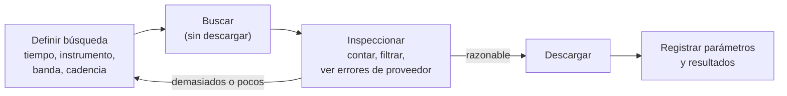

# B14-C22 — Acceso a datos heliofísicos abiertos con SunPy

<!-- nav:top -->
[🏠 Programa](../../../../README.md) · [📚 Bloque B14](../../../tronco-comun/B14-computacion-cientifica-y-ciencia-abierta.md) · [← Anterior: B14-C21 — Datos de misiones planetarias: PDS4, etiquetas y SPICE](../B14-C21-datos-de-misiones-planetarias-pds4-etiquetas-y-spice/CLASE.md) · [Siguiente: B14-C23 — Protocolo preregistrado de análisis →](../B14-C23-protocolo-preregistrado-de-analisis/CLASE.md)
<!-- /nav -->

## 1. Ubicación, nivel y alcance

Segunda clase de la ampliación programada del bloque B14. En [C05](../B14-C05-tablas-astronomicas-y-catalogos/CLASE.md) y [C18](../B14-C18-flujos-de-datos-espaciales/CLASE.md) trabajaste catálogos y flujos en general; aquí aprendes la lógica de acceder a **archivos heliofísicos abiertos**: primero buscar (por tiempo, instrumento y cadencia), después descargar. Nivel N2.

**Aviso de alcance:** el laboratorio **no usa SunPy ni accede a ningún servicio** (VSO, JSOC, CDAWeb ni otro). Implementa la lógica de búsqueda sobre un **índice sintético** de registros con nombres ficticios. Lo que digo de SunPy viene de su tutorial de adquisición de datos, que consulté; lo que digo de VSO, JSOC y CDAWeb se limita a que SunPy los lista como clientes.

Verás el flujo «buscar, inspeccionar, descargar», el manejo de intervalos de tiempo y de submuestreo por cadencia, y la importancia de informar los proveedores que fallan. No verás la instalación de SunPy, la lectura de mapas solares ni calibración.

## 2. Por qué esta clase existe

Quieres estudiar una región activa del Sol durante un día usando imágenes ultravioleta. Hay cientos de miles de archivos repartidos en varios proveedores. Descargarlo todo es imposible y descargar sin filtrar es inútil. La pregunta motivadora es: **¿cómo pido solo lo que necesito, cómo sé que no me falta nada y cómo registro lo que pedí?**

La decisión central es: **¿qué intervalo, instrumento, banda y cadencia necesito?** Una búsqueda mal definida da demasiado o demasiado poco, y un proveedor caído puede dejar un hueco que no notes si no se informa.

## 3. Lo que podrás hacer al terminar

1. Describir el flujo de SunPy: buscar, inspeccionar resultados y descargar.
2. Definir un intervalo de tiempo con extremos explícitos (cerrado–abierto) y contar los registros esperados.
3. Submuestrear por cadencia con una regla clara y verificar el conteo.
4. Reconocer que un proveedor puede fallar y exigir que el resultado conserve el error.
5. Registrar la búsqueda (parámetros y resultado) como parte de la procedencia.
6. Declarar qué parte del acceso real no se probó.

La evidencia es el **registro de una búsqueda reproducible** del ejercicio 12 (sección 20).

## 4. Con qué llegas y cómo comprobarlo

Necesitas C08, C18 y el manejo de tablas. Cinco preguntas:

1. ¿Cuántos registros hay en 24 h con cadencia de 12 s? (7200.)
2. ¿Qué diferencia hay entre un intervalo cerrado–abierto `[a, b)` y uno cerrado `[a, b]`?
3. ¿Por qué se registran los parámetros de una búsqueda?
4. ¿Qué es la cadencia de una serie?
5. ¿Qué es un proveedor de datos?

<details>
<summary>Ver respuestas</summary>

1. `86 400/12 = 7200`. 2. El primero incluye `a` y excluye `b`; el segundo incluye ambos. 3. Para poder repetirla y entender el resultado (C18). 4. El tiempo entre registros consecutivos. 5. El servicio o archivo que guarda y ofrece los datos.
</details>

Con cuatro o cinco aciertos, sigue; con tres o menos, repasa C18.

## 5. Un caso real: Fido, la interfaz unificada de SunPy

El tutorial de SunPy (S1) presenta **Fido** como su interfaz unificada de búsqueda y descarga: una sola API sobre muchas fuentes de datos. Las búsquedas se construyen con atributos: `a.Time(inicio, fin)` para el intervalo, `a.Instrument`, `a.Wavelength`, `a.Sample` para la cadencia, y `a.Level` y `a.Physobs`; los atributos específicos de un cliente viven en submódulos como `attrs.vso` y `attrs.jsoc`; el operador `|` combina búsquedas con «o». Fido dirige las consultas a clientes como VSOClient, JSOCClient, CDAWEBClient, HEKClient, LYRAClient, RHESSIClient y GONGClient, y los clientes que fallan se informan en el atributo `.errors` de la respuesta. El flujo es: **buscar** (`Fido.search`, no descarga nada), **inspeccionar** (indexar por cliente o posición, filtrar como una tabla de Astropy), **descargar** (`Fido.fetch`) y **reintentar** los fallos.

El **ejemplo conductor** es un índice **sintético** de 15 840 registros de un día ficticio (2026-01-01, 24 h): «AIA-ficticio» en 171 y 193 Å con cadencia de 12 s (proveedor A) y «EUV-ficticio» a 304 Å cada 60 s (proveedor B). Todos los nombres son ficticios.

## 6. Vocabulario

Un **cliente** es el componente que habla con un proveedor concreto. Una **búsqueda** devuelve una lista de registros sin descargar archivos. Un **registro** describe un archivo (instrumento, tiempo, banda). La **cadencia** es el intervalo entre observaciones; **submuestrear** es quedarse con un registro por ventana de tiempo. Un **intervalo cerrado–abierto** `[t₀, t₁)` incluye `t₀` y excluye `t₁`. La **longitud de onda** (aquí en ångström, Å; 1 Å = 10⁻¹⁰ m) identifica la banda. Un **error de proveedor** es un fallo de una fuente que no debe silenciarse.

## 7. Modelo mental: buscar es barato, descargar es caro

La búsqueda solo recorre un índice: es rápida y reproducible; la descarga mueve archivos. Primero se acota la búsqueda hasta que el número de registros sea razonable y solo entonces se descarga.



*Descripción textual:* se define la búsqueda, se ejecuta sin descargar, se inspecciona (conteo, filtros y errores de proveedor); si el número de registros no es razonable se vuelve a definir; si lo es, se descarga y se registran parámetros y resultados.

**Analogía y su límite.** Mirar el catálogo de una biblioteca antes de pedir los libros. Límite: en una biblioteca el catálogo es completo y único; aquí cada proveedor tiene el suyo y puede fallar.

## 8. La explicación, paso a paso

### 8.1 Definir el intervalo

El intervalo es `[t₀, t₁)`: incluye el inicio y excluye el fin. El laboratorio lo comprueba: entre `t = 3600 s` y `7200 s`, un instrumento con cadencia de 12 s tiene `3600/12 = 300` registros, con el último en `7188 s`; el de `7200 s` no cuenta. Con extremos cerrados se contaría un registro más en cada intervalo adyacente y los intervalos consecutivos duplicarían el del borde. (La convención de SunPy para sus intervalos no la verifiqué en el tutorial: aquí se define la del laboratorio.)

### 8.2 Contar lo esperado

Antes de ejecutar, calcula cuántos registros esperas. 24 h con cadencia de 12 s: 7200 registros por banda; la búsqueda devuelve 7200. Una hora sin filtros: `300 + 300 + 60 = 660` (dos bandas de AIA ficticio y una de EUV ficticio); devuelve 660. Un conteo que no coincide delata un filtro mal puesto o datos faltantes.

### 8.3 Submuestrear por cadencia

S1 menciona `a.Sample` para fijar una cadencia. El laboratorio implementa su propia regla: de cada ventana de `muestra` segundos desde el inicio, el primer registro. Con ventanas de 120 min (7200 s) en 24 h, quedan 12 registros por banda, en `0, 7200, 14 400, …`; con las dos bandas de AIA ficticio, 24. (La definición exacta de `a.Sample` en SunPy no la verifiqué; esta es la regla del laboratorio.)

### 8.4 Los proveedores fallan

Si el proveedor B «no responde», la búsqueda del laboratorio devuelve solo los 600 registros de A y **conserva el mensaje** «proveedor B no respondió». Esto sigue el principio de S1 (los clientes que fallan se informan en `.errors`). Un análisis que no mira los errores puede creer que no hubo datos de B cuando en realidad no pudo preguntarlos: ausencia de datos y ausencia de respuesta son cosas distintas.

### 8.5 Registrar la búsqueda

Una búsqueda reproducible se registra con los atributos usados (tiempo, instrumento, banda, cadencia), la fecha en que se hizo, los proveedores que respondieron y fallaron, el número de registros y la huella de los archivos descargados (C11, C18). Los servicios cambian con el tiempo y una misma búsqueda puede dar resultados distintos mañana.

### 8.6 Lo que no se probó

No usé SunPy ni ningún servicio: no sé cómo se comporta cada cliente real, ni sus límites de volumen, ni sus atributos exclusivos. El tutorial (S1) es la única fuente para SunPy y no cubre las condiciones de uso de VSO, JSOC o CDAWeb; hay que leerlas antes de usarlos.

## 9. Magnitudes, símbolos y unidades

| Concepto | Qué es | Unidad | Valor en el ejemplo |
|---|---|---|---|
| `t` | tiempo desde el inicio del día | s | 0 a 86 399 |
| cadencia AIA ficticio | intervalo entre registros | s | 12 |
| cadencia EUV ficticio | intervalo entre registros | s | 60 |
| `λ` | longitud de onda | Å (1 Å = 10⁻¹⁰ m) | 171, 193, 304 |
| registros | filas del índice | conteo | 15 840 |

## 10. Convenciones y referencias

Datos **sintéticos** y nombres ficticios. Los tiempos son segundos desde un origen arbitrario, sin escalas de tiempo reales (B13). El intervalo es cerrado–abierto y la regla de submuestreo es la del laboratorio. Versiones: Python 3.12.9, NumPy 2.5.4, pandas 3.1.1.

## 11. De dónde sale lo que afirmamos

| ID | Fuente | Localizador | Respalda | Estado |
|---|---|---|---|---|
| S1 | SunPy, tutorial de adquisición de datos (Fido) | https://docs.sunpy.org/en/stable/tutorial/acquiring_data/index.html | Fido como interfaz unificada; atributos `a.Time`, `a.Instrument`, `a.Wavelength`, `a.Sample`, `a.Level`, `a.Physobs`; clientes (VSO, JSOC, CDAWeb, etc.); errores por cliente; flujo buscar–inspeccionar–descargar–reintentar | Página consultada el 2026-11-05 (mutable) |

Límites: no consulté la documentación de VSO, JSOC ni CDAWeb; no verifiqué la convención de intervalos ni la definición exacta de `a.Sample`; no usé SunPy. Los registros del laboratorio son ficticios y no sirven para nada fuera de la lógica de búsqueda.

## 12. Cómo ver el resultado

Versión accesible.

| Búsqueda | Registros | Esperado |
|---|---|---|
| AIA ficticio 171 Å, 24 h | 7200 | 86 400/12 |
| AIA ficticio 171 Å, `[3600, 7200)` | 300 | 3600/12 |
| 171 Å cada 120 min | 12 | 24 h/2 h |
| AIA ficticio, ambas bandas, cada 120 min | 24 | 12 × 2 |
| Proveedor B caído, 1 h | 600 y un error informado | 300 × 2 |
| Sin filtros, 1 h | 660 | 300 + 300 + 60 |

## 13. Ejemplo trabajado: una búsqueda auditable

1. **Define:** `[0, 86 400)`, instrumento «AIA-ficticio», 171 Å.
2. **Espera:** 7200 registros.
3. **Busca:** 7200; sin errores.
4. **Acota:** `[3600, 7200)` → 300; último en 7188 s.
5. **Submuestrea** cada 120 min → 12, en 0, 7200, …
6. **Simula** el fallo de B: 600 registros y el error conservado.
7. **Registra** parámetros, errores y conteos.

**Paso final · incertidumbre.** Los conteos coinciden porque el índice sintético es completo y perfecto. Un archivo real tiene huecos, cadencias que cambian y registros duplicados entre proveedores; por eso el conteo esperado es un punto de partida para investigar, no una garantía.

## 14. Comparación: descargar todo, filtrar localmente y buscar primero

**Descargar todo** es inviable por volumen. **Filtrar localmente** exige haber descargado. **Buscar primero** (S1) reduce el volumen antes de descargar y deja un registro reproducible. La limitación es que depende del índice del proveedor y de que esté disponible.

## 15. Práctica guiada

**Ejercicio 1 · con los pasos.** ¿Cuántos registros espera el instrumento EUV ficticio (cadencia 60 s) en `[0, 3600)`? *Pasos:* `3600/60` (sección 8.2).

<details><summary>Solución comentada</summary>

60 registros. El de `3600 s` pertenece al intervalo siguiente.
</details>

**Ejercicio 2 · con una pista.** Si usas intervalos cerrados `[t₀, t₁]` en búsquedas consecutivas, ¿qué pasa en el límite? *Pista:* el registro de la frontera.

<details><summary>Solución comentada</summary>

El registro en la frontera aparecería en ambas búsquedas: duplicado. El intervalo cerrado–abierto lo evita.
</details>

**Ejercicio 3 · casi autónomo.** Con ventanas de 30 min en 24 h, ¿cuántos registros por banda se esperan?

<details><summary>Solución comentada</summary>

`24 h/0,5 h = 48` ventanas, un registro por ventana: 48.
</details>

## 16. Práctica autónoma, transferencia e integrador

**Ejercicio 4.** Calcula cuántos registros tiene AIA ficticio (dos bandas) en un día.

<details><summary>Solución comentada</summary>

`2 × 7200 = 14 400`; con EUV ficticio (1440) suma 15 840, el tamaño del índice.
</details>

**Ejercicio 5.** Un proveedor falla y tu análisis dice «no hubo datos de ese instrumento». ¿Qué error cometiste?

<details><summary>Solución comentada</summary>

Confundiste ausencia de respuesta con ausencia de datos. Revisa los errores devueltos (en SunPy, `.errors`, según S1), repite la búsqueda y registra el fallo.
</details>

**Ejercicio 6.** ¿Qué cadencia efectiva obtienes con ventanas de 120 min? ¿Es la misma que la nominal?

<details><summary>Solución comentada</summary>

7200 s (cada 2 h); la nominal del instrumento es 12 s. La cadencia efectiva es la de la ventana, no la del instrumento.
</details>

**Ejercicio 7.** Propón una comprobación para detectar huecos en una serie descargada con cadencia nominal de 12 s.

<details><summary>Solución comentada</summary>

Calcular las diferencias de tiempo consecutivas y marcar las mayores que 12 s (con una tolerancia); contar los registros frente a los esperados.
</details>

**Ejercicio 8.** Combina dos búsquedas con «o» (operador `|` en SunPy, S1): ¿cuántos registros esperas para las bandas 171 y 193 Å en una hora?

<details><summary>Solución comentada</summary>

`300 + 300 = 600`. Es la unión de dos búsquedas disjuntas.
</details>

**Ejercicio 9 · transferencia.** Una búsqueda de ayer dio 1000 registros y la de hoy 1020, con los mismos parámetros. ¿Qué haces?

<details><summary>Solución comentada</summary>

El archivo cambió (nuevos registros o reprocesos). Registras la fecha, comparas con la huella de lo ya descargado y decides si repites el análisis. Por eso se registra la fecha de cada búsqueda.
</details>

**Ejercicio 10 · transferencia.** Debes descargar 50 000 archivos. ¿Qué precauciones tomas?

<details><summary>Solución comentada</summary>

Leer las condiciones y límites del proveedor, probar con un subconjunto, usar reintentos con pausas, verificar huellas o tamaños, y registrar lo descargado. Una descarga masiva puede perjudicar a otros usuarios.
</details>

**Ejercicio 11 · transferencia.** Dos instrumentos tienen marcas de tiempo en escalas distintas. ¿Qué compruebas antes de cruzar sus registros?

<details><summary>Solución comentada</summary>

La escala de tiempo (UTC, TAI, etc.) y la referencia de cada archivo (B13); convertir a una común antes de comparar. Los segundos intercalares pueden crear diferencias de decenas de segundos.
</details>

**Ejercicio 12 · integrador.** Entrega el **registro de una búsqueda reproducible** (sobre un índice sintético propio o un servicio real con sus condiciones leídas): atributos, conteo esperado y obtenido, submuestreo, manejo de errores de proveedor, fecha, y lo que no se probó.

<details><summary>Solución modelo</summary>

Debe incluir la tabla de la sección 12 con tus números, la simulación de un proveedor caído con el error conservado, el registro de parámetros y fecha, y una declaración de si usaste datos sintéticos o un servicio real y de qué condiciones de uso leíste.
</details>

## 17. Laboratorio

El script [busqueda_sintetica.py](busqueda_sintetica.py) construye el índice sintético y comprueba intervalos cerrados–abiertos, filtros, submuestreo y el informe de un proveedor caído, con conteos calculados de antemano. **No usa SunPy ni red.**

**Datos:** sintéticos y ficticios. **Predice antes de ejecutar:** ¿cuántos registros de AIA ficticio caben en `[3600, 7200)`? **Ejecución del 2026-11-05 (Python 3.12.9, NumPy 2.5.4, pandas 3.1.1):**

```text
índice sintético: 15840 registros
AIA-ficticio 171 A, 24 h: 7200 registros (esperado 86400/12 = 7200)
AIA-ficticio 171 A, [3600, 7200): 300 registros (esperado 3600/12 = 300; el extremo 7200 no cuenta)
submuestreo cada 120 min: 12 registros (esperado 12)
AIA-ficticio, ambas longitudes de onda, cada 120 min: 24 registros (esperado 24)
proveedor B caído, 1 h: 600 registros de ['AIA-ficticio']; errores = ['proveedor B no respondió']
sin filtros, 1 h: 660 registros (esperado 300 + 300 + 60 = 660)
Pruebas superadas.
```

```bash
python programa/clases/B14/B14-C22-acceso-a-datos-heliofisicos-abiertos-con-sunpy/busqueda_sintetica.py
```

**Límites:** índice perfecto y ficticio; sin red; sin SunPy; las reglas de intervalo y submuestreo son las del laboratorio.

## 18. Errores frecuentes y cómo corregirlos

**Intervalos cerrados que duplican fronteras.** Se corrige con el ejercicio 2.

**Confundir ausencia de respuesta con ausencia de datos.** Se corrige con el ejercicio 5.

**No contar lo esperado.** Se corrige con los ejercicios 1 y 3.

**No registrar la fecha de la búsqueda.** Se corrige con el ejercicio 9.

**Descargar sin acotar ni leer condiciones.** Se corrige con el ejercicio 10.

## 19. Cómo sabrás que vas bien

Tras 8.1: ¿cuentas los registros de un intervalo? Si no, rehaz el ejercicio 1. Tras 8.4: ¿explicas por qué se conserva el error? Si no, rehaz el 5. Tras el ejemplo trabajado: ¿qué conteo te alertaría? Tras el laboratorio: ¿qué no probaste de SunPy? Al final: ¿qué dice tu registro de la fecha y los errores?

## 20. Qué entregas y cómo se evalúa

El producto es tu **registro de una búsqueda reproducible** del ejercicio 12.

| Criterio | Inicial | En desarrollo | Logrado | Destacado |
|---|---|---|---|---|
| Definición | Sin criterios | Algunos atributos | Tiempo, instrumento, banda y cadencia | Con intervalo explícito |
| Verificación | Sin conteo | Conteo sin esperado | Conteo esperado y obtenido | Con huecos y errores de proveedor |
| Registro | Ninguno | Parámetros | Parámetros, fecha y errores | Con huellas |
| Fuentes y alcance | Sin fuente | Fuente sin alcance | Fuente con alcance | Declara lo no probado |

**Condiciones críticas:** no silenciar errores de proveedor; no presentar un índice sintético como un servicio real; leer condiciones de uso antes de descargar.

## 21. Ética, seguridad y límites

Los servicios públicos tienen límites y condiciones; una descarga masiva puede afectar a otros. Cita las fuentes de datos como pidan. No incluyas credenciales en los registros. Accesibilidad: tablas en texto. Material educativo.

## 22. Para cerrar y seguir

Se busca primero, se inspecciona y solo después se descarga; el intervalo es cerrado–abierto, se cuenta lo esperado, se informan los proveedores que fallan y se registra la búsqueda con su fecha. Esta clase no usó SunPy ni ningún servicio. Queda abierta una pregunta: ¿cómo comprobarías que una serie descargada no tiene huecos?

**Glosario español–inglés.** cliente · *client*; búsqueda · *search / query*; registro · *record*; cadencia · *cadence*; submuestrear · *to subsample*; intervalo cerrado–abierto · *half-open interval*; proveedor · *provider*; heliofísica · *heliophysics*.

**Continuidad.** B14-C23 y C24 tratan cómo documentar de antemano y durante el análisis; B14-C25 y siguientes (programadas) extienden la idea de catálogos a datos geoespaciales; B13 trata las escalas de tiempo.

**Referencias:** ver sección 11.

<!-- nav:bottom -->
---

[← Anterior: B14-C21 — Datos de misiones planetarias: PDS4, etiquetas y SPICE](../B14-C21-datos-de-misiones-planetarias-pds4-etiquetas-y-spice/CLASE.md) · [📚 Bloque B14](../../../tronco-comun/B14-computacion-cientifica-y-ciencia-abierta.md) · [Siguiente: B14-C23 — Protocolo preregistrado de análisis →](../B14-C23-protocolo-preregistrado-de-analisis/CLASE.md)
<!-- /nav -->
