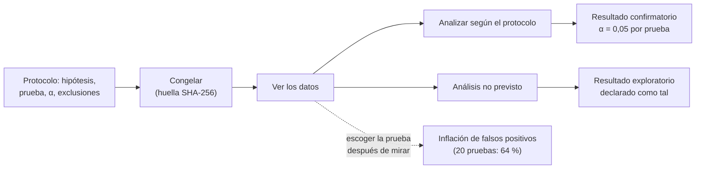

# B14-C23 — Protocolo preregistrado de análisis

<!-- nav:top -->
[🏠 Programa](../../../../README.md) · [📚 Bloque B14](../../../tronco-comun/B14-computacion-cientifica-y-ciencia-abierta.md) · [← Anterior: B14-C22 — Acceso a datos heliofísicos abiertos con SunPy](../B14-C22-acceso-a-datos-heliofisicos-abiertos-con-sunpy/CLASE.md) · [Siguiente: B14-C24 — Documentación de hipótesis y decisiones de análisis →](../B14-C24-documentacion-de-hipotesis-y-decisiones-de-analisis/CLASE.md)
<!-- /nav -->

## 1. Ubicación, nivel y alcance

Tercera clase de la ampliación programada del bloque B14. En [C20](../B14-C20-proyecto-reproducible-de-analisis-astronomico/CLASE.md) hiciste un análisis reproducible; ahora decides **qué análisis haces antes de ver los datos**, y lo dejas escrito. Es la protección contra el error más sutil: escoger el análisis después de mirar. Nivel N2.

**Aviso de alcance:** el laboratorio **no registra nada en ningún registro externo**; el protocolo se «congela» con una huella SHA-256 local. La simulación usa datos sintéticos de hipótesis nulas.

Verás qué es un protocolo preregistrado, qué contiene, por qué reduce falsos positivos (con una simulación), cómo se detecta una desviación y qué NO resuelve el preregistro. No verás estadística formal de comparaciones múltiples (B12), ni cómo usar un registro concreto.

## 2. Por qué esta clase existe

Tienes una curva de luz y muchas formas de analizarla: otro filtro, otra ventana, otro modelo, otra prueba. Si pruebas veinte y comunicas la que «sale», el resultado casi seguro parece significativo aunque no haya nada. La pregunta motivadora es: **¿cómo demuestro que no elegí el análisis después de ver el resultado?**

La decisión central es: **¿qué hipótesis, métodos, criterios de exclusión y umbrales fijo ahora, antes de mirar?** Lo que quede fuera se declara exploratorio, no se esconde.

## 3. Lo que podrás hacer al terminar

1. Explicar qué es el preregistro y la diferencia entre análisis confirmatorio y exploratorio.
2. Redactar un protocolo con hipótesis, prueba, umbral, exclusiones y versión de los datos.
3. Congelar el protocolo con una huella y detectar cualquier desviación posterior.
4. Calcular la probabilidad de al menos un falso positivo en `k` pruebas independientes.
5. Aplicar la corrección de Bonferroni y explicar su coste.
6. Declarar qué cubre y qué no cubre un preregistro.

La evidencia es el **protocolo preregistrado con criterios de decisión** del ejercicio 12 (sección 20).

## 4. Con qué llegas y cómo comprobarlo

Necesitas C10, C11, C20 y la idea de nivel de significación. Cinco preguntas:

1. ¿Qué probabilidad de falso positivo tiene una prueba con `α = 0,05` si no hay efecto? (5 %.)
2. Si haces 2 pruebas independientes, ¿qué probabilidad hay de al menos un falso positivo? (`1 − 0,95² = 9,75 %`.)
3. ¿Qué es una huella SHA-256? (C11)
4. ¿Qué es una hipótesis nula?
5. ¿Qué es un criterio de exclusión de datos? (C08)

<details>
<summary>Ver respuestas</summary>

1. 5 %. 2. `1 − 0,9025 = 0,0975`. 3. Un resumen de bytes que cambia si cambia el contenido. 4. La hipótesis de que no hay efecto. 5. Una regla que dice qué datos se descartan y por qué.
</details>

Con cuatro o cinco aciertos, sigue; con tres o menos, repasa C11 y B12.

## 5. Un caso real: qué es y qué no es preregistrar

La página del Center for Open Science sobre preregistro (S1) lo define como **escribir el plan de investigación antes del estudio y enviarlo a un registro** (por ejemplo, el OSF). Se registra el plan, incluidos los análisis previstos; debe especificarse al menos una prueba confirmatoria. Se hace justo antes de recolectar datos, tras una petición de revisores de más datos o antes de analizar un conjunto existente (con requisitos extra y declaración de acceso previo). Sirve para **separar el trabajo planeado (confirmatorio) del no planeado (exploratorio)**, lo que aumenta la credibilidad y reduce falsos positivos. Lo que **no** hace: no prohíbe análisis exploratorios (se permiten, etiquetados), no garantiza resultados válidos por sí mismo («planear con antelación es necesario pero no suficiente»), no es una cárcel (se puede modificar si se declara, por ejemplo en un documento de cambios transparentes), no es privado para siempre (los embargos duran hasta cuatro años) y no encaja en todos los diseños.

El **ejemplo conductor** es una simulación **sintética**: 20 000 repeticiones de un estudio ficticio con 20 hipótesis nulas independientes (sin efecto real).

## 6. Vocabulario

Un **protocolo preregistrado** es el plan de análisis fechado y fijado antes de ver los datos. Un análisis **confirmatorio** sigue el plan; uno **exploratorio** no. Una **desviación** es cualquier diferencia entre lo planeado y lo hecho. Un **falso positivo** es declarar un efecto que no existe. La **tasa de error por familia** es la probabilidad de al menos un falso positivo en `k` pruebas. La **corrección de Bonferroni** usa `α/k` por prueba. La **huella del protocolo** es el SHA-256 de su texto normalizado. **Congelar** es fijar el protocolo de modo que cambiarlo sea detectable.

## 7. Modelo mental: decidir primero, mirar después

Hay dos caminos. En uno decides el análisis, lo fijas y luego miras los datos: la probabilidad de falso positivo es la que declaraste. En otro miras los datos y escoges la prueba que sale: la probabilidad real de «encontrar algo» sube con cada prueba extra.



*Descripción textual:* el protocolo se congela con una huella antes de ver los datos; el análisis según el protocolo da un resultado confirmatorio con la tasa de error declarada; un análisis no previsto se etiqueta exploratorio; escoger la prueba después de mirar los datos infla los falsos positivos (con 20 pruebas, el 64 %).

**Analogía y su límite.** Apostar a una carta antes de que la den, frente a elegir la carta ganadora después. Límite: preregistrar no hace verdadera la hipótesis; solo hace honesto el procedimiento.

## 8. La explicación, paso a paso

### 8.1 Qué contiene un protocolo

El del laboratorio (sintético) tiene: la hipótesis («profundidad > 0»), la prueba (z bilateral), `α = 0,05`, el número de pruebas (1), las exclusiones («ninguna») y la huella de la versión de los datos (C11). Un protocolo real añade los criterios de decisión («se declara detección si `p < α`»), el tamaño de muestra o la regla de parada, el tratamiento de datos ausentes (C08) y la prueba confirmatoria que exige S1.

### 8.2 La simulación: una sola prueba

20 000 repeticiones, cada una con 50 muestras gaussianas estándar y una prueba z bilateral (varianza conocida igual a 1). Sin efecto real, la frecuencia de «falsos positivos» fue `0,0491`, frente al `0,05` teórico: coincide dentro del error estadístico (cuatro errores estándar binomiales).

### 8.3 La simulación: veinte pruebas, quedarse con la que sale

Con 20 hipótesis nulas independientes por estudio, la probabilidad teórica de al menos un resultado «significativo» es `1 − 0,95²⁰ = 0,6415`. La frecuencia simulada fue `0,6444`. **En dos de cada tres estudios sin efecto alguno se encontraría algo «significativo»** si se reporta la mejor de 20 pruebas. Eso es lo que el preregistro, al fijar de antemano qué prueba cuenta, busca evitar.

### 8.4 Corregir por múltiples pruebas

Si de verdad se hacen 20 pruebas, con Bonferroni se usa `α/20 = 0,0025` por prueba: la probabilidad teórica de al menos un falso positivo pasa a `1 − 0,9975²⁰ = 0,0488`, y la simulada fue `0,0519` (dentro de la tolerancia de cuatro errores estándar). El coste: cada prueba individual es más exigente, y se pierde sensibilidad ante efectos reales. (La fórmula de Bonferroni y su coste son conocimiento general que se profundiza en B12; no los consulté en una fuente.)

### 8.5 Congelar y detectar desviaciones

El protocolo se serializa con claves ordenadas y se calcula su huella (`7d33aedcb3fb001f…`). Si el análisis ejecutado coincide con el protocolo, la huella coincide y no hay desviaciones. Si se cambia `alfa` a 0,10 y se añade una exclusión («se quitaron 3 puntos»), el laboratorio detecta exactamente `['alfa', 'exclusiones']` y la huella cambia. Esa lista de desviaciones se declara en el informe (C24).

### 8.6 Lo que el preregistro no hace

No prohíbe lo exploratorio (S1): permite explorar si se etiqueta. No hace válido el resultado: S1 dice que es necesario pero no suficiente. No impide que alguien cambie el protocolo y su huella a la vez: la huella debe registrarse en un lugar externo (fecha y sistema verificables). Y la huella local del laboratorio **no es un registro**: solo ilustra la idea.

## 9. Magnitudes, símbolos y unidades

| Símbolo | Qué es | Unidad | Valor |
|---|---|---|---|
| `α` | nivel de significación por prueba | adimensional | 0,05 |
| `k` | número de pruebas | adimensional | 20 |
| `n` | muestras por prueba | adimensional | 50 |
| `z` | estadístico | adimensional | `media·√n` bajo la nula |
| `P_k` | probabilidad de al menos un falso positivo | adimensional | 0,6415 (teórica, α = 0,05); 0,0488 (Bonferroni) |
| repeticiones | estudios simulados | conteo | 20 000 |

## 10. Convenciones y referencias

Datos **sintéticos** (semilla 20261105). Pruebas independientes, varianza conocida. La tasa teórica es `1 − (1 − α)^k` bajo independencia. El protocolo del laboratorio es un ejemplo; ningún registro externo se usó.

## 11. De dónde sale lo que afirmamos

| ID | Fuente | Localizador | Respalda | Estado |
|---|---|---|---|---|
| S1 | Center for Open Science, *Preregistration* | https://www.cos.io/initiatives/prereg | Definición de preregistro; qué se registra y cuándo; separa confirmatorio de exploratorio; reduce falsos positivos; no prohíbe lo exploratorio; no garantiza validez; plazos de embargo | Página consultada el 2026-11-05 (mutable) |

Límites: no consulté literatura estadística sobre comparaciones múltiples ni sobre la eficacia empírica del preregistro; las fórmulas `1 − (1 − α)^k` y Bonferroni se verifican con la simulación del laboratorio y no se atribuyen a una fuente. No se usó ningún registro externo.

## 12. Cómo ver el resultado

Versión accesible de la simulación.

| Escenario | Frecuencia simulada | Teórica |
|---|---|---|
| Una prueba preregistrada | 0,0491 | 0,0500 |
| 20 pruebas, se reporta si alguna sale | 0,6444 | 0,6415 |
| 20 pruebas con Bonferroni | 0,0519 | 0,0488 |

Desviaciones detectadas entre protocolo y ejecución: `['alfa', 'exclusiones']`.

## 13. Ejemplo trabajado: preregistrar y auditar

1. **Redacta** el protocolo: hipótesis, prueba z bilateral, `α = 0,05`, 1 prueba, sin exclusiones, huella de los datos.
2. **Congela:** huella `7d33aedcb3fb001f…`, anotada en un lugar externo (aquí, no hecho).
3. **Analiza** solo lo previsto: falso positivo esperado 5 %.
4. **Compara** ejecución y protocolo: sin desviaciones, misma huella.
5. **Si exploras,** etiquétalo exploratorio y, si haces 20 pruebas, corrige con Bonferroni o declara la tasa de error por familia: 64 % sin corregir.
6. **Si cambias** el umbral o excluyes datos, registra la desviación (C24).

**Paso final · incertidumbre.** La simulación solo vale bajo sus supuestos (pruebas independientes, gaussianas, varianza conocida). Con pruebas correlacionadas, la probabilidad de al menos un falso positivo es menor que `1 − 0,95²⁰`, pero sigue siendo mucho mayor que 5 %.

## 14. Comparación: sin preregistro, con preregistro y con informe registrado

**Sin preregistro** el análisis puede adaptarse a los datos, con riesgo de inflar falsos positivos. **Con preregistro** (S1) se separa lo planeado de lo explorado, y las desviaciones se declaran. Un **informe registrado** (*Registered Report*) añade revisión por pares del plan antes de tener los resultados (S1 lo distingue del preregistro). Cada paso añade garantías y trabajo.

## 15. Práctica guiada

**Ejercicio 1 · con los pasos.** Calcula la probabilidad de al menos un falso positivo con 5 pruebas independientes y `α = 0,05`. *Pasos:* `1 − 0,95⁵` (sección 8.3).

<details><summary>Solución comentada</summary>

`0,95⁵ = 0,7738`; `1 − 0,7738 = 0,226`. Con solo 5 pruebas, casi una de cada cuatro vez hay un «positivo» sin efecto.
</details>

**Ejercicio 2 · con una pista.** ¿Qué `α` por prueba da Bonferroni para 5 pruebas? *Pista:* `α/k`.

<details><summary>Solución comentada</summary>

`0,05/5 = 0,01`. La probabilidad de al menos un falso positivo queda en `1 − 0,99⁵ = 0,049`.
</details>

**Ejercicio 3 · casi autónomo.** ¿Qué diferencia hay entre análisis confirmatorio y exploratorio según S1?

<details><summary>Solución comentada</summary>

El confirmatorio sigue el plan registrado de antemano; el exploratorio no estaba planeado. Ambos son legítimos si se etiquetan como lo que son.
</details>

## 16. Práctica autónoma, transferencia e integrador

**Ejercicio 4.** ¿Cuántas pruebas independientes necesitas para que la probabilidad de al menos un falso positivo supere el 50 % con `α = 0,05`?

<details><summary>Solución comentada</summary>

`1 − 0,95^k > 0,5` → `k > ln 0,5/ln 0,95 = 13,5`: 14 pruebas.
</details>

**Ejercicio 5.** Tu protocolo dice «excluir valores a más de 5 MAD» (C08) y al ver los datos decides usar 3 MAD. ¿Qué haces?

<details><summary>Solución comentada</summary>

Registras la desviación (cuándo, por qué, qué cambió), analizas con ambas reglas, reportas la planeada como confirmatoria y la otra como exploratoria.
</details>

**Ejercicio 6.** ¿Por qué la huella del protocolo debe registrarse fuera de tu equipo?

<details><summary>Solución comentada</summary>

Porque si alguien (tú mismo) puede cambiar el protocolo y recalcular la huella, no hay prueba de que no se modificó después de ver los datos. Un registro externo con fecha lo evita.
</details>

**Ejercicio 7.** Propón los criterios de decisión de un protocolo para detectar un tránsito en una curva de luz.

<details><summary>Solución comentada</summary>

Ejemplo: modelo trapezoidal; prueba de que la profundidad ajustada supera `3σ` de su incertidumbre; `α` o umbral declarado; exclusiones (outliers a 5 MAD); versión de los datos; qué se reporta si no se cumple el criterio. Se acepta cualquier criterio completo.
</details>

**Ejercicio 8.** Un colega dice «preregistré, así que mi resultado es cierto». ¿Qué respondes?

<details><summary>Solución comentada</summary>

S1: planear es necesario pero no suficiente. El preregistro hace transparente el procedimiento; la validez depende del diseño, los datos y el análisis.
</details>

**Ejercicio 9 · transferencia.** Ya tienes los datos cuando decides preregistrar. ¿Qué dice S1 y qué haces?

<details><summary>Solución comentada</summary>

S1: es posible antes de analizar un conjunto existente, con condiciones extra y declarando el acceso previo. Declaras qué viste ya y qué decisiones se tomaron con conocimiento de los datos.
</details>

**Ejercicio 10 · transferencia.** Tienes 30 resultados descriptivos que quieres mostrar. ¿Los preregistras todos como confirmatorios?

<details><summary>Solución comentada</summary>

No: preregistras las pruebas confirmatorias (al menos una, S1) y presentas el resto como exploratorias. Si todas son confirmatorias, corriges por múltiples pruebas.
</details>

**Ejercicio 11 · transferencia.** Un revisor pide un análisis adicional. ¿Cómo lo manejas?

<details><summary>Solución comentada</summary>

Lo realizas, lo etiquetas como no planeado en el protocolo original y lo documentas como cambio o análisis adicional (S1 menciona un documento de cambios transparentes). Mantienes visible el análisis planeado.
</details>

**Ejercicio 12 · integrador.** Entrega un **protocolo preregistrado con criterios de decisión** para un análisis sintético propio: hipótesis, prueba, umbral, exclusiones, versión de los datos, huella del protocolo, simulación de la tasa de falsos positivos con tu diseño, detección de desviaciones y declaración de lo que el preregistro no cubre.

<details><summary>Solución modelo</summary>

Debe incluir el protocolo, su huella, la simulación con frecuencia simulada frente a teórica, una prueba que detecte al menos dos desviaciones sembradas, la nota sobre el registro externo pendiente y las limitaciones. Se acepta cualquier diseño sintético.
</details>

## 17. Laboratorio

El script [preregistro_y_comparaciones.py](preregistro_y_comparaciones.py) simula 20 000 estudios con 20 hipótesis nulas, mide las tasas de falsos positivos (una prueba, 20 pruebas, Bonferroni), las compara con las teóricas dentro de cuatro errores estándar y congela un protocolo con una huella para detectar desviaciones. **No usa ningún registro externo.**

**Datos:** sintéticos (semilla 20261105). **Predice antes de ejecutar:** ¿qué frecuencia esperas para «alguna de 20»? **Ejecución del 2026-11-05 (Python 3.12.9, NumPy 2.5.4):**

```text
una sola prueba (preregistrada): falsos positivos = 0.0491 (teórico 0.0500)
20 pruebas, se reporta si alguna sale (sin preregistrar): 0.6444 (teórico 0.6415)
20 pruebas con Bonferroni (alfa/20): 0.0519 (teórico 0.0488)
huella del protocolo congelado: 7d33aedcb3fb001f...
desviaciones detectadas: ['alfa', 'exclusiones']; la huella cambia: True
Pruebas superadas.
```

```bash
python programa/clases/B14/B14-C23-protocolo-preregistrado-de-analisis/preregistro_y_comparaciones.py
```

**Límites:** pruebas independientes y gaussianas; una sola semilla; la huella local no es un registro; no se usó ningún registro externo.

## 18. Errores frecuentes y cómo corregirlos

**Elegir la prueba después de mirar.** Se corrige con la sección 8.3 y el ejercicio 4.

**Cambiar el protocolo sin declararlo.** Se corrige con el ejercicio 5.

**Creer que preregistrar garantiza validez.** Se corrige con el ejercicio 8.

**Ocultar lo exploratorio.** Se corrige con los ejercicios 3 y 10.

**Congelar solo en tu equipo.** Se corrige con el ejercicio 6.

## 19. Cómo sabrás que vas bien

Tras 8.3: ¿calculas `1 − 0,95^k`? Si no, rehaz el ejercicio 1. Tras 8.5: ¿detectas desviaciones? Si no, rehaz el 5. Tras el ejemplo trabajado: ¿qué es confirmatorio y qué exploratorio? Tras el laboratorio: ¿qué no es un registro? Al final: ¿dónde registrarías tu huella?

## 20. Qué entregas y cómo se evalúa

El producto es tu **protocolo preregistrado con criterios de decisión** del ejercicio 12.

| Criterio | Inicial | En desarrollo | Logrado | Destacado |
|---|---|---|---|---|
| Protocolo | Sin criterios | Hipótesis sin umbral | Completo y congelado | Con criterios de decisión |
| Simulación | Ninguna | Cita la fórmula | Simula y compara | Con tolerancia estadística |
| Desviaciones | No las detecta | Las nota | Las lista | Con tratamiento exploratorio |
| Fuentes y alcance | Sin fuente | Fuente sin alcance | Fuente con alcance | Declara lo que no cubre |

**Condiciones críticas:** no presentar un análisis exploratorio como confirmatorio; no afirmar que algo está registrado si solo hay una huella local; no ocultar desviaciones.

## 21. Ética, seguridad y límites

Preregistrar es un compromiso público: no lo uses como sello de calidad vacío. Respeta los embargos y las condiciones del registro. Un preregistro no sustituye la revisión ética cuando hay personas implicadas. Accesibilidad: tablas en texto. Material educativo.

## 22. Para cerrar y seguir

Un protocolo preregistrado fija, antes de mirar, la hipótesis, la prueba, el umbral y las exclusiones, y separa lo confirmatorio de lo exploratorio; la simulación muestra por qué: con 20 pruebas, el 64 % de los estudios sin efecto «encontraría» algo. No hay garantía de validez ni registro externo en esta clase. Queda abierta una pregunta: ¿cómo registrarías tus desviaciones durante el análisis?

**Glosario español–inglés.** preregistro · *preregistration*; confirmatorio · *confirmatory*; exploratorio · *exploratory*; desviación · *deviation*; falso positivo · *false positive*; corrección de Bonferroni · *Bonferroni correction*; congelar · *to freeze*.

**Continuidad.** B14-C24 documenta las decisiones y desviaciones durante el análisis; B12 profundiza las comparaciones múltiples; B124-C14 trata la ciencia abierta en general.

**Referencias:** ver sección 11.

<!-- nav:bottom -->
---

[← Anterior: B14-C22 — Acceso a datos heliofísicos abiertos con SunPy](../B14-C22-acceso-a-datos-heliofisicos-abiertos-con-sunpy/CLASE.md) · [📚 Bloque B14](../../../tronco-comun/B14-computacion-cientifica-y-ciencia-abierta.md) · [Siguiente: B14-C24 — Documentación de hipótesis y decisiones de análisis →](../B14-C24-documentacion-de-hipotesis-y-decisiones-de-analisis/CLASE.md)
<!-- /nav -->
