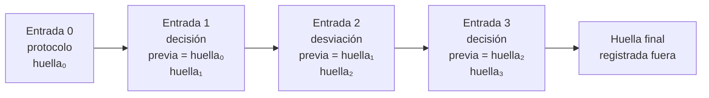

# B14-C24 — Documentación de hipótesis y decisiones de análisis

<!-- nav:top -->
[🏠 Programa](../../../../README.md) · [📚 Bloque B14](../../../tronco-comun/B14-computacion-cientifica-y-ciencia-abierta.md) · [← Anterior: B14-C23 — Protocolo preregistrado de análisis](../B14-C23-protocolo-preregistrado-de-analisis/CLASE.md) · [Siguiente: B14-C25 — Catálogos de datos geoespaciales y metadatos (STAC) →](../B14-C25-catalogos-de-datos-geoespaciales-y-metadatos-stac/CLASE.md)
<!-- /nav -->

## 1. Ubicación, nivel y alcance

Cuarta clase de la ampliación programada del bloque B14. En [C23](../B14-C23-protocolo-preregistrado-de-analisis/CLASE.md) fijaste el plan antes de mirar; durante el análisis real surgen decisiones y desviaciones que ese plan no previó. Esta clase trata cómo **registrarlas** de forma que cualquiera pueda reconstruir qué se decidió, cuándo y por qué. Nivel N2.

**Aviso de alcance:** el laboratorio usa una bitácora local encadenada por hashes con textos y fechas **ficticios y fijos**; no hay registro externo ni sistema de control de versiones.

Verás qué registrar, la diferencia entre decisión y desviación, una bitácora que solo se puede ampliar, la cadena de huellas que delata cambios, y su límite: no impide reescribirla entera. No verás gestión de proyectos ni herramientas concretas de registro.

## 2. Por qué esta clase existe

Seis meses después de un análisis, nadie recuerda por qué se excluyeron tres puntos ni cuándo se cambió el modelo. Y un revisor pregunta si la exclusión estaba prevista. La pregunta motivadora es: **¿cómo dejo un registro de las decisiones que permita reconstruir el análisis y distinguir lo planeado de lo improvisado?**

La decisión central es: **¿qué se anota, con qué detalle y de modo que se note si se altera?** Una nota hecha al momento, fechada y encadenada vale más que una memoria reconstruida después.

## 3. Lo que podrás hacer al terminar

1. Distinguir hipótesis, decisión y desviación y registrar cada una con sus campos.
2. Escribir una entrada de bitácora con fecha, tipo, texto y relación con el protocolo.
3. Encadenar entradas con huellas y verificar la cadena.
4. Detectar una modificación, un borrado o un reordenamiento y localizar el punto de rotura.
5. Reconocer el límite de la cadena: una reescritura completa es válida.
6. Producir un informe que liste desviaciones y las separe de lo confirmatorio.

La evidencia es la **bitácora de decisiones y desviaciones** del ejercicio 12 (sección 20).

## 4. Con qué llegas y cómo comprobarlo

Necesitas C11 (huellas), C23 (protocolo, desviaciones) y C18 (procedencia). Cinco preguntas:

1. ¿Qué es una desviación del protocolo? (C23)
2. ¿Qué garantiza una huella SHA-256 y qué no? (C11)
3. ¿Qué es un registro «solo de adición»?
4. ¿Por qué incluir la huella previa en cada entrada?
5. ¿Qué diferencia hay entre lo confirmatorio y lo exploratorio? (C23)

<details>
<summary>Ver respuestas</summary>

1. Cualquier diferencia entre lo planeado y lo hecho. 2. Que el contenido es el mismo; no que sea correcto. 3. Uno al que se añaden entradas sin modificar las anteriores. 4. Para que cualquier cambio en una entrada anterior rompa el vínculo con las siguientes. 5. Lo confirmatorio sigue el plan; lo exploratorio no.
</details>

Con cuatro o cinco aciertos, sigue; con tres o menos, repasa C11 y C23.

## 5. Un caso real: cambios transparentes y bitácora

La página del Center for Open Science sobre preregistro (S1) establece que los cambios al plan **están permitidos si se declaran**, por ejemplo en un documento de cambios transparentes; que los análisis no previstos se permiten pero hay que **etiquetarlos como exploratorios**; y que el plan no es una cárcel pero las modificaciones posteriores a ver resultados deben divulgarse. De ahí se deriva lo que registra esta clase: cada desviación, con su fecha, motivo y efecto. S1 no define el formato de una bitácora ni menciona cadenas de huellas: la **encadenada** es una técnica de esta clase, basada en C11.

El **ejemplo conductor** es una bitácora **sintética** de un análisis ficticio de un tránsito: un protocolo, dos decisiones y una desviación (excluir tres muestras atípicas que no estaban en el protocolo), con fechas fijas inventadas.

## 6. Vocabulario

Una **hipótesis** es la afirmación que se pone a prueba. Una **decisión** es una elección razonada dentro de lo permitido por el protocolo. Una **desviación** es una diferencia con el protocolo. Una **bitácora** es el registro cronológico de entradas. Una **cadena de huellas** hace que cada entrada incluya la huella de la anterior. **Solo de adición** significa que no se modifica ni borra lo escrito. Un **informe de desviaciones** las lista con motivo y efecto. Un **registro externo** guarda la huella final fuera de tu control.

## 7. Modelo mental: cada entrada firma la anterior

Cada entrada contiene la huella de la anterior en su propio contenido. Cambiar una entrada vieja cambia su huella y, con ella, la que la siguiente tenía anotada: el vínculo se rompe desde ahí.



*Descripción textual:* cuatro entradas encadenadas: protocolo, decisión, desviación y decisión. Cada una contiene la huella de la anterior y calcula la suya sobre todo su contenido, incluida esa referencia. La huella de la última se registra fuera del equipo.

**Analogía y su límite.** Un cuaderno de laboratorio con páginas numeradas y firmadas cada día por un testigo. Límite: aquí el «testigo» es una huella, que detecta cambios pero no sabe si lo escrito es verdad.

## 8. La explicación, paso a paso

### 8.1 Qué se registra

Hipótesis (qué se prueba y qué la refutaría), decisiones (qué se eligió y por qué), desviaciones (qué cambió respecto al protocolo, cuándo, con qué conocimiento de los datos y con qué efecto) y la versión de los datos y del software en cada punto (C11, C12). El laboratorio usa tres tipos de entrada, `protocolo`, `decision` y `desviacion`, y la explicación va en el campo `texto`.

### 8.2 La entrada

Cada entrada tiene índice, fecha, tipo, texto y la huella de la anterior; su huella es el SHA-256 de esos cinco campos. La primera entrada (índice 0) lleva una huella previa de 64 ceros y fija la huella del protocolo (C23). Las fechas del laboratorio son fijas y ficticias para que el resultado sea reproducible; en un registro real, la fecha debe ser la del momento y verificable.

### 8.3 Decisión frente a desviación

Una **decisión** es una elección que el protocolo permitía (por ejemplo, usar el modelo trapezoidal que el plan especificaba). Una **desviación** es algo que el protocolo no preveía o contradecía: en el ejemplo, «se excluyen 3 muestras con flujo atípico (más de 5 MAD); no estaba en el protocolo; se declara exploratorio». La frontera no siempre es clara; si dudas, regístralo como desviación.

### 8.4 Verificar la cadena

La verificación recorre las entradas comprobando tres cosas: que el índice sea el esperado, que la huella previa coincida con la huella de la entrada anterior y que la huella propia coincida con su contenido. Devuelve el índice del primer fallo. Con la bitácora íntegra, no hay fallo.

### 8.5 Atacar la cadena

El laboratorio prueba cuatro alteraciones y el punto exacto donde se detectan. **Modificar** el texto de la entrada 1: se rompe en el índice 1. **Recalcular solo la huella** de la entrada modificada: se rompe en el índice 2, porque la entrada 2 sigue apuntando a la huella antigua. **Borrar** la entrada 2: se rompe en el índice 2 (el índice ya no coincide). **Intercambiar** las entradas 1 y 2: se rompe en el índice 1. **Añadir** una entrada válida: la cadena sigue íntegra, ahora con 5 entradas.

### 8.6 El límite

Si alguien reescribe **toda** la bitácora desde el principio (en el laboratorio, cambiando «trapezoidal» por «gaussiano» en todos los textos), obtiene otra cadena perfectamente válida, pero su **huella final es distinta**. Por eso la huella final debe publicarse o registrarse aparte (un registro externo, un mensaje fechado, un depósito de datos): si no, la cadena demuestra coherencia interna, no antigüedad. Y nada de esto prueba que lo anotado sea verdad.

## 9. Magnitudes, símbolos y unidades

| Concepto | Qué es | Unidad | Valor en el ejemplo |
|---|---|---|---|
| entradas | registros de la bitácora | conteo | 4 (luego 5) |
| tipos | protocolo, decisión, desviación | — | 1, 2, 1 |
| huella | SHA-256 | 64 dígitos hexadecimales | cadena de 4 (5) huellas |
| punto de rotura | índice del primer fallo | entero | 1, 2, 2 y 1 en las pruebas |
| desviaciones registradas | entradas de tipo desviación | conteo | 1 |

## 10. Convenciones y referencias

Datos **sintéticos**; fechas ficticias y fijas (enero de 2026). La huella de cada entrada es SHA-256 sobre el JSON de sus cinco campos con claves ordenadas. La cadena detecta cambios; no autentica a la persona que escribe. Ningún registro externo se usó.

## 11. De dónde sale lo que afirmamos

| ID | Fuente | Localizador | Respalda | Estado |
|---|---|---|---|---|
| S1 | Center for Open Science, *Preregistration* | https://www.cos.io/initiatives/prereg | Los cambios al plan se permiten si se declaran (documento de cambios transparentes); lo no planeado se etiqueta exploratorio; el plan no es una cárcel | Página consultada el 2026-11-05 (mutable) |

Límites: S1 no define formatos de bitácora ni cadenas de huellas; la cadena es una técnica de esta clase; no consulté guías de cuadernos de laboratorio ni normas de integridad de datos. La bitácora del laboratorio es de adición solo por convención del programa.

## 12. Cómo ver el resultado

Versión accesible de las pruebas del laboratorio.

| Alteración | Punto donde se detecta |
|---|---|
| Ninguna (bitácora íntegra) | sin fallo |
| Texto de la entrada 1 modificado | índice 1 |
| Solo se recalcula la huella de la entrada 1 | índice 2 |
| Entrada 2 borrada | índice 2 |
| Entradas 1 y 2 intercambiadas | índice 1 |
| Una entrada válida añadida | sin fallo (5 entradas) |
| Reescritura completa | cadena válida con otra huella final |

## 13. Ejemplo trabajado: reconstruir una decisión

1. **Entrada 0 (protocolo):** hipótesis, prueba, `α`, huella del protocolo.
2. **Entrada 1 (decisión):** modelo trapezoidal con ingreso fijo de 1000 s, con su justificación.
3. **Entrada 2 (desviación):** exclusión de 3 muestras a más de 5 MAD, fuera del protocolo, declarada exploratoria.
4. **Entrada 3 (decisión):** reportar con y sin la exclusión.
5. **Verifica:** cadena íntegra.
6. **Ataca:** cada alteración se detecta en el índice esperado.
7. **Informe:** 1 desviación; el resultado con exclusión es exploratorio y el sin exclusión, confirmatorio.

**Paso final · incertidumbre.** La bitácora demuestra coherencia interna y delata cambios, pero no prueba que las fechas sean verdaderas ni que el texto sea completo. Su valor crece si la huella final se registra externamente y si se escribe en el momento.

## 14. Comparación: memoria, documento libre y bitácora encadenada

La **memoria** falla con el tiempo. Un **documento libre** (texto o cuaderno) es cómodo y modificable sin dejar rastro. Un **sistema de control de versiones** (Git) ya ofrece historial encadenado (principio general; no lo consulté aquí). La **bitácora encadenada** de esta clase enseña el mecanismo con pocos medios. Cuál usar depende del rigor que exijan tu proyecto y tu institución.

## 15. Práctica guiada

**Ejercicio 1 · con los pasos.** Clasifica como decisión o desviación: (a) usar el modelo especificado en el protocolo; (b) cambiar `α` de 0,05 a 0,10 tras ver los resultados. *Pasos:* ¿lo permitía el protocolo? (sección 8.3).

<details><summary>Solución comentada</summary>

(a) decisión; (b) desviación, y grave: cambiar el umbral tras ver resultados debe declararse y no puede presentarse como confirmatorio (C23).
</details>

**Ejercicio 2 · con una pista.** Escribe una entrada de desviación con sus campos. *Pista:* fecha, qué cambió, por qué, qué se sabía de los datos, efecto.

<details><summary>Solución comentada</summary>

Ejemplo: «2026-01-03 · desviación · se excluyen 3 muestras a más de 5 MAD; no estaba en el protocolo; se hizo tras ver la curva; efecto: la profundidad estimada cambia de X a Y; se declara exploratorio». Cualquier redacción con esos campos sirve.
</details>

**Ejercicio 3 · casi autónomo.** ¿Por qué recalcular la huella de la entrada alterada no engaña a la verificación?

<details><summary>Solución comentada</summary>

La entrada siguiente contiene la huella antigua en su campo «previa»; al cambiar la huella de la anterior, no coinciden y se detecta en el índice siguiente (2 en el laboratorio).
</details>

## 16. Práctica autónoma, transferencia e integrador

**Ejercicio 4.** Con 10 entradas, ¿en qué índice se detecta la alteración del texto de la entrada 6?

<details><summary>Solución comentada</summary>

En el índice 6: su huella ya no coincide con su contenido.
</details>

**Ejercicio 5.** ¿Por qué se rompe en el índice 2 al borrar la entrada 2, y no en el 3?

<details><summary>Solución comentada</summary>

Tras borrar, la que era la entrada 3 pasa a estar en la posición 2 y su campo de índice (3) no coincide con la posición esperada (2); además su huella previa apunta a la entrada borrada.
</details>

**Ejercicio 6.** ¿Qué detecta y qué no detecta una cadena de huellas?

<details><summary>Solución comentada</summary>

Detecta modificaciones, borrados y reordenamientos de entradas antiguas. No detecta una reescritura completa (válida con otra huella final), la falsedad de lo anotado ni el momento real de escritura.
</details>

**Ejercicio 7.** ¿Dónde registrarías la huella final y por qué?

<details><summary>Solución comentada</summary>

En un lugar fuera de tu control con fecha verificable (un registro de preregistro, un depósito de datos, un mensaje fechado a tu equipo): así una reescritura posterior no coincidiría con la huella ya registrada.
</details>

**Ejercicio 8.** Dos colegas anotan en la misma bitácora en paralelo. ¿Qué problema aparece?

<details><summary>Solución comentada</summary>

La cadena es lineal: dos entradas con la misma huella previa crean una bifurcación. Se necesitan reglas (un solo escritor a la vez, o una bitácora por persona y una fusión documentada).
</details>

**Ejercicio 9 · transferencia.** Descubres un error en una decisión pasada. ¿Cómo lo corriges sin tocar lo escrito?

<details><summary>Solución comentada</summary>

Añades una entrada nueva que reconoce el error, lo corrige y explica el efecto. No modificas la antigua: el registro de adición conserva la historia, incluida la equivocación.
</details>

**Ejercicio 10 · transferencia.** Un revisor pide el historial de decisiones. ¿Qué entregas?

<details><summary>Solución comentada</summary>

La bitácora completa con su huella final, el protocolo con su huella, el informe de desviaciones y las versiones de datos y software (C11, C12, C23). Con eso el revisor puede verificar la cadena y la coherencia.
</details>

**Ejercicio 11 · transferencia.** ¿Qué haces si dudas entre decisión y desviación?

<details><summary>Solución comentada</summary>

La registras como desviación: es más prudente sobredeclarar que esconder; la transparencia es el objetivo (S1).
</details>

**Ejercicio 12 · integrador.** Entrega una **bitácora de decisiones y desviaciones** para un análisis sintético propio: protocolo con huella, al menos tres decisiones y dos desviaciones, verificación de la cadena, cuatro ataques con su punto de detección, informe de desviaciones, el límite de la cadena y dónde registrarías la huella final.

<details><summary>Solución modelo</summary>

Debe incluir las entradas con sus campos, la tabla de la sección 12 con tus resultados, el informe que separe lo confirmatorio de lo exploratorio, una declaración de que la cadena no autentica ni prueba antigüedad sin un registro externo, y la propuesta de ese registro. Se acepta cualquier análisis sintético.
</details>

## 17. Laboratorio

El script [bitacora_de_decisiones.py](bitacora_de_decisiones.py) construye la bitácora encadenada de cuatro entradas, verifica su integridad, aplica cuatro alteraciones (modificar, recalcular solo la huella, borrar y reordenar), comprueba que añadir mantiene la cadena y muestra que una reescritura completa es válida con otra huella final. **No usa registro externo.**

**Datos:** sintéticos, con fechas fijas y ficticias. **Predice antes de ejecutar:** ¿en qué índice se rompe al recalcular solo la huella de la entrada 1? **Ejecución del 2026-11-05 (Python 3.12.9):**

```text
entradas: 4; tipos: ['protocolo', 'decision', 'desviacion', 'decision']
cadena íntegra: verificación aprobada
texto de la entrada 1 modificado: se rompe en el índice 1
recalcular solo la huella de la entrada 1: se rompe en el índice 2 (la entrada 2 apunta a la huella anterior)
entrada 2 borrada: se rompe en el índice 2
entradas 1 y 2 intercambiadas: se rompe en el índice 1
añadir una entrada válida: cadena íntegra con 5 entradas; huella final = 04ec54fcaec094b2...
límite: una cadena reescrita entera también verifica, pero su huella final es distinta; por eso la huella final debe publicarse o registrarse aparte
desviaciones del protocolo registradas: 1
Pruebas superadas.
```

```bash
python programa/clases/B14/B14-C24-documentacion-de-hipotesis-y-decisiones-de-analisis/bitacora_de_decisiones.py
```

**Límites:** bitácora local de un solo escritor; fechas ficticias; no autentica a quien escribe; no prueba antigüedad.

## 18. Errores frecuentes y cómo corregirlos

**Anotar después de memoria, no en el momento.** Se corrige con la sección 2 y el ejercicio 9.

**Corregir una entrada modificándola.** Se corrige con el ejercicio 9.

**Clasificar una desviación como decisión.** Se corrige con los ejercicios 1 y 11.

**Creer que la cadena prueba la fecha.** Se corrige con la sección 8.6 y el ejercicio 7.

**No registrar la huella final fuera.** Se corrige con el ejercicio 7.

## 19. Cómo sabrás que vas bien

Tras 8.3: ¿clasificas decisiones y desviaciones? Si no, rehaz el ejercicio 1. Tras 8.5: ¿predices dónde se detecta cada alteración? Si no, rehaz los ejercicios 4 y 5. Tras el ejemplo trabajado: ¿qué es confirmatorio y qué exploratorio? Tras el laboratorio: ¿qué no prueba la cadena? Al final: ¿dónde registrarías tu huella final?

## 20. Qué entregas y cómo se evalúa

El producto es tu **bitácora de decisiones y desviaciones** del ejercicio 12.

| Criterio | Inicial | En desarrollo | Logrado | Destacado |
|---|---|---|---|---|
| Contenido | Notas sueltas | Entradas sin motivo | Entradas con fecha, motivo y efecto | Con versiones de datos y software |
| Integridad | Ninguna | Huellas sin encadenar | Cadena verificada | Con ataques y puntos de detección |
| Desviaciones | Las oculta | Las menciona | Las lista y las separa | Con informe confirmatorio/exploratorio |
| Fuentes y alcance | Sin fuente | Fuente sin alcance | Fuente con alcance | Declara el límite de la cadena |

**Condiciones críticas:** no modificar entradas anteriores; no ocultar una desviación; no afirmar que una huella local prueba antigüedad.

## 21. Ética, seguridad y límites

Una bitácora honesta incluye los errores propios. Si registra datos de personas, protégelos. La cadena no sustituye la integridad científica ni la revisión institucional. Accesibilidad: tablas en texto. Material educativo.

## 22. Para cerrar y seguir

Documentar un análisis es anotar, en el momento y de modo que solo se pueda ampliar, las hipótesis, decisiones y desviaciones; una cadena de huellas delata modificaciones, borrados y reordenamientos, pero no una reescritura completa, por lo que la huella final debe registrarse fuera. Queda abierta una pregunta: ¿cómo evitarías la bifurcación cuando varias personas anotan a la vez?

**Glosario español–inglés.** bitácora · *log / lab notebook*; decisión · *decision*; desviación · *deviation*; cadena de huellas · *hash chain*; solo de adición · *append-only*; informe de desviaciones · *deviation report*; registro externo · *external registry*.

**Continuidad.** Las clases B14-C25 en adelante (programadas) amplían el bloque a datos geoespaciales; B14-C20 integra estas prácticas en un proyecto; B124-C14 trata la ciencia abierta en general.

**Referencias:** ver sección 11.

<!-- nav:bottom -->
---

[← Anterior: B14-C23 — Protocolo preregistrado de análisis](../B14-C23-protocolo-preregistrado-de-analisis/CLASE.md) · [📚 Bloque B14](../../../tronco-comun/B14-computacion-cientifica-y-ciencia-abierta.md) · [Siguiente: B14-C25 — Catálogos de datos geoespaciales y metadatos (STAC) →](../B14-C25-catalogos-de-datos-geoespaciales-y-metadatos-stac/CLASE.md)
<!-- /nav -->
