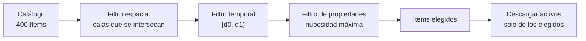

# B14-C25 — Catálogos de datos geoespaciales y metadatos (STAC)

<!-- nav:top -->
[🏠 Programa](../../../../README.md) · [📚 Bloque B14](../../../tronco-comun/B14-computacion-cientifica-y-ciencia-abierta.md) · [← Anterior: B14-C24 — Documentación de hipótesis y decisiones de análisis](../B14-C24-documentacion-de-hipotesis-y-decisiones-de-analisis/CLASE.md) · [Siguiente: B14-C26 — Formatos de datos ráster geoespaciales: GeoTIFF y COG →](../B14-C26-formatos-de-datos-raster-geoespaciales-geotiff-y-cog/CLASE.md)
<!-- /nav -->

## 1. Ubicación, nivel y alcance

Quinta clase de la ampliación programada del bloque B14, la primera de las orientadas a **observación terrestre**. En [C05](../B14-C05-tablas-astronomicas-y-catalogos/CLASE.md) trabajaste catálogos de objetos celestes; aquí catalogas **escenas** (imágenes satelitales que cubren un trozo de la Tierra en un momento) para poder encontrarlas y reutilizarlas. Nivel N2.

**Aviso de alcance:** los «ítems» del laboratorio **imitan la idea de STAC pero son una simplificación didáctica**, no validada contra el esquema STAC ni ninguna extensión; la propiedad de nubosidad tiene un nombre inventado. No hay red ni servicio STAC. De STAC solo afirmo lo que dice la página que consulté.

Verás qué metadatos hacen encontrable una escena, la búsqueda por caja envolvente, fechas y propiedades, y la regla de los bordes. No verás la API de búsqueda STAC en detalle, las extensiones ni la ingesta masiva.

## 2. Por qué esta clase existe

Un satélite produce miles de escenas al día. Para estudiar una inundación necesitas las que cubren una región, en unas fechas, con poca nube. Sin metadatos estándar, cada proveedor lo describe a su manera y buscar es imposible. La pregunta motivadora es: **¿qué debe decir de cada escena un catálogo para poder buscarla sin abrirla?**

La decisión central es: **¿qué campos describen dónde, cuándo y cómo es una escena, y cómo se consulta?** La búsqueda se hace sobre metadatos baratos, no sobre píxeles caros.

## 3. Lo que podrás hacer al terminar

1. Describir un ítem de catálogo (geometría, caja envolvente, propiedades, activos).
2. Buscar por caja envolvente con una regla de bordes explícita.
3. Combinar filtros espaciales, temporales y de propiedades y verificar el resultado con un conteo independiente.
4. Revisar que un ítem tenga los campos mínimos.
5. Distinguir catálogo, colección, ítem y activo.
6. Declarar qué de STAC no se verificó.

La evidencia es la **búsqueda reproducible en un catálogo** del ejercicio 12 (sección 20).

## 4. Con qué llegas y cómo comprobarlo

Necesitas C05, C18, C22 y coordenadas (B04). Cinco preguntas:

1. ¿Qué es una caja envolvente (*bounding box*)?
2. ¿Cuántas casillas de 1° cubre una caja de 2° × 2° alineada con la rejilla? (4.)
3. ¿Qué es GeoJSON? (Un formato JSON para geometrías.)
4. ¿Por qué buscar en metadatos y no en píxeles?
5. ¿Qué es un intervalo cerrado–abierto? (C22)

<details>
<summary>Ver respuestas</summary>

1. El rectángulo mínimo que contiene una geometría. 2. 4. 3. Formato de texto para geometrías geográficas. 4. Los metadatos son pequeños y rápidos de recorrer; los píxeles son enormes. 5. Incluye el inicio y excluye el fin.
</details>

Con cuatro o cinco aciertos, sigue; con tres o menos, repasa C22.

## 5. Un caso real: qué dice STAC de sí mismo

La página de STAC (S1) lo describe como una forma flexible, basada en JSON, de describir y enlazar datos geoespaciales para que puedan explorarse, rastrearse o buscarse. Sus bloques: el **ítem** es la unidad básica, que junta los datos con sus metadatos; cada ítem es una *feature* de GeoJSON, por lo que las herramientas GIS lo leen, e incluye el tiempo que representan los datos, enlaces a los datos descritos y a ítems relacionados; el **catálogo** es un documento JSON que lista ítems y/o catálogos hijos, sin reglas fijas de organización; la **colección** amplía un catálogo con la información de un conjunto de datos espacio-temporal (extensión espacial y temporal, licencia, palabras clave, proveedores); los **activos** son los enlaces dentro de un ítem hacia los datos reales. Los ítems tienen geometría, caja envolvente, propiedades (los proveedores pueden añadir campos) y activos. Una **API STAC** añade un punto de búsqueda de ítems. La página no describe `datetime` por su nombre ni explica con detalle la geometría ni la caja.

El **ejemplo conductor** es un catálogo **sintético** de 400 escenas ficticias de 1° × 1° en una rejilla de 20 × 20, con fechas de 2026-01-01 a 2026-02-09 (diez escenas por fecha) y nubosidad `(i·7) mod 100 %`.

## 6. Vocabulario

Un **ítem** describe una escena. Un **catálogo** agrupa ítems. Una **colección** describe un conjunto de datos. Un **activo** es un enlace a un archivo. La **caja envolvente** `[minX, minY, maxX, maxY]` acota la escena. **Intersecar** dos cajas es que se solapen con área positiva; cajas que solo comparten un borde **no** se intersecan en este laboratorio. La **nubosidad** es el porcentaje de la escena cubierto por nubes. Un **conteo independiente** usa otro método (C18).

## 7. Modelo mental: buscar metadatos, abrir solo lo elegido

El catálogo permite filtrar antes de abrir ningún archivo. Cada filtro reduce el conjunto; los activos solo se descargan para los ítems finales.



*Descripción textual:* de 400 ítems del catálogo se aplican en cadena un filtro espacial (cajas que se intersecan), uno temporal (intervalo cerrado–abierto) y uno de propiedades (nubosidad máxima); solo de los ítems elegidos se descargan los activos.

**Analogía y su límite.** Buscar en el índice de un archivo antes de pedir las cajas. Límite: el índice puede estar desactualizado o incompleto; un ítem en el catálogo no garantiza que su archivo exista.

## 8. La explicación, paso a paso

### 8.1 El ítem

Cada ítem del laboratorio tiene `type: Feature`, `id`, `bbox`, `geometry` (un polígono GeoJSON), `properties` (con `fecha` y `nubosidad_pct`) y `assets` (con un enlace ficticio). Es la estructura que S1 describe en lo esencial. Un ítem ocupa unos 337 caracteres de JSON: mucho menos que la escena que describe.

### 8.2 Intersección de cajas y bordes

Dos cajas se intersecan si `minX_a < maxX_b` y `maxX_a > minX_b` (y lo mismo en Y). Con desigualdades estrictas, las cajas que solo se tocan **no** se intersecan. La caja `[5, 5, 6, 6]` coincide con una escena, la 105, y devuelve **1**; sus ocho vecinas solo comparten borde o esquina. Con desigualdades no estrictas devolvería 9. Es la misma cuestión de bordes que los intervalos de C22, y conviene declararla.

### 8.3 Cajas interiores y parciales

La caja `[3.5, 3.5, 5.5, 5.5]` cruza las columnas 3, 4 y 5 y las filas 3, 4 y 5: `3 × 3 = 9` escenas. Una caja que sale de la rejilla, `[−5, −5, 0.5, 0.5]`, solo interseca la escena 000.

### 8.4 Filtros temporales y de propiedades

Fechas `[2026-01-01, 2026-01-06)`: cinco fechas por diez escenas = **50**. Nubosidad `≤ 20 %`: **84** escenas, que coincide con un conteo independiente `sum(1 for i in range(400) if (i·7) mod 100 ≤ 20)`. Si la propiedad de nubosidad faltara en algún ítem, el filtro lo descartaría o fallaría: hay que decidir qué hacer con los ausentes (C08).

### 8.5 La búsqueda combinada

Caja `[0, 0, 10, 10]` × fechas `[2026-01-01, 2026-01-21)` × nubosidad `≤ 50 %`: **54** escenas. Un conteo independiente por aritmética de índices da también 54. Es la misma técnica de verificación de C18: contar de dos maneras.

### 8.6 Lo que no se verificó

No leí la especificación STAC ni su API de búsqueda; no sé qué campos obligatorios exige ni cómo nombra la fecha o la nubosidad (esta última es un nombre inventado). El revisor del laboratorio comprueba campos mínimos de **esta clase**. Para un catálogo real hay que validar contra el esquema oficial.

## 9. Magnitudes, símbolos y unidades

| Concepto | Qué es | Unidad | Valor en el ejemplo |
|---|---|---|---|
| `bbox` | caja envolvente | grados (`lon`, `lat`) | `[lon0, lat0, lon0+1, lat0+1]` |
| `fecha` | fecha de la escena | día (ISO) | 2026-01-01 a 2026-02-09 |
| `nubosidad_pct` | cobertura de nubes | % | `(i·7) mod 100` |
| escenas | ítems | conteo | 400 |
| búsqueda combinada | resultado | conteo | 54 |

## 10. Convenciones y referencias

Datos **sintéticos**. Coordenadas planas lon/lat sin cruce del antimeridiano. Bordes excluidos en la intersección y fecha final excluida. `nubosidad_pct` es un nombre inventado. Los enlaces de los activos usan un dominio inválido a propósito.

## 11. De dónde sale lo que afirmamos

| ID | Fuente | Localizador | Respalda | Estado |
|---|---|---|---|---|
| S1 | STAC, *About the STAC spec* | https://stacspec.org/en/about/stac-spec/ | STAC como forma basada en JSON de describir datos geoespaciales; ítem (GeoJSON *feature*), catálogo, colección, activos; propiedades extensibles; la API añade búsqueda | Página consultada el 2026-11-05 (mutable); no se leyó la especificación |

Límites: no consulté la especificación ni la API STAC; `datetime` y la geometría no están descritos en la página; la simplificación del laboratorio no está validada.

## 12. Cómo ver el resultado

Versión accesible.

| Búsqueda | Escenas | Esperado |
|---|---|---|
| `[3.5, 3.5, 5.5, 5.5]` | 9 | 3 × 3 |
| `[5, 5, 6, 6]` | 1 | solo la 105 (bordes excluidos) |
| `[−5, −5, 0.5, 0.5]` | 1 | solo la 000 |
| fechas `[01-01, 01-06)` | 50 | 5 × 10 |
| nubosidad ≤ 20 % | 84 | conteo independiente 84 |
| combinada | 54 | conteo independiente 54 |

## 13. Ejemplo trabajado: encontrar escenas para un evento

1. **Región:** `[0, 0, 10, 10]`; **fechas:** `[01-01, 01-21)`; **nubosidad:** ≤ 50 %.
2. **Espacial:** de 400 a 100 escenas.
3. **Temporal:** las fechas anteriores al 21 de enero corresponden a las escenas 0 a 199 (diez por fecha), que incluyen todas las 100 de la región (filas 0 a 9): siguen siendo 100. Aquí el filtro no elimina nada, por la forma del catálogo sintético.
4. **Nubosidad:** quedan 54.
5. **Verifica** con un conteo por aritmética de índices: 54.
6. **Registra** los parámetros, la fecha de la consulta y los identificadores resultantes (C18).
7. **Descarga** solo los activos de esas 54 escenas.

**Paso final · incertidumbre.** El resultado es exacto porque el catálogo es sintético y completo. En uno real, el catálogo puede omitir escenas, la nubosidad es una estimación del proveedor y la geometría real no es un rectángulo.

## 14. Comparación: carpetas, tabla propia y catálogo estándar

**Carpetas con nombres** (`2026-01-03_zonaA.tif`) no se buscan por área. Una **tabla propia** funciona para un equipo. Un **catálogo con metadatos estándar** permite que herramientas distintas lo consulten (S1), a cambio de cumplir la especificación.

## 15. Práctica guiada

**Ejercicio 1 · con los pasos.** ¿Cuántas escenas interseca la caja `[2.2, 2.2, 3.8, 3.8]`? *Pasos:* columnas y filas tocadas (sección 8.3).

<details><summary>Solución comentada</summary>

Columnas 2 y 3, filas 2 y 3: `2 × 2 = 4` escenas.
</details>

**Ejercicio 2 · con una pista.** ¿Qué devuelve `[5, 5, 6, 6]` con desigualdades no estrictas? *Pista:* los vecinos que comparten borde.

<details><summary>Solución comentada</summary>

9: la escena central más las ocho que comparten borde o esquina. Con estrictas, 1.
</details>

**Ejercicio 3 · casi autónomo.** Cuenta cuántas escenas hay en las fechas `[2026-01-03, 2026-01-08)`.

<details><summary>Solución comentada</summary>

Cinco fechas (3 a 7 de enero) × 10 escenas = 50.
</details>

## 16. Práctica autónoma, transferencia e integrador

**Ejercicio 4.** ¿Cuántas escenas tiene el catálogo con nubosidad exactamente 0?

<details><summary>Solución comentada</summary>

`(i·7) mod 100 = 0` ⇔ `i` múltiplo de 100 (7 y 100 son primos entre sí): `i = 0, 100, 200, 300` → 4 escenas.
</details>

**Ejercicio 5.** Una escena cruza el antimeridiano (lon 179° a 181°). ¿Qué problema da con una caja `[minX, maxX]`?

<details><summary>Solución comentada</summary>

La caja plana no puede representarla bien (`minX = 179, maxX = −179` rompe el orden). Hay que partirla en dos cajas o usar convenciones específicas. Esta clase no las trata.
</details>

**Ejercicio 6.** ¿Qué hace el filtro de nubosidad con un ítem que no tiene esa propiedad?

<details><summary>Solución comentada</summary>

En el laboratorio fallaría con un error de clave; en un catálogo real hay que decidir (excluir, incluir o marcar) y registrarlo. Es el problema de los ausentes de C08.
</details>

**Ejercicio 7.** Escribe el conteo independiente de la caja `[0,0,10,10]` sola.

<details><summary>Solución comentada</summary>

Columnas 0 a 9 y filas 0 a 9 (cajas que se intersecan con borde excluido): `10 × 10 = 100`.
</details>

**Ejercicio 8.** ¿Qué diferencia hay entre catálogo y colección según S1?

<details><summary>Solución comentada</summary>

La colección extiende al catálogo con información del conjunto de datos espacio-temporal: extensión, licencia, palabras clave y proveedores.
</details>

**Ejercicio 9 · transferencia.** Tu búsqueda de ayer dio 54 escenas y hoy 56. ¿Qué haces?

<details><summary>Solución comentada</summary>

El catálogo cambió (nuevas escenas o reprocesos). Registras la fecha, comparas identificadores y decides si repites el análisis (C22).
</details>

**Ejercicio 10 · transferencia.** Un proveedor mide la nubosidad por escena y otro por píxel. ¿Qué cuidado tienes al combinarlos?

<details><summary>Solución comentada</summary>

No son comparables directamente: definiciones distintas. Documentas cada una y filtras por separado, o calculas una cantidad común.
</details>

**Ejercicio 11 · transferencia.** Vas a publicar tus escenas procesadas como catálogo. ¿Qué metadatos añades?

<details><summary>Solución comentada</summary>

Geometría y caja, fecha, propiedades de calidad, enlaces a activos con tipo y huella (C11), licencia y procedencia (C19), y la validación contra el esquema oficial.
</details>

**Ejercicio 12 · integrador.** Entrega una **búsqueda reproducible en un catálogo**: catálogo (sintético o de una fuente con sus condiciones leídas), búsqueda combinada con conteo independiente, regla de bordes, tratamiento de ausentes, registro de parámetros y fecha, y lo que no validaste contra STAC.

<details><summary>Solución modelo</summary>

Debe incluir la tabla de la sección 12 con tus números, la regla de bordes declarada, el conteo independiente, el registro y una nota de que la validación contra el esquema oficial está pendiente (o hecha). Se acepta cualquier catálogo sintético.
</details>

## 17. Laboratorio

El script [busqueda_en_catalogo.py](busqueda_en_catalogo.py) construye el catálogo sintético, revisa campos mínimos, busca por caja, fechas y nubosidad y verifica cada conteo con un método independiente. **No usa red ni valida contra STAC.**

**Datos:** sintéticos. **Predice antes de ejecutar:** ¿cuántas escenas devuelve la caja `[5, 5, 6, 6]`? **Ejecución del 2026-11-05 (Python 3.12.9):**

```text
ítems: 400; todos con campos mínimos; tamaño de un ítem en JSON = 337 caracteres
caja [3.5, 3.5, 5.5, 5.5]: 9 escenas (esperado 3 x 3 = 9)
caja [5, 5, 6, 6] (coincide con una escena): 1 escena (esperado 1; las vecinas solo se tocan)
caja parcialmente fuera de la rejilla: 1 escena (la 000)
fechas [2026-01-01, 2026-01-06): 50 escenas (esperado 5 fechas x 10 = 50)
nubosidad <= 20 %: 84 escenas (conteo independiente: 84)
combinada: caja [0,0,10,10] x fechas [01-01, 01-21) x nubosidad <= 50: 54 escenas
conteo independiente de la combinada: 54 (coincide)
ítem sin bbox detectado por el revisor
Pruebas superadas.
```

```bash
python programa/clases/B14/B14-C25-catalogos-de-datos-geoespaciales-y-metadatos-stac/busqueda_en_catalogo.py
```

**Límites:** STAC simplificado y sin validar; coordenadas planas; sin antimeridiano; sin red.

## 18. Errores frecuentes y cómo corregirlos

**No declarar la regla de bordes.** Se corrige con el ejercicio 2.

**Ignorar los ausentes en propiedades.** Se corrige con el ejercicio 6.

**Suponer que el catálogo es completo.** Se corrige con el ejercicio 9.

**Comparar nubosidades de definiciones distintas.** Se corrige con el ejercicio 10.

**Cajas planas en el antimeridiano.** Se corrige con el ejercicio 5.

## 19. Cómo sabrás que vas bien

Tras 8.2: ¿predices el efecto de los bordes? Si no, rehaz el ejercicio 2. Tras 8.5: ¿cuentas de dos maneras? Si no, rehaz el 7. Tras el ejemplo trabajado: ¿qué falta para publicar un catálogo real? Tras el laboratorio: ¿qué no validaste de STAC? Al final: ¿cómo registras tu búsqueda?

## 20. Qué entregas y cómo se evalúa

El producto es tu **búsqueda reproducible en un catálogo** del ejercicio 12.

| Criterio | Inicial | En desarrollo | Logrado | Destacado |
|---|---|---|---|---|
| Metadatos | Sin estructura | Algunos campos | Campos mínimos revisados | Validados contra el esquema oficial |
| Búsqueda | Sin criterio | Un filtro | Filtros combinados | Con regla de bordes y ausentes |
| Verificación | Sin conteo | Conteo sin esperado | Conteo independiente | Con registro de fecha |
| Fuentes y alcance | Sin fuente | Fuente sin alcance | Fuente con alcance | Declara lo no validado |

**Condiciones críticas:** no presentar la simplificación como STAC válido; no omitir la regla de bordes; no presentar datos sintéticos como escenas reales.

## 21. Ética, seguridad y límites

Las imágenes de observación terrestre pueden mostrar personas, propiedades o infraestructuras sensibles: respeta licencias y normas de uso. Un catálogo expone qué existe y dónde: considera si publicarlo. Accesibilidad: tablas en texto. Material educativo.

## 22. Para cerrar y seguir

Un catálogo de escenas describe dónde, cuándo y cómo es cada una con metadatos pequeños; se busca por caja, fechas y propiedades, con reglas de bordes explícitas y conteos verificados de dos maneras. Esta clase usó una simplificación de STAC, no validada. Queda abierta una pregunta: ¿cómo validarías un catálogo real contra el esquema oficial?

**Glosario español–inglés.** catálogo · *catalog*; colección · *collection*; ítem · *item*; activo · *asset*; caja envolvente · *bounding box*; metadatos · *metadata*; nubosidad · *cloud cover*.

**Continuidad.** B14-C26 trata el formato de los datos que el catálogo enlaza; B14-C28 el almacenamiento espacial indexado; B14-C31 la API que entrega estos metadatos.

**Referencias:** ver sección 11.

<!-- nav:bottom -->
---

[← Anterior: B14-C24 — Documentación de hipótesis y decisiones de análisis](../B14-C24-documentacion-de-hipotesis-y-decisiones-de-analisis/CLASE.md) · [📚 Bloque B14](../../../tronco-comun/B14-computacion-cientifica-y-ciencia-abierta.md) · [Siguiente: B14-C26 — Formatos de datos ráster geoespaciales: GeoTIFF y COG →](../B14-C26-formatos-de-datos-raster-geoespaciales-geotiff-y-cog/CLASE.md)
<!-- /nav -->
