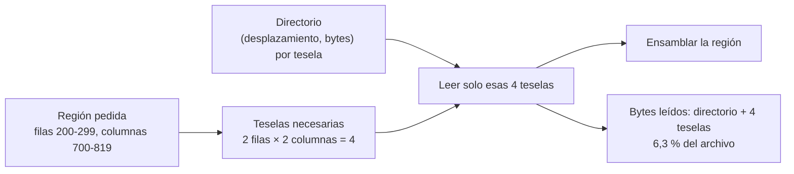

# B14-C26 — Formatos de datos ráster geoespaciales: GeoTIFF y COG

<!-- nav:top -->
[🏠 Programa](../../../../README.md) · [📚 Bloque B14](../../../tronco-comun/B14-computacion-cientifica-y-ciencia-abierta.md) · [← Anterior: B14-C25 — Catálogos de datos geoespaciales y metadatos (STAC)](../B14-C25-catalogos-de-datos-geoespaciales-y-metadatos-stac/CLASE.md) · [Siguiente: B14-C27 — Procesamiento por teselas de grandes volúmenes de imágenes →](../B14-C27-procesamiento-por-teselas-de-grandes-volumenes-de-imagenes/CLASE.md)
<!-- /nav -->

## 1. Ubicación, nivel y alcance

Sexta clase de la ampliación programada del bloque B14. En [C06](../B14-C06-formato-fits-y-encabezados/CLASE.md) estudiaste FITS, el formato de las imágenes astronómicas; las imágenes de **observación terrestre** usan otros formatos ráster que añaden la georreferencia: GeoTIFF y su variante pensada para la nube, COG. Nivel N2.

**Aviso de alcance:** el laboratorio **no usa GeoTIFF, COG ni GDAL**. Implementa un **formato didáctico propio** con teselas, directorio y pirámide, que reproduce la *idea* de leer solo lo necesario; no es ninguno de esos formatos. Lo que afirmo de GeoTIFF y COG se limita a las dos páginas que consulté, que no describen los detalles internos.

Verás qué añade un ráster geoespacial a una imagen, qué significa organizar los datos en teselas y niveles de resolución, la relación entre píxel y coordenadas geográficas, y por qué las lecturas parciales importan. No verás etiquetas TIFF, compresión ni proyecciones.

## 2. Por qué esta clase existe

Una escena de satélite pesa cientos de megabytes y tú necesitas un recuadro de 100 × 120 píxeles. Si el formato obliga a leer todo el archivo, gastas tiempo y ancho de banda. Y una imagen sin georreferencia no dice dónde está en la Tierra. La pregunta motivadora es: **¿cómo organizo un ráster para leer solo la región que necesito y saber a qué lugar corresponde cada píxel?**

La decisión central es: **¿cómo se dividen los datos (teselas), qué niveles de resolución se guardan y qué convención liga píxel con coordenadas?** Las tres decisiones deben quedar explícitas.

## 3. Lo que podrás hacer al terminar

1. Explicar qué añade GeoTIFF a una imagen y qué promete COG.
2. Leer una región de un ráster organizado en teselas leyendo solo las teselas necesarias.
3. Calcular cuántos bytes se leen y compararlos con el archivo completo.
4. Explicar una pirámide de resoluciones y verificarla con un cálculo independiente.
5. Convertir entre píxel y coordenadas con una geotransformación y comprobar la ida y vuelta.
6. Declarar qué convención de píxel (esquina o centro) se usa.

La evidencia es la **auditoría de un ráster** del ejercicio 12 (sección 20).

## 4. Con qué llegas y cómo comprobarlo

Necesitas C02 (arreglos), C06, C07 (fragmentos) y C25. Cinco preguntas:

1. ¿Cuántos bytes ocupa una imagen de 1024 × 1024 de `float32`? (4 194 304.)
2. ¿Cuántas teselas de 128 × 128 hay en ella? (64.)
3. ¿Qué es una pirámide de resoluciones?
4. ¿Qué es un tamaño de píxel de 0,001° y cuántos píxeles abarca 1°? (1000.)
5. ¿Qué es una lectura parcial? (C07)

<details>
<summary>Ver respuestas</summary>

1. `1024² × 4`. 2. `(1024/128)² = 64`. 3. Versiones de la imagen a resolución decreciente guardadas junto a ella. 4. La distancia que cubre un píxel; 1000 píxeles por grado. 5. Leer solo un fragmento del dato, sin cargar el resto.
</details>

Con cuatro o cinco aciertos, sigue; con tres o menos, repasa C07.

## 5. Un caso real: qué dicen GeoTIFF y COG

La página del OGC sobre GeoTIFF (S1) lo presenta como estándar que define el *Geographic Tagged Image File Format* y fija reglas para usar TIFF en el intercambio de imágenes georreferenciadas; **formaliza la especificación comunitaria GeoTIFF 1.0** y la alinea con el conjunto de parámetros geodésicos EPSG; la versión es la 1.1 (documento OGC 19-008r4, estándar internacional). La página no nombra las etiquetas TIFF concretas de la georreferencia ni da fecha de publicación. La página de COG (S2) lo define como un GeoTIFF estándar diseñado para alojarse en un servidor de archivos HTTP, cuyo orden interno permite a programas en la nube trabajar con él con eficiencia: los clientes usan **peticiones HTTP por rango** para traer solo las partes necesarias en lugar del archivo completo, lo que permite lecturas parciales, que varias aplicaciones trabajen sobre un único archivo en línea y que el software GIS tradicional lo lea como un GeoTIFF normal. S2 no describe la organización interna (teselas, pirámides) y remite a la especificación COG.

El **ejemplo conductor** es un ráster **sintético** de 1024 × 1024 `float32` con valores `100 + 0,5·col + 0,25·fila + 10·sen(col/50)`, esquina superior izquierda en `(lon 10,0°; lat 40,0°)` y píxel de 0,001°.

## 6. Vocabulario

Un **ráster** es una cuadrícula de valores. Un **GeoTIFF** es un TIFF con georreferencia (S1). Una **tesela** (*tile*) es un bloque rectangular del ráster guardado de forma contigua. Un **directorio de teselas** dice dónde empieza cada una y cuántos bytes ocupa. Una **pirámide** (*overviews*) son copias a resolución reducida. Una **petición por rango** pide solo un trozo de bytes de un archivo remoto (S2). La **geotransformación** liga píxel con coordenadas: origen, tamaño de píxel. El **centro del píxel** es su punto medio; la **esquina** su punto superior izquierdo. La **proyección** o sistema de referencia de coordenadas (B01-C04) dice qué significan lon y lat.

## 7. Modelo mental: el directorio dice dónde está cada tesela

Con un directorio, para leer una región solo se calculan qué teselas la cubren y se leen esas. El resto del archivo no se toca.



*Descripción textual:* la región pedida determina qué teselas la cubren (cuatro); el directorio da su posición y tamaño; solo esas cuatro teselas se leen y se ensamblan en la región. Los bytes leídos son los del directorio más cuatro teselas, el 6,3 % del archivo.

**Analogía y su límite.** Un atlas con índice de hojas: abres solo las hojas que cubren tu zona. Límite: un atlas no se comprime ni se sirve por red; un COG sí puede, con las ventajas y costes que eso implica.

## 8. La explicación, paso a paso

### 8.1 Teselas y directorio

El archivo didáctico guarda 64 teselas de 128 × 128 `float32` (65 536 bytes cada una) tras una cabecera y un directorio de 64 pares (desplazamiento, bytes). El tamaño total es 4 195 344 bytes: los 4 194 304 de los datos más 1040 de cabecera y directorio.

### 8.2 Leer una región

La región filas 200–299 y columnas 700–819 cubre las teselas de fila 1 y 2 y de columna 5 y 6: **4 teselas**. El lector calcula cuáles, lee cabecera y directorio más esas 4 teselas, ensambla la región y lee en total **263 184 bytes, el 6,3 %** del archivo (`16 + 16·64 + 4·65 536 = 263 184`). La región leída es **idéntica** a la rebanada del arreglo completo (`np.array_equal`). Una lectura parcial correcta debe ser idéntica a la completa, no «parecida».

### 8.3 La pirámide

Un nivel a mitad de resolución se obtiene promediando bloques de 2 × 2: forma 512 × 512, un cuarto de los bytes (1 048 576). El laboratorio lo verifica contra un promedio independiente calculado píxel a píxel. Las pirámides sirven para mostrar una escena completa sin leer todos sus píxeles.

### 8.4 Píxel y coordenadas

La geotransformación del ejemplo: origen en la esquina superior izquierda `(10,0°; 40,0°)` y píxel de 0,001° con el norte arriba. Con la convención «el píxel `(fila, col)` cubre desde `lon0 + col·dx` hasta `lon0 + (col+1)·dx` y desde `lat0 − (fila+1)·dy` hasta `lat0 − fila·dy`», el centro del píxel `(0, 0)` es `(10,0005°; 39,9995°)` y la esquina `(10,0°; 40,0°)` cae en el píxel `(0, 0)`. La ida y vuelta píxel → geo → píxel es exacta. **Esta convención se definió en la clase; no consulté la del estándar GeoTIFF**, y confundir esquina y centro desplaza todo medio píxel (0,0005° ≈ 55 m en latitud).

### 8.5 Lo que COG añade (y lo que no demuestra el laboratorio)

S2 dice que un COG se organiza para lecturas por rango y que sigue siendo un GeoTIFF normal. El laboratorio ilustra el principio con un formato propio y un archivo local: no usa HTTP, no comprime, no usa etiquetas TIFF y no verifica nada de la especificación COG. Que un archivo sea un COG válido se comprueba con las herramientas de validación de la especificación.

### 8.6 Cuándo importa el formato

Con archivos pequeños, cualquier formato sirve. Con escenas grandes y accesos remotos, leer por regiones ahorra órdenes de magnitud de datos transferidos. Con formatos sin teselas, leer una esquina puede obligar a leer filas enteras. La elección es un compromiso entre compatibilidad (el formato que tus herramientas leen) y eficiencia.

## 9. Magnitudes, símbolos y unidades

| Símbolo | Qué es | Unidad | Valor en el ejemplo |
|---|---|---|---|
| `N` | tamaño del ráster | píxeles | 1024 × 1024 |
| `T` | tamaño de tesela | píxeles | 128 × 128 |
| `dx, dy` | tamaño de píxel | grados | 0,001 |
| `(lon0, lat0)` | esquina superior izquierda | grados | (10,0; 40,0) |
| bytes leídos | lectura parcial | B | 263 184 (6,3 %) |
| nivel de pirámide | resolución reducida | píxeles | 512 × 512 |

## 10. Convenciones y referencias

Datos **sintéticos**. Norte arriba, sin rotación; orden de teselas por filas; sin compresión; convención de esquina definida en la clase; sistema de coordenadas lon/lat plano sin especificar datum (B13). El archivo didáctico **no es** GeoTIFF ni COG.

## 11. De dónde sale lo que afirmamos

| ID | Fuente | Localizador | Respalda | Estado |
|---|---|---|---|---|
| S1 | OGC, *GeoTIFF* | https://www.ogc.org/standards/geotiff/ | GeoTIFF como estándar para imágenes georreferenciadas en TIFF; formaliza la especificación 1.0 comunitaria; alineado con EPSG; versión 1.1 (OGC 19-008r4) | Página consultada el 2026-11-05 (mutable); no leí el estándar |
| S2 | cogeo.org, *Cloud Optimized GeoTIFF* | https://cogeo.org/ | COG: GeoTIFF para servidores HTTP; peticiones por rango; lecturas parciales; compatible con GIS tradicional | Página consultada el 2026-11-05 (mutable); sin detalle interno |

Límites: no leí el estándar GeoTIFF ni la especificación COG; no sé cómo organiza las teselas ni qué convención de píxel usa el estándar; no se usó HTTP ni GDAL. La organización del laboratorio es propia.

## 12. Cómo ver el resultado

Versión accesible.

| Comprobación | Resultado |
|---|---|
| Tamaño del archivo | 4 195 344 B (datos 4 194 304 + 1040) |
| Región 100 × 120 píxeles | 4 teselas; 263 184 B leídos (6,3 %); idéntica a la rebanada |
| Pirámide | 512 × 512; 1/4 de los bytes; igual al promedio 2 × 2 |
| Centro del píxel (0, 0) | (10,0005°; 39,9995°) |
| Ida y vuelta píxel → geo → píxel | exacta |

## 13. Ejemplo trabajado: leer un recuadro y ubicarlo

1. **Pedido:** filas 200–299, columnas 700–819.
2. **Teselas:** filas 1–2, columnas 5–6: 4.
3. **Lectura:** directorio más 4 teselas = 263 184 B (6,3 %).
4. **Verificación:** idéntica a la rebanada completa.
5. **Georreferencia:** la esquina superior izquierda de la región está en `lon = 10,0 + 700 × 0,001 = 10,700°` y `lat = 40,0 − 200 × 0,001 = 39,800°`.
6. **Centro del primer píxel de la región:** `(10,7005°; 39,7995°)`.
7. **Registra** la convención de píxel usada.

**Paso final · incertidumbre.** La lectura parcial es exacta porque no hay compresión ni pérdida. Con un formato real, hay que comprobar además que la geotransformación y el sistema de referencia declarados son los correctos.

## 14. Comparación: ráster plano, GeoTIFF con teselas y COG

Un **ráster plano** (filas contiguas) lee rápido todo y mal una esquina. Un **GeoTIFF con teselas** lee bien regiones y trae la georreferencia. Un **COG** (S2) organiza el archivo además para peticiones por rango en un servidor HTTP y sigue siendo un GeoTIFF. La elección depende de si el acceso es local o remoto y de las herramientas del equipo.

## 15. Práctica guiada

**Ejercicio 1 · con los pasos.** ¿Cuántas teselas toca la región filas 0–127, columnas 0–127? *Pasos:* ¿cubre más de una tesela? (sección 8.2).

<details><summary>Solución comentada</summary>

Una sola (la tesela (0,0)): la región coincide con ella. Leer 65 536 B más el directorio.
</details>

**Ejercicio 2 · con una pista.** ¿Y filas 100–199, columnas 100–199? *Pista:* cruza límites en ambos sentidos.

<details><summary>Solución comentada</summary>

Filas 100–127 (tesela 0) y 128–199 (tesela 1); lo mismo en columnas: `2 × 2 = 4` teselas aunque la región sea de solo 100 × 100 píxeles. Las regiones que cruzan fronteras de tesela cuestan más.
</details>

**Ejercicio 3 · casi autónomo.** Calcula las coordenadas del centro del píxel (fila 500, columna 300).

<details><summary>Solución comentada</summary>

`lon = 10,0 + (300 + 0,5) × 0,001 = 10,3005°`; `lat = 40,0 − (500 + 0,5) × 0,001 = 39,4995°`.
</details>

## 16. Práctica autónoma, transferencia e integrador

**Ejercicio 4.** ¿Qué fracción del archivo se leería para una región de 128 × 128 que cae exactamente sobre una tesela?

<details><summary>Solución comentada</summary>

`(1040 + 65 536)/4 195 344 = 1,6 %`.
</details>

**Ejercicio 5.** ¿Cuántos bytes tiene el nivel de pirámide a un cuarto de resolución (por lado)?

<details><summary>Solución comentada</summary>

256 × 256 × 4 = 262 144 B: 1/16 del original.
</details>

**Ejercicio 6.** Confundes esquina con centro del píxel. ¿Qué error de posición cometes con píxeles de 0,001°?

<details><summary>Solución comentada</summary>

Medio píxel: 0,0005° en cada eje, unos 55 m en latitud (1° ≈ 111 km; cifra general, no consultada aquí).
</details>

**Ejercicio 7.** Escribe la comprobación de una lectura parcial correcta.

<details><summary>Solución comentada</summary>

`np.array_equal(region_leida, ráster_completo[f0:f1, c0:c1])`: igualdad exacta (C07); más el conteo de bytes leídos frente al esperado.
</details>

**Ejercicio 8.** ¿Qué dice S2 sobre cómo se leen las partes de un COG remoto?

<details><summary>Solución comentada</summary>

Con peticiones HTTP por rango, que traen solo las partes necesarias en lugar del archivo completo (S2).
</details>

**Ejercicio 9 · transferencia.** Tu región de interés es una franja de 10 × 1000 píxeles del ráster de 1024 × 1024. ¿Cómo influye el tamaño de tesela?

<details><summary>Solución comentada</summary>

Con teselas de 128 × 128 tocas `1 × 8 = 8` teselas (`8 × 16 384 = 131 072` píxeles leídos) para usar solo 10 000: se lee 13 veces más de lo necesario. Con teselas más estrechas se desperdiciaría menos. El tamaño de tesela debe ajustarse al patrón de acceso.
</details>

**Ejercicio 10 · transferencia.** Dos ráster usan convenciones de píxel distintas (esquina y centro). ¿Cómo lo detectas?

<details><summary>Solución comentada</summary>

Con un punto de control conocido (un cruce de caminos, una esquina de una construcción) y comprobando el desplazamiento de medio píxel; y leyendo la documentación del formato.
</details>

**Ejercicio 11 · transferencia.** ¿Qué compruebas antes de afirmar que un archivo es un COG válido?

<details><summary>Solución comentada</summary>

Que pase las herramientas de validación de la especificación COG (que esta clase no leyó); que sea un GeoTIFF (S1, S2) y que su organización permita lecturas por rango.
</details>

**Ejercicio 12 · integrador.** Entrega una **auditoría de un ráster** (sintético o con fuente): tamaño, teselas, lectura de una región con bytes leídos, verificación contra la rebanada, pirámide verificada, geotransformación con convención declarada y lo que no verificaste del estándar real.

<details><summary>Solución modelo</summary>

Debe incluir la tabla de la sección 12 con tus números, la convención de píxel, la declaración de que el formato es didáctico (o la validación real realizada) y una lista de pendientes (compresión, proyección, validador COG). Se acepta cualquier ráster sintético.
</details>

## 17. Laboratorio

El script [lectura_por_regiones.py](lectura_por_regiones.py) escribe el ráster sintético en un formato de teselas propio, lee una región leyendo solo las teselas necesarias, compara con la rebanada completa, verifica la pirámide y la geotransformación. **No es GeoTIFF ni COG y no usa GDAL ni HTTP.**

**Datos:** sintéticos. **Predice antes de ejecutar:** ¿qué fracción del archivo se lee? **Ejecución del 2026-11-05 (Python 3.12.9, NumPy 2.5.4):**

```text
archivo: 4195344 bytes; ráster completo = 4194304 bytes; teselas = 64
región 100 x 120 píxeles: leídos 263184 bytes de 4195344 (6.3%); lectura idéntica a la rebanada completa
bytes esperados = cabecera/directorio + 4 teselas x 65536 = 263184 (coincide)
nivel de pirámide: (512, 512) (a mitad de resolución, 1048576 bytes = 1/4 del original); verificado contra el promedio 2x2 independiente
centro del píxel (0,0) = (10.0005, 39.9995); ida y vuelta píxel->geo->píxel exacta; esquina (10.0, 40.0) -> píxel (0, 0)
Pruebas superadas.
```

```bash
python programa/clases/B14/B14-C26-formatos-de-datos-raster-geoespaciales-geotiff-y-cog/lectura_por_regiones.py
```

**Límites:** formato didáctico; sin compresión, etiquetas TIFF ni HTTP; convención de píxel propia.

## 18. Errores frecuentes y cómo corregirlos

**Leer el archivo entero para un recuadro.** Se corrige con la sección 8.2 y el ejercicio 9.

**Confundir esquina y centro del píxel.** Se corrige con los ejercicios 6 y 10.

**No verificar la lectura parcial.** Se corrige con el ejercicio 7.

**Afirmar que un archivo es COG sin validarlo.** Se corrige con el ejercicio 11.

**Ignorar el tamaño de tesela.** Se corrige con el ejercicio 9.

## 19. Cómo sabrás que vas bien

Tras 8.2: ¿calculas las teselas de una región? Si no, rehaz los ejercicios 1 y 2. Tras 8.4: ¿calculas el centro de un píxel? Si no, rehaz el 3. Tras el ejemplo trabajado: ¿qué convención usaste? Tras el laboratorio: ¿qué no es este formato? Al final: ¿cómo validarías un COG real?

## 20. Qué entregas y cómo se evalúa

El producto es tu **auditoría de un ráster** del ejercicio 12.

| Criterio | Inicial | En desarrollo | Logrado | Destacado |
|---|---|---|---|---|
| Lectura parcial | Lee todo | Lee por regiones sin comprobar | Idéntica a la rebanada | Con bytes esperados y medidos |
| Georreferencia | Ignora | Usa sin convención | Convención declarada y ida y vuelta | Con punto de control |
| Pirámide | Ninguna | Calcula | Verifica con cálculo independiente | Explica su uso |
| Fuentes y alcance | Sin fuente | Fuente sin alcance | Fuente con alcance | Declara que el formato es didáctico |

**Condiciones críticas:** no presentar el formato didáctico como GeoTIFF o COG; no omitir la convención de píxel; no afirmar validez de COG sin un validador.

## 21. Ética, seguridad y límites

Las imágenes georreferenciadas pueden revelar ubicaciones sensibles; revisa licencias y restricciones antes de publicarlas. Los servidores de archivos reciben mucha carga si miles de clientes piden rangos: respeta sus límites. Accesibilidad: tablas en texto. Material educativo.

## 22. Para cerrar y seguir

Un ráster geoespacial añade georreferencia a una imagen; organizado en teselas con directorio y pirámide, permite leer solo la región necesaria, como busca un COG. En el laboratorio se leyó el 6,3 % del archivo con un resultado idéntico al completo, usando un formato didáctico. Queda abierta una pregunta: ¿qué tamaño de tesela conviene para tu patrón de acceso?

**Glosario español–inglés.** ráster · *raster*; tesela · *tile*; pirámide de resoluciones · *overviews / pyramid*; petición por rango · *range request*; geotransformación · *geotransform*; georreferencia · *georeferencing*; centro de píxel · *pixel center*.

**Continuidad.** B14-C27 procesa grandes volúmenes dividiéndolos en teselas; B14-C25 cataloga estos archivos; B14-C28 y B14-C29 los consultan y publican.

**Referencias:** ver sección 11.

<!-- nav:bottom -->
---

[← Anterior: B14-C25 — Catálogos de datos geoespaciales y metadatos (STAC)](../B14-C25-catalogos-de-datos-geoespaciales-y-metadatos-stac/CLASE.md) · [📚 Bloque B14](../../../tronco-comun/B14-computacion-cientifica-y-ciencia-abierta.md) · [Siguiente: B14-C27 — Procesamiento por teselas de grandes volúmenes de imágenes →](../B14-C27-procesamiento-por-teselas-de-grandes-volumenes-de-imagenes/CLASE.md)
<!-- /nav -->
