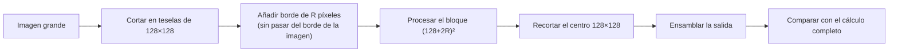

# B14-C27 — Procesamiento por teselas de grandes volúmenes de imágenes

<!-- nav:top -->
[🏠 Programa](../../../../README.md) · [📚 Bloque B14](../../../tronco-comun/B14-computacion-cientifica-y-ciencia-abierta.md) · [← Anterior: B14-C26 — Formatos de datos ráster geoespaciales: GeoTIFF y COG](../B14-C26-formatos-de-datos-raster-geoespaciales-geotiff-y-cog/CLASE.md) · [Siguiente: B14-C28 — Bases de datos espaciales →](../B14-C28-bases-de-datos-espaciales/CLASE.md)
<!-- /nav -->

## 1. Ubicación, nivel y alcance

Séptima clase de la ampliación programada del bloque B14. En [C26](../B14-C26-formatos-de-datos-raster-geoespaciales-geotiff-y-cog/CLASE.md) leíste regiones de un ráster; ahora **procesas** una imagen demasiado grande para la memoria dividiéndola en teselas, y aprendes por qué cada tesela necesita un **borde** de contexto. [C13](../B14-C13-computacion-paralela/CLASE.md) a C16 trataron el paralelismo; esta clase trata cómo trocear el dato. Nivel N2.

Verás el procesamiento por teselas, el borde (*halo*) que una operación local necesita, el error que aparece en las costuras sin él, y el sobrecoste del borde. No verás la ejecución paralela de las teselas, la compresión ni los sistemas de coordenadas.

## 2. Por qué esta clase existe

Una cobertura global de imágenes ocupa terabytes y ningún equipo la carga entera. Para suavizarla, calcular un índice o detectar cambios hay que procesarla por pedazos. Pero si cada pedazo se procesa aislado, aparecen líneas en las uniones. La pregunta motivadora es: **¿cómo troceo una imagen para procesarla sin que el resultado dependa de los cortes?**

La decisión central es: **¿qué tamaño de tesela y qué borde necesita mi operación?** Una operación que mira `R` píxeles a cada lado necesita un borde de `R` píxeles; menos da costuras, más desperdicia cálculo.

## 3. Lo que podrás hacer al terminar

1. Dividir una imagen en teselas y procesarlas una a una con memoria acotada.
2. Determinar el borde que necesita una operación local según su alcance.
3. Comprobar que el resultado por teselas es idéntico al cálculo completo.
4. Mostrar que sin borde aparecen errores solo junto a las costuras.
5. Calcular la memoria de trabajo y el sobrecoste del borde.
6. Declarar los límites de la verificación (la imagen cabe en memoria para comparar).

La evidencia es el **procesamiento por teselas verificado** del ejercicio 12 (sección 20).

## 4. Con qué llegas y cómo comprobarlo

Necesitas C02 (arreglos y vistas), C14 (memoria) y C26 (teselas). Cinco preguntas:

1. ¿Qué es un filtro de promedio de 5 × 5? (Cada píxel pasa a ser la media de su vecindario de 5 × 5.)
2. ¿Cuántos píxeles ve cada lado de un píxel en ese filtro? (2.)
3. ¿Qué es un borde replicado?
4. ¿Cuántos elementos tiene una tesela de 128 × 128 con borde de 2? (132² = 17 424.)
5. ¿Por qué comprobar contra el cálculo completo?

<details>
<summary>Ver respuestas</summary>

1. La media de los 25 vecinos. 2. 2 píxeles. 3. Los píxeles fuera de la imagen se rellenan con el valor del borde más cercano. 4. `(128 + 4)² = 17 424`. 5. Porque es la referencia de corrección (C10).
</details>

Con cuatro o cinco aciertos, sigue; con tres o menos, repasa C02 y C14.

## 5. Un caso real: qué aporta este tema (y qué no hay detrás)

Esta clase **no tiene una fuente consultada específica**: el procesamiento por teselas con borde es una técnica general de cálculo sobre rejillas que se demuestra aquí mediante un experimento propio. Lo consultado en clases anteriores respalda las piezas: lecturas parciales por teselas (C26, con el OGC y cogeo.org), arreglos de NumPy y su coste en memoria (C02, C14) y la necesidad de verificar contra un cálculo de referencia (C10). No afirmo nada de este tema que no verifique el propio laboratorio.

El **ejemplo conductor** es una imagen **sintética** de 512 × 512 (rampa + senoide + ruido gaussiano de 1,0, semilla 20261105), un filtro de promedio de 5 × 5 y teselas de 128 × 128.

## 6. Vocabulario

Una **operación local** calcula cada píxel de salida a partir de un vecindario de la entrada. El **radio** `R` es cuántos píxeles mira a cada lado (aquí 2). El **borde** (*halo*) es el contexto adicional de `R` píxeles alrededor de cada tesela que se lee para calcularla. Una **costura** es la línea de unión entre dos teselas. Un **borde replicado** completa los píxeles que caen fuera de la imagen con el valor del borde. La **memoria de trabajo** es lo que se necesita a la vez. El **sobrecoste del borde** es el cálculo extra por procesar el halo.

## 7. Modelo mental: cada tesela necesita a sus vecinas

El valor de un píxel junto a una costura depende de píxeles de la tesela vecina. Si se procesa la tesela sola, esos píxeles faltan y el resultado es erróneo en esa franja. Con un borde del tamaño del alcance, la tesela trae lo que necesita y el resultado coincide con el completo.



*Descripción textual:* la imagen se corta en teselas de 128 × 128; a cada una se le añade un borde de `R` píxeles sin pasar el borde de la imagen; se procesa el bloque ampliado, se recorta el centro de 128 × 128 y se ensambla la salida, que se compara con el cálculo completo.

**Analogía y su límite.** Pintar una pared por paños: si no traslapas un poco, queda una línea. Límite: aquí el traslape tiene un tamaño exacto, el alcance de la operación, y es verificable.

## 8. La explicación, paso a paso

### 8.1 La operación y el borde

El filtro promedia el vecindario de 5 × 5, es decir, `R = 2`. Un píxel junto a la costura necesita hasta 2 píxeles de la tesela vecina. El borde de la tesela debe ser, como mínimo, `R`.

### 8.2 Con borde: idéntico

Se procesa cada tesela con su borde de 2 píxeles y se recorta el centro. La máxima diferencia con el cálculo completo es **0** (`0,00 × 10⁰`): resultado idéntico, con la misma operación y los bordes de la imagen replicados de igual modo. Se pudo comparar porque la imagen de 512 × 512 sí cabe en memoria.

### 8.3 Sin borde: costuras

Si cada tesela se procesa sola (borde 0), difieren **12 144 píxeles de 262 144** (4,63 %), con una diferencia máxima de 0,868. El laboratorio comprueba que **todos** esos píxeles están a 2 o menos píxeles de una costura interior: el error vive en las franjas de ancho `2R` alrededor de las costuras, no en el interior de las teselas. (Los bordes de la imagen no son costuras: allí el relleno replicado es el mismo en ambos cálculos.)

### 8.4 Memoria y sobrecoste

Con borde, el bloque de trabajo más grande tiene `(128 + 4)² = 17 424` elementos: **6,6 %** de la imagen. El sobrecoste del borde es `(128 + 4)²/128² − 1 = 6,3 %` más de cálculo respecto a procesar teselas sin borde. Para imágenes mucho mayores, la memoria de trabajo sigue siendo la de una tesela, independiente del tamaño total: esa es la ventaja.

### 8.5 Elegir el tamaño de tesela

El borde es un coste proporcional al perímetro de la tesela; la tesela grande lo amortiza, pero exige más memoria y reparte peor el trabajo. Con radio 2, una tesela de 32 × 32 tendría sobrecoste `(36/32)² − 1 = 26,6 %` y una de 512 × 512, `(516/512)² − 1 = 1,6 %`. Es el compromiso habitual; la medida real depende del equipo y de la operación (C14).

### 8.6 Lo que no cubre

El experimento usa una operación local simple. Operaciones con alcance grande (un filtro de decenas de píxeles), globales (la media de toda la imagen, un histograma) o con estado (un seguimiento) requieren otra estrategia: bordes grandes, una pasada de reducción previa o recursión. No verifiqué eso. Tampoco ejecuté las teselas en paralelo (C13) ni leí desde un formato real (C26).

## 9. Magnitudes, símbolos y unidades

| Símbolo | Qué es | Unidad | Valor en el ejemplo |
|---|---|---|---|
| `N` | lado de la imagen | píxeles | 512 |
| `T` | lado de la tesela | píxeles | 128 |
| `R` | radio del filtro (borde necesario) | píxeles | 2 |
| elementos de trabajo | bloque con borde | elementos | 17 424 (6,6 %) |
| píxeles distintos sin borde | error por costuras | conteo | 12 144 (4,63 %) |
| sobrecoste | cálculo extra del borde | % | 6,3 |

## 10. Convenciones y referencias

Datos **sintéticos**. Bordes de la imagen replicados. Teselas cuadradas sin solape salvo el borde. Las diferencias se miden en las unidades arbitrarias de la imagen sintética.

## 11. De dónde sale lo que afirmamos

| ID | Fuente | Localizador | Respalda | Estado |
|---|---|---|---|---|
| — | Ninguna fuente específica consultada para esta clase | — | Todo lo afirmado sobre el borde, las costuras y los costes se demuestra con el laboratorio | — |

Límites: sin fuente externa; la técnica es general y aquí se verifica con un experimento propio; las cifras son de este experimento. Las piezas de apoyo vienen de las clases C02, C10, C14 y C26 con sus propias fuentes.

## 12. Cómo ver el resultado

Versión accesible.

| Procesamiento | Diferencia con el cálculo completo |
|---|---|
| Teselas con borde de 2 | 0 (idéntico) |
| Teselas sin borde | 12 144 píxeles distintos (4,63 %), máxima 0,868, todos a ≤ 2 píxeles de una costura |

Memoria de trabajo con borde: 17 424 elementos (6,6 % de la imagen). Sobrecoste del borde: 6,3 %.

## 13. Ejemplo trabajado: suavizar por teselas

1. **Operación:** promedio de 5 × 5, `R = 2`.
2. **Teselas:** 16 de 128 × 128 (512/128 = 4 por lado).
3. **Cada tesela:** leer el bloque con borde (hasta `132 × 132`; menos en los límites de la imagen), filtrar, recortar el centro.
4. **Ensamblar** la salida de 512 × 512.
5. **Comparar** con el cálculo completo: diferencia máxima 0.
6. **Contraste:** sin borde, 4,63 % de los píxeles son erróneos, todos en franjas de 2 píxeles junto a las costuras interiores.
7. **Coste:** memoria 6,6 % de la imagen y 6,3 % de cálculo extra.

**Paso final · incertidumbre.** La igualdad exacta se debe a que se usa la misma operación en ambos casos y a que el orden de las sumas dentro de cada píxel es el mismo (si no, habría diferencias de redondeo, C10). Con otra operación o un orden distinto, hay que comprobar con tolerancia.

## 14. Comparación: imagen entera, teselas sin borde y teselas con borde

**Imagen entera**: simple y limitada por la memoria. **Teselas sin borde**: memoria acotada pero con costuras erróneas. **Teselas con borde**: memoria acotada y resultado idéntico, con un sobrecoste del perímetro. Para operaciones que no son locales, ninguna de las tres basta sin más.

## 15. Práctica guiada

**Ejercicio 1 · con los pasos.** ¿Qué borde necesita un filtro de promedio de 7 × 7? *Pasos:* radio = (lado − 1)/2 (sección 8.1).

<details><summary>Solución comentada</summary>

`R = 3`. Cada tesela necesita 3 píxeles de contexto por lado.
</details>

**Ejercicio 2 · con una pista.** ¿Cuántos elementos tiene el bloque de una tesela de 128 × 128 con borde 3 (no en el límite de la imagen)? *Pista:* `(T + 2R)²`.

<details><summary>Solución comentada</summary>

`(128 + 6)² = 17 956`.
</details>

**Ejercicio 3 · casi autónomo.** Calcula el sobrecoste del borde para `T = 64` y `R = 2`.

<details><summary>Solución comentada</summary>

`(68/64)² − 1 = 1,1289 − 1 = 12,9 %`.
</details>

## 16. Práctica autónoma, transferencia e integrador

**Ejercicio 4.** ¿Cuántas costuras interiores hay en cada sentido con teselas de 128 en una imagen de 512?

<details><summary>Solución comentada</summary>

3 en cada sentido (en 128, 256 y 384).
</details>

**Ejercicio 5.** ¿Por qué los bordes de la imagen no producen error sin halo?

<details><summary>Solución comentada</summary>

Porque allí el relleno replicado es el mismo en el cálculo completo y en el de teselas: no falta información real, solo hay relleno. Las costuras interiores sí pierden píxeles reales de la tesela vecina.
</details>

**Ejercicio 6.** Un filtro tiene alcance de 40 píxeles y teselas de 128. ¿Qué sobrecoste tiene el borde?

<details><summary>Solución comentada</summary>

`(128 + 80)²/128² − 1 = 2,64 − 1 = 164 %`: casi triplica el cálculo. Hace falta una tesela mayor o otra estrategia.
</details>

**Ejercicio 7.** ¿Qué operación NO se puede hacer correctamente por teselas aisladas, ni siquiera con borde finito?

<details><summary>Solución comentada</summary>

Las globales: la media de toda la imagen, el máximo global, un histograma completo. Hay que combinar resultados parciales de cada tesela en una reducción posterior (no tratada aquí).
</details>

**Ejercicio 8.** Describe una prueba automática que habría detectado la falta de borde.

<details><summary>Solución comentada</summary>

Comparar el resultado por teselas con el completo en una imagen pequeña con tolerancia estrecha (C10) y revisar dónde difieren: si las diferencias están junto a las costuras, falta borde.
</details>

**Ejercicio 9 · transferencia.** Una cobertura de 100 000 × 100 000 píxeles de `float32`. ¿Cuántos bytes ocupa y cuántos necesita una tesela de 1024 × 1024 con borde 2?

<details><summary>Solución comentada</summary>

`10¹⁰ × 4 = 40 GB`. Una tesela con borde: `(1024 + 4)² × 4 = 4,2 MB`. La memoria de trabajo es independiente del tamaño total.
</details>

**Ejercicio 10 · transferencia.** Quieres procesar teselas en paralelo (C13). ¿Qué cuidas?

<details><summary>Solución comentada</summary>

Que cada tesela sea independiente (el borde se lee, no se comparte), que el ensamblaje sea determinista, y que el resultado paralelo sea idéntico al serie. Y medir el coste de leer los bordes repetidos.
</details>

**Ejercicio 11 · transferencia.** Un resultado por teselas difiere del completo en `10⁻¹⁵` relativo. ¿Error?

<details><summary>Solución comentada</summary>

Probablemente ruido de redondeo por distinto orden de sumas (C10): se compara con una tolerancia justificada. Un error de costuras sería mucho mayor y localizado.
</details>

**Ejercicio 12 · integrador.** Entrega un **procesamiento por teselas verificado**: operación con su radio, procesamiento con y sin borde, verificación contra el cálculo completo, localización de los errores sin borde, memoria y sobrecoste, y una sección con lo que la técnica no cubre.

<details><summary>Solución modelo</summary>

Debe incluir la tabla de la sección 12 con tus números, la comprobación de que los errores están junto a las costuras, el cálculo de memoria y sobrecoste y una lista de operaciones no locales. Se acepta cualquier operación local sintética.
</details>

## 17. Laboratorio

El script [teselas_con_borde.py](teselas_con_borde.py) filtra una imagen sintética completa y por teselas con y sin borde, compara con el completo, verifica que los errores sin borde están junto a las costuras y calcula memoria y sobrecoste.

**Datos:** sintéticos (semilla 20261105). **Predice antes de ejecutar:** ¿qué porcentaje de píxeles será erróneo sin borde? **Ejecución del 2026-11-05 (Python 3.12.9, NumPy 2.5.4):**

```text
con halo de 2 píxeles: máxima diferencia con el cálculo completo = 0.00e+00
sin halo: 12144 píxeles distintos de 262144 (4.63%); máxima diferencia = 0.868
las diferencias están solo a <= 2 píxeles de una costura interior (verificado)
memoria de trabajo por tesela con halo: 17424 elementos = 6.6% de la imagen completa
sobrecoste de procesar el halo: 6.3% (de (T+2R)^2 frente a T^2)
Pruebas superadas.
```

```bash
python programa/clases/B14/B14-C27-procesamiento-por-teselas-de-grandes-volumenes-de-imagenes/teselas_con_borde.py
```

**Límites:** operación local simple; la imagen cabe en memoria para poder comparar; sin paralelismo ni formato real.

## 18. Errores frecuentes y cómo corregirlos

**Procesar teselas sin borde.** Se corrige con la sección 8.3 y el ejercicio 8.

**Un borde menor que el alcance.** Se corrige con los ejercicios 1 y 6.

**Aplicar teselas a operaciones globales.** Se corrige con el ejercicio 7.

**Culpar al redondeo de un error de costuras.** Se corrige con el ejercicio 11.

**No verificar contra el completo.** Se corrige con el ejercicio 8.

## 19. Cómo sabrás que vas bien

Tras 8.1: ¿determinas el borde de una operación? Si no, rehaz el ejercicio 1. Tras 8.4: ¿calculas el sobrecoste? Si no, rehaz el 3. Tras el ejemplo trabajado: ¿qué pasa sin borde? Tras el laboratorio: ¿qué operaciones no cubre? Al final: ¿qué tamaño de tesela eliges y por qué?

## 20. Qué entregas y cómo se evalúa

El producto es tu **procesamiento por teselas verificado** del ejercicio 12.

| Criterio | Inicial | En desarrollo | Logrado | Destacado |
|---|---|---|---|---|
| Borde | Sin borde | Borde por intuición | Borde = alcance | Con localización de errores sin borde |
| Verificación | Sin comparar | Comparación visual | Idéntico al completo | Con tolerancia justificada |
| Costes | No calcula | Calcula uno | Memoria y sobrecoste | Con comparación de tamaños de tesela |
| Fuentes y alcance | Sin fuente | Fuente sin alcance | Declara que no hay fuente externa | Declara qué operaciones no cubre |

**Condiciones críticas:** no procesar por teselas sin borde una operación local; no afirmar equivalencia sin comparar con el completo; no extender la técnica a operaciones globales.

## 21. Ética, seguridad y límites

Procesar coberturas globales consume mucha energía y cómputo compartido: justifica el volumen. Un error de costuras puede pasar por un fenómeno real en un mapa publicado: verifica antes. Accesibilidad: tablas en texto. Material educativo.

## 22. Para cerrar y seguir

Procesar por teselas acota la memoria, pero cada tesela necesita un borde del tamaño del alcance de la operación; sin él aparecen errores en las costuras (4,63 % de los píxeles en el ejemplo) y con él el resultado es idéntico, con un sobrecoste del 6,3 %. Queda abierta una pregunta: ¿cómo procesarías por teselas una operación global como un histograma?

**Glosario español–inglés.** tesela · *tile*; borde / halo · *halo / overlap*; costura · *seam*; operación local · *local operation*; memoria de trabajo · *working memory*; radio · *radius*; sobrecoste · *overhead*.

**Continuidad.** B14-C28 consulta datos espaciales con índices; B14-C30 automatiza cadenas de procesamiento como esta; B14-C13 paraleliza el procesamiento de teselas.

**Referencias:** ver sección 11 (sin fuente externa).

<!-- nav:bottom -->
---

[← Anterior: B14-C26 — Formatos de datos ráster geoespaciales: GeoTIFF y COG](../B14-C26-formatos-de-datos-raster-geoespaciales-geotiff-y-cog/CLASE.md) · [📚 Bloque B14](../../../tronco-comun/B14-computacion-cientifica-y-ciencia-abierta.md) · [Siguiente: B14-C28 — Bases de datos espaciales →](../B14-C28-bases-de-datos-espaciales/CLASE.md)
<!-- /nav -->
