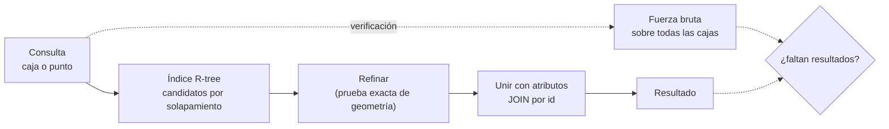

# B14-C28 — Bases de datos espaciales

<!-- nav:top -->
[🏠 Programa](../../../../README.md) · [📚 Bloque B14](../../../tronco-comun/B14-computacion-cientifica-y-ciencia-abierta.md) · [← Anterior: B14-C27 — Procesamiento por teselas de grandes volúmenes de imágenes](../B14-C27-procesamiento-por-teselas-de-grandes-volumenes-de-imagenes/CLASE.md) · [Siguiente: B14-C29 — Servicios de datos geoespaciales estándar (OGC) →](../../../tronco-comun/B14-computacion-cientifica-y-ciencia-abierta.md#b14-c29)
<!-- /nav -->

## 1. Ubicación, nivel y alcance

Octava clase de la ampliación programada del bloque B14. En [C25](../B14-C25-catalogos-de-datos-geoespaciales-y-metadatos-stac/CLASE.md) buscaste escenas recorriéndolas una a una; con miles de millones de registros eso no escala. Una **base de datos espacial** guarda las geometrías con un **índice** que encuentra rápido lo que está en una región. [C07](../B14-C07-hdf5-y-almacenamiento-cientifico/CLASE.md) trató almacenamiento científico, pero no consultas espaciales. Nivel N2.

**Aviso de alcance:** el laboratorio usa el módulo **R\*Tree de SQLite** (incluido en el `sqlite3` estándar de Python), no PostGIS ni SpatiaLite, con cajas rectangulares planas. No hay esfera, proyecciones ni geometrías complejas.

Verás qué es un índice espacial y por qué evita recorrer todo, cómo se consulta por caja y por punto, que el índice es un **filtro de candidatos** y no una prueba exacta, y cómo verificar contra una búsqueda de fuerza bruta. No verás SQL espacial avanzado, geometrías curvas ni el antimeridiano.

## 2. Por qué esta clase existe

Un archivo tiene 50 000 huellas de escenas y tu aplicación pregunta «¿qué escenas cubren este punto?» miles de veces. Recorrerlas todas cada vez desperdicia tiempo. La pregunta motivadora es: **¿cómo estructuro los datos para que una consulta espacial cueste poco y devuelva exactamente lo correcto?**

La decisión central es: **¿qué índice uso y cómo compruebo que no pierde resultados?** Un índice que pierde una escena es peor que no tenerlo.

## 3. Lo que podrás hacer al terminar

1. Explicar qué es un índice espacial y qué problema resuelve.
2. Crear una tabla de huellas con un índice R-tree en SQLite y consultar por caja y por punto.
3. Verificar el resultado del índice contra una búsqueda de fuerza bruta independiente.
4. Explicar por qué el índice es un filtro y no una prueba exacta.
5. Unir el índice con una tabla de atributos.
6. Declarar los límites del experimento (cajas planas, sin esfera).

La evidencia es el **informe de consultas espaciales verificadas** del ejercicio 12 (sección 20).

## 4. Con qué llegas y cómo comprobarlo

Necesitas C25, C26 y SQL elemental (`SELECT ... WHERE`). Cinco preguntas:

1. ¿Cuándo se solapan dos cajas? (Cuando se solapan en ambos ejes.)
2. ¿Qué hace un `JOIN` entre dos tablas?
3. ¿Por qué un índice acelera una búsqueda?
4. ¿Qué es la búsqueda de fuerza bruta?
5. ¿Qué es un falso positivo y un falso negativo en una búsqueda? (C10)

<details>
<summary>Ver respuestas</summary>

1. `maxX_a ≥ minX_b` y `minX_a ≤ maxX_b` y lo mismo en Y. 2. Combina filas de dos tablas por una clave común. 3. Evita examinar todos los registros, agrupándolos de forma jerárquica. 4. Examinar todos los registros uno a uno. 5. Falso positivo: devuelve algo que no cumple; falso negativo: omite algo que cumple.
</details>

Con cuatro o cinco aciertos, sigue; con tres o menos, repasa C25.

## 5. Un caso real: el módulo R*Tree de SQLite

La documentación de SQLite (S1) describe el módulo R\*Tree como un índice de tabla virtual para **consultas de rango** sobre cajas multidimensionales, usado sobre todo con datos geoespaciales y también con intervalos de tiempo. Cada entrada es un rectángulo con un identificador entero; el índice encuentra con rapidez las entradas contenidas en una caja de consulta o que la solapan. Se crea con `CREATE VIRTUAL TABLE ... USING rtree(id, minX, maxX, minY, maxY)`; la primera columna es una clave entera de 64 bits y las demás vienen en pares mínimo/máximo, de 1 a 5 dimensiones. Las coordenadas se guardan como **flotantes de 32 bits**: por redondeo, los límites inferiores se redondean hacia abajo y los superiores hacia arriba, de modo que **las cajas pueden crecer ligeramente pero nunca encoger**, y las consultas de solapamiento nunca pierden un resultado. Y subraya que el R\*Tree es **un filtro, no un motor de geometría exacta**: reduce candidatos que luego se verifican con una prueba más precisa. El módulo debe estar habilitado al compilar (`-DSQLITE_ENABLE_RTREE=1`).

El **ejemplo conductor** es un conjunto **sintético** de 50 000 huellas rectangulares ficticias (longitud 0–360°, latitud −90° a 90°, tamaños de 0,5° a 3°, semilla 20261105).

## 6. Vocabulario

Un **índice espacial** agrupa geometrías por cercanía para hallar rápido las de una región. Un **R-tree** es un índice jerárquico de cajas. Una **tabla virtual** es una tabla que el motor implementa con un módulo (aquí, `rtree`). Una **consulta de solapamiento** devuelve las cajas que se cruzan con la de consulta. Una **consulta puntual** devuelve las cajas que contienen un punto. Un **candidato** es un resultado del índice que aún no se ha verificado con una prueba exacta. La **fuerza bruta** compara con todo. Un **atributo** es un dato no espacial (el nombre de la escena).

## 7. Modelo mental: dos fases, filtrar y refinar

El índice responde «¿qué cajas podrían interesarte?» con rapidez y sin perder ninguna; después se refina con la prueba exacta si hace falta. En este experimento la geometría es la propia caja, así que el refinado es trivial.



*Descripción textual:* la consulta (caja o punto) va primero al índice, que devuelve candidatos por solapamiento; se refinan con una prueba exacta de geometría, se unen con los atributos por identificador y se obtiene el resultado. En paralelo, para verificar, una fuerza bruta sobre todas las cajas se compara con el resultado para ver si falta alguno.

**Analogía y su límite.** El índice de un mapa de carreteras con cuadrículas A–F y 1–9: miras solo las casillas que tocan tu zona. Límite: un mapa en papel no se reorganiza al insertar un punto nuevo; un R-tree sí se mantiene.

## 8. La explicación, paso a paso

### 8.1 Crear tabla e índice

El laboratorio crea una tabla `escenas(id, nombre)` y una tabla virtual `idx` con `rtree(id, minX, maxX, minY, maxY)`, e inserta 50 000 huellas en ambas (con SQLite 3.45.3). Si el módulo no estuviera compilado, el script lo declara **omitido** y termina con código 2 en lugar de aprobar.

### 8.2 Consulta por caja

La caja de consulta `(lon 100–110, lat 20–30)` se resuelve con `WHERE maxX >= ? AND minX <= ? AND maxY >= ? AND minY <= ?` (la forma de solapamiento de S1). Resultado: el R-tree devuelve **101** escenas.

### 8.3 Verificar con fuerza bruta

La misma condición con NumPy sobre las 50 000 cajas devuelve también **101**: faltan 0 y sobran 0. El criterio de la prueba es estricto en lo esencial (**no puede faltar ninguna**, porque S1 garantiza que el solapamiento no pierde resultados) y tolera hasta un 0,1 % de sobrantes por el redondeo a 32 bits.

### 8.4 Consulta puntual con unión

«¿Qué escenas contienen el punto (180°, 0°)?» se resuelve con una unión entre el índice y la tabla de nombres: **3** escenas, igual que la fuerza bruta. La unión por `id` trae los atributos (nombre) de los candidatos.

### 8.5 Una caja fuera del dominio

Una caja en `lon 400–410` queda fuera de todo (el dominio llega a 360°): **0** resultados. Los casos vacíos son parte de la verificación.

### 8.6 Tiempos, con cautela

Una sola medición dio 0,27 ms con el R-tree y 0,77 ms con NumPy sobre todas las cajas. **No es una comparación válida**: es una medición única (no el mejor de varias, C14), con NumPy vectorizado y 50 000 cajas, un tamaño en el que la fuerza bruta aún es barata. La ventaja del índice crece con el número de registros; este experimento no la mide.

## 9. Magnitudes, símbolos y unidades

| Concepto | Qué es | Unidad | Valor en el ejemplo |
|---|---|---|---|
| `minX, maxX` | extensión en longitud | grados | 0–360 |
| `minY, maxY` | extensión en latitud | grados | −90 a 90 |
| huellas | registros | conteo | 50 000 |
| consulta de caja | resultados | conteo | 101 (R-tree y fuerza bruta) |
| consulta puntual | resultados | conteo | 3 |
| tiempo | una medición | ms | 0,27 y 0,77 (no concluyente) |

## 10. Convenciones y referencias

Datos **sintéticos**. Coordenadas planas lon/lat, sin cruce del antimeridiano ni cálculo sobre la esfera: una «caja» de lon/lat no es una caja en la superficie de la Tierra. Cajas cerradas (se admite el contacto en el borde). Versión: Python 3.12.9, NumPy 2.5.4, SQLite 3.45.3.

## 11. De dónde sale lo que afirmamos

| ID | Fuente | Localizador | Respalda | Estado |
|---|---|---|---|---|
| S1 | SQLite, *The SQLite R\*Tree Module* | https://www.sqlite.org/rtree.html | Índice de tabla virtual para consultas de rango; sintaxis; clave entera y pares mín/máx; coordenadas de 32 bits con redondeo hacia afuera; solapamiento sin pérdidas; es un filtro; compilación con `SQLITE_ENABLE_RTREE` | Página consultada el 2026-11-05 (mutable) |

Límites: no consulté PostGIS, SpatiaLite ni los estándares de SQL espacial; no medí rendimiento con repeticiones ni tamaños mayores; el experimento usa cajas planas.

## 12. Cómo ver el resultado

Versión accesible.

| Consulta | R-tree | Fuerza bruta | Faltan | Sobran |
|---|---|---|---|---|
| Caja (100, 110, 20, 30) | 101 | 101 | 0 | 0 |
| Punto (180°, 0°) con unión | 3 | 3 | 0 | 0 |
| Caja fuera del dominio | 0 | 0 | 0 | 0 |

## 13. Ejemplo trabajado: encontrar escenas sobre un punto

1. **Crea** la tabla de escenas y la tabla virtual del índice.
2. **Inserta** las 50 000 huellas (SQLite 3.45.3).
3. **Consulta** la caja (100–110, 20–30): 101.
4. **Verifica** con fuerza bruta: 101; 0 faltan y 0 sobran.
5. **Consulta** el punto (180°, 0°) con unión a los nombres: 3.
6. **Comprueba** el caso vacío: 0.
7. **Registra** la versión de SQLite y los parámetros.

**Paso final · incertidumbre.** El índice no perdió ni inventó nada en este experimento; en general, el redondeo a 32 bits puede añadir candidatos de borde (S1), que el refinado exacto eliminaría. Y las cajas lon/lat planas no sustituyen a la geometría sobre la esfera.

## 14. Comparación: recorrer todo, índice R-tree y base espacial completa

**Recorrer todo** es simple y deja de ser viable con muchos registros. Un **R-tree** en SQLite es ligero, sin servidor, ideal para catálogos de cajas. Una **base espacial completa** (PostGIS, SpatiaLite) añade geometrías reales, proyecciones y funciones espaciales (no consultadas aquí). La elección depende del volumen, de las geometrías y de la infraestructura.

## 15. Práctica guiada

**Ejercicio 1 · con los pasos.** Escribe la condición SQL de solapamiento con una caja `(a, b, c, d)` = `(minX, maxX, minY, maxY)`. *Pasos:* ambos ejes (sección 8.2).

<details><summary>Solución comentada</summary>

`maxX >= a AND minX <= b AND maxY >= c AND minY <= d`. Es la forma de S1.
</details>

**Ejercicio 2 · con una pista.** ¿Qué consulta SQL devuelve las escenas que contienen un punto `(x, y)`? *Pista:* el punto es una caja de tamaño cero.

<details><summary>Solución comentada</summary>

`WHERE minX <= x AND maxX >= x AND minY <= y AND maxY >= y` (S1, consulta de contención de un punto).
</details>

**Ejercicio 3 · casi autónomo.** ¿Por qué el índice «no puede perder» un solapamiento pero sí puede añadir un candidato de más?

<details><summary>Solución comentada</summary>

Porque guarda las cajas con límites redondeados hacia afuera (S1): las cajas crecen, nunca encogen. Una caja que solapaba sigue solapando; una que casi tocaba puede pasar a solapar.
</details>

## 16. Práctica autónoma, transferencia e integrador

**Ejercicio 4.** Con las 50 000 cajas, ¿cuántos bytes ocupan los límites en `float64` y en `float32`?

<details><summary>Solución comentada</summary>

4 límites × 50 000 × 8 B = 1,6 MB en `float64`; × 4 B = 0,8 MB en `float32` (el índice, S1).
</details>

**Ejercicio 5.** Un colega compara el R-tree con la fuerza bruta y encuentra 2 escenas más en el R-tree. ¿Qué haces?

<details><summary>Solución comentada</summary>

Compruebas si son candidatos de borde por redondeo de 32 bits (cajas que casi tocan la consulta) y las verificas con la geometría exacta. Si faltaran, sería un error grave.
</details>

**Ejercicio 6.** ¿Por qué la comparación de 0,27 ms frente a 0,77 ms no demuestra que el índice sea mejor?

<details><summary>Solución comentada</summary>

Es una medición única; NumPy vectorizado sobre 50 000 cajas es rápido; las mediciones fiables usan el mejor de varias y varios tamaños (C14).
</details>

**Ejercicio 7.** Propón una consulta combinada (espacial + atributo) y cómo la verificarías.

<details><summary>Solución comentada</summary>

Por ejemplo, escenas sobre la caja con `nombre LIKE 'escena-0%'`; se verifica con fuerza bruta aplicando ambas condiciones sobre los arreglos y comparando los conjuntos.
</details>

**Ejercicio 8.** ¿Qué pasa con una escena que cruza el antimeridiano (179° a 181°)?

<details><summary>Solución comentada</summary>

Una caja `minX = 179, maxX = 181` es válida en lon 0–360; pero en lon −180 a 180 no. Hay que fijar un convenio y partir las geometrías que cruzan el límite. No se trata aquí.
</details>

**Ejercicio 9 · transferencia.** Tu catálogo tiene 10⁹ huellas. ¿Qué cambia respecto a este experimento?

<details><summary>Solución comentada</summary>

La fuerza bruta deja de ser viable (se mediría), el índice debe caber o paginarse en disco, las inserciones masivas requieren cuidado y conviene un motor diseñado para ese volumen. Se mide con tamaños crecientes.
</details>

**Ejercicio 10 · transferencia.** Quieres distancias reales entre un punto y escenas sobre la Tierra. ¿Sirve el R-tree de cajas planas?

<details><summary>Solución comentada</summary>

Solo como filtro previo de candidatos; la distancia sobre la esfera o el elipsoide requiere una geometría adecuada (B04, B13). La caja lon/lat deforma con la latitud.
</details>

**Ejercicio 11 · transferencia.** Insertas escenas mientras alguien consulta. ¿Qué advierte S1?

<details><summary>Solución comentada</summary>

Que conviene evitar actualizar el R\*Tree mientras una consulta sobre él sigue ejecutándose, porque puede dar `SQLITE_LOCKED` (S1).
</details>

**Ejercicio 12 · integrador.** Entrega un **informe de consultas espaciales verificadas**: base con índice sobre huellas sintéticas, consultas por caja y por punto con unión, verificación contra fuerza bruta (faltantes y sobrantes), casos vacíos, versión de SQLite y límites (cajas planas, mediciones).

<details><summary>Solución modelo</summary>

Debe incluir la tabla de la sección 12 con tus números, la tolerancia declarada para sobrantes, el caso vacío, la versión y una discusión de qué no cubre (esfera, antimeridiano, rendimiento a escala). Se acepta cualquier conjunto sintético.
</details>

## 17. Laboratorio

El script [rtree_con_sqlite.py](rtree_con_sqlite.py) crea la tabla y el índice, inserta 50 000 huellas, consulta por caja y por punto, verifica contra fuerza bruta y comprueba un caso vacío. Si el módulo R\*Tree no está disponible, lo declara omitido y termina con código 2.

**Datos:** sintéticos (semilla 20261105). **Predice antes de ejecutar:** ¿cuántas escenas faltarán respecto a la fuerza bruta? (0.) **Ejecución del 2026-11-05 (Python 3.12.9, NumPy 2.5.4, SQLite 3.45.3):**

```text
insertadas 50000 huellas en tabla y en el R-tree
caja de consulta (100.0, 110.0, 20.0, 30.0): R-tree devuelve 101, fuerza bruta 101; faltan 0; sobran 0
tiempos (una sola medición, sin repetir): R-tree = 0.27 ms; NumPy sobre todas las cajas = 0.77 ms
punto (180.0, 0.0): 3 escenas lo contienen (fuerza bruta: 3)
caja fuera del dominio: 0 resultados (correcto)
Pruebas superadas.
```

```bash
python programa/clases/B14/B14-C28-bases-de-datos-espaciales/rtree_con_sqlite.py
```

**Límites:** cajas planas; una sola medición de tiempo; sin PostGIS ni SpatiaLite; el valor 101 depende de la semilla y de la versión de NumPy.

## 18. Errores frecuentes y cómo corregirlos

**Tratar el índice como prueba exacta.** Se corrige con los ejercicios 3 y 5.

**No verificar contra fuerza bruta.** Se corrige con el ejercicio 5.

**Concluir rendimiento de una sola medición.** Se corrige con el ejercicio 6.

**Usar cajas lon/lat como distancias.** Se corrige con el ejercicio 10.

**Modificar el índice durante una consulta.** Se corrige con el ejercicio 11.

## 19. Cómo sabrás que vas bien

Tras 8.2: ¿escribes la condición de solapamiento? Si no, rehaz el ejercicio 1. Tras 8.3: ¿explicas por qué no puede faltar ninguna? Si no, rehaz el 3. Tras el ejemplo trabajado: ¿qué verificas siempre? Tras el laboratorio: ¿qué mediste y qué no? Al final: ¿cómo manejarías el antimeridiano?

## 20. Qué entregas y cómo se evalúa

El producto es tu **informe de consultas espaciales verificadas** del ejercicio 12.

| Criterio | Inicial | En desarrollo | Logrado | Destacado |
|---|---|---|---|---|
| Consultas | Recorre todo | Una consulta | Caja, punto y unión | Con casos vacíos |
| Verificación | Sin comparar | Compara conteos | Faltantes y sobrantes con tolerancia | Con explicación de sobrantes |
| Rendimiento | Afirma sin medir | Una medición | Mejor de varias | Con tamaños crecientes |
| Fuentes y alcance | Sin fuente | Fuente sin alcance | Fuente con alcance | Declara cajas planas y límites |

**Condiciones críticas:** no aprobar un índice que pierda resultados; no concluir rendimiento sin mediciones repetidas; no presentar cajas planas como geometría sobre la Tierra.

## 21. Ética, seguridad y límites

Una base espacial de huellas de imágenes puede revelar zonas sensibles; controla el acceso. Los parámetros de consulta construidos a partir de entrada de usuarios deben pasarse como parámetros (como hace el laboratorio con `?`) y no concatenarse en el SQL, para evitar inyección (principio general). Accesibilidad: tablas en texto. Material educativo.

## 22. Para cerrar y seguir

Un índice R-tree encuentra cajas por región sin recorrerlas todas; es un filtro que no pierde solapamientos (S1) y se verifica contra una búsqueda de fuerza bruta. En el experimento, 101 escenas en la caja y 3 en el punto, sin faltantes ni sobrantes; los tiempos no son concluyentes. Queda abierta una pregunta: ¿cómo mediría la ventaja del índice al crecer el número de huellas?

**Glosario español–inglés.** base de datos espacial · *spatial database*; índice espacial · *spatial index*; R-tree · *R-tree*; tabla virtual · *virtual table*; consulta de solapamiento · *overlap query*; candidato · *candidate*; fuerza bruta · *brute force*.

**Continuidad.** B14-C29 trata servicios estándar para publicar estos datos; B14-C31 las APIs que los entregan; B14-C25 el catálogo que los describe.

**Referencias:** ver sección 11.

<!-- nav:bottom -->
---

[← Anterior: B14-C27 — Procesamiento por teselas de grandes volúmenes de imágenes](../B14-C27-procesamiento-por-teselas-de-grandes-volumenes-de-imagenes/CLASE.md) · [📚 Bloque B14](../../../tronco-comun/B14-computacion-cientifica-y-ciencia-abierta.md) · [Siguiente: B14-C29 — Servicios de datos geoespaciales estándar (OGC) →](../../../tronco-comun/B14-computacion-cientifica-y-ciencia-abierta.md#b14-c29)
<!-- /nav -->
