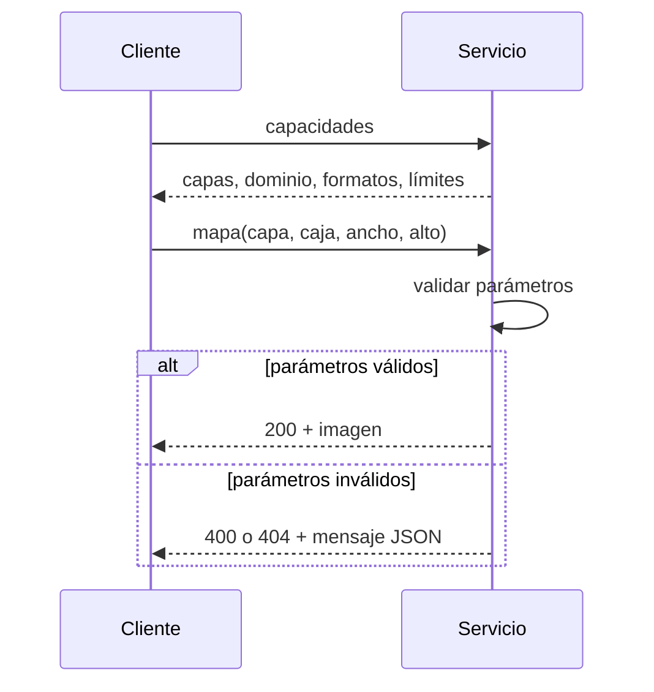

# B14-C29 — Servicios de datos geoespaciales estándar (OGC)

<!-- nav:top -->
[🏠 Programa](../../../../README.md) · [📚 Bloque B14](../../../tronco-comun/B14-computacion-cientifica-y-ciencia-abierta.md) · [← Anterior: B14-C28 — Bases de datos espaciales](../B14-C28-bases-de-datos-espaciales/CLASE.md) · [Siguiente: B14-C30 — Cadenas de procesamiento automatizado de datos →](../B14-C30-cadenas-de-procesamiento-automatizado-de-datos/CLASE.md)
<!-- /nav -->

## 1. Ubicación, nivel y alcance

Novena clase de la ampliación programada del bloque B14. En [C25](../B14-C25-catalogos-de-datos-geoespaciales-y-metadatos-stac/CLASE.md) a [C28](../B14-C28-bases-de-datos-espaciales/CLASE.md) aprendiste a describir, guardar y consultar datos geoespaciales; ahora los **publicas para otros sistemas** mediante servicios con interfaz estándar, de modo que cualquier cliente que hable el estándar pueda pedirlos. Nivel N2.

**Aviso de alcance:** el servicio del laboratorio **no es un WMS ni cumple ningún estándar del OGC**: usa nombres de parámetros propios, devuelve JSON y una imagen en formato PGM, y no sigue la especificación WMS 1.3.0, **que no leí**. Ilustra el patrón petición–respuesta. Lo que afirmo del OGC se limita a lo que dicen las dos páginas que consulté.

Verás qué es un servicio de datos estándar y por qué importa, el patrón «capacidades + petición de mapa», la validación de parámetros, la orientación de la imagen y el manejo de errores. No verás XML de capacidades, sistemas de referencia, formatos de imagen ni seguridad.

## 2. Por qué esta clase existe

Has producido un mosaico de imágenes y varias organizaciones quieren verlo en sus propios visores. Enviar archivos a cada una no escala, y cada una usa un programa distinto. La pregunta motivadora es: **¿cómo ofrezco mis datos para que programas que no conozco puedan pedirlos de forma predecible?**

La decisión central es: **¿qué interfaz estándar sigo y cómo respondo a lo inválido?** Un servicio útil documenta lo que ofrece y rechaza con claridad lo que no entiende.

## 3. Lo que podrás hacer al terminar

1. Explicar qué resuelve un servicio de datos con interfaz estándar.
2. Describir el patrón de capacidades más petición de datos.
3. Validar los parámetros de una petición de mapa y devolver errores con código y mensaje.
4. Comprobar que la imagen servida es idéntica al cálculo directo y que su orientación es la declarada.
5. Distinguir WMS (imágenes de mapas) de la API de *features* (objetos) según el OGC.
6. Declarar qué parte del estándar real no se probó.

La evidencia es el **servicio descrito y consumido** del ejercicio 12 (sección 20).

## 4. Con qué llegas y cómo comprobarlo

Necesitas C26 (ráster y georreferencia), C25 y nociones de HTTP (petición y respuesta). Cinco preguntas:

1. ¿Qué es una petición HTTP GET con parámetros en la dirección?
2. ¿Qué significa el código 404? ¿Y el 400?
3. ¿Qué es el centro de un píxel? (C26)
4. ¿Qué es una caja envolvente? (C25)
5. ¿Por qué se rechaza una caja con mínimo mayor que máximo?

<details>
<summary>Ver respuestas</summary>

1. Un pedido de recurso donde los parámetros van tras `?` (`clave=valor`). 2. 404: no existe el recurso; 400: la petición es inválida (conocimiento general; no lo consulté en el RFC). 3. Su punto medio. 4. El rectángulo mínimo que contiene una geometría. 5. No define una región.
</details>

Con cuatro o cinco aciertos, sigue; con tres o menos, repasa C25 y C26.

## 5. Un caso real: lo que dice el OGC de WMS y de la API de features

La página del OGC sobre WMS (S1) lo describe como una **interfaz HTTP simple para pedir imágenes de mapas georreferenciadas** a una o más bases de datos geoespaciales distribuidas; las imágenes (JPEG, PNG) pueden verse en un navegador, y la interfaz puede indicar si son transparentes, para combinar capas de varios servidores. Lista las versiones 1.3.0 (vigente; coincide con ISO 19128), 1.1.1, 1.1 y 1.0 (históricas). **No describe las operaciones** (GetCapabilities, GetMap, GetFeatureInfo): remite a la especificación 06-042, que no leí. La página de OGC API – Features (S2) lo presenta como bloques modulares para crear, modificar y consultar *features* geoespaciales por la web; la Parte 1 (Core) cubre geometrías en longitud/latitud WGS 84 y la Parte 2 otros sistemas de referencia; sus operaciones de descubrimiento y consulta usan HTTP GET; permite acceder a datos a nivel de *feature* individual sin descargar todo el conjunto; versiones: Core 1.0 con corrigendum 1.0.1, CRS 1.0, Filtering 1.0 y CQL2 1.0.0. S2 no habla de WFS.

El **ejemplo conductor** es un servicio **local y sintético** que sirve una capa «demo»: `f(lon, lat) = 128 + 100·sen(lon/10°)·cos(lat/10°)` (valores de 8 bits) sobre `lon, lat ∈ [0°, 40°)`.

## 6. Vocabulario

Un **servicio** responde peticiones HTTP con datos. Las **capacidades** son la descripción de lo que el servicio ofrece (capas, dominios, formatos). Una **petición de mapa** pide una imagen de una región con un tamaño. Una **capa** es un conjunto de datos servido. **Validar** es comprobar que los parámetros son correctos antes de responder. El **código de estado** resume el resultado (200, 400, 404). **PGM** es un formato de imagen gris muy simple. Un **cliente** es el programa que pide. La **interoperabilidad** es que clientes distintos puedan usar el servicio sin adaptarlo.

## 7. Modelo mental: preguntar qué hay, luego pedir

Un cliente primero pregunta qué ofrece el servicio y después pide una imagen concreta con parámetros válidos. El servicio comprueba cada parámetro y responde con la imagen o con un error claro.



*Descripción textual:* el cliente pide las capacidades y el servicio responde con las capas, el dominio, los formatos y los límites. Luego el cliente pide un mapa con capa, caja, ancho y alto; el servicio valida los parámetros: si son válidos responde 200 con la imagen; si no, 400 o 404 con un mensaje en JSON.

**Analogía y su límite.** Un mostrador con menú: primero lees qué hay, luego pides con los datos necesarios. Límite: un mostrador es presencial; un servicio recibe peticiones mal formadas de programas, y debe responder con claridad.

## 8. La explicación, paso a paso

### 8.1 Las capacidades

El laboratorio levanta un servidor en `127.0.0.1` en un puerto efímero. La petición de capacidades devuelve 200 con la capa `demo`, su dominio `[0, 0, 40, 40]`, el máximo de 512 píxeles por lado y el formato `image/x-portable-graymap`. Un cliente no necesita saberlo de antemano: lo pregunta.

### 8.2 La petición de mapa

Los parámetros son capa, caja (`minlon`, `minlat`, `maxlon`, `maxlat`), ancho y alto. Para la caja completa y 64 × 64 píxeles, el servicio devuelve 200 con una imagen PGM de forma `(64, 64)`, valores entre 28 y 228. Cada píxel toma el valor de la función en su centro.

### 8.3 Verificar la imagen

La imagen recibida es **idéntica** (`np.array_equal`) al cálculo directo de la función en los centros de píxel: el servicio hace lo que dice. Es la prueba de corrección del servicio, con la misma lógica que C10.

### 8.4 La orientación

La convención declarada: fila 0 al norte (máxima latitud) y columna 0 al oeste (mínima longitud). Una petición de 2 × 2 sobre `[10, 30] × [10, 30]` devuelve `[[48, 80], [135, 132]]`, igual a la esperada calculando los centros `(15, 25)`, `(25, 25)`, `(15, 15)`, `(25, 15)`. Un cliente que supusiera el norte abajo mostraría el mapa volteado: la orientación debe documentarse.

### 8.5 Los errores

El servicio responde con código y mensaje JSON a: faltan parámetros (400), capa desconocida (404), caja invertida (400), caja fuera del dominio (400), tamaño excesivo (400), valor no numérico (400) y petición desconocida (400). Los códigos son los que esperaba la clase por convención HTTP general; no los verifiqué en el RFC.

### 8.6 Lo que este laboratorio no es

Un WMS real (S1, versión 1.3.0) tiene parámetros y formatos que definen la especificación 06-042, que no leí; un cliente WMS estándar no entendería este servicio. La API de *features* de S2 sirve objetos, no imágenes. Y no se probaron autenticación, límites de uso, HTTPS ni rendimiento.

## 9. Magnitudes, símbolos y unidades

| Concepto | Qué es | Unidad | Valor en el ejemplo |
|---|---|---|---|
| `lon, lat` | coordenadas | grados | dominio `[0, 40)` |
| `ancho, alto` | tamaño de la imagen | píxeles | 64 × 64; máximo 512 |
| valor de píxel | brillo de 8 bits | entero 0–255 | 28 a 228 |
| código de estado | resultado HTTP | entero | 200, 400, 404 |
| centro de píxel | punto de evaluación | grados | `minlon + (col + 0,5)·Δlon` |

## 10. Convenciones y referencias

Datos **sintéticos**. Coordenadas planas lon/lat sin sistema de referencia declarado. Fila 0 al norte, columna 0 al oeste. El servidor solo escucha en `127.0.0.1` mientras corre el laboratorio. No es WMS.

## 11. De dónde sale lo que afirmamos

| ID | Fuente | Localizador | Respalda | Estado |
|---|---|---|---|---|
| S1 | OGC, *Web Map Service* | https://www.ogc.org/standards/wms/ | WMS como interfaz HTTP simple para pedir imágenes de mapas georreferenciadas; versiones 1.3.0 (ISO 19128), 1.1.1, 1.1 y 1.0 | Página consultada el 2026-11-05 (mutable); no describe las operaciones |
| S2 | OGC, *OGC API – Features* | https://www.ogc.org/standards/ogcapi-features/ | Bloques modulares para consultar *features*; Parte 1 Core (WGS 84 lon/lat), Parte 2 CRS; HTTP GET; acceso por *feature*; versiones | Página consultada el 2026-11-05 (mutable) |

Límites: no leí la especificación WMS 1.3.0 (06-042) ni las partes de OGC API – Features; no sé qué parámetros, formatos ni orden de ejes exigen; el significado de los códigos HTTP es conocimiento general no consultado (el RFC 9110 no se leyó en esas secciones). El servicio del laboratorio no es interoperable.

## 12. Cómo ver el resultado

Versión accesible.

| Petición | Resultado |
|---|---|
| capacidades | 200; capa `demo`; formato PGM |
| mapa 64 × 64 de la caja completa | 200; forma (64, 64); idéntico al cálculo directo |
| mapa 2 × 2 sobre `[10, 30]²` | `[[48, 80], [135, 132]]` (fila 0 = norte) |
| faltan parámetros | 400 |
| capa desconocida | 404 |
| caja invertida, fuera del dominio, tamaño excesivo, no numérico, petición desconocida | 400 |

## 13. Ejemplo trabajado: consumir el servicio

1. **Pregunta** las capacidades: capa `demo`, dominio `[0, 40]²`, máximo 512 píxeles.
2. **Pide** el mapa completo a 64 × 64.
3. **Comprueba** que la imagen coincide con el cálculo directo: idéntica.
4. **Comprueba la orientación** con un 2 × 2: coincide con los centros esperados.
5. **Prueba los errores:** siete casos con su código.
6. **Registra** el servicio, la fecha y los parámetros usados.

**Paso final · incertidumbre.** El servicio devuelve exactamente lo que se calcula porque la capa es una función. Con datos reales habría remuestreo, proyecciones y compresión, y la comparación sería con tolerancia.

## 14. Comparación: enviar archivos, servicio de mapas y API de features

**Enviar archivos** es simple y no escala. Un **servicio de mapas** (S1) entrega imágenes ya dibujadas, ideales para visualizar. Una **API de features** (S2) entrega los objetos y atributos, ideal para análisis. Elegir depende de si el consumidor quiere ver o calcular.

## 15. Práctica guiada

**Ejercicio 1 · con los pasos.** Calcula el valor de la capa en `(lon, lat) = (10°, 10°)`: `128 + 100·sen(1 rad)·cos(1 rad)`. *Pasos:* con `lon/10° = 1 rad` (sección 8.2; la función usa `lon` y `lat` en grados dividido por 10°).

<details><summary>Solución comentada</summary>

`sen 1 = 0,8415`, `cos 1 = 0,5403`; producto `0,4546`; `128 + 45,46 = 173,5`, redondeado a 173. (La función exacta usa `lon/10°` como radianes: `10°/10° = 1` en esas unidades.)
</details>

**Ejercicio 2 · con una pista.** ¿Qué código devuelve una caja con `minlon = 5` y `maxlon = 1`? *Pista:* la validación.

<details><summary>Solución comentada</summary>

400 con el mensaje «caja inválida (mín debe ser menor que máx)».
</details>

**Ejercicio 3 · casi autónomo.** Una imagen de 2 × 2 sobre `[0, 20] × [0, 20]`: ¿en qué puntos se evalúa la capa?

<details><summary>Solución comentada</summary>

En los centros: `lon ∈ {5, 15}` y `lat ∈ {15, 5}` para las filas norte y sur; fila 0: `(5, 15)` y `(15, 15)`; fila 1: `(5, 5)` y `(15, 5)`.
</details>

## 16. Práctica autónoma, transferencia e integrador

**Ejercicio 4.** ¿Por qué la imagen pedida no puede salirse del dominio de la capa?

<details><summary>Solución comentada</summary>

La función solo está definida allí; el servicio no inventa datos fuera. Responde 400 e informa el dominio, y el cliente corrige.
</details>

**Ejercicio 5.** Un cliente interpreta la fila 0 como el sur. ¿Qué ve?

<details><summary>Solución comentada</summary>

El mapa volteado verticalmente. La orientación debe quedar en la documentación del servicio.
</details>

**Ejercicio 6.** ¿Qué ventaja tiene que el servicio publique sus capacidades?

<details><summary>Solución comentada</summary>

Los clientes descubren las capas, el dominio, los formatos y los límites sin código específico para cada servicio, y pueden validar sus peticiones antes de enviarlas.
</details>

**Ejercicio 7.** Propón un límite de uso que el servicio debería tener en un despliegue real.

<details><summary>Solución comentada</summary>

Máximo de píxeles por petición (ya existe: 512 por lado), número de peticiones por minuto, tiempo máximo de respuesta y autenticación si los datos no son públicos.
</details>

**Ejercicio 8.** ¿Qué diferencia hay entre WMS y OGC API – Features según las páginas del OGC?

<details><summary>Solución comentada</summary>

WMS entrega imágenes de mapas georreferenciadas (S1); la API de features da acceso a objetos individuales sin descargar todo el conjunto (S2).
</details>

**Ejercicio 9 · transferencia.** Quieres que un cliente WMS estándar use tu servicio. ¿Qué debes hacer?

<details><summary>Solución comentada</summary>

Implementar la especificación WMS 1.3.0 (06-042), con sus parámetros, formatos y capacidades, y validar con las herramientas del OGC. Este laboratorio no lo hace.
</details>

**Ejercicio 10 · transferencia.** Tus datos son sensibles (ubicación de especies amenazadas). ¿Qué cambia antes de publicar un servicio?

<details><summary>Solución comentada</summary>

Degradas la resolución o el dominio, controlas el acceso (autenticación), registras el uso y revisas la licencia y la política de la institución.
</details>

**Ejercicio 11 · transferencia.** El servicio tarda mucho con 512 × 512. ¿Cómo lo mejoras?

<details><summary>Solución comentada</summary>

Pirámides o teselas precalculadas (C26–C27), caché de respuestas, índices (C28) y límites. Mide antes de optimizar (C14).
</details>

**Ejercicio 12 · integrador.** Entrega un **servicio descrito y consumido**: un servicio local con capacidades, petición de datos, validación de parámetros y errores con código; un cliente que verifica la respuesta contra un cálculo directo y la orientación; una tabla de errores probados; y la declaración de qué parte del estándar real no cubre.

<details><summary>Solución modelo</summary>

Debe incluir las capacidades, la tabla de la sección 12 con tus resultados, la verificación idéntica y de orientación, los casos de error, y una nota explícita de que no es WMS ni OGC API conformes (o la validación real realizada).
</details>

## 17. Laboratorio

El script [servicio_de_mapas_local.py](servicio_de_mapas_local.py) levanta un servidor local en `127.0.0.1`, consume capacidades y mapas con un cliente, verifica la imagen contra el cálculo directo y la orientación, y prueba siete errores. **No es WMS ni cumple ningún estándar del OGC.**

**Datos:** sintéticos. **Predice antes de ejecutar:** ¿qué código dará una capa desconocida? **Ejecución del 2026-11-05 (Python 3.12.9, NumPy 2.5.4):**

```text
capacidades: 200 application/json; capas = ['demo']; formatos = ['image/x-portable-graymap']
mapa 64x64: 200 image/x-portable-graymap; forma (64, 64); min 28, max 228
píxeles idénticos al cálculo directo
mapa 2x2 sobre [10,30]x[10,30]: [[48, 80], [135, 132]] (esperado [[48, 80], [135, 132]]: fila 0 = norte, columna 0 = oeste)
error «faltan parámetros»: 400 (faltan parámetros)
error «capa desconocida»: 404 (capa desconocida)
error «caja invertida»: 400 (caja inválida (mín debe ser menor que máx))
error «fuera del dominio»: 400 (caja fuera del dominio de la capa)
error «tamaño excesivo»: 400 (tamaño fuera de 1..512)
error «no numérico»: 400 (parámetro no numérico)
error «petición desconocida»: 400 (petición desconocida)
Pruebas superadas.
```

```bash
python programa/clases/B14/B14-C29-servicios-de-datos-geoespaciales-estandar-ogc/servicio_de_mapas_local.py
```

**Límites:** servicio no conforme; un solo cliente; sin autenticación, HTTPS ni proyecciones; escucha solo en el equipo local.

## 18. Errores frecuentes y cómo corregirlos

**Afirmar que el servicio es estándar.** Se corrige con el ejercicio 9 y la sección 8.6.

**No documentar la orientación.** Se corrige con el ejercicio 5.

**No validar parámetros.** Se corrige con los ejercicios 2 y 4.

**Servir sin límites.** Se corrige con el ejercicio 7.

**Publicar datos sensibles sin revisar.** Se corrige con el ejercicio 10.

## 19. Cómo sabrás que vas bien

Tras 8.2: ¿calculas los puntos de evaluación de un mapa pequeño? Si no, rehaz el ejercicio 3. Tras 8.5: ¿clasificas un error en 400 o 404? Si no, rehaz el 2. Tras el ejemplo trabajado: ¿qué falta para un servicio estándar? Tras el laboratorio: ¿qué no es? Al final: ¿qué límites pondrías?

## 20. Qué entregas y cómo se evalúa

El producto es tu **servicio descrito y consumido** del ejercicio 12.

| Criterio | Inicial | En desarrollo | Logrado | Destacado |
|---|---|---|---|---|
| Interfaz | Sin descripción | Parámetros listados | Capacidades y petición | Con límites y orientación documentados |
| Validación | Ninguna | Algunos errores | Errores con código y mensaje | Con prueba de cada caso |
| Verificación | Sin comparar | Visual | Idéntico al cálculo directo | Con orientación y borde |
| Fuentes y alcance | Sin fuente | Fuente sin alcance | Fuente con alcance | Declara que no es conforme |

**Condiciones críticas:** no presentar el servicio como WMS conforme; no omitir la validación de parámetros; no exponer datos sensibles.

## 21. Ética, seguridad y límites

Un servicio expuesto a Internet recibe peticiones de cualquiera: autenticación, límites y revisión de datos sensibles son imprescindibles. El laboratorio solo escucha en el equipo local. Accesibilidad: entrega de imagen con alternativas textuales en la documentación. Material educativo.

## 22. Para cerrar y seguir

Un servicio de datos estándar permite que clientes desconocidos pidan datos de forma predecible: primero capacidades, luego peticiones validadas, con errores claros. WMS entrega imágenes de mapas y OGC API – Features, objetos (según las páginas del OGC). El servicio del laboratorio no es conforme a ninguno. Queda abierta una pregunta: ¿qué cambios necesitaría para que un cliente WMS real lo usara?

**Glosario español–inglés.** servicio · *service*; capacidades · *capabilities*; petición de mapa · *map request*; capa · *layer*; código de estado · *status code*; interoperabilidad · *interoperability*; cliente · *client*.

**Continuidad.** B14-C31 trata el diseño de APIs de datos en general (paginación, validación, caché); B14-C30 automatiza la producción de los datos que se sirven; B14-C28 los indexa.

**Referencias:** ver sección 11.

<!-- nav:bottom -->
---

[← Anterior: B14-C28 — Bases de datos espaciales](../B14-C28-bases-de-datos-espaciales/CLASE.md) · [📚 Bloque B14](../../../tronco-comun/B14-computacion-cientifica-y-ciencia-abierta.md) · [Siguiente: B14-C30 — Cadenas de procesamiento automatizado de datos →](../B14-C30-cadenas-de-procesamiento-automatizado-de-datos/CLASE.md)
<!-- /nav -->
