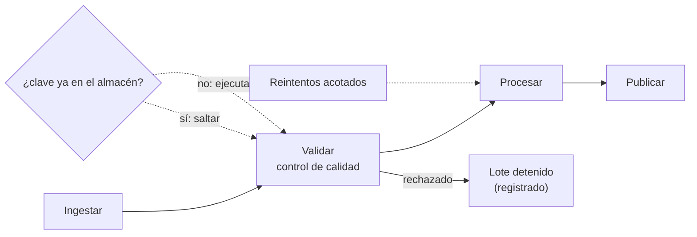

# B14-C30 — Cadenas de procesamiento automatizado de datos

<!-- nav:top -->
[🏠 Programa](../../../../README.md) · [📚 Bloque B14](../../../tronco-comun/B14-computacion-cientifica-y-ciencia-abierta.md) · [← Anterior: B14-C29 — Servicios de datos geoespaciales estándar (OGC)](../B14-C29-servicios-de-datos-geoespaciales-estandar-ogc/CLASE.md) · [Siguiente: B14-C31 — APIs de servicios de datos →](../B14-C31-apis-de-servicios-de-datos/CLASE.md)
<!-- /nav -->

## 1. Ubicación, nivel y alcance

Décima clase de la ampliación programada del bloque B14. En [C18](../B14-C18-flujos-de-datos-espaciales/CLASE.md) describiste un flujo de datos; en [C27](../B14-C27-procesamiento-por-teselas-de-grandes-volumenes-de-imagenes/CLASE.md), cómo procesar grandes volúmenes. Producir datos **de forma continua** (cada día llegan escenas nuevas) exige una **cadena automática** que se ejecute sola, no repita lo ya hecho, se detenga ante datos malos y se recupere de fallos pasajeros. Nivel N2.

**Aviso de alcance:** el laboratorio ejecuta la cadena **en un solo proceso, sin planificador, reloj ni red**. No hay alertas, registros persistentes ni recuperación tras caída. Lo único que consulté es la documentación de `graphlib` de Python para el orden de dependencias.

Verás el orden de etapas por dependencias, la idempotencia (no repetir lo hecho), el control de calidad que detiene un lote defectuoso, el reintento ante fallos transitorios y qué registrar. No verás orquestadores concretos ni despliegue.

## 2. Por qué esta clase existe

Cada madrugada llegan datos nuevos. Si un humano debe lanzar cada paso, tarde o temprano se olvida uno; si un lote corrupto atraviesa la cadena, contamina el producto final; si un fallo de red detiene todo y al reiniciar se repite desde cero, se pierde tiempo. La pregunta motivadora es: **¿cómo diseño una cadena que produzca datos fiables sin supervisión constante y sin esconder sus fallos?**

La decisión central es: **¿qué comprueba cada etapa antes de pasar el dato a la siguiente, y qué pasa cuando algo falla?** Una cadena que no se detiene ante un dato malo es peor que una cadena manual.

## 3. Lo que podrás hacer al terminar

1. Declarar las etapas de una cadena con sus dependencias y calcular su orden de ejecución.
2. Detectar un ciclo de dependencias.
3. Hacer una etapa idempotente mediante una clave derivada de la entrada.
4. Diseñar un control de calidad que detenga un lote defectuoso y deje constancia.
5. Aplicar reintentos acotados a fallos transitorios y registrar el fallo definitivo.
6. Declarar lo que la cadena de laboratorio no cubre.

La evidencia es la **cadena automatizada con controles de calidad** del ejercicio 12 (sección 20).

## 4. Con qué llegas y cómo comprobarlo

Necesitas C11 (huellas), C18 (flujos), C10 (verificación) y C08 (datos ausentes). Cinco preguntas:

1. ¿Qué es una dependencia entre etapas?
2. ¿Qué significa que una operación sea idempotente?
3. ¿Qué es un control de calidad de datos? (C08)
4. ¿Qué es un fallo transitorio?
5. ¿Por qué se acota el número de reintentos?

<details>
<summary>Ver respuestas</summary>

1. Una etapa necesita el resultado de otra. 2. Repetirla con la misma entrada produce el mismo resultado sin efectos adicionales. 3. Una comprobación (por ejemplo, fracción de NaN y rango de la media) que acepta o rechaza un lote. 4. Un fallo que desaparece al reintentar (una conexión caída un momento). 5. Para no reintentar eternamente algo que no se arregla solo.
</details>

Con cuatro o cinco aciertos, sigue; con tres o menos, repasa C18 y C08.

## 5. Un caso real: ordenar por dependencias con `graphlib`

La documentación de Python (S1) describe `graphlib.TopologicalSorter` como el ordenador de los nodos de un grafo dirigido acíclico de modo que cada nodo aparece después de sus predecesores; las dependencias se dan como un diccionario de nodo a sus predecesores o con `add`; con un ciclo, `prepare()` (y por tanto `static_order()`) lanza `CycleError`, subclase de `ValueError`, cuyo `args[1]` contiene el ciclo; y para uso en paralelo se usan `prepare()`, `get_ready()` y `done()`. Es la única fuente consultada: la idempotencia, el control de calidad y los reintentos son técnicas generales que aquí se demuestran con un experimento, no se atribuyen a una fuente.

El **ejemplo conductor** es una cadena **sintética** de cuatro etapas (ingestar → validar → procesar → publicar) que procesa cinco lotes de 1000 flujos relativos; el lote 3 está corrompido a propósito con 200 valores `NaN`.

## 6. Vocabulario

Una **cadena** (*pipeline*) es una secuencia de etapas con dependencias. Un **grafo acíclico dirigido (DAG)** representa las dependencias sin ciclos. El **orden topológico** respeta que cada etapa va después de sus predecesoras. La **idempotencia** es que repetir no cambia el resultado. Un **lote** es un conjunto de datos procesado de una vez. El **control de calidad** (QC) acepta o rechaza el lote con criterios declarados. Un **reintento** repite una etapa tras un fallo transitorio. El **registro** (*log*) anota qué ocurrió con cada etapa. Una **clave de caché** identifica un resultado por su entrada.

## 7. Modelo mental: cada etapa comprueba, decide y deja constancia

Cada etapa recibe un dato con su huella, calcula la clave del resultado, y si ya existe lo reutiliza; si no, lo calcula, y si falla lo reintenta; si el control de calidad lo rechaza, detiene el lote. Todo queda en un registro.



*Descripción textual:* las etapas ingestar, validar, procesar y publicar se encadenan; si la validación (control de calidad) rechaza el lote, este se detiene y se registra. Antes de cada etapa se consulta si su clave ya está en el almacén (si sí, se salta; si no, se ejecuta), y las etapas que pueden fallar de forma transitoria tienen reintentos acotados.

**Analogía y su límite.** Una línea de montaje con inspección y registro: la pieza defectuosa se aparta y se anota. Límite: en una línea de montaje la pieza no se puede reprocesar con una clave; aquí el dato sí.

## 8. La explicación, paso a paso

### 8.1 El orden de las etapas

Las dependencias son `validar ← ingestar`, `procesar ← validar`, `publicar ← procesar`. El ordenador topológico (S1) da `['ingestar', 'validar', 'procesar', 'publicar']`. Con un ciclo (`a` depende de `b` y `b` de `a`), lanza `CycleError`, que el laboratorio captura: un diseño cíclico se detecta antes de ejecutar.

### 8.2 Idempotencia con una clave

La clave de una etapa es el SHA-256 de `etapa | lote | huella de la entrada` (C11). Si la clave existe en el almacén, la etapa se **salta** y se reutiliza su resultado; si no, se ejecuta y se guarda. Así, repetir la cadena sobre los mismos datos no recalcula nada. Resultado del laboratorio: en la primera pasada se **ejecutaron 17 etapas** (4 lotes completos × 4 etapas, más la ingesta del lote 3); en la segunda pasada, **0 ejecutadas y 17 saltadas**.

### 8.3 El control de calidad

La etapa de validación rechaza el lote si más del 1 % de los valores son `NaN` o si la media sale de `[0,99; 1,01]`. El lote 3 tiene 20 % de `NaN` y se **detiene** tras ingerirse: ni se procesa ni se publica. El resultado de los cinco lotes es `[True, True, True, False, True]`: solo el defectuoso falla. En la segunda pasada vuelve a detenerse (la validación no guarda un resultado cuando rechaza), con constancia en el registro. Los umbrales (1 %, `[0,99; 1,01]`) son de esta clase; en un caso real se justifican con el instrumento y el uso del dato.

### 8.4 Reintentos acotados

Si una etapa falla de forma transitoria, se reintenta hasta 3 veces. Con 2 fallos inyectados en `procesar`, la cadena termina bien tras 2 reintentos (registro: 4 etapas ejecutadas, `reintento 1` y `reintento 2`). Con 5 fallos, se agotan los 3 intentos y se registra **«falló definitivamente»**: no se reintenta sin fin ni se silencia.

### 8.5 Qué registrar

Cada etapa de cada lote deja una línea: ejecutada, saltada, reintento, detenida por calidad o fallo definitivo. En la primera pasada, el lote 3 registra `ejecutada` (ingesta) y `detenida por calidad`. El registro permite auditar qué se produjo y por qué falta un lote, y es la base de las alertas en un sistema real.

### 8.6 Lo que no cubre

Una cadena operativa añade: planificación horaria, ejecución en paralelo de lotes (C13), persistencia de resultados en disco, alertas, caducidad de la caché, versionado de datos y código (C11, C12), cuotas y recuperación tras una caída del proceso. Nada de eso se probó. Y las claves de caché dependen de que la entrada sea determinista: un resultado que dependa de la hora o de un servicio externo no es idempotente sin precauciones.

## 9. Magnitudes, símbolos y unidades

| Concepto | Qué es | Unidad | Valor en el ejemplo |
|---|---|---|---|
| lotes | conjuntos procesados | conteo | 5 (el 3 corrupto) |
| valores por lote | flujos relativos | adimensional | 1000 |
| umbral de `NaN` | fracción máxima aceptada | fracción | 1 % |
| rango de la media | aceptado por QC | adimensional | `[0,99; 1,01]` |
| reintentos máximos | intentos por etapa | conteo | 3 |
| etapas ejecutadas / saltadas | primera / segunda pasada | conteo | 17 / 0 y 0 / 17 |

## 10. Convenciones y referencias

Datos **sintéticos** (semilla `20261105 + n`). Los umbrales del control de calidad son de esta clase. Los fallos transitorios se inyectan de forma determinista. Un solo proceso; sin reloj. Versiones: Python 3.12.9, NumPy 2.5.4.

## 11. De dónde sale lo que afirmamos

| ID | Fuente | Localizador | Respalda | Estado |
|---|---|---|---|---|
| S1 | Python Software Foundation, documentación de `graphlib` | https://docs.python.org/3/library/graphlib.html | `TopologicalSorter`: orden tras predecesores, formas de dar dependencias, `CycleError` ante un ciclo, uso con `prepare/get_ready/done` | Página consultada el 2026-11-05 (mutable) |

Límites: no consulté documentación de orquestadores ni de prácticas de calidad de datos; la idempotencia, el control de calidad y los reintentos se demuestran con el experimento y no se atribuyen a una fuente. Los umbrales son de esta clase.

## 12. Cómo ver el resultado

Versión accesible.

| Situación | Resultado |
|---|---|
| Orden de etapas | ingestar, validar, procesar, publicar |
| Ciclo de dependencias | `CycleError` detectado |
| Primera pasada (lotes 0–4) | aprobados `[T, T, T, F, T]`; 17 etapas ejecutadas |
| Lote 3 | `ejecutada` (ingesta) + `detenida por calidad` |
| Segunda pasada | 17 saltadas, 0 ejecutadas, lote 3 de nuevo detenido |
| 2 fallos transitorios | termina; reintentos 1 y 2 |
| 5 fallos | «falló definitivamente» tras 3 intentos |

## 13. Ejemplo trabajado: una cadena que no se miente

1. **Ordena** las etapas con `TopologicalSorter`.
2. **Ejecuta** cinco lotes: cuatro completos y el 3 detenido en la validación.
3. **Comprueba** el registro: 17 ejecutadas; el lote 3 con `detenida por calidad`.
4. **Repite** la pasada: 17 saltadas; nada se recalcula.
5. **Inyecta** 2 fallos transitorios: termina con 2 reintentos.
6. **Inyecta** 5 fallos: fallo definitivo registrado.
7. **Decide** qué alerta se enviaría en un sistema real.

**Paso final · incertidumbre.** El control de calidad solo detecta lo que comprueba: un lote con valores plausibles pero equivocados pasaría. Los umbrales deben justificarse con datos reales y revisarse cuando cambie el instrumento.

## 14. Comparación: manual, guion lineal y cadena con dependencias

**Manual**: flexible y propenso a olvidos. **Guion lineal**: repetible pero repite todo y no se detiene con criterio. **Cadena con dependencias, claves y controles**: reutiliza lo hecho, se detiene ante lo malo y deja constancia, a cambio de más diseño.

## 15. Práctica guiada

**Ejercicio 1 · con los pasos.** Da el orden de `{"C": {"B"}, "B": {"A"}, "D": {"B", "C"}}`. *Pasos:* predecesores primero (sección 8.1).

<details><summary>Solución comentada</summary>

`A, B, C, D`: `A` no depende de nada; `B` de `A`; `C` de `B`; `D` de `B` y `C`.
</details>

**Ejercicio 2 · con una pista.** ¿Por qué la clave incluye la huella de la entrada? *Pista:* ¿qué pasa si cambia el dato?

<details><summary>Solución comentada</summary>

Si el dato cambia, la clave cambia y la etapa se recalcula; si no cambia, se reutiliza. Sin la huella, un resultado viejo se reusaría con datos nuevos.
</details>

**Ejercicio 3 · casi autónomo.** Un lote tiene 0,5 % de `NaN` y media 1,002. ¿Lo acepta el control de calidad?

<details><summary>Solución comentada</summary>

Sí: 0,5 % ≤ 1 % y 1,002 ∈ `[0,99; 1,01]`.
</details>

## 16. Práctica autónoma, transferencia e integrador

**Ejercicio 4.** ¿Cuántas etapas ejecutadas habría en la primera pasada con 10 lotes si el 4 y el 7 están corruptos?

<details><summary>Solución comentada</summary>

8 lotes completos × 4 = 32, más la ingesta de los 2 corruptos = 34.
</details>

**Ejercicio 5.** ¿Por qué un lote rechazado vuelve a ser rechazado en la segunda pasada, y es lo correcto?

<details><summary>Solución comentada</summary>

La entrada es la misma y el control de calidad es determinista: debe dar el mismo veredicto. No se «arregla solo» por repetir.
</details>

**Ejercicio 6.** Un fallo ocurre siempre en una etapa. ¿Qué hacen los reintentos?

<details><summary>Solución comentada</summary>

Se agotan (3 intentos) y se registra el fallo definitivo: es un fallo persistente, no transitorio, y requiere intervención. Reintentar sin fin lo escondería.
</details>

**Ejercicio 7.** Propón un criterio de calidad más para un lote de imágenes.

<details><summary>Solución comentada</summary>

Por ejemplo: fracción de píxeles saturados menor que un umbral, o nubosidad máxima, o tamaño de archivo dentro de lo esperado. Cualquiera justificado por el instrumento.
</details>

**Ejercicio 8.** ¿Qué debería ocurrir si cambia el código de `procesar`?

<details><summary>Solución comentada</summary>

La clave debe incluir la versión del código; si no, la caché devolvería resultados del código anterior. Se versiona el código (C12) y se añade a la clave.
</details>

**Ejercicio 9 · transferencia.** Un resultado depende de la hora de ejecución. ¿Es idempotente?

<details><summary>Solución comentada</summary>

No: la misma entrada da salidas distintas. Hay que fijar la hora como parámetro de entrada o eliminar la dependencia.
</details>

**Ejercicio 10 · transferencia.** Quieres procesar los lotes en paralelo (C13). ¿Qué cuidas?

<details><summary>Solución comentada</summary>

Que los lotes sean independientes, que el almacén soporte accesos concurrentes, que el registro mantenga el orden de lectura y que el resultado paralelo coincida con el serie.
</details>

**Ejercicio 11 · transferencia.** El proceso se cae a mitad de una pasada. ¿Qué ventaja da la idempotencia?

<details><summary>Solución comentada</summary>

Al reiniciar, las etapas ya guardadas se saltan y solo se completa lo pendiente. Requiere que el almacén sea persistente (aquí está en memoria y se perdería).
</details>

**Ejercicio 12 · integrador.** Entrega una **cadena automatizada con controles de calidad**: etapas con dependencias y su orden, idempotencia por clave, un control de calidad con umbrales justificados, reintentos acotados, registro de cada etapa, pruebas con un lote defectuoso y fallos inyectados, y una lista de lo que no cubre.

<details><summary>Solución modelo</summary>

Debe incluir la tabla de la sección 12 con tus números, los umbrales con su justificación, la prueba de repetición (nada se recalcula), el registro y una declaración de límites (sin planificador, sin persistencia, sin alertas). Se acepta cualquier cadena sintética.
</details>

## 17. Laboratorio

El script [cadena_con_control_de_calidad.py](cadena_con_control_de_calidad.py) ordena las etapas, detecta un ciclo, ejecuta cinco lotes (uno corrupto), repite la pasada comprobando que no se recalcula nada e inyecta fallos transitorios y persistentes.

**Datos:** sintéticos. **Predice antes de ejecutar:** ¿qué ocurrirá con el lote 3 en la segunda pasada? **Ejecución del 2026-11-05 (Python 3.12.9, NumPy 2.5.4):**

```text
orden topológico de las etapas: ['ingestar', 'validar', 'procesar', 'publicar']
un ciclo de dependencias se detecta (CycleError)
primera pasada, lotes 0-4: aprobados = [True, True, True, False, True]
  resumen lote 3: {'ejecutada': 1, 'detenida por calidad': 1}
  etapas ejecutadas en total: 17 (4 lotes completos x 4 + 1 de ingesta del lote 3 = 17)
segunda pasada: aprobados = [True, True, True, False, True]; {'saltada': 17, 'detenida por calidad': 1}
fallo transitorio (2 fallos): {'ejecutada': 4, 'reintento 1': 1, 'reintento 2': 1}
fallo persistente (5 fallos): {'ejecutada': 2, 'reintento 1': 1, 'reintento 2': 1, 'reintento 3': 1, 'falló definitivamente': 1}
Pruebas superadas.
```

```bash
python programa/clases/B14/B14-C30-cadenas-de-procesamiento-automatizado-de-datos/cadena_con_control_de_calidad.py
```

**Límites:** un proceso; almacén en memoria; sin planificador, alertas ni recuperación tras caída; umbrales de la clase.

## 18. Errores frecuentes y cómo corregirlos

**Dejar pasar un lote sin control de calidad.** Se corrige con la sección 8.3 y el ejercicio 7.

**Claves de caché sin la huella o la versión del código.** Se corrige con los ejercicios 2 y 8.

**Reintentar sin límite.** Se corrige con el ejercicio 6.

**No registrar qué se detuvo.** Se corrige con la sección 8.5.

**Resultados que dependen de la hora.** Se corrige con el ejercicio 9.

## 19. Cómo sabrás que vas bien

Tras 8.1: ¿ordenas un grafo de etapas? Si no, rehaz el ejercicio 1. Tras 8.2: ¿explicas la idempotencia? Si no, rehaz el 2. Tras el ejemplo trabajado: ¿qué ocurre si se cae el proceso? Tras el laboratorio: ¿qué no cubre? Al final: ¿qué alerta enviarías ante un fallo definitivo?

## 20. Qué entregas y cómo se evalúa

El producto es tu **cadena automatizada con controles de calidad** del ejercicio 12.

| Criterio | Inicial | En desarrollo | Logrado | Destacado |
|---|---|---|---|---|
| Dependencias | Orden manual | Orden fijo en el código | Orden topológico con detección de ciclos | Con ejecución paralela segura |
| Idempotencia | Repite todo | Caché ingenua | Clave con huella y versión | Con persistencia |
| Calidad y fallos | Ninguno | Control sin registro | Control con umbrales y registro | Con reintentos acotados y alertas |
| Fuentes y alcance | Sin fuente | Fuente sin alcance | Fuente con alcance | Declara lo no cubierto |

**Condiciones críticas:** no dejar pasar un lote que no cumple el control de calidad; no esconder fallos; no presentar la demostración como un sistema operativo.

## 21. Ética, seguridad y límites

Una cadena automática propaga errores a escala: un criterio de calidad equivocado contamina miles de productos. Revisa los umbrales y las alertas. Los procesos desatendidos consumen cómputo: limita su uso. Accesibilidad: registros legibles. Material educativo.

## 22. Para cerrar y seguir

Una cadena automática ordena sus etapas por dependencias, no repite lo ya hecho (clave derivada de la entrada), se detiene ante lotes que no pasan el control de calidad, reintenta lo transitorio con un límite y deja constancia de todo. En el experimento: 17 etapas ejecutadas y luego 17 saltadas, un lote detenido y un fallo definitivo registrado. Queda abierta una pregunta: ¿cómo detectarías un lote malo que pasa tus controles?

**Glosario español–inglés.** cadena de procesamiento · *processing pipeline*; dependencia · *dependency*; orden topológico · *topological order*; idempotencia · *idempotence*; control de calidad · *quality control (QC)*; reintento · *retry*; registro · *log*.

**Continuidad.** B14-C31 trata cómo entregar los productos mediante APIs; B14-C27 y C13 aportan el procesamiento por teselas y en paralelo; B14-C11 y C12 versionan datos y entorno de la cadena.

**Referencias:** ver sección 11.

<!-- nav:bottom -->
---

[← Anterior: B14-C29 — Servicios de datos geoespaciales estándar (OGC)](../B14-C29-servicios-de-datos-geoespaciales-estandar-ogc/CLASE.md) · [📚 Bloque B14](../../../tronco-comun/B14-computacion-cientifica-y-ciencia-abierta.md) · [Siguiente: B14-C31 — APIs de servicios de datos →](../B14-C31-apis-de-servicios-de-datos/CLASE.md)
<!-- /nav -->
