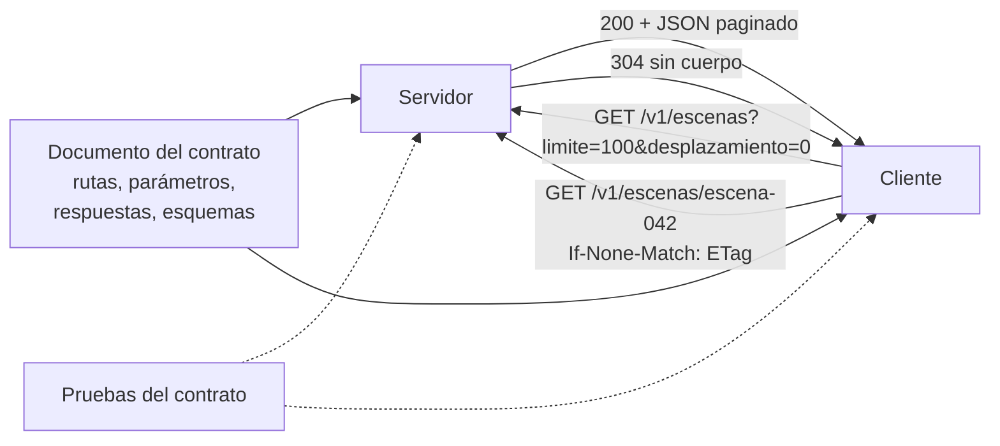

# B14-C31 — APIs de servicios de datos

<!-- nav:top -->
[🏠 Programa](../../../../README.md) · [📚 Bloque B14](../../../tronco-comun/B14-computacion-cientifica-y-ciencia-abierta.md) · [← Anterior: B14-C30 — Cadenas de procesamiento automatizado de datos](../B14-C30-cadenas-de-procesamiento-automatizado-de-datos/CLASE.md) · [Siguiente: B15-C01 — Series temporales discretas →](../../B15/B15-C01-series-temporales-discretas/CLASE.md)
<!-- /nav -->

## 1. Ubicación, nivel y alcance

Undécima y última clase de la ampliación programada del bloque B14. En [C29](../B14-C29-servicios-de-datos-geoespaciales-estandar-ogc/CLASE.md) publicaste datos con un servicio de mapas; en [C30](../B14-C30-cadenas-de-procesamiento-automatizado-de-datos/CLASE.md), los produces de forma continua. Falta la **interfaz programable** con la que otros sistemas piden esos datos: una API. El problema es de diseño: paginar, validar, responder con códigos claros y evitar transferencias inútiles. Nivel N2.

**Aviso de alcance:** la API del laboratorio es un **diseño propio, local y mínimo**, sin autenticación, límites de uso ni HTTPS. No sigue ninguna especificación. El documento descriptivo que genera es una **simplificación**, no un documento OpenAPI válido. Lo que digo de OpenAPI viene de la primera parte de su especificación, que leí (los primeros 100 000 de 348 845 caracteres); lo que digo de los códigos HTTP y de las cabeceras de caché es conocimiento general: el RFC 9110 no lo leí en esas secciones.

Verás recursos y rutas, paginación sin duplicados ni omisiones, filtros, validación de parámetros, códigos de estado, caché condicional con ETag, versionado de la ruta y documentación del contrato. No verás autenticación, límites de uso, escalado ni GraphQL.

## 2. Por qué esta clase existe

Tu catálogo de escenas tiene 250 000 ítems y un programa ajeno quiere recorrerlos. Si le entregas una lista de golpe, se cae; si cada petición repite lo que ya tiene, desperdicias ancho de banda; si cambia un parámetro y falla sin explicación, nadie sabe qué hizo mal. La pregunta motivadora es: **¿cómo diseño una API de datos que otros programas puedan usar sin mi ayuda y sin sorpresas?**

La decisión central es: **¿qué contrato ofrezco (rutas, parámetros, respuestas, errores) y cómo lo documento y verifico?** El contrato es la API; el código es un detalle.

## 3. Lo que podrás hacer al terminar

1. Definir recursos y rutas con versión.
2. Paginar con límite y desplazamiento y verificar que el recorrido no omite ni duplica.
3. Validar parámetros y devolver códigos de estado con mensajes en JSON.
4. Usar un ETag y la petición condicional para ahorrar transferencias.
5. Documentar el contrato y comprobar que las respuestas lo cumplen.
6. Declarar los límites de una API de demostración.

La evidencia es la **API documentada con pruebas** del ejercicio 12 (sección 20).

## 4. Con qué llegas y cómo comprobarlo

Necesitas C25 (ítems), C29 (servicio y errores), C11 (huellas) y JSON. Cinco preguntas:

1. ¿Qué es un recurso en una API?
2. ¿Qué diferencia hay entre `limite` y `desplazamiento`?
3. ¿Cuántas páginas de 100 hacen falta para 250 elementos? (3.)
4. ¿Qué es una suma de verificación? (C11)
5. ¿Qué es un contrato de una API?

<details>
<summary>Ver respuestas</summary>

1. Una entidad con dirección propia (una escena). 2. `limite` es cuántos elementos por página; `desplazamiento`, cuántos se saltan. 3. `⌈250/100⌉ = 3`. 4. Un resumen de bytes que identifica un contenido. 5. Lo que el servicio promete: rutas, parámetros, respuestas y errores.
</details>

Con cuatro o cinco aciertos, sigue; con tres o menos, repasa C29.

## 5. Un caso real: qué es OpenAPI

La especificación OpenAPI (S1) es un modo estándar e independiente del lenguaje de **describir APIs HTTP** que permite a personas y programas descubrir qué hace un servicio sin leer su código, otra documentación ni el tráfico de red. Un documento OpenAPI describe: rutas y operaciones (los puntos de acceso y los métodos HTTP de cada uno), parámetros (en la ruta, la consulta, las cabeceras o las cookies), cuerpos de petición y respuestas (con códigos de estado), esquemas de datos (basados en JSON Schema) y otros detalles (servidores, componentes reutilizables, seguridad). La versión más reciente que vi es la 3.2.1, de 10 de septiembre de 2026. Solo leí la primera parte de la especificación.

El **ejemplo conductor** es una API **local y sintética** de 250 escenas ficticias (`id`, `fecha`, `nubosidad_pct`), con rutas `/v1/escenas` (lista paginada con filtro) y `/v1/escenas/{id}` (un elemento con ETag).

## 6. Vocabulario

Una **API** (interfaz de programación) es el contrato por el que un programa pide datos a otro. Un **recurso** es una entidad direccionable. Una **ruta** es su dirección. **Paginar** es dividir una lista en páginas con `limite` y `desplazamiento`. Un **código de estado** resume el resultado: 200 (correcto), 304 (sin cambios), 400 (petición inválida), 404 (no existe) (significados generales). Un **ETag** es una etiqueta que identifica una versión de un recurso; con `If-None-Match`, el cliente pregunta «¿sigue siendo esta versión?» y el servidor responde 304 sin cuerpo si sí. El **versionado** (`/v1/`) permite cambiar la API sin romper a los clientes antiguos. Un **esquema** describe la forma de los datos.

## 7. Modelo mental: el contrato manda

El contrato dice qué se puede pedir y qué se recibirá; el servidor lo cumple y el cliente lo usa. La documentación se genera del contrato (o al revés), y las pruebas comprueban que ambos lados coinciden.



*Descripción textual:* un documento del contrato (rutas, parámetros, respuestas y esquemas) sirve tanto al servidor como al cliente. El cliente pide una página con límite y desplazamiento y recibe un 200 con JSON paginado; pide un elemento con la cabecera `If-None-Match` y, si no cambió, recibe 304 sin cuerpo. Las pruebas del contrato comprueban ambos lados.

**Analogía y su límite.** Un menú de restaurante: dice qué puedes pedir y qué recibirás. Límite: el menú no valida tu pedido; el servidor sí debe hacerlo.

## 8. La explicación, paso a paso

### 8.1 Recursos y rutas con versión

`/v1/escenas` es la colección y `/v1/escenas/{id}` un elemento. El prefijo `/v1/` permite lanzar `/v2/` sin romper a nadie: una petición a `/v2/escenas` da 404 «ruta desconocida» en el laboratorio.

### 8.2 Paginación correcta

La primera página con `limite=5` devuelve `total = 250` y 5 elementos. Recorrer con `limite=100` y desplazamientos 0, 100, 200 da **3 páginas, 250 escenas, 250 distintas, en el orden original**: sin omisiones ni duplicados. La prueba compara los identificadores con la lista completa. La paginación por desplazamiento es sensible a inserciones durante el recorrido (un elemento nuevo desplaza los siguientes); en una API con datos cambiantes se prefiere un cursor, que no se trata aquí.

### 8.3 Filtros y su verificación

`nubosidad_max=20` devuelve `total = 54` escenas, igual que un conteo independiente sobre la lista original (C18, C25). Un filtro mal escrito (`<` en vez de `≤`) se detecta así.

### 8.4 Validar parámetros

El servidor rechaza con 400 y un mensaje JSON: `limite = 0`, `limite = 1000` (máximo 100), `desplazamiento = −1`, `limite = abc` y `nubosidad_max = 150`. Un identificador inexistente da 404 y una ruta desconocida también. Un servicio que acepta `limite = 10⁹` se puede tumbar con una petición: el máximo es una defensa, no una molestia.

### 8.5 ETag y petición condicional

La respuesta de `/v1/escenas/escena-042` lleva `ETag: "c7eb868fbc6e529d"`, los primeros 16 caracteres del SHA-256 del cuerpo (C11). Si el cliente repite la petición con `If-None-Match` igual, recibe **304 sin cuerpo (0 bytes)**; con un valor distinto, recibe 200 con el cuerpo. La técnica ahorra transferencia cuando el recurso no cambió. (Lo que significan 304, ETag e `If-None-Match` es conocimiento general; el RFC 9110 solo lo vi de forma parcial y no lo uso como respaldo.)

### 8.6 El documento del contrato

El laboratorio publica en `/v1/documento` un JSON con las rutas (`/v1/escenas`, `/v1/escenas/{id}`), parámetros, respuestas y el esquema de una escena. Comprueba además que los 100 elementos de una página cumplen ese esquema. **No es un documento OpenAPI válido** (S1 define un formato con claves específicas que no usé); es una simplificación para mostrar la idea de que el contrato se escribe, se publica y se verifica.

## 9. Magnitudes, símbolos y unidades

| Concepto | Qué es | Unidad | Valor en el ejemplo |
|---|---|---|---|
| `total` | elementos que cumplen el filtro | conteo | 250; 54 con `nubosidad_max=20` |
| `limite` | elementos por página | conteo | 1 a 100 |
| `desplazamiento` | elementos saltados | conteo | 0, 100, 200 |
| `nubosidad_pct` | cobertura de nubes | % | `(i·7) mod 100` |
| ETag | etiqueta de versión | cadena | 16 caracteres hexadecimales |
| código de estado | resultado | entero | 200, 304, 400, 404 |

## 10. Convenciones y referencias

Datos **sintéticos**. Respuestas en JSON con claves ordenadas. Servidor en `127.0.0.1` y puerto efímero solo durante la ejecución. El diseño de rutas y parámetros es de esta clase. Versiones: Python 3.12.9.

## 11. De dónde sale lo que afirmamos

| ID | Fuente | Localizador | Respalda | Estado |
|---|---|---|---|---|
| S1 | OpenAPI Initiative, *OpenAPI Specification* | https://spec.openapis.org/oas/latest.html | Qué es OpenAPI y qué describe un documento (rutas, operaciones, parámetros, cuerpos y respuestas, esquemas, seguridad); versión 3.2.1 del 2026-09-10 | Leídos los primeros 100 000 de 348 845 caracteres el 2026-11-05 (mutable) |

Límites: el RFC 9110 no se leyó en las secciones de códigos de estado, ETag y peticiones condicionales; sus significados son conocimiento general; no consulté prácticas de paginación por cursor ni de límites de uso; el documento del laboratorio no es OpenAPI válido; la API no tiene autenticación ni HTTPS.

## 12. Cómo ver el resultado

Versión accesible.

| Petición | Resultado |
|---|---|
| `/v1/escenas?limite=5` | 200; total 250; 5 elementos |
| Recorrido con `limite=100` | 3 páginas; 250 escenas distintas; en orden |
| `nubosidad_max=20` | 200; total 54 (igual que el conteo independiente) |
| `/v1/escenas/escena-042` | 200; ETag `"c7eb868fbc6e529d"` |
| con `If-None-Match` igual | 304; 0 bytes |
| con `If-None-Match` distinto | 200 con cuerpo |
| `limite=0`, `1000`, `desplazamiento=-1`, `limite=abc`, `nubosidad_max=150` | 400 |
| `escena-999`, `/v2/escenas` | 404 |

## 13. Ejemplo trabajado: un cliente que no se pierde nada

1. **Lee** el documento del contrato: rutas y parámetros.
2. **Pide** la primera página (`limite=100`): 250 en total.
3. **Recorre** los desplazamientos 0, 100, 200: 3 páginas, 250 distintos.
4. **Comprueba** que el orden coincide con el original.
5. **Filtra** `nubosidad_max=20`: 54, igual que el conteo independiente.
6. **Pide** un elemento y guarda su ETag; la siguiente vez usa `If-None-Match`: 304.
7. **Prueba** los errores: 400 y 404 con mensaje.

**Paso final · incertidumbre.** Todo es correcto porque los datos no cambian durante el recorrido y hay un solo cliente. Con datos cambiantes, la paginación por desplazamiento puede omitir o repetir elementos; con muchos clientes, hacen falta límites de uso.

## 14. Comparación: archivo entero, API paginada y API con caché condicional

El **archivo entero** es simple y deja de ser viable con volúmenes grandes. La **API paginada** entrega por partes y permite filtros. La **caché condicional** evita retransmitir lo que no cambió. Cada capa añade complejidad y beneficios; para datos que cambian poco, la tercera paga.

## 15. Práctica guiada

**Ejercicio 1 · con los pasos.** ¿Cuántas páginas de 30 hacen falta para 250 elementos y cuántos elementos tiene la última? *Pasos:* `⌈250/30⌉` y el resto (sección 8.2).

<details><summary>Solución comentada</summary>

9 páginas (8 × 30 = 240); la última tiene 10 elementos.
</details>

**Ejercicio 2 · con una pista.** ¿Qué código devuelve `limite = 1000`? ¿Por qué hay un máximo? *Pista:* ¿qué pasaría con `10⁹`?

<details><summary>Solución comentada</summary>

400. El máximo protege al servidor de peticiones que lo saturan.
</details>

**Ejercicio 3 · casi autónomo.** ¿Qué devuelve la API con `If-None-Match` igual al ETag actual?

<details><summary>Solución comentada</summary>

304 sin cuerpo. El cliente reutiliza la copia que ya tiene.
</details>

## 16. Práctica autónoma, transferencia e integrador

**Ejercicio 4.** ¿Cuántas escenas tienen `nubosidad_pct` exactamente 0?

<details><summary>Solución comentada</summary>

`(i·7) mod 100 = 0` ⇔ `i` múltiplo de 100: `i = 0, 100, 200` → 3 escenas (de las 250).
</details>

**Ejercicio 5.** Un cliente pagina con desplazamiento mientras se insertan escenas al principio. ¿Qué ocurre?

<details><summary>Solución comentada</summary>

Los elementos se desplazan: alguno se repite en la página siguiente. La paginación por cursor (basada en un identificador estable) lo evita. No se trata aquí.
</details>

**Ejercicio 6.** ¿Para qué sirve el prefijo `/v1/`?

<details><summary>Solución comentada</summary>

Para evolucionar la API sin romper a los clientes: los cambios incompatibles van a `/v2/` y `/v1/` sigue funcionando un tiempo.
</details>

**Ejercicio 7.** Escribe la comprobación de que un recorrido paginado no omite ni duplica.

<details><summary>Solución comentada</summary>

Acumular los identificadores de todas las páginas y comprobar `len(ids) == total`, `len(set(ids)) == total` y que coincidan con la lista de referencia.
</details>

**Ejercicio 8.** ¿Qué debería incluir una respuesta de error para que el cliente la entienda?

<details><summary>Solución comentada</summary>

Código de estado adecuado, un mensaje legible y, si ayuda, datos del error (el parámetro, el máximo permitido), todo en JSON. El laboratorio devuelve `error` y datos extra como `limite_max`.
</details>

**Ejercicio 9 · transferencia.** Quieres añadir un campo nuevo a la escena. ¿Rompes a los clientes?

<details><summary>Solución comentada</summary>

Añadir un campo opcional suele ser compatible (los clientes que no lo conocen lo ignoran); cambiar o quitar uno existente no, y exige nueva versión. Hay que documentarlo en el contrato.
</details>

**Ejercicio 10 · transferencia.** Un cliente pide 100 veces la misma escena por minuto. ¿Qué puedes hacer?

<details><summary>Solución comentada</summary>

Fomentar `If-None-Match` (304 sin cuerpo), limitar la tasa de peticiones y recomendar caché local. Los límites de uso no se implementan aquí.
</details>

**Ejercicio 11 · transferencia.** ¿Qué falta para exponer esta API en Internet?

<details><summary>Solución comentada</summary>

HTTPS, autenticación y autorización si procede, límites de uso, registros y monitorización, validación más estricta, un documento de contrato estándar y pruebas de seguridad. Nada de eso se probó.
</details>

**Ejercicio 12 · integrador.** Entrega una **API documentada con pruebas**: rutas con versión, paginación verificada, filtro con conteo independiente, validación con códigos y mensajes, ETag y petición condicional, un documento del contrato con comprobación de esquema y la lista de lo que falta para producción.

<details><summary>Solución modelo</summary>

Debe incluir la tabla de la sección 12 con tus resultados, las pruebas de paginación, filtro, errores y 304, el documento del contrato y una declaración clara de límites (sin autenticación, HTTPS ni límites de uso; documento no OpenAPI, o la validación real). Se acepta cualquier conjunto sintético.
</details>

## 17. Laboratorio

El script [api_de_escenas.py](api_de_escenas.py) levanta la API local, comprueba la paginación sin duplicados, el filtro contra un conteo independiente, el esquema de los elementos, el ETag y el 304, siete casos de error y el documento del contrato.

**Datos:** sintéticos. **Predice antes de ejecutar:** ¿cuántos bytes tiene la respuesta 304? **Ejecución del 2026-11-05 (Python 3.12.9):**

```text
primera página: 200; total = 250; devueltos = 5
recorrido paginado: 3 páginas, 250 escenas, 250 distintas
filtro nubosidad_max=20: total = 54 (conteo independiente 54)
100 elementos de una página cumplen el esquema descrito
elemento escena-042: 200; ETag = "c7eb868fbc6e529d"
con If-None-Match igual: 304; cuerpo de 0 bytes
con If-None-Match distinto: 200 con cuerpo
error «limite 0»: 400 parámetro fuera de rango
error «limite 1000»: 400 parámetro fuera de rango
error «desplazamiento negativo»: 400 parámetro fuera de rango
error «no numérico»: 400 parámetro no numérico
error «nubosidad 150»: 400 parámetro fuera de rango
error «id inexistente»: 404 escena no encontrada
error «ruta desconocida»: 404 ruta desconocida
documento descriptivo: 200; rutas = ['/v1/escenas', '/v1/escenas/{id}']
Pruebas superadas.
```

```bash
python programa/clases/B14/B14-C31-apis-de-servicios-de-datos/api_de_escenas.py
```

**Límites:** un cliente; sin autenticación, HTTPS ni límites de uso; documento no OpenAPI; datos que no cambian durante el recorrido.

## 18. Errores frecuentes y cómo corregirlos

**No poner un máximo de página.** Se corrige con el ejercicio 2.

**Paginar sin verificar omisiones ni duplicados.** Se corrige con el ejercicio 7.

**Errores sin mensaje ni código adecuado.** Se corrige con el ejercicio 8.

**Cambiar campos sin versionar.** Se corrige con los ejercicios 6 y 9.

**Exponer sin seguridad.** Se corrige con el ejercicio 11.

## 19. Cómo sabrás que vas bien

Tras 8.2: ¿calculas las páginas de un recorrido? Si no, rehaz el ejercicio 1. Tras 8.5: ¿explicas el 304? Si no, rehaz el 3. Tras el ejemplo trabajado: ¿qué pasaría con datos cambiantes? Tras el laboratorio: ¿qué no es esta API? Al final: ¿qué documento del contrato publicarías?

## 20. Qué entregas y cómo se evalúa

El producto es tu **API documentada con pruebas** del ejercicio 12.

| Criterio | Inicial | En desarrollo | Logrado | Destacado |
|---|---|---|---|---|
| Contrato | Sin documentar | Lista de rutas | Rutas, parámetros, respuestas y esquema | Verificado contra las respuestas |
| Paginación y filtros | Sin límites | Paginación sin verificar | Sin duplicados ni omisiones | Con conteo independiente |
| Errores y caché | Sin códigos | Algunos códigos | 400/404 con mensajes y 304 | Con pruebas de cada caso |
| Fuentes y alcance | Sin fuente | Fuente sin alcance | Fuente con alcance | Declara lo no verificado y lo que falta |

**Condiciones críticas:** no exponer una API sin validar parámetros; no presentar el documento simplificado como OpenAPI válido; no afirmar seguridad sin haberla probado.

## 21. Ética, seguridad y límites

Una API expone datos y capacidad de cómputo a programas desconocidos: autenticación, autorización, límites y registros son imprescindibles antes de publicarla. Valida siempre la entrada, también contra inyección. Los datos personales requieren protección. Accesibilidad: mensajes de error legibles. Material educativo.

## 22. Para cerrar y seguir

Una API de datos es un contrato: rutas con versión, paginación verificada, filtros comprobados, validación con códigos y mensajes, caché condicional y un documento que se publica y se prueba. En el experimento, 250 escenas en 3 páginas sin duplicados, 54 con el filtro, y un 304 de 0 bytes. Con esto se cierra la ampliación programada del bloque B14. Queda abierta una pregunta: ¿cómo paginarías datos que cambian mientras se recorren?

**Glosario español–inglés.** interfaz de programación · *application programming interface (API)*; recurso · *resource*; ruta · *route / endpoint*; paginación · *pagination*; código de estado · *status code*; etiqueta de entidad · *entity tag (ETag)*; petición condicional · *conditional request*; contrato · *contract*.

**Continuidad.** Con esta clase termina la ampliación programada de B14; B14-C20 integra las prácticas de reproducibilidad del bloque, y los bloques de observación terrestre usan estas APIs como interfaz de entrega.

**Referencias:** ver sección 11.

<!-- nav:bottom -->
---

[← Anterior: B14-C30 — Cadenas de procesamiento automatizado de datos](../B14-C30-cadenas-de-procesamiento-automatizado-de-datos/CLASE.md) · [📚 Bloque B14](../../../tronco-comun/B14-computacion-cientifica-y-ciencia-abierta.md) · [Siguiente: B15-C01 — Series temporales discretas →](../../B15/B15-C01-series-temporales-discretas/CLASE.md)
<!-- /nav -->
