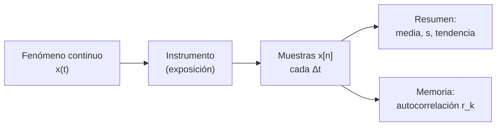

# B15-C01 — Series temporales discretas

<!-- nav:top -->
[🏠 Programa](../../../../README.md) · [📚 Bloque B15](../../../tronco-comun/B15-senales-imagenes-y-estimacion-cientifica.md) · [← Anterior: B14-C31 — APIs de servicios de datos](../../../tronco-comun/B14-computacion-cientifica-y-ciencia-abierta.md#b14-c31) · [Siguiente: B15-C02 — Muestreo y aliasing →](../B15-C02-muestreo-y-aliasing/CLASE.md)
<!-- /nav -->

## 1. Ubicación, nivel y alcance

Primera clase del bloque B15. Aquí aprendes a tratar una medición que se repite en el tiempo como una **lista ordenada de números** con una regla clara para el instante de cada uno: la serie temporal discreta. Nivel N2. Verás cómo se construye el eje del tiempo, qué resumen estadístico describe la serie, cómo se quita una tendencia y cómo se mide si la serie «se acuerda de sí misma» (autocorrelación). Usas cálculo elemental ([B09](../../../tronco-comun/B09-calculo-diferencial-e-integral.md)) y la idea de incertidumbre de [B01-C18](../../B01/B01-C18-incertidumbre-y-errores-elementales/CLASE.md). No verás todavía por qué el muestreo puede engañar (C02), ni la descomposición en frecuencias (C04).

## 2. Por qué esta clase existe

Un telescopio espacial mide el brillo de una estrella cada dos minutos durante semanas. Lo que llega a tierra no es una curva continua, sino una tabla de números. Esa tabla puede ocultar una rotación de la estrella, el paso de un planeta, una deriva del instrumento y un hueco por la descarga de datos. Antes de aplicar cualquier técnica avanzada hay que saber **qué es exactamente esa tabla**: cuándo se tomó cada valor, qué lo resume, qué le falta y qué trozo es señal y qué trozo es tendencia.

La decisión central: **¿cómo describo una serie para no confundir un artefacto de la toma de datos con un fenómeno del cielo?**

## 3. Lo que podrás hacer al terminar

1. Construir el eje de tiempo `tₙ = t₀ + n Δt` de una serie y calcular su frecuencia de muestreo.
2. Calcular media, varianza y desviación estándar de una serie corta a mano.
3. Quitar una tendencia lineal por mínimos cuadrados y reconocer cuándo el ajuste se contamina.
4. Calcular la autocorrelación a un retardo dado y leer qué periodicidad sugiere.
5. Identificar huecos y calcular qué fracción de la serie falta.
6. Comprobar un código de análisis contra casos con respuesta exacta.

La evidencia es la **ficha de una serie temporal** del ejercicio 12 (sección 20).

## 4. Con qué llegas y cómo comprobarlo

Necesitas sumas, promedios y la gráfica de una recta. Cinco preguntas:

1. ¿Cuánto es `(2 + 4 + 9)/3`?
2. Si una recta pasa por `(0, 1)` y `(2, 5)`, ¿cuál es su pendiente?
3. ¿Cuántos segundos hay en 7 días?
4. ¿Cuánto es `0,15²`?
5. Si tomas un dato cada 120 s, ¿cuántos datos hay en una hora?

<details>
<summary>Ver respuestas</summary>

1. 5. 2. 2. 3. 604 800 s. 4. 0,0225. 5. 30.
</details>

Con cuatro o cinco aciertos, sigue; si no, repasa B03-C06 y B03-C16.

## 5. Un caso real: la cadencia de TESS

El telescopio espacial TESS entrega, para los objetivos elegidos, datos con una cadencia de unos 2 minutos, y para las imágenes completas del campo, una lectura aproximadamente cada 30 minutos (S1, según el texto de MAST consultado). Una estrella con manchas que rota cada pocos días produce una modulación periódica de su brillo; el Sol, de referencia, tiene un periodo de rotación sidérea de 609,12 h a 16° de latitud (S3), es decir, 25,38 días, y su rotación varía con la latitud. En esta clase construimos una **curva de luz sintética** —ficticia, no observada— con esa cadencia de 2 minutos, 7 días de duración, una modulación de 2,5 días, una deriva lenta y un hueco de 12 horas. Es el **ejemplo conductor**.

## 6. Vocabulario

Una **serie temporal discreta** es una sucesión de valores `x[n]`, con `n = 0, 1, 2, …`, tomados en instantes ordenados. La **cadencia** `Δt` es el intervalo entre muestras consecutivas. La **frecuencia de muestreo** `f_s = 1/Δt` es cuántas muestras hay por unidad de tiempo. La **media** `x̄` es el promedio; la **varianza muestral** `s²` mide cuánto se dispersan los datos alrededor de la media; la **desviación estándar** `s` es su raíz. Una **tendencia** es una variación lenta de fondo, no periódica. El **ruido** es la parte de la serie que no se explica con el modelo. La **autocorrelación** `r_k` mide cuánto se parece la serie a sí misma desplazada `k` muestras; el número `k` es el **retardo** (en inglés *lag*). Un **hueco** (*gap*) es un tramo sin datos. Estas definiciones son las habituales en el análisis de series; la de autocorrelación sigue la forma muestral de S2.

## 7. Modelo mental: una película de fotogramas

Una serie discreta es una película: la escena real cambia de forma continua, pero solo conservas fotogramas a intervalos fijos. Lo que no cae en un fotograma, no existe para tu análisis. Analogía: los fotogramas de una película. Su límite: en una película los fotogramas pueden tener duración propia; en una serie científica cada valor suele ser un promedio sobre un tiempo de exposición, no un instante puntual.



*Descripción textual:* el fenómeno continuo pasa por un instrumento que lo promedia durante la exposición y entrega muestras equiespaciadas; sobre ellas se calculan un resumen (media, dispersión, tendencia) y una medida de memoria (autocorrelación).

## 8. La explicación, paso a paso

### 8.1 De lo continuo a lo discreto

Si `x(t)` es el brillo en el instante `t`, la serie es `x[n] = x(t₀ + n Δt)`. El símbolo `t₀` es el instante de la primera muestra y `n` es un entero. Conviene guardar siempre el **instante** de cada dato, no solo su posición `n`, porque con huecos la posición engaña. Declara además la **escala de tiempo** (por ejemplo, UTC o un tiempo baricéntrico): es el tema de [B13](../../../tronco-comun/B13-metrologia-tiempo-y-mediciones-cientificas.md).

### 8.2 Cadencia y frecuencia de muestreo

Con `Δt = 120 s`, `f_s = 1/120 s = 8,333 mHz = 720 muestras por día`. Hay 5040 muestras en 7 días. La frecuencia más alta que podrás distinguir es `f_s/2 = 360 ciclos por día`; la razón se explica en C02.

### 8.3 Resumen estadístico

La media es `x̄ = (1/N) Σ x[n]`. La varianza muestral es `s² = [1/(N − 1)] Σ (x[n] − x̄)²`; dividir por `N − 1` en vez de `N` corrige el sesgo cuando la media también se estimó con los mismos datos (corrección que se justifica en B12-C07). La desviación estándar `s` tiene las unidades del dato.

### 8.4 Tendencia

Una deriva lenta (por ejemplo, el instrumento se enfría) se modela con una recta `a + b t`. Los coeficientes se eligen para minimizar la suma de los cuadrados de los residuos; el método general es de B10-C07 y B15-C16. Se resta la recta y queda la serie «sin tendencia». **Cuidado:** si hay una oscilación que no completa ciclos enteros en el tramo, el ajuste atribuye parte de ella a la recta. En el laboratorio, la pendiente real es `−1,000 × 10⁻⁴` por día y el ajuste da `−2,238 × 10⁻⁴`: la modulación de 2,5 días contamina una ventana de 7 días (2,8 periodos) y el hueco empeora el efecto.

### 8.5 Autocorrelación

Con la media `x̄`, la autocorrelación muestral al retardo `k` es

`r_k = Σ_{n=0}^{N−k−1} (x[n] − x̄)(x[n+k] − x̄) / Σ_{n=0}^{N−1} (x[n] − x̄)²`.

`r_0 = 1` siempre. Un valor cercano a +1 dice que, `k` muestras después, la serie se parece mucho; cerca de −1, que está en oposición; cerca de 0, que no hay relación lineal. Si la serie es una oscilación de periodo `P` muestras, `r_k` es alta en `k = P`, negativa en `k = P/2`. Una serie de ruido blanco (C03) da valores cercanos a 0 para `k ≥ 1`. La autocorrelación es una herramienta de S2 para detectar no aleatoriedad.

### 8.6 Huecos

Los huecos rompen la regla `tₙ = t₀ + n Δt`. Hay tres respuestas posibles: usar los instantes reales y métodos que admiten muestreo irregular (C06), rellenar con interpolación declarando que es relleno (C19), o recortar la serie a tramos continuos. Lo que no debe hacerse es olvidar el hueco y tratar la serie como equiespaciada.

## 9. Magnitudes, símbolos y unidades

| Símbolo | Qué es | Unidad | Nota |
|---|---|---|---|
| `x[n]` | brillo normalizado | adimensional | flujo relativo a la mediana |
| `t₀`, `tₙ` | instante inicial y del dato `n` | s o d | escala de tiempo declarada |
| `Δt` | cadencia | s | 120 s en el ejemplo |
| `f_s` | frecuencia de muestreo | Hz, ciclos/d | `1/Δt` |
| `x̄`, `s` | media y desviación estándar | las de `x` | `s` con `N − 1` |
| `r_k` | autocorrelación | adimensional | `−1 ≤ r_k ≤ 1` |
| `k` | retardo | muestras | tiempo = `k Δt` |

## 10. Convenciones y referencias

Índice `n` desde 0. Tiempo en días para periodos largos y en segundos para cadencias. Las curvas de luz se normalizan dividiendo por una mediana. Todas las cifras de la curva del laboratorio son **sintéticas**; las cadencias de TESS y la rotación solar son datos publicados con pocas cifras.

## 11. De dónde sale lo que afirmamos

| ID | Fuente | Localizador | Respalda | Estado |
|---|---|---|---|---|
| S1 | MAST/STScI, *TESS* (página de la misión) | https://archive.stsci.edu/missions-and-data/tess | Datos de objetivos con cadencia aproximada de 2 min; imágenes completas aproximadamente cada 30 min (según esa página) | Consultada el 2026-11-05 mediante extracción automática |
| S2 | NIST/SEMATECH, *e-Handbook of Statistical Methods*, §1.3.5.12 «Autocorrelation» | https://www.itl.nist.gov/div898/handbook/eda/section3/eda35c.htm | Autocorrelación al retardo k para datos equiespaciados; uso para detectar no aleatoriedad | Consultada el 2026-11-05 mediante extracción automática |
| S3 | NASA/NSSDC, *Sun Fact Sheet* (actualizada 2024-05-09) | https://nssdc.gsfc.nasa.gov/planetary/factsheet/sunfact.html | Periodo de rotación sidérea 609,12 h a 16° de latitud | Consultada el 2026-11-05 mediante extracción automática |
| S4 | NASA/HEASARC, *TESS* (portal de la misión) | https://heasarc.gsfc.nasa.gov/docs/tess/ | Cada sector de observación dura aproximadamente 27 días (noticia «TESS Cycle 10 pointings»; ver ejercicio 4) | Consultada el 2026-11-05 mediante extracción automática |

Límites: la fórmula de `r_k` y la corrección `N − 1` se enseñan como resultados estándar; no se reprodujo el texto de S2. Los datos del laboratorio son sintéticos.

## 12. Cómo ver una serie

Equivalente accesible a una gráfica de la curva sintética (valores del laboratorio):

| Cantidad | Valor |
|---|---|
| Muestras totales / con datos | 5040 / 4680 (faltan 360, 7,1 %) |
| Media | 0,999 728 |
| Desviación estándar | 0,001 557 |
| Tras quitar la recta ajustada | 0,001 484 |

Descripción larga: la curva sube y baja suavemente con un periodo de 2,5 días y amplitud pico de 0,002 sobre un nivel cercano a 1; el ruido añade un temblor de 0,0005; entre los días 3,0 y 3,5 no hay puntos.

## 13. Ejemplo trabajado: una serie de ocho muestras

**Paso 1 · Datos (sintéticos).** `x = [1,0; 1,2; 1,1; 0,9; 1,0; 1,2; 1,1; 0,9]`, una cada 120 s. Parecen repetirse cada 4 muestras (480 s).

**Paso 2 · Media.** `x̄ = 8,4/8 = 1,05`.

**Paso 3 · Desviaciones.** `[−0,05; +0,15; +0,05; −0,15; −0,05; +0,15; +0,05; −0,15]`. Suma de cuadrados: `2 × (0,0025 + 0,0225 + 0,0025 + 0,0225) = 0,1`.

**Paso 4 · Desviación estándar.** `s² = 0,1/7 = 0,014 29`; `s = 0,1195`.

**Paso 5 · Autocorrelación.** Para `k = 1`, la suma de productos es `−0,0075` → `r₁ = −0,075`. Para `k = 2`, `−0,075` → `r₂ = −0,75`. Para `k = 4`, `0,05` → `r₄ = +0,5`.

**Paso 6 · Lectura.** `r₄` es positivo y `r₂` muy negativo: la serie se repite cada 4 muestras. El valor de `r₄` es 0,5 y no 1 porque solo hay `N − k = 4` pares de ocho: el estimador está atenuado por el factor `(N − k)/N = 0,5`.

## 14. Distintas formas de resumir una serie

Con **estadísticos globales** (media, `s`) resumes la serie pero pierdes el orden en el tiempo: dos series con los mismos números en distinto orden dan lo mismo. Con la **gráfica** ves el orden, pero la lectura es subjetiva. Con la **autocorrelación** cuantificas el orden. Las tres miradas se complementan; ninguna sustituye a las otras.

## 15. Práctica guiada

**Ejercicio 1 · con los pasos indicados.** Una serie tiene `Δt = 30 min` y 96 muestras. ¿Cuánto dura, cuál es `f_s` en ciclos por día y cuál su frecuencia máxima distinguible (según 8.2)?

<details><summary>Solución comentada</summary>

Dura `96 × 30 min = 48 h = 2 d` (más exactamente, de la primera a la última hay 95 intervalos). `f_s = 48` ciclos/día; el máximo distinguible es 24 ciclos/día (8.2).
</details>

**Ejercicio 2 · con una pista.** Calcula media y desviación estándar de `[2; 4; 4; 4; 5; 5; 7; 9]` con `N − 1`. *Pista:* la media es 5.

<details><summary>Solución comentada</summary>

Desviaciones: `−3, −1, −1, −1, 0, 0, 2, 4`; cuadrados: `9+1+1+1+0+0+4+16 = 32`. `s² = 32/7 = 4,571`; `s = 2,138` (8.3). Con `N` daría `2`.
</details>

**Ejercicio 3 · casi autónomo.** Para `x = [1; −1; 1; −1; 1; −1]` calcula `r₁` y `r₂`.

<details><summary>Solución comentada</summary>

Media 0; suma de cuadrados 6. Para `k = 1`: cinco productos de `−1`, suma `−5`, `r₁ = −5/6 = −0,833`. Para `k = 2`: cuatro productos de `+1`, `r₂ = 4/6 = 0,667` (8.5). Alterna el signo: periodo de 2 muestras.
</details>

## 16. Práctica autónoma, transferencia e integrador

**Ejercicio 4.** ¿Cuántas muestras hay en 27 días con cadencia de 2 min?

<details><summary>Solución comentada</summary>

`27 × 720 = 19 440` (8.2). Es el orden de una serie de un sector de TESS, que según la página de la misión (S4) dura aproximadamente 27 días.
</details>

**Ejercicio 5.** Dos series, `[1; 2; 3; 4]` y `[3; 1; 4; 2]`, tienen la misma media y la misma `s`. Calcula `r₁` de cada una (usa la fórmula de 8.5) y di qué te muestra.

<details><summary>Solución comentada</summary>

Media 2,5; desviaciones `[−1,5; −0,5; 0,5; 1,5]` y `[0,5; −1,5; 1,5; −0,5]`; suma de cuadrados 5. Primera: `(0,75 − 0,25 + 0,75)/5 = 0,25`. Segunda: `(−0,75 − 2,25 − 0,75)/5 = −0,75`. Mismos estadísticos globales, memoria opuesta (14).
</details>

**Ejercicio 6.** En el laboratorio, `r_k` en un periodo completo (`k = 1800`) vale `+0,559` y en medio periodo `−0,739`. ¿Qué periodo en días sugieren? ¿Por qué `+0,559` y no `+1`?

<details><summary>Solución comentada</summary>

`k = 1800` muestras × 120 s = 2,5 d. No llega a 1 por el ruido (reduce la correlación) y por el factor de atenuación `(N − k)/N`, que con `N = 5040` vale `0,64` (13, paso 6).
</details>

**Ejercicio 7.** Quita la recta `x = 3 − 0,5 t` de la serie `[3; 2,5; 2; 1,5]` en `t = 0, 1, 2, 3`. ¿Qué queda?

<details><summary>Solución comentada</summary>

Resta `3; 2,5; 2; 1,5`: residuo `[0; 0; 0; 0]` (8.4). La serie era una recta pura.
</details>

**Ejercicio 8.** Una serie tiene 4680 muestras válidas de 5040 posibles. ¿Qué fracción falta? ¿Puedes calcular `r_k` sumando solo los pares disponibles sin cuidado? Razona.

<details><summary>Solución comentada</summary>

Faltan `360/5040 = 7,1 %`. Con huecos, `x[n+k]` puede caer dentro del hueco: hay que descartar esos pares y normalizar por los pares usados, o usar métodos para muestreo irregular (8.6).
</details>

**Ejercicio 9 · transferencia.** El Sol rota con 609,12 h de periodo sidéreo (S3). Con cadencia de 30 min, ¿cuántas muestras hay por rotación? ¿Y con 2 min?

<details><summary>Solución comentada</summary>

`609,12 h / 0,5 h = 1218` muestras; con 2 min (`1/30 h`): `609,12 × 30 = 18 274`. Más muestras por periodo permiten ver la forma de la modulación, no solo su existencia.
</details>

**Ejercicio 10 · transferencia.** Un colega afirma: «mi serie tiene `r₁ = 0,95`, así que cada dato es casi independiente de los demás». Evalúa la afirmación.

<details><summary>Solución comentada</summary>

Es lo contrario: `r₁` alto significa que datos vecinos se parecen mucho, es decir, **no** son independientes (8.5). Promediar `N` datos así reduce el error mucho menos que `1/√N` (se verá en C03).
</details>

**Ejercicio 11 · transferencia.** Si ajustas una recta a 2,8 periodos de una oscilación, ¿por qué la pendiente sale distinta de la deriva real? Propón dos remedios.

<details><summary>Solución comentada</summary>

Porque la parte no completada del último ciclo tiene media distinta de cero y el ajuste la absorbe (8.4). Remedios: ajustar tendencia y oscilación a la vez (C16), o usar una ventana con ciclos enteros.
</details>

**Ejercicio 12 · integrador.** Elabora la *ficha de una serie temporal* para la curva sintética: cadencia, duración, `f_s`, muestras, fracción de huecos, media, `s`, pendiente ajustada y su discrepancia con la real, y `r_k` en medio y un periodo, con una frase de lectura y la fuente de cada dato publicado.

<details><summary>Solución modelo</summary>

Ficha con: `Δt = 120 s`; 7 d; 8,333 mHz (720/d); 5040 muestras y 4680 válidas (7,1 % de huecos); `x̄ = 0,999 728`, `s = 0,001 557`; pendiente `−2,238 × 10⁻⁴/d` frente a `−1,000 × 10⁻⁴/d` (discrepancia por contaminación de la modulación, 8.4); `r₉₀₀ = −0,739`, `r₁₈₀₀ = +0,559` ⇒ periodo 2,5 d. Fuentes S1–S3 con fecha; datos rotulados como sintéticos.
</details>

## 17. Laboratorio: serie sintética, tendencia y autocorrelación

El script [serie_discreta.py](serie_discreta.py) comprueba la autocorrelación contra el resultado analítico de un seno puro (`r_k = (1 − k/N) cos(2πk/P)`), verifica que el ajuste lineal recupera una recta exacta y construye la curva sintética de 7 días con un hueco.

**Datos:** sintéticos, semilla 15001. **Predice antes de ejecutar:** ¿la pendiente ajustada será igual a la real? (No: la modulación la contamina.) **Ejecución del 2026-11-05 (Python 3.12.9, NumPy 2.4.4):**

```text
  prueba seno: r_100 = +0.9500 (analítico +0.9500)
  prueba seno: r_50 = -0.9750 (analítico -0.9750)
  prueba seno: r_25 = +0.0079 (analítico +0.0000)
muestras: 5040, con hueco: 4680, faltan 360 (7.1 %)
frecuencia de muestreo = 8.333 mHz = 720 muestras/día; Nyquist = 360 ciclos/día
media = 0.999728; desviación estándar = 0.001557
tendencia ajustada: -2.238e-4 por día (real -1.000e-4); orden en origen 1.000379
desviación estándar tras quitar tendencia = 0.001484
r_k en medio periodo (k=900) = -0.739;  en un periodo (k=1800) = +0.559
Pruebas superadas.
```

```bash
python programa/clases/B15/B15-C01-series-temporales-discretas/serie_discreta.py
```

**Límites:** ruido blanco gaussiano, un solo periodo, sin tránsitos; el estimador de `r_k` aquí no descarta los pares que caen en el hueco (se discute en el ejercicio 8).

## 18. Errores frecuentes y cómo corregirlos

**Usar el índice `n` como si fuera tiempo.** Con huecos o cadencia variable, el tiempo real manda. Se corrige con el ejercicio 8.

**Creer que una media y una `s` iguales significan series iguales.** Se corrige con el ejercicio 5.

**Interpretar `r_k` alto como independencia.** Se corrige con el ejercicio 10.

**Ajustar una tendencia sobre una ventana que no contiene ciclos enteros.** Se corrige con el ejercicio 11.

**Dividir por `N` o por `N − 1` sin saber por qué.** Se corrige con el ejercicio 2.

## 19. Cómo sabrás que vas bien

Tras 8.2: ¿calculas `f_s` y el máximo distinguible sin mirar? Si no, ejercicio 1. Tras 8.5: ¿puedes decir qué `r_k` esperarías en una oscilación de periodo 4? Si no, ejercicio 3. Tras el laboratorio: ¿por qué la pendiente salió el doble de la real? Si no lo explicas, ejercicio 11.

## 20. Qué entregas y cómo se evalúa

El producto es tu **ficha de una serie temporal** (ejercicio 12).

| Criterio | Inicial | En desarrollo | Logrado | Destacado |
|---|---|---|---|---|
| Eje de tiempo | Usa solo `n` | Cadencia sin unidades | Instantes y `f_s` correctos | Declara escala de tiempo y huecos |
| Cálculo | Errores frecuentes | Algunos errores | Correcto con unidades | Comprueba con un caso analítico |
| Autocorrelación | No la usa | La calcula sin leer | Lee periodo y signo | Explica la atenuación `(N − k)/N` |
| Tendencia | Ignorada | Resta sin comprobar | Resta y discute | Detecta la contaminación |
| Fuentes y rótulos | Sin fuente | Sin fecha | Con localizador y fecha | Rotula sintético vs publicado |

**Condiciones críticas (no se compensan con promedio):** no presentar la curva sintética como observada; declarar los huecos; citar solo fuentes consultadas.

## 21. Ética, seguridad y límites

Una serie sintética sirve para aprender y probar código, no para afirmar nada sobre una estrella real. Si usas datos reales de una misión, cita la versión del producto y respeta su licencia. Accesibilidad: todas las cifras tienen tabla equivalente y el laboratorio funciona sin conexión.

## 22. Para cerrar y seguir

Una serie discreta es una tabla de valores con instantes; se resume con media, dispersión y tendencia y se interroga con la autocorrelación; los huecos y las ventanas cortas pueden contaminar los resultados. Queda abierta una pregunta: ¿qué pasa si la oscilación real es más rápida que la mitad de la frecuencia de muestreo?

**Glosario español–inglés.** serie temporal · *time series*; cadencia · *cadence*; frecuencia de muestreo · *sampling rate*; tendencia · *trend*; autocorrelación · *autocorrelation*; retardo · *lag*; hueco · *gap*; desviación estándar · *standard deviation*.

**Continuidad.** B15-C02 reutiliza tu manejo de `Δt`, `f_s` y la frecuencia máxima distinguible para explicar el **aliasing**.

**Referencias:** ver sección 11.

<!-- nav:bottom -->
---

[← Anterior: B14-C31 — APIs de servicios de datos](../../../tronco-comun/B14-computacion-cientifica-y-ciencia-abierta.md#b14-c31) · [📚 Bloque B15](../../../tronco-comun/B15-senales-imagenes-y-estimacion-cientifica.md) · [Siguiente: B15-C02 — Muestreo y aliasing →](../B15-C02-muestreo-y-aliasing/CLASE.md)
<!-- /nav -->
