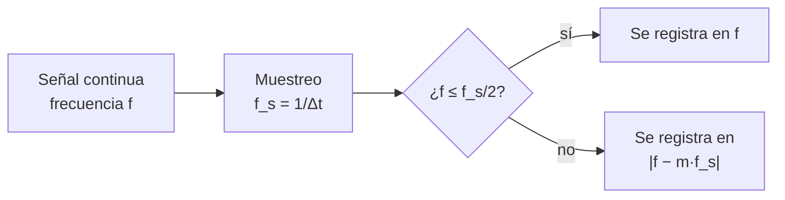

# B15-C02 — Muestreo y aliasing

<!-- nav:top -->
[🏠 Programa](../../../../README.md) · [📚 Bloque B15](../../../tronco-comun/B15-senales-imagenes-y-estimacion-cientifica.md) · [← Anterior: B15-C01 — Series temporales discretas](../B15-C01-series-temporales-discretas/CLASE.md) · [Siguiente: B15-C03 — Ruido blanco y coloreado →](../B15-C03-ruido-blanco-y-coloreado/CLASE.md)
<!-- /nav -->

## 1. Ubicación, nivel y alcance

Segunda clase del bloque B15. En la [clase anterior](../B15-C01-series-temporales-discretas/CLASE.md) construiste una serie con cadencia `Δt` y viste que existe una frecuencia máxima distinguible. Aquí aprendes **por qué** existe, qué pasa con las oscilaciones más rápidas (no desaparecen: se disfrazan) y cómo planificar una toma de datos para evitarlo. Nivel N2. Usas la idea de periodo y frecuencia de B05 y funciones seno/coseno de B04. No verás la transformada de Fourier completa (C04) ni filtros digitales (C07).

## 2. Por qué esta clase existe

Un detector que mide una estrella cada 2 minutos no puede ver directamente algo que oscila cada 3 minutos con precisión, pero tampoco lo ignora: ese movimiento rápido queda registrado como una oscilación **lenta y falsa**. Si no sabes que eso ocurre, publicarías un periodo que no existe. Planificar la cadencia de una misión, o interpretar una tabla de datos, exige saber qué frecuencias son confiables.

La decisión central: **¿qué cadencia necesito, y cómo sé si una frecuencia que veo es real o un alias?**

## 3. Lo que podrás hacer al terminar

1. Calcular la frecuencia de Nyquist de una serie a partir de su cadencia.
2. Predecir la frecuencia aparente (alias) de una oscilación más rápida que Nyquist.
3. Explicar con una igualdad trigonométrica por qué dos frecuencias distintas producen las mismas muestras.
4. Decidir la cadencia mínima para observar una frecuencia dada.
5. Valorar qué hace y qué no hace la integración de la exposición como filtro.
6. Verificar con un script que la frecuencia aparente coincide con la predicción.

La evidencia es la **tabla de aliasing verificada** del ejercicio 12 (sección 20).

## 4. Con qué llegas y cómo comprobarlo

Necesitas frecuencia, periodo y la función coseno. Cinco preguntas:

1. Un fenómeno tiene periodo 0,5 d. ¿Cuál es su frecuencia en ciclos por día?
2. ¿Cuánto es `cos(0)`? ¿Y `cos(2π)`?
3. ¿Cuántos ciclos por día hay en 1 mHz?
4. Para `Δt = 120 s`, ¿cuál es `f_s` en ciclos por día (C01, 8.2)?
5. ¿Cuánto es `|400 − 720|`?

<details>
<summary>Ver respuestas</summary>

1. 2 ciclos/d. 2. 1 y 1. 3. 86,4 ciclos/d. 4. 720. 5. 320.
</details>

Con cuatro o cinco aciertos, sigue; si no, repasa [B15-C01](../B15-C01-series-temporales-discretas/CLASE.md) y B05.

## 5. Un caso real: dos cadencias de TESS

Según la página de MAST consultada (S1), TESS entrega datos de objetivos con cadencia de unos 2 minutos y lee las imágenes completas aproximadamente cada 30 minutos. Eso fija dos frecuencias de Nyquist muy distintas: 360 ciclos por día para 2 min y 24 ciclos por día para 30 min. Una pulsación de 30 ciclos por día (periodo de 48 min) se ve bien con la cadencia de 2 min, pero en las imágenes completas aparece en 18 ciclos por día. Todo el análisis de esta clase usa **señales sintéticas** con esas cadencias; no son observaciones de ninguna estrella. Es el **ejemplo conductor**.

## 6. Vocabulario

El **muestreo** es tomar valores de una señal continua a intervalos regulares `Δt`. La **frecuencia de muestreo** es `f_s = 1/Δt`. La **frecuencia de Nyquist** es `f_N = f_s/2`, el límite superior de las frecuencias distinguibles; el valor `0,5 ciclos por observación` que describe S2 es el mismo límite expresado en ciclos por muestra. El **aliasing** (en español, *solapamiento* o *alias*) es el fenómeno por el cual una frecuencia por encima de `f_N` aparece como otra, más baja. El **filtro antialias** es un filtro aplicado antes de muestrear que elimina lo que está por encima de `f_N`. Un **ciclo por día** (c/d) es una unidad de frecuencia: 1 c/d = 11,574 µHz.

## 7. Modelo mental: la rueda de carreta en el cine

En una película, una rueda que gira rápido parece girar despacio o hacia atrás: la cámara toma fotogramas a intervalos fijos, y entre uno y otro la rueda avanza casi una vuelta completa. Lo que ves es la diferencia. Analogía: la rueda de carreta. Su límite: en la película solo importa el cambio de ángulo de una rueda; en una señal real las frecuencias sobre Nyquist se suman a las de abajo y no puedes separarlas después.



*Descripción textual:* una señal de frecuencia `f` se muestrea; si `f` no supera la mitad de `f_s`, queda registrada en `f`; si la supera, queda registrada en `|f − m f_s|`, con el entero `m` que la deja entre 0 y `f_s/2`.

## 8. La explicación, paso a paso

### 8.1 Muestrear una senoide

Una senoide de frecuencia `f` vale `cos(2π f t + φ)`, con `φ` la fase. Muestreada en `tₙ = n Δt` da `x[n] = cos(2π f n Δt + φ)`. El número `f Δt = f/f_s` es la frecuencia en **ciclos por muestra**.

### 8.2 La igualdad que lo explica

Para cualquier entero `m`, `cos(2π (f + m f_s) n Δt + φ) = cos(2π f n Δt + 2π m n + φ) = cos(2π f n Δt + φ)`, porque `2π m n` es un múltiplo entero de `2π`. Así, las frecuencias `f`, `f + f_s`, `f − f_s`, … producen **exactamente las mismas muestras**. Con esas muestras no hay manera de saber cuál fue la verdadera.

### 8.3 La frecuencia de Nyquist y la fórmula del alias

Como también `cos(−θ) = cos θ`, `f` y `−f` son indistinguibles. Combinando ambas cosas, toda frecuencia queda representada por una única en el intervalo `[0, f_s/2]`. La frecuencia aparente es `f_alias = |f − m f_s|`, con `m` el entero más cercano a `f/f_s`. En la práctica: calcula el resto `r = f mod f_s` y toma el menor entre `r` y `f_s − r`.

### 8.4 Las dos cadencias

Con `Δt = 120 s`: `f_s = 720 c/d`, `f_N = 360 c/d`. Una señal de 400 c/d: `400 mod 720 = 400`; el menor entre 400 y 320 es **320**. Con `Δt = 30 min`: `f_s = 48 c/d`, `f_N = 24 c/d`; una señal de 30 c/d: `30 mod 48 = 30`; el menor entre 30 y 18 es **18**.

### 8.5 Cómo evitarlo

Hay tres vías. La primera: **muestrear más rápido** (`f_s > 2 f_máx`). La segunda: **filtrar antes de muestrear** con un filtro antialias analógico u óptico. La tercera: **muestrear de forma irregular**, porque el alias exacto exige tiempos equiespaciados (C06). La exposición de cada muestra promedia la señal durante `Δt`, lo que atenúa las frecuencias altas, pero poco: un promedio sobre una ventana de duración `T` multiplica la amplitud de una senoide de frecuencia `f` por `|sen(π f T)/(π f T)|` (resultado estándar del promedio sobre una ventana rectangular). Con `T = 120 s` y `f = 400 c/d`, `f T = 400/720 = 0,556` y el factor vale `0,564`: la señal alias conserva el 56 % de su amplitud.

### 8.6 El caso lento: muestrear una vez por día

Si observas una vez por día (`f_s = 1 c/d`) una señal de periodo 1,02 d (`f = 0,9804 c/d`), `f mod 1 = 0,9804` y el menor entre 0,9804 y 0,0196 es 0,0196 c/d: el periodo aparente es **51 d**. Es lo que ocurre cuando se vigila un objeto cada noche a la misma hora y su periodo es casi un día.

### 8.7 La energía no desaparece, se pliega

Lo que hay por encima de `f_N` no se pierde: se suma a las frecuencias bajas. Una vez muestreado, ya no puede separarse. Por eso se razona *antes* de tomar los datos.

## 9. Magnitudes, símbolos y unidades

| Símbolo | Qué es | Unidad | Nota |
|---|---|---|---|
| `Δt` | cadencia | s | 120 s y 1800 s en los ejemplos |
| `f_s` | frecuencia de muestreo | Hz o c/d | `1/Δt` |
| `f_N` | frecuencia de Nyquist | igual | `f_s/2` |
| `f` | frecuencia de la señal | igual | verdadera |
| `f_alias` | frecuencia aparente | igual | en `[0, f_N]` |
| `m` | entero del pliegue | — | `f_alias = |f − m f_s|` |
| `T` | duración de la exposición | s | atenúa poco |

## 10. Convenciones y referencias

Frecuencias en ciclos por día (c/d) cuando se comparan con cadencias de misión, y en Hz si se hace física. `1 c/d = 1,157 407 × 10⁻⁵ Hz`. Todas las señales son sintéticas y de una sola frecuencia; la fase `φ = 0,3 rad` es arbitraria.

## 11. De dónde sale lo que afirmamos

| ID | Fuente | Localizador | Respalda | Estado |
|---|---|---|---|---|
| S1 | MAST/STScI, *TESS* | https://archive.stsci.edu/missions-and-data/tess | Cadencia aproximada de 2 min en objetivos y de unos 30 min en imágenes completas (según la página) | Consultada el 2026-11-05 mediante extracción automática |
| S2 | NIST/SEMATECH, *e-Handbook of Statistical Methods*, §1.3.3.27 «Spectral Plot» | https://www.itl.nist.gov/div898/handbook/eda/section3/spectrum.htm | En series equiespaciadas solo se detectan frecuencias entre 0 y 0,5 ciclos por observación | Consultada el 2026-11-05 mediante extracción automática |

Límites: la identidad trigonométrica y la fórmula del promedio por ventana son resultados estándar; no se citó fuente para ellos. Las señales son sintéticas. S1 describe la misión en el texto consultado, que puede no reflejar cadencias de ciclos posteriores.

## 12. Cómo ver el aliasing

Equivalente accesible a una gráfica de frecuencia verdadera frente a frecuencia aparente (resultados del laboratorio):

| Cadencia | `f_N` (c/d) | `f` verdadera (c/d) | Pico observado (c/d) | Predicho (c/d) |
|---|---|---|---|---|
| 2 min | 360 | 400 | 319,92 | 320 |
| 2 min | 360 | 200 | 200,04 | 200 |
| 30 min | 24 | 30 | 18,00 | 18 |
| 30 min | 24 | 10 | 10,00 | 10 |

Descripción larga: para `f < f_N` la gráfica sigue la diagonal; al pasar `f_N` baja en diagonal contraria hasta cero en `f = f_s`, y luego vuelve a subir: una «sierra» de pendiente ±1.

## 13. Ejemplo trabajado: una pulsación de 400 c/d con cadencia de 2 min

**Paso 1 · Datos (sintéticos).** `f = 400 c/d` (periodo 3,6 min); `Δt = 120 s`.

**Paso 2 · Muestreo.** `f_s = 86 400/120 = 720 c/d`; `f_N = 360 c/d`.

**Paso 3 · ¿Supera Nyquist?** `400 > 360`, sí: habrá alias.

**Paso 4 · Fórmula.** `m = 1`: `f_alias = |400 − 720| = 320 c/d`.

**Paso 5 · Comprobación con la FFT.** El laboratorio, con 4096 muestras, da un pico en 319,92 c/d. La resolución de la FFT es `1/(N Δt) = 720/4096 = 0,176 c/d`; la diferencia (0,08) cabe dentro de un bin.

**Paso 6 · Lectura.** El periodo aparente es `1/320 d = 4,5 min`, en vez de 3,6 min. Sin saber que existe el alias, reportarías una pulsación inexistente.

## 14. Distintas formas de resolver la ambigüedad

Con **más cadencia**: resuelve el problema, pero cuesta datos y ancho de banda. Con **dos cadencias distintas**: el verdadero `f` produce alias diferentes en cada una y solo uno es consistente con ambas (en el laboratorio, 400 c/d da 320 con 2 min y 16 con 30 min: `400 mod 48 = 16`, `min(16, 32) = 16`). Con **física previa**: si sabes que el fenómeno no puede ser más rápido que algo, descartas la hipótesis. Con **muestreo irregular**: elimina la simetría exacta (C06). Cada vía supone algo distinto; declara cuál.

## 15. Práctica guiada

**Ejercicio 1 · con los pasos indicados.** Calcula `f_s` y `f_N`, en ciclos por día, para `Δt = 10 min`.

<details><summary>Solución comentada</summary>

`f_s = 86 400/600 = 144 c/d`; `f_N = 72 c/d` (8.3).
</details>

**Ejercicio 2 · con una pista.** Con esa cadencia, ¿a qué frecuencia aparece una señal de 100 c/d? *Pista:* ¿supera 72?

<details><summary>Solución comentada</summary>

100 > 72; `100 mod 144 = 100`; el menor entre 100 y 44 es **44 c/d** (8.3).
</details>

**Ejercicio 3 · casi autónomo.** Quieres ver sin alias una pulsación de 200 c/d. ¿Qué `Δt` máximo necesitas? ¿Sirve la cadencia de 2 min?

<details><summary>Solución comentada</summary>

Necesitas `f_s > 400 c/d`, o sea `Δt < 86 400/400 = 216 s`. Con 120 s, `f_s = 720 > 400`: sirve (8.5).
</details>

## 16. Práctica autónoma, transferencia e integrador

**Ejercicio 4.** Con cadencia de 2 min, ¿a qué frecuencia aparece una señal de 700 c/d?

<details><summary>Solución comentada</summary>

`700 mod 720 = 700`; el menor entre 700 y 20 es **20 c/d** (8.3).
</details>

**Ejercicio 5.** Una señal con `f = f_s` exacta, ¿qué ves en las muestras? ¿Qué frecuencia aparente tiene?

<details><summary>Solución comentada</summary>

`cos(2π n + φ) = cos φ`: todas las muestras valen lo mismo (una constante). Frecuencia aparente 0 (8.2).
</details>

**Ejercicio 6.** Una señal en exactamente `f_N`: `x[n] = sen(π n + φ)`. ¿Qué amplitud ves?

<details><summary>Solución comentada</summary>

`sen(π n + φ) = (−1)ⁿ sen φ`: amplitud `|sen φ|`, que se anula si `φ = 0`. Por eso Nyquist es un límite, no una garantía: justo en `f_N` puede desaparecer (8.3).
</details>

**Ejercicio 7.** Con `f_s = 720 c/d`, ¿qué frecuencias hasta 1600 c/d son indistinguibles de 100 c/d?

<details><summary>Solución comentada</summary>

`m·720 ± 100`: 620, 820, 1340, 1540 (8.2).
</details>

**Ejercicio 8.** Con la cadencia de 30 min y 4096 muestras, ¿cuál es la resolución en frecuencia `1/(N Δt)` en c/d? ¿Cuánto dura la serie?

<details><summary>Solución comentada</summary>

`Δf = 48/4096 = 0,0117 c/d`; duración `4096 × 0,5 h = 2048 h = 85,3 d`.
</details>

**Ejercicio 9 · transferencia.** Observas un objeto una vez por noche. Su periodo real es 0,98 d. ¿Qué periodo aparente verías?

<details><summary>Solución comentada</summary>

`f = 1,0204 c/d`; `f − f_s = 0,0204 c/d` ⇒ periodo aparente `49 d` (8.6).
</details>

**Ejercicio 10 · transferencia.** Una vigilancia semanal (`f_s = 1/7 c/d`) de un fenómeno con periodo 6,5 d. ¿Qué periodo aparente aparece?

<details><summary>Solución comentada</summary>

`f = 0,153 846`; `f_s = 0,142 857`; `f − f_s = 0,010 989` ⇒ `1/0,010 989 = 91 d` (8.3). Un fenómeno de menos de una semana parece estacional.
</details>

**Ejercicio 11 · transferencia.** El instrumento integra 120 s por muestra. ¿Qué fracción de amplitud conserva una señal de 400 c/d? ¿Basta como filtro antialias?

<details><summary>Solución comentada</summary>

`f T = 400/720 = 0,5556`; `sen(π · 0,5556)/(π · 0,5556) = 0,9848/1,7453 = 0,564`. Conserva el 56 %: no basta (8.5).
</details>

**Ejercicio 12 · integrador.** Elabora tu *tabla de aliasing verificada*: para las dos cadencias de la clase y cuatro frecuencias (dos por debajo y dos por encima de `f_N`), predice la frecuencia aparente, mídela con una FFT de tu propia ejecución y anota la diferencia; añade una recomendación de cadencia para ver sin alias 200 c/d.

<details><summary>Solución modelo</summary>

Una tabla como la de la sección 12 ampliada con filas con `f > f_N` (por ejemplo, 500 c/d con 2 min → 220; 40 c/d con 30 min → 8) con la diferencia dentro de un bin; recomendación `Δt < 216 s` con margen (por ejemplo 120 s). Datos rotulados sintéticos; fuentes S1–S2 con fecha.
</details>

## 17. Laboratorio: alias contra predicción

El script [aliasing.py](aliasing.py) genera senoides sintéticas, las muestrea con ambas cadencias, localiza el pico de la FFT y lo compara con la fórmula del alias; falla si difieren más de un bin.

**Datos:** sintéticos. **Predice antes de ejecutar:** ¿en qué frecuencia caerá el pico de 30 c/d en la cadencia de 30 min? (18.) **Ejecución del 2026-11-05 (Python 3.12.9, NumPy 2.4.4):**

```text
cadencia 2 min: fs = 720 c/d, Nyquist = 360 c/d; verdadera 400 c/d -> pico en 319.92 c/d; predicción 320 c/d
cadencia 2 min: fs = 720 c/d, Nyquist = 360 c/d; verdadera 200 c/d -> pico en 200.04 c/d; predicción 200 c/d
cadencia 30 min: fs = 48 c/d, Nyquist = 24 c/d; verdadera 30 c/d -> pico en 18.00 c/d; predicción 18 c/d
cadencia 30 min: fs = 48 c/d, Nyquist = 24 c/d; verdadera 10 c/d -> pico en 10.00 c/d; predicción 10 c/d
muestreo diario de periodo 1,02 d: alias con periodo 51.0 d
Pruebas superadas.
```

```bash
python programa/clases/B15/B15-C02-muestreo-y-aliasing/aliasing.py
```

**Límites:** una sola senoide, sin ruido ni integración de la exposición; usa la FFT como herramienta antes de explicarla (C05).

## 18. Errores frecuentes y cómo corregirlos

**Creer que lo que está sobre Nyquist se pierde.** Se pliega y contamina; ejercicios 4 y 7.

**Tratar Nyquist como garantía.** Justo en `f_N` la amplitud puede anularse; ejercicio 6.

**Pensar que la integración de la exposición evita el alias.** Atenúa poco; ejercicio 11.

**Vigilar a intervalos fijos sin considerar periodos cercanos.** Se corrige con los ejercicios 9 y 10.

**Mezclar c/d con Hz.** Se corrige en el ejercicio 1 convirtiendo con `1 c/d = 1,157 × 10⁻⁵ Hz`.

## 19. Cómo sabrás que vas bien

Tras 8.3: ¿predices el alias de 100 c/d con `Δt = 10 min` sin mirar? Si no, ejercicios 1 y 2. Tras 8.5: ¿por qué la exposición no es un buen antialias? Si no lo explicas, ejercicio 11. Tras el laboratorio: ¿cómo distinguirías un alias de una señal real con dos cadencias? (sección 14).

## 20. Qué entregas y cómo se evalúa

El producto es tu **tabla de aliasing verificada** (ejercicio 12).

| Criterio | Inicial | En desarrollo | Logrado | Destacado |
|---|---|---|---|---|
| Nyquist | Confunde `f_s` y `f_N` | Cálculo con ayuda | Correcto con unidades | Discute el caso límite |
| Predicción del alias | Sin fórmula | Algunos errores | Todas correctas | Explica con la identidad trigonométrica |
| Comprobación | Ausente | Solo una frecuencia | FFT con tolerancia de un bin | Dos cadencias para desambiguar |
| Recomendación | Sin cadencia | Sin margen | Cadencia con margen | Considera la exposición |
| Fuentes y rótulos | Sin fuente | Sin fecha | Con localizador y fecha | Rotula sintético vs publicado |

**Condiciones críticas (no se compensan con promedio):** no presentar un alias como señal real; rotular lo sintético; citar solo fuentes consultadas.

## 21. Ética, seguridad y límites

Reportar un periodo que es un alias contamina la literatura y las decisiones que dependan de él (por ejemplo, la selección de un objetivo). Declara siempre la cadencia con el resultado. Accesibilidad: las gráficas tienen tabla equivalente y el script se ejecuta sin conexión.

## 22. Para cerrar y seguir

Muestrear a `Δt` hace indistinguibles las frecuencias que difieren en múltiplos de `f_s`; lo que supera `f_N` se pliega hacia abajo; se evita con más cadencia, con filtro previo o con muestreo irregular. Queda abierta una pregunta: ¿cómo es el ruido contra el que debemos distinguir una señal real?

**Glosario español–inglés.** muestreo · *sampling*; frecuencia de Nyquist · *Nyquist frequency*; aliasing, solapamiento · *aliasing*; filtro antialias · *anti-aliasing filter*; ciclos por día · *cycles per day*; fase · *phase*.

**Continuidad.** B15-C03 reutiliza tu manejo de frecuencias y de series para caracterizar el **ruido blanco y el coloreado**.

**Referencias:** ver sección 11.

<!-- nav:bottom -->
---

[← Anterior: B15-C01 — Series temporales discretas](../B15-C01-series-temporales-discretas/CLASE.md) · [📚 Bloque B15](../../../tronco-comun/B15-senales-imagenes-y-estimacion-cientifica.md) · [Siguiente: B15-C03 — Ruido blanco y coloreado →](../B15-C03-ruido-blanco-y-coloreado/CLASE.md)
<!-- /nav -->
