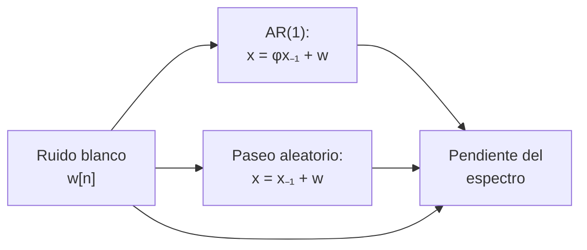

# B15-C03 — Ruido blanco y coloreado

<!-- nav:top -->
[🏠 Programa](../../../../README.md) · [📚 Bloque B15](../../../tronco-comun/B15-senales-imagenes-y-estimacion-cientifica.md) · [← Anterior: B15-C02 — Muestreo y aliasing](../B15-C02-muestreo-y-aliasing/CLASE.md) · [Siguiente: B15-C04 — Transformada de Fourier →](../B15-C04-transformada-de-fourier/CLASE.md)
<!-- /nav -->

## 1. Ubicación, nivel y alcance

Tercera clase del bloque B15. Ya sabes construir una serie ([C01](../B15-C01-series-temporales-discretas/CLASE.md)) y sabes qué frecuencias son confiables ([C02](../B15-C02-muestreo-y-aliasing/CLASE.md)). Aquí caracterizas lo que **no** es señal: el ruido. Distinguirás el ruido **blanco** (cada dato independiente) del **coloreado** (los datos vecinos se parecen) y verás por qué promediar ayuda mucho en el primero y poco en el segundo. Nivel N2. Usas media, varianza y autocorrelación de C01; la probabilidad formal está en [B12](../../../tronco-comun/B12-probabilidad-estadistica-e-incertidumbre.md). No verás todavía la transformada de Fourier (C04), aunque el laboratorio ya usa su espectro como herramienta.

## 2. Por qué esta clase existe

Una regla heredada de la física del laboratorio dice que, al promediar `N` mediciones, el error baja como `1/√N`. Esa regla solo vale si los errores de cada medición son independientes. Un detector real tiene derivas lentas, variaciones térmicas, actividad de la propia estrella: ruido con memoria. Si lo ignoras, declaras una precisión que no tienes. En ciencias espaciales, donde se busca una señal de unas partes por millón dentro de una curva de luz, esa diferencia decide si un hallazgo es real.

La decisión central: **¿cómo es el ruido de mi serie y, por tanto, cuánto me ayuda promediar?**

## 3. Lo que podrás hacer al terminar

1. Definir ruido blanco, ruido autorregresivo AR(1) y paseo aleatorio.
2. Distinguirlos con la autocorrelación al retardo 1 y con la pendiente del espectro.
3. Calcular el error de un promedio en el caso blanco y en el AR(1).
4. Estimar el número efectivo de muestras independientes.
5. Explicar por qué un histograma gaussiano no demuestra que el ruido sea blanco.
6. Verificar un generador de ruido con pruebas estadísticas.

La evidencia es el **informe de ruido** del ejercicio 12 (sección 20).

## 4. Con qué llegas y cómo comprobarlo

Necesitas la media, la desviación estándar y la autocorrelación de [C01](../B15-C01-series-temporales-discretas/CLASE.md), y las potencias. Cinco preguntas:

1. Para `[1; −1; 1; −1; 1; −1]`, ¿cuánto vale `r₁` (C01, ejercicio 3)?
2. ¿Cuánto es `500/√100`?
3. ¿Cuánto es `0,9²`? ¿Y `0,9⁵`?
4. Si una serie alterna signo, ¿`r₁` es positivo o negativo?
5. ¿Cuál es la frecuencia máxima distinguible si `f_s = 720 c/d`?

<details>
<summary>Ver respuestas</summary>

1. `−0,833`. 2. 50. 3. 0,81 y 0,590 49. 4. Negativo. 5. 360 c/d.
</details>

Con cuatro o cinco aciertos, sigue; si no, repasa C01 y C02.

## 5. Un caso real: lo que limita una curva de luz

En una misión como TESS (S1 describe su cadencia de 2 min), el ruido de cada punto incluye el ruido de fotones, el de lectura del detector y variaciones lentas del instrumento y de la propia estrella. Los dos primeros se parecen al ruido blanco; las variaciones lentas son ruido coloreado. Esta clase usa una **serie sintética** con generadores de ruido de semilla fija: no es una curva observada. Es el **ejemplo conductor**.

## 6. Vocabulario

El **ruido blanco** `w[n]` es una sucesión de variables independientes, de media 0 y varianza `σ²`: no tiene memoria y su espectro es plano (el nombre viene de la luz blanca, que mezcla todas las frecuencias por igual). Un proceso **AR(1)** (*autorregresivo de orden 1*) cumple `x[n] = φ x[n−1] + w[n]` con `|φ| < 1`: cada dato hereda una fracción `φ` del anterior. Un **paseo aleatorio** es `x[n] = x[n−1] + w[n]`, la suma acumulada del ruido blanco. El **ruido coloreado** es cualquier ruido con memoria; el **ruido rojo** concentra su potencia en las frecuencias bajas. La **densidad espectral de potencia** (PSD) indica cuánta potencia hay por unidad de frecuencia. El **tiempo de correlación** es el número de muestras tras el cual la autocorrelación cae por debajo de un umbral. El **número efectivo de muestras independientes** `N_eff` es el que daría el mismo error de promedio si los datos fueran blancos.

## 7. Modelo mental: el ruido del tren

El ruido blanco es el ruido de la lluvia sobre un techo: cada gota es independiente de la anterior. El ruido rojo es el vaivén de un tren sobre una vía irregular: cada movimiento depende del anterior. Un promedio de gotas converge rápido; el vaivén del tren no se promedia en un viaje corto. Su límite: el vaivén de un tren tiene una escala característica (el espaciado de los durmientes), mientras que un paseo aleatorio no tiene escala propia.



*Descripción textual:* el ruido blanco es la materia prima; al mezclarlo con la memoria del dato anterior se obtiene AR(1) (memoria parcial) o el paseo aleatorio (memoria total); la pendiente del espectro en escala logarítmica distingue los tres: aproximadamente 0, intermedia y −2.

## 8. La explicación, paso a paso

### 8.1 Ruido blanco

Si `w[n]` es blanco con varianza `σ²`, entonces `r_k ≈ 0` para todo `k ≥ 1`. Con `N` datos independientes, la autocorrelación muestral de un blanco fluctúa en torno a 0 con desviación aproximada de `1/√N`; por eso un valor dentro de `±3/√N` es compatible con «sin memoria» (regla práctica, coherente con el uso de la autocorrelación para detectar no aleatoriedad en S2).

### 8.2 El promedio de un ruido blanco

La media de `N` datos blancos tiene varianza `σ²/N` y desviación `σ/√N`. Con `σ = 500 ppm` (partes por millón, sintético) y `N = 100`: `50 ppm`. Para llegar a 10 ppm hacen falta `N = (500/10)² = 2500` datos.

### 8.3 Ruido AR(1)

En `x[n] = φ x[n−1] + w[n]`, la autocorrelación teórica es `r_k = φ^k`: decae de forma exponencial. La varianza del propio `x` es `σ²/(1 − φ²)`; con `φ = 0,9`, `σ_x = 2,29 σ`. Cuanto más cerca de 1 está `φ`, más lentamente se olvida el pasado. El «tiempo de correlación» para `r_k < 0,1` es `k > ln 0,1/ln φ`; con `φ = 0,9`, `k ≥ 22` muestras.

### 8.4 El promedio de un AR(1)

Para `N` grande, la varianza de la media de un AR(1) es aproximadamente `σ_x² (1 + φ)/[(1 − φ) N]`. Sustituyendo `σ_x² = σ²/(1 − φ²)` y simplificando, la desviación de la media es `σ/[(1 − φ)√N]`: **`1/(1 − φ)` veces la del blanco**. Para `φ = 0,9` es 10 veces peor; el número efectivo de muestras es `N_eff = N (1 − φ)/(1 + φ)` (resultado estándar de series temporales, sin cita específica en esta clase). Con `N = 256`, `N_eff = 13,5`.

### 8.5 Paseo aleatorio

Es el caso límite `φ = 1`: `x[n] = Σ w[i]`. Su varianza crece como `n σ²`: no tiene media estable, así que promediar no converge. La autocorrelación muestral cercana a 1 para retardos pequeños es una señal de alarma.

### 8.6 El espectro como segunda mirada

La PSD de un blanco es plana (pendiente 0 en un gráfico log–log). La de un paseo aleatorio cae como `1/f²` (pendiente −2). La de un AR(1) es plana por debajo de una frecuencia de corte y cae después, así que su pendiente depende de la ventana que mires: en el laboratorio, entre `0,001` y `0,2` ciclos por muestra, da −1,40. La PSD se calcula con la transformada de Fourier (C04–C06); aquí se usa solo como herramienta. S2 describe el gráfico espectral como una herramienta para estudiar la estructura cíclica de una serie.

### 8.7 El histograma no basta

Un histograma muestra la distribución de valores, no su orden. Si mezclas al azar un AR(1), el histograma queda igual pero la memoria desaparece. Por eso, para ruido, mira siempre `r_k` y el espectro además del histograma.

## 9. Magnitudes, símbolos y unidades

| Símbolo | Qué es | Unidad | Nota |
|---|---|---|---|
| `w[n]` | ruido blanco | la de la medida (ppm) | media 0, varianza `σ²` |
| `σ` | desviación del ruido blanco | ppm | 500 ppm, sintético |
| `φ` | coeficiente AR(1) | adimensional | `|φ| < 1` |
| `r_k` | autocorrelación | adimensional | AR(1): `φ^k` |
| `N_eff` | muestras efectivas | adimensional | `N (1 − φ)/(1 + φ)` |
| `S(f)` | PSD | ppm²/(c/d) | pendiente log–log |

## 10. Convenciones y referencias

Las series de esta clase son **sintéticas**: ruido gaussiano con semilla fija (15003) del generador de NumPy. `ppm` = partes por millón = `10⁻⁶` del flujo relativo. La PSD del laboratorio se calcula con el cuadrado del módulo de la FFT sin ventana, con frecuencia en ciclos por muestra.

## 11. De dónde sale lo que afirmamos

| ID | Fuente | Localizador | Respalda | Estado |
|---|---|---|---|---|
| S1 | MAST/STScI, *TESS* | https://archive.stsci.edu/missions-and-data/tess | Cadencia aproximada de 2 min en objetivos | Consultada el 2026-11-05 mediante extracción automática |
| S2 | NIST/SEMATECH, *e-Handbook of Statistical Methods*, §1.3.5.12 «Autocorrelation» y §1.3.3.27 «Spectral Plot» | https://www.itl.nist.gov/div898/handbook/eda/section3/eda35c.htm ; https://www.itl.nist.gov/div898/handbook/eda/section3/spectrum.htm | La autocorrelación sirve para detectar no aleatoriedad; el gráfico espectral examina estructura cíclica | Consultadas el 2026-11-05 mediante extracción automática |

Límites: las fórmulas del AR(1), `N_eff` y la PSD del paseo aleatorio son resultados estándar que no se contrastaron con fuente en esta clase; se comprueban numéricamente en el laboratorio. Los datos son sintéticos.

## 12. Cómo ver el ruido

Equivalente accesible a tres gráficas (resultados del laboratorio, 4096 datos):

| Serie | `r₁` | Pendiente de la PSD |
|---|---|---|
| Blanco | −0,023 | +0,03 |
| AR(1), `φ = 0,9` | +0,895 | −1,40 |
| Paseo aleatorio | +0,999 | −2,01 |

Descripción larga: el blanco oscila de forma irregular alrededor de 0 sin patrón; el AR(1) forma ondulaciones lentas de unas decenas de muestras; el paseo aleatorio vaga lejos de 0 y no regresa pronto.

## 13. Ejemplo trabajado: ¿cuánto ayuda promediar 256 datos?

**Paso 1 · Datos (sintéticos).** `σ = 1` (unidad arbitraria), `N = 256`.

**Paso 2 · Caso blanco.** `σ/√N = 1/16 = 0,0625`.

**Paso 3 · Caso AR(1), `φ = 0,9`.** Factor `1/(1 − φ) = 10`: `0,0625 × 10 = 0,625`.

**Paso 4 · Medición en el laboratorio.** 400 realizaciones de 256 datos: la desviación de las medias es `0,0639` (blanco) y `0,5905` (AR(1)).

**Paso 5 · Comparación.** El blanco coincide con la teoría (2 %). El AR(1) queda un 5,5 % por debajo de la teoría asintótica porque `N = 256` no es «grande» frente al tiempo de correlación (~20 muestras) y porque con 400 realizaciones la propia desviación tiene un error relativo de unos 3,5 %.

**Paso 6 · Lectura.** El mismo promedio es 9 a 10 veces menos preciso con ruido rojo. Con `N_eff = 13,5`, el promedio de 256 datos vale lo que 13 o 14 datos independientes.

## 14. Distintas formas de diagnosticar el ruido

Con la **autocorrelación**: directa, fácil de leer, buena para memoria corta. Con el **espectro**: muestra la memoria en el dominio de la frecuencia, útil con mucha dependencia lenta. Con el **histograma**: informa de la forma de la distribución pero no del orden. Con la **dispersión del promedio frente a `N`** (cómo baja el error al agrupar): es la prueba más directa de cuánto ayuda promediar y detecta ruido rojo cuando la curva deja de bajar como `1/√N`. Usa al menos dos.

## 15. Práctica guiada

**Ejercicio 1 · con los pasos indicados.** Un detector tiene `σ = 500 ppm` por punto (blanco). ¿Qué error tiene el promedio de 100 puntos? ¿Y el de 400?

<details><summary>Solución comentada</summary>

`500/√100 = 50 ppm`; `500/√400 = 25 ppm` (8.2). Cuadruplicar los datos reduce el error a la mitad.
</details>

**Ejercicio 2 · con una pista.** ¿Cuántos puntos blancos de 500 ppm hacen falta para llegar a 10 ppm? *Pista:* despeja `N` en `σ/√N`.

<details><summary>Solución comentada</summary>

`N = (500/10)² = 2500` (8.2).
</details>

**Ejercicio 3 · casi autónomo.** Un paseo aleatorio parte de 0 con pasos `[+1; −1; +1; +1; −1]`. ¿Qué valores toma? ¿Cuál es la varianza esperada tras 100 pasos si `σ = 1`?

<details><summary>Solución comentada</summary>

Valores acumulados: `1, 0, 1, 2, 1` (8.5). La varianza tras 100 pasos es `100 σ² = 100`; la desviación, 10.
</details>

## 16. Práctica autónoma, transferencia e integrador

**Ejercicio 4.** La PSD de una serie tiene pendiente −1,9 en log–log y su `r₁` es 0,998. ¿Qué tipo de ruido sospechas?

<details><summary>Solución comentada</summary>

Pendiente cercana a −2 y `r₁` casi 1: paseo aleatorio, o un proceso muy cercano (8.5, 8.6).
</details>

**Ejercicio 5.** Para `φ = 0,9` y `σ = 1`, ¿cuánto vale la desviación estándar del AR(1) estacionario?

<details><summary>Solución comentada</summary>

`σ_x = σ/√(1 − φ²) = 1/√0,19 = 2,294` (8.3).
</details>

**Ejercicio 6.** ¿Tras cuántas muestras cae `r_k` por debajo de 0,1 para `φ = 0,9`? Con `Δt = 120 s`, ¿cuánto tiempo es?

<details><summary>Solución comentada</summary>

`k > ln 0,1/ln 0,9 = 21,85`; `k = 22`. Tiempo: `22 × 120 s = 2640 s = 44 min` (8.3).
</details>

**Ejercicio 7.** ¿Cuántas muestras efectivas aportan 256 datos con `φ = 0,9`?

<details><summary>Solución comentada</summary>

`256 × 0,1/1,9 = 13,47` (8.4).
</details>

**Ejercicio 8.** Demuestra que el factor entre la desviación de la media AR(1) y la del blanco es `1/(1 − φ)`.

<details><summary>Solución comentada</summary>

AR(1): `σ_x √[(1 + φ)/(1 − φ)]/√N` con `σ_x = σ/√(1 − φ²) = σ/√[(1 − φ)(1 + φ)]`. Entonces `σ √(1 + φ)/√[(1 − φ)(1 + φ)] · 1/√(1 − φ) / √N = σ/[(1 − φ)√N]`. Divide por `σ/√N`: `1/(1 − φ)` (8.4).
</details>

**Ejercicio 9 · transferencia.** Agrupas 15 puntos blancos de 500 ppm (2 min) en un punto de 30 min. ¿Qué ruido esperas por punto agrupado? Si observas 300 ppm, ¿qué sospechas?

<details><summary>Solución comentada</summary>

`500/√15 = 129 ppm`. Un valor observado de 300 ppm supera lo esperado en un factor de 2,3: hay ruido con memoria (o una señal real) además del blanco (14).
</details>

**Ejercicio 10 · transferencia.** Un colega dice: «mis residuos tienen histograma gaussiano, por tanto son ruido blanco». Diseña una prueba que lo refute o lo apoye.

<details><summary>Solución comentada</summary>

Calcula `r₁` y compara con `±3/√N`; calcula la PSD y mira si es plana (8.7). Si mezclas los residuos al azar, `r₁` cae a 0 con el mismo histograma: el histograma no ve el orden.
</details>

**Ejercicio 11 · transferencia.** Para un paseo aleatorio, ¿converge el promedio de `N` datos cuando `N` crece? ¿Qué implica para una calibración basada en promediar?

<details><summary>Solución comentada</summary>

No: la varianza del propio proceso crece con `n` (8.5), así que no hay media estable. Una calibración por promedio largo sería peor, no mejor; hay que modelar la deriva o usar referencias frecuentes.
</details>

**Ejercicio 12 · integrador.** Elabora tu *informe de ruido* para tres series sintéticas de tu propia semilla (blanco, AR(1) con `φ = 0,9`, paseo aleatorio): `r₁`, pendiente de la PSD, desviación del promedio de 256 datos sobre 400 realizaciones frente a la teoría, y una frase de recomendación sobre cuánto promediar.

<details><summary>Solución modelo</summary>

Una tabla con los valores del laboratorio (u otros de tu semilla, dentro de tolerancia estadística: `r₁` blanco < `3/√N`; AR(1) cerca de 0,9; paseo cerca de 1), la comparación `0,0639` vs `0,0625` y `0,59` vs `0,625`, y la recomendación: promediar sirve en el blanco (error `1/√N`), poco en el AR(1) (`N_eff ≈ 13`) y nada en el paseo. Datos rotulados sintéticos.
</details>

## 17. Laboratorio: tres ruidos y un promedio

El script [ruido.py](ruido.py) genera ruido blanco, AR(1) y paseo aleatorio; mide `r₁` y la pendiente de la PSD; y compara la desviación de las medias de 400 realizaciones con la teoría. Falla si el blanco no tiene `|r₁| < 3/√N`, si el AR(1) no da `r₁ ≈ φ`, si las pendientes se alejan de 0 y −2, o si el ruido rojo no promedia peor.

**Datos:** sintéticos, semilla 15003. **Predice antes de ejecutar:** ¿qué `r₁` darán el AR(1) y el paseo? (≈ 0,9 y ≈ 1.) **Ejecución del 2026-11-05 (Python 3.12.9, NumPy 2.4.4):**

```text
blanco           r_1 = -0.023; pendiente del espectro = +0.03
AR(1) phi=0.9    r_1 = +0.895; pendiente del espectro = -1.40
paseo aleatorio  r_1 = +0.999; pendiente del espectro = -2.01
sigma(media, N=256): blanco 0.0639 (teoría 0.0625); AR(1) 0.5905 (teoría aprox. 0.6250)
Pruebas superadas.
```

```bash
python programa/clases/B15/B15-C03-ruido-blanco-y-coloreado/ruido.py
```

**Límites:** ruido gaussiano; el AR(1) teórico es asintótico; sin ventana espectral (la fuga se trata en C06).

## 18. Errores frecuentes y cómo corregirlos

**Aplicar `1/√N` sin comprobar independencia.** Se corrige con los ejercicios 7 y 8.

**Creer que un histograma gaussiano implica ruido blanco.** Se corrige con el ejercicio 10.

**Esperar que el promedio converja siempre.** Se corrige con el ejercicio 11.

**Leer la pendiente del AR(1) como constante.** Depende de la ventana; sección 8.6.

**No fijar la semilla del generador.** Los resultados dejan de ser reproducibles.

## 19. Cómo sabrás que vas bien

Tras 8.2: ¿calculas cuántos datos necesitas para un error dado? Si no, ejercicios 1 y 2. Tras 8.4: ¿por qué 256 datos AR(1) valen unos 13? Si no lo explicas, ejercicios 7 y 8. Tras el laboratorio: ¿qué dos medidas distinguen blanco de rojo? (`r₁` y la pendiente espectral).

## 20. Qué entregas y cómo se evalúa

El producto es tu **informe de ruido** (ejercicio 12).

| Criterio | Inicial | En desarrollo | Logrado | Destacado |
|---|---|---|---|---|
| Clasificación del ruido | Solo por la gráfica | Con una medida | Con `r₁` y pendiente | Con tres medidas coherentes |
| Error del promedio | Siempre `1/√N` | Distingue casos sin cálculo | Calcula ambos casos | Verifica con simulación |
| `N_eff` | Ausente | Fórmula sin sentido | Calculado e interpretado | Relaciona con el tiempo de correlación |
| Reproducibilidad | Sin semilla | Semilla sin versión | Semilla y versiones | Ejecución independiente repetida |
| Fuentes y rótulos | Sin fuente | Sin fecha | Con localizador y fecha | Rotula sintético vs publicado |

**Condiciones críticas (no se compensan con promedio):** no aplicar `1/√N` a ruido con memoria sin comprobarlo; rotular lo sintético; citar solo fuentes consultadas.

## 21. Ética, seguridad y límites

Subestimar el ruido produce falsos descubrimientos; sobreestimarlo, descartar señales reales. Declara cómo estimaste el ruido y con qué supuestos. Accesibilidad: las gráficas tienen tabla equivalente y el laboratorio funciona sin conexión.

## 22. Para cerrar y seguir

El ruido blanco no tiene memoria y se promedia como `1/√N`; el coloreado la tiene, y su promedio es mucho menos preciso; `r₁`, la pendiente del espectro y la dispersión del promedio lo diagnostican. Queda abierta una pregunta: ¿cómo se descompone una señal en frecuencias para ver su espectro?

**Glosario español–inglés.** ruido blanco · *white noise*; ruido rojo · *red noise*; paseo aleatorio · *random walk*; densidad espectral de potencia · *power spectral density*; autorregresivo · *autoregressive*; muestras efectivas · *effective sample size*; semilla · *seed*.

**Continuidad.** B15-C04 reutiliza tu manejo del espectro y de la fase para definir la **transformada de Fourier**.

**Referencias:** ver sección 11.

<!-- nav:bottom -->
---

[← Anterior: B15-C02 — Muestreo y aliasing](../B15-C02-muestreo-y-aliasing/CLASE.md) · [📚 Bloque B15](../../../tronco-comun/B15-senales-imagenes-y-estimacion-cientifica.md) · [Siguiente: B15-C04 — Transformada de Fourier →](../B15-C04-transformada-de-fourier/CLASE.md)
<!-- /nav -->
