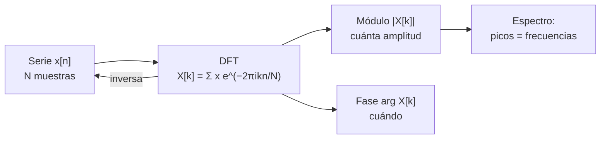

# B15-C04 — Transformada de Fourier

<!-- nav:top -->
[🏠 Programa](../../../../README.md) · [📚 Bloque B15](../../../tronco-comun/B15-senales-imagenes-y-estimacion-cientifica.md) · [← Anterior: B15-C03 — Ruido blanco y coloreado](../B15-C03-ruido-blanco-y-coloreado/CLASE.md) · [Siguiente: B15-C05 — Transformada rápida de Fourier →](../../../tronco-comun/B15-senales-imagenes-y-estimacion-cientifica.md#b15-c05)
<!-- /nav -->

## 1. Ubicación, nivel y alcance

Cuarta clase del bloque B15. Hasta aquí has mirado una serie en el tiempo ([C01](../B15-C01-series-temporales-discretas/CLASE.md)), has visto cómo el muestreo pliega frecuencias ([C02](../B15-C02-muestreo-y-aliasing/CLASE.md)) y cómo se comporta el ruido ([C03](../B15-C03-ruido-blanco-y-coloreado/CLASE.md)). Ahora aprendes la herramienta que cambia el punto de vista: la **transformada de Fourier**, que reescribe una serie como una suma de oscilaciones y dice cuánta amplitud tiene cada frecuencia. Nivel N3. Usas trigonometría de [B04](../../../tronco-comun/B04-algebra-trigonometria-y-geometria-espacial.md) y sumas; los números complejos se introducen aquí lo mínimo necesario. No verás la versión rápida (C05) ni el análisis espectral con ventanas (C06).

## 2. Por qué esta clase existe

Si una estrella pulsa con una pequeña amplitud en medio del ruido, mirar la curva de luz no la revela, pero su espectro de frecuencias sí: un pico a una frecuencia concreta. Lo mismo ocurre con una vibración en una estructura espacial, una señal de radio o un periodo en un registro geofísico. La transformada de Fourier convierte «¿qué oscila, y a qué ritmo?» en una lectura directa.

La decisión central: **¿qué frecuencias contiene mi serie, con qué amplitud, y cuánto puedo fiarme de lo que veo en el espectro?**

## 3. Lo que podrás hacer al terminar

1. Definir la transformada discreta de Fourier (DFT) y calcular una de 4 muestras a mano.
2. Convertir un índice `k` en frecuencia física y viceversa.
3. Obtener la amplitud de una oscilación a partir de `|X[k]|`.
4. Explicar la simetría entre `k` y `N − k` en señales reales.
5. Reconocer y explicar la fuga espectral cuando la frecuencia no cae en un `k` entero.
6. Verificar una DFT con la identidad de Parseval y el teorema de convolución.

La evidencia es el **espectro verificado** del ejercicio 12 (sección 20).

## 4. Con qué llegas y cómo comprobarlo

Necesitas `cos` y `sen`, el periodo y la frecuencia, y los conceptos de Nyquist y de resolución (C02). Cinco preguntas:

1. ¿Cuánto es `cos(π)`? ¿Y `sen(π/2)`?
2. Si `N = 64` y `Δt = 120 s`, ¿cuánto dura la serie?
3. ¿Cuál es el valor de `i²`, donde `i` es la unidad imaginaria?
4. ¿Cuánto es `|3 + 4i|` (el módulo, `√(a² + b²)`)?
5. ¿Cuál es la frecuencia de Nyquist si `f_s = 720 c/d`?

<details>
<summary>Ver respuestas</summary>

1. −1 y 1. 2. 7680 s = 2,13 h. 3. −1. 4. 5. 5. 360 c/d.
</details>

Con cuatro o cinco aciertos, sigue; si no, repasa C02 y B04.

## 5. Un caso real: buscar una pulsación en una curva de luz

En una curva de luz con cadencia de 2 minutos (S2 describe la de TESS), un modo de pulsación estelar se ve como una oscilación periódica de pequeña amplitud. Aquí la sustituimos por una **señal sintética**: 64 muestras cada 120 s con una oscilación que completa exactamente 5 ciclos en la ventana, es decir, a `5/(64 × 120 s) = 6,51 × 10⁻⁴ Hz = 56,25 ciclos por día`. Ver cómo aparece en la DFT, y cómo cambia si la frecuencia no encaja, es el **ejemplo conductor**.

## 6. Vocabulario

Un **número complejo** es `z = a + b i`, con `i² = −1`; su **módulo** es `|z| = √(a² + b²)`. La **fórmula de Euler** es `e^{iθ} = cos θ + i sen θ`. La **transformada de Fourier continua** de una función `f(t)` es, con la convención de S1 (DLMF §1.14), `F(x) = (1/√(2π)) ∫ f(t) e^{ixt} dt`; otras referencias usan el signo contrario en el exponente. La **transformada discreta de Fourier (DFT)** de `N` muestras es `X[k] = Σ_{n=0}^{N−1} x[n] e^{−2π i k n/N}`, para `k = 0, …, N − 1`; es la convención usada en NumPy y en esta clase. Un **bin** es cada valor de `k`. La **resolución en frecuencia** es `Δf = 1/(N Δt)`. La **fuga espectral** (*spectral leakage*) es el reparto de la energía de una frecuencia en bins vecinos cuando no cae exactamente en uno. La **identidad de Parseval** dice que la energía total es la misma en el tiempo y en la frecuencia.

## 7. Modelo mental: un prisma para series

Un prisma separa la luz blanca en colores; la DFT separa una serie en frecuencias. Cada `X[k]` es un número complejo: su módulo dice cuánto de la frecuencia `k` hay; su ángulo (la fase) dice cuándo está el máximo de esa oscilación. Analogía: el prisma. Su límite: un prisma da colores sin fase; la DFT conserva la fase, y con ella puedes reconstruir exactamente la serie original.



*Descripción textual:* la serie de `N` muestras se transforma en `N` números complejos; su módulo da el espectro y su fase la posición temporal; la transformada inversa devuelve la serie original sin pérdida.

## 8. La explicación, paso a paso

### 8.1 La idea: comparar con oscilaciones de prueba

Para saber cuánto de la frecuencia `k` hay en `x`, multiplicas `x[n]` por una oscilación de prueba de esa frecuencia y sumas. Si `x` oscila al mismo ritmo, los productos se refuerzan y la suma es grande; si no, se cancelan. La DFT hace esto para las `N` frecuencias posibles a la vez, usando `e^{−2π i k n/N} = cos(2π k n/N) − i sen(2π k n/N)` para llevar a la vez coseno y seno (así captura la fase).

### 8.2 De la continua a la discreta

La versión continua (S1 §1.14(i), ecuación 1.14.1) integra sobre todo el tiempo, y existe una fórmula de inversión (1.14.4) que recupera `f` a partir de `F`. La DFT es su análogo para `N` muestras: una suma finita, con una inversa `x[n] = (1/N) Σ X[k] e^{2π i k n/N}`. La DFT supone que la serie es **un periodo de una señal que se repite**: es una consecuencia de usar solo `N` muestras, y explica la fuga (8.6).

### 8.3 De `k` a frecuencia física

El bin `k` corresponde a la frecuencia `f_k = k/(N Δt) = k f_s/N`. Con `N = 64` y `Δt = 120 s`: `Δf = 720/64 = 11,25 c/d`; el bin 5 es `56,25 c/d`. Los bins `k > N/2` representan frecuencias negativas (o, equivalentemente, el pliegue de C02): `f_k − f_s`.

### 8.4 El coseno exacto

Si `x[n] = cos(2π k₀ n/N)` con `k₀` entero, la DFT vale `N/2` en `k₀` y en `N − k₀`, y 0 en los demás bins. Para un coseno de amplitud `A`, `|X[k₀]| = A N/2`: **la amplitud se recupera como `A = 2|X[k₀]|/N`**. La simetría `X[N − k] = conj(X[k])` es propia de las señales reales y significa que basta mirar los bins de 0 a `N/2`.

### 8.5 Un caso diminuto a mano

Con `N = 4`, `x = [1; 0; −1; 0]` (un coseno de un ciclo) y `e^{−2π i/4} = −i`: `X[k] = Σ x[n] (−i)^{kn}`. Resulta `X = [0; 2; 0; 2]`: picos de valor `N/2 = 2` en `k = 1` y `k = 3 = N − 1`.

### 8.6 Fuga espectral

Si la frecuencia no es un múltiplo entero de `1/(N Δt)`, la ventana corta la oscilación a mitad de ciclo y la DFT supone un salto en el empalme. La energía se reparte en muchos bins. Con `k₀ = 5,5`, el laboratorio da `|X[5]| = 19,5`, `|X[6]| = 21,2` y `|X[20]| = 1,25`, en vez de un pico limpio de 32. El pico máximo de 21,2 estima una amplitud de `2 × 21,2/64 = 0,66`, un 34 % por debajo de la real (1). Se mitiga con ventanas (C06).

### 8.7 Dos identidades de control

**Parseval:** `Σ |x[n]|² = (1/N) Σ |X[k]|²` (versión discreta de la identidad 1.14.8 de S1). **Convolución:** la DFT del producto de `X` e `Y` equivale a la convolución circular de `x` e `y` (versión discreta de la propiedad de convolución de S1). Si tu código no cumple ambas, tiene un error.

## 9. Magnitudes, símbolos y unidades

| Símbolo | Qué es | Unidad | Nota |
|---|---|---|---|
| `x[n]` | serie de entrada | la de la medida | `N` muestras |
| `X[k]` | DFT | unidad × muestras | complejo |
| `N` | número de muestras | — | 64 en el ejemplo |
| `Δt`, `f_s` | cadencia, frecuencia de muestreo | s, c/d | 120 s, 720 c/d |
| `f_k` | frecuencia del bin | c/d | `k f_s/N` |
| `Δf` | resolución | c/d | `1/(N Δt)` |
| `A` | amplitud del coseno | la de `x` | `2|X|/N` |

## 10. Convenciones y referencias

La DFT de esta clase usa el signo negativo en el exponente y sin factor delante (como NumPy); S1 usa `1/√(2π)` y exponente positivo en su transformada continua. Los resultados de módulo coinciden, pero las fases difieren en signo: declara siempre tu convención. Todas las señales son **sintéticas**.

## 11. De dónde sale lo que afirmamos

| ID | Fuente | Localizador | Respalda | Estado |
|---|---|---|---|---|
| S1 | NIST, *Digital Library of Mathematical Functions* §1.14 «Integral Transforms» | https://dlmf.nist.gov/1.14 | Definición de la transformada de Fourier (1.14.1), inversión (1.14.4), fórmulas de Parseval (1.14.7–1.14.8) y propiedad de convolución | Consultada el 2026-11-05 mediante extracción automática (primeros 100 000 caracteres) |
| S2 | MAST/STScI, *TESS* | https://archive.stsci.edu/missions-and-data/tess | Cadencia aproximada de 2 min en objetivos | Consultada el 2026-11-05 mediante extracción automática |

Límites: las fórmulas de la DFT discreta (inversa, simetría y Parseval discreto) son resultados estándar que se comprueban numéricamente en el laboratorio, no contra un texto citado; S1 trata la transformada continua. Los datos son sintéticos.

## 12. Cómo ver el espectro

Equivalente accesible a la gráfica de `|X[k]|` para el coseno de 5 ciclos y para el de 5,5 ciclos (laboratorio, `N = 64`):

| Bin `k` | 5 ciclos | 5,5 ciclos |
|---|---|---|
| 5 | 32,0 | 19,5 |
| 6 | 0,0 | 21,2 |
| 20 | 0,0 | 1,25 |
| 59 | 32,0 | — |

Descripción larga: con 5 ciclos hay dos picos finos y simétricos en 5 y 59; con 5,5 ciclos el pico se ensancha, se reparte entre 5 y 6, y deja «faldas» de menor altura en todos los bins.

## 13. Ejemplo trabajado: ¿cuánta amplitud tiene la pulsación?

**Paso 1 · Datos (sintéticos).** `x[n] = A cos(2π · 5 n/64)` con `A = 1`; `Δt = 120 s`; `N = 64`.

**Paso 2 · Frecuencia del bin.** `f₅ = 5 × 720/64 = 56,25 c/d`.

**Paso 3 · DFT.** El laboratorio da `|X[5]| = |X[59]| = 32,000 000`, y 8 × 10⁻¹⁴ en los demás bins (ruido de redondeo).

**Paso 4 · Amplitud.** `A = 2 × 32/64 = 1` ✓.

**Paso 5 · Comprobación.** Parseval: para una serie aleatoria de 64 datos, `Σ x² = 56,462 540 370` y `(1/N) Σ |X|² = 56,462 540 370`. La DFT directa y `numpy.fft.fft` difieren en 1,6 × 10⁻¹³.

**Paso 6 · Lectura.** Con la frecuencia en un bin exacto, la amplitud se lee sin error. Con 5,5 ciclos, no (8.6).

## 14. Distintas formas de hallar un periodo

Con la **autocorrelación** (C01): robusta, pero mezcla todas las frecuencias en un solo gráfico. Con la **DFT**: separa las frecuencias y permite estimar amplitudes, pero supone muestreo equiespaciado y sufre fuga. Con un **ajuste de senoide** (C16): da amplitud y fase con incertidumbre si ya sabes la frecuencia. Con el **periodograma de Lomb–Scargle** (se estudia en C06): sirve con muestreo irregular. La DFT es el primer instrumento; los otros la complementan.

## 15. Práctica guiada

**Ejercicio 1 · con los pasos indicados.** Calcula la DFT de `x = [1; 1; 1; 1; 1; 1; 1; 1]` (`N = 8`). *Pasos:* para `k = 0` el exponente es 0; para `k ≠ 0`, la suma de potencias de una raíz de la unidad se anula.

<details><summary>Solución comentada</summary>

`X[0] = Σ x = 8`. Para `k ≠ 0`, `Σ e^{−2π i kn/8} = 0` (las ocho direcciones se cancelan). `X = [8; 0; 0; 0; 0; 0; 0; 0]`: una constante solo tiene componente a frecuencia 0 (8.1).
</details>

**Ejercicio 2 · con una pista.** Con `N = 64` y `Δt = 120 s`, ¿cuál es `Δf` y cuál la frecuencia del bin 3? *Pista:* 8.3.

<details><summary>Solución comentada</summary>

`Δf = 720/64 = 11,25 c/d`; `f₃ = 33,75 c/d`.
</details>

**Ejercicio 3 · casi autónomo.** Calcula a mano la DFT de `x = [1; 2; 3; 4]` y verifica Parseval.

<details><summary>Solución comentada</summary>

Con `(−i)^{kn}`: `X₀ = 10`; `X₁ = 1 + 2(−i) + 3(−1) + 4(i) = −2 + 2i`; `X₂ = 1 − 2 + 3 − 4 = −2`; `X₃ = −2 − 2i`. Parseval: `Σ x² = 30`; `(100 + 8 + 4 + 8)/4 = 30` ✓ (8.7).
</details>

## 16. Práctica autónoma, transferencia e integrador

**Ejercicio 4.** Un coseno de amplitud `A` en una serie de `N = 64` da `|X[k₀]| = 0,064`. ¿Cuánto vale `A`?

<details><summary>Solución comentada</summary>

`A = 2 × 0,064/64 = 0,002` (8.4).
</details>

**Ejercicio 5.** Si una serie real tiene un pico en `k = 5` con `N = 64`, ¿dónde está su espejo y por qué existe?

<details><summary>Solución comentada</summary>

En `k = 59 = N − 5`; es la simetría `X[N − k] = conj X[k]` de las señales reales (8.4).
</details>

**Ejercicio 6.** Verifica Parseval para `x = [3; 4]` (`N = 2`, con `X₀ = 7`, `X₁ = −1`).

<details><summary>Solución comentada</summary>

`Σ x² = 9 + 16 = 25`; `(49 + 1)/2 = 25` ✓.
</details>

**Ejercicio 7.** Con `N = 64` y `Δt = 120 s`, ¿en qué bin cae una frecuencia de 100 c/d? ¿Es exacta?

<details><summary>Solución comentada</summary>

`100/11,25 = 8,89`: el bin más cercano es el 9, pero no es exacta: hay fuga y la amplitud leída será menor que la real (8.6).
</details>

**Ejercicio 8.** Quieres separar dos oscilaciones que difieren 3 c/d. ¿Cuánto debe durar como mínimo la serie, y cuántas muestras tiene con 120 s?

<details><summary>Solución comentada</summary>

Se necesita `Δf ≤ 3 c/d`, o sea `T ≥ 1/3 d = 8 h = 28 800 s`; con 120 s: `N ≥ 240`.
</details>

**Ejercicio 9 · transferencia.** En el caso de 5,5 ciclos (laboratorio), el pico máximo vale 21,2 en vez de 32. ¿Qué amplitud estimas con `A = 2|X|/N`, y qué error relativo tiene?

<details><summary>Solución comentada</summary>

`A ≈ 2 × 21,18/64 = 0,662`; error `−34 %`. Es la «pérdida por escalón» de una frecuencia fuera de bin (8.6): para medir amplitudes con rigor hay que usar ventanas o un ajuste directo (C06, C16).
</details>

**Ejercicio 10 · transferencia.** Una serie de brillo relativo tiene media 1 y oscilaciones pequeñas. ¿Qué valor tiene `X[0]` con `N = 64`, y por qué conviene restar la media antes de mirar el espectro?

<details><summary>Solución comentada</summary>

`X[0] = Σ x = N × media = 64`: un pico enorme en frecuencia cero que domina la escala del gráfico y se fuga a bins vecinos. Restar la media deja ver las oscilaciones (8.4).
</details>

**Ejercicio 11 · transferencia.** Multiplicar las DFT de dos series de longitudes 4 y 3 da la convolución circular. ¿Qué longitud mínima debes usar (rellenando con ceros) para obtener la convolución lineal sin que se doble sobre sí misma?

<details><summary>Solución comentada</summary>

`4 + 3 − 1 = 6`. Con menos, los extremos «dan la vuelta» y contaminan el inicio (8.7; la convolución se estudia en C08).
</details>

**Ejercicio 12 · integrador.** Elabora tu *espectro verificado*: escribe tu propia DFT por suma directa, aplícala a un coseno con `k₀` entero y a otro con `k₀` no entero, compara con `numpy.fft.fft`, verifica Parseval y reporta amplitud estimada, error por fuga y frecuencia física del pico.

<details><summary>Solución modelo</summary>

Para `k₀ = 5`: picos de 32 en 5 y 59, resto < 10⁻¹³, `A = 1`, frecuencia 56,25 c/d. Para `k₀ = 5,5`: máximo 21,2, `A ≈ 0,66` (−34 %), frecuencia aparente entre 56,25 y 67,5 c/d. Parseval y comparación con NumPy dentro de 10⁻⁹. Datos sintéticos; fuentes S1–S2 con fecha.
</details>

## 17. Laboratorio: DFT directa contra la teoría

El script [dft.py](dft.py) implementa la DFT por la suma directa y la contrasta con cuatro referencias: el resultado analítico del coseno (`N/2`), la identidad de Parseval, el teorema de convolución circular y `numpy.fft.fft`; finalmente muestra la fuga con `k₀ = 5,5`.

**Datos:** sintéticos, semilla 15004. **Predice antes de ejecutar:** ¿qué valor tendrá `|X[5]|` en el coseno entero? (32.) **Ejecución del 2026-11-05 (Python 3.12.9, NumPy 2.4.4):**

```text
|X[5]| = 32.000000, |X[59]| = 32.000000 (analítico 32.0)
máximo en los otros bins = 8.01e-14
Parseval: sum|y|^2 = 56.462540370; (1/N) sum|Y|^2 = 56.462540370
convolución circular directa vs producto de DFT: diferencia máxima 1.09e-13
DFT directa vs numpy.fft.fft: 1.60e-13
k0 = 5,5: |X[5]| = 19.511, |X[6]| = 21.181, |X[20]| = 1.247 (fuga)
Pruebas superadas.
```

```bash
python programa/clases/B15/B15-C04-transformada-de-fourier/dft.py
```

**Límites:** la suma directa es `O(N²)`; con `N` grande es lenta (C05). Señales sin ruido ni ventana.

## 18. Errores frecuentes y cómo corregirlos

**Olvidar que la DFT supone periodicidad.** Origina la fuga; ejercicios 7 y 9.

**Leer un bin como frecuencia sin convertir.** Se corrige con el ejercicio 2.

**Estimar amplitudes sin dividir por `N/2`.** Se corrige con el ejercicio 4.

**No restar la media.** Se corrige con el ejercicio 10.

**Mezclar convenciones de signo y normalización.** Se corrige declarando la convención (sección 10).

## 19. Cómo sabrás que vas bien

Tras 8.3: ¿conviertes un bin a frecuencia física? Si no, ejercicio 2. Tras 8.5: ¿calculas a mano la DFT de 4 muestras? Si no, ejercicio 3. Tras 8.6: ¿por qué el pico de 5,5 ciclos es más bajo? Si no lo explicas, ejercicio 9.

## 20. Qué entregas y cómo se evalúa

El producto es tu **espectro verificado** (ejercicio 12).

| Criterio | Inicial | En desarrollo | Logrado | Destacado |
|---|---|---|---|---|
| Definición y convención | Sin declarar | Parcial | Declara signo y normalización | Relaciona con S1 |
| Cálculo | Errores de índice | Algunos errores | Correcto con unidades | Comprueba con Parseval y NumPy |
| Amplitud | Sin escala | Fórmula sin comprobar | `A = 2|X|/N` verificada | Cuantifica el error por fuga |
| Interpretación | Solo describe | Frecuencia aproximada | Frecuencia física correcta | Discute resolución y alias |
| Fuentes y rótulos | Sin fuente | Sin fecha | Con localizador y fecha | Rotula sintético vs publicado |

**Condiciones críticas (no se compensan con promedio):** declarar la convención de la transformada; verificar con una identidad independiente; citar solo fuentes consultadas.

## 21. Ética, seguridad y límites

Un pico en un espectro no es un descubrimiento: puede ser un alias, una fuga o un artefacto del muestreo. Antes de afirmar una frecuencia real, comprueba con otra cadencia o con otro instrumento. Accesibilidad: las gráficas tienen tabla equivalente y el laboratorio funciona sin conexión.

## 22. Para cerrar y seguir

La DFT compara la serie con oscilaciones de prueba y devuelve amplitud y fase por frecuencia; el bin `k` corresponde a `k f_s/N`; solo es limpia si la frecuencia encaja en un bin; Parseval y la convolución sirven de control. Queda abierta una pregunta: ¿cómo calcular esto con millones de muestras en un tiempo razonable?

**Glosario español–inglés.** transformada de Fourier · *Fourier transform*; transformada discreta · *discrete Fourier transform*; fuga espectral · *spectral leakage*; resolución en frecuencia · *frequency resolution*; módulo · *magnitude*; fase · *phase*; identidad de Parseval · *Parseval's identity*.

**Continuidad.** B15-C05 reutiliza tu manejo de `N`, `k` y de las identidades de control para presentar la **transformada rápida de Fourier**.

**Referencias:** ver sección 11.

<!-- nav:bottom -->
---

[← Anterior: B15-C03 — Ruido blanco y coloreado](../B15-C03-ruido-blanco-y-coloreado/CLASE.md) · [📚 Bloque B15](../../../tronco-comun/B15-senales-imagenes-y-estimacion-cientifica.md) · [Siguiente: B15-C05 — Transformada rápida de Fourier →](../../../tronco-comun/B15-senales-imagenes-y-estimacion-cientifica.md#b15-c05)
<!-- /nav -->
