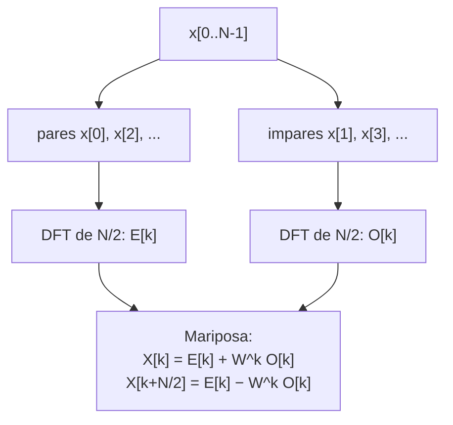

# B15-C05 — Transformada rápida de Fourier

<!-- nav:top -->
[🏠 Programa](../../../../README.md) · [📚 Bloque B15](../../../tronco-comun/B15-senales-imagenes-y-estimacion-cientifica.md) · [← Anterior: B15-C04 — Transformada de Fourier](../B15-C04-transformada-de-fourier/CLASE.md) · [Siguiente: B15-C06 — Análisis espectral de señales →](../B15-C06-analisis-espectral-de-senales/CLASE.md)
<!-- /nav -->

## 1. Ubicación, nivel y alcance

Quinta clase del bloque B15. En la [clase anterior](../B15-C04-transformada-de-fourier/CLASE.md) definiste la DFT y la calculaste por la suma directa, que cuesta `N²` operaciones. Aquí aprendes la idea que la hace práctica: la **transformada rápida de Fourier (FFT)**, que da exactamente el mismo resultado con del orden de `N log N` operaciones. Nivel N3. Verás cómo funciona el truco de dividir en pares e impares, cuánto ahorra, cómo se ordenan las frecuencias en las rutinas de biblioteca y qué hace (y qué no hace) rellenar con ceros. No verás el análisis espectral con ventanas (C06).

## 2. Por qué esta clase existe

Una curva de luz de 27 días con cadencia de 2 minutos tiene 19 440 muestras. La suma directa de la DFT necesita unos 378 millones de multiplicaciones complejas; una imagen de 1024 × 1024 necesitaría muchísimas más. Sin un algoritmo rápido, analizar miles de estrellas o filtrar imágenes con Fourier sería inviable. Con él, la misma tarea cabe en una fracción de segundo.

La decisión central: **¿cómo uso la FFT sin equivocarme en lo que devuelve (orden, escala, relleno) y cómo sé que mi implementación es correcta?**

## 3. Lo que podrás hacer al terminar

1. Deducir la fórmula de la mariposa `X[k] = E[k] + W^k O[k]` a partir de la DFT.
2. Calcular a mano una FFT de 4 muestras por pares e impares.
3. Contar las operaciones de la FFT y compararlas con las de la DFT.
4. Interpretar el orden de los bins que devuelven `fft` y `fftfreq`.
5. Explicar qué aporta y qué no aporta el relleno con ceros.
6. Verificar una FFT propia contra la DFT directa y contra una biblioteca.

La evidencia es la **tabla de coste y exactitud** del ejercicio 12 (sección 20).

## 4. Con qué llegas y cómo comprobarlo

Necesitas la DFT de [C04](../B15-C04-transformada-de-fourier/CLASE.md), potencias de 2 y logaritmos en base 2. Cinco preguntas:

1. ¿Cuánto es `log₂ 1024`?
2. Si `W = e^{−2πi/N}`, ¿cuánto vale `W^{N/2}`? (Piensa en `e^{−iπ}`.)
3. ¿Cuál es la DFT de `[1; 1; 1; 1]`?
4. ¿Cuántas multiplicaciones hace una suma directa de `N = 64` datos si cada `X[k]` requiere `N`?
5. ¿Cuál es la frecuencia máxima distinguible si `f_s = 720 c/d`?

<details>
<summary>Ver respuestas</summary>

1. 10. 2. −1. 3. `[4; 0; 0; 0]`. 4. `64² = 4096`. 5. 360 c/d.
</details>

Con cuatro o cinco aciertos, sigue; si no, repasa C04.

## 5. Un caso real: 27 días de datos de TESS

Un sector de observación de TESS dura aproximadamente 27 días (S3) y los objetivos tienen cadencia de unos 2 min (S2); el ejercicio 4 de [C01](../B15-C01-series-temporales-discretas/CLASE.md) calcula las 19 440 muestras resultantes. Sobre una señal **sintética** de esa longitud —un coseno de 56,25 ciclos por día— medimos qué cuesta encontrar su frecuencia y qué cambia al rellenar con ceros hasta una potencia de 2. Es el **ejemplo conductor**.

## 6. Vocabulario

La **FFT** es una familia de algoritmos que calculan la DFT en `O(N log N)`; la versión más usada se atribuye a Cooley y Tukey, como señala la documentación de NumPy (S1). Una **mariposa** (*butterfly*) es la operación básica: combina un par de valores con un factor de giro `W^k = e^{−2πi k/N}`. La **base 2** es el caso `N = 2^m`. El **relleno con ceros** (*zero padding*) es añadir ceros al final de la serie para alargarla. El **orden estándar** de las salidas es: índice 0 = frecuencia cero, luego las positivas y después las negativas (S1). `rfft` es la variante para series reales, que devuelve solo la mitad no redundante. La **normalización** indica con qué factor se escala la transformada; por defecto, NumPy deja la directa sin escalar y escala la inversa por `1/N` (S1).

## 7. Modelo mental: ordenar un mazo por mitades

Para ordenar un mazo grande, lo partes en dos mazos, ordenas cada uno y los combinas. Sale mucho más barato que comparar todas las cartas con todas. La FFT parte la serie en muestras pares e impares, calcula la DFT de cada mitad (que es más pequeña) y las combina con unos pocos productos. Analogía: ordenar por mitades. Su límite: al ordenar, el orden final es único pero depende de las comparaciones; en la FFT el resultado es **exactamente** el de la DFT, sin aproximación.



*Descripción textual:* la serie se divide en pares e impares; se calcula la DFT de cada mitad (recursivamente, con el mismo método); se combinan con la mariposa, que produce dos salidas por cada `k`.

## 8. La explicación, paso a paso

### 8.1 El coste de la DFT directa

Cada `X[k]` es una suma de `N` productos y hay `N` valores de `k`: `N²` multiplicaciones complejas. Para `N = 19 440`: `3,779 × 10⁸`.

### 8.2 Dividir en pares e impares

Separa la suma de la DFT en los índices pares `n = 2m` y los impares `n = 2m + 1`:
`X[k] = Σ_m x[2m] e^{−2πi k(2m)/N} + Σ_m x[2m+1] e^{−2πi k(2m+1)/N}`.
En la primera suma, `e^{−2πi k·2m/N} = e^{−2πi km/(N/2)}`: es la DFT de `N/2` puntos de las muestras pares, `E[k]`. En la segunda, sacando el factor común `W^k = e^{−2πi k/N}`, queda `W^k` por la DFT de `N/2` puntos de las impares, `O[k]`. Entonces

`X[k] = E[k] + W^k O[k]`, para `k = 0, …, N/2 − 1`.

### 8.3 La mitad que sale gratis

`E[k]` y `O[k]` son periódicas de periodo `N/2`: `E[k + N/2] = E[k]`. Y `W^{k+N/2} = W^k · W^{N/2} = −W^k` (porque `W^{N/2} = e^{−iπ} = −1`). Por tanto

`X[k + N/2] = E[k] − W^k O[k]`.

Con un solo producto `W^k O[k]` obtienes dos salidas. Esa es la mariposa.

### 8.4 La recursión y el coste

Si `T(N)` es el número de mariposas, `T(N) = 2 T(N/2) + N/2`, con `T(1) = 0`. Resolviendo, `T(N) = (N/2) log₂ N`. El laboratorio cuenta las mariposas de su propia implementación y coinciden con la fórmula en todos los tamaños. La tabla de la sección 12 muestra que la DFT directa necesita `N²/[(N/2) log₂ N]` veces más operaciones (aproximadamente, comparando productos): 4369 veces más con `N = 32 768`.

### 8.5 El orden de los resultados

`numpy.fft.fft` (S1) devuelve `A[0]` = frecuencia cero, `A[1 … N/2 − 1]` positivas, `A[N/2]` la de Nyquist (para `N` par) y después las negativas en orden de magnitud decreciente. `numpy.fft.fftfreq(N, d)` da la frecuencia de cada salida. Para `N = 8`, `d = 1`: `[0; 0,125; 0,25; 0,375; −0,5; −0,375; −0,25; −0,125]`. Para series reales, `rfft` evita las negativas, redundantes por la simetría de C04.

### 8.6 Relleno con ceros

Si añades ceros hasta `N' > N`, la DFT se evalúa en una rejilla más fina (`Δf' = 1/(N' Δt)`), pero **no hay información nueva**: la capacidad de separar dos frecuencias cercanas sigue dependiendo de la duración real `T = N Δt`, es decir, de `1/T`. Sirve para interpolar la forma del pico y para usar una longitud eficiente. En el laboratorio, un coseno de 56,25 c/d con `N = 19 440` da su pico en `56,2593 c/d` (rejilla `0,0370 c/d`); relleno hasta `32 768`, en `56,2500 c/d` (rejilla `0,0220 c/d`). Que el segundo caso caiga justo en 56,25 es una coincidencia de que `56,25/720 × 32 768 = 2560` es entero.

### 8.7 Longitudes que no son potencia de 2

La implementación propia del laboratorio exige `N = 2^m`. Las bibliotecas aceptan otros `N`; el laboratorio lo comprueba con `N = 19 440 = 2⁴ · 3⁵ · 5`. Que sea más o menos rápida según los factores de `N` es un hecho conocido de las bibliotecas que aquí no se mide.

## 9. Magnitudes, símbolos y unidades

| Símbolo | Qué es | Unidad | Nota |
|---|---|---|---|
| `N` | número de muestras | — | 19 440 en el ejemplo |
| `W` | factor de giro `e^{−2πi/N}` | adimensional | `W^{N/2} = −1` |
| `E[k]`, `O[k]` | DFT de pares e impares | unidad × muestras | longitud `N/2` |
| `T(N)` | mariposas | — | `(N/2) log₂ N` |
| `Δf` | rejilla de frecuencia | c/d | `1/(N Δt)` |
| `T` | duración real | s o d | fija la resolución |

## 10. Convenciones y referencias

Convención de signo y escala: la de NumPy (S1), la misma de C04. «Operación» significa aquí «multiplicación compleja» (o «mariposa»); el coste real depende además de sumas, memoria y del equipo. Los tiempos del laboratorio son **orientativos** y no forman parte de las pruebas. Los datos son **sintéticos**.

## 11. De dónde sale lo que afirmamos

| ID | Fuente | Localizador | Respalda | Estado |
|---|---|---|---|---|
| S1 | NumPy, *Discrete Fourier Transform (`numpy.fft`)*, documentación estable | https://numpy.org/doc/stable/reference/routines.fft.html | Definición con exponente negativo; normalizaciones `backward`/`ortho`/`forward`; orden estándar de las salidas; atribución de la FFT moderna a Cooley y Tukey | Consultada el 2026-11-05 mediante extracción automática |
| S2 | MAST/STScI, *TESS* | https://archive.stsci.edu/missions-and-data/tess | Cadencia aproximada de 2 min en objetivos | Consultada el 2026-11-05 mediante extracción automática |
| S3 | NASA/HEASARC, *TESS* (portal de la misión) | https://heasarc.gsfc.nasa.gov/docs/tess/ | Sector de observación de aproximadamente 27 días (noticia «TESS Cycle 10 pointings») | Consultada el 2026-11-05 mediante extracción automática |

Límites: el artículo original de Cooley y Tukey (1965) no se pudo consultar (la página del editor respondió 403), por lo que no se cita como fuente; la deducción de 8.2–8.4 es un resultado estándar que se comprueba numéricamente. Los tiempos son orientativos.

## 12. Cómo ver el ahorro

Equivalente accesible a una gráfica log–log de coste frente a `N` (conteos exactos del laboratorio):

| `N` | Mariposas `(N/2) log₂ N` | `N²` | `N²/mariposas` |
|---|---|---|---|
| 8 | 12 | 64 | 5,3 |
| 128 | 448 | 16 384 | 36,6 |
| 2048 | 11 264 | 4 194 304 | 372,4 |
| 32 768 | 245 760 | 1 073 741 824 | 4369,1 |

Descripción larga: en escala logarítmica la DFT directa sube con pendiente 2 y la FFT con pendiente casi 1; la distancia entre las dos líneas crece con `N`.

## 13. Ejemplo trabajado: FFT de `[1; 2; 3; 4]` por pares e impares

**Paso 1 · Datos (sintéticos).** `x = [1; 2; 3; 4]`, `N = 4`, `W = e^{−2πi/4} = −i`.

**Paso 2 · Separar.** Pares: `[1; 3]`; impares: `[2; 4]`.

**Paso 3 · DFT de `N/2 = 2`.** `E = [1 + 3; 1 − 3] = [4; −2]`; `O = [2 + 4; 2 − 4] = [6; −2]`.

**Paso 4 · Mariposas.** `k = 0` (`W⁰ = 1`): `X₀ = 4 + 6 = 10`; `X₂ = 4 − 6 = −2`. `k = 1` (`W¹ = −i`): `W¹ O₁ = (−i)(−2) = 2i`; `X₁ = −2 + 2i`; `X₃ = −2 − 2i`.

**Paso 5 · Comprobación.** Coincide con la DFT directa de C04 (ejercicio 3): `[10; −2 + 2i; −2; −2 − 2i]`. Dos mariposas, en vez de las `4² = 16` productos directos.

## 14. Distintas formas de calcular una DFT

La **suma directa** es la más simple y sirve para verificar (C04), pero su coste crece como `N²`. La **FFT propia de base 2** enseña el mecanismo y exige `N = 2^m`. La **FFT de biblioteca** acepta cualquier `N`, es mucho más rápida (en el laboratorio, 0,18 ms frente a 81 ms de la propia y 640 ms de la directa para `N = 2048`, valores orientativos) y es la que se usa en la práctica. Escribe la tuya para entenderla; usa la de la biblioteca para trabajar, verificada contra la tuya.

## 15. Práctica guiada

**Ejercicio 1 · con los pasos indicados.** Cuenta las mariposas de una FFT de `N = 8` y compáralas con `N²`. *Pasos:* usa `(N/2) log₂ N`.

<details><summary>Solución comentada</summary>

`(8/2) · 3 = 12` mariposas, contra `64` productos directos (8.4). La razón es 5,3.
</details>

**Ejercicio 2 · con una pista.** Calcula la FFT de `[5; 1; 4; 2]` por pares e impares. *Pista:* pares `[5; 4]`, impares `[1; 2]`; `W¹ = −i`.

<details><summary>Solución comentada</summary>

`E = [9; 1]`, `O = [3; −1]`. `X₀ = 9 + 3 = 12`; `X₂ = 9 − 3 = 6`; `W¹ O₁ = (−i)(−1) = i`: `X₁ = 1 + i`, `X₃ = 1 − i`. Comprobación directa de `X₁`: `5 + 1(−i) + 4(−1) + 2(i) = 1 + i` ✓ (8.2–8.3).
</details>

**Ejercicio 3 · casi autónomo.** ¿Cuántas mariposas necesita una FFT de `N = 1024`, y cuántas veces menos que `N²`?

<details><summary>Solución comentada</summary>

`512 · 10 = 5120`; `1024² = 1 048 576`; razón `204,8` (8.4).
</details>

## 16. Práctica autónoma, transferencia e integrador

**Ejercicio 4.** Para la serie de 27 días (`N = 19 440`) rellenada hasta 32 768: ¿cuántas mariposas? ¿Cuántas veces menos que las `N²` de la DFT directa de 19 440 puntos?

<details><summary>Solución comentada</summary>

`16 384 · 15 = 245 760`; `377 913 600 / 245 760 = 1537,7` (laboratorio). Orden de magnitud: mil quinientas veces menos.
</details>

**Ejercicio 5.** Al pasar de `N = 2048` a `N = 4096`, ¿en qué factor crecen las mariposas y los productos de la DFT directa?

<details><summary>Solución comentada</summary>

Mariposas: `11 264 → 24 576`, factor `2,18`; directa: `4 194 304 → 16 777 216`, factor `4` (8.1, 8.4).
</details>

**Ejercicio 6.** Da el resultado de `fftfreq(6, 1)` e identifica la frecuencia de Nyquist.

<details><summary>Solución comentada</summary>

`[0; 1/6; 1/3; −1/2; −1/3; −1/6]`. El índice 3 (`N/2`) es la frecuencia de Nyquist, `−0,5` ciclos por muestra (8.5).
</details>

**Ejercicio 7.** Con `norm="ortho"` ambas direcciones se escalan por `1/√N`. Para `x = [3; 4]`, `X = [7; −1]` sin escalar: ¿cuánto vale `Σ|X|²` en escala ortonormal y qué observas?

<details><summary>Solución comentada</summary>

Escala ortonormal: `[7/√2; −1/√2]`; `Σ|X|² = (49 + 1)/2 = 25 = Σ|x|²`: la transformada conserva la energía (S1; Parseval de C04).
</details>

**Ejercicio 8.** Rellenas una serie de duración `T = 27 d` con ceros hasta duplicar su longitud. ¿Cambia la capacidad de separar dos frecuencias? ¿Y la rejilla?

<details><summary>Solución comentada</summary>

La rejilla se divide por 2; la capacidad de separar sigue fijada por `1/T = 0,037 c/d` (8.6).
</details>

**Ejercicio 9 · transferencia.** Una imagen de 1024 × 1024 se transforma haciendo FFT de cada fila y luego de cada columna. ¿Cuántas mariposas en total? ¿Y cuántos productos haría una DFT bidimensional directa (`(N²)²` con `N = 1024`)?

<details><summary>Solución comentada</summary>

2048 FFT de longitud 1024: `2048 · 5120 = 10 485 760` mariposas. Directa: `1024⁴ ≈ 1,10 × 10¹²` productos; razón `~10⁵` (8.4). Es lo que hace viable filtrar imágenes con Fourier (C09, C11).
</details>

**Ejercicio 10 · transferencia.** Un colega dice: «relleno mi serie de 100 puntos hasta 1000 y así separo frecuencias diez veces más cercanas». Evalúa.

<details><summary>Solución comentada</summary>

No: la resolución real sigue siendo `1/(100 Δt)`. El relleno suaviza la curva del espectro pero los dos picos siguen fundidos si distan menos de `1/T` (8.6).
</details>

**Ejercicio 11 · transferencia.** Convolucionar dos secuencias de 1024 puntos con FFT necesita 3 FFT (dos directas y una inversa) más un producto elemento a elemento. Estima el coste en mariposas y compáralo con el producto directo de `1024²`.

<details><summary>Solución comentada</summary>

`3 · 5120 = 15 360` más 1024 productos ≈ `16 384`; directo: `1 048 576`; razón `~64` (el teorema de convolución es de C04, 8.7; se aplica en C08). Para longitudes lineales habría que rellenar a ≥ 2047.
</details>

**Ejercicio 12 · integrador.** Elabora tu *tabla de coste y exactitud*: implementa una FFT de base 2, y para `N = 2³ … 2¹³` (saltando de 2 en 2) tabula mariposas contadas, fórmula, razón con `N²` y diferencia máxima con `numpy.fft.fft`; añade tres tiempos orientativos y la advertencia de que dependen del equipo.

<details><summary>Solución modelo</summary>

Tabla como la de 12 (con diferencias < 10⁻¹¹ para `N = 256`), los conteos iguales a la fórmula en todas las filas y tiempos como los del laboratorio. Se declaran sintéticos los datos, la versión de Python/NumPy y la semilla; fuentes S1–S3 con fecha.
</details>

## 17. Laboratorio: FFT de base 2, conteo de mariposas y orden de bins

El script [fft_rapida.py](fft_rapida.py) implementa la FFT por pares e impares, la compara con la DFT directa y con `numpy.fft.fft`, cuenta las mariposas y exige que coincidan con `(N/2) log₂ N`, comprueba el orden de `fftfreq` y muestra el efecto del relleno con ceros en el caso de 27 días.

**Datos:** sintéticos, semilla 15005. **Predice antes de ejecutar:** ¿cuántas mariposas para `N = 8`? (12.) **Ejecución del 2026-11-05 (Python 3.12.9, NumPy 2.4.4):**

```text
FFT propia vs DFT directa (N=256): 1.69e-12; vs numpy: 2.25e-14
N        mariposas  (N/2)log2N   N^2        N^2 / mariposas
8        12         12           64         5.3
32       80         80           1024       12.8
128      448        448          16384      36.6
512      2304       2304         262144     113.8
2048     11264      11264        4194304    372.4
8192     53248      53248        67108864   1260.3
32768    245760     245760       1073741824 4369.1
27 d a 120 s: N = 19440; potencia de 2 siguiente = 32768; N^2 = 3.779e+08; (N/2)log2N con N = 32768: 245760
fftfreq(8, d=1) = [0.0, 0.125, 0.25, 0.375, -0.5, -0.375, -0.25, -0.125]
  N usado = 19440: pico en 56.2593 c/d, resolución de rejilla 0.03704 c/d
  N usado = 32768: pico en 56.2500 c/d, resolución de rejilla 0.02197 c/d
tiempos N=2048 (orientativos, dependen del equipo): DFT 640.4 ms; FFT propia 81.4 ms; numpy 0.178 ms
Pruebas superadas.
```

```bash
python programa/clases/B15/B15-C05-transformada-rapida-de-fourier/fft_rapida.py
```

**Límites:** la FFT propia exige potencias de 2 y no está optimizada; la razón `N²/mariposas` compara productos, no tiempo real; los tiempos varían entre ejecuciones.

## 18. Errores frecuentes y cómo corregirlos

**Olvidar el orden de los bins y leer una frecuencia negativa como positiva.** Se corrige con el ejercicio 6.

**Creer que el relleno con ceros mejora la resolución.** Se corrige con los ejercicios 8 y 10.

**Mezclar normalizaciones al comparar con otro programa.** Se corrige con el ejercicio 7 y la sección 10.

**Usar tiempos de una máquina como prueba.** Las pruebas son los conteos, no los tiempos.

**Aplicar una FFT de base 2 a un `N` que no lo es.** La implementación propia debe fallar o rellenar; se declara.

## 19. Cómo sabrás que vas bien

Tras 8.3: ¿obtienes `X[k+N/2]` sin otro producto? Si no, ejercicio 2. Tras 8.4: ¿cuántas mariposas necesita `N = 1024`? Si no lo sabes, ejercicio 3. Tras el laboratorio: ¿por qué el pico con relleno cae «justo» en 56,25? Si no lo explicas, relee 8.6.

## 20. Qué entregas y cómo se evalúa

El producto es tu **tabla de coste y exactitud** (ejercicio 12).

| Criterio | Inicial | En desarrollo | Logrado | Destacado |
|---|---|---|---|---|
| Algoritmo | Copia sin entender | Funciona con errores | Correcto y verificado | Explica la mariposa con la deducción |
| Coste | Sin conteo | Conteo parcial | Conteo igual a la fórmula | Compara con `N²` y discute límites |
| Exactitud | Sin comparación | Contra una referencia | Contra DFT y biblioteca | Con tolerancias justificadas |
| Interpretación | Ignora el orden de bins | Ordena con ayuda | Frecuencias físicas correctas | Distingue rejilla y resolución |
| Fuentes y rótulos | Sin fuente | Sin fecha | Con localizador y fecha | Declara lo no consultado |

**Condiciones críticas (no se compensan con promedio):** verificar la FFT contra una referencia independiente; no presentar tiempos como prueba; citar solo fuentes consultadas.

## 21. Ética, seguridad y límites

Una FFT mal escalada o mal ordenada produce amplitudes y frecuencias falsas con apariencia limpia. Verifica con un caso de respuesta conocida antes de analizar datos reales. Accesibilidad: la gráfica de coste tiene tabla equivalente y el laboratorio se ejecuta sin conexión.

## 22. Para cerrar y seguir

La FFT calcula la misma DFT dividiendo en pares e impares, con `(N/2) log₂ N` mariposas; las bibliotecas devuelven los bins en orden estándar con una normalización declarada; rellenar con ceros afina la rejilla pero no la resolución. Queda abierta una pregunta: ¿cómo se estima de forma fiable un espectro cuando la señal real no encaja en la ventana?

**Glosario español–inglés.** transformada rápida de Fourier · *fast Fourier transform*; mariposa · *butterfly*; factor de giro · *twiddle factor*; relleno con ceros · *zero padding*; normalización · *normalization*; orden estándar · *standard order*.

**Continuidad.** B15-C06 reutiliza tu manejo de la FFT, de la fuga y de la resolución para el **análisis espectral con ventanas**.

**Referencias:** ver sección 11.

<!-- nav:bottom -->
---

[← Anterior: B15-C04 — Transformada de Fourier](../B15-C04-transformada-de-fourier/CLASE.md) · [📚 Bloque B15](../../../tronco-comun/B15-senales-imagenes-y-estimacion-cientifica.md) · [Siguiente: B15-C06 — Análisis espectral de señales →](../B15-C06-analisis-espectral-de-senales/CLASE.md)
<!-- /nav -->
