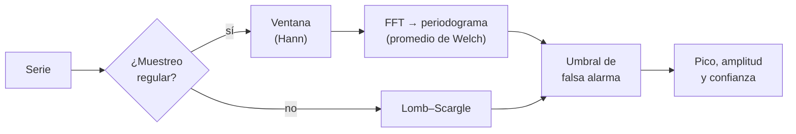

# B15-C06 — Análisis espectral de señales

<!-- nav:top -->
[🏠 Programa](../../../../README.md) · [📚 Bloque B15](../../../tronco-comun/B15-senales-imagenes-y-estimacion-cientifica.md) · [← Anterior: B15-C05 — Transformada rápida de Fourier](../B15-C05-transformada-rapida-de-fourier/CLASE.md) · [Siguiente: B15-C07 — Filtrado digital →](../B15-C07-filtrado-digital/CLASE.md)
<!-- /nav -->

## 1. Ubicación, nivel y alcance

Sexta clase del bloque B15 y cierre del tramo de señales en una dimensión. Con la DFT ([C04](../B15-C04-transformada-de-fourier/CLASE.md)) y la FFT ([C05](../B15-C05-transformada-rapida-de-fourier/CLASE.md)) puedes calcular un espectro; aquí aprendes a **leerlo con rigor**: usar una ventana para controlar la fuga, promediar para reducir su variabilidad, fijar un umbral que distinga un pico real de uno casual y tratar series con huecos o muestreo irregular. Nivel N3. Usas el ruido blanco de [C03](../B15-C03-ruido-blanco-y-coloreado/CLASE.md) y la estadística de [B12](../../../tronco-comun/B12-probabilidad-estadistica-e-incertidumbre.md). No verás filtros (C07) ni espectrogramas (tiempo–frecuencia).

## 2. Por qué esta clase existe

Alguien afirma: «hay un periodo de 3,7 días en esta estrella». ¿Cómo se sostiene? Un espectro siempre tiene un pico máximo, incluso si solo hay ruido; la pregunta es si ese pico es más alto de lo que el azar produciría. Además, los datos astronómicos rara vez son uniformes: las noches, el clima y los huecos de telemetría rompen la regularidad. Un análisis espectral sin ventana, sin umbral y sin considerar los huecos produce periodos falsos con apariencia científica.

La decisión central: **¿hay una señal periódica en estos datos, con qué amplitud y con qué probabilidad de falsa alarma?**

## 3. Lo que podrás hacer al terminar

1. Calcular un periodograma y convertirlo en amplitud corrigiendo el efecto de la ventana.
2. Comparar la fuga de una ventana rectangular y de una de Hann.
3. Reducir la variabilidad del espectro promediando segmentos (método de Welch) y reconocer su coste en resolución.
4. Fijar un umbral de falsa alarma teniendo en cuenta cuántas frecuencias se exploran.
5. Calcular la amplitud mínima detectable de una señal en ruido blanco.
6. Aplicar el periodograma de Lomb–Scargle a datos con muestreo irregular y manejar bien sus unidades.

La evidencia es el **espectro con umbral declarado** del ejercicio 12 (sección 20).

## 4. Con qué llegas y cómo comprobarlo

Necesitas la DFT, la resolución `1/T` y la idea de ruido blanco. Cinco preguntas:

1. Con `N = 1024` y un coseno de amplitud 2 en un bin entero, ¿cuánto vale `|X[k₀]|` (C04, 8.4)?
2. Si la duración de una serie es 27 d, ¿cuál es su resolución `1/T`?
3. ¿Cuánto vale `e^{−ln 100}`?
4. Si el ruido blanco tiene `σ² = 1`, ¿cuál es el valor medio de `|X[k]|²/N`?
5. ¿Qué es la fuga espectral?

<details>
<summary>Ver respuestas</summary>

1. 1024. 2. 0,037 c/d. 3. 0,01. 4. 1 (es la varianza del ruido; se comprueba en el laboratorio). 5. Reparto de la energía de una frecuencia en bins vecinos cuando no cae en un bin exacto.
</details>

Con cuatro o cinco aciertos, sigue; si no, repasa C03 y C04.

## 5. Un caso real: una variable observada con huecos

Un astrónomo aficionado mide el brillo de una estrella variable desde el suelo durante 27 días: unas 300 medidas repartidas al azar, con un hueco de dos días por mal tiempo. Aquí reproducimos esa situación con **datos sintéticos**: una oscilación de 3,7 ciclos por día y amplitud 0,5 (en unidades arbitrarias), ruido blanco de desviación 0,5 y 274 puntos irregulares. La pregunta es si el análisis la recupera y con qué confianza. Es el **ejemplo conductor**.

## 6. Vocabulario

El **periodograma** es el cuadrado del módulo de la DFT dividido por `N`: `P[k] = |X[k]|²/N`. Una **ventana** es una función `w[n]` por la que se multiplica la serie antes de transformarla, para suavizar los bordes; la de **Hann** es `w[n] = 0,5 − 0,5 cos(2πn/N)` (versión periódica). La **ganancia coherente** de una ventana es su media; reduce la amplitud del pico en ese factor. El **método de Welch** divide la serie en segmentos (a veces solapados), calcula el periodograma de cada uno y los promedia (S1). La **densidad espectral de potencia** (PSD) es la potencia por unidad de frecuencia. La **probabilidad de falsa alarma** (FAP) es la probabilidad de que el ruido solo produzca un pico al menos tan alto. El **periodograma de Lomb–Scargle** estima el espectro con muestreo irregular ajustando senoides por mínimos cuadrados (S2, S3). El **factor de ensayos** (*trials factor*) es el número de frecuencias independientes exploradas.

## 7. Modelo mental: escuchar con un micrófono y un oído entrenado

Un espectro es como escuchar un cuarto ruidoso: siempre oyes algo más fuerte que lo demás, pero eso no implica que haya un instrumento tocando. Para afirmarlo necesitas saber cuánto ruido de fondo hay y cuánto se espera que una frecuencia cualquiera sobresalga por azar. Analogía: reconocer una nota en un cuarto ruidoso. Su límite: el oído humano promedia en el tiempo sin que lo decidas; en el espectro, el promedio y la ventana son decisiones tuyas que cambian el resultado.



*Descripción textual:* con muestreo regular se aplica una ventana, se calcula el periodograma y se promedia por segmentos; con muestreo irregular se usa Lomb–Scargle; en ambos casos se compara con un umbral de falsa alarma antes de declarar un pico.

## 8. La explicación, paso a paso

### 8.1 Del módulo al periodograma

Para un coseno de amplitud `A` en un bin entero, `|X[k₀]| = A N/2` (C04). El periodograma da `P[k₀] = (A N/2)²/N = A² N/4`. Para ruido blanco de varianza `σ²`, `P[k]` vale en promedio `σ²`. La razón entre ambas es la **relación señal–ruido espectral**: `A² N/(4σ²)`. Crece con `N`: más datos hacen emerger un pico débil, aunque el ruido de cada bin no baje (8.3).

### 8.2 Ventanas

Cortar la serie equivale a multiplicarla por una ventana rectangular, que produce fuga lejana alta. Una ventana suave la reduce. En el laboratorio, un coseno de 64,5 ciclos en 1024 muestras (fuera de bin) tiene, a 30 bins del pico, un nivel de **−34,0 dB** con ventana rectangular y de **−96,6 dB** con Hann. El precio: la ventana de Hann ensancha el pico principal y reduce su amplitud. Para un coseno en un bin entero, la amplitud con Hann es `|X| = A N/4` (la mitad), de modo que la amplitud se recupera como `A = 4|X|/N` (ganancia coherente 0,5). Con la frecuencia entre dos bins, el pico máximo pierde un 36 % con la rectangular (654,3 de 1024) y un 15 % con Hann (434,6 de 512).

### 8.3 La variabilidad del periodograma

Un resultado importante: el periodograma de ruido blanco **no se vuelve más liso al aumentar `N`**. Cada ordenada `P[k]` sigue una distribución exponencial de media `σ²`, cuya desviación relativa es 1. El laboratorio da `1,006`. Para reducirla se promedian `K` segmentos independientes: la desviación relativa baja a `1/√K` (`0,245` para `K = 16`, teoría `0,25`). Es el fundamento del método de Welch (S1), que además solapa los segmentos (por defecto la mitad, según S1) para aprovechar mejor los datos. El coste: cada segmento es más corto y la resolución empeora: `Δf = f_s/L`, con `L` la longitud del segmento.

### 8.4 Cuándo un pico es real

Si `P[k]` es exponencial con media `σ²`, `Prob(P > z σ²) = e^{−z}` para un bin. Pero se miran `M` bins independientes, y la probabilidad de que **alguno** supere `z σ²` es `FAP = 1 − (1 − e^{−z})^M ≈ M e^{−z}`. Para un `FAP` objetivo, `z = ln(M/FAP)`. Con `M = 1023` y `FAP = 1 %`: `z = 11,54`. El laboratorio simula 3000 series de ruido: la fracción con máximo sobre ese umbral es `0,0113` (teoría `0,0100`; 34 casos de 3000, dentro de la fluctuación esperada). Si ignoras el factor de ensayos y usas el `z` de un solo bin (`z = 4,6` para 1 %), obtienes unos `M × 1 % ≈ 10` picos falsos.

### 8.5 La señal más débil que puedes ver

Un pico en bin exacto alcanza `A² N/4`. Detectarlo con un FAP dado exige `A² N/4 > z σ²`, o sea `A_mín = σ √(4z/N)`. Con `N = 2048`, `M = 1023`, FAP 1 %: `A_mín = 0,150 σ`. Con 27 días a 2 min (`N = 19 440`, `M = 9719`, `z = 13,79`): `A_mín = 0,053 σ`. Tener más datos permite ver señales más débiles que el ruido de cada punto.

### 8.6 Muestreo irregular: Lomb–Scargle

La FFT necesita muestreo uniforme. El periodograma de Lomb–Scargle ajusta, para cada frecuencia, una senoide por mínimos cuadrados con los instantes reales (S2, S3; S3 se leyó solo en su resumen). En SciPy la función `lombscargle` espera **frecuencias angulares** (rad por unidad de tiempo): para una frecuencia en ciclos por día hay que multiplicar por `2π` (S2). En el laboratorio, con 274 puntos irregulares y un hueco de dos días, el pico cae en `3,702 c/d` (verdadera `3,7`), muy por debajo de la resolución `1/T = 0,037 c/d`.

### 8.7 Lo que el espectro no puede hacer

La resolución está fijada por la duración `T`: dos periodos cuya frecuencia difiere menos de `1/T` no se separan. Los huecos producen **alias de ventana**: copias del pico desplazadas por las frecuencias del patrón de muestreo (por ejemplo, 1 c/d si observas de noche). Y el espectro supone que la señal es estacionaria: un periodo que cambia de fase o de amplitud se reparte en varios picos. S4 resume el gráfico espectral como una herramienta para examinar la estructura cíclica, no como una prueba.

## 9. Magnitudes, símbolos y unidades

| Símbolo | Qué es | Unidad | Nota |
|---|---|---|---|
| `P[k]` | periodograma | (unidad de `x`)² | `|X[k]|²/N` |
| `w[n]` | ventana | adimensional | Hann: `0,5 − 0,5 cos(2πn/N)` |
| `σ²` | varianza del ruido blanco | (unidad de `x`)² | media de `P` |
| `K` | segmentos promediados | — | desviación relativa `1/√K` |
| `z`, `M`, FAP | umbral, bins independientes, falsa alarma | —, —, — | `z = ln(M/FAP)` |
| `A_mín` | amplitud mínima detectable | la de `x` | `σ√(4z/N)` |
| `ω` | frecuencia angular | rad/d | `2π f` |

## 10. Convenciones y referencias

Frecuencia `f` en ciclos por día; `ω = 2π f` en radianes por día para SciPy. El periodograma de esta clase usa `|X|²/N` sin ventana de normalización; cuando se usa ventana, se corrige la amplitud con su ganancia coherente. Los datos son **sintéticos**, con semilla 15006. La versión de SciPy usada en el laboratorio es la 1.17.1; la página de documentación consultada (S1) corresponde a la 1.18.0 y no se reprodujeron sus parámetros por defecto más allá de lo citado.

## 11. De dónde sale lo que afirmamos

| ID | Fuente | Localizador | Respalda | Estado |
|---|---|---|---|---|
| S1 | SciPy, `scipy.signal.welch`, manual v1.18.0 | https://docs.scipy.org/doc/scipy/reference/generated/scipy.signal.welch.html | Welch promedia periodogramas modificados de segmentos solapados; solape por defecto de la mitad; escalas `density` y `spectrum` | Consultada el 2026-11-05 mediante extracción automática |
| S2 | SciPy, `scipy.signal.lombscargle`, manual | https://docs.scipy.org/doc/scipy/reference/generated/scipy.signal.lombscargle.html | Periodograma generalizado; frecuencias en rad por unidad de tiempo; opciones de normalización | Consultada el 2026-11-05 mediante extracción automática |
| S3 | VanderPlas, J. T., *Understanding the Lomb–Scargle Periodogram*, arXiv:1703.09824 (2017) | https://arxiv.org/abs/1703.09824 | Introducción conceptual al método para datos irregulares | Solo resumen consultado el 2026-11-05 |
| S4 | NIST/SEMATECH, *e-Handbook*, §1.3.3.27 «Spectral Plot» | https://www.itl.nist.gov/div898/handbook/eda/section3/spectrum.htm | El gráfico espectral examina estructura cíclica en el dominio de la frecuencia | Consultada el 2026-11-05 mediante extracción automática |

Límites: la distribución exponencial del periodograma, la fórmula de FAP y el comportamiento de la ventana de Hann son resultados estándar que se comprueban numéricamente en el laboratorio, no contra un texto citado; S3 se leyó solo en su resumen. Los datos son sintéticos.

## 12. Cómo ver el espectro

Equivalente accesible a las gráficas del laboratorio:

| Resultado | Valor |
|---|---|
| Nivel a 30 bins del pico, rectangular / Hann (coseno fuera de bin) | −34,0 dB / −96,6 dB |
| Pico fuera de bin / pico dentro de bin, rectangular | 654,3 / 1024 (−36 %) |
| Pico fuera de bin / pico dentro de bin, Hann | 434,6 / 512 (−15 %) |
| Desviación relativa del periodograma, 1 segmento / 16 segmentos | 1,006 / 0,245 |
| Frecuencia del pico de Lomb–Scargle | 3,702 c/d (verdadera 3,7) |

Descripción larga: el periodograma de ruido es una «hierba» irregular con picos y valles de amplitud comparable a su media; la señal aparece como un pico aislado, mucho más alto que la hierba. Con Hann, los pies del pico caen mucho más rápido que con la ventana rectangular.

## 13. Ejemplo trabajado: ¿hay una señal en 2048 datos?

**Paso 1 · Datos (sintéticos).** `N = 2048`, ruido blanco de `σ = 1`, `M = 1023` bins independientes (se excluyen el 0 y Nyquist).

**Paso 2 · Umbral.** Para FAP = 1 %: `z = ln(1023/0,01) = 11,54`.

**Paso 3 · Amplitud mínima.** `A_mín = σ √(4 · 11,54/2048) = 0,150`.

**Paso 4 · Un candidato.** Observas un pico de potencia `P = 40 σ²` en un bin. Como `40 > 11,54`, supera el umbral; su `FAP ≈ M e^{−40} ≈ 4 × 10⁻¹⁵`.

**Paso 5 · Amplitud del candidato.** `A = √(4P/N) = √(4 · 40/2048) = 0,28 σ`, si la frecuencia está en el bin.

**Paso 6 · Lectura.** El pico es muy significativo, y su amplitud (0,28 veces la desviación de cada dato) solo se puede ver porque se promedió con 2048 puntos. Si la frecuencia no está en un bin, la amplitud real es algo mayor (8.2).

## 14. Distintas formas de estimar un espectro

El **periodograma simple** es lo más directo, pero su ruido no baja con `N`. El **método de Welch** lo suaviza con un coste en resolución. **Lomb–Scargle** acepta muestreo irregular. El **ajuste de una senoide** (C16) da amplitud y fase con incertidumbres cuando ya conoces la frecuencia. El **espectro paramétrico** (por ejemplo, con modelos AR) no se trata aquí. Elige según el muestreo y la pregunta; declara siempre ventana, longitud de segmento y solape.

## 15. Práctica guiada

**Ejercicio 1 · con los pasos indicados.** Con ventana de Hann y `N = 1024`, un coseno en un bin entero da `|X| = 512`. ¿Cuál es su amplitud? *Pasos:* `A = 4|X|/N`.

<details><summary>Solución comentada</summary>

`A = 4 · 512/1024 = 2` (8.2).
</details>

**Ejercicio 2 · con una pista.** ¿Qué desviación relativa tiene un periodograma promediado sobre `K = 16` y sobre `K = 100` segmentos independientes? *Pista:* `1/√K`.

<details><summary>Solución comentada</summary>

`0,25` y `0,10` (8.3).
</details>

**Ejercicio 3 · casi autónomo.** Calcula el umbral `z` para FAP = 1 % cuando exploras `M = 511` frecuencias.

<details><summary>Solución comentada</summary>

`z = ln(511/0,01) = ln(51 100) = 10,84` (8.4).
</details>

## 16. Práctica autónoma, transferencia e integrador

**Ejercicio 4.** Con `f_s = 720 c/d` y segmentos de `L = 1024` muestras, ¿cuál es la resolución? ¿Y con `L = 256`?

<details><summary>Solución comentada</summary>

`720/1024 = 0,703 c/d`; `720/256 = 2,81 c/d` (8.3). Segmentos más cortos dan un espectro más liso pero menos resuelto.
</details>

**Ejercicio 5.** Calcula `A_mín` para `N = 19 440`, `M = 9719`, FAP = 1 %.

<details><summary>Solución comentada</summary>

`z = ln(9719/0,01) = 13,79`; `A_mín = σ√(4 · 13,79/19 440) = 0,053 σ` (8.5).
</details>

**Ejercicio 6.** SciPy recibe `ω` en rad/d. ¿Qué valor corresponde a `f = 3,7 c/d`?

<details><summary>Solución comentada</summary>

`ω = 2π · 3,7 = 23,25 rad/d` (8.6). Olvidar el `2π` desplaza todo el espectro.
</details>

**Ejercicio 7.** Con ventana de Hann y `N = 1024` mides un pico `|X| = 300` en un bin entero. ¿Qué amplitud tiene la señal?

<details><summary>Solución comentada</summary>

`A = 4 · 300/1024 = 1,17` (8.2).
</details>

**Ejercicio 8.** Exploras `M = 1000` frecuencias independientes y declaras «pico» todo lo que supera el umbral de un solo bin para 1 % (`z = 4,6`). ¿Cuántas falsas alarmas esperas por búsqueda?

<details><summary>Solución comentada</summary>

`M × e^{−4,6} = 1000 × 0,01 = 10` (8.4). Hay que usar `z = ln(M/FAP)`.
</details>

**Ejercicio 9 · transferencia.** Dos oscilaciones de 3,70 y 3,72 c/d, ¿se pueden separar con 27 días de datos? ¿Cuánto tiempo haría falta?

<details><summary>Solución comentada</summary>

`1/T = 0,037 c/d > 0,02 c/d`: no. Hace falta `T ≥ 1/0,02 = 50 d` (8.7).
</details>

**Ejercicio 10 · transferencia.** Un pico tiene potencia `15 σ²` en una búsqueda con `M = 9719`. ¿Cuál es su FAP? ¿Lo darías por real?

<details><summary>Solución comentada</summary>

`FAP ≈ 9719 · e^{−15} = 9719 · 3,06 × 10⁻⁷ = 3,0 × 10⁻³` (0,3 %). Supera el umbral de 1 %, pero antes de aceptarlo conviene comprobar alias de ventana, otra cadencia o datos independientes (8.4, 8.7).
</details>

**Ejercicio 11 · transferencia.** Quieres una resolución de 0,05 c/d con `f_s = 720 c/d` usando Welch. ¿Qué longitud de segmento necesitas y cuántos segmentos sin solape caben en 19 440 muestras? ¿Qué concluyes?

<details><summary>Solución comentada</summary>

`L = 720/0,05 = 14 400`; caben `19 440/14 400 = 1,35`: apenas un segmento. No puedes promediar sin sacrificar resolución (8.3): hay que elegir entre un espectro resuelto pero ruidoso o liso pero borroso.
</details>

**Ejercicio 12 · integrador.** Elabora tu *espectro con umbral declarado*: genera tu propia serie irregular de 27 días con una senoide débil, calcula su periodograma de Lomb–Scargle, fija un umbral de FAP del 1 % con el factor de ensayos, informa la frecuencia del pico, su amplitud estimada y su FAP, y declara ventana, grilla, semilla y versiones.

<details><summary>Solución modelo</summary>

Pico dentro de `0,05 c/d` de la frecuencia sembrada, potencia por encima de `z = ln(M/0,01)` con `M ≈ T × f_máx` (número de frecuencias independientes), amplitud estimada con su incertidumbre, mención de los alias de ventana y de la resolución `1/T`. Datos sintéticos; fuentes S1–S4 con fecha.
</details>

## 17. Laboratorio: ventana, variabilidad, falsa alarma y Lomb–Scargle

El script [espectro.py](espectro.py) comprueba cuatro cosas contra referencias analíticas: la amplitud con y sin ventana de Hann (`A N/2` y `A N/4`), la desviación relativa del periodograma (1 y `1/√K`), la tasa de falsa alarma de la fórmula `z = ln(M/FAP)` y la recuperación de una frecuencia con Lomb–Scargle.

**Datos:** sintéticos, semilla 15006. **Predice antes de ejecutar:** ¿qué fracción de series de ruido superará el umbral? (≈ 1 %.) **Ejecución del 2026-11-05 (Python 3.12.9, NumPy 2.4.4, SciPy 1.17.1):**

```text
(1) |X[64]| sin ventana = 1024.000000 (A N/2 = 1024.0); con Hann = 512.000000 (A N/4 = 512.0)
    rectangular : pico 654.3; nivel a 30 bins del pico = -34.0 dB
    Hann        : pico 434.6; nivel a 30 bins del pico = -96.6 dB
(2) desviación relativa del periodograma: 1 segmento 1.006 (teoría 1); 16 segmentos 0.245 (teoría 0.250)
(3) umbral z = 11.54 sigma^2; FAP teórica 0.0100; observada 0.0113 (34/3000)
(4) 274 puntos irregulares en 27 d; pico de Lomb-Scargle en 3.702 c/d (verdadera 3.7); 1/T = 0.037 c/d
Pruebas superadas.
```

```bash
python programa/clases/B15/B15-C06-analisis-espectral-de-senales/espectro.py
```

**Límites:** ruido gaussiano blanco; el número de ensayos se toma igual al de bins de la FFT; el periodograma de Lomb–Scargle usa la normalización por defecto (potencia sin normalizar) y la FAP de Lomb–Scargle no se calcula aquí.

## 18. Errores frecuentes y cómo corregirlos

**Declarar un periodo solo porque es el pico máximo.** Se corrige con los ejercicios 3 y 10.

**Olvidar el factor de ensayos.** Se corrige con el ejercicio 8.

**Pasar ciclos por día a una función que espera radianes.** Se corrige con el ejercicio 6.

**Usar ventana sin corregir la amplitud.** Se corrige con los ejercicios 1 y 7.

**Esperar que más datos «alisen» el periodograma.** Solo el promedio de segmentos lo alisa; sección 8.3.

## 19. Cómo sabrás que vas bien

Tras 8.2: ¿recuperas la amplitud con Hann? Si no, ejercicios 1 y 7. Tras 8.4: ¿por qué `z = 4,6` no sirve cuando exploras mil frecuencias? Si no lo explicas, ejercicio 8. Tras el laboratorio: ¿qué limita separar 3,70 y 3,72 c/d? (la duración, ejercicio 9).

## 20. Qué entregas y cómo se evalúa

El producto es tu **espectro con umbral declarado** (ejercicio 12).

| Criterio | Inicial | En desarrollo | Logrado | Destacado |
|---|---|---|---|---|
| Método | Sin ventana ni justificación | Ventana sin corregir amplitud | Ventana/método adecuados al muestreo | Compara dos métodos |
| Umbral | Ninguno | Un bin | Con factor de ensayos | Verifica la FAP por simulación |
| Amplitud | No estimada | Sin corrección | Corregida con ganancia coherente | Con incertidumbre |
| Resolución y alias | No discutidos | Resolución sola | Resolución y alias de ventana | Prueba con otra cadencia |
| Fuentes y rótulos | Sin fuente | Sin fecha | Con localizador y fecha | Declara que S3 fue solo resumen |

**Condiciones críticas (no se compensan con promedio):** declarar umbral y factor de ensayos; no confundir ciclos con radianes; citar solo fuentes consultadas.

## 21. Ética, seguridad y límites

Un periodo anunciado a partir de un pico sin umbral puede orientar mal el uso de tiempo de telescopio o de misión. Declara la FAP y el número de frecuencias exploradas. Accesibilidad: las gráficas tienen tabla equivalente y el laboratorio funciona sin conexión.

## 22. Para cerrar y seguir

Un espectro útil lleva ventana, promedio, umbral con factor de ensayos y, si el muestreo es irregular, Lomb–Scargle; su resolución la fija la duración y sus picos pueden ser alias. Queda abierta una pregunta: ¿cómo se eliminan las frecuencias que no interesan antes o después de analizar?

**Glosario español–inglés.** periodograma · *periodogram*; ventana · *window*; método de Welch · *Welch's method*; probabilidad de falsa alarma · *false alarm probability*; factor de ensayos · *trials factor*; muestreo irregular · *uneven sampling*; ganancia coherente · *coherent gain*.

**Continuidad.** B15-C07 reutiliza tu manejo del espectro y de la resolución para el **filtrado digital**.

**Referencias:** ver sección 11.

<!-- nav:bottom -->
---

[← Anterior: B15-C05 — Transformada rápida de Fourier](../B15-C05-transformada-rapida-de-fourier/CLASE.md) · [📚 Bloque B15](../../../tronco-comun/B15-senales-imagenes-y-estimacion-cientifica.md) · [Siguiente: B15-C07 — Filtrado digital →](../B15-C07-filtrado-digital/CLASE.md)
<!-- /nav -->
