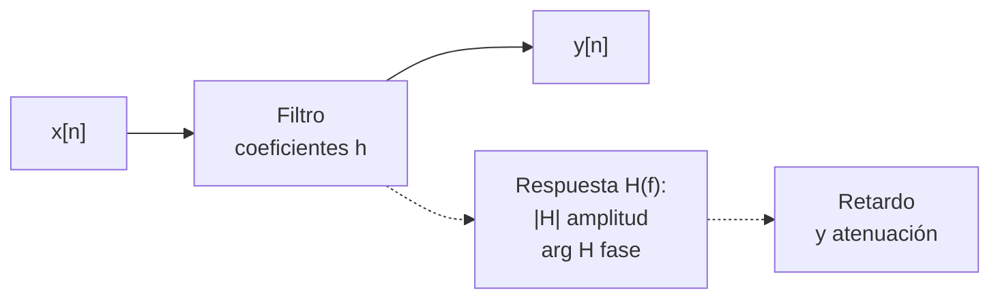

# B15-C07 — Filtrado digital

<!-- nav:top -->
[🏠 Programa](../../../../README.md) · [📚 Bloque B15](../../../tronco-comun/B15-senales-imagenes-y-estimacion-cientifica.md) · [← Anterior: B15-C06 — Análisis espectral de señales](../B15-C06-analisis-espectral-de-senales/CLASE.md) · [Siguiente: B15-C08 — Convolución y respuesta impulsional →](../B15-C08-convolucion-y-respuesta-impulsional/CLASE.md)
<!-- /nav -->

## 1. Ubicación, nivel y alcance

Séptima clase del bloque B15. Sabes mirar una serie en el tiempo y en la frecuencia ([C06](../B15-C06-analisis-espectral-de-senales/CLASE.md)). Ahora aprendes a **modificarla a propósito**: quitar una deriva lenta, reducir el ruido rápido o suavizar sin destruir lo que buscas. Verás dos filtros básicos —la media móvil y el filtro de un polo—, cómo se describe lo que hacen (respuesta en frecuencia), qué retardo introducen y qué precio tiene cada decisión. Nivel N3. No verás el diseño de filtros de orden alto ni filtros adaptativos. La convolución se formaliza en la clase siguiente.

## 2. Por qué esta clase existe

Una curva de luz tiene una modulación lenta de la estrella (manchas que rotan) de 2000 partes por millón y, escondido en ella, el paso de un planeta que reduce el brillo 1000 ppm durante tres horas. Para ver el tránsito hay que quitar la modulación; pero si el filtro es demasiado agresivo, también se come parte del tránsito. Filtrar siempre es un compromiso, y hay que saber **cuánto señal pierdes y cuánto ruido quitas**.

La decisión central: **¿qué filtro uso, con qué parámetro, y cuánto de lo que quiero conservar queda después?**

## 3. Lo que podrás hacer al terminar

1. Aplicar una media móvil y calcular su efecto sobre el ruido blanco.
2. Obtener y leer la respuesta en frecuencia de un filtro.
3. Describir el filtro de un polo con su constante de tiempo y su respuesta al escalón.
4. Calcular el retardo que introduce un filtro causal y explicar los efectos de borde.
5. Diseñar un filtro paso alto como «serie menos media móvil» y cuantificar la señal que conserva.
6. Verificar un filtro contra su fórmula analítica y contra una biblioteca.

La evidencia es el **filtro con respuesta comprobada** del ejercicio 12 (sección 20).

## 4. Con qué llegas y cómo comprobarlo

Necesitas el espectro ([C04](../B15-C04-transformada-de-fourier/CLASE.md)), el ruido blanco ([C03](../B15-C03-ruido-blanco-y-coloreado/CLASE.md)) y series geométricas. Cinco preguntas:

1. Si promedias 25 datos blancos de desviación 1, ¿qué desviación tiene el promedio?
2. ¿Cuánto es `1 − 0,9¹⁰`?
3. ¿Qué frecuencia tiene una oscilación de periodo 2,5 d?
4. ¿Qué es la frecuencia de Nyquist de una serie con cadencia 120 s (en c/d)?
5. ¿Cuánto vale `Σ_{m=0}^{M−1} 1/M`?

<details>
<summary>Ver respuestas</summary>

1. 0,2. 2. 0,651. 3. 0,4 c/d. 4. 360 c/d. 5. 1.
</details>

Con cuatro o cinco aciertos, sigue; si no, repasa C03 y C04.

## 5. Un caso real: separar un tránsito de la modulación estelar

Con la cadencia de unos 2 min de los objetivos de TESS (S1), una curva de luz sintética de 7 días contiene una modulación senoidal de 2000 ppm y periodo 2,5 d, ruido blanco de 300 ppm por punto y un tránsito de 1000 ppm que dura 3 h (91 muestras). La tarea es dejar el tránsito y quitar la modulación. Los datos son **sintéticos**. Es el **ejemplo conductor**.

## 6. Vocabulario

Un **filtro digital** transforma una serie `x[n]` en otra `y[n]`. Es **lineal** si la salida de una suma es la suma de las salidas, e **invariante** si no depende de cuándo empieza la serie. Un filtro **FIR** (respuesta finita al impulso) calcula `y[n] = Σ_{m=0}^{M−1} h[m] x[n − m]`; la lista `h[m]` son los **coeficientes**. Un filtro **IIR** (respuesta infinita) reutiliza salidas anteriores, como `y[n] = α x[n] + (1 − α) y[n − 1]` (S2 escribe la forma general). La **media móvil** de `M` puntos es el FIR con `h[m] = 1/M`. La **respuesta en frecuencia** `H(f)` indica cómo cambia cada frecuencia `f`: el módulo `|H|` escala la amplitud y el argumento desfasa. Un filtro **paso bajo** deja pasar lo lento; **paso alto**, lo rápido. El **retardo** es cuánto desplaza el filtro la señal en el tiempo. Un filtro es **causal** si `y[n]` solo usa datos presentes y pasados.

## 7. Modelo mental: una criba y un colador de café

Un filtro es una criba: deja pasar unas frecuencias y retiene otras. Una media móvil es como colar el café con una gasa de ancho `M`: lo fino pasa borroso, lo grueso se mantiene. Analogía: criba o colador. Su límite: una criba separa objetos en dos montones; un filtro digital atenúa gradualmente y también retrasa o distorsiona la fase.



*Descripción textual:* la serie entra en el filtro, que se describe por sus coeficientes `h` o, de forma equivalente, por su respuesta en frecuencia `H(f)`; esta determina cuánto se atenúa cada frecuencia y cuánto se retrasa.

## 8. La explicación, paso a paso

### 8.1 La media móvil

`y[n] = (1/M) Σ_{m=0}^{M−1} x[n − m]` promedia las últimas `M` muestras. Si `x` es ruido blanco de desviación `σ`, `y` tiene desviación `σ/√M` (C03, 8.2); el laboratorio da `0,1989` con `M = 25` (teoría `0,2000`). Pero `y` ya no es blanco: las muestras vecinas comparten datos, así que están correlacionadas.

### 8.2 Su respuesta en frecuencia

La respuesta de la media móvil de `M` puntos es `H(f) = sen(π f M)/(M sen(π f)) · e^{−iπ f (M−1)}`, con `f` en ciclos por muestra. En `f = 0`, `|H| = 1`: lo constante pasa intacto. Se anula en `f = 1/M, 2/M, …`: esas frecuencias desaparecen por completo. Para `M = 5`, la DFT de los coeficientes coincide con la fórmula con un error de `1,6 × 10⁻¹⁵` y `|H(0,2)| = 0,0165` (cero teórico, más el redondeo de la rejilla de 64 puntos). El factor de fase `e^{−iπ f (M−1)}` es un retardo de `(M − 1)/2` muestras (8.5).

### 8.3 Cómo medir la respuesta de cualquier filtro

Alimenta el filtro con un impulso (un 1 seguido de ceros): la salida son los coeficientes `h`. La DFT de `h` (C04) es `H(f)`. Esa es la prueba más general y es la que usa el laboratorio.

### 8.4 El filtro de un polo

`y[n] = α x[n] + (1 − α)y[n − 1]`, con `0 < α ≤ 1`. Con `α = 0,1` cada salida mezcla un 10 % del dato nuevo y un 90 % del pasado. Su respuesta a un escalón (de 0 a 1) es `y[n] = 1 − (1 − α)^{n+1}`: con `α = 0,1`, `y[0] = 0,1`, `y[9] = 0,6513` y `y[49] = 0,9948`. La **constante de tiempo** aproximada es `1/α = 10` muestras. Es estable si `|1 − α| < 1`. El laboratorio comprueba la respuesta exacta y la contrasta con `lfilter` de SciPy, que implementa la ecuación de diferencias general (S2).

### 8.5 FIR frente a IIR, y el retardo

Un FIR de coeficientes simétricos y `M` términos retrasa todas las frecuencias por igual, `(M − 1)/2` muestras (en el laboratorio, un pulso con centroide en 150 sale en `165` con `M = 31`: retardo `15,000` exacto). Un IIR suele retrasar de forma desigual según la frecuencia pero necesita pocos coeficientes. Si tienes todos los datos de antemano, puedes reducir el retardo aplicando el filtro con una ventana **centrada** (como en 8.7) o procesando hacia delante y hacia atrás; si trabajas en tiempo real, el retardo es inevitable.

### 8.6 Bordes

Cerca del principio y del final, el filtro no tiene datos suficientes. Hay tres opciones: descartar los `M − 1` valores contaminados, rellenar (reflejando, repitiendo el último valor) o usar una versión del filtro más corta en el borde. Elige una y declara cuál: las tres cambian el resultado.

### 8.7 Quitar la modulación: paso alto como «serie menos media móvil»

Si `y = x − MA_W(x)` con una media móvil **centrada** de `W` muestras, el filtro es paso alto con `H_alto(f) = 1 − H_MA(f)`. Para la modulación de periodo 2,5 d (`f = 0,4 c/d`) y `W = 361` muestras (12,04 h = 0,5014 d): `|H_MA| = 0,9351`, así que queda un `6,5 %` de la modulación, unos **130 ppm** de los 2000. Pero el tránsito también sufre: dentro del tránsito, la media móvil está «tirada» por el propio hueco. Sin ruido ni modulación, el laboratorio da una profundidad de `747,9 ppm` en el centro, exactamente `D(1 − d/W)` con `D = 1000 ppm`, `d = 91` y `W = 361`: se pierde el 25 %. Con ruido y modulación, la profundidad media medida entre las muestras 10 y 81 del tránsito es `665 ppm`, por debajo de 748 (el ruido de 300 ppm por punto da ±36 ppm en un promedio de 71 puntos, y la modulación residual añade otro desvío).

### 8.8 El compromiso

Una ventana `W` más larga protege el tránsito (`1 − d/W` mayor) pero deja pasar más modulación (`|H_MA|` se aleja de 1 menos rápido). Una ventana corta quita más modulación pero come el tránsito. Una buena práctica es enmascarar el tránsito conocido antes de calcular la tendencia, o ajustar la tendencia y el tránsito a la vez (C16).

## 9. Magnitudes, símbolos y unidades

| Símbolo | Qué es | Unidad | Nota |
|---|---|---|---|
| `x[n]`, `y[n]` | entrada y salida | ppm | serie sintética |
| `h[m]`, `M` | coeficientes y su número | —, muestras | media móvil: `1/M` |
| `H(f)` | respuesta en frecuencia | adimensional (complejo) | `f` en ciclos/muestra |
| `α` | peso del dato nuevo (un polo) | adimensional | `1/α` ≈ constante de tiempo |
| `W` | ventana de la tendencia | muestras | 361 = 12,04 h |
| `d`, `D` | duración y profundidad del tránsito | muestras, ppm | 91 y 1000 |

## 10. Convenciones y referencias

Frecuencia en ciclos por muestra dentro de las fórmulas (1 c/muestra = `f_s`); en c/d al hablar del cielo. La media móvil «centrada» usa una ventana impar. Los filtros causales usan `x[n − m]` con `m ≥ 0`. Todo es **sintético**; semilla 15007.

## 11. De dónde sale lo que afirmamos

| ID | Fuente | Localizador | Respalda | Estado |
|---|---|---|---|---|
| S1 | MAST/STScI, *TESS* | https://archive.stsci.edu/missions-and-data/tess | Cadencia aproximada de 2 min en objetivos | Consultada el 2026-11-05 mediante extracción automática |
| S2 | SciPy, `scipy.signal.lfilter`, manual | https://docs.scipy.org/doc/scipy/reference/generated/scipy.signal.lfilter.html | Ecuación de diferencias general `a·y = b·x`, forma directa II transpuesta | Consultada el 2026-11-05 mediante extracción automática |

Límites: la respuesta en frecuencia de la media móvil, el retardo `(M − 1)/2`, la profundidad retenida `D(1 − d/W)` y la estabilidad del filtro de un polo son resultados estándar que se verifican numéricamente en el laboratorio, no contra un texto citado. Los datos son sintéticos.

## 12. Cómo ver los filtros

Equivalente accesible a las gráficas del laboratorio:

| Cantidad | Valor |
|---|---|
| Media móvil `M = 5`: `|H(0)|` y `|H(0,2)|` | 1,0000 y 0,0165 |
| Un polo `α = 0,1`: `y[0]`, `y[9]`, `y[49]` al escalón | 0,1000; 0,6513; 0,9948 |
| Ruido blanco con `M = 25` | desviación 0,1989 (teoría 0,2000) |
| Retardo del FIR `M = 31` | 15,000 muestras |
| Profundidad del tránsito en el centro, sin ruido | 747,9 ppm (teoría 747,9) |

Descripción larga: la respuesta de la media móvil es un lóbulo central que vale 1 en `f = 0` y cae a cero en `f = 1/M`, seguido de lóbulos laterales pequeños; la del filtro de un polo es una curva suave que baja con la frecuencia.

## 13. Ejemplo trabajado: ¿cuánto del tránsito sobrevive?

**Paso 1 · Datos (sintéticos).** Cadencia 120 s; tránsito de `D = 1000 ppm` y `d = 91` muestras (3,03 h); media móvil centrada de `W = 361` muestras.

**Paso 2 · Cuánto se tira de la base.** Dentro del tránsito, la ventana incluye las 91 muestras bajas de las 361: la media móvil queda desplazada `D · d/W = 1000 · 91/361 = 252,1 ppm` hacia abajo.

**Paso 3 · Resultado del paso alto.** `y = x − MA`: en el centro, `−1000 − (−252,1) = −747,9 ppm`.

**Paso 4 · Comprobación.** El laboratorio da `747,9 ppm`: coincide con `D(1 − d/W)` a `10⁻¹²`.

**Paso 5 · Modulación residual.** `|H_MA(0,4 c/d)| = 0,9351` ⇒ queda `2000 · (1 − 0,9351) = 130 ppm`, bajo el ruido de cada punto (300 ppm) pero no despreciable frente a 748 ppm.

**Paso 6 · Lectura.** Con este filtro conservas el 75 % del tránsito y eliminas el 93,5 % de la modulación. Si necesitas la profundidad real, corrige el 25 % o enmascara el tránsito al calcular la tendencia.

## 14. Distintas formas de quitar una tendencia

La **media móvil** es simple y se analiza por completo, pero come señales de duración parecida a `W`. La **mediana móvil** resiste valores atípicos (no se desarrolla aquí). El **ajuste polinómico** (C16) suaviza con pocos parámetros pero se contamina con ciclos incompletos (C01, 8.4). El **filtro de un polo** es barato y causal, pero retrasa. Decide con la escala de lo que conservas y lo que descartas, y comprueba el efecto con una señal sintética de respuesta conocida, como hace el laboratorio.

## 15. Práctica guiada

**Ejercicio 1 · con los pasos indicados.** Una media móvil de `M = 4` puntos se aplica a `x = [4; 8; 6; 2; 4]`. Calcula las dos salidas «válidas» (sin borde). *Pasos:* promedia cuatro muestras consecutivas.

<details><summary>Solución comentada</summary>

`(4 + 8 + 6 + 2)/4 = 5`; `(8 + 6 + 2 + 4)/4 = 5` (8.1). Con 5 datos y `M = 4` hay `5 − 4 + 1 = 2` salidas válidas.
</details>

**Ejercicio 2 · con una pista.** ¿A qué frecuencias (en ciclos por muestra) se anula una media móvil de `M = 8`? *Pista:* ceros en `k/M`.

<details><summary>Solución comentada</summary>

`f = 1/8, 2/8, 3/8, 4/8 = 0,125; 0,25; 0,375; 0,5` (8.2). Con `f_s = 720 c/d`, `0,125` equivale a 90 c/d.
</details>

**Ejercicio 3 · casi autónomo.** Con `α = 0,2`, calcula la respuesta al escalón en `n = 0, 1, 2` y la constante de tiempo aproximada.

<details><summary>Solución comentada</summary>

`y[n] = 1 − 0,8^{n+1}`: `0,2; 0,36; 0,488`. Constante de tiempo `1/α = 5` muestras (8.4).
</details>

## 16. Práctica autónoma, transferencia e integrador

**Ejercicio 4.** ¿Qué retardo introduce una media móvil causal de `M = 31` muestras con cadencia 120 s? Dalo en muestras y en minutos.

<details><summary>Solución comentada</summary>

`(31 − 1)/2 = 15` muestras `= 30 min` (8.5).
</details>

**Ejercicio 5.** Promedias 100 datos blancos de 300 ppm con una media móvil de 100 puntos. ¿Qué desviación tiene la salida? ¿Es independiente de la salida de la muestra siguiente?

<details><summary>Solución comentada</summary>

`300/√100 = 30 ppm`. Las salidas consecutivas comparten 99 de 100 datos: están muy correlacionadas (8.1), por lo que no son 100 medidas independientes.
</details>

**Ejercicio 6.** Un filtro tiene `α = 0,5`. ¿Es estable? ¿Y con `α = 2,2`?

<details><summary>Solución comentada</summary>

Es estable si `|1 − α| < 1`: con 0,5, `0,5 < 1` sí; con 2,2, `|−1,2| = 1,2 > 1`: no, la salida crece sin límite (8.4).
</details>

**Ejercicio 7.** Calcula `D(1 − d/W)` para un tránsito de `D = 500 ppm`, `d = 60` y `W = 241`.

<details><summary>Solución comentada</summary>

`500 · (1 − 60/241) = 500 · 0,751 = 375,6 ppm` (8.7).
</details>

**Ejercicio 8.** Para conservar el 90 % del tránsito de 91 muestras, ¿qué ventana mínima `W` necesitas?

<details><summary>Solución comentada</summary>

`1 − d/W ≥ 0,9` ⇒ `W ≥ 10 d = 910` muestras (30,3 h). Pero así dejas pasar mucha modulación de 2,5 d: `f W = 0,4 · 1,265 = 0,506` ⇒ `|H_MA| = sen(π · 0,506)/(π · 0,506) = 0,63`, quedaría el 37 % de la modulación (8.8).
</details>

**Ejercicio 9 · transferencia.** Un colega suaviza con una media móvil de 11 puntos un periodograma ya calculado (no una serie) y dice que «mejoró la resolución». Evalúa.

<details><summary>Solución comentada</summary>

Suavizar el periodograma reduce su variabilidad (C06, 8.3) pero ensancha los picos: empeora la resolución. Es un compromiso, no una mejora gratuita.
</details>

**Ejercicio 10 · transferencia.** El filtro de un polo con `α = 0,1` se usa para seguir una temperatura en tiempo real. La temperatura sube de golpe 5 K. ¿Cuántas muestras tarda la salida en llegar al 95 % del salto?

<details><summary>Solución comentada</summary>

`1 − 0,9^{n+1} = 0,95` ⇒ `0,9^{n+1} = 0,05` ⇒ `n + 1 = ln 0,05/ln 0,9 = 28,4` ⇒ `n ≈ 28` (8.4). Hay que aceptar ese retardo o aumentar `α` a costa de más ruido.
</details>

**Ejercicio 11 · transferencia.** ¿Qué pasa si aplicas el paso alto «x − media móvil» y la modulación tiene exactamente el periodo `W` (en muestras)? ¿Y si es mucho mayor que `W`?

<details><summary>Solución comentada</summary>

Si el periodo es `W`, la media móvil lo anula (cero en `f = 1/W`): el paso alto lo deja entero. Si el periodo es mucho mayor, `|H_MA| ≈ 1` y el paso alto lo elimina casi por completo (8.2, 8.7).
</details>

**Ejercicio 12 · integrador.** Elabora tu *filtro con respuesta comprobada*: elige una media móvil o un filtro de un polo, mide su respuesta con un impulso y una DFT, compárala con la fórmula analítica (diferencia máxima), calcula la reducción de ruido blanco y el retardo, y aplícalo a la curva sintética del caso, reportando la fracción de tránsito conservada y la modulación residual.

<details><summary>Solución modelo</summary>

Diferencia con la fórmula `≈ 10⁻¹⁵`; reducción `σ/√M` dentro de 3 %; retardo `(M − 1)/2`; fracción de tránsito conservada `1 − d/W` y modulación residual `1 − |H_MA|`. Se declara que los datos son sintéticos, la semilla, las versiones y las fuentes S1–S2 con fecha.
</details>

## 17. Laboratorio: filtros contra sus fórmulas

El script [filtros.py](filtros.py) verifica la respuesta en frecuencia de la media móvil con la DFT de sus coeficientes, la respuesta al escalón del filtro de un polo contra la fórmula y contra `lfilter`, la reducción de ruido, el retardo de un FIR simétrico y la profundidad conservada del tránsito, y finalmente aplica el paso alto a la curva con modulación y ruido.

**Datos:** sintéticos, semilla 15007. **Predice antes de ejecutar:** ¿qué profundidad central esperas, sin ruido, con `D = 1000`, `d = 91`, `W = 361`? (747,9 ppm.) **Ejecución del 2026-11-05 (Python 3.12.9, NumPy 2.4.4, SciPy 1.17.1):**

```text
(1) media móvil M=5: |H(0)| = 1.0000; |H(0,2 c/muestra)| = 0.0165 (teoría 0 en f = 1/M = 0,2); diferencia máx. con la fórmula = 1.6e-15
(2) un polo a=0,1: y[0] = 0.1000; y[9] = 0.6513 (1-0,9^10 = 0.6513); y[49] = 0.9948; constante de tiempo 1/a = 10 muestras
(3) ruido blanco con media móvil de 25 puntos: sigma = 0.1989 (teoría 0.2000)
(4) retardo del FIR causal (M=31): centroide de 150.000 a 165.000 (retardo 15.000; teoría 15.0)
(5) tránsito sin ruido: profundidad en el centro tras quitar la media móvil de 361 muestras = 747.9 ppm (teoría D(1-d/W) = 747.9 ppm)
    modulación 2000 ppm (P=2,5 d): factor de la media móvil |H| = 0.9351; residuo teórico 130 ppm; desviación del residuo (incl. ruido) ≈ 313 ppm
    profundidad media en tránsito con ruido y modulación: 665 ppm (centro esperado ≈ 748)
Pruebas superadas.
```

```bash
python programa/clases/B15/B15-C07-filtrado-digital/filtros.py
```

**Límites:** filtros de un solo parámetro; ventana centrada con `mode="same"` (bordes rellenados con ceros por NumPy); la comparación de 665 con 748 ppm no tiene una prueba estadística formal.

## 18. Errores frecuentes y cómo corregirlos

**Tratar las salidas de una media móvil como independientes.** Se corrige con el ejercicio 5.

**Ignorar el retardo de un filtro causal.** Se corrige con los ejercicios 4 y 10.

**Filtrar sin saber cuánta señal se pierde.** Se corrige con los ejercicios 7 y 8.

**No declarar el tratamiento de los bordes.** Sección 8.6.

**Creer que suavizar mejora la resolución.** Se corrige con el ejercicio 9.

## 19. Cómo sabrás que vas bien

Tras 8.2: ¿dónde se anula una media móvil de 8 puntos? Si no, ejercicio 2. Tras 8.4: ¿calculas la respuesta al escalón del filtro de un polo? Si no, ejercicio 3. Tras 8.7: ¿por qué el tránsito pierde el 25 %? Si no lo explicas, ejercicios 7 y 8.

## 20. Qué entregas y cómo se evalúa

El producto es tu **filtro con respuesta comprobada** (ejercicio 12).

| Criterio | Inicial | En desarrollo | Logrado | Destacado |
|---|---|---|---|---|
| Respuesta en frecuencia | Sin medir | Solo la fórmula | Medida con impulso y comparada | Explica ceros y fase |
| Ruido | No cuantificado | Valor sin verificar | `σ/√M` verificado | Distingue correlación de salidas |
| Señal conservada | No evaluada | Estimación cualitativa | Cálculo `1 − d/W` verificado | Optimiza `W` con el compromiso |
| Retardo y bordes | Ignorados | Uno de los dos | Ambos declarados | Los corrige o los acota |
| Fuentes y rótulos | Sin fuente | Sin fecha | Con localizador y fecha | Rotula sintético vs publicado |

**Condiciones críticas (no se compensan con promedio):** cuantificar la señal que el filtro destruye; no presentar datos filtrados como crudos; citar solo fuentes consultadas.

## 21. Ética, seguridad y límites

Un filtro puede crear o destruir señales: una tendencia mal quitada puede borrar un tránsito o fabricar uno. Guarda siempre los datos originales y registra el filtro con sus parámetros. Accesibilidad: las gráficas tienen tabla equivalente y el laboratorio funciona sin conexión.

## 22. Para cerrar y seguir

Un filtro lineal se describe por sus coeficientes y su respuesta en frecuencia; la media móvil reduce el ruido como `1/√M` pero correlaciona la salida, retrasa `(M − 1)/2` muestras y, como paso alto, resta parte de lo que buscas. Queda abierta una pregunta: ¿cuál es el nombre y la forma general de «sumar con pesos desplazados», y cómo se aplica a imágenes?

**Glosario español–inglés.** filtro digital · *digital filter*; media móvil · *moving average*; paso bajo · *low-pass*; paso alto · *high-pass*; respuesta en frecuencia · *frequency response*; retardo · *delay*; causal · *causal*; efecto de borde · *edge effect*.

**Continuidad.** B15-C08 reutiliza tu manejo de coeficientes y de respuesta al impulso para formalizar la **convolución**.

**Referencias:** ver sección 11.

<!-- nav:bottom -->
---

[← Anterior: B15-C06 — Análisis espectral de señales](../B15-C06-analisis-espectral-de-senales/CLASE.md) · [📚 Bloque B15](../../../tronco-comun/B15-senales-imagenes-y-estimacion-cientifica.md) · [Siguiente: B15-C08 — Convolución y respuesta impulsional →](../B15-C08-convolucion-y-respuesta-impulsional/CLASE.md)
<!-- /nav -->
