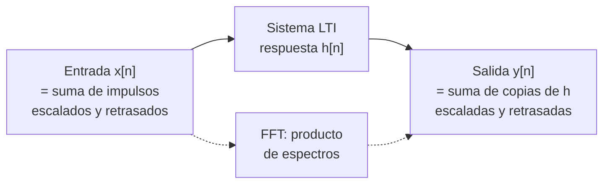

# B15-C08 — Convolución y respuesta impulsional

<!-- nav:top -->
[🏠 Programa](../../../../README.md) · [📚 Bloque B15](../../../tronco-comun/B15-senales-imagenes-y-estimacion-cientifica.md) · [← Anterior: B15-C07 — Filtrado digital](../B15-C07-filtrado-digital/CLASE.md) · [Siguiente: B15-C09 — Procesamiento de imágenes digitales →](../B15-C09-procesamiento-de-imagenes-digitales/CLASE.md)
<!-- /nav -->

## 1. Ubicación, nivel y alcance

Octava clase del bloque B15. En [C07](../B15-C07-filtrado-digital/CLASE.md) usaste filtros como «sumas con pesos desplazados» sin darles su nombre general: **convolución**. Aquí la defines con rigor, descubres que un sistema lineal e invariante queda totalmente descrito por su **respuesta impulsional** y aprendes a calcular la salida de cualquier entrada a partir de ella. El ejemplo es un sensor de temperatura con inercia térmica. Nivel N3. Usas sumas, la DFT ([C04](../B15-C04-transformada-de-fourier/CLASE.md)) y la FFT ([C05](../B15-C05-transformada-rapida-de-fourier/CLASE.md)). No verás la operación inversa (C11) ni convolución bidimensional con detalle (C09).

## 2. Por qué esta clase existe

Un termistor a bordo de una nave no mide la temperatura del instante: mide una versión retrasada y suavizada, porque su cuerpo tarda en calentarse o enfriarse. Si la nave entra en eclipse y el entorno baja 50 K de golpe, el sensor irá bajando poco a poco. Lo mismo ocurre con una imagen desenfocada, con un telescopio que difumina un punto de luz o con un detector con memoria. Todos son sistemas que *convolucionan* la señal verdadera con una respuesta característica. Entender la convolución permite predecir lo que mide el instrumento y, después, intentar deshacerlo.

La decisión central: **dada la respuesta del instrumento a un pulso muy corto, ¿qué verá con cualquier otra entrada?**

## 3. Lo que podrás hacer al terminar

1. Calcular una convolución discreta a mano y con código, y predecir su longitud.
2. Explicar por qué la salida de un sistema lineal e invariante es la suma de respuestas impulsionales desplazadas y escaladas.
3. Obtener la respuesta impulsional de un sensor de primer orden y su respuesta a un escalón.
4. Aplicar las propiedades de la convolución (conmutativa, asociativa, linealidad).
5. Usar la FFT para convolucionar sin errores de «vuelta» (relleno de ceros).
6. Reconocer cuándo un sistema no se puede describir por convolución.

La evidencia es la **convolución verificada con un sensor** del ejercicio 12 (sección 20).

## 4. Con qué llegas y cómo comprobarlo

Necesitas sumas con índices, la media móvil de C07 y la exponencial. Cinco preguntas:

1. ¿Cuánto es `e^{−1}`?
2. ¿Cuántas muestras tiene la media móvil de 5 puntos (C07, 6)?
3. Si `a = 0,1`, ¿cuánto es `1 − (1 − a)^10`?
4. ¿Qué dice el teorema de convolución de la DFT (C04, 8.7)?
5. ¿Qué es un sistema lineal?

<details>
<summary>Ver respuestas</summary>

1. 0,368. 2. 5 coeficientes iguales a 1/5. 3. 0,651. 4. La DFT de la convolución (circular) es el producto de las DFT. 5. Uno donde la salida de una suma ponderada de entradas es la suma ponderada de las salidas.
</details>

Con cuatro o cinco aciertos, sigue; si no, repasa C07 y C04.

## 5. Un caso real: el sensor que tarda en enterarse

Una nave entra en la sombra de un planeta y la temperatura del entorno baja de 300 K a 250 K de forma casi instantánea. Un termistor de primer orden, con constante de tiempo `τ = 30 s`, leído cada 1 s, tarda en seguir ese cambio. Todo el caso es **sintético**: τ y las temperaturas son ficticias, pensadas para ver la mecánica; un sensor real exige medir su respuesta. Es el **ejemplo conductor**.

## 6. Vocabulario

El **impulso** discreto `δ[n]` vale 1 en `n = 0` y 0 en los demás. La **respuesta impulsional** `h[n]` es la salida del sistema cuando la entrada es `δ[n]`. La **convolución** de `x` y `h` es `(x ∗ h)[n] = Σ_m x[m] h[n − m]` (la definición de NumPy en S2 es la misma con otro orden de nombres: se voltea una secuencia y se desliza sobre la otra). Un sistema es **lineal** si la salida de `αx₁ + βx₂` es `αy₁ + βy₂`, e **invariante en el tiempo** si retrasar la entrada solo retrasa la salida. Se abrevia **LTI**. El **escalón** `u[n]` vale 1 desde `n = 0`. La **constante de tiempo** `τ` de un sensor de primer orden es el tiempo en que recorre el 63,2 % de un cambio brusco (`1 − e^{−1}`). La **convolución circular** es la que implícitamente calcula el producto de DFT: supone que las series se repiten.

## 7. Modelo mental: un eco por cada golpe

Imagina golpear un tambor: un golpe produce una vibración que se apaga; esa vibración es la respuesta impulsional. Si das varios golpes de distinta fuerza en distintos instantes, el sonido total es la suma de las vibraciones, cada una escalada y desplazada. Eso es la convolución. Analogía: tambor y ecos. Su límite: un tambor real puede no ser lineal (golpes fuertes suenan distinto); la convolución exige linealidad.



*Descripción textual:* la entrada se ve como una suma de impulsos; por linealidad e invariancia, la salida es la suma de copias de `h` desplazadas y escaladas; equivalentemente, en frecuencia, se multiplican los espectros.

## 8. La explicación, paso a paso

### 8.1 Un ejemplo a mano

Convoluciona `x = [1; 2; 3]` con `h = [1; 0; −1]`. Cada `x[m]` aporta una copia de `h` escalada por `x[m]` y desplazada `m` lugares: `1·[1,0,−1]` en la posición 0, `2·[1,0,−1]` en la 1 y `3·[1,0,−1]` en la 2. Sumando por posición: `[1; 2; 3 − 1; −2; −3] = [1; 2; 2; −2; −3]`. El laboratorio confirma el resultado. La salida tiene `3 + 3 − 1 = 5` valores: en general, `N + M − 1` (modo `full` de S2).

### 8.2 Por qué las sumas de impulsos desplazados bastan

Cualquier serie es `x[n] = Σ_m x[m] δ[n − m]` (cada muestra es un impulso escalado). Si el sistema es lineal, la salida es `Σ_m x[m] · (respuesta a δ[n − m])`. Si además es invariante, la respuesta a `δ[n − m]` es `h[n − m]`. Resulta `y[n] = Σ_m x[m] h[n − m]`: la convolución. Todo el comportamiento del sistema está en `h`.

### 8.3 Propiedades útiles

Es **conmutativa** (`x ∗ h = h ∗ x`), **asociativa** (`(x ∗ h₁) ∗ h₂ = x ∗ (h₁ ∗ h₂)`: dos filtros en cadena equivalen a uno) y **distributiva** (`x ∗ (h₁ + h₂) = x ∗ h₁ + x ∗ h₂`). El laboratorio verifica las dos primeras y la longitud. La media móvil de C07 es la convolución con `h[m] = 1/M`.

### 8.4 El sensor de primer orden

Un sensor cuyo estado cambia hacia el entorno en proporción a la diferencia tiene la respuesta continua `e^{−t/τ}/τ`. Muestreada cada `Δt`, su versión discreta exacta es `h[n] = a (1 − a)^n` con `a = 1 − e^{−Δt/τ}`. Con `τ = 30 s` y `Δt = 1 s`, `a = 0,0328`. Su respuesta al escalón unitario es `y[n] = 1 − (1 − a)^{n+1} = 1 − e^{−(n+1)Δt/τ}`, que coincide con la analítica del sistema continuo en los instantes de muestreo: el laboratorio da una diferencia de `3,3 × 10⁻¹⁶`. El área de `h` vale 1: ante una entrada constante, la salida acaba igualándola (ganancia en continua 1; es el filtro de un polo de C07 con `α = a`).

### 8.5 Qué mide el sensor en la sombra

Con un cambio real de −50 K, la lectura es `300 − 50 · (1 − e^{−t/τ})`. El laboratorio da: en 1 s, 298,36 K; en 30 s (una constante de tiempo), 268,39 K (fracción 0,632); en 60 s, 256,77 K (todavía 6,77 K por encima de 250 K); en 138 s, 250,50 K. El 99 % del cambio se alcanza en `τ ln 100 = 138,2 s` (el laboratorio da 139 s al contar muestras). Un análisis de la temperatura que ignorara esta inercia interpretaría mal los primeros minutos del eclipse.

### 8.6 Convolución y Fourier

El teorema de convolución (S1, §1.14, la propiedad de convolución: la transformada de `f ∗ g` es el producto de las transformadas, con la normalización de S1) tiene una versión discreta: la DFT de la convolución **circular** es el producto de las DFT. Para obtener la convolución lineal (la de 8.1), hay que rellenar con ceros a una longitud `≥ N + M − 1`. El laboratorio muestra que con relleno el error es `1,9 × 10⁻¹⁵` y que sin él la parte circular se desvía hasta `2,75` en un ejemplo de 64 datos y 9 coeficientes, porque los extremos «dan la vuelta».

### 8.7 Cuánto cuesta

La convolución directa de `N` datos con `M` coeficientes cuesta `N M` productos. Para `N = 19 440` y `M = 361`: `7,02 × 10⁶`. Con FFT se hacen tres transformadas de longitud `32 768` (≥ 19 800) más un producto: unos `7,7 × 10⁵` pasos de mariposa y producto, del orden de 9 veces menos. Cuando `M` es pequeño (por ejemplo, 5), la directa gana; cuando `M` es grande, gana la FFT.

### 8.8 Cuándo no hay convolución

Si el sistema no es lineal (por ejemplo, `y[n] = x[n]²`) o no es invariante (por ejemplo, `y[n] = n x[n]`), no existe una `h` única que lo describa. Un sensor que se satura o cuya respuesta cambia con la temperatura sale de este marco.

## 9. Magnitudes, símbolos y unidades

| Símbolo | Qué es | Unidad | Nota |
|---|---|---|---|
| `x[n]`, `y[n]` | entrada y salida | K (sensor) | temperatura |
| `h[n]` | respuesta impulsional | 1/muestra (sin unidades en continuo: 1/s) | área = 1 |
| `δ[n]`, `u[n]` | impulso y escalón | — | |
| `τ` | constante de tiempo | s | 30 s (sintético) |
| `Δt` | cadencia | s | 1 s |
| `a` | `1 − e^{−Δt/τ}` | — | 0,0328 |
| `N`, `M` | longitudes de `x` y `h` | muestras | salida: `N + M − 1` |

## 10. Convenciones y referencias

La convolución se define con la suma sobre `m` de `x[m]h[n − m]`. La salida «completa» tiene `N + M − 1` muestras; los `M − 1` extremos tienen solapamiento parcial y son «de borde» (S2). Las temperaturas y τ son **sintéticas**; semilla 15008 para las pruebas con ruido.

## 11. De dónde sale lo que afirmamos

| ID | Fuente | Localizador | Respalda | Estado |
|---|---|---|---|---|
| S1 | NIST, *Digital Library of Mathematical Functions* §1.14 | https://dlmf.nist.gov/1.14 | Propiedad de convolución de la transformada de Fourier (continua) | Consultada el 2026-11-05 mediante extracción automática |
| S2 | NumPy, `numpy.convolve`, documentación estable | https://numpy.org/doc/stable/reference/generated/numpy.convolve.html | Definición de la convolución discreta; modos `full`, `same`, `valid` y sus longitudes | Consultada el 2026-11-05 mediante extracción automática |

Límites: la deducción de 8.2, la respuesta del sensor de primer orden y el teorema discreto con relleno son resultados estándar verificados numéricamente en el laboratorio, no contra un texto citado. No se usó ningún dato de un sensor real.

## 12. Cómo ver la convolución

Equivalente accesible a las gráficas del laboratorio:

| Cantidad | Valor |
|---|---|
| `[1,2,3] ∗ [1,0,−1]` | `[1; 2; 2; −2; −3]` |
| Respuesta al escalón vs analítica | diferencia máx. `3,3 × 10⁻¹⁶` |
| Lectura a 1 / 30 / 60 / 138 s tras la caída de 300 K a 250 K | 298,36 / 268,39 / 256,77 / 250,50 K |
| Convolución por FFT con relleno / circular sin relleno | error `1,9 × 10⁻¹⁵` / `2,75` |

Descripción larga: la respuesta al impulso es una curva que arranca en `a = 0,033` y decae suavemente; la respuesta al escalón sube desde 0 con pendiente inicial `a` y se acerca a 1 sin pasarse, alcanzando 0,632 en 30 s.

## 13. Ejemplo trabajado: respuesta del sensor a una entrada de dos pasos

**Paso 1 · Datos (sintéticos).** `τ = 30 s`, `Δt = 1 s`, `a = 0,03279`. Entrada: temperatura relativa `x = −50 K` desde `t = 0`, y de vuelta a `0` desde `t = 100 s`.

**Paso 2 · Descomposición.** `x = −50 u[n] + 50 u[n − 100]` (escalón hacia abajo y escalón de regreso 100 s después).

**Paso 3 · Linealidad e invariancia.** La salida es `−50 · y_esc[n] + 50 · y_esc[n − 100]`, con `y_esc[n] = 1 − e^{−(n+1)/30}`.

**Paso 4 · Valor en `t = 99 s` (n = 99).** `y_esc[99] = 1 − e^{−100/30} = 0,9643`; la segunda parte vale 0. Salida: `−48,2 K`.

**Paso 5 · Valor en `t = 130 s` (n = 130).** `y_esc[130] = 1 − e^{−131/30} = 0,9874`; `y_esc[30] = 1 − e^{−31/30} = 0,6443`. Salida: `−49,37 + 32,2 = −17,2 K`.

**Paso 6 · Lectura.** El sensor aún marca −17 K, 30 s después de que el entorno regresó a 0: la inercia retarda el regreso. Un solo escalón bastó para caracterizar el sistema; todo lo demás sale por linealidad.

## 14. Distintas formas de calcular una convolución

Por la **suma directa**: transparente y exacta, cuesta `N M`. Con **numpy.convolve**: la misma suma, en código optimizado (S2). Con **FFT y relleno**: más rápida si `M` es grande (8.7); exige relleno para evitar el efecto circular. Para un sensor de primer orden, la **recursión** `y[n] = (1 − a) y[n − 1] + a x[n]` da el mismo resultado con un solo producto por muestra (C07, 8.4). Elige según `M` y si necesitas el resultado en tiempo real.

## 15. Práctica guiada

**Ejercicio 1 · con los pasos indicados.** Convoluciona `[1; 1; 1]` con `[1; 2]`. *Pasos:* una copia de `[1, 2]` por cada uno, desplazada.

<details><summary>Solución comentada</summary>

`[1,2] + [0,1,2] + [0,0,1,2] = [1; 3; 3; 2]` (8.1). Longitud `3 + 2 − 1 = 4`.
</details>

**Ejercicio 2 · con una pista.** Para el sensor del caso (`τ = 30 s`, `Δt = 1 s`), calcula `a` y la respuesta al escalón en `n = 0, 1, 2`. *Pista:* `y[n] = 1 − e^{−(n+1)/30}`.

<details><summary>Solución comentada</summary>

`a = 1 − e^{−1/30} = 0,0328`; `y[0] = 0,0328`, `y[1] = 1 − e^{−2/30} = 0,0645`, `y[2] = 1 − e^{−0,1} = 0,0952` (8.4).
</details>

**Ejercicio 3 · casi autónomo.** ¿En cuántos segundos alcanza el 90 % de un cambio brusco el sensor con `τ = 30 s`?

<details><summary>Solución comentada</summary>

`1 − e^{−t/τ} = 0,9` ⇒ `t = τ ln 10 = 69,1 s` (8.5).
</details>

## 16. Práctica autónoma, transferencia e integrador

**Ejercicio 4.** Con `N = 100` datos y `M = 9` coeficientes, ¿cuántas muestras tiene la convolución `full`, `same` y `valid`?

<details><summary>Solución comentada</summary>

`full`: `100 + 9 − 1 = 108`; `same`: 100; `valid`: `100 − 9 + 1 = 92` (S2).
</details>

**Ejercicio 5.** Demuestra con `[1; 2]` y `[3; 4]` que la convolución es conmutativa.

<details><summary>Solución comentada</summary>

`[1,2] ∗ [3,4] = [3; 4 + 6; 8] = [3; 10; 8]`. `[3,4] ∗ [1,2] = [3; 6 + 4; 8] = [3; 10; 8]` (8.3).
</details>

**Ejercicio 6.** Aplica la media móvil de 3 puntos (`h = [1/3; 1/3; 1/3]`) a un pulso aislado `x = [0; 0; 3; 0; 0]`. ¿Qué sale?

<details><summary>Solución comentada</summary>

`[0; 0; 1; 1; 1; 0; 0]` (longitud `5 + 3 − 1 = 7`). El pulso se ensancha a 3 muestras y baja a la tercera parte, conservando el área 3 (8.3).
</details>

**Ejercicio 7.** Estima los productos de la convolución directa de `N = 19 440` con `M = 361` y compáralos con el coste con FFT (8.7).

<details><summary>Solución comentada</summary>

`19 440 × 361 = 7,02 × 10⁶`. Con FFT: 3 × 245 760 mariposas + 32 768 productos ≈ `7,7 × 10⁵`; razón `~9` (C05 da el conteo de mariposas).
</details>

**Ejercicio 8.** Un sistema LTI responde al impulso con `h = [0,5; 0,3; 0,2]`. Predice la salida para `x = [1; 0; 2]`.

<details><summary>Solución comentada</summary>

`y = 1·[0,5; 0,3; 0,2] + 2·(h desplazado 2) = [0,5; 0,3; 0,2 + 1,0; 0,6; 0,4] = [0,5; 0,3; 1,2; 0,6; 0,4]` (8.2).
</details>

**Ejercicio 9 · transferencia.** A los 60 s del eclipse el sensor marca 256,77 K con el entorno a 250 K. ¿Qué `τ` máxima exigirías para que el error a los 60 s fuera menor de 1 K?

<details><summary>Solución comentada</summary>

Error `= 50 e^{−60/τ} < 1` ⇒ `e^{−60/τ} < 0,02` ⇒ `τ < 60/ln 50 = 15,3 s` (8.5). Con 30 s el error es `50 e^{−2} = 6,77 K` ✓.
</details>

**Ejercicio 10 · transferencia.** Un colega multiplica las FFT de una serie de 64 datos y de un filtro de 9 coeficientes, sin relleno, y dice que obtiene lo mismo que `np.convolve`. ¿Es cierto?

<details><summary>Solución comentada</summary>

No: obtiene la convolución circular; el laboratorio da una desviación máxima de `2,75` respecto a la lineal. Debe rellenar a `≥ 64 + 9 − 1 = 72` (8.6).
</details>

**Ejercicio 11 · transferencia.** ¿Se puede describir con una convolución el sistema `y[n] = x[n]²`? ¿Y `y[n] = n · x[n]`? Razona con la definición.

<details><summary>Solución comentada</summary>

No en ambos. `x²` no es lineal: duplicar la entrada cuadruplica la salida. `n x[n]` es lineal pero no invariante: retrasar la entrada cambia el factor `n` (8.8).
</details>

**Ejercicio 12 · integrador.** Elabora tu *convolución verificada con un sensor*: define un sensor de primer orden (elige `τ` y `Δt`), calcula su `h`, su respuesta a un escalón y a una entrada de dos pasos, compárala con la analítica, muestra el error de la convolución circular sin relleno y reporta cuánto tarda en alcanzar el 99 % del cambio.

<details><summary>Solución modelo</summary>

`a = 1 − e^{−Δt/τ}`; respuesta al escalón igual a `1 − e^{−(n+1)Δt/τ}` a `10⁻¹⁵`; entrada de dos pasos por linealidad e invariancia (como en 13); error circular de orden uno frente a `10⁻¹⁵` con relleno; tiempo al 99 % `τ ln 100`. Datos sintéticos, semilla, versiones y fuentes S1–S2 con fecha.
</details>

## 17. Laboratorio: convolución contra soluciones exactas

El script [convolucion.py](convolucion.py) implementa la convolución directa, la compara con `numpy.convolve` y con la FFT (con y sin relleno), verifica la longitud y las propiedades, y comprueba la respuesta al escalón del sensor de primer orden contra la fórmula analítica.

**Datos:** sintéticos, semilla 15008. **Predice antes de ejecutar:** ¿qué lectura da el sensor 30 s después de la caída? (≈ 268,4 K.) **Ejecución del 2026-11-05 (Python 3.12.9, NumPy 2.4.4):**

```text
(1) [1,2,3] * [1,0,-1] = [1.0, 2.0, 2.0, -2.0, -3.0]
(2) conmutativa, asociativa y longitud N+M-1: verificadas
(3) FFT con relleno a N+M-1: error 1.9e-15; circular sin relleno: error 2.75
(4) sensor tau = 30 s: respuesta al escalón vs analítica, diferencia máx. = 3.3e-16
    área de h = 0.999998 (ganancia en continua = 1)
    t =   1 s: lectura 298.36 K (cambio real -50 K; fracción 0.033)
    t =  30 s: lectura 268.39 K (cambio real -50 K; fracción 0.632)
    t =  60 s: lectura 256.77 K (cambio real -50 K; fracción 0.865)
    t = 138 s: lectura 250.50 K (cambio real -50 K; fracción 0.990)
    el 99 % del salto se alcanza en 139 s (teoría tau ln 100 = 138.2 s)
(5) linealidad y invariancia en el tiempo: verificadas
Pruebas superadas.
```

```bash
python programa/clases/B15/B15-C08-convolucion-y-respuesta-impulsional/convolucion.py
```

**Límites:** sensor ideal de primer orden, sin ruido, sin saturación y con `h` truncado a 400 muestras (área `0,999998`); los datos no son de ningún instrumento real.

## 18. Errores frecuentes y cómo corregirlos

**Olvidar voltear una de las secuencias al calcular a mano.** Se corrige con los ejercicios 1 y 5.

**Confundir la longitud de salida con la de la entrada.** Se corrige con el ejercicio 4.

**Multiplicar DFT sin rellenar y creer que se obtiene la convolución lineal.** Se corrige con el ejercicio 10.

**Aplicar la convolución a un sistema no lineal o variable en el tiempo.** Se corrige con el ejercicio 11.

**Ignorar la inercia del sensor al interpretar un cambio brusco.** Se corrige con los ejercicios 3 y 9.

## 19. Cómo sabrás que vas bien

Tras 8.1: ¿conviertes `[1,1,1] ∗ [1,2]` sin ayuda? Si no, ejercicio 1. Tras 8.4: ¿qué fracción de un salto ha recorrido el sensor tras una constante de tiempo? Si no, ejercicio 3. Tras 8.6: ¿cuándo coinciden la circular y la lineal? Si no lo explicas, ejercicio 10.

## 20. Qué entregas y cómo se evalúa

El producto es tu **convolución verificada con un sensor** (ejercicio 12).

| Criterio | Inicial | En desarrollo | Logrado | Destacado |
|---|---|---|---|---|
| Definición | Fórmula sin sentido | A mano con errores | A mano correcta y con código | Explica por impulsos desplazados |
| Sensor | `h` sin deducción | `h` sin comprobar | `h` y escalón contra la analítica | Predice entradas nuevas por linealidad |
| FFT | No la usa | Sin relleno | Con relleno verificado | Compara costes |
| Límites | No los declara | Menciona la no linealidad | Identifica sistemas que no son LTI | Los ejemplifica |
| Fuentes y rótulos | Sin fuente | Sin fecha | Con localizador y fecha | Rotula sintético vs publicado |

**Condiciones críticas (no se compensan con promedio):** verificar contra una solución exacta; declarar la linealidad como supuesto; citar solo fuentes consultadas.

## 21. Ética, seguridad y límites

Un modelo lineal de un sensor no sustituye su calibración real; usar una `τ` supuesta en decisiones térmicas de una nave puede llevar a conclusiones peligrosas. Mide la respuesta del instrumento y declara su rango lineal. Accesibilidad: las gráficas tienen tabla equivalente y el laboratorio funciona sin conexión.

## 22. Para cerrar y seguir

Un sistema lineal e invariante queda descrito por su respuesta impulsional; la salida es la convolución de la entrada con ella; la FFT la acelera si se rellena con ceros; un sensor de primer orden retrasa y suaviza con constante `τ`. Queda abierta una pregunta: ¿qué pasa con una imagen, que tiene dos dimensiones y una respuesta (la de un telescopio) que la difumina?

**Glosario español–inglés.** convolución · *convolution*; respuesta impulsional · *impulse response*; sistema lineal e invariante · *linear time-invariant system*; escalón · *step*; constante de tiempo · *time constant*; convolución circular · *circular convolution*; relleno con ceros · *zero padding*.

**Continuidad.** B15-C09 reutiliza tu manejo de la convolución para tratar una **imagen digital** como una señal en dos dimensiones.

**Referencias:** ver sección 11.

<!-- nav:bottom -->
---

[← Anterior: B15-C07 — Filtrado digital](../B15-C07-filtrado-digital/CLASE.md) · [📚 Bloque B15](../../../tronco-comun/B15-senales-imagenes-y-estimacion-cientifica.md) · [Siguiente: B15-C09 — Procesamiento de imágenes digitales →](../B15-C09-procesamiento-de-imagenes-digitales/CLASE.md)
<!-- /nav -->
